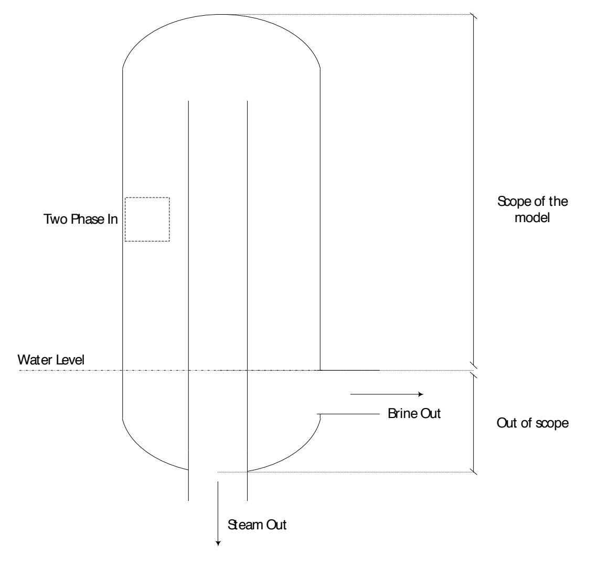
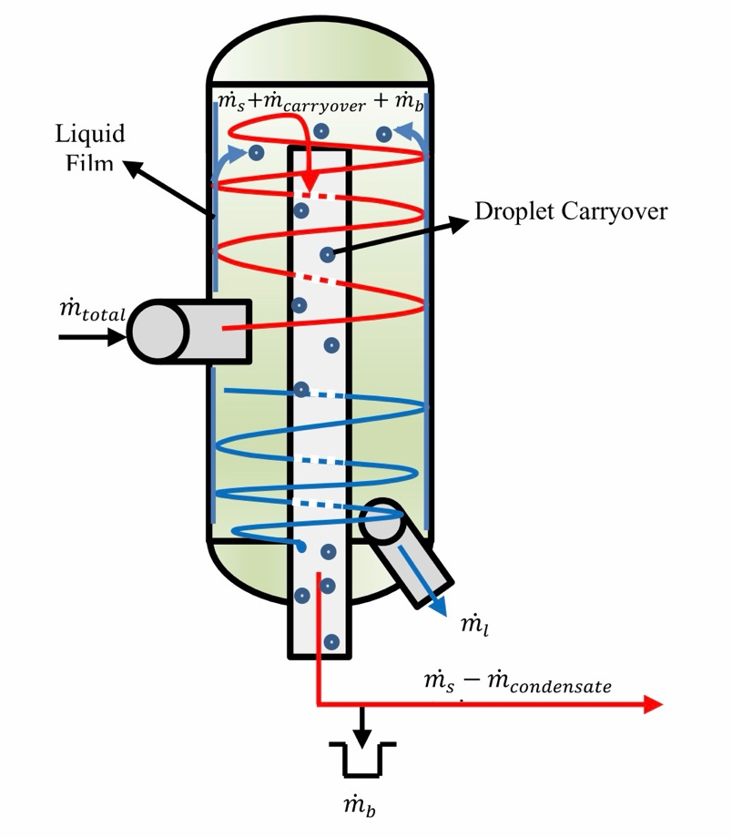
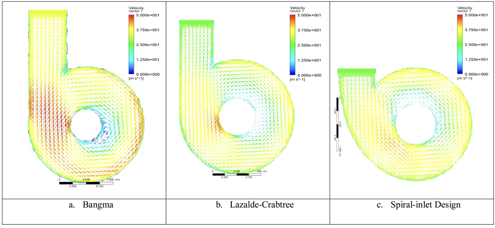

# Part 1 — Introduction and literature review

## 1. Introduction

Geothermal steam–water separators remove liquid from the steam supplied to turbines. Liquid carryover can contribute to erosion and mineral deposition, so reliable separation is important for plant operation. Established design methods support separator sizing and performance estimates, while computational fluid dynamics (CFD) provides access to internal flow fields that are difficult to measure. These complementary roles are described by [Zarrouk and Purnanto (2015)](https://www.sciencedirect.com/science/article/abs/pii/S0375650514000637).

The primary focus of this project is the effect of two-phase inlet conditions on geothermal separator performance. This work builds on the geothermal separator CFD study by Purnanto et al. (2013), whose Fluent model provides the starting point for the investigation. That model assumes a mist inlet condition, with gas as the continuous phase and liquid as a dispersed phase. In practice, inlet flow conditions depend on fluid enthalpy, mass flow rate and upstream pipe geometry, which influence the liquid distribution and droplet structure entering the separator. These differences can affect the internal flow field, pressure distribution and separation efficiency. This project investigates an imposed stratified inlet arrangement, with liquid occupying the outer-wall side of the inlet and steam occupying the remaining area.

To this end, the project had four objectives. The first was to become familiar with and reproduce the results of the existing Purnanto et al. (2013) Fluent model, with the aim of establishing a validated baseline. The second was to expand the model by implementing realistic two-phase inlet conditions across a range of flow regimes. The third was to investigate how inlet flow regime affects the internal flow field, pressure distribution and separation efficiency across a range of operating conditions. The fourth was to identify the geometric or operational parameters that most strongly influence separation efficiency, providing guidance for separator optimisation.

During the mesh-convergence study of the reconstructed Purnanto et al. (2013) model, liquid inventory and pressure drop continued to change with iteration. These observations prompted closer examination of how the model accounted for separated liquid. The published model excluded brine outflow and assumed a constant water level, while the inherited computational setup had no dedicated discharge boundary for collected brine. Figure 1 illustrates the scope of the published model.

*Figure 1. Computational scope of the Purnanto et al. (2013) separator model. The domain ends at the assumed water level, leaving the lower vessel and brine outlet outside the model. Reproduced from Purnanto et al. (2013, p. 5, Figure 7).*

Without a brine-removal path, steady mass balance would require all incoming liquid to leave through the steam outlet, which is inconsistent with the intended separation process. Addressing liquid removal and numerical convergence therefore became necessary before the effects of inlet conditions could be interpreted reliably. This formed an unexpected substantial part of the project, involving tests of numerical liquid collectors and resolved brine-outlet treatments to assess whether they could support a mass-conserving solution that remained stable with further iteration.

The study covers the separator vessel and its inlet conditions, with emphasis on model reconstruction, liquid removal and numerical assessment. Downstream steam pipelines, condensate drain pots, scrubbers and demisters are outside its scope. Related simplified-domain investigations are discussed with attribution and with regard to differences in geometry and modelling choices.

The literature review establishes the physical and modelling context. The methods and verification sections explain how the calculations were performed and assessed. The results and discussion then examine their implications for the project objectives, followed by conclusions and recommendations for future work.

## 2. Literature Review

Geothermal steam-water separation is a well-established but technically complex process that sits at the heart of liquid-dominated geothermal power generation. This review examines the existing body of knowledge across four themes relevant to this project. First, the design and performance of geothermal steam-water separators are discussed, covering separator types, sizing methods, and the key metrics by which performance is evaluated. Second, the two-phase flow physics governing separation behaviour inside the vessel are examined, with particular attention to the mechanisms that cause actual separator efficiency to fall short of theoretical predictions. Third, the application of computational fluid dynamics (CFD) as a tool for modelling separator behaviour is reviewed, tracing the development of prior Fluent-based models and identifying their limitations. Finally, the broader system context is considered, examining how downstream factors beyond the separator itself influence the quality of steam ultimately delivered to the turbine. Together, these themes establish the state of current knowledge and define the research gap that this project addresses.

### 2.1. Geothermal Steam-Water Separator Design and Performance

Most conventional geothermal resources are liquid-dominated, meaning fluid extracted from the reservoir arrives at the surface as a two-phase mixture of steam and hot brine. Before this fluid can drive a turbine, the phases must be separated, as liquid droplets entering the turbine cause blade erosion, scale deposition, and long-term efficiency losses (Rizaldy et al., 2016). The steam-water separator is therefore one of the most critical pieces of equipment in a geothermal power plant.

Since the development of the first liquid-dominated reservoir at Wairakei, New Zealand in the 1950s, two designs have dominated the industry: the vertical cyclone separator and the horizontal gravity separator. Approximately 70% of plants worldwide use vertical separators, with vertical designs common in fields influenced by New Zealand technology and horizontal designs more prevalent in Iceland, Japan, and Russia (Zarrouk & Purnanto, 2014).

The vertical Bottom Outlet Cyclone (BOC) separator operates by introducing the two-phase fluid tangentially into a cylindrical vessel, inducing a spiralling flow. Centrifugal force drives the denser liquid phase to the vessel wall where it falls to the brine outlet, while the lower-density steam migrates to the central axis and exits through an internal steam pipe at the bottom of the vessel, as illustrated in Figure 2. The BOC design with a spiral inlet is currently the industry standard, having evolved from the original circular inlet design of Bangma (1961), and the rectangular inlet of Lazalde-Crabtree (1984), as reviewed in Zarrouk & Purnanto (2014). The horizontal separator, by contrast, relies on gravity settling and is simpler to contruct but requires a larger vessel for the same flow rate and achieves lower separation efficiency under equivalent conditions.

*Figure 2. Simplified flow mechanism inside a vertical BOC separator, showing the tangential two-phase inlet, spiraling flow, liquid film formation on the vessel wall, Adapted from Rizaldy et al. (2016).*

Separator sizing is primarily governed by the fluid enthalpy, total mass flow rate, and chosen separation pressure. Separation pressure is selected to maximise power output while minimising silica scaling (Zarrouk & Purnanto, 2014). BOC separator performance is typically expressed through separation efficiency, with design calculations predicting values in the range of 99.5–99.99% when inlet velocities are maintained between 30-40 m/s, below the breakdown velocity at which re-entrainment degrades separation. Internal pressure drop is also an important metric, as losses within the vessel directly reduce the energy available to the turbine.

Finally, separator location relative to the power station significantly affects overall steam quality. Centralised separation stations reduce capital cost but increase the risk of carryover reaching the turbine. A minimum separation distance of approximately 400 m from the power station is generally recommended to allow adequate steam scrubbing (Zarrouk & Purnanto, 2014).

### 2.2. Two-Phase Flow Physics Inside the Separator

Understanding what actually happens to the two-phase fluid inside the separator is essential for predicting separation performance. The inlet flow is not simply a uniform steam-water mixture, depending on fluid enthalpy, mass flow rate, and pipe geometry, the incoming fluid can exhibit a range of flow regimes including annular, slug, or dispersed flow, each with different liquid distributions and droplet characteristics (Zarrouk & Purnanto, 2014). The flow regime at the inlet directly influences the size and distribution of liquid droplets entering the vessel, which in turn governs how effectively they can be separated by centrifugal force.

Once inside the BOC separator, the spiralling flow field causes denser liquid droplets to migrate outward toward the vessel wall under centrifugal action. Most of this liquid successfully drains down the wall to the brine outlet. However, a proportion of the separated liquid forms a thin continuous film on the inner wall of the vessel. As shown in Figure 2, as the upward-spiralling steam contacts this film, interfacial shear forces destabilise the film surface and generate new droplets that are re-entrained into the steam core, a process known as liquid film re-entrainment (Rizaldy et al., 2016). Two distinct mechanisms drive this re-entrainment: roll wave re-entrainment, which dominates at higher liquid film Reynolds numbers, and undercut re-entrainment, which dominates at lower Reynolds numbers (Rizaldy et al., 2016). Additionally, Foong (2005) noted that liquid can creep upward along the vessel wall, coalesce near the top, and fall directly into the steam outlet pipe, further reducing effective separation.

The practical consequence of these mechanisms is that the actual separator efficiency is lower than the theoretical efficiency predicted by design calculations alone. Rizaldy et al. (2016) showed that re-entrainment rate increases with both liquid loading fraction and inlet velocity, meaning that operating conditions that deviate from design intent can significantly degrade real-world performance. This gap between theoretical and actual efficiency is well documented: even at reported design efficiencies of 99.995%, at a steam flow of 100 t/h there is still approximately 5 kg/h of liquid carryover (Rizaldy et al., 2016). Over time, this carryover is responsible for the mineral scaling and blade erosion observed in geothermal turbines worldwide.

Quantifying re-entrainment analytically is difficult because it depends on liquid film thickness, steam velocity, interfacial geometry, and inlet flow angle, parameters that are not accessible through empirical sizing methods alone. As Rizaldy et al. (2016) noted, a more accurate prediction of liquid carryover would require knowledge of the critical flow parameters inside the separator, such as local film thickness and steam-liquid relative velocity, quantities that can only realistically be obtained through CFD modelling.

### 2.3. CFD as a Tool for Predicting Separator Behaviour

Empirical sizing methods, such as the Lazalde-Crabtree correlations, are useful for determining vessel dimensions and estimating overall separation efficiency, but they cannot reveal the internal flow behaviour that drives those outcomes. CFD offers a complementary approach — by numerically solving the governing fluid equations across a discretised geometry, it allows direct visualisation of velocity fields, pressure distributions, and droplet trajectories within the separator. This capability is particularly valuable for identifying localised flow problems and evaluating design modifications that empirical methods cannot resolve.

The application of CFD to geothermal separators has developed incrementally. McKibbin (1998) presented early simplified analytical and numerical solutions for flow within a cyclone separator, demonstrating that the characteristic pressure distribution: lower at the centre, higher at the outer wall, was consistent with theory. The first substantive CFD study using commercial software was conducted by Pointon et al. (2009, as cited in Purnanto et al., 2013), who used Ansys Fluent to examine upstream piping arrangements, separator geometric proportions, and steam outlet tube entry conditions. Their work established that CFD was a viable tool for geothermal separator design, demonstrating its ability to examine specific aspects of separator performance that empirical methods cannot resolve.

Building on this, Purnanto et al. (2013) conducted a more comprehensive CFD study in Fluent, modelling three different BOC separator design: the Bangma circular inlet, the Lazalde-Crabtree rectangular inlet, and the spiral inlet under a range of fluid enthalpies and mass flow rates. A key modelling decision was the choice of turbulence model. Flow inside a cyclone separator is highly turbulent and swirling, and no single model performs reliably across all conditions. Purnanto et al. (2013) selected the Renormalization Group (RNG) k-ε model, which had previously been used for cyclone flows by Gimbun et al. (2005) and Pointon et al. (2009), on the basis that it provides good accuracy for swirling flows with significantly less computational cost than the Reynolds Stress Model (RSM) or Large Eddy Simulation (LES). Separator efficiency was predicted using Fluent's Discrete Phase Model (DPM), with droplet sizes estimated using the Harwell technique.

The CFD results provided direct insight into the internal flow behaviour of each design. As shown in Figure 3, the spiral-inlet design produces a notably more uniform velocity distribution at the first rotation compared to the Bangma and Lazalde-Crabtree tangential inlet designs, which exhibit disturbed regions of lower velocity near the outer wall opposite the inlet. These disturbances indicate that the transition from linear to rotational motion is less smooth in the tangential designs, promoting water atomisation and potential carryover, behaviour that the Lazalde-Crabtree empirical correlation cannot detect or quantify (Purnanto et al., 2013).

*Figure 3. CFD velocity profiles for the (a) Bangma, (b) Lazalde-Crabtree, and (c) spiral-inlet BOC separator designs at an inlet enthalpy of 1600 kJ/kg. Adapted from Zarrouk and Purnanto (2014).*

Figure 4 compares the outlet steam quality predicted by the CFD simulation and the Lazalde-Crabtree empirical calculation against measured data from several Weber separators across a range of inlet velocities. While both approaches generally align with field data at lower velocities, notable scatter is evident in the simulation results, and neither approach consistently tracks the measured field data across all conditions (Zarrouk & Purnanto, 2014). This discrepancy highlights the need for further model refinement and direct validation against field measurements, the gap this project addresses.

*Figure 4. Outlet steam quality against inlet velocity for the Lazalde-Crabtree (1984) separator design, comparing CFD simulation results, empirical calculations, Lazalde-Crabtree's correlation, and measured data from several Weber separators. Adapted from Zarrouk & Purnanto (2014).*

Several important limitations were acknowledged. The model assumed mist or mist-annular flow conditions at the upstream pipe feeding the separator, regardless of actual inlet flow regime, excluded flashing within the vessel, and treated the separation process as isothermal, meaning the energy equation was not solved. The brine outflow was not modelled, and the water level inside the vessel was held constant. Perhaps most significantly, a substantial number of droplet trajectories could not be resolved during the particle tracking stage, producing what the authors termed "incomplete particles." These were assumed to be separated in order to obtain efficiency estimates, which the authors themselves noted was not rigorous (Purnanto et al., 2013). While limited comparison against Weber separator field data was presented, as shown in Figure 4, the primary validation benchmark remained the Lazalde-Crabtree empirical correlation. The scatter in CFD results across the operating range was insufficient to establish confidence in the model's predictive accuracy, and as Zarrouk & Purnanto (2014) concluded, further refinement and validation against field results is still needed.

### 2.4. Limits of Separator-Only Prediction

Even a well-designed separator operating within its intended parameters does not guarantee that clean, dry steam will reach the turbine. The steam gathering system between the separator and the turbine introduces additional sources of liquid and mineral contamination that are independent of separator performance. Heat loss through the steam pipeline causes condensation, generating new liquid within the steam line after separation has already occurred. This condensate, along with any carryover from the separator, accumulates at low points in the pipeline and must be removed by condensate drain pots (CDPs) and scrubbers before the steam enters the power house (Umanzor & Zarrouk, 2022). If these secondary removal systems are inadequate, whether due to poor design, insufficient pipeline length, or low CDP removal efficiency, the turbine will receive wet steam regardless of how efficiently the primary separator performs.

The practical consequences of this are well documented. At the Berlin geothermal steam field in El Salvador, primary separation efficiency was measured at approximately 99.99%, yet significant mineral deposits were found in the turbine rotor seals, causing a unit to be taken offline (Umanzor et al., 2021). Investigation found that the likely causes included condensate pooling in convoluted two-phase branch lines upstream of the separator, undersized CDP legs along the main steam header, and insufficient steam scrubbing downstream, none of which were related to the separator's own separation performance. Similarly, Mubarok & Zarrouk (2016) reported moisture and mineral damage to turbines at the Ulubelu geothermal field despite the separators being designed and sized to standard. These cases illustrate that the separator is only one component in a chain of equipment that collectively determines steam quality at the turbine inlet.

Arifien and Zarrouk (2015, as cited in Rizaldy et al., 2016) further highlighted that there remains debate within the industry over the primary cause of mineral carryover, whether it originates from micro-scale liquid droplets entrained in the steam, or from volatile silica carried in the steam phase itself. This distinction matters because the two mechanisms require different mitigation strategies, and current separator efficiency models cannot distinguish between them. The broader implication is that optimising the separator in isolation is insufficient. Thus, a complete understanding of separator behaviour, including accurate prediction of internal flow conditions and carryover rates, is a necessary foundation for evaluating the performance of the whole steam gathering system.
