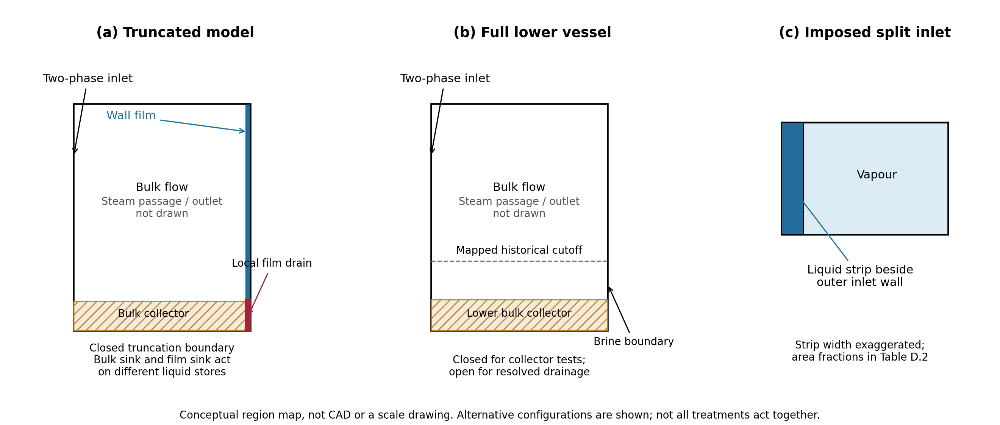

# Part 2 — Model, methods and numerical assessment

## 3. Model and methods

Ansys Fluent was used for the CFD calculations. The later single-inlet reconstruction and same-computer tetrahedral repeat used Fluent 2025 R2.

### 3.1. Investigation design and computational domains

The investigation began by asking whether the reconstructed inlet model produced a settled baseline. Continuing liquid accumulation motivated two removal approaches: resolving the lower vessel and brine outlet, and withdrawing liquid numerically near the assumed water level. Outlet studies then tested whether discharge could be controlled, while sink studies separated source application from global conservation. Wall-film studies examined how liquid reached a surface drain. Later inlet, mesh and droplet comparisons measured sensitivity and historical-output reproduction without assuming that the preceding studies had established convergence. These were related configurations, not one simulation carried through every test. Where possible, paired tests started from the same saved field to assess the selected change.

The truncated vessel ended near the assumed water level and initially had only a steam outlet. Numerical collectors later removed liquid from its lower region by subtracting mass within selected cells. This represented withdrawal without resolving a physical discharge pipe. Full-geometry calculations instead retained the lower vessel and brine pipe, either closing the brine face while testing a collector or opening it for resolved drainage. Table 1 distinguishes these representations. Neither a sink nor a prescribed outlet pressure was calibrated against operating-plant drainage data.

| **Model family** | **Liquid representation and removal** | **Comparison purpose** |
|:---|:---|:---|
| Truncated inlet reconstruction | Mixture carrier; optional DPM; initially no continuous-liquid drain | Inlet distribution, mesh development and particle tracking |
| Truncated collector and film | Mixture carrier with liquid-only sink; optional EWF and direct film drain | Startup, wall routing, film transport and removal |
| Full geometry with collector | Mixture carrier; lower liquid source; brine face closed | Source strength and steady conservation |
| Full geometry with open drain | Mixture or VOF; specified brine pressure/resistance; optional inventory feedback | Outlet response, pool development and startup |
| Single-inlet reconstruction | Recovered carrier/DPM settings on poly-hexcore and tetrahedral meshes | Conditional historical reproduction and computational cost |

*Table 1. Model families and the questions each can address.*

Figure 5 locates the removal regions conceptually. Table D.2 records the available dimensions and case-specific coordinates. These distinguish a source in lower bulk cells from a source on a film wall; neither is a resolved brine pipe. The truncation datums and source extents differ between mesh families and must not be transferred between them without checking the geometry.

*Figure 5. Model regions used in the removal and inlet studies: (a) truncated vessel with separate bulk and film removal, (b) lower full-vessel region with either a bulk collector or an open brine boundary, and (c) the imposed inlet partition. Original schematic based on the recorded model definitions; not CAD or a scale drawing. The steam passage, detailed scroll and proposed blocker/ramp shapes are omitted. Alternative treatments shown here were not all active together; Table D.2 gives their spatial definitions.*

### 3.2. Inlets, phase models and material assumptions

The models distinguished bulk flow in the vessel, droplets moving through that flow, and a thin liquid layer on the walls. The Mixture model represented interpenetrating liquid and vapour within each cell; VOF represented the liquid pool and its interface with vapour. DPM tracked droplets through the bulk flow, while EWF represented liquid transport along wall surfaces. These descriptions could be combined only with explicit accounting for transfers between them.

The imposed stratified inlet placed liquid along the outer inlet wall and vapour in the remaining region. The inlet boundary was divided into faces supplying only liquid and faces supplying only vapour, with phase flow rates and meshed areas defining the imposed velocities. Earlier variants supplied liquid over half of the inlet; mixed single-inlet reconstructions supplied both phases through one boundary. These were separate configurations. This arrangement represented an assumed incoming liquid distribution; no upstream pipe calculation established a developed stratified flow or a wider flow-regime map.

Steady Mixture calculations used vapour as the primary phase and liquid as the secondary phase. They solved bulk continuity, mixture momentum and liquid volume fraction, with algebraic slip for relative motion. The full-geometry collector used Manninen slip, Schiller–Naumann drag and a 10 µm continuum liquid diameter. RNG $k$–$\varepsilon$ with standard wall functions provided the main RANS closure; turbulence-model alternatives remained distinct tests.

Resolved-pool calculations used VOF with shared velocity. Historical transient tests used explicit VOF, whereas the later steady-pool campaign used implicit VOF. Table 2 gives the fixed properties of the full-geometry collector and steady-pool models. Energy, phase change, DPM and EWF were disabled in those families. Surface tension was omitted in the steady macroscopic-pool model. These assumptions differ from the later film configurations and recovered particle properties.

| **Property** | **Liquid** | **Vapour** |
|:---|:---|:---|
| Density (kg/m$^{3}$) | 881.77 | 5.73 |
| Dynamic viscosity (Pa·s) | 145.96 × 10$^{-6}$ | 15.188 × 10$^{-6}$ |

*Table 2. Properties for the full-geometry collector and steady VOF pool families.*

### 3.3. Boundary conditions and meshes

The full-geometry collector and steady-pool cases imposed liquid and vapour inlet velocities of 27.118 m/s, with nominal phase feeds of 116.921 and 80.690 kg/s. Inlet turbulence intensity was 2.11%, with hydraulic diameters of 0.01338 m for liquid and 0.72061 m for vapour. Steam-outlet gauge pressure was 1.12 MPa at zero operating pressure. Gravity acted downwards at 9.81 m/s$^{2}$; walls were stationary and no slip. Steam-outlet backflow was vapour, while VOF brine backflow was liquid. Reverse flow was retained with its sign.

The steady-pool outlet represented an ideal reservoir with external liquid level 0.10 m and height-dependent pressure. Initial pools of 0.10 and 0.30 m tested starting-state dependence under the same external head. Separate pressure and resistance studies changed the discharge condition. Earlier feedback calculations used liquid mass below y=0.10 m as a pool proxy and adjusted brine pressure towards an assumed 200 kg target; they did not control a measured liquid height.

The full-geometry collector and steady VOF family used 620,431 cells; earlier outlet/control work used a separate 231,376-cell mesh. The historical seven-mesh study contained 1.69–13.37 million cells. Later film studies used approximately 60k–2.6M cells, while the single-inlet family spanned 357,145–5,479,605 cells.

For the single-inlet comparison, the separator geometry represented by the original tetrahedral mesh was remeshed using poly-hexcore. The selected comparison mesh contained 946,967 cells, compared with 2,964,593 cells in the recovered spiral tetrahedral mesh. It was a chosen reconstruction candidate, not a mesh selected through demonstrated solution independence. The comparison assessed whether it could reproduce the tetrahedral-reference outputs at lower computational cost. Their geometry was intended to match, but the recorded volume discrepancy prevents assuming identical fluid domains. Appendix D records the mesh-construction limits and the role of uncalibrated model parameters.

Cell count and node count describe different aspects of a mesh. Nodes define its geometry, while cells define the finite-volume control volumes. Fluent stores the main flow variables at cell centres (Ansys, 2025), so node count is not a direct count of those unknowns. Cells share nodes differently in tetrahedral and poly-hexcore meshes; neither equal node counts nor equal cell counts establish equal spatial resolution or accuracy. The comparison therefore reports cell count and measured runtime separately, with numerical sensitivity assessed separately.

### 3.4. Numerical collection and staged loading

In the truncated model, the collector was prescribed to remove liquid at the inlet liquid mass-flow rate. Removal was distributed over a lower cell zone in proportion to local liquid volume fraction; a minimum denominator prevented division by near-zero liquid content. Vapour had no direct mass sink; accompanying momentum and turbulence sources represented removal with the liquid. This tested idealised collection and source delivery. Once the commanded removal was delivered, steady closure required negligible liquid discharge elsewhere. It was not a general physical drain law. It differed from the full-geometry depletion collector,

$$S_L=-\chi\frac{\rho_L\alpha_L}{\tau},\qquad S_V=0,$$

where $\chi$ is one in collector cells and zero elsewhere, and $\tau$ is an assumed depletion time. This second treatment made removal depend on liquid present in the collector rather than prescribing the inlet flow as its removal rate. Collector thickness, depletion time and solver treatment were examined separately where the tests could share a starting field. The final matched strength comparison changed $\tau$ from 0.02 to 0.10 s while holding the Coupled solver and phase-volume-fraction settings fixed. In the later truncated contact collector, “contact” meant entry to the existing 715-cell lower zone, selected by cell-centre height $y\leq0.10$ m. It used the same local-content depletion form, with $\tau=10^{-5}$ s in the selected startup configuration, rather than the inlet-throughput command. Matching momentum removal used liquid velocity; vapour had no direct sink. This finite-rate bulk capture did not empty the separate EWF store. Film initially left through its existing lower edge; the later direct film drain added a sink to a lower wall segment.

Staged loading developed a 25%-feed field, increased both phase feeds over 2,000 iterations and then held full feed. A subsequent continuation changed pressure–velocity coupling to Coupled and enabled Global Time Step. Later startup comparisons activated Coupled, roughness, a contact collector and EWF before the inlet ramp. These tested a combined preparation procedure rather than isolating the effect of ramping alone. Cold-start tests that ramped the sink at full inlet flow were separate experiments.

### 3.5. Wall-film development and direct drainage

EWF introduced a separate wall-liquid inventory with film mass and momentum equations. DPM deposition and bulk-phase accretion provided different routes into that inventory. Splash, stripping and edge separation could release liquid, so their event counters, represented particle masses and film source terms required separate treatment. Roughness screens preceded combined roughness/film studies; the later selected roughness was 0.045 mm with roughness constant 0.5.

Film calculations included both active-bulk intervals and intervals with flow, turbulence, volume fraction and relative motion frozen. Freezing retained a fixed forcing field for film development; it did not establish that the carrier had converged. Film age means the accumulated time advanced by the film equations. It was recorded with the accepted timestep and the equations being updated. Where inner-film residuals were available, they were checked at each timestep; meeting that tolerance did not establish steady film inventory. Local film-balance checks with updating bulk flow were distinguished from checks made with bulk flow held fixed. The later mesh comparison selected frozen-bulk states at 195 ms; available bulk-active extensions were assessed separately.

The direct drain acted on a lower film-wall segment, using

$$s_m=-k\rho_L\max(h,0),\qquad \boldsymbol{s}_p=s_m\boldsymbol{u}_f,$$

where $s_m$ is the film mass source per unit wall area, $\boldsymbol{s}_p$ is the corresponding momentum source, and $h$ and $\boldsymbol{u}_f$ are film thickness and velocity. The capture time $\tau_f$ was 1.5 ms. The rate coefficient $k=\min(1/\tau_f,0.01/\Delta t_{\mathrm{refresh}})$ bounded source-only removal to at most 1% of local film mass over the declared 15 µs source-refresh span, $\Delta t_{\mathrm{refresh}}$. Transport and accretion could change the total film inventory independently of this removal bound. Tests with an initial film first compared depletion with the drain disabled and enabled while bulk flow was held fixed. Paired continuations then tested transport into an initially dry drain region. Film leaving through the model's existing outlet edges and film removed by the added source were integrated separately.

The later enhanced film configuration included gravity, gas shear, wall resistance, momentum advection, spreading and surface tension. It used sequential film equations and disabled Flow Momentum Coupling. Updating the bulk equations in that configuration therefore did not establish reciprocal film–bulk momentum coupling. Earlier coupled-film and basic-EWF configurations retained their own settings; they were not treated as equivalent models.

### 3.6. Droplet tracking and operating-condition comparisons

One-way DPM tracked droplets without feedback to the carrier. Interacting DPM calculations instead allocated part of the total liquid feed to particles and reduced Eulerian liquid feed correspondingly. Diagnostic one-way particle weights were not added as extra physical inlet mass. In the interacting cases, the continuous-phase interaction setting enabled particle momentum feedback to the bulk equations. The droplets were inert, with no evaporation; energy was not solved. A zero DPM mass source was therefore compatible with momentum interaction and did not mean that interaction was disabled. This particle–bulk coupling is distinct from the pressure–velocity solver setting named Coupled. The reconstructed inlet/carrier/DPM/EWF comparisons included five matched operating points, rather than the entire proposed parameter matrix.

Historical enthalpy reconstruction used nine droplet-size groups from the recorded Harwell-derived distribution after 1,500 carrier iterations. Each group represented a prescribed diameter and mass-flow weight. Each of two historical inlet families contained five full-flow enthalpies, 1440–1760 kJ/kg, and a reduced-flow 1600 kJ/kg condition. The poly-hexcore reconstruction repeated the five full-flow conditions from fresh initial fields. Here, enthalpy identified prescribed phase feeds, injection speeds and droplet distributions; energy and phase change were not solved. Recovered liquid and vapour densities remained fixed at 881.2109 and 5.7974 kg/m$^{3}$, distinct from Table 2. The 1,500-iteration horizon deliberately reproduced the historical procedure for an output-sensitivity comparison; it was not a convergence criterion.

One-way tracking retained step-length factor 5, pressure and virtual-mass forces. The inlet and steam outlet were escape boundaries, the bottom trapped particles, and vessel walls reflected them with normal/tangential restitution coefficients 0.3/0.8. Aggregate escaped mass could therefore include inlet escape and was not necessarily steam-outlet carryover.

A tracking-budget test retracked the same frozen 1600 kJ/kg carrier solution on the poly-hexcore mesh at 10,000 and 100,000 maximum particle steps. The later comparisons used 100,000 steps. Their estimate

$$\eta_{\mathrm{assumed}}=100\left(1-\frac{\dot m_{\mathrm{escaped}}}{\dot m_{\mathrm{injected}}}\right)$$

counted incomplete trajectories as separated. Incomplete particles ended tracking without reaching an escape or trapping boundary; a trapped numerical fate was also not independently verified physical capture. All three categories were retained alongside the estimate. Historical provisional steam quality used inlet steam and recorded escaped mass; it was a distinct estimate, subject to the same need to identify the escape boundary.

## 4. Verification and validation assessment

The assessment separated three questions: was the intended calculation implemented, was its numerical solution sufficiently settled and conservative, and did it reproduce physical separator behaviour? Configuration checks and simple analytical tests addressed the first question. Residual, mass-balance, inventory and sensitivity checks addressed the second. Independent measurements would be required for the third.

### 4.1. Implementation and numerical controls

Reading back solver settings, checking the mesh and reopening selected saved solutions verified that the intended configuration and results had been retained. Python and PyFluent supported setup and extraction. Solver transcripts supplied iteration numbers when interface counters were stale. Source fields already expressed as per-cell mass flow were summed, rather than multiplied by cell volume again.

The main full-geometry Mixture baseline used SIMPLE, PRESTO pressure, second-order momentum/turbulence and QUICK volume fraction. Later controlled cases used Coupled; the steady-pool model used compressive volume-fraction reconstruction and implicit body force. Each comparison retained its actual pseudo-time and relaxation settings. Global Time Step in these steady calculations was numerical pseudo-time, not elapsed physical time.

A frictionless single-liquid duct independently checked the outlet-resistance implementation. For $K=0$ or 9 and driving pressure 200 or 800 Pa, the analytical velocity was

$$U=\sqrt{\frac{2\Delta p}{\rho(1+K)}}.$$

Here, $\Delta p$ is inlet total pressure minus external static pressure, $\rho$ is liquid density and $K$ specifies added outlet resistance. The unit term accounts for outlet kinetic head. The corrected test used a modest nonzero starting velocity and 500 iterations per case. Numerical acceptance used the final 100 iterations; speed and finite-value guards covered all 500. This isolated a boundary-law implementation, not multiphase separator hydraulics. Separate hydrostatic, sealed-boundary, interface and pressure-datum controls examined startup disturbances under their own conditions.

### 4.2. Mass accounting, film transfer and storage

Boundary fluxes were positive into the domain. For an EWF-off liquid calculation, the steady remainder was

$$R_L=\sum_b\dot m_{L,b}+\dot m_{L,\mathrm{source}},\qquad M_L=\int_V\rho_L\alpha_L\,\mathrm dV.$$

Removal sources were negative and counted once. Solver reports that already included sources were distinguished from boundary-only reports. Liquid, vapour and solver-reported mixture balances were normalised by their corresponding feeds. Mean absolute error used the mean of absolute sample remainders, not the absolute signed mean. Where DPM or film transfer was active, its signed contribution belonged in the relevant subsystem account.

For physical transient flow, the storage-aware remainder was

$$R_{L,\mathrm{transient}}=\sum_b\dot m_{L,b}+\dot m_{L,\mathrm{source}}-\frac{\Delta M_L}{\Delta t},$$

with any active inter-model transfers included. Steady inventory change per iteration remained a numerical-development measure. It was not divided by an EWF timestep to invent a physical bulk storage rate.

The local film mass balance compared measured inventory change with integrated transfers over the film-time interval:

$$E_f=\Delta M_f-\int_{t_0}^{t_1}\left(\dot m_{\mathrm{to\ film,net}}-\dot m_{\mathrm{film,out}}-\dot m_{\mathrm{direct\ drain}}\right)\,\mathrm dt.$$

The net source was the film mass gained after any release already included in the solver report. Release was therefore subtracted separately only when it had not already been included. Error normalisation followed the declared integrated source or transfer basis. This accounting allowed a growing film to conserve mass; stationary film additionally required negligible storage.

For the combined bulk, film and particle system, internal transfers must cancel. A film-only balance could not establish conservation of the combined system when bulk flow was held fixed. A local film pass with bulk flow updating also left the other mass balances to be checked. Film removal, collector removal and particle boundary fates were kept distinct.

### 4.3. Convergence, comparison windows and uncertainty

Assessment combined residuals, conservation, storage and routing. Appendix B gives the numerical criteria and windows for the principal tests; these were study tolerances, not estimates of physical uncertainty. Reaching an iteration count or film age was a separate execution outcome. Some later EWF runs continued after numerical acceptance limits ceased to control continuation, so completion did not mean those limits had been met. Table 3 summarises the interpretation checks.

| **Check** | **Assessment** | **Interpretation limit** |
|:---|:---|:---|
| Bulk solution | Active residuals, phase/source balances, inventory and wrong-outlet flow | A small scaled residual alone did not establish steady conservation |
| Film solution | Inner-film tolerance, Courant, thickness, source integration and storage | A local balance pass did not establish stationary or complete-system flow |
| Mesh comparison | Between-mesh changes versus within-run drift and spatial differences | Equal iteration count or film age did not ensure equal numerical maturity |
| Particle tracking | Fate-mass reconciliation and sensitivity to tracking budget | Accounting for incomplete mass did not determine its eventual destination |

*Table 3. Numerical checks and their interpretation boundaries.*

Mesh comparison used cell counts, boundary identities and available quality metrics. Pressure, velocity and inventory histories tested iterative stability before a spatial-discretisation claim. Matched wall resolution was not established. For field comparisons, cell velocities were volume-averaged into $20\times70\times20$ common bins. Each shared bin was weighted by the smaller volume assigned by the two meshes. The resulting root-mean-square (RMS) vector difference was normalised by reference RMS velocity. Cross-mesh coverage was 86–91% of reference volume, compared with 100% for same-mesh iteration comparisons. A coarser $10\times35\times10$ projection retained the qualitative conclusion. These were comparisons over supported bins, not whole-domain discretisation-error estimates. No Grid Convergence Index was inferred from unstable sequences. Runtime comparisons measured cost for the stated cases, not time to equivalent accuracy.

### 4.4. Validation basis

The Purnanto study supplied the model reconstruction reference. The later enthalpy comparison used the project's July tetrahedral results from Fluent 2024 R2, while the reconstruction used 2025 R2. The exact July case binary and tracking cap were not recovered, so agreement tested reproduction of recorded estimates rather than exact replication. Matched measurements of carryover, brine discharge and pressure loss, with compatible definitions and uncertainty, were unavailable. Implementation checks and numerical sensitivity were therefore assessed separately from physical accuracy.
