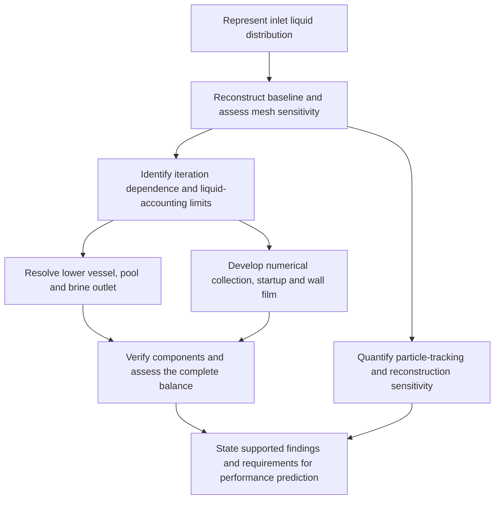

# Project findings, evidence and report claims

Working source for writing the final research report. The project-wide review on **16 October 2026** used repository main **`619d46c`**, all 14 numbered experiment folders and the legacy reconstruction. A targeted **17 October adversarial review** checked mass/film, mesh/particle and process claims against their saved records and analysis definitions; it added the limits and precise windows below. This replaces the narrower Phase 9/10 review. See [review verification](adversarial-review-2026-10-17.json).

This document connects the findings, explains what they support and recommends how to use them. The linked **Project experiment records remain the scientific evidence owners**. This was a review of saved records and selected local machine summaries, not a new solver campaign or a complete reanalysis of every raw history. Reported, independently checked and derived quantities are identified where that distinction matters. Later terminal results take precedence over stale running or planned entries in phase indexes.

Read first: [central argument](#the-reports-central-argument) · [phase coverage](#coverage-of-the-experiment-record) · [findings F01–F21](#findings-and-defensible-claims) · [original objectives](#what-this-means-for-the-original-objectives) · [report changes](#recommended-changes-to-the-report) · [figure plan](#figure-and-table-plan) · [uncertainties](#contradictions-uncertainties-and-remaining-evidence-work).

## Confirmed writing decisions

| Decision | Current instruction |
| --- | --- |
| Narrative | Present one integrated project story. Individual ownership does not restrict the findings discussed. Keep configurations distinct where their differences affect inference. |
| Figures | Credit reused partner figures and published figures explicitly; retain the original data/run source and any adaptation details. |
| Length and format | Maximum **30 pages**, Times New Roman **12 pt**, counted from introduction through conclusions. This supersedes the earlier 25-page instruction. |
| Required sections | Title page, abstract, declaration, table of contents, acknowledgements, glossary, introduction, literature review, project-specific middle sections, discussion, conclusions/future work, references and appendices. Title, abstract, contents, references and appendices are excluded as specified by the supplied instructions. |
| Introduction | Preserve its connected argument, original four objectives, actual stratified-inlet scope and brine-outlet explanation. Do not replace objectives with new research questions. |
| Literature review | Keep the wording matched to the submitted first-report PDF and current figure numbering. See [copy verification](literature-final-pdf-check.json). Later substantive changes need a separate writing decision. |
| Geometry comparison | Andy confirmed that the historical tetrahedral model and M04 were **intended to have identical fluid geometry**. The inferred volume difference remains unexplained; intent does not establish actual parity. |
| Ambiguous Phase 5 completion | Andy is unsure whether S4-04, S4-07 and Stage 5 were completed. Their disputed outcomes are excluded until execution evidence is found. |

The scientific conclusions below are evidence judgements. Suggested emphasis and section order are recommendations for the next draft, not replacements for the original objectives.

## The report's central argument

The project began with a physical modelling question: how should inlet liquid distribution be represented, and how does that choice affect separator predictions? Reconstructing the existing model and assessing mesh sensitivity exposed a prerequisite: the liquid had to be accounted for, and the computed state had to be sufficiently settled before inlet or geometry effects could be interpreted.

The project then made several concrete advances. It implemented explicit inlet distributions, constructed repeatable model comparisons, tested resolved outlets and numerical collection, improved startup and solver behaviour, developed wall-film transport and drainage, corrected important accounting errors, verified a simple drain-resistance implementation, and quantified particle-tracking and mesh/iteration sensitivity. Some local balances, short drainage windows and solver checks passed. These successes should be stated before their limits.

The remaining limitation is specific: the reviewed evidence does not establish a complete separator solution that simultaneously has the required phase accounting, stationary operating inventories, adequate numerical convergence and discretisation evidence, and independent physical validation. This is different from claiming that every model failed to conserve mass, that no useful modelling was achieved, or that no physical steady solution exists.

This is a scientific explanation of the work, not a claim that every experiment was planned in this order. Some investigations were exploratory, and some successful preparation steps arose from correcting implementation problems.

**Provisional synthesis for the abstract/discussion:**

> The investigation developed and assessed inlet, liquid-removal and wall-film treatments for a geothermal separator CFD model. Staged loading and solver changes reduced continuity residuals, selected tests demonstrated conservative film development and drainage, and a simple outlet-resistance benchmark verified the implemented pressure–flow relation. However, these component successes did not establish a stationary, validated separator solution. Mesh and tracking studies further showed that close agreement in selected output estimates could conceal substantial inventory drift, spatial differences and unresolved particle fates. The work therefore defines both usable modelling capabilities and the numerical evidence still required for reliable separator-performance prediction.

## Coverage of the experiment record

Phase numbers identify record families, not one strictly linear sequence. In particular, there are two distinct Phase 9 and two Phase 10 folders. Historical case names such as 08b/08c also occur in different study families.

| Record family | What was reviewed and learned | Use in the report |
| --- | --- | --- |
| [Legacy reconstruction](../../../experiments/legacy/legacy-bangma-reconstruction/historical-run.md) | Stalled historical recreation; need for explicit geometry/settings provenance | Brief starting context, not a quantitative performance result |
| [Phase 1: baseline and inlet](../../../experiments/phase-01-purnanto-baseline-and-inlet-exploration/index.md) | Reference audit, mixed/pure split-inlet variants, actual inlet area and patched-pool trials; explicit inlet representation but open liquid accounting | Explain the physical motivation and model assumptions |
| [Phase 2: parity and qualification](../../../experiments/phase-02-parity-reset-and-pre-v2-qualification/index.md) | Repeatable parent, loading and long-iteration checks, recovered seven-mesh study, early full-domain pressure/VOF tests | Main evidence that mesh and inlet effects could not yet be isolated |
| [Phase 3: DPM](../../../experiments/phase-03-dpm-carryover-and-coupling/index.md) | Deterministic/stochastic tracking, coupling and feed partition, fine-mist tests; twelve historical enthalpy calculations | Particle-accounting achievement and conditional output comparisons |
| [Phase 4: early EWF](../../../experiments/phase-04-ewf-wall-film-mechanisms/index.md) | Deposition, splash, separation/stripping options and longer continuations | Establish observable film mechanisms; do not rank performance from event counts |
| [Phase 5: full geometry](../../../experiments/phase-05-full-geometry-v2/index.md) | Pressure/vent/withdrawal boundaries, transient startup and initialisation screens, numerical/loading controls | Show why adding the missing outlet did not by itself settle the model |
| [Phase 6: brine pool](../../../experiments/phase-06-full-geometry-with-brine-pool/index.md) | Local inventory proxy, pressure feedback, stronger feedback, long horizon and discovery screens | Working control implementation and limits of an uncalibrated hydraulic surrogate |
| [Phase 7A: simplified removal](../../../experiments/phase-07a-simplified-purnanto-liquid-removal/index.md) | Fixed-mesh outlet and withdrawal screens, lower-cell-zone source, feedback and cold-start source ramp; ringed-outlet proposal unrun | Selection and verification of an implementable liquid-only sink |
| [Phase 7.1A: absorber/startup](../../../experiments/phase-07-1a-absorber-convergence/index.md) | Virtual outlet, low-feed hold, inlet ramp, R0 Coupled continuation; turbulence/numerical screens | The ramp-plus-sink residual improvement recalled by Andy |
| [Phase 7.2A: wall routing](../../../experiments/phase-07-2a-wall-liquid-routing/index.md) | Roughness, EWF, contact sink, shortened startup, film-time/velocity studies, release/drain controls, staged finalisation and turbulence tests | Main positive wall-routing, numerical-improvement and local-accounting results |
| [Phase 7B: full-geometry removal](../../../experiments/phase-07b-full-geometry-liquid-removal/index.md) | Historical sinks, collector thickness/rate, solver/source controls and partial staged startup | Full-domain sink feasibility and controlled limits on steady conservation |
| [Phase 8: reconstruction](../../../experiments/phase-08-storyline-reconstruction/index.md) | F0–F4 inlet/carrier/DPM/EWF comparisons and selected finer-mesh/startup repeats | Direct link back to inlet representation; some small bulk-boundary gaps, incomplete complete-system accounting |
| [Phase 9: EWF meshes](../../../experiments/phase-09-mesh-convergence/index.md) | Five initial mesh states, later Plan v1 development, alternative fixed-step tests and selected 195/200 ms endpoints | Provisional mesh sensitivity and completed development; final comparison still incomplete |
| [Phase 9: steady VOF and diagnostics](../../../experiments/phase-09-steady-vof-pool/index.md) | Historical resolved outlets, two-pool steady tests, N2000 extension and all seven follow-on diagnostic families | Positive simple verification, short conservative drainage and limits of full-domain operation |
| [Phase 10: single-inlet mesh/replication](../../../experiments/phase-10-single-inlet-mesh-convergence/index.md) | Seven-level mesh family, BF01, saved-field comparisons, reconstructed carrier/DPM, tracking cap, five enthalpies and tetrahedral timing | Conditional reproduction, tracking sensitivity and bounded computational-cost evidence |
| [Phase 10: proposed designs](../../../experiments/phase-10-proposed-design/results.md) | Vertical/angled geometries, early film checks, basic-EWF development and later Plan v1 attempt | Local numerical passes and two developed configurations; no established design benefit |

This coverage includes the terminal results and relevant subordinate findings. It does not mean that every intermediate controller event or every raw solver row was rechecked. Those details belong in the linked evidence rather than the report body.

## Findings and defensible claims

### F01. Inlet representation was implemented, but early high outlet-quality values were insufficient

Phase 1 established explicit liquid/gas inlet regions and actual-area loading. Phase 2's 08b N5000 state reported 116.92/80.69 kg/s liquid/vapour feed, 0.082132/81.464165 kg/s at the steam outlet and 99.8993% outlet dryness, while the boundary imbalance was about **58.73% of total feed**. Of 13,020 tracked parcels, 13,012 were incomplete. The separate 08c-v20 continuation changed liquid outlet flow from **0.001327 to 3.219214 kg/s** between N3088 and N20000; dryness changed from **99.99782% to 94.96220%**.

**Claim:** the reconstructed model produced reproducible observations, but a high dryness value and few confirmed escapes did not establish an iteration-independent separator prediction. Do not attribute these reconstructed-case errors directly to the published Purnanto solution. Historical labels such as “separation efficiency” must be checked against their actual formula.

Sources: [08b result](../../../experiments/phase-02-parity-reset-and-pre-v2-qualification/purnanto-08b-parity-split-inlet/results.md), [08c continuation and identity correction](../../../experiments/phase-02-parity-reset-and-pre-v2-qualification/purnanto-08c-inlet-loading-sensitivity/results.md), [Phase 1 actual-area result](../../../experiments/phase-01-purnanto-baseline-and-inlet-exploration/purnanto-04-mixed-wet-half-actual-area/results.md).

### F02. The mesh study exposed continuing inventory and pressure changes

All seven historical meshes eventually reached N3000; their labels were not their actual cell counts. In the 900k-labelled continuation, liquid inventory increased **104.054 → 171.030 kg** between N4000 and N6000 (**64.37%**), while pressure drop increased **31.029 → 34.049 kPa**. Final-500 pressure drift remained **4.612%**. In another pair, the approximately 0.51% cross-mesh pressure difference was smaller than within-run pressure drift of 2.69% and 2.46%.

**Claim:** iterative drift prevented a clean estimate of mesh sensitivity. This directly supports the approved introduction: the mesh-convergence investigation exposed the need to examine liquid removal and numerical stability. It does not prove that mesh quality alone or the missing brine outlet caused every instability.

Source: [historical mesh study, including later completion/N6000 addendum](../../../experiments/phase-02-parity-reset-and-pre-v2-qualification/purnanto-08b-parity-split-inlet/mesh-convergence-checkpoint-20260803.md).

### F03. DPM reconstruction and bookkeeping succeeded within important limits

The historical baseline and spiral-inlet sweeps each covered six conditions: five enthalpies from 1440 to 1760 kJ/kg and a reduced-flow 1600 kJ/kg case. All twelve had nine injection-fate rows and met the recorded **0.2% per-injection mass-accounting tolerance**. This reconciles reported particle categories; it does not resolve incomplete trajectories. Provisional quality used inlet steam and confirmed escaped liquid, not a verified outlet quality measurement.

Separate Phase 3 partition controls accounted for **111.074 kg/s Eulerian liquid + 5.846 kg/s represented DPM liquid = 116.920 kg/s**. About **51.77%** of represented DPM mass remained incomplete in that control. Stochastic dispersion and tracking choices changed observed escapes, but incomplete tracks remained substantial.

**Claim:** the project produced a traceable operating matrix and verified specific feed/fate accounts. It did not establish physical grade efficiency or an isolated inlet-geometry advantage. The historical 08b/08c sweep identities are different from Phase 2's identically named cases.

Sources: [twelve-case replication](../../../experiments/phase-03-dpm-carryover-and-coupling/historical-andy-studies/enthalpy-dpm-replication.md), [partition control](../../../experiments/phase-03-dpm-carryover-and-coupling/purnanto-09cV2-dpm-partition-control/results.md), [stochastic sensitivity](../../../experiments/phase-03-dpm-carryover-and-coupling/purnanto-09b-dpm-stochastic-dispersion/results.md).

### F04. Early EWF represented deposition and release mechanisms

Five intended mechanism branches had finite N5000 film inventories of approximately **0.201–0.207 kg**. Deposited particles, splash events and edge separation could be inspected. The sampled 168.81 µm bin and larger bins showed more absorption than escape; this is not a measured physical cut diameter. The combined branch grew **0.2022 → 0.2884 kg** from N5000 to N10000, while continuity and film Courant worsened.

**Claim:** film formation and selected mechanisms were implemented and observed. Their event counts and final film masses do not establish integrated drainage or performance. Some intended clean-control flags and release/history parity were incompletely verified, so avoid a causal ranking of all optional mechanisms.

Sources: [mechanism comparison](../../../experiments/phase-04-ewf-wall-film-mechanisms/observations/04-010v2-ewf-mechanism-comparison.md), [longer continuation](../../../experiments/phase-04-ewf-wall-film-mechanisms/observations/06-010v2-iteration-continuation.md).

### F05. Full geometry supplied an outlet, but its boundary and startup treatment remained consequential

Phase 5 compared pressure outlets, vents, withdrawal and fan treatments. Four of twelve initial cases completed their 500-iteration horizon; eight failed numerically. Targeted K3/K7 vent tests reached N500 with brine liquid discharge **661.976/596.647 kg/s** against about **116.921 kg/s** feed, while global liquid inventory increased in the final steady-iteration window. This is a steady accounting problem, not evidence of physical pool drainage over time.

Loading/numerical controls sometimes improved intermediate results. F12 had about **+0.073% total imbalance at 40% load**, but **−11.107% at full load**. Transient pressure/initialisation screens also failed under their tested settings. Some long steady continuations completed, but did not supply a qualified operating baseline.

**Claim:** adding a brine path changed phase routing and exposed sensitivity to outlet conditions and preparation. No optimum pressure or universally successful formulation was established. The missing outlet is an important modelling omission, not a complete explanation of every subsequent failure.

Sources: [boundary comparison](../../../experiments/phase-05-full-geometry-v2/full-geometry-02e-mixture-outlet-characterization/stage-01/results.md), [targeted vents](../../../experiments/phase-05-full-geometry-v2/full-geometry-02e-mixture-outlet-characterization/stage-02/results.md), [loading controls](../../../experiments/phase-05-full-geometry-v2/full-geometry-03a-mixture-08b-parity-baseline/stage-03/results.md), [long continuations](../../../experiments/phase-05-full-geometry-v2/full-geometry-03a-mixture-08b-parity-baseline/stage-04/results.md), [transient pressure screen](../../../experiments/phase-05-full-geometry-v2/full-geometry-fg-mix-t01-transient-liquid-outlet/stage-03/results-pressure-sensitivity.md).

### F06. Pool feedback worked as a controller, but did not establish the intended operating pool

The control variable was liquid mass below y=0.10 m, not a measured liquid height. The 200 kg target and bounded pressure actuator were numerical assumptions. Stronger feedback reduced local proxy drift **0.0337 → 0.00620 kg/iteration** and total-flow-normalised mismatch **10.18% → 5.11%** in short windows, but hit the pressure floor and did not hold the target.

The longer test's final-1000 mean liquid input, brine output and steam-outlet liquid were **116.8468, 94.4731 and 6.2769 kg/s**. The remaining **+16.0967 kg/s** is **13.776% of liquid feed**. The separately reported **8.115%** uses total mixture feed. These final-window means were independently checked from the saved JSON during this review.

**Claim:** the feedback observable and actuation were implemented, and a stronger controller improved a short diagnostic window. The long test did not establish calibrated hydraulic control or a stable operating pool. Do not turn an inventory proxy into a measured pool level.

Sources: [stronger feedback](../../../experiments/phase-06-full-geometry-with-brine-pool/stage-04-stronger-feedback-hypothesis/results.md), [long test](../../../experiments/phase-06-full-geometry-with-brine-pool/stage-06-long-horizon-surrogate-hypothesis/results.md), [phase conclusion](../../../experiments/phase-06-full-geometry-with-brine-pool/conclusion.md).

### F07. A liquid-selective numerical sink was a real implementation achievement

Phase 7A established a lower-cell-zone source acting on the liquid phase, without a direct vapour mass sink. An early G0.25 source-integral discrepancy was an extraction error: summing the already integrated source gave **−28.272494 kg/s**, matching the intended command. The earlier volume-integral reading was not evidence that the sink failed to apply.

Initial cold-start source ramping still gave continuity around **0.36–0.47** and increasing global inventory. It is a different experiment from the later low-feed **inlet** ramp that improved residuals. Fixed-mesh controls and higher gains did not establish stable collection; the proposed ringed-outlet family remained unrun.

**Claim:** a usable, auditable liquid-removal architecture was built. Correct source application did not itself establish the surrounding flow solution.

Sources: [source correction](../../../experiments/phase-07a-simplified-purnanto-liquid-removal/cell-zone-treatment-family/p7-e5-cz-g025/results.md), [early sink ramp](../../../experiments/phase-07a-simplified-purnanto-liquid-removal/cell-zone-absorber-control-family/p7-e5-cz-absorb-cold-ramp11692/results.md), [phase interpretation](../../../experiments/phase-07a-simplified-purnanto-liquid-removal/interpretation.md).

### F08. Low-feed preparation, inlet ramping and the Coupled solver improved residuals

This is the **Phase 7.1A R0 sequence** Andy recalled, not a Phase 9 film-only test:

**25% feed with a throughput-controlled sink → 2000-iteration inlet ramp → full-feed Coupled/Global Time Step continuation.** Global Time Step here is numerical pseudo-time, not physical transient time. The initial low-feed hold arose from a ramp-application error; the corrected ramp then applied and checked the intended inlet commands.

| Quantity | Reported value and scope |
| --- | --- |
| Low-feed minimum continuity | **3.2056e−4**, reported in the current report's selected-history account; not a terminal full-feed value |
| Full-feed control continuity | **0.0027841** at native N5586; reported oscillations around **0.002–0.005** |
| Liquid feed | **116.92 kg/s** |
| Applied liquid sink | **116.92 kg/s**, matching its command to numerical precision |
| Additional steam-outlet liquid | **24.3344 kg/s outward** |
| Liquid boundary-plus-source remainder | **−24.3344 kg/s = −20.8129% of liquid feed** |
| Native mixture boundary-plus-source remainder | **−23.8923 kg/s = −12.0906% of mixture feed** |

With inflow positive, the liquid endpoint account is **116.92 − 24.3344 − 116.92 = −24.3344 kg/s**. These are endpoint algebraic accounts, not window-averaged transient storage rates. The native mixture and phase-summed outlet differ by about 0.003 kg/s in the reported rounded values; retain that precision difference.

**Claim:** this combined procedure produced substantially calmer residual behaviour and a useful common starting field. It did not establish steady conservation. The sink removed the full liquid feed by construction; positive liquid carryover then left over-removal in the steady budget. Do not attribute the improvement to ramping alone, mix warm-up maxima with terminal-control statistics, or treat exact command tracking as whole-system closure.

Sources: [R0 preparation history](../../../experiments/phase-07-1a-absorber-convergence/roughness-family/r0-smooth-control/provenance.md), [declared control window](../../../experiments/phase-07-1a-absorber-convergence/roughness-family/r0-smooth-control/control-window.md), [source-inclusive audit](../../../experiments/phase-07b-full-geometry-liquid-removal/convergence-investigation/shuhei-audit.md), [selected low-feed account and figure](<../../Shuhei Report/draft/03-results.md>).

### F09. Full-domain collectors changed inventory and removal without restoring steady balance

The Phase 7B thickness/rate/numerical studies demonstrated liquid access to the collector and independently audited source application. Historical sink developments reduced corrected liquid imbalance from **91.19% to 54.56%** across a changing development sequence; this is improvement, not a matched one-factor ranking.

In the later controlled E6/E7 comparison, increasing depletion time **0.02 → 0.10 s** increased mean collector liquid volume **0.006259 → 0.030844 m³**, while removal stayed near **275.962 → 272.028 kg/s**. Mean absolute liquid imbalance remained **144.369/148.213% of feed** and inventories still changed. Source assignment/sign/unit audits found no concrete implementation defect; the implicit source Jacobian remained unresolved. E8 stopped at N128 before the first conditioning gate, so it is not a completed falsification of staged startup.

**Claim:** collector strength alone did not fix the tested global solution; the controlled response and accounting audits narrow the problem. These steady iterates are not a physical law in which liquid is simultaneously created and drained. Avoid claiming a proven source-code bug or that every sink treatment is impossible.

Sources: [historical corrected sink accounts](../../../experiments/phase-07b-full-geometry-liquid-removal/historical-andy-studies/closed-bottom-liquid-sinks.md), [terminal closure](../../../experiments/phase-07b-full-geometry-liquid-removal/closure.md), [E7 comparison](../../../experiments/phase-07b-full-geometry-liquid-removal/convergence-investigation/coupled-nphase-weaker-sink/results.md), [source-treatment audit](../../../experiments/phase-07b-full-geometry-liquid-removal/convergence-investigation/source-treatment-audit.md).

### F10. Roughness and wall-film models changed liquid routing substantially

From the common R0 parent, tail liquid outlet flow was **24.3715 kg/s** for the smooth control and **13.6253 kg/s** at 8 mm roughness, a **44.09% reduction**. The latter also lost about **187.109 kg** of bulk liquid from the common parent. Small roughness values did not produce the same trend. These diagnostic roughness values are not established material properties or an optimum surface treatment.

The E2.7 film case produced sustained film development: film mass grew **3.1112 → 5.842 kg** over the additional continuation, while bulk inventory was about 63 kg and liquid outlet flow about 1.734 kg/s. Some later combined roughness/EWF configurations hit a film-thickness cap and became numerically unacceptable. Equal-iteration film comparisons also mixed different film ages; matched-time comparisons were more informative.

**Claim:** inlet-to-wall transport and represented liquid stores are sensitive to wall treatment. A lower bulk outlet flux can accompany depletion, film storage or unstable film growth; it is not by itself improved separation. Bulk-liquid contact sinks and direct film sinks are distinct mechanisms.

Sources: [roughness family](../../../experiments/phase-07-2a-wall-liquid-routing/roughness-family/results.md), [EWF family](../../../experiments/phase-07-2a-wall-liquid-routing/ewf-family/results.md), [combined treatment/contact replacement](../../../experiments/phase-07-2a-wall-liquid-routing/stage-02-combined-ewf-roughness/results.md).

### F11. Revised startup and selected film windows passed useful numerical checks

| Study | Positive finding | Precise limit |
| --- | --- | --- |
| Early EWF + roughness/contact startup | Ramp peak continuity **0.011166 → 0.0033336 (−70.15%)**; peak bulk+film inventory **−70.43%**; peak liquid outlet **−75.78%** | Combined setup/timing change. Separate activation-hold peak **0.10593** was larger than the historical ramp peak; 15 of the final 100 film updates failed inner tolerance. |
| Stage 4 commercial-steel active-bulk case | Final-window continuity mean **0.00184594**; film-ledger error **0.009931%** of integrated accretion | Local film accounting and lower residuals; inner-film residuals were unavailable, so no inner-convergence pass is inferred. Complete-system closure remained unverified. |
| Stage 4 local staged finalisation | Accepted **+35 ms / N36020**: 1000/1000 inner-film solves passed, net-source gap **0.252404%**, with bulk active | Film height and both film-velocity residuals each ≤1e-5; accounting criterion 1%. Bulk/outlet/collector qualification still failed. Later sequential 2.5 µs trial passed all inner solves but had **1.16832%** net-source gap, above its 1% criterion. |
| Vertical-slit early film test, filed in Phase 10 | **N5290 / 7.75 ms**, 12.5 µs step; **100%** checked inner-film tolerance passes; film-ledger error **0.000009%** | Bulk frozen; accretion **76.003567**, drainage **0.012754**, storage **75.990820 kg/s**. Film accounting passed while the steady-film screen failed. |

**Claim:** there were genuine local convergence/accounting successes, including active-bulk tests. Do not describe all favourable evidence as merely a frozen-flow artefact. Conversely, do not extend one checked window's success to a later configuration or the entire separator.

Sources: [startup comparison](../../../experiments/phase-07-2a-wall-liquid-routing/stage-03-shortened-reconstruction/early-ewf-startup/results.md), [commercial steel](../../../experiments/phase-07-2a-wall-liquid-routing/stage-04-ewf-wall-parameters/commercial-steel/results.md), [staged finalisation](../../../experiments/phase-07-2a-wall-liquid-routing/stage-04-ewf-wall-parameters/staged-finalisation/results.md), [vertical-slit local pass](../../../experiments/phase-10-proposed-design/vertical-slit154k/startup-stage3/film-development/results.md).

### F12. Film drainage was demonstrated, but storage persisted

The reference-speed frozen-bulk campaign reached **500 ms**, with film mass **9.5444 kg**. Over its final 10 ms, accretion, drainage and storage were **81.121, 69.600 and 11.528 kg/s**. The **14.20% drainage deficit is stored film**, not automatically a conservation error. Only the reference-speed arm reached 500 ms; the lower-speed arm stopped at 135.451 ms and the higher-speed arm remained pending.

A separate matched 15 ms direct-drain OFF/ON test reduced lower-wall film inventory by **70.32%**. Total film was **11.172556 kg OFF versus 10.982861 kg ON**, only **1.70% lower** with the drain, and grew in both cases. Direct removal was **0.5088 kg**, but combined external removal increased by only **0.1897 kg**, because some direct removal replaced native outflow. The longer 405 ms record, including its rejected tail, contained **15.16 kg direct removal** and **27.58 kg net film accumulation**.

**Claim:** film transport to a drain and actual removal from the model were demonstrated. The tested drain did not eliminate storage elsewhere. The earlier 500 ms reference, the enhanced release/drain configuration and the later Plan v1 designs are different cases.

Sources: [500 ms reference and incomplete speed arms](../../../experiments/phase-07-2a-wall-liquid-routing/stage-03-shortened-reconstruction/early-ewf-startup/inlet-speed-500ms/results.md), [matched direct drain](../../../experiments/phase-07-2a-wall-liquid-routing/stage-04-ewf-wall-parameters/ewf-only-drain/results.md), [long drain development](../../../experiments/phase-07-2a-wall-liquid-routing/stage-04-ewf-wall-parameters/ewf-only-drain/long-development/results.md).

### F13. Phase 8 gives a direct inlet-model result and selected small bulk balance errors

The split-inlet reconstruction increased retained liquid by about **37%** in the selected reference comparison. This supports a computed effect of inlet representation on liquid retention, not validation of the imposed distribution as a developed pipe-flow regime.

At matched N16000 comparisons, the five two-way-DPM F3 cases had final-window mean absolute Eulerian boundary gaps **0.17–0.69% of Eulerian feed**. Their bulk-liquid outlet fractions were **94.30–98.72% of total water feed**: a nearly closed bulk boundary budget could coexist with most liquid leaving through the steam outlet. Provisional EWF F4 reduced bulk-liquid outlet flow at each matched point, but its boundary gaps were **4.82–55.48%**; film transfers and terminal particle fates were not included in that diagnostic. Recorded DPM mass feedback was zero in these windows, so adding that term did not close the F4 account.

**Claim:** inlet representation and model package changed retained liquid and outlet routing. Selected bulk accounts were small; do not say no case ever achieved a good balance. Neither a small F3 boundary gap nor lower F4 outlet flow establishes useful whole-system separation. The matched comparison covered five pairs, not the whole planned 65-point matrix.

Later 342k/680k/997k local split-inlet tests continued accumulating liquid. Transferred-field, fresh-start and activation attempts included both numerical failures and session interruptions; these are not interchangeable evidence. Turbulence-model/solver discovery tests did not establish a universal model ranking.

Sources: [split-inlet result](../../../experiments/phase-08-storyline-reconstruction/stage-01-60k-storyline/f2-split-inlet/results.md), [matched F3/F4 table, definitions and windows](../../../experiments/phase-08-storyline-reconstruction/stage-01-60k-storyline/results.md), [later fine-mesh scope](../../../experiments/phase-08-storyline-reconstruction/CONTEXT.md).

### F14. Resolved drainage included short conservative successes

Historical transient VOF 07j had **4692.869 kg/s brine outflow** against **116.92 kg/s feed**, yet its storage-aware balance error was **0.4601% of feed** at **0.2 ms**. Large outflow can be balanced by depletion of a pool; it is not inherently nonconservation. That case still failed the intended controlled-drainage behaviour.

A closed zero-feed hydrostatic test remained bounded for ten steps (**10 µs**) with continuity **3.470e−6**. Clean 07n at **0.05% nominal feed** achieved a total imbalance reported after ten added steps (**1.28 ms beyond its saved step-90 parent**) of about **−9.11e−8 kg/s**, pure-liquid brine discharge and no wrong-phase leakage. Longer fixed-pressure and pressure-adjusted holds did not retain the required balance. A later low continuity value did not override those flux errors.

**Claim:** short rest and conservative drainage could be represented. Sustained operating drainage was not established. These transient results must not be merged with the separate full-flow steady VOF campaign or interpreted as validated plant behaviour.

Source: [historical resolved-outlet evidence and later closure](../../../experiments/phase-09-steady-vof-pool/historical-andy-studies/resolved-brine-outlet.md).

### F15. The corrected simple drain benchmark passed; the full separator still did not

**Correction to the earlier Phase 9/10 review:** the first four duct cases reached analytical terminal values but violated startup speed guards. A separately executed corrected repeat then passed **all four** terminal and all-iteration guard checks. It used a modest initial velocity, retained the same physical benchmark and completed 500 iterations per case.

For a frictionless, single-liquid duct, **K=0/9** and pressure differences **200/800 Pa** produced the expected speeds **0.673523, 1.347046, 0.212987 and 0.425973 m/s**. The relation was

\[
U=\sqrt{\frac{2\Delta p}{\rho(1+K)}}.
\]

Here, driving pressure is inlet total minus external static pressure; the unit term in $1+K$ is outlet kinetic head. Corrected-repeat analytical, balance, residual and stability checks apply to **iterations 401–500**; speed/nonfinite guards cover **all 500 iterations**. Final-window balances and residuals were at numerical roundoff, not an uncertainty estimate for a real separator. The analysis and guard audit were checked separately.

The full-separator steady VOF N1000–N2000 extension instead lost **15.558%** liquid inventory and had **401.175%** mean absolute liquid imbalance relative to feed. Separate K9 full-geometry tests also failed the joint criteria. Changing the numerical package to SIMPLE reduced late liquid imbalance by about **60%**, but increased inventory loss **4.149% → 32.905%**.

**Claim:** the forward-flow resistance implementation was verified against a simple analytical problem. Its use did not establish a conservative stationary multiphase separator. The source review must credit the corrected repeat, rather than allowing the original campaign's warning to erase the later successful verification.

Sources: [benchmark, corrected terminal section](../../../experiments/phase-09-steady-vof-pool/follow-on-diagnostics/drainage-boundary-verification/results.md), [checked analysis](../../../../PyAnsys/output/drainage-benchmark-repeat1/analysis.json), [checked guards](../../../../PyAnsys/output/drainage-benchmark-repeat1/guard-audit.json), [N2000 extension](../../../experiments/phase-09-steady-vof-pool/results.md), [K9 full-geometry closure](../../../experiments/phase-09-steady-vof-pool/follow-on-diagnostics/full-geometry-drain-resistance/closure.md), [solver-package contrast](../../../experiments/phase-09-steady-vof-pool/follow-on-diagnostics/steady-vof-solver-method/results.md).

### F16. Pressure/gravity controls narrowed explanations without proving one cause

The seven follow-on diagnostic families covered drain-law verification, full-domain resistance, solver method, hydrostatic behaviour, startup recovery, discrete-interface initialisation and pressure/gravity initialisation. A pressure-datum change removed one zero-gravity drift, but gravity-on startup motion persisted across separate controls: at zero operating feed, after sealing the brine boundary in a two-phase case, and in homogeneous liquid without an interface. The homogeneous-liquid tests retained open matched hydrostatic outlets.

In two homogeneous-liquid gravity controls, inventory stayed **23863.417 kg**, yet net flow remained hundreds of kg/s. Fixed inventory alone was therefore not proof of continuity. Similar symptoms across different formulations do not establish a unique shared cause.

**Claim:** the controls ruled out some proposed necessary explanations within those tests and directed attention to pressure/gravity initialisation and discretisation. They did not prove that a physical steady separator is impossible, that all VOF models fail, or that the interface or outlet alone caused every instability. Do not convert startup numerical velocities into physical flow predictions.

Sources: [diagnostic family index](../../../experiments/phase-09-steady-vof-pool/follow-on-diagnostics/index.md), [hydrostatic test](../../../experiments/phase-09-steady-vof-pool/follow-on-diagnostics/steady-vof-hydrostatic/results.md), [startup recovery](../../../experiments/phase-09-steady-vof-pool/follow-on-diagnostics/hydrostatic-startup-recovery/closure.md), [interface test](../../../experiments/phase-09-steady-vof-pool/follow-on-diagnostics/discrete-interface-initialization/closure.md), [pressure/gravity closure](../../../experiments/phase-09-steady-vof-pool/follow-on-diagnostics/pressure-gravity-initialization/closure.md).

### F17. Phase 9 completed substantial film development, with mixed local balance evidence

The selected Plan v1 comparison endpoint is **195 ms with bulk frozen**. Three meshes also completed a supplementary 195–200 ms stage with all bulk equations active for 1000 updates. A film clock is not equivalent to that duration of a fully coupled physical transient separator simulation.

| Mesh | Latest selected/preserved states in the saved records | Evidence |
| --- | --- | --- |
| 60,964 cells | N49899 at 195 ms; N50899 at 200 ms | [Completed Plan v1](../../../experiments/phase-09-mesh-convergence/server6-60k-planv1/results.md) |
| 342,609 cells | Selected N111460 at 195 ms, bulk frozen; later bulk-active work supplementary | [Selected endpoint](../../../experiments/phase-09-mesh-convergence/results.md) |
| 679,970 cells | N103080 at 195 ms; N104080 at 200 ms | [Completion and retained warnings](../../../experiments/phase-09-mesh-convergence/server1-680k/results.md) |
| 997,604 cells | N49900 at 195 ms; N50900 at 200 ms; 34 histories reported consecutive and finite | [Completion](../../../experiments/phase-09-mesh-convergence/server3-997k/results.md) |
| 2,596,657 cells | N35000 at 58.350 ms saved/reopened; continuation recorded, no verified 195/200 ms completion in this record | [Partial development](../../../experiments/phase-09-mesh-convergence/server4-2_6M/results.md) |

The 680k frozen-film ledger discrepancy was **0.242% over 3.5–8.5 ms**, **0.238% over 8.5–33.5 ms**, then **1.625% over 33.5–36.5 ms** and **1.634% over 39.5–42.5 ms**. The first two met the recorded 1% film-balance bound; later windows did not. These are local integrated film accounts, not final whole-separator errors. Some steps also hit the film subiteration cap. The 60k seeded drain test removed **3.347 mg** with **0.00667%** ledger error; that small functional probe does not qualify production conservation.

Earlier 60k fixed 10 µs and 5 µs runs with bulk active throughout failed. The later staged/frozen completion therefore supports the revised procedure as a package, not the claim that reducing the timestep alone solved the problem. The 223k startup and earlier Server 6 997k partial route are additional preparation evidence, not substitutes for the selected five-mesh endpoints.

Initial bulk states showed pressure agreement of about **0.06%** between 342k and 680k, but every final-2000 window retained inventory growth, **12.17–17.39% of window-mean inventory** across the family. Final matched 195 ms analysis is not yet established in the report. Numerical acceptance gates were disabled in later development; the 679,970-cell **195–200 ms bulk-active extension** reached peak film Courant **4.918978**. That warning belongs to the extension, not the selected 195 ms frozen-bulk state. Completion alone is not a convergence pass. Later sequential enhanced-EWF settings retained **Flow Momentum Coupling OFF**, so updating bulk equations did not establish reciprocal film–bulk momentum coupling.

**Claim:** sustained film development and selected functional/ledger checks were achieved. The final whole-separator balance is **unverified**, not a measured failure percentage that can be invented from earlier windows. Earlier inventory growth is not itself a film-ledger error. A five-level mesh-independence claim remains unsupported.

Additional sources: [initial bulk comparison](../../../experiments/phase-09-mesh-convergence/initial-bulk-comparison.md), [Plan v1 and selected endpoint rule](../../../experiments/phase-09-mesh-convergence/ewf-plan-v1.md), [10 µs failure](../../../experiments/phase-09-mesh-convergence/server6-60k-10us/results.md), [5 µs failure](../../../experiments/phase-09-mesh-convergence/server6-60k-5us/results.md), [223k startup](../../../experiments/phase-09-mesh-convergence/server6-223k/results.md), [earlier 997k route](../../../experiments/phase-09-mesh-convergence/server6-997k/results.md).

### F18. Proposed geometries produced developed film states, but no verified design advantage

The vertical blocker and angled ramp both reached **50 ms and 150 ms** with basic EWF and frozen bulk. The vertical basic-EWF settings were matched to the angled configuration, but mesh resolution, inherited fields and preparation history still differed. These were not isolated geometry-only comparisons.

The later vertical Plan v1 attempt toward 500 ms failed during bulk-active adjustment at **N45047 / 150.0386 ms**. Reducing the film step alone did not sustain adjustment. A subsequent recovery pair at **N44691 / 150.0012 ms** was verified, but the later command outcome became unconfirmed when evidence access was lost. The angled Plan v1 run was queued behind verified vertical completion.

**Claim:** film development was computed in both supplied designs and a local early film window passed numerical checks (F11). Neither the proposed-design 500 ms targets nor an improved separator design are established. The separate earlier 500 ms reference-speed run (F12) must not be used to imply these design runs completed.

Sources: [design comparison](../../../experiments/phase-10-proposed-design/results.md), [vertical basic EWF](../../../experiments/phase-10-proposed-design/vertical-slit154k/basic-ewf-10us/results.md), [angled basic EWF](../../../experiments/phase-10-proposed-design/angled-slit213k/results.md), [vertical Plan v1](../../../experiments/phase-10-proposed-design/vertical-slit154k/planv1-500ms/results.md), [angled queue](../../../experiments/phase-10-proposed-design/angled-slit213k/planv1-500ms/results.md).

### F19. Later mesh comparisons showed why scalar agreement was insufficient

A traceable seven-level single-inlet mesh family was prepared. Six levels failed numerically and the seventh was skipped partway through; this was not a completed convergence study. The BF01 body-force change also failed and did not isolate a unique numerical cause.

Saved-field comparisons remained useful. At N1000, M05/M06 mean speed differed only **0.98%**, while projected vector fields differed by about **14–17%**. The report's **20×70×20** common-bin projection uses volume-weighted bin means and weights each shared bin by the smaller assigned volume. Cross-mesh coverage is **86–91%** of reference volume, versus **100%** for same-mesh comparisons. Coarser **10×35×10** bins retain the qualitative conclusion. Within-run N1000→N2000 vector changes were **17.60–26.90%**, alongside inventory increases of **177.9–230.9%**. Iteration dependence was comparable to or larger than differences between meshes; these are not equal-coverage whole-domain discretisation-error estimates.

**Claim:** scalar similarity concealed spatial differences and iteration dependence. No mesh-independent reference solution, Richardson extrapolation or GCI was established. Positive mesh volumes and selected quality metrics are mesh checks, not solution-convergence or original-geometry proof.

Sources: [mesh-family results](../../../experiments/phase-10-single-inlet-mesh-convergence/results.md), [saved-field assessment](../../../experiments/phase-10-single-inlet-mesh-convergence/predivergence-mesh-sensitivity.md), [BF01 diagnosis](../../../experiments/phase-10-single-inlet-mesh-convergence/bf01-diagnosis.md).

### F20. Historical output reproduction was close, but particle fates remained sensitive

The reconstructed N1500 M04 carrier had **90.895%** liquid-inventory growth over N1000–N1500, **91.120%** mean absolute liquid flux error relative to liquid feed and continuity **0.23252**. Vapour balance was much better, so favourable vapour or momentum metrics could not qualify the full state.

With the same saved carrier and injections, raising the tracking cap **10,000 → 100,000** steps changed escaped liquid **0.01775 → 0.03812 kg/s (+114.76%)**, while incomplete mass barely changed, **19.74 → 19.71 kg/s**. This is a controlled tracking-limit sensitivity result, not proof of a particular recirculation or interpolation mechanism.

All five selected enthalpy reconstructions completed. Under the explicit **incomplete-as-separated** convention, M04's estimated efficiencies differed from historical estimates by at most **0.018449 percentage points**, with **68.06% fewer cells**. Arithmetic from the saved comparison CSV also shows **16.78–33.29% of particle mass incomplete** and escaped mass **1.55–2.30 times** the historical estimates. Near-100% efficiency values compress material differences in escaped or unresolved mass. **Both inlet and steam outlet were escape boundaries**; aggregate escaped mass is not verified steam-outlet carryover. Bottom trapping and vessel reflection (normal/tangential restitution **0.3/0.8**) are numerical boundary fates, not independently validated capture.

Enthalpy labels prescribe phase feeds, injection speeds and droplet distributions; **energy and phase change were disabled**, with fixed carrier liquid/vapour densities **881.210876/5.797434 kg/m³**. The **1500-iteration** endpoint repeats the historical procedure for conditional reproduction despite failed numerical qualification. July used **Fluent 2024 R2**, versus **2025 R2** for the later reconstruction; the exact July binary and tracking cap were not recovered. Current 100,000-step tracking therefore does not establish historical settings parity. Fixed properties are verified in the [live-source settings](../../../../PyAnsys/output/phase10-single-inlet-mesh-convergence/replication1600-M04/spiral-recovered-parent/live-source-settings.json); imposed inputs are in the [enthalpy setup](../../../experiments/phase-10-single-inlet-mesh-convergence/replication-enthalpy-sweep.md).

**Claim:** conditional historical-output reproduction and tracking sensitivity were quantified. Neither is physical validation or evidence that incomplete particles were actually separated. Distinguish historical tetrahedral results from the fresh current tetrahedral benchmark, and “reconstructed comparison” from exact historical replication.

Sources: [carrier assessment](../../../experiments/phase-10-single-inlet-mesh-convergence/replication1600-carrier-results.md), [tracking-cap contrast](../../../experiments/phase-10-single-inlet-mesh-convergence/replication1600-dpm-limit-test.md), [five enthalpies](../../../experiments/phase-10-single-inlet-mesh-convergence/replication-enthalpy-results.md), [checked fate/efficiency CSV](../../../../PyAnsys/output/phase10-single-inlet-mesh-convergence/replication-enthalpy-M04/efficiency-comparison.csv), [settings/parity assessment](../../../experiments/phase-10-single-inlet-mesh-convergence/replication1600-settings-audit.md).

### F21. Runtime was measured, but the intended geometry match is unresolved

M04 is the fourth mesh in the seven-level single-inlet poly-hexcore family. It was generated by remeshing the separator geometry represented by the original tetrahedral mesh, with the intention of retaining the same fluid domain. M04 contains **946,967 cells**, compared with **2,964,593 cells** in the recovered spiral tetrahedral reference. This comparison tested output reproduction and computational cost after remeshing.

The same-PC, fixed-horizon 1600 kJ/kg comparison gave carrier times **42.01 min M04 versus 86.17 min tetrahedral**, and DPM times **3.98 versus 7.06 min**. Tracking workloads were **11,079 versus 98,388 parcels** (1,231 versus 10,932 per each of nine injections). Equal step caps do not guarantee equal trajectory duration across different local meshes and velocities. These are cost observations for those cases, not equal-work tracking performance or time to equivalent accuracy. Do not infer mesh efficiency from a per-parcel normalisation either.

The inferred starting fluid volumes were **22.7930 m³ M04 and 27.9610 m³ tetrahedral**: the latter is **22.67% larger relative to M04**. Andy confirmed that the geometries were intended to be identical. The actual geometry/volume discrepancy must therefore be resolved before attributing a roughly twofold carrier-time difference only to mesh type or cell count. Confirmation of intent does not correct the recorded discrepancy.

**Claim now:** “At the selected fixed iteration count, the M04 case required less wall time on the same computer; geometry parity and equivalent solution accuracy were not established.” Avoid an efficiency/accuracy/speedup headline that omits those conditions.

Sources: [tetrahedral benchmark and comparison limits](../../../experiments/phase-10-single-inlet-mesh-convergence/replication1600-tet-results.md), [poly-hexcore particle workload](../../../experiments/phase-10-single-inlet-mesh-convergence/replication1600-dpm-results.md), [tracking-limit comparison](../../../experiments/phase-10-single-inlet-mesh-convergence/replication1600-dpm-limit-test.md).

## How to distinguish the numerical claims

| Measure | What a favourable value establishes | What it does not establish |
| --- | --- | --- |
| Scaled continuity residual | A solver-equation measure under that run's scaling and solution procedure | Exact phase balance, correct liquid destination, stationarity or physical accuracy |
| Sink command minus applied source | The configured source was applied at the intended rate | That available physical liquid or total inlet/outlet accounting is correct |
| Boundary-plus-source steady remainder | Consistency of the recorded external flow/source account, with signs and sources defined | Physical transient closure unless storage and a physical clock are included |
| Film-ledger error | Agreement of film inventory change with integrated film transfers/removal over the checked film time | Full bulk+film+particle closure or stationary film |
| Inventory slope | Whether retained mass continues changing under the stated coordinate | A physical storage rate when the coordinate is steady iteration |
| Outlet liquid fraction/dryness | The defined composition or routing ratio at the measured outlet | Overall separation efficiency without all exits, stores and particle fates |
| Completed run/save/reopen | Execution and artifact persistence | Numerical qualification, discretisation independence or validation |
| Analytical benchmark agreement | Verification for the tested equations, boundary law and simple geometry | Calibration or validation of the real separator |

A conservative transient film can continue growing:

\[
\Delta M_{\rm film}=M_{\rm into\ film}-M_{\rm out\ of\ film}.
\]

Growth is not automatically a conservation error. Stationary operation additionally requires negligible storage over a suitable window. Conversely, a flat inventory curve is not proof of conservation when bulk equations are frozen or the solution is numerically inconsistent.

For a combined system account, internal transfers between Eulerian liquid, film and DPM must cancel rather than appear as external removal. Keep capture, stripping, splash, edge release, native film outflow and direct sinks distinct. Preserve whether the source is already net of a release term.

### Accounting corrections that belong in the discussion

- **Bulk source reports:** some native phase reports already included User Mass Source. Adding the sink again double-counted removal; boundary-only and source-inclusive reports need different treatment. See F07/F09 and the [combined-history account](../../../experiments/phase-07-2a-wall-liquid-routing/stage-02-combined-ewf-roughness/results.md).
- **Film source reports:** Stage 4 fixed-forcing controls showed separation was already debited in the native net-secondary source. Removing a second separation debit changed selected film gaps **1.19814/1.14390% → 0.08495/0.09579%**. This is configuration-specific source-accounting evidence; it does not retroactively turn every old run into a pass. See [accounting repair](../../../experiments/phase-07-2a-wall-liquid-routing/stage-04-ewf-wall-parameters/staged-finalisation/results.md).
- **Denominators:** label liquid-feed, mixture-feed, Eulerian-feed and integrated-film-source normalisations explicitly. The 13.776% and 8.115% Phase 6 figures are not conflicting measurements.
- **Clocks and windows:** distinguish native iteration, physical transient time, accepted film time, endpoint values and window statistics. Never divide a steady bulk inventory change by an EWF timestep to invent a physical bulk storage rate.
- **Status:** use “failed criterion”, “passed local criterion”, “not analysed”, “interrupted” and “not run” precisely. Missing evidence is not a measured numerical failure.

## What this means for the original objectives

| Original objective | Supported answer from the completed work | How to state the remaining limit |
| --- | --- | --- |
| Reproduce the existing model, aiming for a validated baseline | Reconstructed settings and operating matrices; conditional historical-output agreement; identified iteration, accounting and tracking sensitivities | Reproduction was partial/conditional; independent physical validation and a qualified operating baseline were not achieved |
| Implement realistic inlet conditions across flow regimes | Implemented the imposed stratified outer-wall liquid arrangement and compared inlet representations | The completed inlet-regime scope was limited; do not claim annular, slug or a full regime map was tested |
| Assess inlet effects on internal flow, pressure and separation across conditions | Measured retention/routing response, loading/enthalpy sensitivities and field differences | These are configuration-dependent numerical findings; unsettled states and incomplete fates limit physical performance conclusions |
| Identify influential parameters and inform optimisation | Identified sensitivities to startup, collection law, wall treatment, outlet resistance, numerical package and tracking horizon | Sensitivity evidence informs further model development; it does not establish an optimum separator design or validated parameter ranking |

The project therefore answers the objectives to different degrees. Retain the original objectives and discuss their achieved scope explicitly; do not rewrite them to make every original ambition appear completed.

## Recommended changes to the report

### Overall flow

Use the following sequence within the required report sections:

1. **Inlet modelling and baseline credibility:** original motivation, reconstruction, mesh/iteration drift and the omitted brine-removal path (F01–F03).
2. **Providing a liquid-removal route:** full-domain outlet/pool work and numerical collection; include useful short drainage and controller results (F05–F09, F14–F16).
3. **Improving numerical behaviour and wall-liquid routing:** inlet ramp/Coupled result, roughness, EWF, corrected contact/source accounting and direct drainage (F08, F10–F13).
4. **Assessing the developed models:** mesh/film-time evidence, proposed geometries, particle tracking, conditional reconstruction and measured cost (F17–F21).
5. **Synthesis against the original objectives:** what worked, what its checks establish, what remains uncertain, and the next discriminating work.

The report need not give each phase its own subsection. The phase map above is the coverage reference; the report should group the evidence around these scientific questions. Distinguish model configurations by their geometry, phase formulation, sources and active equations, rather than organising chapters around personal ownership.

### Section-by-section changes

| Current section | Recommended change and purpose |
| --- | --- |
| Title/abstract | Retain the numerical-assessment focus. Add concrete positive achievements: improved startup, verified drain law and demonstrated film drainage. Then state the remaining complete-system limitation. |
| Introduction | The approved story remains suitable. Keep Purnanto as the starting study, original objectives and limited stratified scope. Use the mesh evidence to motivate the brine-removal investigation, without claiming a uniquely proven cause of every failure. |
| Literature review | Keep the final-PDF copy as requested. Mark its prospective field-validation wording and incomplete references for later reconciliation; do not silently reinterpret that ambition as an achieved result. |
| Model and methods | Add a compact configuration table: truncated versus full domain; Mixture versus VOF; numerical collector versus physical outlet; EWF/DPM on/off; active versus frozen bulk. Explain source/flux definitions before comparing results. |
| Verification/assessment | Separate execution checks, analytical component verification, local film/carrier checks, steady operating qualification, spatial/tracking sensitivity and physical validation. Credit the corrected drain benchmark. |
| Results 5.1–5.2 | Keep reconstruction and mesh drift, but pair efficiency-like outputs with unresolved mass and iteration evidence. |
| Results 5.3–5.5 | Present working removal/control components before their limitations. Include short conservative drainage and the corrected verification result; avoid a sequence framed only as failures. |
| New numerical-development/wall-routing result group | Include R0 low-feed/ramp/Coupled improvement, its explicit full-feed mass budget, later active-bulk/local film passes, and matched drain OFF/ON. These deserve results space in an integrated report, not only a brief partner comparison in discussion. |
| Results 5.6–5.8 | Use final completion records. Present mesh sensitivity, tracking-cap response and the fate table before conditional efficiency/timing. Mark the geometry discrepancy. |
| Discussion 6.1 | Broaden “the main result is a limit” into “model capabilities established and remaining operating-state limits”. Support both halves with examples. |
| Discussion 6.2 | Retain accounting distinctions; add film net-source correction and storage-aware transient examples. |
| Discussion 6.4 | Reframe the separate-partner comparison as a synthesis of model configurations and liquid routes. Figure attribution remains explicit. |
| Conclusions/future work | Give one direct answer per original objective. List verified components and sensitivities, then the unresolved complete-system, mesh/geometry and validation work. |

Suggested core discussion wording:

> Reduced residuals, accurate source application and local mass closure were each achieved in selected configurations, but they did not consistently coincide with stationary inventories and the intended liquid routing. The inlet-ramp and Coupled procedure substantially improved numerical behaviour, while its throughput-controlled sink still left an open full-feed liquid budget. Later film and drainage tests established more complete local accounts and functional removal. The principal remaining task is therefore to combine these verified capabilities into a numerically adequate operating model, rather than to infer separator efficiency from a favourable residual or outlet ratio alone.

### Working body-page allocation

| Content | Indicative pages |
| --- | ---: |
| Introduction | 2 |
| Literature review | 6 |
| Methods and numerical assessment | 5 |
| Results, organised into the four evidence groups above | 9 |
| Discussion | 4 |
| Conclusions and future work | 2 |
| Reserve for figures, table movement and final pagination | 2 |
| **Maximum** | **30** |

This is a planning allocation, not a compiled layout result. The integrated rewrite now incorporates these findings in the abstract and Sections 3–7, while preserving the approved introduction and literature review. Its current compiled count and layout check are recorded in [word-count.json](word-count.json) and [layout-check-2026-10-16.json](layout-check-2026-10-16.json). Retain original source/detail in appendices rather than compressing every phase into the body. Use the supplied handbook's word guidance alongside the confirmed page/font rule when finalising.

## Figure and table plan

Keep a small set of figures that answer the main questions. This is a selection plan, not a request to copy all assets now. The integrated draft retains literature Figures 2–4 and numbers its results figures 5–8. Two reproduced figures from Shuhei are credited in their captions and bibliography.

| Figure/table role | Existing source or evidence owner | What it should show / credit |
| --- | --- | --- |
| Original computational scope, current Figure 1 | [Purnanto provenance](purnanto-figure-source.json) | Published truncated scope and excluded brine region; retain reproduced-from citation |
| Baseline iteration/mesh limitation | [historical mesh study](../../../experiments/phase-02-parity-reset-and-pre-v2-qualification/purnanto-08b-parity-split-inlet/mesh-convergence-checkpoint-20260803.md) | Inventory and pressure versus iteration, with cross-mesh difference beside within-run drift; recover native plot source before drawing new curves |
| Ramp/Coupled improvement and mass account | [existing residual/loading figure](<../../Shuhei Report/figures/results-described-early-development.png>) and [provenance](<../../Shuhei Report/figures/results-described-early-development.provenance.json>) | Credit Shuhei for a reused figure. Add a separate small table of inlet, sink and outlet rates; a low residual must not hide the open budget |
| Full-domain drain verification and operating limit | [corrected duct benchmark](../../../experiments/phase-09-steady-vof-pool/follow-on-diagnostics/drainage-boundary-verification/results.md), [steady VOF histories](../../../experiments/phase-09-steady-vof-pool/results.md) | Analytical-versus-computed flow and representative separator inventory/balance; state that geometries and questions differ |
| Film transport/storage | [500 ms figure](<../../Shuhei Report/figures/results-film-development-reference500ms.png>) and [provenance](<../../Shuhei Report/figures/results-film-development-reference500ms-provenance.json>) | Credit Shuhei; label frozen bulk and accretion/drainage/storage; do not call the growing film steady |
| Direct drainage | [matched OFF/ON figure](<../../Shuhei Report/figures/results-direct-film-drain.png>) and [provenance](<../../Shuhei Report/figures/results-direct-film-drain.provenance.json>) | Credit Shuhei; retain both local inventory and combined removal, since direct sink partly replaces native outflow |
| Mesh and tracking sensitivity | [saved-field study](../../../experiments/phase-10-single-inlet-mesh-convergence/predivergence-mesh-sensitivity.md), [tracking cap](../../../experiments/phase-10-single-inlet-mesh-convergence/replication1600-dpm-limit-test.md) | Scalar agreement versus vector changes; escaped/trapped/incomplete mass at both caps |
| Conditional reproduction table | [five-enthalpy result](../../../experiments/phase-10-single-inlet-mesh-convergence/replication-enthalpy-results.md) | Estimated efficiency **beside** incomplete fraction and escaped mass; timing only with geometry caveat |
| Optional final-development/design comparison | [Phase 9 initial comparison](../../../experiments/phase-09-mesh-convergence/initial-bulk-comparison.md), [design record](../../../experiments/phase-10-proposed-design/results.md) | Use only after common-time fields/metrics are assembled; no invented final mesh curve or design ranking |

For a reused partner figure, identify “Figure supplied by Shuhei Yokkaichi” or “Adapted from analysis by Shuhei Yokkaichi”, as appropriate, together with the run source. A newly plotted figure from shared project data should identify the data source and how it was processed; do not imply that a redraw is new experimental evidence. Published diagrams retain normal publication attribution. Figure creator/source should be confirmed where the saved record does not establish it.

## Contradictions, uncertainties and remaining evidence work

| Issue | Current resolution / next evidence needed | Consequence for wording |
| --- | --- | --- |
| 25 versus 30 pages | User explicitly confirmed **30 pages**, TNR12, introduction through conclusions | Earlier 25-page planning statements are superseded |
| Ownership of early phases | User wants integrated project findings, with explicit figure attribution | Do not make ownership a narrative gate; retain technical configuration provenance |
| Tet versus M04 fluid volume | Intended identical geometry confirmed; recorded/inferred volumes differ by 22.67% relative to M04 | Actual CAD/domain parity remains unverified; no mesh-only speedup claim |
| Phase 5 S4-04/S4-07/Stage 5 completion | Index and detailed records disagree; user is unsure; no supporting terminal packet located | Exclude disputed outcomes and precise rankings; the Phase 5 conclusions above use supported results |
| “All four drain tests passed” versus startup guard failure | Original campaign violated its startup guard; **corrected repeat subsequently passed** | Describe both accurately; corrected component verification is a valid positive result |
| Phase 6 discovery count | Nested records show six cases; old summary said three | Use detailed executed coverage; do not rely on the old summary count |
| Phase 8 incomplete matrix/status | Updated selected comparison covers five F3/F4 pairs and 25/65 core points; some root entries remain stale | Report completed comparisons, not completion of the whole planned matrix |
| Final Phase 9 balance and mesh comparison | Completion records exist, but matched final accounts/residual qualification are not established in the reviewed material; some raw histories are absent locally | “Final whole-separator closure unverified”; do not invent a final error or claim all final endpoints failed |
| Phase 10 design 500 ms outcome | Latest vertical command unconfirmed; angled queued; prior 150 ms pairs verified | Do not transfer the separate reference-speed 500 ms completion to proposed designs |
| Historical July exact model parity | Exact original settings/binary and tracking limits partly unresolved | Use “reconstructed historical comparison”, not exact replication |
| Published model versus reconstructed cases | Purnanto's omitted lower-region/brine scope is documented; present numerical symptoms come from these reconstructions | Do not claim the paper's actual solver histories or unique root cause were proved |
| Original broad inlet objective | User confirms completed inlet-regime work was stratified outer-wall liquid / steam elsewhere | Retain original objective but state achieved scope; no completed multi-regime performance map |
| Physical validation | No independent validation campaign established in these reviewed records; downstream resistance/head inputs remain assumptions | Numerical verification, internal comparisons and reproduction are not physical validation |

### Highest-value checks before stronger report claims

1. **Geometry parity:** compare actual fluid-region volumes, bounds, inlet/outlet dimensions and included lower volume for tet and M04. Resolve the confirmed intended-equality discrepancy before discussing mesh-only cost gains.
2. **Selected Phase 9 pairs:** assemble matched 195 ms film/field comparisons and, separately, the saved 195–200 ms bulk-active phase/source/inventory histories. Count internal transfers once. A short extension alone cannot prove long-term stationarity.
3. **Particle fates:** retain incomplete mass explicitly and use the cap test to explain uncertainty. Resolve missing paths/settings only if a stronger performance claim is required.
4. **Figure provenance and current report references:** preserve source/window/scaling, creator credit, and citations. Complete missing bibliography entries before submission.
5. **Disputed historical results:** recover original evidence only if those specific Phase 5 branches would change the report argument. They are not needed to state the supported findings above.

These are evidence and drafting priorities. This review did not run further simulations, change experiment status or reinterpret absence of evidence as a completed failure.

## Short conclusion for future drafting

The strongest report is about **developing and assessing the model needed to study inlet effects**. It should show the physical motivation, the numerical problem discovered during baseline assessment, the liquid-removal and wall-film capabilities that were established, and the remaining requirements for a credible operating solution. Residual improvement, accurate local accounting and component verification are substantive findings. Their limits should be stated beside the evidence, without allowing those limits to erase the progress or allowing the progress to imply validated separator performance.
