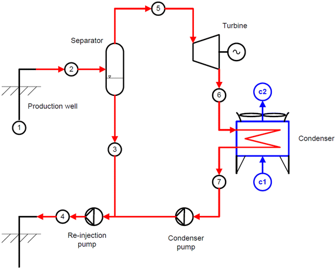

# Part 1 — Introduction and literature review

<!-- Research framing: credible liquid transport and collection, developed through mesh/inlet assessment, absorber and startup procedures, and wall-film studies. Internal evidence links are traceability notes. -->

## 1. Introduction

### 1.1. Engineering problem

In a flash-steam geothermal power plant, hot fluid carries heat from an underground reservoir to the surface through production wells. As pressure falls, some liquid turns into steam, a process called flashing. Surface pipework carries the resulting steam–water mixture to a separator, where the flow divides into two routes: steam towards the power-generation equipment and liquid brine towards separate discharge ([U.S. Energy Information Administration, n.d.](https://www.eia.gov/energyexplained/geothermal/geothermal-power-plants.php)).

Figure 1 places the separator within this process. Steam supplies the turbine–generator, while brine and condensed exhaust steam return towards reinjection. The separator must keep these routes distinct: liquid entering the steam line remains available to reach downstream equipment. The numbered circles identify thermodynamic states in the source; c1 and c2 indicate the condenser cooling-water connections. This is a plant schematic; the separator geometry used in this study is described below.

*Figure 1. Single-flash geothermal plant. Source: [El Haj Assad et al. (2017)](https://doi.org/10.1186/s40517-017-0074-z), fig. 1, crediting Valdimarsson (2011).*

<!-- Figure source: https://media.springernature.com/m685/springer-static/image/art%3A10.1186%2Fs40517-017-0074-z/MediaObjects/40517_2017_74_Fig1_HTML.gif ; downloaded 18 October 2026; unmodified published image; SHA-256 adc88534eef5b5a3d0fa8642c47cbb8f3f6a0e17ef41f10217c12998dd542d54. Original figure credits Valdimarsson (2011). -->

This separation protects the downstream equipment. Liquid carried into the steam outlet can cause turbine erosion and transport minerals that form deposits. Separator design must therefore consider the quality of the outgoing steam together with pressure loss and operating pressure ([Zarrouk & Purnanto, 2015](https://doi.org/10.1016/j.geothermics.2014.05.009)).

This project concerns a vertical bottom-outlet cyclone (BOC) with a spiral inlet. The inlet directs the incoming steam–water mixture around a cylindrical vessel, creating a rotating flow. Liquid moves towards the outer wall, while steam flows towards an internal pipe that carries it out through the bottom. The term *bottom outlet* refers to this steam-pipe arrangement; the brine has a separate discharge route (Figure 3). This arrangement determines how the rotating flow approaches the steam outlet ([Zarrouk & Purnanto, 2015](https://doi.org/10.1016/j.geothermics.2014.05.009)).

The difficulty is that driving liquid towards the wall does not complete separation. Wall liquid can form a film, circulate around the vessel, drain towards collection or return to the steam as droplets. Stronger rotation can assist outward liquid transport, but steam shear can also promote droplet release. Improving a separator therefore requires understanding both how liquid reaches the wall and what happens afterwards, rather than assuming that stronger swirl always gives better performance (Sections 2.2–2.4).

Computational fluid dynamics (CFD) offers a way to examine these internal paths and assess possible geometry changes. For that purpose, the model must represent both liquid capture and subsequent collection. This study examines how an inherited BOC model can be developed to meet that requirement.

<!-- Evidence: [Study scope](../../../scope.md); [inlet-development interpretation](../../../experiments/phase-01-purnanto-baseline-and-inlet-exploration/interpretation.md); [author's development context and meeting sources](../Shuhei-Context.md#how-the-project-understanding-developed); [absorber-development context](../../../experiments/phase-07-1a-absorber-convergence/CONTEXT.md). -->

### 1.2. Problem in the inherited model

The CFD domain represents the separator within the wider plant shown in Figure 1. Two simplifications interrupt the liquid path described above: the omission of brine discharge and the absence of a separate wall-film model.

The first problem is the missing liquid exit. The inherited CFD geometry omits the brine pool and discharge pipe, leaving a closed lower wall. Without a collection treatment, incoming liquid must therefore accumulate within the model or leave through the steam outlet. Simply opening the lower boundary does not ensure separate liquid discharge, because steam can also escape through it. The simplified geometry therefore lacks a route that removes collected liquid while retaining the intended steam path.

The second problem is the unresolved behaviour of liquid after wall capture. The inherited formulation represents steam and liquid through a bulk Mixture field, without a separate model of an evolving wall film. Purnanto et al. (2013), whose approach underpins the inherited model, also tracked injected droplets using the Discrete Phase Model (DPM) to estimate outlet steam quality (Section 2.3.1). These trajectories describe droplet motion through the calculated flow, but do not resolve the subsequent storage, drainage and release of deposited liquid. Ordinary wall boundary conditions alone do not provide this film description.

Together, these limitations leave the liquid path incomplete between wall capture and final discharge. A low liquid flow through the steam outlet may reflect storage on the wall or at the base rather than sustained collection. The model must distinguish liquid transport, storage, release and removal before its outlet predictions can support an assessment of separator performance.

<!-- Evidence: [Model boundary](../../../model.md). -->

<!-- Evidence: [Verified early absorber](../../../experiments/phase-07-1a-absorber-convergence/baseline-v2-virtual-liquid-outlet/results.md); [selected case history](../../../experiments/phase-07-2a-wall-liquid-routing/stage-02-combined-ewf-roughness/case-history-N45606.md); [full-geometry scope decision](../../../experiments/phase-06-full-geometry-with-brine-pool/conclusion.md); historical lower-boundary dilemma in [29 April, 04:04–06:36](../../../meetings/otter/2026-04-29-wk-7-steam-liquid-separator-analysis.md). -->

<!-- Evidence: [R0 control](../../../experiments/phase-07-1a-absorber-convergence/roughness-family/r0-smooth-control/results.md); [source-inclusive R0 accounting assessment](../../../experiments/phase-07b-full-geometry-liquid-removal/convergence-investigation/shuhei-audit.md). -->

### 1.3. Research aim and questions

The aim is to develop the inherited separator CFD model and assess whether it gives a numerically consistent and physically credible account of liquid transport and collection. The investigation addresses four questions:

1. How do mesh representation and inlet phase placement affect the predicted liquid distribution, retention near the wall and drainage?

2. How can the inherited CFD model be improved to achieve greater numerical consistency and more realistic liquid behaviour?

3. How do wall roughness and wall-film modelling affect liquid transport, storage, release and collection?

4. How can CFD inform separator design optimisation to improve separation performance?

These questions progress from understanding liquid distribution, through improving the model and examining wall transport, to identifying possible design changes. Progress is assessed using residuals, liquid balances, inventories and discharge paths. Physical credibility ultimately requires comparison with measurements under matched conditions and consistent definitions of performance (Section 2.2). The present work evaluates model development; incomplete liquid accounting and the absence of a matched field comparison limit claims about separator efficiency.

### 1.4. Scope and contribution

To address these questions, the study follows the liquid path through the simplified separator model. Mesh and inlet comparisons assess how liquid reaches and remains near the wall. Collector development addresses the missing discharge route, supported by startup procedures that allow the model to reach the intended feed conditions. Wall-roughness and wall-film studies then examine how captured liquid is stored, transported, released or drained. This understanding informs two inlet-region design proposals: a vertical film blocker and an angled film ramp. Their preliminary assessment examines local flow changes; demonstrating improved separation remains outside the completed scope. Downstream equipment, mineral chemistry and optimum operating pressure are outside the simulated scope.

<!-- Evidence: [Study overview](../../../index.md); [selected case history](../../../experiments/phase-07-2a-wall-liquid-routing/stage-02-combined-ewf-roughness/case-history-N45606.md). -->

Figure 2 brings these investigations together by distinguishing liquid transfer within the vessel from removal out of the model. Liquid entering a wall film can remain in storage, drain away or return to the steam as droplets. The routes shown were examined in separate model configurations.

*Figure 2. Conceptual liquid pathways examined in separate model configurations.*

<!-- Overview basis: Sections 3.2–3.3, 4.7, 4.10–4.11 and 5.3–5.6; [editable figure and source record](../figures/report-liquid-destinations-overview.provenance.json). No arrow represents a measured rate or proven final droplet fate. -->

The contribution is a set of checked collection and startup procedures, evidence of how model choices affect liquid transport, and two design proposals informed by the wall-film findings. Together, these extend the inherited model from predicting liquid distribution towards investigating how liquid reaches collection. The following literature review explains how prior flow predictions, collection assumptions and film studies inform this development.

## 2. Literature review

### 2.1. How a geothermal steam–water separator works

A vertical bottom-outlet cyclone (BOC) uses a tangential or spiral inlet to rotate the incoming steam and brine. Liquid moves towards the wall while steam occupies the central region. An internal pipe carries steam out through the bottom; brine leaves separately. *Bottom outlet* refers to the steam-pipe arrangement ([Zarrouk & Purnanto, 2015](https://doi.org/10.1016/j.geothermics.2014.05.009)).

Liquid at the wall can form a film that drains towards the brine discharge or releases droplets back into the steam (Figure 3). The schematic also distinguishes brine discharge from downstream liquid collection and condensation.

*Figure 3. Conceptual schematic of separator liquid paths: wall film, carryover, brine discharge ($\dot m_l$) and downstream brine collection ($\dot m_b$). Source: [Rizaldy et al. (2016)](https://www.researchgate.net/publication/310818568_LIQUID_CARRYOVER_IN_GEOTHERMAL_STEAM-WATER_SEPARATORS), fig. 5.*

<!-- Evidence: [Model boundary](../../../model.md). Figure source: [primary carryover paper](../../../../CFD_wiki/raw/053_Rizaldy_Final.pdf), PDF page 3, original fig. 5; symbol interpretation checked against PDF pages 3–4. [Full-page source preview](../figures/literature-candidates/wall-film/rizaldy-2016-pdf-page-03.png). The inserted panel was rendered directly from the local PDF; its labels and arrows are unchanged. -->

### 2.2. Internal flow physics and performance measures

Rotation produces a low-pressure core, with inward acceleration scaling as $u_\theta^2/r$, where $u_\theta$ is the tangential velocity and $r$ is the radius. The different responses of liquid and steam to pressure and drag, which depend on their densities, allow outward liquid transport. Fine droplets can follow the steam, whereas larger droplets reach collection surfaces more readily. Uncertain inlet droplet sizes and continued droplet generation complicate prediction ([Pointon et al., 2009](https://publications.mygeoenergynow.org/grc/1028587.pdf)).

Higher velocity can strengthen outward transport but also increase entrainment by steam shear. Empirical data show sharp increases in outlet wetness at different inlet steam velocities for different separators (Figure 4). Thus, greater swirl alone does not establish better separation ([Zarrouk & Purnanto, 2015](https://doi.org/10.1016/j.geothermics.2014.05.009)).

*Figure 4. Outlet wetness and steam quality versus inlet steam velocity for three separator datasets. Left axis: outlet wetness; right axis: steam quality. Source: [Zarrouk and Purnanto (2015)](https://doi.org/10.1016/j.geothermics.2014.05.009), fig. 12, using Bangma (1960) and Lazalde-Crabtree (1984) data.*

<!-- Figure source: [primary design review](<../../../../CFD_wiki/raw/Zarrouk and Purnanto 2014.pdf>), PDF page 12 / printed page 247; [full-page source preview](../figures/literature-candidates/design-overview/zarrouk-purnanto-2015-page-12.png). The published axes, curves, points and legend are unchanged. -->

Outlet steam quality is defined as

$$
x_{\mathrm{out}}=
\frac{\dot m_{v,\mathrm{out}}}
{\dot m_{v,\mathrm{out}}+\dot m_{l,\mathrm{out}}},
$$

where the terms are outward vapour and liquid mass-flow rates through the steam outlet. Purnanto et al. (2013) used this measure ([Purnanto et al., 2013](https://www.researchgate.net/publication/269519626_CFD_MODELLING_OF_TWO-PHASE_FLOW_INSIDE_GEOTHERMAL_STEAM-WATER_SEPARATORS)). Outlet steam quality differs from the liquid-capture fraction, which compares collected liquid with inlet liquid; the denominators of these two measures are not interchangeable.

Steam purity concerns chemical contamination in the steam. Estimates of chemical carryover are affected by condensation and drain-pot collection, so field comparisons require matching definitions and sampling locations ([Rizaldy et al., 2016](https://www.researchgate.net/publication/310818568_LIQUID_CARRYOVER_IN_GEOTHERMAL_STEAM-WATER_SEPARATORS)).

Assessing internal pressure drop requires defined inlet and outlet locations and a stated static or total pressure measure. This assessment differs from selecting the optimum operating pressure, which also involves flashing and plant conditions ([Pointon et al., 2009](https://publications.mygeoenergynow.org/grc/1028587.pdf); [Zarrouk & Purnanto, 2015](https://doi.org/10.1016/j.geothermics.2014.05.009)). The present no-flashing model addresses internal flow at prescribed phase conditions.

### 2.3. Established design methods and geothermal CFD

Empirical geothermal design methods provide reference points for CFD. CFD can additionally reveal internal flow patterns, but agreement with an empirical performance estimate does not establish that the model represents the correct liquid-collection mechanism ([Zarrouk & Purnanto, 2015](https://doi.org/10.1016/j.geothermics.2014.05.009)).

Pointon et al. (2009) used Fluent's Discrete Phase Model (DPM) to compare inlet designs with assumptions about droplet feed and wall/baffle collection. Predicted efficiencies were 99.96% for scrolled entry and 99.93% for tangential entry; an empirical design method gave 99.955%. Scrolled entry also gave a higher calculated mean tangential velocity than tangential entry: 34.1 rather than 32.5 m/s (Figure 5). However, agreement with the empirical method did not independently test the feed or collection assumptions ([Pointon et al., 2009](https://publications.mygeoenergynow.org/grc/1028587.pdf)).

*(a) Inlet configurations.*

*(b) Calculated tangential-velocity distributions.*

*Figure 5. Scrolled entry gives a higher calculated mean tangential velocity than tangential entry. (a) Inlet geometries; (b) tangential-velocity fields. Scrolled entry (labelled “lemniscate entrance” in the source) is on the left; tangential entry is on the right. Source: [Pointon et al. (2009)](https://publications.mygeoenergynow.org/grc/1028587.pdf), figs. 5 and 7.*

<!-- Figure source: [primary Pointon paper](../../../../CFD_wiki/raw/1028587.pdf), PDF pages 5–6 / printed pages 946–947; [geometry source page](../figures/literature-candidates/pointon/page-5.png); [velocity source page](../figures/literature-candidates/pointon/page-6.png). Both published panels, the velocity legend and mean annotations are unchanged. The report adds the (a)/(b) labels outside the images. -->

Pointon et al. (2009) and Purnanto et al. (2013) both used renormalisation-group (RNG) k–ε turbulence modelling. Pointon preferred RNG with a swirl modification because it had lower computational requirements than Reynolds stress modelling. This rationale offers a starting point, not a detailed turbulence-model comparison. Turbulence-model accuracy in the present swirling and near-wall flow remains to be assessed ([Pointon et al., 2009](https://publications.mygeoenergynow.org/grc/1028587.pdf); [Purnanto et al., 2013](https://www.researchgate.net/publication/269519626_CFD_MODELLING_OF_TWO-PHASE_FLOW_INSIDE_GEOTHERMAL_STEAM-WATER_SEPARATORS)).

Section 3 identifies the inherited modelling assumptions; Appendix A.1 records the controls used in the selected comparisons.

#### 2.3.1. Purnanto's modelling approach and its limits

Purnanto et al. compared three separator designs using steady, isothermal Mixture modelling, RNG $k$–$\varepsilon$ turbulence and SIMPLE coupling. Walls were smooth; upstream pre-separation and brine discharge were excluded, with constant pool level assumed ([Purnanto et al., 2013, §§2.2–3.3, pp. 3–6](https://www.researchgate.net/publication/269519626_CFD_MODELLING_OF_TWO-PHASE_FLOW_INSIDE_GEOTHERMAL_STEAM-WATER_SEPARATORS)).

After the flow solution, DPM tracked nine Harwell-derived droplet sizes, uniformly distributed across the inlet. Equal injection counts represented unequal mass flows. Bottom-reaching droplets counted as separated; outlet quality was steam mass divided by total outlet mass. The paper's earlier escaped/injected count definition instead describes penetration ([Purnanto et al., 2013, §§2.5 and 4.3, pp. 4, 8](https://www.researchgate.net/publication/269519626_CFD_MODELLING_OF_TWO-PHASE_FLOW_INSIDE_GEOTHERMAL_STEAM-WATER_SEPARATORS)). The count-based quantity can be written as:

$$
P_N=\frac{N_{\mathrm{escaped}}}{N_{\mathrm{injected}}}.
$$

Here, $N_{\mathrm{escaped}}$ and $N_{\mathrm{injected}}$ are particle counts. This ratio differs from outlet steam quality, defined in Section 2.2, and from the fraction of inlet liquid collected. Droplet mass weighting is therefore essential when interpreting the reported performance.

Incomplete tracks persisted even when the step limit rose from $10^5$ to $10^6$. Counting them as separated improved empirical agreement, but the authors acknowledged that assumption was not rigorous. Exact injection weights were unreported, and mesh refinement and experimental calibration remained necessary ([Purnanto et al., 2013, pp. 8–9](https://www.researchgate.net/publication/269519626_CFD_MODELLING_OF_TWO-PHASE_FLOW_INSIDE_GEOTHERMAL_STEAM-WATER_SEPARATORS)).

Differences in vessel proportions also prevented an isolated comparison of inlet shape. For the present study, a further limitation is the distinction between assigning droplets a destination and resolving liquid transport after wall capture. The approach did not provide a separate evolving wall-film account through which storage, drainage and return to the steam could be assessed. These limitations motivate explicit collection and wall-film treatments, while the Mixture and turbulence formulations provide a starting point for model development.

<!-- Primary-source audit: the maintained CFD wiki source page guided retrieval, but CFD_wiki/raw was absent in this checkout. The author-uploaded ten-page 2013 IPENZ paper was read directly online, separately from the 2012 workshop version. The count equation expresses the prose definition, not a numbered equation copied from the paper. The count ratio in §2.5 must not be silently called collection efficiency. The omission of an evolving wall-film account is a scope assessment; no claim is made that Purnanto measured zero film or that the present work solved incomplete particle tracking. -->

### 2.4. Wall–liquid transport and carryover

Film motion depends on gravity, pressure and shear. Deposition adds liquid to the film; drainage removes liquid from the film; entrainment returns droplets to the steam. More wall deposition can therefore increase liquid storage or later release without increasing external collection.

Rizaldy et al. (2016) predict that entrainment is sensitive to loading, film thickness and inlet velocity. Figure 6 illustrates the conceptual mechanisms of undercut and roll-wave entrainment, associated with lower and higher film Reynolds numbers, respectively. Film Reynolds number compares inertia with viscosity using liquid velocity and film thickness. However, the brine-flow data needed to compare the predicted liquid carryover with measurements from the first drain pot after the Wairakei separator were unavailable, leaving quantitative agreement with field measurements unresolved ([Rizaldy et al., 2016](https://www.researchgate.net/publication/310818568_LIQUID_CARRYOVER_IN_GEOTHERMAL_STEAM-WATER_SEPARATORS)).

*Figure 6. Conceptual mechanisms by which steam shear releases droplets from a liquid film: (a) undercut and (b) roll-wave entrainment. Source: [Rizaldy et al. (2016)](https://www.researchgate.net/publication/310818568_LIQUID_CARRYOVER_IN_GEOTHERMAL_STEAM-WATER_SEPARATORS), fig. 9, crediting Ishii and Grolmes (1975).*

<!-- Figure source: [primary carryover paper](../../../../CFD_wiki/raw/053_Rizaldy_Final.pdf), PDF page 5; [full-page source preview and original attribution](../figures/literature-candidates/wall-film/rizaldy-2016-pdf-page-05.png). The two published mechanism panels and labels are unchanged. -->

Fluent's roughness settings change near-wall momentum transfer; they do not add film storage or a drain ([Ansys, Inc., 2025k](https://ansyshelp.ansys.com/public/Views/Secured/corp/v252/en/flu_th/x1-5720008.164.html)). Eulerian Wall Film (EWF) modelling, by contrast, adds surface storage and transport. These treatments answer different questions: roughness changes the interaction with the wall, while EWF represents what happens to liquid held on it. This distinction motivates their separate assessment alongside outlet flow, retained liquid mass and collection.

### 2.5. Representing liquid and its collection

The Mixture model represents bulk liquid through the secondary-phase volume fraction. Algebraic slip estimates the relative velocity between phases under a local-equilibrium assumption. The liquid volume fraction does not directly resolve film thickness or the droplet-size distribution ([Ansys, Inc., 2025d](https://ansyshelp.ansys.com/public/Views/Secured/corp/v252/en/flu_th/flu_th_sec_drift_oview.html)).

DPM follows size-dependent droplet trajectories. Interpreting its results requires defined injection and boundary treatments and a count of every tracked fate, including incomplete trajectories.

Skoog (2020) combined EWF surface transport, DPM deposition and entrainment in a reactor-channel approximation. Film and droplet flows were compared with one-dimensional calculations using Okawa correlations based on experiments. The inlet liquid allocation between film and droplets and the transverse droplet velocity affected the result. For the present study, this provides a method for distinguishing film storage from droplet transport; transferring the reactor correlations to a cyclone still requires justification ([Skoog, 2020](https://www.diva-portal.org/smash/get/diva2:1452100/FULLTEXT02.pdf); [Ansys, Inc., 2025e](https://ansyshelp.ansys.com/public/views/secured/corp/v252/en/flu_ug/flu_ug_models_wallfilm.html)).

Bulk-to-film transfer moves liquid within the domain, whereas the absorber removes it from the domain. Droplet injection must not duplicate liquid already supplied by another feed. Fluent permits cell-zone mass sources and associated transport sources ([Ansys, Inc., 2025a](https://ansyshelp.ansys.com/public/Views/Secured/corp/v252/en/flu_ug/flu_ug_bcs_sec_cell_zones.html)), but the governing source law and its effects require assessment. Section 4.3 describes the contact-based absorber.

<!-- Evidence: [Audited model basis](../../../model.md); [liquid-accounting guardrails and application of Skoog](../../../technical/skoog-application-guardrails.md); [absorber-development context](../../../experiments/phase-07-1a-absorber-convergence/CONTEXT.md). -->

### 2.6. Numerical startup, convergence and validation

In a steady calculation, iterations and pseudo-time describe numerical development, not physical filling time. The National Aeronautics and Space Administration (NASA) recommends monitoring residuals and relevant outputs, with convergence criteria based on acceptable error in those outputs ([National Aeronautics and Space Administration \[NASA\], 2021a](https://www.grc.nasa.gov/www/wind/valid/tutorial/iterconv.html)).

Fluent permits flow development before film initialisation ([Ansys, Inc., 2025h](https://ansyshelp.ansys.com/public/views/secured/corp/v252/en/flu_ug/flu_ug_ewf_sec_overview.html)). Reduced-feed startup and ramps remain case-specific choices that require assessment.

Implementation checks, iterative convergence, mass accounting and numerical sensitivity answer separate questions. Mesh and time-step studies require a fixed model; changes to roughness or the absorber instead test model sensitivity ([NASA, 2021c](https://www.grc.nasa.gov/www/wind/valid/tutorial/verassess.html)).

Physical validation requires comparison with relevant measurements and assessment of uncertainty ([NASA, 2021b](https://www.grc.nasa.gov/www/wind/valid/tutorial/valassess.html)). For this model, those comparisons must assess the assumed collection route and outlet predictions within the tested operating range.

<!-- Evidence: [Verification and validation limits](../../../vnv.md). -->

### 2.7. Remaining model uncertainties and research direction

Pointon and Purnanto show how CFD can relate separator geometry to internal flow and predicted outlet performance (Section 2.3). The film studies add a further consideration: captured liquid can remain stored or return to the steam (Sections 2.4–2.5). Together, these approaches distinguish predicting wall capture from predicting sustained collection. Pointon's collecting boundaries and Purnanto's treatment of incomplete tracks also show why the assumed liquid destination matters when interpreting an outlet prediction.

The unresolved question for the inherited model is whether liquid delivered to the wall can reach collection without continued accumulation or return to the steam. Its omitted brine discharge makes an explicit collection route necessary, while the film literature motivates examining what happens before liquid reaches that route. This leads to the investigation in Section 4: compare liquid distribution, establish collection and workable startup, examine wall-film transport, and use that understanding to propose design changes. Tracking storage and removal alongside outlet flow makes each stage informative about the complete liquid path.
