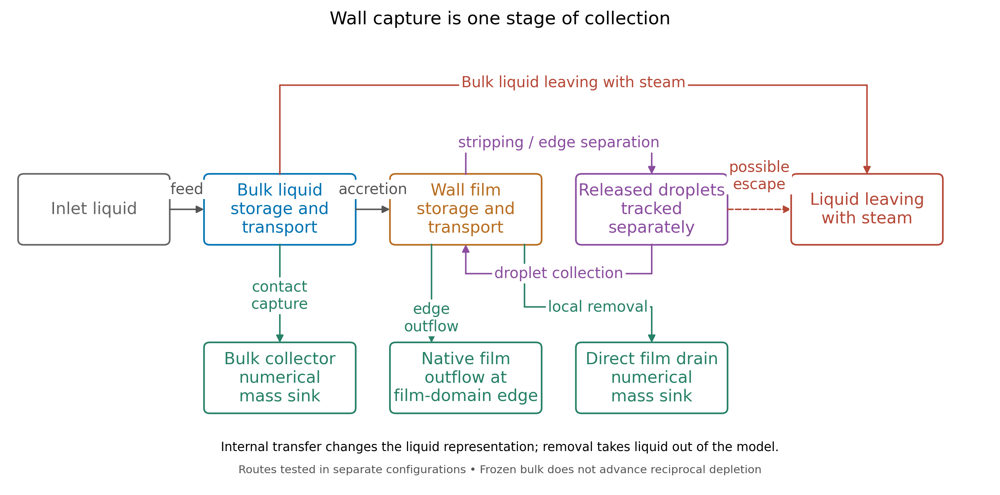

# Part 1 — Introduction and literature review

<!-- Research framing: credible liquid transport and collection, developed through mesh/inlet assessment, absorber and startup procedures, and wall-film studies. Internal evidence links are traceability notes. -->

## 1. Introduction

### 1.1. Engineering problem

Geothermal steam–water separators supply dry steam to turbines. Liquid carryover can cause erosion and transport minerals that form deposits. Separator design must therefore consider separation efficiency, pressure drop and operating pressure ([Zarrouk & Purnanto, 2015](https://doi.org/10.1016/j.geothermics.2014.05.009)).

This study develops an inherited computational fluid dynamics (CFD) model of a vertical bottom-outlet cyclone with a spiral inlet. The study follows the liquid path from phase placement at the inlet through wall transport and collection.

<!-- Evidence: [Study scope](../../../scope.md); [inlet-development interpretation](../../../experiments/phase-01-purnanto-baseline-and-inlet-exploration/interpretation.md); [author's development context and meeting sources](../Shuhei-Context.md#how-the-project-understanding-developed); [absorber-development context](../../../experiments/phase-07-1a-absorber-convergence/CONTEXT.md). -->

### 1.2. Problem in the inherited model

The simplified geometry omits the lower brine-discharge path. A closed bottom leaves the liquid without an intended exit; opening the whole lower boundary can also allow steam to escape through it. The model needs a liquid-collection treatment that preserves the steam route.

Liquid reaching the wall is only one stage of separation. A lower liquid flow through the steam outlet can accompany greater collection, continued storage or transfer into a wall film. The model must therefore track liquid destinations alongside outlet flow to assess what each change achieves.

<!-- Evidence: [Model boundary](../../../model.md). -->

A virtual collector, called an absorber, and reduced-feed startup enabled roughness and Eulerian Wall Film (EWF) studies after unsuccessful full-geometry drainage trials.

<!-- Evidence: [Verified early absorber](../../../experiments/phase-07-1a-absorber-convergence/baseline-v2-virtual-liquid-outlet/results.md); [selected case history](../../../experiments/phase-07-2a-wall-liquid-routing/stage-02-combined-ewf-roughness/case-history-N45606.md); [full-geometry scope decision](../../../experiments/phase-06-full-geometry-with-brine-pool/conclusion.md); historical lower-boundary dilemma in [29 April, 04:04–06:36](../../../meetings/otter/2026-04-29-wk-7-steam-liquid-separator-analysis.md). -->

<!-- Evidence: [R0 control](../../../experiments/phase-07-1a-absorber-convergence/roughness-family/r0-smooth-control/results.md); [source-inclusive R0 accounting assessment](../../../experiments/phase-07b-full-geometry-liquid-removal/convergence-investigation/shuhei-audit.md). -->

### 1.3. Research aim and questions

The aim is to develop and assess the separator model's liquid-transport and collection paths. The longer-term purpose is to predict separation efficiency and pressure drop. The present work addresses four questions:

1. How do mesh representation and inlet phase placement affect liquid distribution and retention near the wall?
2. How can numerical collection and staged startup provide starting fields for wall studies?
3. How do wall roughness and wall-film modelling affect liquid transport, storage, release and collection?
4. What numerical and liquid-accounting evidence supports these predictions, and what remains necessary for field validation?

### 1.4. Scope and contribution

The study focuses on the simplified primary separator model. Mesh and inlet comparisons lead into collector development and studies of startup and wall treatment. Later cases examine film development up to 500 ms, release mechanisms and direct drainage. Downstream equipment, mineral chemistry and optimum operating pressure are outside the simulated scope.

<!-- Evidence: [Study overview](../../../index.md); [selected case history](../../../experiments/phase-07-2a-wall-liquid-routing/stage-02-combined-ewf-roughness/case-history-N45606.md). -->

The contribution combines checked collection and startup procedures with evidence of how model choices affect liquid delivery, storage and removal. The comparisons assess model development rather than validated separator performance; refinement of the combined model remains incomplete. Appendix A.2 defines the controlled reconstructions.

Figure 1 maps the liquid destinations examined across separate configurations. Transfer to film or droplets changes the representation of liquid within the vessel; collector and drain treatments remove liquid from the model. Released droplets must be tracked separately to establish their destinations. During frozen-bulk film tests, reciprocal depletion of the bulk liquid is not advanced.

*Figure 1. Liquid destinations examined in separate model configurations. Wall capture can lead to storage, release or removal. Numerical sinks and native film-edge outflow are distinct; this conceptual map does not show a measured balance.*

<!-- Overview basis: Sections 3.2–3.3, 4.7, 4.10–4.11 and 5.3–5.6; [editable figure and source record](../figures/report-liquid-destinations-overview.provenance.json). No arrow represents a measured rate or proven final droplet fate. -->

Section 3 describes the model and comparisons. Section 4 asks how liquid reaches the wall, where it can go and what wall treatment changes. Sections 5–6 connect these findings to collection and the evidence needed for performance prediction.

## 2. Literature review

### 2.1. How a geothermal steam–water separator works

A vertical bottom-outlet cyclone (BOC) uses a tangential or spiral inlet to rotate the incoming steam and brine. Liquid moves towards the wall while steam occupies the central region. An internal pipe carries steam out through the bottom; brine leaves separately. *Bottom outlet* refers to the steam-pipe arrangement ([Zarrouk & Purnanto, 2015](https://doi.org/10.1016/j.geothermics.2014.05.009)).

Liquid at the wall can form a film that drains towards the brine discharge or releases droplets back into the steam (Figure 2). The schematic also distinguishes brine discharge from downstream liquid collection and condensation.

*Figure 2. Conceptual schematic of separator liquid paths: wall film, carryover, brine discharge ($\dot m_l$) and downstream brine collection ($\dot m_b$). Source: [Rizaldy et al. (2016)](https://www.researchgate.net/publication/310818568_LIQUID_CARRYOVER_IN_GEOTHERMAL_STEAM-WATER_SEPARATORS), fig. 5.*

<!-- Evidence: [Model boundary](../../../model.md). Figure source: [primary carryover paper](../../../../CFD_wiki/raw/053_Rizaldy_Final.pdf), PDF page 3, original fig. 5; symbol interpretation checked against PDF pages 3–4. [Full-page source preview](../figures/literature-candidates/wall-film/rizaldy-2016-pdf-page-03.png). The inserted panel was rendered directly from the local PDF; its labels and arrows are unchanged. -->

### 2.2. Internal flow physics and performance measures

Rotation produces a low-pressure core, with inward acceleration scaling as $u_\theta^2/r$, where $u_\theta$ is the tangential velocity and $r$ is the radius. The different responses of liquid and steam to pressure and drag, which depend on their densities, allow outward liquid transport. Fine droplets can follow the steam, whereas larger droplets reach collection surfaces more readily. Uncertain inlet droplet sizes and continued droplet generation complicate prediction ([Pointon et al., 2009](https://publications.mygeoenergynow.org/grc/1028587.pdf)).

Higher velocity can strengthen outward transport but also increase entrainment by steam shear. Empirical data show sharp increases in outlet wetness at different inlet steam velocities for different separators (Figure 3). Thus, greater swirl alone does not establish better separation ([Zarrouk & Purnanto, 2015](https://doi.org/10.1016/j.geothermics.2014.05.009)).

*Figure 3. Outlet wetness and steam quality versus inlet steam velocity for three separator datasets. Left axis: outlet wetness; right axis: steam quality. Source: [Zarrouk and Purnanto (2015)](https://doi.org/10.1016/j.geothermics.2014.05.009), fig. 12, using Bangma (1960) and Lazalde-Crabtree (1984) data.*

<!-- Figure source: [primary design review](<../../../../CFD_wiki/raw/Zarrouk and Purnanto 2014.pdf>), PDF page 12 / printed page 247; [full-page source preview](../figures/literature-candidates/design-overview/zarrouk-purnanto-2015-page-12.png). The published axes, curves, points and legend are unchanged. -->

Outlet steam quality is defined as

$$
x_{\mathrm{out}}=
\frac{\dot m_{v,\mathrm{out}}}
{\dot m_{v,\mathrm{out}}+\dot m_{l,\mathrm{out}}},
$$

where the terms are outward vapour and liquid mass-flow rates through the steam outlet. Purnanto et al. (2013) used this measure ([Purnanto et al., 2013](https://www.researchgate.net/publication/269519626_CFD_MODELLING_OF_TWO-PHASE_FLOW_INSIDE_GEOTHERMAL_STEAM-WATER_SEPARATORS)). Outlet steam quality differs from the liquid-capture fraction, which compares collected liquid with inlet liquid; the denominators of these two measures are not interchangeable.

Steam purity concerns chemical contamination in the steam. Estimates of chemical carryover are affected by condensation and drain-pot collection, so field comparisons require matching definitions and sampling locations ([Rizaldy et al., 2016](https://www.researchgate.net/publication/310818568_LIQUID_CARRYOVER_IN_GEOTHERMAL_STEAM-WATER_SEPARATORS)).

Assessing internal pressure drop requires defined inlet and outlet locations and a stated static or total pressure measure. This assessment differs from selecting the optimum operating pressure, which also involves flashing and plant conditions ([Pointon et al., 2009](https://publications.mygeoenergynow.org/grc/1028587.pdf); [Zarrouk & Purnanto, 2015](https://doi.org/10.1016/j.geothermics.2014.05.009)). The present no-flashing model addresses internal flow at prescribed phase conditions.

### 2.3. Established design methods and geothermal CFD

Empirical geothermal design methods provide reference points for CFD. However, CFD's additional flow detail must be assessed against the model's assumptions and the comparison evidence ([Zarrouk & Purnanto, 2015](https://doi.org/10.1016/j.geothermics.2014.05.009)).

Pointon et al. (2009) used Fluent's Discrete Phase Model (DPM) to compare inlet designs with assumptions about droplet feed and wall/baffle collection. Predicted efficiencies were 99.96% for scrolled entry and 99.93% for tangential entry; an empirical design method gave 99.955%. Scrolled entry also gave a higher calculated mean tangential velocity than tangential entry: 34.1 rather than 32.5 m/s (Figure 4). However, agreement with the empirical method did not independently test the feed or collection assumptions ([Pointon et al., 2009](https://publications.mygeoenergynow.org/grc/1028587.pdf)).

*(a) Inlet configurations.*

*(b) Calculated tangential-velocity distributions.*

*Figure 4. Scrolled entry gives a higher calculated mean tangential velocity than tangential entry. (a) Inlet geometries; (b) tangential-velocity fields. Scrolled entry (labelled “lemniscate entrance” in the source) is on the left; tangential entry is on the right. Source: [Pointon et al. (2009)](https://publications.mygeoenergynow.org/grc/1028587.pdf), figs. 5 and 7.*

<!-- Figure source: [primary Pointon paper](../../../../CFD_wiki/raw/1028587.pdf), PDF pages 5–6 / printed pages 946–947; [geometry source page](../figures/literature-candidates/pointon/page-5.png); [velocity source page](../figures/literature-candidates/pointon/page-6.png). Both published panels, the velocity legend and mean annotations are unchanged. The report adds the (a)/(b) labels outside the images. -->

Purnanto et al. (2013) compared three BOC configurations using a steady Mixture model and a DPM outlet-quality calculation. Differences in vessel proportions prevented the effect of inlet shape from being isolated. Counting droplets with incomplete tracks as separated improved empirical agreement, but the authors described this assumption as non-rigorous. The inherited modelling basis therefore requires explicit treatment of unresolved droplet fate ([Purnanto et al., 2013](https://www.researchgate.net/publication/269519626_CFD_MODELLING_OF_TWO-PHASE_FLOW_INSIDE_GEOTHERMAL_STEAM-WATER_SEPARATORS)).

Both studies used renormalisation-group (RNG) k–ε turbulence modelling. Pointon preferred RNG with a swirl modification because it had lower computational requirements than Reynolds stress modelling. This rationale offers a starting point, not a detailed turbulence-model comparison. Turbulence-model accuracy in the present swirling and near-wall flow remains to be assessed ([Pointon et al., 2009](https://publications.mygeoenergynow.org/grc/1028587.pdf); [Purnanto et al., 2013](https://www.researchgate.net/publication/269519626_CFD_MODELLING_OF_TWO-PHASE_FLOW_INSIDE_GEOTHERMAL_STEAM-WATER_SEPARATORS)).

Appendix B.2 compares the methods and assumptions carried into this study.

### 2.4. Wall–liquid transport and carryover

Film motion depends on gravity, pressure and shear. Deposition adds liquid to the film; drainage removes liquid from the film; entrainment returns droplets to the steam. More wall deposition can therefore increase liquid storage or later release without increasing external collection.

Rizaldy et al. (2016) predict that entrainment is sensitive to loading, film thickness and inlet velocity. Figure 5 illustrates the conceptual mechanisms of undercut and roll-wave entrainment, associated with lower and higher film Reynolds numbers, respectively. Film Reynolds number compares inertia with viscosity using liquid velocity and film thickness. However, the brine-flow data needed to compare the predicted liquid carryover with measurements from the first drain pot after the Wairakei separator were unavailable, leaving quantitative agreement with field measurements unresolved ([Rizaldy et al., 2016](https://www.researchgate.net/publication/310818568_LIQUID_CARRYOVER_IN_GEOTHERMAL_STEAM-WATER_SEPARATORS)).

*Figure 5. Conceptual mechanisms by which steam shear releases droplets from a liquid film: (a) undercut and (b) roll-wave entrainment. Source: [Rizaldy et al. (2016)](https://www.researchgate.net/publication/310818568_LIQUID_CARRYOVER_IN_GEOTHERMAL_STEAM-WATER_SEPARATORS), fig. 9, crediting Ishii and Grolmes (1975).*

<!-- Figure source: [primary carryover paper](../../../../CFD_wiki/raw/053_Rizaldy_Final.pdf), PDF page 5; [full-page source preview and original attribution](../figures/literature-candidates/wall-film/rizaldy-2016-pdf-page-05.png). The two published mechanism panels and labels are unchanged. -->

Fluent's roughness settings change near-wall momentum transfer; they do not add film storage or a drain ([Ansys, Inc., 2025k](https://ansyshelp.ansys.com/public/Views/Secured/corp/v252/en/flu_th/x1-5720008.164.html)). EWF, by contrast, adds surface storage and transport. The effects of roughness and EWF on outlet flow must be interpreted alongside retained liquid mass and collection.

### 2.5. Representing liquid and its collection

The Mixture model represents bulk liquid through the secondary-phase volume fraction. Algebraic slip estimates the relative velocity between phases under a local-equilibrium assumption. The liquid volume fraction does not directly resolve film thickness or the droplet-size distribution ([Ansys, Inc., 2025d](https://ansyshelp.ansys.com/public/Views/Secured/corp/v252/en/flu_th/flu_th_sec_drift_oview.html)).

DPM follows size-dependent droplet trajectories. Interpreting its results requires defined injection and boundary treatments and a count of every tracked fate, including incomplete trajectories.

Skoog (2020) combined EWF surface transport, DPM deposition and entrainment in a reactor-channel approximation. Film and droplet flows were compared with one-dimensional calculations using Okawa correlations based on experiments. The inlet liquid allocation between film and droplets and the transverse droplet velocity affected the result. This separate accounting of film and droplet flows provides a precedent, but the applicability of the reactor conditions and correlations to a cyclone still requires justification ([Skoog, 2020](https://www.diva-portal.org/smash/get/diva2:1452100/FULLTEXT02.pdf); [Ansys, Inc., 2025e](https://ansyshelp.ansys.com/public/views/secured/corp/v252/en/flu_ug/flu_ug_models_wallfilm.html)).

Bulk-to-film transfer moves liquid within the domain, whereas the absorber removes it from the domain. Droplet injection must not duplicate liquid already supplied by another feed. Fluent permits cell-zone mass sources and associated transport sources ([Ansys, Inc., 2025a](https://ansyshelp.ansys.com/public/Views/Secured/corp/v252/en/flu_ug/flu_ug_bcs_sec_cell_zones.html)), but the governing source law and its effects require assessment. Section 3 describes the contact-based absorber.

<!-- Evidence: [Audited model basis](../../../model.md); [liquid-accounting guardrails and application of Skoog](../../../technical/skoog-application-guardrails.md); [absorber-development context](../../../experiments/phase-07-1a-absorber-convergence/CONTEXT.md). -->

### 2.6. Numerical startup, convergence and validation

In a steady calculation, iterations and pseudo-time describe numerical development, not physical filling time. The National Aeronautics and Space Administration (NASA) recommends monitoring residuals and relevant outputs, with convergence criteria based on acceptable error in those outputs ([National Aeronautics and Space Administration \[NASA\], 2021a](https://www.grc.nasa.gov/www/wind/valid/tutorial/iterconv.html)).

Fluent permits flow development before film initialisation ([Ansys, Inc., 2025h](https://ansyshelp.ansys.com/public/views/secured/corp/v252/en/flu_ug/flu_ug_ewf_sec_overview.html)). Reduced-feed startup and ramps remain case-specific choices that require assessment.

Implementation checks, iterative convergence, mass accounting and numerical sensitivity answer separate questions. Mesh and time-step studies require a fixed model; changes to roughness or the absorber instead test model sensitivity ([NASA, 2021c](https://www.grc.nasa.gov/www/wind/valid/tutorial/verassess.html)).

Physical validation requires comparison with relevant measurements and assessment of uncertainty ([NASA, 2021b](https://www.grc.nasa.gov/www/wind/valid/tutorial/valassess.html)). For this model, those comparisons must assess the assumed collection route and outlet predictions within the tested operating range.

<!-- Evidence: [Verification and validation limits](../../../vnv.md). -->

### 2.7. Remaining model uncertainties and research direction

The literature shows that the definition of collection is central to the research problem. In Pointon's model, a droplet's trajectory ends at a collecting boundary, whereas the film literature allows captured liquid to return to the steam. Purnanto's incomplete tracks highlight a further distinction between a calculated destination and an assumed one. Agreement in an outlet measure therefore does not, by itself, resolve the internal liquid path when feed, capture or final fate is imposed.

The inherited model adds a specific difficulty: its truncated domain omits brine discharge. Changes to the mesh and inlet can alter predicted liquid delivery to the wall, but cannot provide the missing exit. This study therefore connects comparisons of these changes to collector development and then to film storage, release and drainage. The separate bulk, film and droplet accounts make it possible to ask whether a lower bulk-liquid outlet rate accompanies external collection, internal transfer or continued storage. That distinction determines what each result contributes to performance prediction.