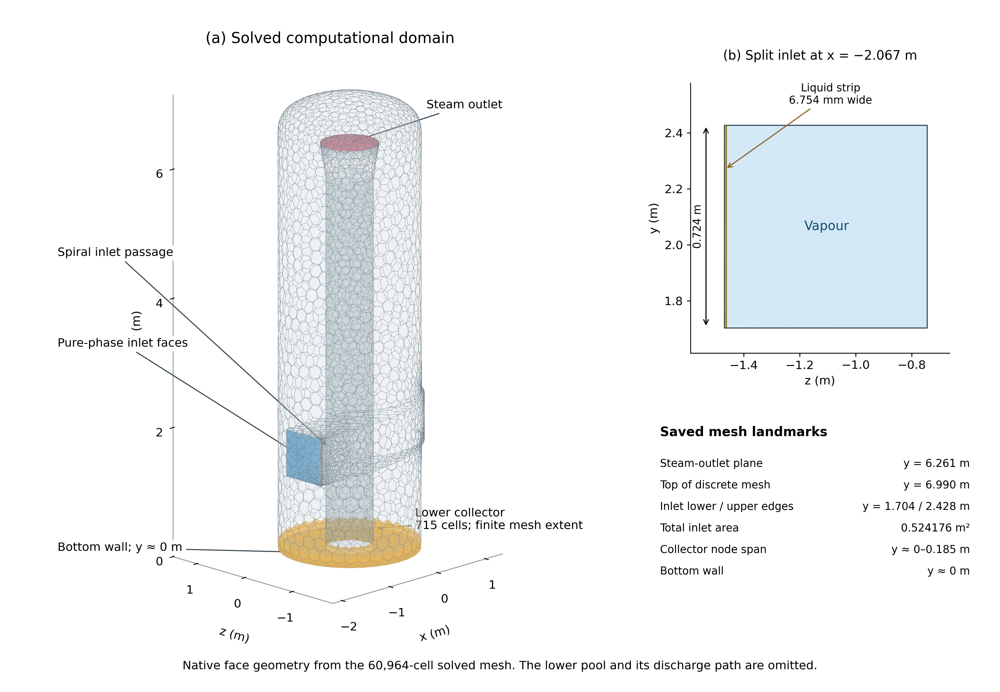
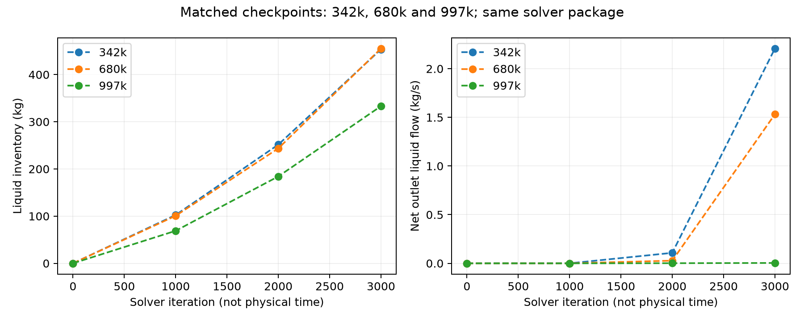
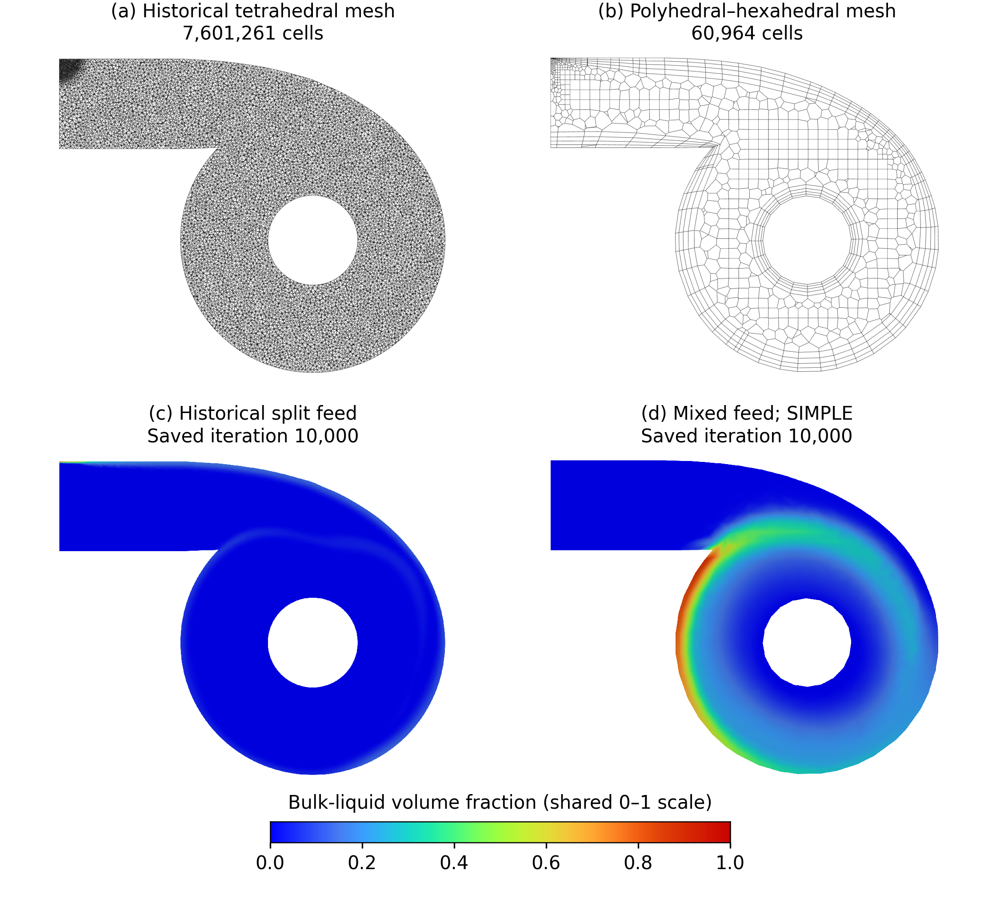
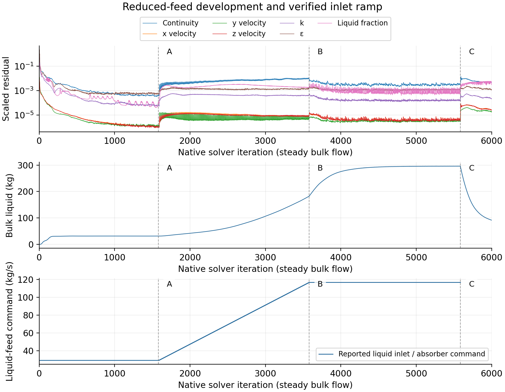
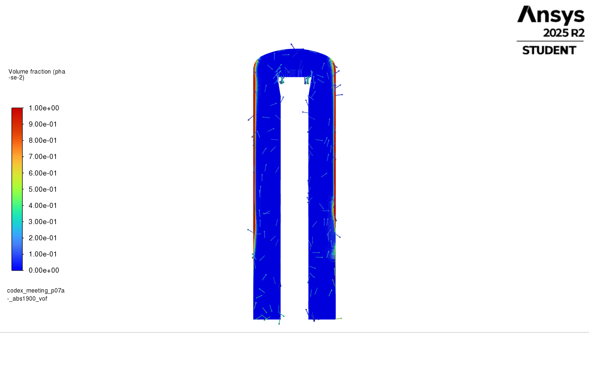
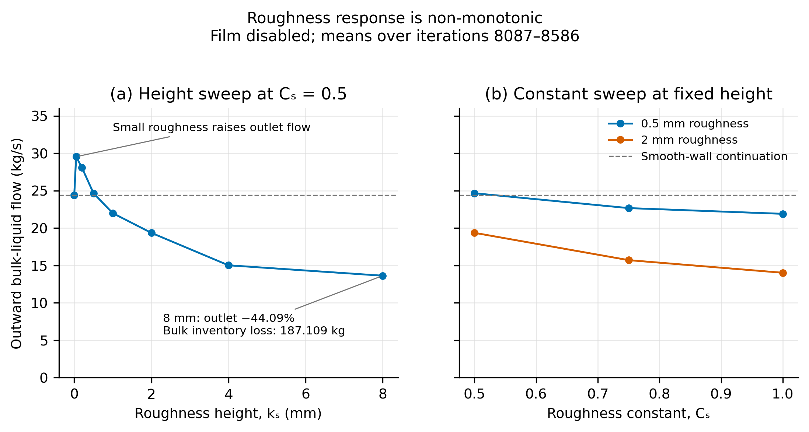
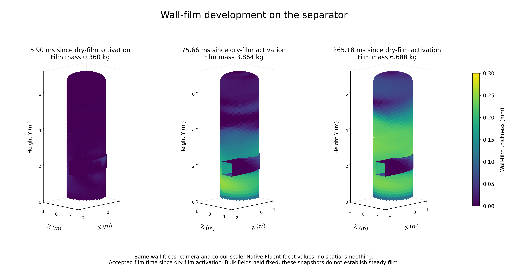
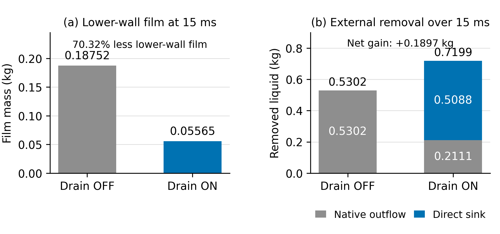
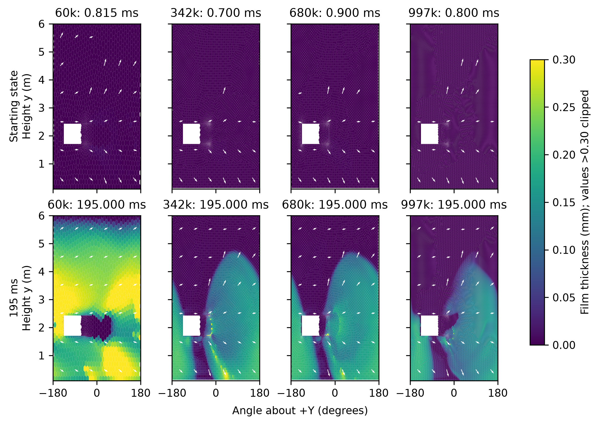
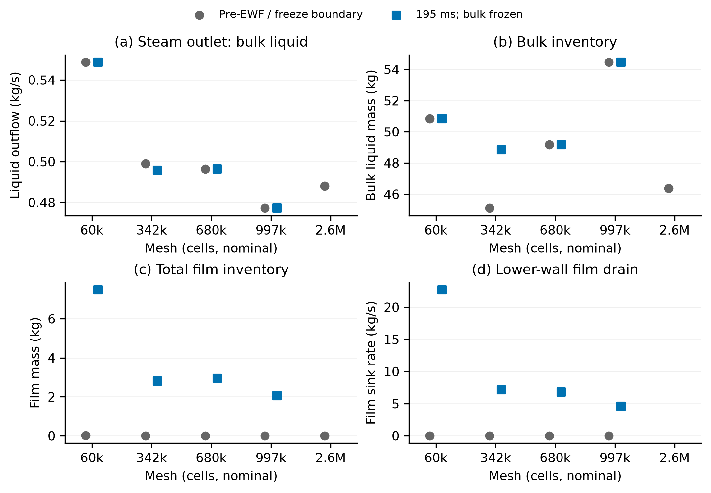

# Model basis, development methods and results

## 3. Inherited model and operating basis

The investigation continued the Purnanto-based separator geometry, bulk-flow formulation and reference operating condition. These defined the starting model. Its development required more than predicting liquid movement towards the wall: the model also needed to represent what happened to liquid after it arrived there. Section 4 follows the successive investigations of liquid delivery, retention, wall transport and collection, introducing each method alongside the evidence it supplied.

The account follows the questions that connected the investigations. Later reconstructions are identified where they revisit earlier assumptions; they explain the model's behaviour without implying that those results were available when the original choices were made.

### 3.1. Computational domain and modelling scope

Building on the model limitations identified in the literature review, this study used the inherited separator geometry based on Purnanto et al. (2013).

The simplified domain retained the spiral inlet, cylindrical separation vessel and internal steam outlet pipe needed to study liquid transport through the active separation region (Figure 6). The inlet guided the incoming mixture into the vessel, while the internal pipe provided the steam exit. The lower brine pool and its discharge pipe were omitted, leaving a closed bottom wall.

*Figure 6. Simplified computational domain and inlet arrangement: (a) spiral inlet, vessel and internal steam outlet; (b) wall-side liquid strip and adjacent vapour inlet. The brine pool and discharge pipe are omitted. Panel (b) shows the split inlet introduced in Section 4.1; the collector is introduced in Section 4.3.*

The closed base supplied no physical liquid exit. Section 4 follows the inlet, mesh and collection changes used to investigate liquid transport in this domain.

### 3.2. Bulk-flow model and retained assumptions

The Mixture model provided a computationally cheaper continuation of Purnanto's separator model. Its algebraic-slip formulation was consistent with the small-Stokes-number argument used in that study: sufficiently small dispersed droplets respond rapidly relative to the characteristic flow timescale ([Purnanto et al., 2013](https://www.researchgate.net/publication/269519626_CFD_MODELLING_OF_TWO-PHASE_FLOW_INSIDE_GEOTHERMAL_STEAM-WATER_SEPARATORS)). Solving mixture momentum with algebraic slip requires fewer equations than a full Eulerian formulation, making repeated inlet and wall-treatment investigations more practical ([Ansys, Inc., 2025d](https://ansyshelp.ansys.com/public/Views/Secured/corp/v252/en/flu_th/flu_th_sec_drift_oview.html)). After exploratory VOF and turbulence trials, Mixture with RNG $k$–$\varepsilon$ was retained as the practical basis for the inlet and wall-treatment studies. The alternative formulations remained exploratory (Appendix A.13).

<!-- Basis: [recorded baseline rationale](../../../experiments/phase-01-purnanto-baseline-and-inlet-exploration/purnanto-00-reference-spiral-boc/setup.md); [executed VOF trial](../../../experiments/phase-01-purnanto-baseline-and-inlet-exploration/purnanto-02b-vof-split-inlet-transient/setup.md); [turbulence screening](../../../experiments/phase-07-1a-absorber-convergence/turbulence-family/README.md). The small-Stokes-number rationale concerns dispersed liquid; applicability to concentrated wall liquid remains unverified. -->

A pressure-based solver with the Mixture model in Ansys Fluent 2025 R2 was used for bulk continuity, momentum, liquid fraction and algebraic slip. Steam was the primary phase and water the secondary phase. The inherited setup used SIMPLE pressure–velocity coupling, carried forward from Purnanto; later Coupled reconstructions are distinguished in Appendix A.2. The RNG $k$–$\varepsilon$ model included swirl treatment and standard wall functions; gravity acted downwards. The energy equation was disabled; flashing, condensation and temperature-dependent properties were excluded. Table 1 gives the material values; Appendix A.1 records the controls ([Ansys, Inc., 2025d](https://ansyshelp.ansys.com/public/Views/Secured/corp/v252/en/flu_th/flu_th_sec_multiphase_mixture.html)).

*Table 1. Fixed material properties verified for the throughput-controlled absorber model.*

| Phase | Density (kg/m³) | Dynamic viscosity (Pa·s) |
| --- | ---: | ---: |
| Vapour | 5.79743 | $1.52062\times10^{-5}$ |
| Liquid water | 881.211 | $1.45544\times10^{-4}$ |

The selected bulk-flow formulation used Manninen slip, Schiller–Naumann drag and a liquid-phase diameter of 10 µm. These settings kept the bulk slip model fixed across the wall comparisons introduced below. Its accuracy for concentrated wall liquid remained unverified. The liquid-phase diameter controls continuum slip, separately from DPM droplets and film (Appendix A.1).

### 3.3. Reference feed and boundary conditions

The reference feed condition was retained from Purnanto to provide a common operating basis for the model-development comparisons: 197.61 kg/s at 1600 kJ/kg and 11.2 bar absolute. At this pressure, saturated liquid and vapour enthalpies, $h_f$ and $h_g$, gave the vapour mass fraction as $x=(h-h_f)/(h_g-h_f)=0.408323$. The steam and liquid feeds followed from $x\dot m_{\mathrm{tot}}$ and $(1-x)\dot m_{\mathrm{tot}}$, linking the phase loading to the reference thermodynamic condition. The inlet commands retained Purnanto's rounded phase mass flows of 116.92 kg/s liquid and 80.69 kg/s vapour; Appendix A.7 gives the calculation ([Purnanto et al., 2013](https://www.researchgate.net/publication/269519626_CFD_MODELLING_OF_TWO-PHASE_FLOW_INSIDE_GEOTHERMAL_STEAM-WATER_SEPARATORS)). Enthalpy defined the supplied composition; flashing was not solved within the domain.

The boundary setup retained the Purnanto-based model’s prescribed-feed and pressure-outlet approach. The steam outlet supplied the pressure boundary condition, allowing inlet pressure to emerge from the solution. The operating pressure was 0 Pa, so outlet gauge and absolute pressures were equal. Stationary, no-slip walls confined the flow. The project’s revised inlet distribution and numerical collection treatments are introduced in Sections 4.2–4.4. Appendices A.6 and A.2 give the turbulence and backflow inputs and the reconstruction differences.

## 4. Model development and results

The first comparison examined how inlet phase placement changed liquid delivery to the wall. Accumulation and contrasting solver behaviour then raised questions about mesh representation and the missing collection route. They also exposed a separate requirement: retained liquid needed an exit through which it could be collected. A lower collector and a developed flow field then provided the basis for wall-treatment comparisons. Those comparisons led to further questions about film storage, release and drainage, followed by tests of numerical sensitivity. The workflow supporting the investigation is described separately in Section 4.11.

Each comparison uses its stated mesh and settings. Outlet liquid flow is reported as positive outwards unless a signed value is given. Steady-solver iterations track numerical development; accepted film time tracks the transient film calculation. Detailed settings and supporting trials remain in the appendices.

### 4.1. Pure-split inlet and visible liquid distribution

Using the inlet geometry shown in Section 3.1 (Figure 6), the 0.724 m × 0.724 m cross-section was divided into a 6.754 mm wall-side liquid strip and the remaining steam inlet. The reference feed from Section 3.3 supplied approximately 116.9 kg/s of liquid and 80.7 kg/s of steam through these respective faces. The change therefore concerned where each phase entered, while retaining the overall phase loading. This represented the expected wall-side concentration of liquid as the upstream flow turned into the separator. Complete phase separation at entry was an assumption; the strip-sizing basis is given in Appendix A.7.

The boundary-flux comparison with mixed feed showed little change: almost all incoming liquid still left through the steam outlet. The contours were more informative. In Figure 7(b), the pure-split case shows a more continuous liquid-rich band around the outer wall. The centre section in Figure 7(d) shows liquid concentrated beside the wall and in a deeper region near the base, while most of the central bulk remains low in liquid.

*Figure 7. Liquid volume fraction with mixed (a, c) and pure-split feed (b, d), at inlet height (a, b) and through the vessel centre (c, d).*

These views helped distinguish liquid gathering near the wall and base from liquid being collected. The inlet change made that spatial behaviour clearer without establishing an effective removal route. This shifted attention towards what happened to liquid after it reached the wall: where it accumulated and how it could drain. The following section examines that accumulation across finer mesh representations.

<!-- Rationale: [22 April spiral-inlet discussion, 03:41–04:39](../../../meetings/otter/2026-04-22-wk-6-spiral-inlet-design-meeting.md); [11 March initial two-phase inlet proposal, 02:08](../../../meetings/otter/2026-03-11-two-phase-fluid-modeling-meeting.md). Meeting records establish design intent, not measured inlet phase distributions. Evidence: [matched inlet setup and numerical basis](../../../experiments/phase-08-storyline-reconstruction/stage-01-60k-storyline/baseline-lineage-audit.md), [mixed-feed results](../../../experiments/phase-08-storyline-reconstruction/stage-01-60k-storyline/f1-one-inlet/results.md), [split-feed spatial findings](../../../experiments/phase-08-storyline-reconstruction/stage-01-60k-storyline/f2-split-inlet/results.md), and [native inlet-plane exports](../../../Poster/poster-sections/mesh-and-volume-fraction-comparison.md). -->

### 4.2. Liquid accumulation and mesh representation

The finer split-inlet cases made the missing collection route clearer. On the 342k, 680k and 997k meshes, liquid gathered near the wall and base, and its inventory continued to rise while little escaped through the steam outlet (Figure 8). The closed base provided no separate liquid exit, so low outlet carryover did not mean successful collection. The lines join saved checkpoints during solver development, rather than a physical-time history; detailed values are retained in Appendix A.17.

*Figure 8. Liquid inventory (left) and outlet liquid flow (right) on the 342k, 680k and 997k meshes.*

Continued calculation on the 680k mesh produced further accumulation before numerical divergence stopped the run. The historical tetrahedral case had continued much further. This contrast raised the question of whether the mesh representation of wall liquid helped expose the accumulation problem. Liquid transport near the wall determines whether it reaches the base or returns towards the steam outlet, so both the gradient across this region and motion along it matter (Section 2.4).

Poly-hexcore offered a practical way to concentrate resolution near the wall while retaining an economical core. Wall-following poly-prism layers connect through polyhedral cells to a hexahedral interior, allowing small wall-normal spacing without applying it throughout the vessel ([Ansys, Inc., 2020, pp. 1–2](https://www.ansys.com/content/dam/resource-center/white-paper/ansys-fluent-mosaic-technology-wp.pdf)).

The potential benefit is better resolution of liquid-fraction gradients with less numerical spreading. Fluent's guidance links reduced numerical diffusion to refinement and flow alignment; however, wall-following layers do not automatically align with the spiralling liquid path, and tetrahedral meshes can also include prism layers. Actual spacing and orientation therefore matter more than the mesh name ([Ansys, Inc., 2025c, §7.1.3.3](https://ansyshelp.ansys.com/public/Views/Secured/corp/v252/en/flu_ug/flu_ug_GridTypes.html)). Core resolution also remains important because swirl and pressure gradients drive the surrounding flow ([Ansys, Inc., 2025l, §§10.3.2–10.3.3](https://ansyshelp.ansys.com/public/Views/Secured/corp/v252/en/flu_ug/flu_ug_uns_sec_models_swirl.html)).

Figure 9 compares the mesh sections and liquid fields at iteration 10,000. The historical tetrahedral case shows a thin liquid-rich region near the wall; the 60k polyhedral–hexahedral reconstruction shows broader enrichment with a higher liquid fraction. Its mesh section shows wall-following layers, transition cells and larger interior cells. This spatial comparison is separate from the 680k accumulation and failure sequence above.

*Figure 9. Historical tetrahedral and polyhedral–hexahedral mesh sections (a–b) and liquid-volume-fraction fields (c–d).*

Together, these observations suggest that the poly-hexcore representation may have preserved wall liquid more effectively, exposing accumulation at the closed base. Accumulation may then have contributed to numerical breakdown, while greater numerical spreading could help explain why the historical case continued. This remains a proposed mechanism: inlet placement, preparation and numerical controls also differed, and the immediate cause of failure was unresolved.

The 60k states still had high wall $y^+$ values, indicating coarse near-wall resolution despite the layers (Appendix A.10). Improved liquid preservation therefore remains a working interpretation, not evidence of greater accuracy. A matched comparison is needed; Section 4.10 later examines mesh sensitivity with film and collection included.

<!-- Development rationale: [17 August discussion of wall layers and coarse-mesh experimentation](../../../meetings/otter/2026-08-17-fluid-dynamics-modeling-meeting.md). That discussion concerns earlier full-geometry work, not a measured speed or accuracy comparison for the final simplified mesh. -->

<!-- Evidence: [native mesh and liquid-field comparison, source pairs and export manifests](../../../Poster/poster-sections/mesh-and-volume-fraction-comparison.md); solved 60k topology and wall-resolution evidence in Appendix A.10. The separate 342k mesh illustration used elsewhere is not substituted for the 60k contour's mesh here. -->

### 4.3. Providing a liquid-collection route

The inlet and mesh studies changed delivery and retention but provided no separate collection route. Earlier trials included the lower geometry to represent the brine pool and discharge directly. Unresolved stability and mass-balance problems in those trials complicated the study of liquid transport (Appendix A.13). The investigation therefore returned to the simplified domain to examine transport and collection separately from pool behaviour and discharge control. Full-geometry modelling remained a possible later extension.

The absorber and closed bottom wall together represented the two functions of the omitted brine pool needed for this study. The absorber captured liquid reaching the lower region, representing its transfer into the pool. For the steam, the bottom wall acted as an idealised stationary pool surface: it prevented downward passage and diverted the flow within the vessel towards the steam outlet. This was the basis for selecting the simplified model for liquid-transport and collection studies: it retained liquid capture and steam diversion without resolving pool motion, level control or discharge. The rigid, no-slip surface remained an approximation to the real steam–brine interface.

<!-- Modelling rationale: [Phase 7A interpretation](../../../experiments/phase-07a-simplified-purnanto-liquid-removal/interpretation.md). -->

The absorber was implemented as a liquid mass sink in a defined cell region near the base. Removal depended on the local liquid content and a prescribed depletion time:

$$
S_L=-\frac{\rho_L\alpha_L}{\tau},\qquad \tau=10^{-5}\ \mathrm{s}.
$$

Here, $\rho_L$ is liquid density, $\alpha_L$ is liquid volume fraction and $\tau$ is the depletion time; $S_L$ is the mass sink per unit volume, in kg/(m³·s). Associated momentum and turbulence sources represented capture without a direct steam mass sink. This allowed liquid reaching the lower region to leave without explicitly modelling the pool and discharge pipe. Appendices A.3–A.5 give the implementation, depletion-time sensitivity and earlier throughput-controlled formulation ([Ansys, Inc., 2025a](https://ansyshelp.ansys.com/public/Views/Secured/corp/v252/en/flu_ug/flu_ug_bcs_sec_cell_zones.html)).

<!-- Evidence: [matched finer-mesh checkpoints](../../../experiments/phase-08-storyline-reconstruction/stage-02-fine-mesh-simple/direct-student-342k/n3000/results.md), [997k spatial result](../../../experiments/phase-08-storyline-reconstruction/stage-02-fine-mesh-simple/direct-student-997k/n3000/results.md), [680k accumulation and failed continuation](../../../experiments/phase-08-storyline-reconstruction/stage-02-fine-mesh-simple/direct-student-680k/n4000/results.md), [mixed-inlet Coupled account](../../../experiments/phase-08-storyline-reconstruction/stage-01-60k-storyline/f1-one-inlet/results.md) and [full-geometry scope decision](../../../experiments/phase-06-full-geometry-with-brine-pool/conclusion.md). -->

### 4.4. Reduced-feed hold as a platform for model development

With the absorber in place, holding the inlet at 25% of the reference feed allowed the continuity residual to decrease substantially before adding further model complexity. The startup used the 60k mesh, Hybrid Initialisation, smooth walls and no wall-film model. This earlier run used throughput-controlled removal (Appendix A.5). Table 2 gives the reduced and full-feed boundary conditions.

*Table 2. Main boundary conditions. Reduced feed was 25% of full feed, with the phase mass ratio retained.*

| Boundary | Condition | Full feed | Reduced feed |
| --- | --- | ---: | ---: |
| Liquid inlet | Liquid mass-flow inlet | 116.9200 kg/s | 29.2300 kg/s |
| Vapour inlet | Vapour mass-flow inlet | 80.6900 kg/s | 20.1725 kg/s |
| Steam outlet | Gauge pressure | 1.120 MPa | Same |
| Vessel and bottom | Stationary, no-slip walls | Selected roughness/film treatment | As defined for startup |

During the reduced-feed hold, the scaled continuity residual reached a minimum of $3.2\times10^{-4}$ (Figure 10). By comparison, the absorber-free 342k case discussed in Section 4.2 had a residual of approximately 0.21 at its saved endpoint. The hold minimum was therefore about 650 times lower, approaching a three-order-of-magnitude reduction. This contrast shows the much lower residual level achieved with collection and reduced loading, although the different meshes, feed rates and sampling points prevent attribution of the decrease to the absorber alone.

Liquid inventory was also much lower: about 31 kg at the end of the reduced-feed hold, compared with 454 kg in the absorber-free 342k reference, a reduction of approximately 93% between these saved states. More importantly, inventory changed by only 0.3% over the last 500 hold iterations, whereas it continued to rise in the absorber-free case. Together, the lower inventory and small change during the hold supported its use as a starting field for further development. As with continuity, this comparison reflects the combined changes in collection, loading and mesh, rather than the absorber alone. The inlet was then increased gradually to full feed, allowing each loading stage to build on the preceding field. Gradual loading is consistent with Fluent guidance for improving solution stability in swirling flows ([Ansys, Inc., 2025l](https://ansyshelp.ansys.com/public/Views/Secured/corp/v252/en/flu_ug/flu_ug_uns_sec_models_swirl.html)).

*Figure 10. Residuals, liquid inventory and inlet loading during the reduced-feed hold, ramp and subsequent development.*

Figure 10 shows the continuity residual rising during the ramp, then falling during full-feed development with Coupled pressure–velocity solution and Global Time Step pseudo-time. Its full-feed endpoint was about $2.8\times10^{-3}$: higher than the reduced-feed minimum, but still well below the absorber-free reference. Markers A, B and C identify the ramp start, full feed with Coupled activation, and wall-film activation, respectively; the horizontal axis records solver iterations, not physical time.

The lower residuals provided a practical platform for controlled experiments with roughness and wall-film physics. The saved full-feed field, termed the developed parent, supplied common starting conditions so that each added treatment could be assessed against the same baseline. Residual oscillations and an unresolved liquid balance remained, so this was a usable experimental starting point rather than proof of a converged solution. Section 4.5 assesses that balance.

<!-- Evidence: [absorber-free 342k continuity reference](../../../experiments/phase-08-storyline-reconstruction/stage-02-fine-mesh-simple/direct-student-342k/n3000/results.md), [selected case history](../../../experiments/phase-07-2a-wall-liquid-routing/stage-02-combined-ewf-roughness/case-history-N45606.md), Appendix A.15.1, [carrier residuals](../../../../PyAnsys/output/phase72a-lineage-N45606/20261005/carrier-residuals.csv) and [liquid histories](../../../../PyAnsys/output/phase72a-lineage-N45606/20261005/selected-lineage-histories.csv). Residual ratio: 0.20837 / 0.00032056 = approximately 650. Inventory comparison: (453.612255 - 31.3571) / 453.612255 = approximately 93.1% lower; the hold inventory fell 0.30% over iterations 1080–1580. These are separate run states, not a measured depletion of the absorber-free inventory. This compares an absorber-free endpoint with a reduced-feed hold minimum across different meshes and loading; it is not an isolated absorber-effect measurement or a mass-balance-error ratio. -->

### 4.5. Remaining wall-liquid routing problem

The absorber provided a lower collection route, but substantial liquid still reached the steam outlet at full feed. Figure 10a illustrates the concern in an earlier absorber trial: liquid-rich bands extend up the outer walls to the upper shoulders, with smaller enriched regions near the internal outlet entrance. The red and yellow regions show that liquid remained high in the vessel despite the removal region below.

*Figure 10a. Liquid volume fraction and velocity vectors in an earlier absorber trial.*

Providing a sink was therefore only part of the problem: liquid also needed to reach it. Wall–liquid interaction was therefore important: the liquid appeared to retain enough upward momentum that gravity alone was insufficient to redirect it downwards towards the collector. This motivated the roughness and wall-film studies in Sections 4.6.1 and 4.6.2, which examined whether changing the wall treatment could favour liquid delivery towards the collector. The unresolved baseline mass balance limited these studies to model responses rather than verified separation performance (Appendix A.15.2).

<!-- Spatial evidence: original meeting image retained in place; its filename and embedded scene label identify an earlier Phase 7A absorber-active1900 view. It is not the N5586 full-feed parent and is used only as historical qualitative evidence of upper-wall liquid. The exact pair linkage for this older combined contour/vector export has not been independently verified. [Related Phase 7A source-state records](../../../meetings/2026-09-14/figures/phase07a/README.md). The original image has clipped legend text but readable 0–1 ticks; no pixels were altered. -->
<!-- Narrative evidence: [21 September meeting, 00:37–05:05](../../../meetings/otter/2026-09-21-separator-simulation-progress-update.md), particularly the observations of liquid above the inlet, upward spiralling and upper-region accumulation. The transcript does not establish that this retained image was the exact contour displayed in that meeting. -->
<!-- Baseline evidence: [full-feed control continuation](../../../experiments/phase-07-1a-absorber-convergence/roughness-family/r0-smooth-control/results.md), [baseline handoff](../../../experiments/phase-07-2a-wall-liquid-routing/baseline-control-handoff.md) and [full-feed control accounting audit](../../../experiments/phase-07b-full-geometry-liquid-removal/convergence-investigation/shuhei-audit.md). Figure 10a is inserted without changing existing figure numbers or cross-references. -->

### 4.6. Wall–liquid interaction investigation

Two branches from the common parent examined the wall route identified above. Roughness tested whether increased near-wall momentum loss changed the liquid route; EWF added film storage and transport. The roughness branch kept EWF disabled, while the film branch retained smooth walls, separating the treatments before combined cases were examined.

The comparisons were designed to distinguish changes in liquid routing from differences caused by model preparation. Wall-treatment screens therefore started from a common saved field and used equal update horizons and reporting windows. Because the parent was still developing, these comparisons assessed responses to the treatments rather than equilibrium performance. Exploratory inlet, droplet and film tests informed the selected comparisons (Appendix A.13).

#### 4.6.1. Roughness response from the common parent

Wall roughness was included in the wall-friction treatment through the equivalent sand-grain height $k_s$ and roughness constant $C_s$ ([Ansys, Inc., 2025k](https://ansyshelp.ansys.com/public/Views/Secured/corp/v252/en/flu_th/x1-5720008.164.html)). The tested values were sensitivity inputs, not measured surface properties. The wall treatment and unresolved settings are documented in Appendix A.10.

Roughness ranged from 0 to 8 mm; Appendix A.5 gives the $C_s$ variations and reporting windows. Wall-screen comparisons used arithmetic means over the final 500 bulk updates.

<!-- Motivation: [early outlet-flow record](../../../experiments/phase-07-1a-absorber-convergence/v2-inlet-loading-ramp/results.md); [roughness hypothesis](../../../experiments/phase-07-1a-absorber-convergence/roughness-family/index.md); [film hypothesis](../../../experiments/phase-07-1a-absorber-convergence/ewf-family/index.md); [5 October wall-liquid discussion](../../../meetings/otter/2026-10-05-separator-liquid-film-and-roughness-analysis.md). -->

The mean bulk-liquid outlet flow varied non-monotonically with roughness height (Figure 11). At $C_s=0.5$, a roughness height of 0.05 mm raised the mean outlet flow by 21.21% relative to the smooth-wall reference, whereas a height of 8 mm reduced it by 44.09%, from 24.3715 to 13.6253 kg/s. Increasing $C_s$ lowered the flow at both fixed roughness heights. Dashed lines mark the smooth-wall reference.

*Figure 11. Mean outlet liquid flow versus (a) roughness height and (b) roughness constant.*

The 8 mm case lost 187.109 kg of bulk liquid, so its lower outlet flow accompanied depletion of stored liquid. Oscillations and incomplete balances left the division between collection and storage change unresolved.

<!-- Evidence for the material-reference continuation: [Commercial-steel results](../../../experiments/phase-07-2a-wall-liquid-routing/stage-04-ewf-wall-parameters/commercial-steel/results.md). The 0.045 mm value is a selected reference, not a measured separator finish or a matched roughness-only comparison. -->

<!-- Evidence: [roughness-screen results and sample standard deviations](../../../experiments/phase-07-2a-wall-liquid-routing/roughness-family/results.md#matched-tail-comparison) and [comparison figure and provenance](../../../observations/07-wall-liquid-interaction.md). The source's later statement identifying the lowest outlet conflicts with its table; the table values are used here. -->

The sensitivity study showed that wall roughness could substantially change the predicted liquid behaviour. Subsequent model development therefore adopted a commercial-steel roughness of $k_s=0.045$ mm with $C_s=0.5$, reflecting the steel construction of real separators; the bottom wall remained smooth. This provided a material-based reference rather than selecting roughness solely to reduce outlet liquid flow. The value represents commercial steel, rather than a measured finish of the modelled separator (Appendix A.12).

#### 4.6.2. Accretion-enabled wall-film response

The separate smooth-wall comparison introduced the Eulerian Wall Film (EWF) model. It solved surface mass and momentum equations, with accretion transferring bulk liquid into the film ([Ansys, Inc., 2025e](https://ansyshelp.ansys.com/public/Views/Secured/corp/v252/en/flu_ug/flu_ug_ewf_sec_options.html)). This added explicit film storage and transport to the bulk-liquid calculation.

With common smooth-wall starting fields and throughput collection, the EWF package reduced mean outlet liquid flow by 92.88%, from 24.369 kg/s in the film-disabled continuation to 1.735 kg/s in the accretion-enabled case over iterations 8087–8586 (Figure 12). Phase accretion and the coupled film equations were enabled with a 10 µs film step; momentum feedback was disabled. The shaded region marks the final 500 iterations used for comparison. Earlier trials are documented in Appendix A.11.

*Figure 12. Outlet liquid flow with EWF disabled and accretion enabled.*

During the accretion-enabled continuation, bulk mass fell from 295.8536 to 63.0234 kg, while film mass reached only 3.1112 kg. Film storage alone therefore accounted for only a small part of the bulk-inventory decrease; the remaining change required a combined account of outlet flow and collection.

<!-- Evidence: [film-disabled and accretion-enabled comparison](../../../observations/07-wall-liquid-interaction.md), [wall-film-screen results and native sections](../../../experiments/phase-07-2a-wall-liquid-routing/ewf-family/results.md#native-phase-2-volume-fraction-contours--2026-09-23), [paired contour provenance](../figures/bulk-comparison-described-film-treatment.provenance.json) and [selected endpoint histories](../../../../PyAnsys/output/phase72a-lineage-N45606/20261005/selected-lineage-histories.csv). The film-disabled continuation's mean is from its separate comparison run and is not substituted for the roughness screen's smooth-wall mean. -->

The film treatment reduced bulk-liquid outlet flow, but continued film storage remained an issue when roughness, film transport and the local absorber law were combined. In that continuation, drainage remained about 10% below accretion over the final comparison window, so liquid continued to accumulate in the film. Several settings changed together, preventing attribution to one treatment (Appendix A.15.3). This result motivated longer film-development studies, while the lengthy inherited startup prompted the next investigation: introducing the treatments earlier to create a more practical starting field.

<!-- Evidence: [contact-strength screens](../../../experiments/phase-07-2a-wall-liquid-routing/stage-02-combined-ewf-roughness/results.md#all-liquid-contact-absorber-trial), [complete selected case history](../../../experiments/phase-07-2a-wall-liquid-routing/stage-02-combined-ewf-roughness/case-history-N45606.md) and [corrected film ledger](../../../../PyAnsys/output/phase72a-lineage-N45606/20261005/corrected-film-development-summary.json). The short strength-screen branch is distinct from the original-field continuation retained in Appendix A.9. -->

### 4.7. Shortened startup with early wall-film activation

The startup study asked a different question: whether the combined model could reach full feed with smaller loading disturbances. Matching ramp progress aligned inlet loading, while the activation hold provided a separate window to assess the disturbance from introducing the additional models. Several settings changed together, so this comparison tested the combined procedure rather than isolating each contribution (Appendix A.16).

The shortened procedure reused the reduced-feed field without reinitialisation and activated contact collection, roughness, Coupled flow and a dry-initialised film before increasing the feed (Appendix A.16).

Early activation reduced disturbances during the loading ramp, but introduced a larger continuity-residual peak during the preceding activation hold. Within the ramp window, the peak continuity residual fell by 70.15%, peak bulk + film inventory by 70.43%, and peak outward outlet liquid flow by 75.78% relative to the historical ramp (Figure 13). Appendix A.17 lists the peak values.

*Figure 13. Historical and shortened startup: (a) continuity residual, (b) liquid inventory and (c) outlet liquid flow.*

The activation hold, excluded from Figure 13, had a continuity residual peak of 0.10593, exceeding the historical ramp peak. At iteration 5080, bulk and film masses were 61.0549 and 0.1645 kg, respectively. Almost all film input was still stored (Appendix A.15.4). All ramp updates met the recorded inner-film tolerance, but 15 of the final 100 hold updates failed to meet it (Appendix A.9.4). The benefit was therefore specific to the loading ramp; the activation disturbance and later inner-film tolerance failures remained.

The shortened startup established a more practical route to the combined full-feed model, reducing the ramp peaks in continuity residual, liquid inventory and outlet liquid flow by about 70–76%. The contact source matched independently evaluated removal throughout the procedure, confirming its implementation. Despite the remaining activation disturbance and balance limitations, this provided a defined starting field for longer film studies. The central question could then shift from reaching full feed to whether the young film would develop sustained drainage or continue to store liquid.

<!-- Evidence: [shortened-startup results](../../../experiments/phase-07-2a-wall-liquid-routing/stage-03-shortened-reconstruction/early-ewf-startup/results.md), [audited metrics, native source checks and normalisation](../../../../PyAnsys/output/phase72a-stage3-early-ewf-server1/20261005/analysis-summary.json) and [native final histories for Appendix A.15.4](../../../../PyAnsys/output/phase72a-stage3-early-ewf-server1/20261005/final-histories.json). -->

### 4.8. Film spreading, drainage and continued storage

The young film produced during startup was advanced to 500 ms to examine whether it would spread and develop sustained drainage. The surrounding bulk flow was held fixed while the film evolved, allowing its response to a constant supply and forcing to be examined. This isolated film development; the retained bulk field was still developing, so the calculation did not represent a converged whole-separator flow. Native film-edge outflow provided drainage, while the bulk absorber acted separately on liquid outside the film (Appendix A.9).

Drainage rose rapidly during early development and then began to level out (Figure 14). This showed that the film could sustain an outflow rather than only store incoming liquid. However, the drainage curve remained below the film-input curve, and the film inventory continued to rise through 500 ms. Over the final reporting window, drainage was still approximately 14% below input. A slowly changing drainage rate therefore did not indicate a steady film.

*Figure 14. Film inventory, input and drainage through 500 ms.*

The spatial views show the accompanying spread and thickening across much of the vessel wall, particularly in the lower and middle regions (Figure 15). The initially thin film developed into broader regions of appreciable thickness, showing that the model could represent sustained surface transport and storage. These snapshots extend to 265 ms; the later development to 500 ms is recorded by the histories in Figure 14. All spatial views use the same thickness scale.

*Figure 15. Wall-film thickness during development under fixed bulk forcing.*

Computational cost was a major practical limitation. Small film timesteps required many updates to advance even a short physical time. Timestep size, Courant limits and mesh resolution had to be considered together when seeking faster progress without losing numerical stability or acceptable film-mass accounting. A larger step that passed an early check did not necessarily remain suitable as the film developed; later checks rejected some faster settings. Finding workable settings was therefore an iterative task, and extending the calculation far enough to test whether inventory would eventually level out remained costly. Appendix A.9 retains the timestep checks and solver limitations.

The calculation established widespread film development and sustained drainage, but not a stationary film inventory. Continued storage remained the central limitation at 500 ms; it was unresolved whether a longer run would reach a balance. The next studies examined whether additional release and removal routes could change that balance and reduce continued storage.

<!-- The computational-cost and optimisation experience is described from the author's report revision direction; no measured runtime or speed-up is claimed. -->
<!-- Evidence: [selected film-development results, spatial metrics and reporting windows](../../../experiments/phase-07-2a-wall-liquid-routing/stage-03-shortened-reconstruction/early-ewf-startup/film-development/results.md), [500 ms campaign results](../../../experiments/phase-07-2a-wall-liquid-routing/stage-03-shortened-reconstruction/early-ewf-startup/inlet-speed-500ms/results.md), [selected reference-speed CSV](../../../../PyAnsys/output/phase72a-stage3-speed-sensitivity-server1/20261006/selected-film-history-reference.csv) and [Figure 14 provenance](../figures/results-film-development-reference500ms-provenance.json). -->

### 4.9. Film release and direct lower-wall drainage

Continued film storage raised two questions: could liquid return to droplets, and could it be removed directly at the base? A separate configuration enabled additional film forces and droplet interactions, including stripping and edge separation. These release mechanisms were active, but film inventory still increased. Release returned liquid to droplets within the model; it did not itself represent external collection. Because the bulk fields and film settings also changed, this was not an isolated comparison with the 500 ms run (Appendix A.12).

The next test addressed direct collection. The bulk absorber could not remove liquid stored in the wall film, so the film domain was extended onto the lower wall and a separate sink removed local film mass and its associated momentum. A matched Drain OFF/ON comparison used identical starting fields, the same expanded film domain and frozen bulk flow. Over 15 ms, activating the sink reduced lower-wall film inventory by about 70% (Figure 16). Total external removal also increased, although part of the direct removal replaced native film outflow.

*Figure 16. Drain OFF/ON comparison: (a) lower-wall film mass and (b) external liquid removal.*

During longer development, lower-wall film inventory stayed low while upper-film inventory continued to grow. This accumulation was already present before the run exceeded its Courant limit; the rejected tail does not establish a reliable endpoint (Appendix A.12).

Direct drainage therefore controlled storage locally, but did not stop accumulation elsewhere. Adding a removal route was insufficient to establish a steady film: liquid supply and transport towards that route also needed to be understood. This motivated the later mesh comparison, which examined how resolution affected film distribution, storage and drainage.

<!-- Evidence: [release-mechanism continuation](../../../experiments/phase-07-2a-wall-liquid-routing/stage-04-ewf-wall-parameters/realism-continuation/feedback-off/results.md), [matched direct-drain test](../../../experiments/phase-07-2a-wall-liquid-routing/stage-04-ewf-wall-parameters/ewf-only-drain/results.md) and [long drain-ON development](../../../experiments/phase-07-2a-wall-liquid-routing/stage-04-ewf-wall-parameters/ewf-only-drain/long-development/results.md). -->

### 4.10. Numerical assessment and mesh sensitivity

The coarse mesh provided a practical basis for developing film transport and collection. The next question was whether its predicted film coverage, storage and drainage persisted with finer resolution. Four meshes—60k, 342k, 680k and 997k—were compared at a common film age of 195 ms. Earlier coarse-mesh drainage had begun to level out around 200 ms (Figure 14), making this a practical observation time rather than an equilibrium criterion. The earlier film settings differed, so its development timescale was only a guide. Computational cost and available time were the main reasons for using the shortened startup and limiting the mesh comparison to about 200 ms of film development.

Each film evolved under its own mesh's frozen bulk field, using the selected steel roughness and with film-to-flow momentum feedback disabled. The comparison therefore tested developing states under the selected preparation procedure, rather than isolating spatial discretisation error. Appendix A.17.6 gives the preparation differences and detailed values.

The clearest difference appears in the wall-film contours (Figure 17). These maps unfold the cylindrical wall, with height vertically and angle around the vessel horizontally; the white opening marks the inlet. The lower row compares all meshes at 195 ms. On the 60k mesh, relatively thick film covers much of the displayed wall. The finer meshes retain more distinct film paths and thinner upper-wall regions. The 342k and 680k patterns are similar, while the 997k case has less extensive appreciable film thickness above the inlet. Purple indicates low thickness, not necessarily a dry wall. All panels share a 0–0.30 mm scale; thicker values are clipped, and the arrows indicate direction rather than speed.

*Figure 17. Wall-film thickness before development (top) and at 195 ms (bottom).*

The inventory and drainage results support this spatial contrast (Figure 18). The finer meshes contain less film and have lower drain rates than the 60k case. Although 342k and 680k give similar film inventories and drainage, the 997k case contains about 30% less film and drains about 32% less than 680k. The finest completed mesh therefore breaks the apparent agreement between the intermediate meshes; these results do not establish mesh independence.

*Figure 18. Bulk-liquid quantities, film inventory and lower-wall drain rate across meshes.*

The drain rate depends on the liquid present in the lower-wall removal region. Under the same removal law, less local film therefore gives a lower drain rate; this does not independently show that the drain became less effective. Figure 18 shows instantaneous rates at saved states, not cumulative collection. Its bulk quantities describe the frozen forcing, while the 2.6M case provides only an initial reference and has no 195 ms film result.

The contours are consistent with slower film development on the finer meshes, but they cannot establish propagation speed. Lower supply or greater release could also produce thinner, less extensive films. Differences in retained bulk fields and preparation further limit causal attribution. Source and timestep checks supported implementation, but continuous selected-run histories were unavailable to separate film supply, storage, release and removal (Appendices A.9.4 and A.17.6).

The mesh comparison changed the interpretation of the coarse-mesh results: widespread film coverage and strong drainage were not reproduced at the same film age on the finer meshes. The study established sensitivity to mesh and preparation, but not mesh independence. Longer histories are needed to determine whether the finer cases develop towards similar behaviour or retain different distributions. The following section describes the workflow that supported these investigations.

<!-- Evidence: [selected-state results and history availability](../../../experiments/phase-09-mesh-convergence/results.md#selected-starting-and-195-ms-states--17-october-2026), [endpoint CSV](../../../../PyAnsys/output/phase9-selected-results/20261017/endpoint-results.csv), [history audit](../../../../PyAnsys/output/phase9-selected-results/20261017/history-audit.json), [film-map provenance](../../../experiments/phase-09-mesh-convergence/figures/selected-film-thickness.provenance.json), and [endpoint-figure provenance](../../../experiments/phase-09-mesh-convergence/figures/selected-mesh-response.provenance.json). Percentages use unrounded endpoint values. The author supplied the observation-time rationale on 17 October 2026. -->

### 4.11. Experiment workflow and use of automation

Automation made repeated CFD investigations practical by connecting case setup, Fluent execution and analysis within a reusable workflow. OpenAI Codex helped perform these tasks, while I retained responsibility for the research questions and interpretation. The main contribution was continuity: later experiments could build on saved cases, checked procedures and recorded findings rather than reconstructing the work each time.

The retained records identify 387 executed configurations across both project partner and I, including failed and partial trials. This indicates the breadth of exploration, not a measured speed-up from automation. Reusing setup and analysis procedures supported comparisons across inlet conditions, collection methods, roughness and wall-film settings. Checkpoints and background monitoring also allowed long calculations to continue beyond an active chat and preserved starting points for recovery.

*Experiment workflow linking research questions, execution, evidence and subsequent decisions.*

A connected knowledge base and experiment records preserved the purpose, assumptions, settings and results of each investigation. Task-specific instructions guided the agent through setup and verification, while custom tools connected it to Fluent. Saved case/data pairs, solver readback and transcripts made completed actions checkable. These records helped identify unsupported assumptions and recover from failed calculations; they supported traceability, while convergence and physical validity still required separate assessment.

The custom agent harness was designed to build confidence through verified actions and keep work within the research task. Recorded objectives, permitted changes and stopping conditions gave the agent a clear scope to return to, while settings readback and saved evidence made progress checkable. The Model Context Protocol (MCP) integration connected the agent to persistent Fluent sessions through PyFluent, allowing it to inspect solver state and issue controlled commands without rebuilding the connection for each interaction. Combined with scheduled monitoring, this supported round-the-clock inspection of long runs while the host and solver remained available, including progress checks, failure detection and recovery within the agreed scope. This increased the scope for supervised autonomy without assuming that the agent would always remain correct or on task. The workflows and Fluent integration are available in the [project GitHub repository](https://github.com/Shuhei-uni/P4P_knowledgeWiki).

Human judgement remained the main constraint on useful progress. I was learning Fluent and CFD, and some investigations proved peripheral to the liquid-routing question. Automation could carry out a test, but I still had to decide whether it answered an important question and what its results meant. An experienced researcher may use the same workflow more effectively by identifying useful tests earlier. The project's experience suggests that agents can take on much of the repeated implementation and evidence-handling work, while the value of that work depends on informed scientific direction.

<!-- Diagram reproduced unchanged from the repository README. “Auto Loop” and “Result.md” are older labels for the current phase-loop workflow and results.md records; the implementation evolved during the project. -->

<!-- Scale-count audit, 17 October 2026: all 166 exact setup.md files in the 15 Project/experiments campaign folders were read, together with linked results, historical/deferred setup records and execution evidence. Count distinct executed experimental conditions/protocols across BOTH authors. Multiple cases inside one setup count separately. Deliberately tested numerical-setting changes and standalone DPM comparisons count; failed/partial trials count if solver execution is evidenced. Exclude unchanged continuations, checkpoints, repeated identical conditions, routine implementation/seeded verification probes, pre-solve blocks, prepared-only cases, and scheduled controls never reached. Do not count every ramp step or individual particle track.
Campaign | setup.md files | distinct executed configurations
phase-01-purnanto-baseline-and-inlet-exploration | 7 | 22
phase-02-parity-reset-and-pre-v2-qualification | 5 | 15
phase-03-dpm-carryover-and-coupling | 5 | 28 (includes 12 Andy historical cases)
phase-04-ewf-wall-film-mechanisms | 7 | 7
phase-05-full-geometry-v2 | 8 | 52
phase-06-full-geometry-with-brine-pool | 8 | 8
phase-07a-simplified-purnanto-liquid-removal | 32 | 24
phase-07b-full-geometry-liquid-removal | 12 | 12
phase-07-1a-absorber-convergence | 1 | 9
phase-07-2a-wall-liquid-routing | 41 | 98
phase-08-storyline-reconstruction | 13 | 49
phase-09-mesh-convergence | 9 | 15
phase-09-steady-vof-pool | 8 | 23
phase-10-proposed-design | 9 | 10
phase-10-single-inlet-mesh-convergence | 1 | 15
TOTAL | 166 | 387 = 358 bulk/film/numerical conditions + 29 standalone particle-tracking comparisons.
Cross-phase deduplication: 7.2A R0/E0 counted once under 7.1A; 7.2A inherited 60k N8000 baseline counted under Phase 9 mesh; historical F1 SIMPLE/F0 alias counted once; Phase 6 S1-R/F11, D04/S3-C and S6/S4-C repeats excluded; Phase 6 D01/D02 pressure cases count once despite references in missing Phase 5 Stage 5; current matched 2025 R2 tet benchmark differs from historical 2024 R2 protocol. Same-control restarts and endpoint fractional timesteps are not extra cases.
Evidence limit: this is an exact sum of identified configurations in retained records, not a proven complete all-time total. Missing Phase 5 Stage 5 Realizable/RSM/SST detail, unidentifiable early Student/anthracite tests, a poorly identified failed stripping test and uncertain corrupt G025 execution were excluded. No simultaneous-computer count or measured speed-up is claimed. Detailed read-only subagent ledgers were produced in the operating-system temporary directory, consolidated as cfd-case-audit-consolidated.md; the campaign files above and their linked results own the evidence. -->

<!-- Workflow sources: [repository overview](../../../../README.md#experiment-workflow); [phase-loop procedure](../../../../.agents/skills/phase-loop/SKILL.md); [MCP session controls](../../../../PyAnsys/src/pyansys_fluent/mcp_server.py); [run-control procedure](../../../../.agents/skills/pyansys-workflow/references/run-control.md). The reflection on learning CFD, peripheral work and expert judgement comes from the author's direction on 17 October 2026. No measured reduction in hallucination or task drift is claimed. -->
