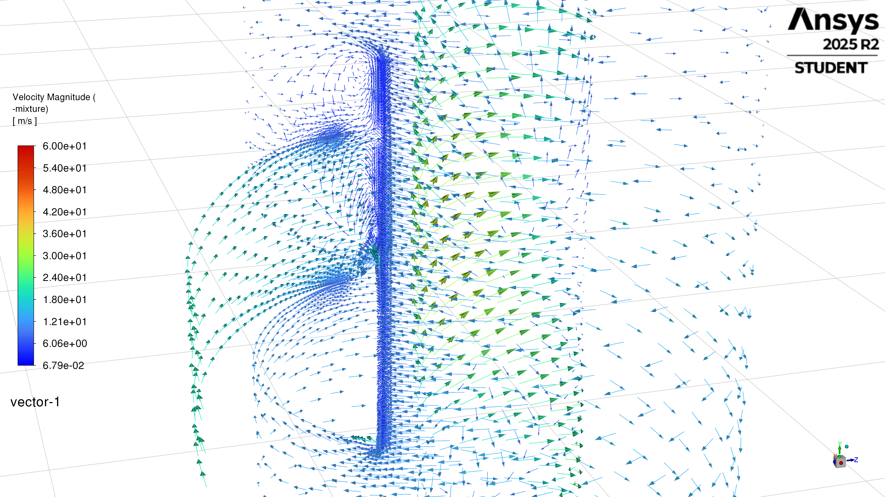
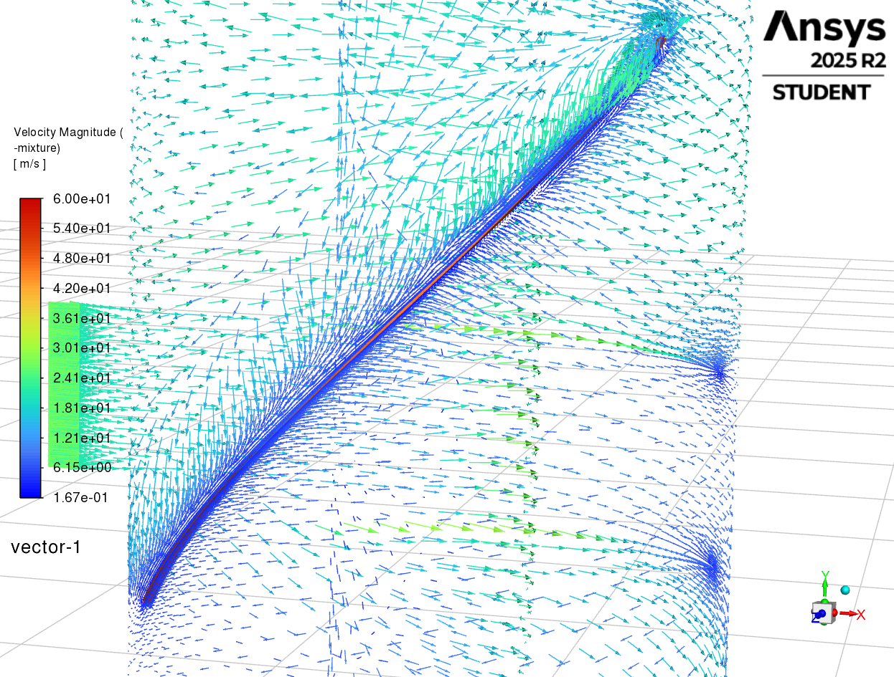

# Part 4 — Discussion, conclusions and future work

## 5. Discussion

This project developed the inherited separator model into a framework for investigating liquid transport and collection. Its progress should be assessed through the additional questions the model could answer: where liquid accumulated, how it entered and moved within a wall film, and whether it reached an external removal route. Lower residuals and repeatable startup procedures made these investigations practical, while the resulting fields identified where further model development was needed.

### 5.1. Inlet and mesh representation

The early comparisons showed why outlet flux alone could not explain the separator's behaviour. Pure-split feed produced a clearer liquid-rich wall band and deeper enrichment near the base, although almost all incoming liquid still left through the steam outlet (Section 4.1). The contours therefore revealed a change in liquid distribution that the boundary fluxes largely concealed. This made the path from wall capture to collection the central modelling question: inlet changes should be judged by where liquid ultimately goes, not only by whether they concentrate it near the wall.

The finer absorber-free cases exposed the same issue through continued accumulation at the closed base (Section 4.2). Lower liquid flow through the steam outlet could reflect retention rather than successful separation. The mesh comparisons suggested that near-wall representation affected how much liquid remained there, but differences in inlet placement and numerical preparation prevented an isolated accuracy judgement. Together, these findings showed that changing liquid delivery and retention could not resolve the missing discharge route. That required an explicit collection treatment.

### 5.2. Collection and numerical stability

Purnanto's collection assumptions provided the starting point described in Section 2.3.1, but the present study needed an explicit route for removing liquid from the bulk field. In the simplified domain, the lack of a separate liquid exit led either to accumulation or discharge with steam. The absorber supplied an explicit collection route without requiring a resolved brine pool and its outlet controls. This removed a practical obstacle to studying wall transport, while retaining pool pressure and level response as modelling assumptions.

The numerical progress was substantial. With collection and reduced feed, the reported minimum scaled continuity residual was about 650 times lower than the saved absorber-free reference, while liquid inventory was about 93% lower and changed little late in the hold (Section 4.4). These comparisons involve different loading, meshes and sampling points, with unverified residual-scaling equivalence. They describe the states reached by the combined procedure, rather than an isolated absorber effect or a quantified improvement in mass conservation. With matching continuity normalisation, the shortened-startup comparison reduced ramp peaks in continuity residual, liquid inventory and outlet flow by about 70–76%. This made it practical to introduce roughness, film physics and collection before full loading and then reuse the resulting fields for further experiments.

Strong swirl, turbulence and exchanges between bulk liquid, wall film and droplets made this a coupled problem. A change that improved one response could expose another unresolved process. The reduced residuals provided a more stable basis for adding and testing these processes. They demonstrate numerical progress, but neither residual reduction nor a stable bulk inventory alone establishes a complete liquid balance or physical accuracy.

### 5.3. Wall-liquid transport and film development

The wall studies identified a more specific problem than liquid reaching the vessel wall. Roughness substantially changed outlet liquid flow, but its response was not monotonic and could accompany depletion of stored liquid. The commercial-steel reference therefore supplied a material-based setting for later work, rather than a roughness chosen simply to minimise outlet flow. Roughness affected transport without creating a new collection route.

EWF made the wall a separate liquid store with its own transport and release processes, extending the liquid-path description beyond the droplet destinations discussed in Section 2.3.1. The model progressed from a young film to widespread coverage and sustained drainage over 500 ms. This was a significant extension of the model's capability: film development could be inspected directly rather than inferred only from bulk contours or droplet destinations. However, film input still exceeded drainage, showing why a slowly changing drainage rate was insufficient evidence of a stationary liquid state.

The release and direct-drain tests clarified the destination of liquid leaving the film. Release returned liquid to droplets within the vessel; direct drainage removed it externally. The lower-wall sink reduced local inventory while some of its removal replaced native outflow. During longer development, lower-wall storage remained low but upper-film storage continued to increase. These findings show that a functioning collector does not guarantee that the whole film reaches a steady balance.

This gives a concrete modelling consequence to the film literature reviewed in Section 2.4: wall capture cannot be treated as permanent separation when liquid can remain stored or return to the steam. Attention must therefore extend to transport between capture and collection. A design feature should be assessed by whether it increases externally collected liquid without increasing carryover, continued storage or unacceptable pressure loss. A lower film inventory alone could instead reflect greater release into the steam. This provided the physical basis for the design proposals in Section 5.5.

### 5.4. Mesh sensitivity of the developed model

The mesh comparison tested whether the behaviour used to develop the model persisted with finer resolution. At the same film age, the finer meshes showed more distinct film paths, less extensive upper-wall thickness, lower inventory and lower drainage. The apparent agreement between the intermediate meshes did not persist at the finest completed mesh (Section 4.10). This establishes sensitivity to mesh and preparation, and prevents treating coarse-mesh drainage as a mesh-independent performance prediction.

Slower film propagation is one possible explanation, but the lower inventory makes a transport-only explanation incomplete. Film accumulation depends on supply minus drainage and release. If starting mass, supply and release were identical, persistently lower drainage would leave more liquid stored, not less. The selected endpoints instead contain less film as well as a lower instantaneous drain rate. Differences in supply, release and their histories must therefore be considered alongside transport; an endpoint does not establish the preceding drainage history.

Broad coarse-mesh coverage could also partly reflect numerical spreading, while finer resolution preserves more distinct paths. Differences in the retained bulk fields and preparation could produce similar contrasts. These alternatives cannot be separated with the available snapshots. Consequently, higher coarse-mesh drainage cannot yet be interpreted as better predicted collection, and lower fine-mesh drainage cannot be interpreted as poorer separator performance. A comparison time informed by the coarse mesh did not establish equivalent film development across resolutions. Longer histories are needed to determine whether the finer cases approach similar behaviour later or maintain different liquid distributions.

### 5.5. Implications for separator design

The persistent upper-wall accumulation identified in Section 5.3 guided two proposals to improve the liquid path towards collection. The **vertical film blocker** aims to interrupt circulating wall liquid before it meets the incoming steam again. The **angled film ramp** aims to guide that liquid downwards towards collection. They provide a partial answer to the design-optimisation question in Section 1.3 by translating the observed transport problem into specific geometric changes.

Figure 21 shows encouraging local flow responses: the blocker interrupts the vector pattern, while flow beside the ramp changes direction along its inclined edge. These observations support further testing of the intended mechanisms. They do not establish improved drainage, because the vectors describe mixture velocity rather than wall-film motion. Different views and vector sampling also limit the panels to a qualitative comparison.

| (a) Vertical film blocker | (b) Angled film ramp |
| --- | --- |
|  |  |

*Figure 21. Preliminary mixture-velocity vectors around (a) the vertical film blocker and (b) the angled film ramp.*

Both basic-film cases reached 150 ms, providing starting states for further assessment (Appendix A.8). However, their meshes and earlier preparation differed, the bulk fields were frozen, and stripping and edge separation were disabled. The next design comparison must include film release and coupled transport to test whether either feature reduces liquid returning to the steam. The separate enhanced-film inlet comparison must remain distinct from these basic-film results.

The design contribution is therefore a pair of physically motivated proposals with preliminary evidence of local flow redirection. Their effect on wall-film transport and sustained collection remains to be tested, as set out in Section 6.2.

<!-- Evidence: [poster](../../../Poster/A1%20Landscape%20%E2%80%94%20Geothermal%20Separator%20Poster%20%E2%80%94%20Working%20Draft.pptx); [design rationale and attribution](../Shuhei-Context.md#10-design-proposals-act-on-the-wall-liquid-path-revealed-by-the-studies); [comparison settings](../../../experiments/phase-10-proposed-design/setup.md); [earlier inlet comparison and limits](../../../experiments/phase-10-proposed-design/inlet-comparison-50ms.md). Figure 21 retains the manual files unchanged; folder association does not independently verify the exact native state at image export. Appendix A.8 retains the image-source identities. -->

### 5.6. Overall contribution and remaining limits

The project substantially expanded the inherited model's capability and made the liquid-collection problem more explicit. Checked removal and startup procedures supported repeatable wall studies; longer film calculations distinguished storage from drainage; and mesh comparisons challenged conclusions that could otherwise have been drawn from one resolution. The resulting wall-film understanding also informed two design proposals. Relative to the inherited Purnanto approach (Section 2.3.1), the advance is a broader, testable account of liquid transport and collection. It does not establish a corrected efficiency for Purnanto's cases, which were not reproduced under matched conditions.

These procedures emerged from a broader programme than the selected report sequence. The retained records identify 387 executed configurations across both project partners, including failed and partial trials. Investigations of alternative boundaries, pool treatments, turbulence models and numerical controls informed which approaches were retained and which questions required a different method. Appendix A.7 gives the pool-control evidence behind the move to simplified collection. Their value was in narrowing the modelling problem and developing reusable procedures; the number of runs alone does not establish accuracy.

Computational cost limited how far those tests could be taken. Mesh resolution, film timestep, Courant limits and solver stability had to be balanced against available time. Shortened startup and the approximately 200 ms mesh comparison were practical responses to those constraints. Frozen bulk fields allowed film development to be studied under fixed forcing, but did not resolve the complete evolving interaction between bulk liquid, film and droplets. The finite histories therefore leave eventual stationary behaviour open.

The agent harness made setup, recovery and comparison repeatable across this experiment programme (Section 4.11). Its value was continuity and traceability; no controlled productivity comparison was made. Scientific judgement remained essential to selecting useful tests and interpreting their results.

The remaining steps are specific: close the combined liquid account, distinguish mesh effects from preparation and development time, and compare with measurements under matched conditions. These limits constrain claims about separation efficiency and pressure loss, but do not negate the demonstrated progress. The project established a more capable experimental model and identified the liquid pathways on which further numerical and design work should focus.

<!-- Project evidence: Sections 4.3–4.11 and their linked records; [baseline handoff](../../../experiments/phase-07-2a-wall-liquid-routing/baseline-control-handoff.md); [roughness-screen results](../../../experiments/phase-07-2a-wall-liquid-routing/roughness-family/results.md#matched-tail-comparison); [matched direct drainage](../../../experiments/phase-07-2a-wall-liquid-routing/stage-04-ewf-wall-parameters/ewf-only-drain/results.md); [long drainage continuation](../../../experiments/phase-07-2a-wall-liquid-routing/stage-04-ewf-wall-parameters/ewf-only-drain/long-development/results.md); [selected mesh evidence](../../../experiments/phase-09-mesh-convergence/results.md#selected-starting-and-195-ms-states--17-october-2026). The emphasis on progress from the inherited model, broad experimentation and compute constraints follows the author's report direction. -->

## 6. Conclusions and future work

### 6.1. Conclusions

Liquid reaching the wall did not by itself establish collection. This study developed a geothermal separator CFD model by tracking where liquid enters, accumulates, transfers and leaves. Mesh and inlet investigations showed that the predicted wall-liquid distribution depended on how wall liquid was represented. Placing liquid beside the wall made wall and base enrichment clearer, even where outlet flow changed little. Absorber-free cases showed the consequences of a missing collection route: liquid accumulated or was discharged almost completely through the steam outlet.

The absorber and revised startup procedures improved numerical behaviour sufficiently to support more complex wall studies. With reduced inlet loading, continuity residual and liquid inventory were much lower than in the absorber-free reference, although mesh and loading also differed. The later startup procedure reduced the peak continuity residual during loading by about 70%. These results demonstrate progress in numerical consistency and model capability, while physical accuracy remains to be established.

Roughness and wall-film modelling changed both outlet liquid flow and retained mass, showing that a reduction in outlet flow must be interpreted alongside storage and collection. Film coverage and fairly steady drainage developed over 500 ms with the surrounding flow held fixed, but accumulation continued. Direct drainage reduced lower-wall storage while partly replacing existing film outflow, and liquid continued to accumulate higher on the wall. The central finding is that successful local drainage does not ensure a steady liquid balance throughout the separator.

The completed work demonstrates model sensitivity and provides checked procedures for collection and startup. These findings motivate tests of designs that redirect wall liquid towards collection. At 195 ms, finer-mesh states showed less extensive appreciable film thickness and lower film drainage. The coarse-informed observation time did not establish equivalent film development across resolutions. Lower film inventory as well as lower drainage leaves differences in film supply, release and development unresolved; mesh independence has not been established. Sustained liquid accounting and physical validation are still needed before claiming improved separation efficiency or pressure-drop accuracy.

The design question is partially answered by the vertical film blocker and angled film ramp (Section 5.5), which apply the wall-film findings to geometric changes. Preliminary flow directions support further testing, but improved drainage and separation remain unverified.

### 6.2. Future work

The first priority is to determine whether the wall film can reach a statistically steady state. At 500 ms, drainage had become fairly steady but film inventory was still increasing (Section 4.8). Longer calculations should track total and upper-wall inventory alongside film input, release and drainage. Evidence of a statistically steady film would require no sustained growth in total or upper-wall inventory, with mean input balanced by mean outflow and release over successive observation windows. If growth persists, the next task is to identify whether continued supply, weak downward transport or insufficient release sustains the upper-wall accumulation. Extending the fixed-bulk calculation would first test this balance under unchanged forcing; it would not establish a steady state for the fully coupled separator. Given the computational cost, timestep and Courant settings should be assessed on a developed film before committing to longer runs.

The same investigation should resolve whether finer meshes need more development time. At approximately 200 ms, the finest completed mesh had both less film and lower drainage, so slower transport alone could not explain the difference (Section 4.10). Longer histories of film supply, storage and drainage on selected meshes would show whether their responses approach one another or remain distinct. This is more informative than adding further comparisons at the same short film age.

The second priority is to test whether the blocker and ramp proposed in Section 5.5 reduce upper-wall accumulation. Compare both features with the unmodified separator under matched feed, film settings and preparation, tracking upper-wall inventory, external collection and liquid returning to the steam. Film release and coupled transport must be included to assess renewed carryover. A useful feature must reduce persistent storage by directing liquid towards collection, rather than merely releasing it back into the steam.
