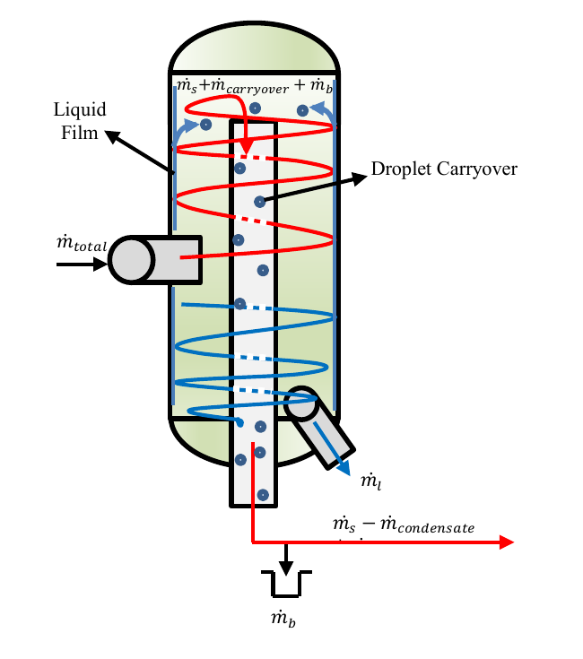
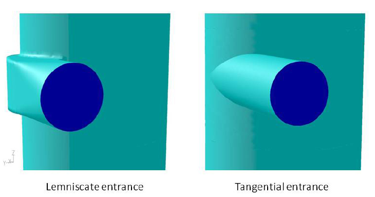
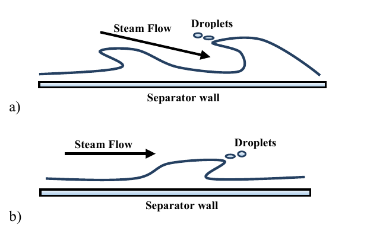
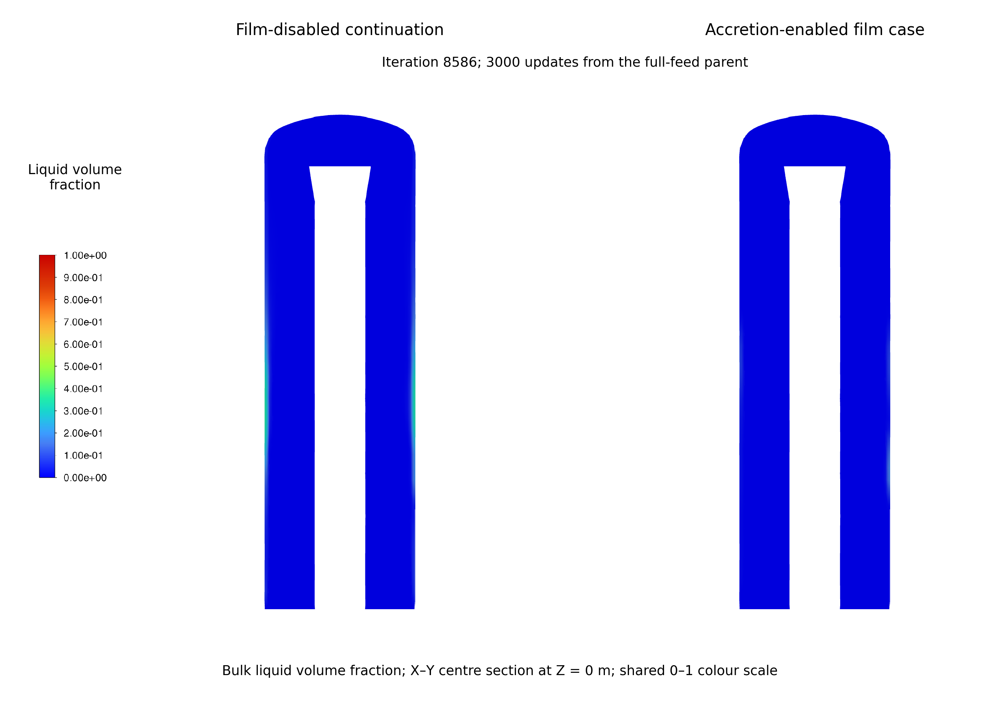
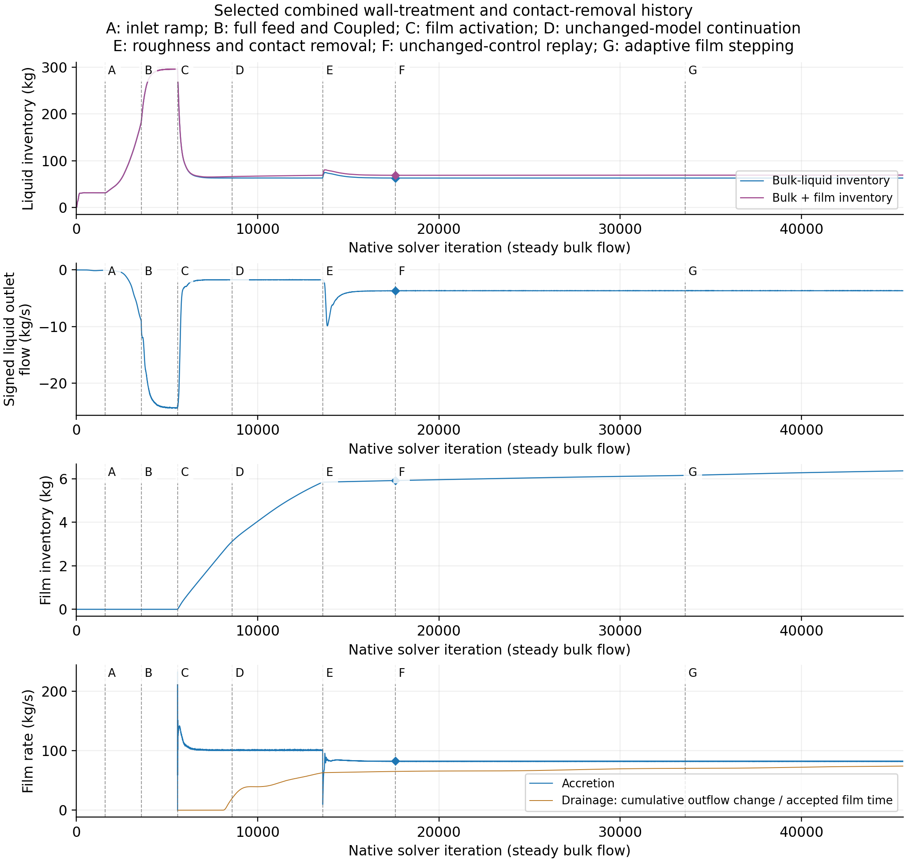
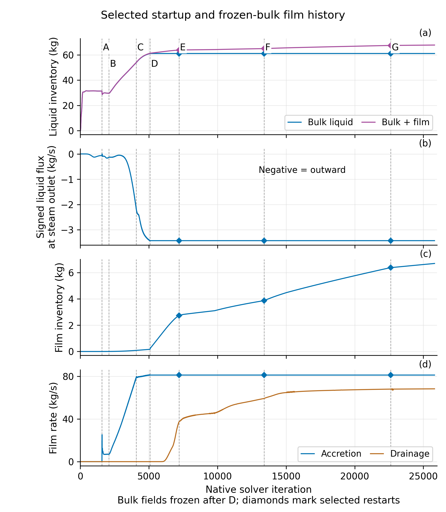
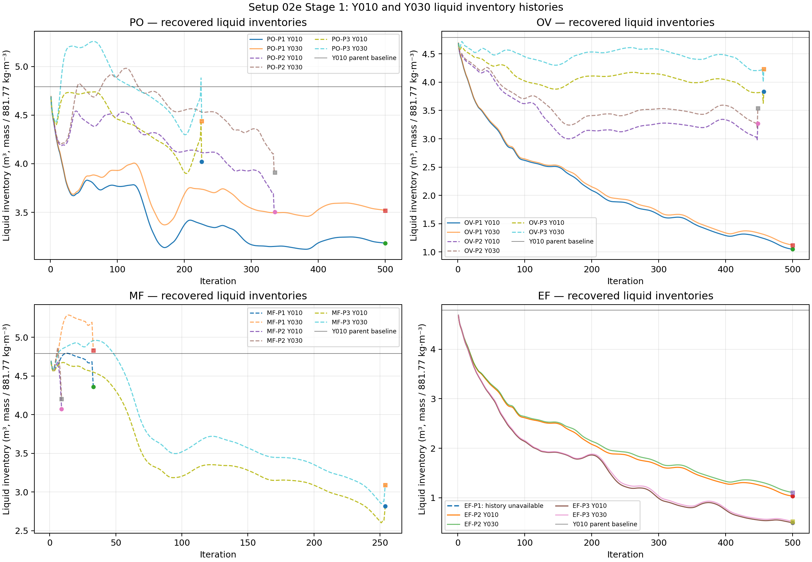
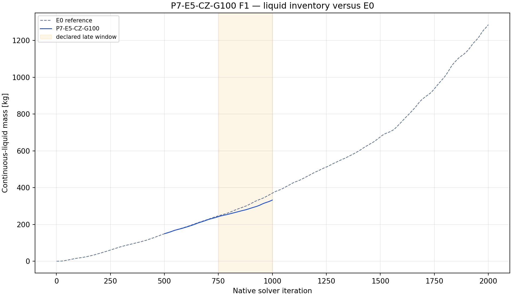
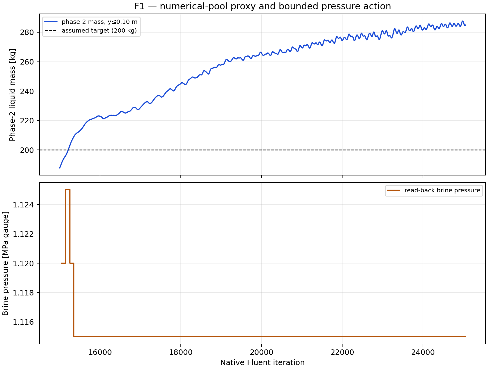

# Development of a geothermal separator CFD model: liquid transport, collection and wall-film behaviour

## Title page information

| Field | Information |
| --- | --- |
| Author | Shuhei Yokkaichi |
| Programme | Bachelor of Engineering (Honours), Engineering Science |
| Institution | The University of Auckland |
| Report type | Part IV Research Project Report |
| Supervisors | Sadiq Zarrouk and Maedeh Amirpour |
| Co-worker | Andy Tran |
| Draft date | 12 October 2026 |
| Student identification | To be entered by the author |
| Submission date | To be entered by the author |

<!-- Names follow the supplied working poster. The supplied ESB title-page template includes supervisors and co-worker; this takes precedence here over the generic structuring handout's different cover-page advice. -->

## Abstract

Geothermal separators must move liquid away from steam, collect it and provide a discharge route. This study developed an existing computational fluid dynamics model of a vertical steam–water separator by following liquid through the bulk flow, vessel wall and collector. The simplified geometry omitted the lower brine discharge. Mesh development, separate steam and liquid inlet regions, a numerical collector and staged startup enabled studies of wall roughness and Eulerian Wall Film.

The revised mesh provided wall-following refinement and showed changed liquid distributions. With mesh, feed and numerical controls held fixed, placing inlet liquid beside the wall increased retained mass by 37.4%. Without a collector, liquid accumulated in the lower vessel or almost entirely left through the steam outlet. Collection and reduced-feed startup then supplied common fields for wall comparisons. The later combined startup reduced the peak continuity residual during loading by 70.15%. The selected film treatment reduced mean bulk-liquid steam-outlet flow from 24.369 to 1.735 kg/s, alongside a large inventory change.

With bulk flow fields held fixed, film spread and thickened over the lower and middle wall. At 500 ms, input and drainage averaged 81.12 and 69.60 kg/s over the final 10 ms, with storage of 11.53 kg/s. Later configurations added droplet release and impact mechanisms. A matched direct film-drain test reduced lower-wall film inventory by 70.32%. A longer continuation showed that upper-wall liquid could still accumulate while the lower drain operated.

The study connects inlet and wall assumptions to liquid destinations and supplies checked collection and startup procedures. Wall capture, release and drainage must be assessed together when judging design changes. Developing fields, incomplete mass balances and unresolved numerical sensitivity limit the findings to model development. Physical validation is still needed before predicting separation efficiency or pressure loss.

> **Draft completion note.** Section 4.13 reserves the final Phase 9 mesh results. Update this abstract with their main finding when those results are selected; no outcome is assumed here.

## Declaration

*Unsigned draft using the supplied University template. The author must review and sign the declaration before submission.*

**Student**

I hereby declare that:

1. This report is the result of the final year project work carried out by my project partner (see cover page) and I under the guidance of our supervisor (see cover page) in the 2026 academic year at the Department Engineering Science and Biomedical Engineering, Faculty of Engineering, University of Auckland.
2. This report is not the outcome of work done previously.
3. This report is not the outcome of work done in collaboration, except that with a potential project sponsor (if any) as stated in the text.
4. This report is not the same as any report, thesis, conference article or journal paper, or any other publication or unpublished work in any format.

**Continuing-project statement.** The work builds on an inherited separator model and the published work of Purnanto et al. (2013). The present investigation developed liquid-collection and startup procedures, examined mesh and inlet assumptions, and studied wall roughness, film transport, release and drainage. The starting geometry and bulk modelling approach are identified as inherited work.

**Use of generative AI.** OpenAI Codex assisted with literature retrieval, coding and checking Fluent/PyFluent workflows, execution and recovery support, analysis, figure preparation and report drafting. Fluent performed the numerical calculations. The researcher directed the scientific scope and supplied the physical interpretation. Appendix D describes the division of work and the report's evidence records.

**Report word count:** to be inserted from the final assembled report.

**Signature and date:** to be completed by the author.

<!-- Prescribed wording: ../../ESB_part_IV_latex_report_template_v2/Declaration/ESB_declaration_online.tex. The declaration is not signed or represented as approved by this draft. -->

## Table of contents

| Report section | Draft location |
| --- | --- |
| 1. Introduction | [Part 1](#1-introduction) |
| 2. Literature review | [Part 1](#2-literature-review) |
| 3. Model and methods | [Part 2](#3-model-and-methods) |
| 4. Results | [Part 3](#4-results) |
| 5. Discussion | [Part 4](#5-discussion) |
| 6. Conclusions and future work | [Part 4](#6-conclusions-and-future-work) |
| References | [References](#references) |
| Appendix A. Method detail and reproducibility | [Appendix A](#appendix-a-method-detail-and-reproducibility) |
| Appendix B. Evidence routes and source limits | [Appendix B](#appendix-b-evidence-routes-and-source-limits) |
| Appendix C. Figure register | [Appendix C](#appendix-c-figure-register) |
| Appendix D. Author contribution | [Appendix D](#appendix-d-author-contribution) |

Page references will be generated during document layout.

## List of figures

| Figure | Subject |
| --- | --- |
| 1 | Separator operation and liquid routes |
| 2 | Empirical wetness and inlet velocity |
| 3 | Inlet geometries and tangential-velocity fields |
| 4 | Wall-film droplet entrainment |
| 5 | Actual solved domain and split inlet |
| 6 | Mesh structure and wall-liquid fields |
| 7 | Effect of inlet phase placement on liquid distribution |
| 8 | Liquid inventory and outlet flow on three finer meshes |
| 9 | Early startup and carrier development |
| 10 | Roughness response |
| 11 | Film-disabled/accretion-enabled outlet histories |
| 12 | Film-disabled/accretion-enabled bulk-liquid spatial comparison |
| 13 | Shortened-startup ramp comparison |
| 14 | Selected film development through 500 ms |
| 15 | Film-thickness views |
| 16 | Phase 9 liquid and film fields across mesh resolutions — reserved |
| 17 | Phase 9 collection, outlet flow and storage versus mesh resolution — reserved |
| A1 | Complete contact chronology |
| A2 | Shortened-startup and film chronology to iteration 25815 |
| A3 | Native inlet mesh section |
| A4 | Original twelve-case full-geometry outlet screen |
| A5 | Earlier cell-zone absorber and reference |
| A6 | Long pool-control trial and scope decision |

## List of main tables

| Table | Subject |
| --- | --- |
| 1 | Selected literature and implications for the separator model |
| 2 | Fixed material properties |
| 3 | Main boundary conditions |
| 4 | Matched inlet-placement results |
| 5 | Developing absorber-free fields at iteration 3000 |
| 6 | Peaks during the matched inlet ramp |
| 7 | Film inventory and late-window rates under frozen bulk fields |
| 8 | Matched direct lower-wall film-drain test |
| 9 | Phase 9 final mesh comparison — reserved |

Appendix tables retain comparison designs, detailed settings, criteria, histories, balance results and the supported research answers.

## Acknowledgements

I thank Sadiq Zarrouk and Maedeh Amirpour for their supervision and feedback as the modelling questions developed. Discussions with Sadiq also helped shape the wall-liquid design concepts. I thank Andy Tran for his collaboration as my project partner.

## Glossary of terms and abbreviations

| Term | Meaning in this report |
| --- | --- |
| BOC | Bottom-outlet cyclone |
| CFD | Computational fluid dynamics |
| Carrier | The Eulerian vapour and bulk-liquid flow fields through which discrete droplets are tracked |
| DPM | Discrete Phase Model; the Lagrangian representation of droplets |
| EWF | Eulerian Wall Film; the wall-based representation of liquid-film transport |
| IAPWS | International Association for the Properties of Water and Steam |
| IF97 | IAPWS industrial formulation for equilibrium water and steam properties |
| PyFluent | Python interface used to configure and command Ansys Fluent |
| Agent harness | Recorded workflow linking research questions, agent instructions, solver execution and analysis |
| RNG | Renormalisation group; used here in the RNG k–ε turbulence model |
| SIMPLE | Semi-Implicit Method for Pressure-Linked Equations |
| Bulk liquid | Liquid represented by the Eulerian secondary phase; excludes EWF inventory and discrete droplets |
| Vapour / bulk liquid | The primary vapour and secondary bulk-liquid phases in the selected Fluent carrier models |
| Accretion | Transfer of represented bulk liquid into the wall film |
| Stripping | Release of liquid from a film under gas forcing |
| Splashing | Production of secondary droplets during droplet impact on a film |
| Edge separation | Release of film liquid at a wall edge |
| Direct film drain | Local mass and momentum sink acting on lower-wall film storage |
| Incomplete trajectory | A tracked droplet with no completed terminal fate under the stated tracking controls |
| Absorber / virtual collector | A numerical liquid-removal treatment inside the truncated model; the two terms refer to the same model role |
| Native iteration | Fluent's recorded solver-update coordinate; it is not physical carrier-flow time |
| Film time | Time accumulated from the accepted EWF steps |
| Source term | A rate added to a transport equation; a negative mass source removes mass |
| Implicit source linearisation | Use of source derivatives within an equation solve to represent source dependence on the solved variable |
| Numerical stability | Observed finite and controlled behaviour over the stated calculation window |
| Iterative convergence | Active equations and relevant outputs meeting their declared settling conditions |
| Numerical accuracy | Accuracy of the computed solution of the stated model, assessed through numerical error and resolution evidence |
| Stiff source | A source with strong sensitivity to the solved variable, which can make an equation harder to solve |
| Numerical qualification | Assessment of a calculation against declared numerical, accounting and stationarity checks |
| Physical validation | Assessment against relevant physical observations for a stated use |

## Symbols

| Symbol | Meaning | Unit |
| --- | --- | --- |
| $\dot m$ | Mass-flow rate | kg/s |
| $M_b, M_f$ | Bulk-liquid and film inventories | kg |
| $M_c$ | Liquid mass in the collector | kg |
| $k_s$ | Modelled roughness height | m |
| $C_s$ | Roughness constant | — |
| $\alpha_L$ | Bulk-liquid volume fraction | — |
| $\rho_L$ | Liquid density | kg/m³ |
| $\boldsymbol u_L$ | Liquid velocity vector | m/s |
| $\boldsymbol u_m$ | Mixture velocity vector | m/s |
| $k$ | Shared turbulent kinetic energy | m²/s² |
| $\epsilon$ | Shared turbulence dissipation rate | m²/s³ |
| $S_L$ | Volumetric liquid mass source | kg/(m³·s) |
| $V_c$ | Collector region / its geometric volume | m³ |
| $\tau$ | Prescribed depletion time in the contact law | s |
| $h_f$ | Film thickness | m |
| $\tau_f$ | Direct film-drain capture time | s |
| $K_d$ | Direct film-drain removal coefficient | s⁻¹ |

---

# Part 1 — Introduction and literature review

<!-- Research framing: credible liquid transport and collection, developed through mesh/inlet assessment, absorber and startup procedures, and wall-film studies. Internal evidence links are traceability notes. -->

## 1. Introduction

### 1.1. Engineering problem

Geothermal steam–water separators supply dry steam to turbines. Liquid carryover can cause erosion and transport minerals that form deposits. Design must therefore consider separation efficiency, pressure drop and operating pressure. ([Zarrouk & Purnanto, 2015](https://doi.org/10.1016/j.geothermics.2014.05.009))

This study develops an inherited computational fluid dynamics (CFD) model of a vertical bottom-outlet cyclone with a spiral inlet. It follows liquid from inlet placement through wall transport and collection.

<!-- Evidence: [Study scope](../../../scope.md); [inlet-development interpretation](../../../experiments/phase-01-purnanto-baseline-and-inlet-exploration/interpretation.md); [author's development context and meeting sources](../Shuhei-Context.md#how-the-project-understanding-developed); [absorber-development context](../../../experiments/phase-07-1a-absorber-convergence/CONTEXT.md). -->

### 1.2. Problem in the inherited model

The simplified geometry omits the lower brine-discharge path. A closed bottom gives liquid no intended exit; opening the whole lower boundary can also let steam escape there. The model needs a collection treatment that preserves the steam route.

<!-- Evidence: [Model boundary](../../../model.md). -->

A virtual collector, termed an absorber, and reduced-feed startup enabled roughness and Eulerian Wall Film (EWF) studies after unsuccessful full-geometry drainage trials.

<!-- Evidence: [Verified early absorber](../../../experiments/phase-07-1a-absorber-convergence/baseline-v2-virtual-liquid-outlet/results.md); [selected case history](../../../experiments/phase-07-2a-wall-liquid-routing/stage-02-combined-ewf-roughness/case-history-N45606.md); [full-geometry scope decision](../../../experiments/phase-06-full-geometry-with-brine-pool/conclusion.md); historical lower-boundary dilemma in [29 April, 04:04–06:36](../../../meetings/otter/2026-04-29-wk-7-steam-liquid-separator-analysis.md). -->

A *developed flow field* is a saved full-feed state used as a common starting point, or parent. The selected parent retained a substantial liquid-balance error; it supported comparisons but was not validated.

<!-- Evidence: [R0 control](../../../experiments/phase-07-1a-absorber-convergence/roughness-family/r0-smooth-control/results.md); [source-inclusive R0 accounting assessment](../../../experiments/phase-07b-full-geometry-liquid-removal/convergence-investigation/shuhei-audit.md). -->

### 1.3. Research aim and questions

The aim is to develop and assess the separator model's liquid-transport and collection paths. Predicting separation efficiency and pressure drop is the longer-term purpose. The present work addresses four questions:

1. How do mesh representation and inlet phase placement affect liquid distribution and retention near the wall?
2. How can numerical collection and staged startup provide starting fields for wall studies?
3. How do wall roughness and wall-film modelling affect liquid transport, storage, release and collection?
4. What numerical and liquid-accounting evidence supports these predictions, and what remains necessary for field validation?

### 1.4. Scope and contribution

The study mainly uses the simplified primary separator. Mesh and inlet comparisons lead into collector development, startup and wall-treatment studies. Later cases examine film development to 500 ms, release mechanisms and direct drainage. Downstream equipment, mineral chemistry and optimum operating pressure are outside the simulated scope.

<!-- Evidence: [Study overview](../../../index.md); [selected case history](../../../experiments/phase-07-2a-wall-liquid-routing/stage-02-combined-ewf-roughness/case-history-N45606.md). -->

The contribution is an account of predicted liquid destinations and methods that enable their study. A final comparison across five mesh resolutions is reserved for Phase 9; mesh convergence remains unqualified. Controlled reconstruction cases are defined in Appendix A.2.

Section 3 describes the model and comparisons. Section 4 presents the results; Sections 5–6 discuss their meaning, limits and further work.

## 2. Literature review

### 2.1. How a geothermal steam–water separator works

A vertical bottom-outlet cyclone (BOC) uses a tangential or spiral inlet to rotate the incoming steam and brine. Liquid moves towards the wall while steam occupies the central region. An internal pipe carries steam out through the bottom; brine leaves separately. *Bottom outlet* refers to the steam-pipe arrangement. ([Zarrouk & Purnanto, 2015](https://doi.org/10.1016/j.geothermics.2014.05.009))

Wall capture is only part of separation. A film may drain, remain in the vessel or release droplets into the steam (Figure 1). The model must therefore distinguish wall retention from external collection.

*Figure 1. Conceptual liquid paths: wall film, droplets carried with steam, brine discharge ($\dot m_l$) and downstream brine collection ($\dot m_b$). The source schematic distinguishes these routes from condensation; it is not a measured mass balance. Source: [Rizaldy et al. (2016)](https://www.researchgate.net/publication/310818568_LIQUID_CARRYOVER_IN_GEOTHERMAL_STEAM-WATER_SEPARATORS), fig. 5.*

<!-- Evidence: [Model boundary](../../../model.md). Figure source: [primary carryover paper](../../../../CFD_wiki/raw/053_Rizaldy_Final.pdf), PDF page 3, original fig. 5; symbol interpretation checked against PDF pages 3–4. [Full-page source preview](../figures/literature-candidates/wall-film/rizaldy-2016-pdf-page-03.png). The inserted panel was rendered directly from the local PDF; its labels and arrows are unchanged. -->

### 2.2. Internal flow physics and performance measures

Rotation produces a low-pressure core, with inward acceleration scaling as $u_\theta^2/r$ for tangential velocity $u_\theta$ and radius $r$. Density-dependent responses to pressure and drag allow outward liquid transport. Fine droplets can follow steam; larger droplets reach collection surfaces more readily. Uncertain inlet sizes and continued droplet generation complicate prediction. ([Pointon et al., 2009](https://publications.mygeoenergynow.org/grc/1028587.pdf))

Higher velocity can strengthen outward transport but also increase entrainment by steam shear. Empirical data show rapid wetness increases at different velocities for different separators (Figure 2). Thus, greater swirl alone does not establish better separation. ([Zarrouk & Purnanto, 2015](https://doi.org/10.1016/j.geothermics.2014.05.009))

*Figure 2. Outlet mass wetness and steam quality versus inlet steam velocity. The reversed right axis gives steam quality. Different datasets show different breakdown regions, not a threshold for this geometry. Source: [Zarrouk and Purnanto (2015)](https://doi.org/10.1016/j.geothermics.2014.05.009), fig. 12, using Bangma (1960) and Lazalde-Crabtree (1984) data.*

<!-- Figure source: [primary design review](<../../../../CFD_wiki/raw/Zarrouk and Purnanto 2014.pdf>), PDF page 12 / printed page 247; [full-page source preview](../figures/literature-candidates/design-overview/zarrouk-purnanto-2015-page-12.png). The published axes, curves, points and legend are unchanged. -->

Outlet steam quality is

$$
x_{\mathrm{out}}=
\frac{\dot m_{v,\mathrm{out}}}
{\dot m_{v,\mathrm{out}}+\dot m_{l,\mathrm{out}}},
$$

where the terms are outward vapour and liquid mass-flow rates through the steam outlet. Purnanto et al. (2013) used this measure. It differs from liquid-capture fraction, which compares collected liquid with inlet liquid; their denominators are not interchangeable. ([Purnanto et al., 2013](https://www.researchgate.net/publication/269519626_CFD_MODELLING_OF_TWO-PHASE_FLOW_INSIDE_GEOTHERMAL_STEAM-WATER_SEPARATORS))

Steam purity concerns contamination. Chemical carryover estimates are affected by condensation and drain-pot collection, so field comparisons need matching definitions and sampling locations. ([Rizaldy et al., 2016](https://www.researchgate.net/publication/310818568_LIQUID_CARRYOVER_IN_GEOTHERMAL_STEAM-WATER_SEPARATORS))

Internal pressure drop requires defined inlet/outlet locations and a stated static or total pressure measure. It differs from selecting optimum operating pressure, which also involves flashing and plant conditions. The present no-flashing model addresses internal flow at prescribed phase conditions. ([Pointon et al., 2009](https://publications.mygeoenergynow.org/grc/1028587.pdf); [Zarrouk & Purnanto, 2015](https://doi.org/10.1016/j.geothermics.2014.05.009))

### 2.3. Established design methods and geothermal CFD

Empirical geothermal design methods provide reference points for CFD. However, CFD's additional flow detail must be assessed against its assumptions and comparison evidence. ([Zarrouk & Purnanto, 2015](https://doi.org/10.1016/j.geothermics.2014.05.009))

Pointon et al. (2009) used Fluent's Discrete Phase Model (DPM) with assumed droplet feed and wall/baffle collection. Predicted efficiencies were 99.96% for scrolled and 99.93% for tangential entry; an empirical design method gave 99.955%. Scrolled entry also gave higher tangential velocities (Figure 3). Empirical agreement did not independently test the feed or collection assumptions. ([Pointon et al., 2009](https://publications.mygeoenergynow.org/grc/1028587.pdf))

*(a) Inlet configurations.*

*(b) Calculated tangential-velocity distributions.*

*Figure 3. (a) Entry geometries; (b) tangential velocity (m/s). Scrolled (lemniscate) entry is left; tangential entry is right. Reported mean velocities are 34.1 and 32.5 m/s, respectively. Source: [Pointon et al. (2009)](https://publications.mygeoenergynow.org/grc/1028587.pdf), figs. 5 and 7.*

<!-- Figure source: [primary Pointon paper](../../../../CFD_wiki/raw/1028587.pdf), PDF pages 5–6 / printed pages 946–947; [geometry source page](../figures/literature-candidates/pointon/page-5.png); [velocity source page](../figures/literature-candidates/pointon/page-6.png). Both published panels, the velocity legend and mean annotations are unchanged. The report adds the (a)/(b) labels outside the images. -->

Purnanto et al. (2013) compared three BOC configurations using a steady Mixture model and DPM outlet-quality calculation. Changed vessel proportions prevented isolation of inlet shape. Counting incomplete droplet tracks as separated improved empirical agreement, but the authors called that assumption non-rigorous. The inherited modelling basis therefore requires explicit treatment of unresolved droplet fate. ([Purnanto et al., 2013](https://www.researchgate.net/publication/269519626_CFD_MODELLING_OF_TWO-PHASE_FLOW_INSIDE_GEOTHERMAL_STEAM-WATER_SEPARATORS))

Both studies used renormalisation-group (RNG) k–ε turbulence modelling. Pointon's swirl modification and lower-cost rationale offer a starting point, not a detailed turbulence-model comparison. Accuracy in the present swirling and near-wall flow remains to be assessed. ([Pointon et al., 2009](https://publications.mygeoenergynow.org/grc/1028587.pdf); [Purnanto et al., 2013](https://www.researchgate.net/publication/269519626_CFD_MODELLING_OF_TWO-PHASE_FLOW_INSIDE_GEOTHERMAL_STEAM-WATER_SEPARATORS))

Table 1 identifies transferable methods and the limits on their use.

*Table 1. Literature methods and their implications for this model.*

| Study / context | Liquid representation | Assessment evidence | Implication |
| --- | --- | --- | --- |
| Pointon et al. (2009): geothermal BOC | DPM; assumed feed and wall collection | Empirical design comparison | Declare droplet feed and collection rules |
| Purnanto et al. (2013): geothermal BOC; 11.2 bar absolute; isothermal, incompressible, no flashing | Mixture and DPM | Outlet quality; incomplete tracks | Retain bulk model; account for unresolved fate |
| Rizaldy et al. (2016): separator and steam line | Film-entrainment correlations; chemical sampling | Wairakei context; incomplete brine-flow data | Study re-entrainment; match sampling locations |
| Skoog (2020): reactor-channel approximation | Separate steam, EWF and DPM | 1D empirical comparison; inlet sensitivity | Track transfers; justify cyclone application |

### 2.4. Wall–liquid transport and carryover

Film motion depends on gravity, pressure and shear. Deposition adds liquid; drainage removes it; entrainment returns droplets to the steam. More wall deposition can therefore increase storage or later release without increasing external collection.

Rizaldy et al. (2016) predict entrainment sensitivity to loading, film thickness and velocity. Figure 4 shows conceptual release mechanisms. Missing brine-flow data prevented the required comparison with Wairakei drain-pot measurements, leaving quantitative field agreement unresolved. ([Rizaldy et al., 2016](https://www.researchgate.net/publication/310818568_LIQUID_CARRYOVER_IN_GEOTHERMAL_STEAM-WATER_SEPARATORS))

*Figure 4. Conceptual (a) undercut and (b) roll-wave entrainment, associated with lower and higher film Reynolds numbers, respectively. Steam releases droplets from the film. Film Reynolds number compares inertia with viscosity using liquid velocity and film thickness. Source: [Rizaldy et al. (2016)](https://www.researchgate.net/publication/310818568_LIQUID_CARRYOVER_IN_GEOTHERMAL_STEAM-WATER_SEPARATORS), fig. 9, crediting Ishii and Grolmes (1975).*

<!-- Figure source: [primary carryover paper](../../../../CFD_wiki/raw/053_Rizaldy_Final.pdf), PDF page 5; [full-page source preview and original attribution](../figures/literature-candidates/wall-film/rizaldy-2016-pdf-page-05.png). The two published mechanism panels and labels are unchanged. -->

Fluent roughness changes near-wall momentum transfer; it does not add a film store or drain. EWF instead adds surface storage and transport. Their outlet-flow responses must be read alongside retained mass and collection. ([Ansys, Inc., 2025k](https://ansyshelp.ansys.com/public/Views/Secured/corp/v252/en/flu_th/x1-5720008.164.html))

### 2.5. Representing liquid and its collection

The Mixture model represents bulk liquid through secondary-phase volume fraction. Algebraic slip estimates relative phase velocity using local equilibrium. Liquid volume fraction does not directly resolve film thickness or droplet-size distribution. ([Ansys, Inc., 2025d](https://ansyshelp.ansys.com/public/Views/Secured/corp/v252/en/flu_th/flu_th_sec_drift_oview.html))

DPM follows size-dependent droplet trajectories. Its interpretation requires defined injection and boundary treatments, with every tracked fate counted, including incomplete trajectories.

Skoog (2020) combined EWF surface transport, DPM deposition and entrainment in a reactor-channel approximation. Film/droplet flows were compared with one-dimensional calculations using experimentally based Okawa correlations. Inlet allocation and transverse droplet velocity affected the result. The separate liquid accounts provide a precedent; reactor conditions and correlations still need justification for a cyclone. ([Skoog, 2020](https://www.diva-portal.org/smash/get/diva2:1452100/FULLTEXT02.pdf); [Ansys, Inc., 2025e](https://ansyshelp.ansys.com/public/views/secured/corp/v252/en/flu_ug/flu_ug_models_wallfilm.html))

Bulk-to-film transfer moves liquid within the domain; the absorber removes it. Droplet injection must not duplicate another liquid feed. Fluent permits cell-zone mass and associated transport sources, but their law and effect require assessment. Section 3 describes the contact-based absorber. ([Ansys, Inc., 2025a](https://ansyshelp.ansys.com/public/Views/Secured/corp/v252/en/flu_ug/flu_ug_bcs_sec_cell_zones.html))

<!-- Evidence: [Audited model basis](../../../model.md); [liquid-accounting guardrails and application of Skoog](../../../technical/skoog-application-guardrails.md); [absorber-development context](../../../experiments/phase-07-1a-absorber-convergence/CONTEXT.md). -->

### 2.6. Numerical startup, convergence and validation

A steady calculation's iterations and pseudo-time describe numerical development, not physical filling time. The National Aeronautics and Space Administration (NASA) recommends monitoring residuals and relevant outputs, with convergence criteria tied to acceptable output error. ([NASA, 2021a](https://www.grc.nasa.gov/www/wind/valid/tutorial/iterconv.html))

Fluent permits flow development before film initialisation. Reduced-feed startup and ramp choices remain case-specific procedures requiring assessment. ([Ansys, Inc., 2025h](https://ansyshelp.ansys.com/public/views/secured/corp/v252/en/flu_ug/flu_ug_ewf_sec_overview.html))

Implementation checks, iterative convergence, mass accounting and numerical sensitivity answer separate questions. Mesh and time-step studies require a fixed model; roughness or absorber changes instead test model sensitivity. ([NASA, 2021c](https://www.grc.nasa.gov/www/wind/valid/tutorial/verassess.html))

Physical validation requires relevant measurements and uncertainty assessment. Here, field comparison must examine the assumed collection route and outlet predictions within the tested operating range. ([NASA, 2021b](https://www.grc.nasa.gov/www/wind/valid/tutorial/valassess.html))

<!-- Evidence: [Verification and validation limits](../../../vnv.md). -->

### 2.7. Remaining model uncertainties and research direction

The inherited model's incomplete liquid path links the research questions: mesh and inlet placement determine liquid delivery; collection supplies an exit; wall modelling determines storage and release. Liquid accounting and numerical checks define the limits of each finding.

---

# Part 2 — Model and methods

## 3. Model and methods

### 3.1. Computational domain and modelling scope

The model represented the upper separation region of a vertical cyclone: spiral inlet, vessel walls and steam outlet. It omitted the brine pool and discharge. The bottom remained a wall, so uncollected liquid could accumulate or leave through the steam outlet.

A numerical collector represented transfer into the omitted pool without opening a steam exit at the base. Full-geometry trials had not established stable drainage and pool control (Appendix A.13). Pool motion and downstream discharge remained outside the model. Absorber-free cases disabled collection in the same domain.

*Figure 5. Saved 60,964-cell domain (a) and inlet split (b). The 6.754 mm liquid strip lies beside the vessel wall. The 715-cell collector was selected by centroid position, $y\leq0.10$ m; its nodes extend to approximately $y=0.185$ m. Colours identify boundaries and the collector. The full-feed parent, combined contact endpoint and shortened-startup endpoint share coordinates and connectivity.*

The mesh uses vertical $y$, with the bottom near $y=0$ (exact bounds in Appendix A.1). The steam-outlet label marks the computational boundary at the central pipe opening. Bulk flow used a steady formulation, while film evolved on a separate clock. Bulk startup described numerical development through iterations, not physical startup time.

### 3.2. Physical model and assumptions

#### 3.2.1. Bulk steam–liquid flow

Ansys Fluent 2025 R2 used a pressure-based solver with absolute velocity. Steam was primary and liquid water secondary. Mixture solved bulk continuity and momentum, transported liquid volume fraction and calculated relative phase motion through algebraic slip. RNG $k$–$\varepsilon$ used differential-viscosity and swirl options with standard wall functions. Gravity acted in negative $y$ at 9.81 m/s². Energy was disabled, excluding flashing, condensation and temperature-dependent properties. Table 2 gives material values. ([Ansys, Inc., 2025d](https://ansyshelp.ansys.com/public/Views/Secured/corp/v252/en/flu_th/flu_th_sec_multiphase_mixture.html))

*Table 2. Fixed material properties verified for the throughput-controlled absorber model.*

| Phase | Density (kg/m³) | Dynamic viscosity (Pa·s) |
| --- | ---: | ---: |
| Vapour | 5.79743 | $1.52062\times10^{-5}$ |
| Liquid water | 881.211 | $1.45544\times10^{-4}$ |

The three states identified in Figure 5 used Manninen slip, Schiller–Naumann drag and 10 µm liquid-phase diameter. This local-equilibrium slip model was held fixed during wall comparisons; its accuracy for concentrated wall liquid remained unverified. The diameter controls continuum slip, separately from DPM droplets and film (Appendix A.1).

#### 3.2.2. Wall roughness and wall-film representation

Roughness changed wall friction through equivalent sand-grain height $k_s$ and constant $C_s$. Tested values were sensitivity inputs, not measured surface properties. The wall treatment and unresolved settings are documented in Appendix A.10. ([Ansys, Inc., 2025k](https://ansyshelp.ansys.com/public/Views/Secured/corp/v252/en/flu_th/x1-5720008.164.html))

Eulerian Wall Film (EWF) solved film mass and momentum on selected walls. Phase accretion transferred bulk liquid into the film. Early cases, including development to 500 ms, included gravity, gas shear, wall-viscous resistance and momentum advection. Film pressure-gradient, spreading and surface-tension forces were off, as were droplet collection, splashing, stripping and droplet edge separation. Native film-edge outflow remained active. ([Ansys, Inc., 2025e](https://ansyshelp.ansys.com/public/Views/Secured/corp/v252/en/flu_ug/flu_ug_ewf_sec_options.html))

Later tests enabled those forces and droplet mechanisms. Stripping releases film liquid under gas forcing; splashing creates secondary droplets on impact; edge separation releases liquid at wall edges. These tests used different developed bulk fields, so their comparison with the early run did not isolate one mechanism. Film-to-bulk momentum feedback stayed off. Coupling the film equations was a separate numerical choice (Appendices A.9 and A.12). ([Ansys, Inc., 2025b](https://ansyshelp.ansys.com/public/Views/Secured/corp/v252/en/flu_th/flu_th_ewf_sec_film_submodels.html))

### 3.3. Boundary conditions and liquid collection

#### 3.3.1. Enthalpy and the inlet phase mass flows

The reference feed was 197.61 kg/s at 1600 kJ/kg and 11.2 bar absolute. Saturated enthalpies gave vapour quality $x_V=(h-h_{L,\mathrm{sat}})/(h_{V,\mathrm{sat}}-h_{L,\mathrm{sat}})=0.408323$. Fixed inlet commands retained Purnanto's rounded **80.69 kg/s vapour and 116.92 kg/s liquid**. Appendix A.7 gives the calculation and properties. ([Purnanto et al., 2013](https://www.researchgate.net/publication/269519626_CFD_MODELLING_OF_TWO-PHASE_FLOW_INSIDE_GEOTHERMAL_STEAM-WATER_SEPARATORS))

#### 3.3.2. Volumetric flow, inlet split and velocity

The 0.724 m square inlet assigned about 0.933% of its area to a 6.754 mm liquid strip. It was sized from phase volume flows under an assumed common velocity. With Table 2's densities, the retained mass commands gave mean normal velocities of approximately 27.134 m/s for liquid and 26.803 m/s for vapour. Appendix A.7 distinguishes the original design densities from the solved material values.

The strip replaced an exploratory inlet that mixed liquid and steam over half the opening. Upstream pipe films support testing liquid entry beside the wall; complete segregation remained imposed. The matched mixed/split comparison tested its consequences. ([Pointon et al., 2009](https://publications.mygeoenergynow.org/grc/1028587.pdf))

#### 3.3.3. Fluent boundary implementation

The main wall-treatment calculations admitted pure liquid at `liquidinlet` and pure vapour at `steaminlet`, normal to both boundaries (Table 3). Operating pressure was 0 Pa; outlet gauge pressure therefore equalled absolute pressure. Inlet pressure was calculated. Turbulence used intensity and hydraulic diameter, with 2.11% intensity. Appendix A.6 gives diameters/backflow inputs and Appendix A.2 reconstruction differences.

*Table 3. Main boundary conditions. Reduced feed was 25% of full feed, with the phase mass ratio retained.*

| Boundary | Condition | Full feed | Reduced feed |
| --- | --- | ---: | ---: |
| Liquid inlet | Liquid mass-flow inlet | 116.9200 kg/s | 29.2300 kg/s |
| Vapour inlet | Vapour mass-flow inlet | 80.6900 kg/s | 20.1725 kg/s |
| Steam outlet | Gauge pressure | 1.120 MPa | Same |
| Vessel and bottom | Stationary, no-slip walls | Selected roughness/film treatment | As defined for startup |

#### 3.3.4. Contact-based absorber

The later contact absorber removed liquid present in collector cells without an inlet-throughput cap or direct vapour mass sink:

$$
S_L=-\frac{\rho_L\alpha_L}{\tau},\qquad \tau=10^{-5}\ \mathrm{s}.
$$

Here, $\rho_L$, $\alpha_L$ and $\tau$ are liquid density, volume fraction and depletion time; $S_L$ has units kg/(m³·s). The compiled source used $\max(\alpha_L,0)$. Momentum removal used $S_L\boldsymbol u_L$ at liquid velocity; turbulence sources used $S_Lk$ and $S_L\varepsilon$. These separate transport sources represented one-way capture. Appendix A.3 gives hooks, derivatives and applied-source checks; A.4 gives depletion-time sensitivity. Earlier screens used the throughput-controlled law in A.5. ([Ansys, Inc., 2025a](https://ansyshelp.ansys.com/public/Views/Secured/corp/v252/en/flu_ug/flu_ug_bcs_sec_cell_zones.html))

Bulk removal, film drainage and diagnostic-particle escape were separate routes. Early film drained where the active EWF wall ended. A later test extended EWF onto the lower wall and added a direct film mass sink with matching momentum removal and assumed 1.5 ms capture time. An isolated source check and matched 15 ms OFF/ON runs tested it with all bulk equations frozen (Appendix A.12).

### 3.4. Mesh and spatial discretisation

Fluent Meshing produced polyhedral–hexahedral meshes with wall-following layers for the expected liquid path. Reduced numerical diffusion remained a hypothesis dependent on resolution, alignment and discretisation. ([Ansys, Inc., 2025c](https://ansyshelp.ansys.com/public/Views/Secured/corp/v252/en/flu_ug/flu_ug_GridTypes.html))

The main mesh contained 60,964 cells. Appendix A.6 gives spatial schemes; Appendix A.10 gives connectivity and wall fields. Mean main-wall $y^+$ was approximately $2.0\times10^4$–$3.4\times10^4$ across three saved states, so wall-following topology did not establish fine wall resolution. Layer dimensions and solver mesh-quality measures remain unverified. Section 3.6 defines the separate mesh comparisons.

### 3.5. Numerical solution procedure

Original startup used Hybrid Initialisation, smooth walls, EWF off and throughput-controlled collection. A failed command left 25% feed to iteration 1580. The corrected procedure increased both phase commands over 2000 updates. At full feed, SIMPLE changed to Coupled with Global Time Step. After warm-up, a separate 1000-update control supplied the iteration-5586 parent (Appendix A.5).

The **developed parent** was selected after reviewing residuals, inventories, flows and sources, without claiming convergence. Shortened startup reused iteration-1580 fields without reinitialisation and enabled contact collection, 0.5 mm roughness, Coupled flow and dry film together (Appendix A.16).

Coupled solved pressure and momentum corrections together, with Mixture volume fraction solved separately. Coupling and pseudo-time changed together, so their individual effects were not isolated. Later film runs froze bulk flow, turbulence, volume fraction and relative motion. Fluent's steady EWF procedure assumes a converged frozen carrier; here the freeze allowed development under fixed forcing before bulk convergence was established. ([Ansys, Inc., 2025i](https://ansyshelp.ansys.com/public/Views/Secured/corp/v252/en/flu_ug/flu_ug_sec_uns_solve_pvel_1.html); [2025j](https://ansyshelp.ansys.com/public/Views/Secured/corp/v252/en/flu_ug/flu_ug_sec_multiphase_solution.html); [2025g](https://ansyshelp.ansys.com/public/Views/Secured/corp/v252/en/flu_th/flu_th_ewf_sec_sol_alg.html))

The implicit beta algorithm lacked inner residual reports. Equal-time fields and mass accounts supplied local checks; missing residuals were not passes. Save/reopen checked settings (Appendix A.9).

### 3.6. Comparison design

Exploratory inlet, droplet and film tests guided later controlled comparisons (Appendix A.13). Wall screens started from a common parent. Startup and combined continuations changed several settings together and tested procedures (Appendix A.16). Roughness ranged from 0 to 8 mm; $C_s$ variations and reporting windows are given in Appendix A.5.

Absorber-free mixed/split Coupled reconstructions held mesh, feed and controls fixed, with fresh initialisation and 10,000 updates. The historical tetrahedral comparison changed mesh, inlet and preparation. SIMPLE/Coupled reconstruction comparisons also changed pseudo-time and the $k$ scheme, so neither isolated one cause.

Finer absorber-free SIMPLE diagnostics compared 342,609-, 679,970- and 997,604-cell fields at iteration 3000. These developing solutions were not a converged mesh study (Appendix A.2).

Phase 9 compares the combined model, with 0.045 mm roughness and momentum feedback off, across five baseline resolutions. Section 4.13 specifies the planned film-age and bulk-development comparison. Blocker and ramp geometries address separate design questions; mesh independence remains unresolved.

<!-- Evidence: [Phase 9 setup](../../../experiments/phase-09-mesh-convergence/setup.md); [EWF Plan v1](../../../experiments/phase-09-mesh-convergence/ewf-plan-v1.md). Reconcile final settings and executed endpoints before completing the reserved result. -->

### 3.7. Data reduction and numerical assessment

Each value retained its case, active equations and reporting window. Endpoints, means and residual minima were distinct. Inventories, outlet flows, collection and film-transfer rates were assessed with residuals and source checks. A fixed iteration horizon did not establish convergence. Appendix A.9 defines the numerical criteria and integration methods.

Fluent fluxes were positive into the domain. With EWF off and no other liquid transfer, the signed remainder (kg/s) was

$$
R_L=\sum_b\dot m_{L,b}+\dot m_{L,\mathrm{source,applied}}.
$$

The source retained its negative removal sign. Evaluated and applied removal described the same sink, so only one entered the balance. Bulk-to-film accretion cancelled only in compatible combined accounts. Native mixture and phase-summed reports were assessed separately.

Early film cases had only accretion input: rate $A_i$ over accepted increment $\Delta t_i$. With outflow increment $\Delta D_f$ and inventory change $\Delta M_f$, the film remainder and percentage error were

$$
E_f=\Delta M_f+\Delta D_f-\sum_i A_i\Delta t_i,\qquad
e_f=100\frac{|E_f|}{\left|\sum_i A_i\Delta t_i\right|}.
$$

Later mechanisms required extra terms (Appendix A.12). With bulk frozen, reciprocal bulk depletion did not advance; film-account agreement could not establish combined conservation.

Wall screens used final-500 arithmetic means; the 500 ms film run used overlap-weighted final-10-ms rates. The bulk-liquid outlet ratio used liquid feed as denominator; outlet dryness used total outlet flow (Section 2.2). Neither pathlines nor diagnostic-droplet fates replaced bulk-liquid fluxes. Residual scaling was checked for startup comparisons; residuals were not percentage mass imbalances. ([NASA, 2021a](https://www.grc.nasa.gov/www/wind/valid/tutorial/iterconv.html))

### 3.8. Experiment workflow and use of automation

The cycle was question → bounded comparison → implementation check → Fluent solve → interpretation → next question. The researcher set scientific scope and interpreted findings. Task-specific agent instructions, Python and PyFluent supported execution. Native reports, transcripts and reopened case/data pairs recorded what ran. This workflow supported repeatable tests and recovery; numerical and physical assessments remained separate. Appendix B links the records.

---

# Part 3 — Results

<!-- Findings follow the physical model-development questions, rather than experiment date. -->

## 4. Results

The results follow liquid from inlet placement to wall retention, collection and film development. Earlier exploratory studies are retained in Appendix A.13.

Each comparison uses its stated mesh and settings. Outlet liquid flow is positive outwards unless a signed value is given. Steady iteration describes numerical development; accepted film time describes the transient film calculation.

### 4.1. Mesh development and the wall-liquid field

The polyhedral–hexahedral mesh had larger interior cells, polyhedral transitions and thin layers along the wall (Figure 6). The workflow gave control over the mesh near the expected liquid path; Section 3.4 gives its near-wall resolution.

At iteration 10,000, the historical tetrahedral field showed thin wall-side liquid enrichment. The 60,964-cell SIMPLE reconstruction showed a broader region with a higher liquid fraction. Inlet representation and preparation also differed, and the coarse SIMPLE state had a large mass-balance error. The comparison shows changed fields; reduced numerical diffusion remains a possible explanation, not a measured accuracy gain.

*Figure 6. Mesh sections (a–b) and bulk-liquid fraction (c–d) at each geometry's inlet midpoint. Left: historical split-feed tetrahedral case, 7,601,261 cells. Right: mixed-feed SIMPLE reconstruction, 60,964 cells. Both liquid fields are saved at iteration 10,000 on a common 0–1 scale. Each column uses one case mesh.*

<!-- Evidence: [native mesh and liquid-field comparison, source pairs and export manifests](../../../Poster/poster-sections/mesh-and-volume-fraction-comparison.md); solved 60k topology and wall-resolution evidence in Appendix A.10. The separate 342k mesh illustration used elsewhere is not substituted for the 60k contour's mesh here. -->

### 4.2. Two-phase inlet and wall-side liquid placement

Split feed produced a more continuous liquid-rich wall band and deeper lower-region enrichment than mixed feed (Figure 7). At nominal 26.81 m/s, retained liquid increased by 471.9 kg, or 37.4% (Table 4). Split feed retained more liquid at all five tested speeds, 20.11–32.14 m/s.

Both cases used the same 60,964-cell mesh, total phase feed, Coupled settings, initialisation and 10,000-update horizon. Mixed feed supplied both phases across both inlet faces; split feed supplied liquid through the wall-side strip. Complete phase segregation was an assumed profile (Section 3.3). It changed internal liquid placement but did not provide collection: both cases discharged almost all incoming liquid through the steam outlet.

*Figure 7. Bulk-liquid fraction at nominal 26.81 m/s and iteration 10,000. (a–b) Inlet-height sections; (c–d) vertical centre sections. Mixed feed: (a, c); split feed: (b, d). Both use a 0–1 scale, a closed bottom, and no absorber or EWF. Contours show distribution; volume integrals quantify mass.*

*Table 4. Matched inlet-placement results. Inventories are iteration-10,000 endpoints; outlet ratios use iterations 9500–10,000. Liquid feed was 116.9387 kg/s.*

| Quantity | Mixed feed | Wall-side split feed |
| --- | ---: | ---: |
| Bulk-liquid inventory (kg) | 1262.6 | 1734.5 |
| Outward steam-outlet liquid / liquid feed (%) | 99.671 | 99.404 |

<!-- Evidence: [matched inlet setup and numerical basis](../../../experiments/phase-08-storyline-reconstruction/stage-01-60k-storyline/baseline-lineage-audit.md), [mixed-feed results](../../../experiments/phase-08-storyline-reconstruction/stage-01-60k-storyline/f1-one-inlet/results.md), [split-feed inventory and spatial findings](../../../experiments/phase-08-storyline-reconstruction/stage-01-60k-storyline/f2-split-inlet/results.md), and [native inlet-plane exports](../../../Poster/poster-sections/mesh-and-volume-fraction-comparison.md). Percentage inventory change is calculated from the rounded published endpoint values. -->

### 4.3. Liquid accumulation and the need for collection

The three finer split-inlet SIMPLE cases accumulated liquid near the wall and base while discharging little through the steam outlet (Table 5; Figure 8). At iteration 3000, the 997,604-cell case held 69.16% of its liquid below $y=1$ m.

*Table 5. Absorber-free checkpoints at iteration 3000 under the same reduced-relaxation SIMPLE settings. The fields are still developing.*

| Cells | Bulk-liquid inventory (kg) | Outward steam-outlet liquid (kg/s) |
| ---: | ---: | ---: |
| 342,609 | 453.612 | 2.2080 |
| 679,970 | 455.409 | 1.5321 |
| 997,604 | 333.142 | 0.003623 |

*Figure 8. Bulk-liquid inventory and net outward outlet flow at saved checkpoints. All cases use pure split feed, SIMPLE and no absorber. Lines connect saved states; steady solver iterations are not physical time.*

On the 679,970-cell mesh, inventory reached 764.744 kg at iteration 4000, with 69.62% below $y=2$ m. Outlet liquid was 8.00 kg/s, or 6.84% of the feed. The next continuation failed after printed iteration 4211; its cause was not isolated.

The next studies used a liquid-selective source after unresolved full-geometry trials (Appendix A.13).

<!-- Evidence: [matched finer-mesh checkpoints](../../../experiments/phase-08-storyline-reconstruction/stage-02-fine-mesh-simple/direct-student-342k/n3000/results.md), [997k spatial result](../../../experiments/phase-08-storyline-reconstruction/stage-02-fine-mesh-simple/direct-student-997k/n3000/results.md), [680k accumulation and failed continuation](../../../experiments/phase-08-storyline-reconstruction/stage-02-fine-mesh-simple/direct-student-680k/n4000/results.md), [mixed-inlet Coupled account](../../../experiments/phase-08-storyline-reconstruction/stage-01-60k-storyline/f1-one-inlet/results.md) and [full-geometry scope decision](../../../experiments/phase-06-full-geometry-with-brine-pool/conclusion.md). -->

### 4.4. Reduced-feed development and inlet ramp

The startup and wall studies used the 60,964-cell split-inlet model, with full feed of 116.92 kg/s liquid and 80.69 kg/s steam.

At 25% feed with throughput collection, inventory fell only 0.30% over iterations 1080–1580, ending at 31.3571 kg (Figure 9). Minimum scaled continuity was $3.2056\times10^{-4}$.

The hold was unintended: a failed ramp command had left both inlet rates unchanged. A corrected, checked 2000-update ramp reached full feed at iteration 3580. Ramp continuity peaked at $1.1166\times10^{-2}$ and inventory reached 182.5178 kg. The hold revealed a useful startup route: develop reduced-feed fields before loading them.

*Figure 9. Scaled bulk residuals, liquid inventory and reported liquid-inlet/absorber command. A: ramp start, iteration 1580. B: full feed and change to Coupled with Global Time Step, iteration 3580. C: EWF activation, iteration 5586. The inherited, unsolved inlet-report value at iteration 1 is omitted. Appendix A.15.1 records the stages.*

<!-- Evidence: [selected case history](../../../experiments/phase-07-2a-wall-liquid-routing/stage-02-combined-ewf-roughness/case-history-N45606.md), [carrier residuals](../../../../PyAnsys/output/phase72a-lineage-N45606/20261005/carrier-residuals.csv) and [liquid histories](../../../../PyAnsys/output/phase72a-lineage-N45606/20261005/selected-lineage-histories.csv). -->

### 4.5. Full-feed control and mass balance

The smooth-wall, EWF-off Coupled continuation became the iteration-5586 comparison parent. Continuity fell and inventory approached 296 kg, but residual oscillations, outlet reverse flow and turbulent-viscosity limiting persisted.

Applied absorber removal matched its 116.92 kg/s command, but another 24.3344 kg/s left through the steam outlet. The signed liquid boundary-plus-source remainder was therefore −24.3344 kg/s, or −20.81% of the feed. Source application was verified; conservation remained unresolved (Appendix A.15.2).

<!-- Evidence: [full-feed control continuation](../../../experiments/phase-07-1a-absorber-convergence/roughness-family/r0-smooth-control/results.md), [baseline handoff](../../../experiments/phase-07-2a-wall-liquid-routing/baseline-control-handoff.md), [aligned native full-feed control histories](../../../../PyAnsys/output/phase71a_r0_control_run4/report-histories-batched.json) and [full-feed control accounting audit](../../../experiments/phase-07b-full-geometry-liquid-removal/convergence-investigation/shuhei-audit.md). -->

### 4.6. Roughness response from the common parent

The roughness response was non-monotonic (Figure 10). At $C_s=0.5$, 0.05 mm raised mean outlet flow by 21.21%; 8 mm reduced it by 44.09%, from 24.3715 to 13.6253 kg/s. Increasing $C_s$ lowered flow at both fixed heights.

*Figure 10. Mean outward steam-outlet liquid flow with EWF off. Left: height sweep at $C_s=0.5$. Right: constant sweep at $k_s=0.5$ and 2 mm; dashed line: smooth continuation. All twelve cases ran 3000 updates from iteration 5586. Means use iterations 8087–8586; lines connect tested settings.*

The 8 mm case lost 187.109 kg of bulk liquid. Oscillations and incomplete balances prevented an efficiency claim. The later 0.045 mm continuation also changed bulk advancement and film stepping, so it did not isolate roughness (Appendix A.12).

<!-- Evidence for the material-reference continuation: [Commercial-steel results](../../../experiments/phase-07-2a-wall-liquid-routing/stage-04-ewf-wall-parameters/commercial-steel/results.md). The 0.045 mm value is a selected reference, not a measured separator finish or a matched roughness-only comparison. -->

<!-- Evidence: [roughness-screen results and sample standard deviations](../../../experiments/phase-07-2a-wall-liquid-routing/roughness-family/results.md#matched-tail-comparison) and [comparison figure and provenance](../../../observations/07-wall-liquid-interaction.md). The source's later statement identifying the lowest outlet conflicts with its table; the table values are used here. -->

### 4.7. Accretion-enabled wall-film response

From common smooth-wall fields with throughput collection, the EWF package reduced mean outlet liquid by 92.88%, from 24.369 to 1.735 kg/s over iterations 8087–8586 (Figure 11). Phase accretion and coupled film equations were on; momentum feedback was off. Earlier trials are in Appendix A.11.

*Figure 11. Outward bulk-liquid outlet flow over 3000 updates from the common full-feed parent. The EWF case uses a fixed 10 µs film step. All 3001 points are shown without smoothing; shading marks the final 500 updates.*

Bulk mass fell from 295.8536 to 63.0234 kg, while film mass reached only 3.1112 kg. The sections showed less liquid beside the wall (Figure 12). The film package changed liquid distribution, but changing inventories and an open combined liquid account prevent an efficiency claim.

*Figure 12. Bulk-liquid fraction at iteration 8586. Left: EWF off. Right: accretion-enabled film case. Native X–Y centre sections at Z = 0 m use the same orthographic camera and 0–1 scale. Film thickness and drainage are separate quantities.*

<!-- Evidence: [film-disabled and accretion-enabled comparison](../../../observations/07-wall-liquid-interaction.md), [wall-film-screen results and native sections](../../../experiments/phase-07-2a-wall-liquid-routing/ewf-family/results.md#native-phase-2-volume-fraction-contours--2026-09-23), [paired contour provenance](../figures/bulk-comparison-described-film-treatment.provenance.json) and [selected endpoint histories](../../../../PyAnsys/output/phase72a-lineage-N45606/20261005/selected-lineage-histories.csv). The film-disabled continuation's mean is from its separate comparison run and is not substituted for the roughness screen's smooth-wall mean. -->

### 4.8. Contact collection and combined model development

Shorter depletion time reduced collector inventory but increased removal variability (Appendix A.4). The combined continuation applied 10 µs contact collection, 0.5 mm roughness and a 1 µs film step together; their effects were not isolated.

At iteration 45606, film mass was 6.3600 kg after 120.769 ms. Final-1000-update drainage remained 9.98% below accretion, so the film continued to fill. Appendix A.15.3 and the linked case history retain the endpoints and detailed film account.

<!-- Evidence: [contact-strength screens](../../../experiments/phase-07-2a-wall-liquid-routing/stage-02-combined-ewf-roughness/results.md#all-liquid-contact-absorber-trial), [complete selected case history](../../../experiments/phase-07-2a-wall-liquid-routing/stage-02-combined-ewf-roughness/case-history-N45606.md) and [corrected film ledger](../../../../PyAnsys/output/phase72a-lineage-N45606/20261005/corrected-film-development-summary.json). The short strength-screen branch is distinct from the original-field continuation retained in Appendix A.9. -->

### 4.9. Shortened startup with early wall-film activation

Shortened startup activated Coupled flow, contact collection, roughness and film in the reduced-feed fields. A 500-update activation hold preceded the 2000-update ramp and 1000-update full-feed hold. Ramp peaks were lower (Figure 13; Table 6).

*Figure 13. Continuity with common normalisation, bulk + film inventory and native signed outlet liquid flux; negative is outwards. Orange: historical iterations 1581–4580. Blue: shortened iterations 2081–5080. The dashed line marks full feed after 2000 ramp updates; shading marks the following hold. The activation hold is excluded. All source points are shown without smoothing.*

*Table 6. Ramp peaks. Reductions are relative to the historical startup; the settings test a combined recipe.*

| Measure | Historical startup | Shortened startup | Reduction (%) |
| --- | ---: | ---: | ---: |
| Scaled continuity | 0.011166 | 0.0033336 | 70.15 |
| Bulk + film inventory (kg) | 182.518 | 53.9715 | 70.43 |
| Outward bulk-liquid steam-outlet flow (kg/s) | 8.99517 | 2.17887 | 75.78 |

The excluded activation hold had a continuity peak of 0.10593, exceeding the historical ramp peak. At iteration 5080, bulk and film masses were 61.0549 and 0.1645 kg. Almost all film input was still stored (Appendix A.15.4). All ramp updates met the recorded inner-film tolerance, but 15 of the final 100 hold updates failed it. The recipe reduced loading peaks without establishing complete startup convergence (Appendix A.9.4).

<!-- Evidence: [shortened-startup results](../../../experiments/phase-07-2a-wall-liquid-routing/stage-03-shortened-reconstruction/early-ewf-startup/results.md), [audited metrics, native source checks and normalisation](../../../../PyAnsys/output/phase72a-stage3-early-ewf-server1/20261005/analysis-summary.json) and [native final histories for Appendix A.15.4](../../../../PyAnsys/output/phase72a-stage3-early-ewf-server1/20261005/final-histories.json). -->

### 4.10. Film development under frozen bulk fields

Film mass increased from 0.1645 kg at 3.5 ms to 9.5444 kg at 500 ms (Figure 14). After iteration 5080, bulk equations were frozen, leaving bulk inventory at 61.0549 kg and outward bulk-liquid outlet flow at 3.4300 kg/s. These fixed values describe held forcing; reciprocal bulk depletion was not calculated.

*Figure 14. Reference-speed film mass and native accretion/drainage rates against accepted time since dry-film activation. Bulk fields are frozen. Markers locate Figure 15 snapshots and the 500 ms endpoint; shading marks the final 10 ms. Selected records are unsmoothed; rejected sibling continuations are excluded.*

The film spread and thickened over the lower and middle wall (Figure 15). Between 75.66 and 265.18 ms, wall area with thickness at least 0.10 mm increased from 40.34% to 61.98%; maximum thickness rose from 0.253 to 0.291 mm.

*Figure 15. Film thickness at 5.90, 75.66 and 265.18 ms; film masses are 0.360, 3.864 and 6.688 kg. Views use the same orthographic camera and 0–0.30 mm scale. Native Fluent wall geometry and facet values are rendered without spatial interpolation.*

*Table 7. Endpoint film mass and mean late-window rates. The 265.184 ms rates use the latest complete 1000-update window; 500 ms rates use the final 10 ms with interval-overlap weighting. Storage is mass change divided by accepted film time.*

| Film time (ms) | Film mass (kg) | Accretion (kg/s) | Drainage (kg/s) | Storage (kg/s) | Drainage deficit (%) |
| ---: | ---: | ---: | ---: | ---: | ---: |
| 265.184 | 6.6883 | 81.121 | 68.177 | 12.954 | 15.96 |
| 500.000 | 9.5444 | 81.121 | 69.600 | 11.528 | 14.20 |

Drainage remained below input (Table 7). At 500 ms, storage was still 11.528 kg/s, so the film was not stationary. Only the reference-speed arm reached this endpoint (Appendix A.9).

<!-- Evidence: [selected film-development results, spatial metrics and reporting windows](../../../experiments/phase-07-2a-wall-liquid-routing/stage-03-shortened-reconstruction/early-ewf-startup/film-development/results.md), [500 ms campaign results](../../../experiments/phase-07-2a-wall-liquid-routing/stage-03-shortened-reconstruction/early-ewf-startup/inlet-speed-500ms/results.md), [selected reference-speed CSV](../../../../PyAnsys/output/phase72a-stage3-speed-sensitivity-server1/20261006/selected-film-history-reference.csv) and [Figure 14 provenance](../figures/results-film-development-reference500ms-provenance.json). -->

### 4.11. Added film-release mechanisms and direct drainage

Later tests enabled stripping, splashing, droplet collection and edge separation, retaining film-to-flow momentum feedback off. After 4000 bulk updates, 50 ms of frozen-bulk development increased film mass from 0.2638 to 5.9070 kg. Final approximately 5 ms mean stripping and edge-separation rates were 64.56 and 51.87 kg/s, while storage was 80.81 kg/s. A separate splash contribution was unresolved.

Native film outflow was zero during that interval. Extending the film domain onto the lower wall then allowed a matched direct-sink test (Table 8). The sink removed 0.5088 kg and reduced lower-wall film mass by 70.32% with all bulk equations frozen.

*Table 8. Direct drainage over 15 ms from identical fields and initial film mass of 9.7526 kg. Both arms use the same expanded film domain; only the sink is switched.*

| Quantity | Drain OFF | Drain ON |
| --- | ---: | ---: |
| Final lower-wall film (kg) | 0.18752 | 0.05565 |
| Final total film (kg) | 11.1726 | 10.9829 |
| Direct sink removal (kg) | 0 | 0.5088 |
| Native film outflow (kg) | 0.5302 | 0.2111 |
| Direct sink plus native outflow (kg) | 0.5302 | 0.7199 |

In the longer continuation, lower film stayed near 0.056 kg while upper film grew. The complete 405 ms record, including the rejected tail, contains 15.16 kg of direct removal and a 27.58 kg increase in film inventory. Storage was positive before the Courant-guard crossing. Local drainage therefore did not stop accumulation elsewhere. These tests used different fields and forces from the early film study; particle release was internal transfer, while the sink removed liquid from the model (Appendix A.12).

<!-- Evidence: [release-mechanism continuation](../../../experiments/phase-07-2a-wall-liquid-routing/stage-04-ewf-wall-parameters/realism-continuation/feedback-off/results.md), [matched direct-drain test](../../../experiments/phase-07-2a-wall-liquid-routing/stage-04-ewf-wall-parameters/ewf-only-drain/results.md) and [long drain-ON development](../../../experiments/phase-07-2a-wall-liquid-routing/stage-04-ewf-wall-parameters/ewf-only-drain/long-development/results.md). -->

### 4.12. Numerical assessment of the selected development path

The shortened-startup contact source matched independently evaluated removal at all 3500 solved updates. A separate film-step test from identical fields showed that 20 µs passed local field and ledger checks over 2.5 ms, whereas 25 µs exceeded the 0.1% ledger-error limit.

These checks verified implementation and supported local step selection. Repeated inner-film failures, missing residual output from the alternative algorithm and continued storage prevented full convergence (Appendix A.9.4). The next comparison examines mesh sensitivity in the combined model.

<!-- Evidence: [combined-history residual checks](../../../experiments/phase-07-2a-wall-liquid-routing/stage-02-combined-ewf-roughness/case-history-N45606.md#ewf-residuals), [shortened-startup source audit](../../../experiments/phase-07-2a-wall-liquid-routing/stage-03-shortened-reconstruction/early-ewf-startup/results.md#film-evidence-and-numerical-limits), [matched-time film-step assessment](../../../experiments/phase-07-2a-wall-liquid-routing/stage-03-shortened-reconstruction/early-ewf-startup/film-development/results.md), [local screen criteria](../../../experiments/phase-07-2a-wall-liquid-routing/stage-03-shortened-reconstruction/early-ewf-startup/film-development/setup.md), [20 µs comparison JSON](../../../../PyAnsys/output/phase72a-stage3-film-development-server1/20261005/mid-film-sensitivity-20us.json) and [25 µs comparison JSON](../../../../PyAnsys/output/phase72a-stage3-film-development-server1/20261005/mid-film-sensitivity-25us.json). -->

### 4.13. Phase 9 — Final model and mesh sensitivity

> **Results pending — reserve four main-body pages.** This section will bring together the final wall-film, release and collection model across the supplied mesh resolutions. The slots below are reserved for verified results; no mesh-convergence conclusion is yet available.

#### 4.13.1. Comparison basis

The supplied meshes contain 60,964, 342,609, 679,970, 997,604 and 2,596,657 fluid cells. The selected plan combines split feed, Mixture/RNG bulk flow, wall-film momentum and accretion, droplet collection and release, and direct lower-wall drainage. Its nominal target is 200 ms film age, with bulk equations frozen during middle film development and active again over 195–200 ms.

The final comparison must confirm common geometry, inlet rates, wall treatment, physical models and collector scope from saved cases. Record any differences in film steps or numerical controls. Slit and ramp geometries answer separate design questions and are excluded from the refinement series.

#### 4.13.2. Liquid distribution across mesh resolution

> **Figure 16 reserved — spatial comparison.** Show matched bulk-liquid sections and wall-film thickness at a common accepted film age. Use the same view and colour range across meshes. Identify wall accumulation, film coverage and access to the lower collector. Retain incomplete or failed cases with their verified endpoints clearly marked.

#### 4.13.3. Development, drainage and mesh sensitivity

> **Figure 17 reserved — development and mesh response.** Plot film inventory, collection/removal rates, steam-outlet liquid and pressure difference against accepted film time. Mark bulk-active and frozen intervals, rejected updates and the common comparison window. Compare mesh endpoints only after assessing continued time development.

*Table 9. Reserved final mesh comparison. Use a common reporting window; retain bulk and film mass, direct drainage, bulk collector removal and signed balance remainders as separate quantities. Cell counts below are verified inputs, not completed result values.*

| Fluid cells | Accepted film age (ms) | Bulk / film mass (kg) | Outlet liquid (kg/s) | Bulk / direct-film removal (kg/s) | Balance remainder (kg/s) |
| ---: | --- | --- | --- | --- | --- |
| 60,964 | Pending | Pending | Pending | Pending | Pending |
| 342,609 | Pending | Pending | Pending | Pending | Pending |
| 679,970 | Pending | Pending | Pending | Pending | Pending |
| 997,604 | Pending | Pending | Pending | Pending | Pending |
| 2,596,657 | Pending | Pending | Pending | Pending | Pending |

**Finding to complete:** state which liquid distributions and rates persist across refinements, which remain sensitive, and whether film storage is still changing. Resolve particle transfers separately from external collection. If comparable fields or conservation evidence remain incomplete, report that specific limit without claiming mesh independence.

<!-- Phase 9 layout reservation: four main-body pages for the comparison basis, Figure 16, Figure 17, final summary table and evidence-based finding. Figure/table text above is a preparation instruction, not a completed caption or numerical result. Owners: [Phase 9 context](../../../experiments/phase-09-mesh-convergence/CONTEXT.md), [mesh/setup audit](../../../experiments/phase-09-mesh-convergence/setup.md), [EWF Plan v1](../../../experiments/phase-09-mesh-convergence/ewf-plan-v1.md), [680k lane setup](../../../experiments/phase-09-mesh-convergence/server1-680k/setup.md). The inherited preparation endpoints have unequal film ages; only matched verified development can support final refinement claims. -->

---

# Part 4 — Discussion, conclusions and future work

## 5. Discussion

### 5.1. Mesh development changed the wall-liquid representation

The polyhedral–hexahedral workflow made wall refinement and coarse local testing more practical. The wall layers were intended to resolve concentrated liquid and steep cross-wall gradients. Reduced numerical smearing remains a hypothesis because transport error also depends on resolution, alignment and discretisation. ([Ansys, Inc., 2025c, §7.1.3.3](https://ansyshelp.ansys.com/public/Views/Secured/corp/v252/en/flu_ug/flu_ug_GridTypes.html))

Finer absorber-free cases retained liquid near the wall and base, exposing the missing drain. Their later failure did not establish greater mesh accuracy.

Historical comparisons also changed inlet representation and preparation, and lacked matched inventory histories. Phase 9 will test whether the liquid fields and rates persist across mesh resolutions under one common model (Section 4.13).

### 5.2. Inlet phase placement changes the wall-liquid starting condition

The thin liquid strip made the wall-rich feed assumption reproducible. Films in upstream piping provide a physical reason to test that placement, but do not establish the actual inlet profile. ([Pointon et al., 2009](https://publications.mygeoenergynow.org/grc/1028587.pdf))

With feed, mesh and controls fixed, wall-side placement increased retained liquid by 37.4%. It changed the liquid reaching the wall before EWF was added. Almost all supplied liquid still left through the steam outlet, so greater retention did not establish better collection. Later wall comparisons must preserve inlet placement.

<!-- Evidence for the development rationale: [Inlet interpretation](../../../experiments/phase-01-purnanto-baseline-and-inlet-exploration/interpretation.md); [author's inlet context](../Shuhei-Context.md#4-two-phase-inlet-make-the-assumed-liquid-arrangement-explicit). -->

### 5.3. The central development problem was the liquid collection route

The main problem was where separated liquid could leave. The closed-bottom model's only exit was the steam outlet. Its liquid either accumulated or left with steam, whereas separator operation requires outward transport followed by brine discharge. Rising inventory was consistent with the missing drain, but changes over steady iterations did not give a physical filling rate. ([Zarrouk & Purnanto, 2015](https://doi.org/10.1016/j.geothermics.2014.05.009))

The absorber-free Coupled cases discharged 99.4–99.7% of liquid feed through the steam outlet. Their smaller mass imbalance accompanied an unsuitable liquid exit route. Coupled remained useful after a collector was added.

Opening the lower boundary let steam leave below. Full-geometry trials exposed dependence on a liquid seal and outlet control; neither an initially patched pool nor the tested pressure feedback established a maintained pool. Explicit collection in the truncated vessel allowed wall studies to continue. It represents transfer to an omitted pool without predicting its pressure, level or discharge response.

<!-- Evidence: [Full-geometry closure](../../../experiments/phase-06-full-geometry-with-brine-pool/conclusion.md); [initial-pool interpretation](../../../experiments/phase-01-purnanto-baseline-and-inlet-exploration/interpretation.md); historical boundary and water-seal discussion in [29 April, 04:04–06:36](../../../meetings/otter/2026-04-29-wk-7-steam-liquid-separator-analysis.md) and [17 August, 02:59–11:29](../../../meetings/otter/2026-08-17-fluid-dynamics-modeling-meeting.md). -->

### 5.4. Contact removal and staged startup made the model easier to develop

The contact absorber tied removal of mass and momentum to liquid present in the collector. This better matched transfer to the omitted pool than prescribing removal from inlet throughput alone. Settings readback and independent reports confirmed the intended source law.

Reduced feed allowed flow and collection to develop before full loading. The useful hold arose after a ramp command failed; the checked ramp turned that observation into a repeatable procedure. Activating the later contact and film treatments before loading reduced ramp peaks in continuity residual, liquid inventory and outlet flow by about 70%, 70% and 76%.

The shorter procedure supported finer-mesh repeats, but changed several settings together. The cause of improvement, activation spike and later film-solver failures remained unresolved. Comparable starts require checked fields and film ages.

### 5.5. Wall treatment strongly controls the calculated liquid state

Roughness and film treatment strongly affected the liquid after it reached the wall. Small roughness heights raised outlet flow, while the largest tested height reduced it by 44.09%. The selected film package reduced mean bulk-liquid outlet flow from 24.369 to 1.735 kg/s. Both treatments also changed inventory and spatial distribution.

A lower bulk-liquid outlet rate can accompany storage, drainage or droplet release. Large inventory changes and incomplete balances prevent an efficiency interpretation. The 8 mm screen and later 0.045 mm material-reference continuation also used different bulk advancement and film stepping. Neither identified an optimum surface finish.

### 5.6. Film development, release and drainage answer different parts of the same question

Longer histories showed the film spreading while drainage remained below input. The continuing growth at 500 ms answered the earlier question about patchy initial films: greater coverage did not establish steady collection.

Later stripping and edge-separation records showed film liquid returning to droplets. Splashing was enabled but not measured separately. This reflects the film-entrainment problem in the literature: wall capture does not guarantee permanent collection. ([Rizaldy et al., 2016](https://www.researchgate.net/publication/310818568_LIQUID_CARRYOVER_IN_GEOTHERMAL_STEAM-WATER_SEPARATORS); [Ansys, Inc., 2025b](https://ansyshelp.ansys.com/public/Views/Secured/corp/v252/en/flu_th/flu_th_ewf_sec_film_submodels.html))

The direct drain reduced lower-wall film inventory by 70.32% with bulk equations frozen. In the longer continuation, lower inventory stayed near 0.056 kg while upper film accumulated. Collection therefore depended on transport to the drain as well as local removal.

The early bulk fields were fixed, and the later drain continuation failed its numerical guard. Neither established a stationary, fully coupled solution. Persistent upper-wall storage gives a specific reason to test features that intercept or redirect that liquid.

<!-- Evidence for the early questions: [Initial EWF interpretation](../../../experiments/phase-04-ewf-wall-film-mechanisms/interpretation.md); [3 June, 12:29–13:29](../../../meetings/otter/2026-06-03-droplet-injection-simulation-review.md); [22 July, 06:40–07:58](../../../meetings/otter/2026-07-22-geothermal-simulation-analysis.md). -->

### 5.7. Contribution and the evidence needed for performance prediction

The contribution is a model-development approach that follows liquid through inlet placement, wall transport and collection. Checked collection and startup procedures enabled the comparisons; longer histories distinguished storage, release and drainage. Appendix B summarises the supported answers in Table B2.

Bulk-liquid flux, outlet quality and DPM escape fractions measure different quantities. Exact absorber tracking did not close the early balance, and a small film-ledger error did not establish whole-separator conservation. Each transfer must be followed and counted once.

High saved wall $y^+$ values, incomplete refinement assessment and omitted pool response limit performance prediction. Physical validation still requires matched operating conditions, measurement locations and uncertainty. ([NASA, 2021b](https://www.grc.nasa.gov/www/wind/valid/tutorial/valassess.html))

> **Phase 9 integration placeholder.** Add the final mesh-sensitivity finding from Section 4.13 here, in Table B2 and in the conclusions. State which fields and rates changed with refinement and which mesh supports the intended use. No outcome is assumed.

## 6. Conclusions and future work

### 6.1. Conclusions

This study developed a geothermal separator CFD model by following where liquid enters, accumulates and leaves. Mesh and inlet investigations showed that the predicted wall-liquid distribution depended on its representation. In the matched inlet comparison, placing liquid beside the wall increased retained mass by 37.4%. Absorber-free cases exposed the missing collection route through accumulation or almost complete liquid discharge through the steam outlet.

A liquid-selective absorber and staged loading supplied common fields for wall studies. The contact treatment represented transfer of liquid mass and momentum to the omitted brine pool. The later combined startup reduced the peak continuity residual during the ramp by 70.15%, while retaining a separate activation disturbance.

Wall treatment strongly changed the predicted liquid state. The selected accretion-enabled film package reduced mean bulk-liquid outlet flow from 24.369 to 1.735 kg/s, alongside a large inventory change. Film calculations showed spreading, thickening and drainage, with storage still averaging 11.53 kg/s over the final 10 ms at 500 ms. Later release and direct-drain tests showed that lower-wall collection can operate while film continues to accumulate above it.

The completed work establishes model sensitivity and checked collection and startup procedures. It also gives a specific reason to test designs that redirect wall liquid towards collection. The reserved Phase 9 results will assess mesh sensitivity of the combined model. Sustained liquid accounting and physical validation are still needed before claiming improved separation efficiency or pressure-drop accuracy.

### 6.2. Future work

The next comparisons should test the explanations established here:

1. **Resolve remaining mesh sensitivity after Phase 9.** Follow up quantities that remain resolution-dependent, using fixed geometry and model settings at matched film ages and bulk-development stages.
2. **Complete the coupled liquid account.** Advance the bulk equations and track bulk, film and droplet transfers together. Separate external removal from internal transfers and repeat developed-film step checks.
3. **Separate startup and model effects.** Compare loading sequence, collector law and solver controls individually from common fields.
4. **Extend the design tests.** Develop the 154k vertical-blocker film, then test the 213k angled ramp against controlled baselines. Compare collection, outlet liquid, storage and pressure loss. The ramp currently has a mesh audit; the external channel remains a supervisory proposal (Appendix A.14).
5. **Compare with measurements.** Match feed conditions and pressure and liquid-sampling locations to assess the model's use for design.

---

# References and appendices

*Working draft. The supplied template specifies APA 7. Author–date links connect the draft text to its sources.*

## References

Ansys, Inc. (2025a). *Cell zone conditions* (§8.2.7, Defining mass, momentum, energy, and other sources). In *Ansys Fluent user's guide* (Release 2025 R2). [Version-matched source](https://ansyshelp.ansys.com/public/Views/Secured/corp/v252/en/flu_ug/flu_ug_bcs_sec_cell_zones.html).

Ansys, Inc. (2025b). *Film sub-models* (§17.2.1). In *Ansys Fluent theory guide* (Release 2025 R2). [Version-matched source](https://ansyshelp.ansys.com/public/Views/Secured/corp/v252/en/flu_th/flu_th_ewf_sec_film_submodels.html).

Ansys, Inc. (2025c). *Mesh topologies* (§7.1, particularly §7.1.3.3, Numerical diffusion). In *Ansys Fluent user's guide* (Release 2025 R2). [Version-matched source](https://ansyshelp.ansys.com/public/Views/Secured/corp/v252/en/flu_ug/flu_ug_GridTypes.html).

Ansys, Inc. (2025d). *Mixture model theory* (§14.4, particularly the overview and relative-velocity formulation). In *Ansys Fluent theory guide* (Release 2025 R2). [Model overview](https://ansyshelp.ansys.com/public/Views/Secured/corp/v252/en/flu_th/flu_th_sec_drift_oview.html). [Algebraic slip formulation](https://ansyshelp.ansys.com/public/Views/Secured/corp/v252/en/flu_th/flu_th_sec_drift_theory_relvel.html).

Ansys, Inc. (2025e). *Modeling Eulerian wall films* (Chapter 30, particularly §§30.3–4). In *Ansys Fluent user's guide* (Release 2025 R2). [Chapter](https://ansyshelp.ansys.com/public/views/secured/corp/v252/en/flu_ug/flu_ug_models_wallfilm.html). [Model options](https://ansyshelp.ansys.com/public/Views/Secured/corp/v252/en/flu_ug/flu_ug_ewf_sec_options.html). [Solution controls](https://ansyshelp.ansys.com/public/Views/Secured/corp/v252/en/flu_ug/flu_ug_ewf_sec_eqns.html).

Ansys, Inc. (2025f). *Model-specific DEFINE macros* (§2.3.45, DEFINE_SOURCE). In *Ansys Fluent customization manual* (Release 2025 R2). [Version-matched source](https://ansyshelp.ansys.com/public/Views/Secured/corp/v252/en/flu_udf/flu_udf_ModelSpecificDEFINE.html).

Ansys, Inc. (2025g). *Numerical schemes and solution algorithm for Eulerian wall films* (§17.4). In *Ansys Fluent theory guide* (Release 2025 R2). [Temporal schemes](https://ansyshelp.ansys.com/public/Views/Secured/corp/v252/en/flu_th/flu_th_ewf_sec_time_diff.html). [Spatial schemes](https://ansyshelp.ansys.com/public/Views/Secured/corp/v252/en/flu_th/flu_th_ewf_sec_space_diff.html). [Steady and transient solution algorithm](https://ansyshelp.ansys.com/public/Views/Secured/corp/v252/en/flu_th/flu_th_ewf_sec_sol_alg.html). [Coupled film solution](https://ansyshelp.ansys.com/public/Views/Secured/corp/v252/en/flu_th/flu_th_ewf_sec_time_coupl.html).

Ansys, Inc. (2025h). *Overview of using the Eulerian wall film model* (§30.2). In *Ansys Fluent user's guide* (Release 2025 R2). [Version-matched source](https://ansyshelp.ansys.com/public/views/secured/corp/v252/en/flu_ug/flu_ug_ewf_sec_overview.html).

Ansys, Inc. (2025i). *Pressure-based solver settings* (§37.3, particularly §37.3.1, Choosing the pressure–velocity coupling method). In *Ansys Fluent user's guide* (Release 2025 R2). [Version-matched source](https://ansyshelp.ansys.com/public/Views/Secured/corp/v252/en/flu_ug/flu_ug_sec_uns_solve_pvel_1.html).

Ansys, Inc. (2025j). *Solution strategies for multiphase modeling* (§27.8, particularly §§27.8.1.2–1.3 and 27.8.1.7). In *Ansys Fluent user's guide* (Release 2025 R2). [Version-matched source](https://ansyshelp.ansys.com/public/Views/Secured/corp/v252/en/flu_ug/flu_ug_sec_multiphase_solution.html).

Ansys, Inc. (2025k). *Wall roughness effects in turbulent wall-bounded flows* (§4.18.5). In *Ansys Fluent theory guide* (Release 2025 R2). [Version-matched source](https://ansyshelp.ansys.com/public/Views/Secured/corp/v252/en/flu_th/x1-5720008.164.html).

International Association for the Properties of Water and Steam. (2012). *Revised release on the IAPWS industrial formulation 1997 for the thermodynamic properties of water and steam* (R7-97[2012]). [Official release](https://iapws.org/technical-guidance/release/IF97-Rev).

National Aeronautics and Space Administration. (2021a, February 10). *Examining iterative convergence*. NPARC Alliance CFD verification and validation tutorial. [Source page](https://www.grc.nasa.gov/www/wind/valid/tutorial/iterconv.html).

National Aeronautics and Space Administration. (2021b, February 10). *Validation assessment*. NPARC Alliance CFD verification and validation tutorial. [Source page](https://www.grc.nasa.gov/www/wind/valid/tutorial/valassess.html).

National Aeronautics and Space Administration. (2021c, February 10). *Verification assessment*. NPARC Alliance CFD verification and validation tutorial. [Source page](https://www.grc.nasa.gov/www/wind/valid/tutorial/verassess.html).

Pointon, A. R., Mills, T. D., Seil, G. J., & Zhang, Q. (2009). Computational fluid dynamic techniques for validating geothermal separator sizing. *GRC Transactions, 33*, 943–948. [Publisher-hosted paper](https://publications.mygeoenergynow.org/grc/1028587.pdf). [Local primary copy consulted](../../../../CFD_wiki/raw/1028587.pdf).

Purnanto, M. H., Zarrouk, S. J., & Cater, J. E. (2013). CFD modelling of two-phase flow inside geothermal steam–water separators. *IPENZ Transactions, 40*, 1–10. [Publisher identifier](https://search.informit.org/doi/10.3316/informit.366967552564856). [Author-uploaded paper](https://www.researchgate.net/publication/269519626_CFD_MODELLING_OF_TWO-PHASE_FLOW_INSIDE_GEOTHERMAL_STEAM-WATER_SEPARATORS).

Rizaldy, Zarrouk, S. J., & Morris, C. (2016, November 23–25). Liquid carryover in geothermal steam–water separators. In *Proceedings of the 38th New Zealand Geothermal Workshop*, Auckland, New Zealand. [Author-hosted paper](https://www.researchgate.net/publication/310818568_LIQUID_CARRYOVER_IN_GEOTHERMAL_STEAM-WATER_SEPARATORS). [Local primary copy consulted](../../../../CFD_wiki/raw/053_Rizaldy_Final.pdf).

Skoog, E. (2020). *CFD annular flow modelling based on a three-field approach* [Master's thesis, Luleå University of Technology]. [University-hosted thesis](https://www.diva-portal.org/smash/get/diva2:1452100/FULLTEXT02.pdf). [Local primary copy consulted](../../../../CFD_wiki/raw/FULLTEXT02.pdf).

Zarrouk, S. J., & Purnanto, M. H. (2015). Geothermal steam–water separators: Design overview. *Geothermics, 53*, 236–254. [DOI](https://doi.org/10.1016/j.geothermics.2014.05.009). [Local primary copy consulted](<../../../../CFD_wiki/raw/Zarrouk and Purnanto 2014.pdf>).

The design overview is cited as 2015, following the volume-publication metadata. Its local filename, PDF header and wiki label use 2014.

## Appendix A. Method detail and reproducibility

### A.1. Verified model inputs and remaining evidence

*Table A1. Model inputs and source records for the selected startup and absorber studies. Unverified settings remain case-specific gaps.*

| Setting group | Verified basis | Evidence and remaining limits |
| --- | --- | --- |
| Geometry and mesh | 60,964 cells, 226,982 nodes and 328,287 faces; identical geometry and connectivity in the full-feed parent, combined contact endpoint and shortened-startup endpoint; 715 collector cells selected by centroid $y\leq0.10$ m | Figure 5 and Appendix A.10 give boundaries, dimensions and source-region extent. The earlier 342,609-cell collector and later meshes are separate cases |
| Wall resolution and quality | Native shared-flow `SV_WALL_YPLUS`, `SV_WALL_YPLUS_UTAU` and adjacent-cell `SV_WALL_DIST` recovered from three hash-matched data pairs | Appendix A.10 gives per-wall area-weighted statistics. Exact meshing layer count/first-layer height and solver-side orthogonal quality/skewness remain unverified; no completed matched refinement study |
| Feed | Enthalpy and phase-flow calculation in Section 3.3.1 and Appendix A.7; hold: 29.23/20.1725 kg/s liquid/vapour; full feed: 116.92/80.69 kg/s | Boundary readbacks and the discrete ramp rule are in the [startup provenance](../../../experiments/phase-07-1a-absorber-convergence/roughness-family/r0-smooth-control/provenance.md) |
| Materials and walls | Density and viscosity for the throughput-controlled absorber model in Section 3.2; smooth-wall parent | Full-precision values are in the [material settings](../../../experiments/phase-07-1a-absorber-convergence/baseline-v2-virtual-liquid-outlet/build-manifest.json); wall treatments are recorded for each selected case |
| Phase interaction | Manninen algebraic slip; Schiller–Naumann drag; constant phase-2 diameter $10^{-5}$ m (10 µm). Virtual mass, lift, wall lubrication, turbulent dispersion and turbulence interaction off; bulk surface tension/cavitation off; no bulk interphase mass-transfer model | Recovered from the hash-matched full-feed parent/control at iteration 5586, combined contact endpoint at iteration 45606 and shortened-startup endpoint at iteration 5080. See [saved-case model and geometry metadata](../figures/model-domain-metadata.json). EWF phase accretion is a separate wall transfer |
| Boundary settings | Pure-phase mass-flow inlets and steam pressure outlet in the main lineage; full-feed-control settings in Appendix A.6 | Pressure, turbulence, hydraulic-diameter and backflow values apply to the identified saved control; they are not assumed for other branches |
| Historical startup | Actual 25% hold to iteration 1580; 2000-update ramp to iteration 3580; Coupled/Global Time Step continuation to iteration 5586 | The [selected native history](../../../experiments/phase-07-2a-wall-liquid-routing/stage-02-combined-ewf-roughness/case-history-N45606.md) distinguishes the intended schedule from the executed sequence |
| Full-feed control | Terminal control separated from hold, ramp and warm-up; settings in Appendix A.6 | Full readbacks are in the [control setup](../../../experiments/phase-07-1a-absorber-convergence/roughness-family/r0-smooth-control/setup.md); the [declared window](../../../experiments/phase-07-1a-absorber-convergence/roughness-family/r0-smooth-control/control-window.md) defines the comparison |
| Final contact absorber | $S_L=-\rho_L\alpha_L/\tau$; $\tau=10^{-5}$ s; liquid-velocity momentum removal; `libcontactv2` | Derivative and hook identities are given in Appendix A.3, with the [contact-treatment setup](../../../experiments/phase-07-2a-wall-liquid-routing/stage-02-combined-ewf-roughness/ewf-absorber/setup.md) |
| Roughness screen | Common full-feed-parent fields at iteration 5586; EWF off; 3000 updates; final-500 means | Heights, constants, inventory changes and oscillations are in the [roughness-screen results](../../../experiments/phase-07-2a-wall-liquid-routing/roughness-family/results.md) |
| Film-disabled/accretion-enabled comparison | Smooth walls; EWF off/on package; accretion on in the film case; film equations coupled; wall momentum feedback off; fixed 10 µs film step | Exact mechanisms and numerical readbacks in Appendix A.9; [accretion-enabled film build/reopen receipt](../../../../PyAnsys/output/phase72a_ewf_student_e27_build_20260923T071523Z/probe-receipt.json) |
| Combined lineage | Original accretion-enabled film fields; later roughness, contact absorber and smaller film step; selected replay and adaptive continuation | Branches, accepted film steps and residual-normalisation changes are in the [combined contact history](../../../experiments/phase-07-2a-wall-liquid-routing/stage-02-combined-ewf-roughness/case-history-N45606.md) |
| Shortened startup | Same iteration 1580 fields; 500 updates at 25%; 2000-update ramp; 1000-update full-feed hold; 1 µs film step | [Shortened-startup protocol and parent identity](../../../experiments/phase-07-2a-wall-liquid-routing/stage-03-shortened-reconstruction/early-ewf-startup/setup.md) |
| Film development | Bulk frozen after iteration 5080; alternative implicit beta algorithm; accepted film steps and native clock; original inner residuals unavailable | Algorithms, exact local criteria and selected recoveries in Appendix A.9; [film-development evidence](../../../experiments/phase-07-2a-wall-liquid-routing/stage-03-shortened-reconstruction/early-ewf-startup/film-development/results.md) |
| Remaining bulk numerical controls | Full-feed-control and shortened-startup discretisation and relaxation are recorded; raw residual tuples and pseudo-time entries are preserved; fixed horizons are not residual stopping criteria | Appendix A.10 distinguishes stored entries from applied controls. Effective global-step selection and the positional mapping of bulk residual-stop tuples remain unverified; do not substitute guessed defaults |

### A.2. Provisional reconstruction comparisons

The reconstruction series used the 60,964-cell simplified mesh with the absorber disabled. It covered numerical packages, mixed and split inlets, one-way droplet diagnostics and a provisional film treatment. Section 3.6 defines the comparisons; Sections 4.1–4.3 present the selected findings. Figure 6 compares the 7,601,261-cell historical tetrahedral case with the mixed-inlet SIMPLE reconstruction. Both fields were saved at iteration 10,000 and displayed at corresponding sections with common liquid-volume-fraction ranges. Mesh and inlet placement differ, so this comparison does not isolate a mesh effect. ([Mixed-inlet SIMPLE settings](../../../experiments/phase-08-storyline-reconstruction/stage-01-60k-storyline/f0-simple/results.md); [native comparison views](../../../Poster/poster-sections/mesh-and-volume-fraction-comparison.md))

The mixed-inlet and split-inlet Coupled cases shared the coarse mesh, materials, total phase feed, outlet, smooth walls and EWF-off bulk model. Both used Coupled, Global Time Step and first-order $k$. The SIMPLE reconstruction instead used pseudo-time off and second-order $k$. The two mixed-inlet cases therefore compare a numerical package, with several controls changed together. ([Mixed-inlet SIMPLE definition](../../../experiments/phase-08-storyline-reconstruction/stage-01-60k-storyline/f0-simple/setup.md); [mixed/split-inlet audit](../../../experiments/phase-08-storyline-reconstruction/stage-01-60k-storyline/baseline-lineage-audit.md))

For phase $i$ on mixed-inlet face $b$, $\dot m_{i,b}=\dot m_i A_b/(A_L+A_V)$. Both faces carried the same phase mixture but retained separate turbulence hydraulic diameters. The split-inlet case placed liquid on the outer `liquidinlet` strip and vapour on `steaminlet`. The speed series scaled both phase commands at a fixed ratio, leaving feed enthalpy unchanged.

Each reconstruction speed used fresh Hybrid Initialisation and a 10,000-update horizon, with iterations 9,500–10,000 as the reporting window. Nominal speeds were 20.11, 23.46, 26.81, 29.48 and 32.14 m/s. At 26.81 m/s, the commands were 116.93872650 kg/s liquid and 80.70292372 kg/s vapour. These are distinct from the historical startup values in Table 3. The nominal speed used combined inlet area, rather than the velocity on each split phase face. No completed resolution study is reported for the mixed-inlet and split-inlet Coupled reconstructions.

Detailed droplet and provisional-film comparisons are outside the selected results. Appendix A.10 shows the inlet mesh in more detail. The finer-mesh checkpoints in Section 4.3 are developing states, rather than a completed convergence study.

The [reconstruction results](../../../experiments/phase-08-storyline-reconstruction/stage-01-60k-storyline/results.md) and [report contract](../../../experiments/phase-08-storyline-reconstruction/stage-01-60k-storyline/report-contract.md) give the methods and values. The [fine-mist distribution](../../../experiments/phase-03-dpm-carryover-and-coupling/purnanto-09cV3-fine-mist-psd/setup.md) remains an assumed input. Tables 4 and 5 report the inlet comparison and finer-mesh diagnostics, respectively.

The coarse mixed-inlet SIMPLE endpoint retained 6576.7 kg. Its late-window liquid discharge was 360.424% of liquid feed, and its mean absolute mixture boundary gap was 153.14% of total feed. The mixed-inlet Coupled final-500 assessment reported a 0.2378% gap. Coupling, pseudo-time and the $k$ scheme changed together. The reported inventory changes are numerical diagnostics, rather than physical accumulation rates. ([SIMPLE comparison](../../../experiments/phase-08-storyline-reconstruction/stage-01-60k-storyline/f0-simple/results.md); [Coupled assessment](../../../experiments/phase-08-storyline-reconstruction/stage-01-60k-storyline/f1-one-inlet/results.md))

The finer diagnostics used 342,609, 679,970 and 997,604 cells, pure split feed of 116.92/80.69 kg/s liquid/vapour, fresh Hybrid Initialisation, SIMPLE with pseudo-time off, Green–Gauss node-based gradients, PRESTO! pressure, second-order momentum/$k$/$\varepsilon$ and QUICK volume fraction. Relaxation factors were pressure 0.2, momentum 0.4, $k$ and $\varepsilon$ 0.5, volume fraction 0.2 and drift velocity 0.1. Absorber, EWF and DPM feedback were off, and the bottom was closed. Geometry volumes differed slightly between meshes. The [matched 3000-update results](../../../experiments/phase-08-storyline-reconstruction/stage-02-fine-mesh-simple/direct-student-342k/n3000/results.md) and [679,970-cell continuation](../../../experiments/phase-08-storyline-reconstruction/stage-02-fine-mesh-simple/direct-student-680k/n4000/results.md) retain paired checkpoint verification and numerical failures.

The separate archived-08b transfer onto 997,604 cells was successfully saved and reopened, then its continuation failed after the last printed iteration 10022. Its inventory fell slightly during those updates, unlike the accumulating 679,970-cell sequence. It is not used as evidence that accumulation caused the crash. ([Transfer and continuation record](../../../experiments/phase-08-storyline-reconstruction/stage-02-fine-mesh-simple/08b-native997k/run2000-off/results.md))

### A.3. Final contact source assignments and independent reporting

*Table A2. Exact source assignments for the final contact absorber at a 10 µs depletion time. The sources act only in the collector zone.*

| Equation and assignment | Final contact source | Source unit |
| --- | --- | --- |
| Phase-2 mass | `contact_mass_10us::libcontactv2` | kg/(m³·s) |
| Mixture x momentum | `contact_x_10us::libcontactv2` | N/m³ |
| Mixture y momentum | `contact_y_10us::libcontactv2` | N/m³ |
| Mixture z momentum | `contact_z_10us::libcontactv2` | N/m³ |
| Shared turbulent kinetic energy | `P71V2SinkK = P71V2Sink*k`, with the contact mass expression | kg/(m·s³) |
| Shared dissipation rate | `P71V2SinkEpsilon = P71V2Sink*epsilon`, with the contact mass expression | kg/(m·s⁴) |
| Direct phase-1 mass | Disabled | — |
| Contact sources outside the collector | No contact hooks added | — |

The collector kept the name `p71a-v2-virtual-outlet`. `P71V2Alpha` read phase-2 fraction; `P72ContactRho` used the selected liquid density; and `P72ContactTau` held the depletion time. The `P71V2Sink` expression evaluated $-\rho_L\alpha_L/\tau$ for removal reporting and the turbulence sources. These inherited names did not identify the earlier throughput-controlled law. The mass and momentum equations used the compiled functions in Table A2. ([Configuration code](../../../../PyAnsys/scripts/setup/run_phase72a_contact_absorber.py); [saved/reopened source state](../../../../PyAnsys/output/phase72a-lineage-N45606/20261005/raw/history-recovery/PyAnsys/output/phase72a-contact-absorber-e27-restart/20261003T032636Z/prepared-reopen.json))

For positive liquid fraction, the mass derivative was $\partial S_L/\partial\alpha_L=-\rho_L/\tau$. The momentum functions supplied $\partial(S_Lu_{L,j})/\partial u_{m,j}\approx S_L$, holding slip and the other source factors fixed. The [C implementation](../../../../PyAnsys/src/pyansys_fluent/contact_absorber.c) used `DEFINE_SOURCE` and wrote each coefficient at the equation index supplied by Fluent, following the documented source interface ([Ansys, Inc., 2025f](https://ansyshelp.ansys.com/public/Views/Secured/corp/v252/en/flu_udf/flu_udf_ModelSpecificDEFINE.html)). It did not assume a fixed index across equations or versions.

The C function used the non-negative part of liquid fraction. For non-negative fractions, the reporting expression represented the same law. Its integral equalled $M_c/\tau$ by definition. A separate native applied-source report checked whether Fluent applied that source.

The two reports served different checks:

1. **Evaluated removal:** `P72ContactRemoval = -VolumeInt(P71V2Sink, collector)`, recorded by `p72-contact-removal`, integrated the expression as a positive removal rate.
2. **Applied source:** `v2-applied-absorber` used a native Volume Sum of `phase-2-user-mass-source` over the collector and retained the source's sign.

The [contact monitor configuration](../../../../PyAnsys/scripts/setup/run_phase72a_contact_absorber.py) and [native monitor definition](../../../../PyAnsys/scripts/setup/run_p71a_v2_inlet_loading.py) specify the reductions. The two values describe the same source and must be counted only once in a balance. Boundary-only fluxes were reported separately from native flux totals that already included user sources.

### A.4. Final contact source strength and its observed limits

The depletion time $\tau$ set the contact-source strength. At a fixed collector mass, a smaller $\tau$ increased evaluated removal $M_c/\tau$. Continuing liquid delivery could still maintain a finite inventory. The law did not impose zero liquid fraction, and $\tau$ was an assumed removal time rather than a measured residence time or bulk timestep.

*Table A3. Contact-strength screens from the same iteration-13586 parent, each advanced by 100 updates to iteration 13686. The values describe developing endpoints.*

| Removal time $\tau$ (µs) | Collector liquid mass (g) | Collector maximum liquid fraction (%) | Evaluated endpoint bulk removal (kg/s) |
| ---: | ---: | ---: | ---: |
| 100 | 2.780 | 0.05010 | 27.80 |
| 10 | 0.496 | 0.01978 | 49.59 |
| 1 | 0.159 | 0.01302 | 158.81 |

Each screen used liquid-velocity momentum removal, a verified 1 µs film step, a nonbinding numerical thickness bound and volume-fraction relaxation of 0.1. The 1 µs removal-time branch reduced collector inventory further but increased source variability. The 10 µs branch was selected for another 1000 updates as a practical compromise; no optimum was established.

The longer screen reached iteration 14686. Over its final 200 updates, mean continuity was 0.001911 and evaluated removal ranged from 51.729 to 82.691 kg/s. Bulk inventory still drifted, and phase-fraction residuals remained above $10^{-3}$. Stationary collector throughput and whole-separator conservation were unresolved. This branch was separate from the later restart from the original fields that reached iteration 45606. ([Contact-screen results](../../../experiments/phase-07-2a-wall-liquid-routing/stage-02-combined-ewf-roughness/results.md#all-liquid-contact-absorber-trial))

### A.5. Startup, comparison protocols and reporting windows

The historical startup and initial wall screens used the throughput-controlled absorber, rather than the final contact law. Its local volumetric source was

$$
S_{L,\mathrm{throughput}}
=-\frac{\dot m_{L,\mathrm{in}}\alpha_L}
{\max\left(\int_{V_c}\alpha_L\,\mathrm dV,\,10^{-6}\ \mathrm{m^3}\right)}.
$$

Here, $\dot m_{L,\mathrm{in}}$ was the magnitude of native phase-2 mass flow at the liquid inlet. Removal depended on inlet flow and was distributed through the collector by liquid fraction. The denominator's floor limited division by a small liquid volume. Momentum removal used liquid velocity; the shared $k$ and $\varepsilon$ sources used the same mass source. No direct vapour mass source was assigned. This early law differs from the local depletion law in Section 3.3.4. ([Source definitions and assignments](../../../experiments/phase-07-1a-absorber-convergence/baseline-v2-virtual-liquid-outlet/build-manifest.json))

*Table A4. Executed procedures and reporting windows. Iteration coordinates identify the saved lineage; they are not physical elapsed time.*

| Comparison or calculation | Preparation and changes | Horizon and reporting rule |
| --- | --- | --- |
| Historical reduced-feed startup | Hybrid Initialisation, ten passes; smooth walls, EWF off, no patched pool; throughput-controlled absorber; 25% inlet commands | Actual hold to iteration 1580 after a delayed ramp command; retain the hold's full history and identify minima and endpoint inventories separately |
| Historical inlet ramp | Start from iteration 1580; ramp both commands to full feed with boundary readback every ten updates | 2000 updates to iteration 3580; compare ramp progress separately from the preceding hold |
| Full-feed control | SIMPLE changed to Coupled with Global Time Step; all other recorded settings retained | First continuation retained as warm-up; second 1000-update control uses native iterations 4586–5586. The expected ledger coordinates, 4580–5580, differ by six restart-boundary rows |
| Wall-roughness screen | Each child starts from the same full-feed-parent fields at iteration 5586; EWF off; vary $k_s$ and $C_s$ with the other recorded controls fixed | 3000 updates per child; report means over iterations 8087–8586 and retain full histories for stability and inventory assessment |
| Film-disabled/accretion-enabled screen | Same developed parent and smooth walls; EWF off versus accretion on, coupled film equations and bulk-flow momentum feedback off; 10 µs film step in the accretion-enabled case | Report iterations 8087–8586; interpret the enabled film settings as a package |
| Combined wall and contact continuation | Start from original accretion-enabled film fields at iteration 13586; add $k_s=0.5$ mm, $C_s=0.5$, final contact removal, collector film drainage and a 1 µs film step | Retain the corrected restart and selected continuation through iteration 45606; use actual accepted film times and record any subsequent control or residual-normalisation changes |
| Shortened startup | Reuse bulk fields saved at iteration 1580; activate Coupled flow, dry EWF with accretion, 0.5 mm roughness at $C_s=0.5$ and contact collection | 500 updates at 25% feed, 2000-update ramp, then 1000 at full feed to iteration 5080; fixed 1 µs film step; compare against matched loading progress |
| Local film-step checks | Restart from identical saved fields with prescribed bulk flow; change the film step | Compare equal accepted film elapsed time and retain inner-film solve behaviour |
| Longer film development | Freeze bulk equations after the shortened startup and advance the film using the selected continuation | Use the native film clock; the reference arm extends to 500 ms, with final-10-ms averages weighted by interval overlap |

The [startup provenance](../../../experiments/phase-07-1a-absorber-convergence/roughness-family/r0-smooth-control/provenance.md), [terminal control definition](../../../experiments/phase-07-1a-absorber-convergence/roughness-family/r0-smooth-control/control-window.md), [selected combined history](../../../experiments/phase-07-2a-wall-liquid-routing/stage-02-combined-ewf-roughness/case-history-N45606.md), [shortened-startup setup](../../../experiments/phase-07-2a-wall-liquid-routing/stage-03-shortened-reconstruction/early-ewf-startup/setup.md) and [film-development record](../../../experiments/phase-07-2a-wall-liquid-routing/stage-03-shortened-reconstruction/early-ewf-startup/film-development/results.md) retain parent identities and execution details. Reconstruction protocols are specified separately in Appendix A.2.

### A.6. Verified full-feed control settings

*Table A5. Boundary and numerical settings from the saved full-feed-control readback. These values identify that control; other case families require their own settings.*

| Setting | Verified value |
| --- | --- |
| Phase feed | Liquid 116.92 kg/s at the liquid strip; vapour 80.69 kg/s at the steam face; the other phase command on each face was zero |
| Operating and outlet pressure | Operating pressure 0 Pa; steam-outlet gauge pressure 1,120,000 Pa |
| Inlet turbulence | Intensity 2.11%; hydraulic diameter 0.01338 m for liquid and 0.72061 m for vapour |
| Outlet backflow | Normal to boundary; total-pressure backflow specification; liquid fraction zero; intensity 2.11%; hydraulic diameter 0.875936 m |
| Physical walls | Stationary, no-slip; smooth in the control, with $k_s=0$ and $C_s=0.5$ |
| Gradients and pressure | Green–Gauss node-based; PRESTO! |
| Momentum and turbulence | Second-order upwind momentum and $\varepsilon$; first-order upwind $k$ |
| Volume fraction | QUICK |
| Pressure–velocity and pseudo-time | Coupled with separately solved volume fraction; Global Time Step |
| Explicit pressure and momentum relaxation | 0.5 for each |
| Global-step explicit relaxation | $k$ and $\varepsilon$: 0.75; volume fraction: 0.5; relative motion: 0.1; density, body force and turbulent viscosity: 1.0 |
| Active bulk equations | Flow, relative motion, turbulence and volume fraction |

The mass-flow inlets stored a supersonic/initial gauge-pressure entry of 1,140,000 Pa. This entry was not a measured inlet pressure and was not used to calculate separator pressure loss. Pressure-sampling locations for a performance comparison remain to be defined.

The saved control also records pseudo-time scale factors of 1.0 for $k$, $\varepsilon$ and volume fraction, with implicit relaxation factors of 0.8, 0.8 and 0.5, respectively. The turbulent-viscosity ratio limit was $10^5$, and the minimum volume fraction for matrix solution was $10^{-8}$. These settings specify numerical controls; they do not measure convergence or accuracy.

The [terminal checkpoint readback](../../../../PyAnsys/output/phase71a_r0_control_run4/checkpoint-plus1000-batched-readback.json) contains the boundary, method and control values. Its [completion receipt](../../../../PyAnsys/output/phase71a_r0_control_run4/authoritative-completion-receipt.json) identifies the saved pair and the two intended solver changes. Contact and shortened-startup cases reduced explicit volume-fraction relaxation to 0.1; the [shortened-startup saved/reopened state](../../../../PyAnsys/output/phase72a-stage3-early-ewf-server1/20261005/prepared-reopen.json) retained the listed bulk schemes, pressure/momentum relaxation and other global-step relaxation factors. Later film algorithm and step changes are specified in Appendix A.9. Appendix A.10 preserves raw bulk residual and global-step settings whose active/positional interpretation remains unverified.

### A.7. Worked inlet calculation and property bases

IAPWS-IF97 provides the industrial formulation for equilibrium water and steam properties ([IAPWS, 2012](https://iapws.org/technical-guidance/release/IF97-Rev)). The calculation below uses the paper's reported saturation enthalpies; the later density values are saved Fluent inputs.

The thermodynamic example in Section 3.3.1 uses Purnanto et al. (2013), Table 1: $h=1600$ kJ/kg, $\dot m_{\mathrm{tot}}=197.61$ kg/s and pressure 11.2 bar absolute, with $h_{L,\mathrm{sat}}=784.66$ and $h_{V,\mathrm{sat}}=2781.46$ kJ/kg. Substitution gives

$$
x_V=\frac{1600-784.66}{2781.46-784.66}=0.408323,
\quad \dot m_V=80.6888\ \mathrm{kg/s},
\quad \dot m_L=116.9212\ \mathrm{kg/s}.
$$

The historical inlet commands used the published rounded values: 80.69 kg/s vapour and 116.92 kg/s liquid. Later continuations kept their saved material properties, rather than replacing them with the paper's densities.

*Table A6. Input calculation for the reference inlet design and the later full-feed mass-flow implementation. Velocities and uniform fractions in this table are calculated from the stated inputs.*

| Quantity | Original split-area design | Later mass-flow calculation |
| --- | ---: | ---: |
| Liquid / vapour commands (kg/s) | 116.92 / 80.69 | 116.92 / 80.69 |
| Liquid density (kg/m³) | 881.77 | 881.2108764648438 |
| Vapour density (kg/m³) | 5.73 | 5.797433853149414 |
| Liquid volumetric flow (m³/s) | 0.13259694 | 0.13268107 |
| Vapour volumetric flow (m³/s) | 14.08202443 | 13.91822693 |
| Combined inlet area (m²) | 0.524176 | 0.524176 |
| Liquid area (m²) | 0.0048896224, calculated | 0.0048899165, supplied input audit |
| Vapour area (m²) | 0.5192863776, calculated | 0.5192860835, supplied input audit |
| Liquid strip width at 0.724 m height (m) | 0.0067536221 | 0.0067540283 |
| Vapour strip width at 0.724 m height (m) | 0.7172463779 | 0.7172459717 |
| Combined volumetric-flow speed (m/s) | 27.11803167 | 26.80570648 |
| Liquid mean normal velocity (m/s) | 27.11803167 | 27.13360599 |
| Vapour mean normal velocity (m/s) | 27.11803167 | 26.80261878 |
| Liquid fraction under a uniform common-velocity assumption | 0.00932821 | 0.00944288 |

The calculations use $Q_i=\dot m_i/\rho_i$, $U_{\mathrm{vol}}=(Q_L+Q_V)/A$, and $U_{i,n}=Q_i/A_i$. The original design selected $A_i=Q_i/U_{\mathrm{vol}}$ to make the phase velocities equal. The later calculation kept the supplied face split but used different densities, so the phase velocities differed. The areas agree with the [input audit](../../../../PyAnsys/output/phase9-mesh-convergence/20261007/mesh-input-audit.json), the [reconstruction audit](../../../experiments/phase-08-storyline-reconstruction/stage-01-60k-storyline/baseline-lineage-audit.md) and the saved face polygons in [Appendix A.10](#a10-saved-mesh-and-wall-resolution-evidence). These velocities are calculated inputs, rather than sampled flow fields; geometric agreement does not assess mesh quality.

For the original reference design, forcing both pure-phase faces to 26.81 m/s on the 0.524176 m² area would supply approximately 195.37 kg/s with the paper's densities. The historical mass-flow route instead fixed 197.61 kg/s. The later material values and fixed face split supply a combined volumetric-flow speed close to 26.81 m/s at those mass commands. The [original derivation](../../../experiments/phase-02-parity-reset-and-pre-v2-qualification/purnanto-08c-inlet-loading-sensitivity/inlet-regimes-interpretation.md), [material readback](../../../experiments/phase-07-1a-absorber-convergence/baseline-v2-virtual-liquid-outlet/build-manifest.json) and [terminal feed readback](../../../../PyAnsys/output/phase71a_r0_control_run4/checkpoint-plus1000-batched-readback.json) identify the separate inputs.

For each nominal reconstruction speed $U$, both reference phase rates were scaled by $U/U_{\mathrm{ref}}$, keeping the phase ratio fixed. Appendix A.2 gives those reference commands. They differ from a calculation that imposes a common speed on the pure-phase faces.

### A.8. Mesh-zone assignments and paired starting states

*Table A7. Region and model assignments needed to recreate the selected wall and contact treatments. Names refer to the partitioned 60,964-cell cases.*

| Region or setting | Recorded assignment |
| --- | --- |
| Bulk fluid zones | `separator-purnanto`: 60,249 cells; `p71a-v2-virtual-outlet`: 715 cells |
| Collector selection | Existing lower cell-centroid selection, $y\leq0.10$ m; separating faces follow the cells rather than an exact horizontal plane |
| Phase mass source | Phase-2 only in the collector; assignments and associated mixture transport terms in Appendix A.3 |
| Roughness treatment | `separator-purnanto:1`, `separator-purnanto:1:001`, `wall`, and `wall:004`; the `bottom` wall retained smooth treatment |
| Contact-branch EWF | Active on `wall`; lower `wall:004` remains outside EWF, allowing native outflow at the lower active-film edge |
| Diagnostic particle collector entry | `interior--separator-purnanto:007` and `interior--separator-purnanto:010`, configured as zero-resistance porous jumps with escape |
| Diagnostic particle lower walls | Escape at `bottom`, `wall:004`, and `separator-purnanto:1:001` |
| Shortened-startup film controls | Fixed 1 µs step; ten subiterations; coupled film equations; phase accretion on; bulk-flow momentum feedback off |
| Shortened-startup numerical film bounds | Adaptive stepping off; recorded Courant input 0.05 and thickness bound 1 m. The bound was a numerical safeguard, not a physical film thickness or an acceptance criterion |
| Frozen-bulk film development | Bulk flow, turbulence, volume fraction and relative motion disabled; film transport and its native drainage retained |

The [roughness code](../../../../PyAnsys/scripts/setup/run_phase72a_family_r_native.py), [contact configuration](../../../../PyAnsys/scripts/setup/run_phase72a_contact_absorber.py), [shortened-startup saved/reopened state](../../../../PyAnsys/output/phase72a-stage3-early-ewf-server1/20261005/prepared-reopen.json) and [film-development implementation](../../../../PyAnsys/scripts/setup/continue_phase72a_stage3_film_development.py) specify the assignments and controls. Earlier shared-budget film sinks and later wall treatments used separate configurations.

*Table A8. Paired input states for the principal comparison routes. Parent records retain the full filenames, paths and hashes.*

| Route | Starting state and field treatment | Owning record |
| --- | --- | --- |
| Historical low-feed startup | Prepared throughput-controlled absorber case/data pair after Hybrid Initialisation; write 29.23 kg/s liquid and 20.1725 kg/s vapour after reading the pair. The build's inherited liquid command was 111.22015 kg/s, so loading the artifact alone did not apply the study's reduced feed | [Verified prepared absorber model](../../../experiments/phase-07-1a-absorber-convergence/baseline-v2-virtual-liquid-outlet/results.md) |
| Common-parent roughness and EWF screens | Saved full-feed-parent/control case/data pair at iteration 5586; retain its developed bulk fields for each child rather than starting from the previous screen endpoint | [Declared full-feed parent and window](../../../experiments/phase-07-1a-absorber-convergence/roughness-family/r0-smooth-control/control-window.md) |
| Original-field contact continuation | Original accretion-enabled film solution at iteration 13586; apply the contact settings template while retaining existing bulk and film fields | [Selected combined history](../../../experiments/phase-07-2a-wall-liquid-routing/stage-02-combined-ewf-roughness/case-history-N45606.md) |
| Shortened startup | Historical iteration-1580 bulk data with the selected 0.5 mm rough-wall and contact treatments; initialise the newly activated film dry without resetting the bulk arrays | [Parent identity and preparation](../../../experiments/phase-07-2a-wall-liquid-routing/stage-03-shortened-reconstruction/early-ewf-startup/setup.md) |
| Frozen-bulk film development | Selected startup pair at iteration 5080 and its saved film clock; preserve both bulk and film fields before disabling bulk equations | [Film-development record](../../../experiments/phase-07-2a-wall-liquid-routing/stage-03-shortened-reconstruction/early-ewf-startup/film-development/results.md) |

The historical startup checkpoint at iteration 1580 supplied the shortened-startup parent. Its case hash was `232e72ff86c657b2d90bff56f6e9cb84336e30905e365fa89d7c699ef653bf57` and its data hash was `ff64317d4e6e77661d7faf13d26d4c04ac3d5db2ea78eed461762a3b3531c187`. Prepared bulk arrays were checked against that saved state. A fresh Hybrid Initialisation would not reproduce this comparison's initial field.

A saved-field continuation requires the paired case/data inputs in Table A8; its description and endpoint iteration alone do not specify the starting fields. Appendix A.1 lists the remaining mesh and control gaps. Appendix A.12 gives the separate parents and assignments for the later release and direct-drain cases.

### A.9. Film mechanisms, algorithms and assessment criteria

#### A.9.1. Active film model

*Table A9. Physical model switches recovered from the accretion-enabled film build/reopen receipt and the shortened-startup prepared/reopened state. These settings define the early cases; the later release and direct-drain configurations are specified in Appendix A.12.*

| Setting | Recorded state in the early EWF configurations through the 500 ms reference |
| --- | --- |
| Film material | `water-liquid-at-psep`, the same fixed liquid material as the bulk secondary phase |
| Film equations | Film mass and momentum active; energy and scalar equations disabled |
| Film momentum terms | Gravity, external-flow shear, wall viscosity and momentum advection active; pressure-gradient, spreading and surface-tension forces disabled |
| Bulk-to-film interaction | Phase accretion active (`secondary-phase-mode=1`); stored concentration 0.001 and velocity 10 m/s. Bulk phase-change mass transfer and EWF–VOF transition disabled |
| Momentum feedback | Film wall `enable_flow_momentum_coupling=false`; carrier flow affects film, with no film momentum feedback to the bulk |
| DPM/film interaction | Collection, splashing and DPM pressure contribution disabled. One-way particle escape remained a separate diagnostic route |
| Film entrainment models | Stripping, droplet edge separation and sharp-edge treatment disabled |
| Drainage topology for contact/shortened startup | Active film on `wall`; lower `wall:004` outside EWF; native outflow at the lower active-film edge. This is distinct from the disabled droplet edge-separation model |
| Stored discretisation identifiers | `time-scheme=2`, `mass-scheme=0`, `mom-scheme=0`; identifiers retained from the actual readbacks rather than converted from assumed defaults |
| Original implicit solver | `implicit-scheme-new?=false`; EWF Coupled Solution on; original $h/u/v$ subiteration output retained |
| Later alternative implicit solver | `implicit-scheme-new?=true`; the beta numerical route exposed by Fluent 252 `eulerian_wallfilm.implicit_options.new_implicit_scheme`. Original inner-residual output unavailable in the tested batches |

The [film build receipt](../../../../PyAnsys/output/phase72a_ewf_student_e27_build_20260923T071523Z/probe-receipt.json) and [shortened-startup state](../../../../PyAnsys/output/phase72a-stage3-early-ewf-server1/20261005/prepared-reopen.json) give the switches. Film equation coupling, bulk momentum feedback and phase accretion are separate controls. Fluent's [model-options guidance](https://ansyshelp.ansys.com/public/Views/Secured/corp/v252/en/flu_ug/flu_ug_ewf_sec_options.html) describes the force and interaction terms. The stored discretisation integers are reported as read back; their scheme orders remain unmapped.

#### A.9.2. Numerical variants and selected restarts

*Table A10. Film numerical procedures attached to the reported field histories. The thickness limit is a numerical bound; it is not a predicted thickness or a physical acceptance criterion.*

| Procedure | Controls and field treatment |
| --- | --- |
| Accretion-enabled film screen and continuation | Original implicit algorithm; coupled film equations; fixed 10 µs; ten subiterations; stop $10^{-5}$; adaptive stepping off; stored Courant input 0.05; 0.3 m thickness bound |
| Contact history from original iteration-13586 fields | Original bulk and film fields retained; contact collection and 0.5 mm rough-wall treatment added; fixed 1 µs, ten subiterations and 1 m bound; explicit volume-fraction relaxation 0.1. At iteration 33586, adaptive film target 0.05, growth 1.2 and reduction 2 replaced the fixed step |
| Shortened startup to iteration 5080 | Historical bulk arrays at iteration 1580 retained; new film initialised dry once; original algorithm, coupled film equations, fixed 1 µs, ten subiterations, stop $10^{-5}$ and 1 m bound |
| Original-solver repair probes | Independent restarts from iteration-5080 fields; allow 30 subiterations, test a half step and a sequential-film alternative; retain the reported probe results separately from selected later fields |
| Alternative implicit local checks | Identical bulk/film fields at iteration 5080; bulk frozen; `implicit-scheme-new?=true`; 30-subiteration input retained; compare a 0.5 µs reference against larger fixed steps at +0.5 ms accepted film time |
| First selected adaptive development | Continue the selected 50 µs matched-time endpoint at iteration 5090; bulk frozen; adaptive development. The continuation to iteration 8190 was rejected; restart the preserved passing fields at iteration 7190 with 5 µs for 100 updates, then target 0.2, growth 1.15 and reduction 2 |
| Mid-development matched-time check | Identical saved fields at iteration 13390 and 75.6616 ms; 2.5 µs ×1000 reference, 25 µs ×100 and 20 µs ×125 candidates; each adds 2.5 ms and uses the same frozen carrier fields |
| Mid-development adaptive continuation | Retain the passing 20 µs endpoint; target 0.5, growth 1.15 and reduction 2. Reject the continuation to iteration 23615 when its Courant guard fails; resume preserved fields at iteration 22615 with 5 µs for 100 updates, then target 0.2, growth 1.15 and reduction 2 |
| Reference development to 500 ms | Continue the selected recovery from iteration 22615, preserving the same carrier fields; accepted native steps define elapsed time. The final increment was shortened to reach exactly 500 ms; its input was 5.595263 µs. No bulk restoration or stationary-film qualification is reported |

In these fixed-step tests, the stored Courant input did not select or cap the step. Adaptive steps were checked against the saved native clock; the stored `timestep-max` did not establish an applied ceiling. Rejected branches were excluded from the selected clock and inventory history. The [film-development result](../../../experiments/phase-07-2a-wall-liquid-routing/stage-03-shortened-reconstruction/early-ewf-startup/film-development/results.md), [run manifest](../../../../PyAnsys/output/phase72a-stage3-film-development-server1/20261005/run-manifest.json) and [implementation](../../../../PyAnsys/scripts/setup/continue_phase72a_stage3_film_development.py) record these case-specific observations. The beta algorithm changed the numerical solution method, without adding a film mechanism.

*Figure A1. Selected contact history through iteration 45606. Markers locate loading, film activation, roughness/contact changes, saved-field replay and adaptive stepping. Negative outlet flux denotes outward liquid flow. Drainage is calculated from cumulative film outflow divided by accepted film-time increments. The iteration axis shows the calculation sequence; accepted film time and inner-solve checks are assessed separately.*

*Figure A2. Shortened startup and selected film development through iteration 25815. A: combined model activation; B: inlet ramp; C: full feed; D: bulk freeze and larger film steps; E: lower-target recovery; F: selected 20 µs local step test; G: smaller-step recovery. Diamonds mark preserved restart fields. Negative outlet flux denotes outward liquid flow. Bulk inventory and outlet flow remain flat after D because the bulk fields are held fixed. Drainage uses cumulative film-outflow change divided by accepted film time. Rejected branches are excluded. Figure 14 extends the selected film history to 500 ms.*

#### A.9.3. Metric definitions and decision scope

Each matched-time comparison used the same wall facets and checked centroid correspondence before evaluating the norms. Let $r$ denote the reference and $c$ the candidate; $m_j$, $\boldsymbol u_j$ and $h_j$ are native film mass, velocity and thickness on facet $j$. With nonzero reference denominators, the recorded differences were

$$
e_M=100\frac{\sum_j|m_j^c-m_j^r|}{\sum_jm_j^r},\qquad
e_u=100\frac{\sum_jm_j^r\|\boldsymbol u_j^c-\boldsymbol u_j^r\|}
{\sum_jm_j^r\|\boldsymbol u_j^r\|},
$$

$$
e_h=100\frac{|h_{\max}^c-h_{\max}^r|}{h_{\max}^r},\qquad
e_D=100\frac{|\overline D^c-\overline D^r|}{|\overline A^r|}.
$$

Here, $e_h$ compares the maximum thickness in each field, rather than local thickness differences. The velocity norm is weighted by reference film mass. $\overline D$ and $\overline A$ are drainage and accretion rates over the same accepted-time interval. The [reference/candidate records](../../../../PyAnsys/output/phase72a-stage3-film-development-server1/20261005/run-manifest.json) and [comparison code](../../../../PyAnsys/scripts/setup/continue_phase72a_stage3_film_development.py) give the values and facet metadata.

With integrated accretion $I_A=\sum_iA_i\Delta t_i$, the early film-ledger remainder was $E_f=\Delta M_f+\Delta D_f-I_A$ and its relative error was $e_f=100|E_f|/|I_A|$. Each recorded rate was multiplied by its accepted film-time increment. Mean accretion, drainage and storage were $I_A/\Delta t$, $\Delta D_f/\Delta t$ and $\Delta M_f/\Delta t$. The signed drainage deficit was $100(I_A-\Delta D_f)/|I_A|$, and the storage ratio was $100\Delta M_f/|I_A|$. During frozen-bulk development, accretion was a prescribed input to this film-only account. It becomes an internal transfer when compatible bulk and film accounts are both solved and combined.

*Table A11. Existing case-specific criteria used for numerical decisions. A local screen is not a statement of universal CFD accuracy.*

| Decision | Recorded criterion | Scope and missing qualification |
| --- | --- | --- |
| Original film inner tolerance | Final recorded $h$, $u$ and $v$ residuals each $\leq10^{-5}$ per update | Count only updates with complete subiteration records; unavailable beta-algorithm residuals are not passes |
| Original-solver step increase | At least 99% of updates meet the inner tolerance; no final inner residual $>1$; $e_f\leq0.1\%$ | Numerical eligibility for a further step trial, not film stationarity |
| Local matched-time field screen | $e_M\leq1\%$, $e_u\leq2\%$, $e_h\leq2\%$; both film ledgers $\leq0.1\%$; finite fields with nonnegative thickness and recovery bounds respected | Same parent, physical model and accepted elapsed film time; valid only for the tested state and interval |
| Additional mid-development screen | $e_D\leq1\%$ of reference accretion | Applied to iteration 13390, +2.5 ms; reference and candidate use the same frozen forcing |
| Recovery bounds | Peak film Courant $\leq1$; maximum thickness $\leq3$ mm; film mass $\leq12.3$ kg; film-ledger error $\leq1\%$; no nonfinite fields | Bounds for preserving and recovering the numerical branch. The stricter local ledger limit remains 0.1% |
| Provisional stationary-film screen | Three consecutive 1000-update windows: absolute drainage deficit and storage/accretion $\leq1\%$, film-ledger error $\leq0.1\%$ and finite nonnegative film fields | Also requires numerical evidence: original solver $\geq99\%$ inner-tolerance pass and no final residual $>1$; alternative solver uses local facet-field agreement because inner residuals are unavailable. No stationary-film qualification was completed |
| Full-model stationary-film assessment | Restore all bulk equations; repeat a developed-film step check; sustain the rate/ledger criteria and spatial persistence over three full-model windows | Adjacent facet-field changes use $e_M\leq1\%$, $e_u\leq2\%$, $e_h\leq2\%$. This assessment remains incomplete |

The [film-development setup](../../../experiments/phase-07-2a-wall-liquid-routing/stage-03-shortened-reconstruction/early-ewf-startup/film-development/setup.md) and [result](../../../experiments/phase-07-2a-wall-liquid-routing/stage-03-shortened-reconstruction/early-ewf-startup/film-development/results.md) define these criteria. Inner tolerance, local field agreement, recovery bounds and stationary-film assessment serve different purposes. Step checks from iterations 5080 and 13390 apply to those film states and intervals.

Iteration-window means were arithmetic means over the stated native updates. Reconstruction mean absolute boundary gaps used $100\,\overline{|R_{\mathrm{boundary}}|}/\dot m_{\mathrm{tot,in}}$, with the phase-summed or native mixture definition stated. The 500 ms film rates used 490–500 ms; partial increments were weighted by their overlap with that window. Bulk-liquid outlet ratios used realised liquid feed. Diagnostic particle weights were excluded from physical throughput. Source checks and a small film-ledger remainder did not establish whole-separator conservation.

#### A.9.4. Detailed film-solver and local-step results

All 2000 shortened-startup ramp updates met the recorded inner-film tolerance. During the full-feed hold, 15 updates between iterations 5025 and 5076 failed, or 15% of the final 100 updates. Each reached the ten-subiteration limit. The largest final subiteration residuals for film thickness, $u$ and $v$ were 1315.134, 9150.082 and 59.84849, respectively, against a tolerance of $10^{-5}$. In the selected 500 ms speed campaign, the 20.11 m/s arm remained incomplete at 135.451 ms and the 32.14 m/s arm was pending.

A small ledger error could coexist with poor inner convergence. The corrected contact history had a film-only ledger error of 0.00637%, while some updates failed the inner tolerance (Table A12). The local replay contained repeated large residual bursts. The final 233 adaptive updates lacked subiteration records and were excluded from the tolerance-pass counts.

*Table A12. Inner-film residual checks over the available combined-history records. A pass requires the final film-thickness and both film-momentum residuals to be at or below $10^{-5}$. Percentages use only the available updates in each segment; they are not steady-state criteria.*

| Segment | Available film updates | Updates meeting all final tolerances | Reported pass fraction (%) |
| --- | ---: | ---: | ---: |
| Original accretion-enabled film case, fixed 10 µs | 8000 | 1957 | 24.46 |
| Corrected contact restart, fixed 1 µs | 4000 | 3807 | 95.17 |
| Selected local replay, fixed 1 µs | 16,000 | 14,717 | 91.98 |
| Adaptive continuation with subiteration records | 11,787 | 10,526 | 89.30 |

A local film-step comparison restarted from identical fields saved at iteration 13390 at 75.662 ms and advanced each arm by 2.5 ms of accepted film time. Bulk fields were held fixed and the alternative implicit film algorithm was used in all arms. The 20 µs candidate met the declared local screen against the 2.5 µs reference, whereas the 25 µs candidate exceeded the 0.1% ledger limit (Table A13). Both candidates closely matched the reference fields. Appendix A.9 defines the algorithms, normalisations, finite-field restrictions and recovery limits used in this screen.

*Table A13. Local film-step assessment from the same fields saved at iteration 13390 to 78.162 ms. Field differences are relative to the 2.5 µs reference. Ledger errors use integrated film input. Thresholds were declared for this local screen; they are not universal CFD acceptance limits.*

| Assessment quantity | Local limit | 20 µs candidate | 25 µs candidate |
| --- | ---: | ---: | ---: |
| Mass-distribution L1 difference (%) | ≤1 | 0.00285 | 0.00757 |
| Film-mass-weighted velocity difference (%) | ≤2 | 0.00207 | 0.00343 |
| Difference in maximum thickness (%) | ≤2 | 0.000115 | 0.000150 |
| Drainage difference / accretion (%) | ≤1 | 0.00283 | 0.00364 |
| Candidate film-ledger error (%) | ≤0.1 | 0.04743 | 0.13391 |
| Reference film-ledger error (%) | ≤0.1 | 0.00958 | 0.00958 |
| Peak film Courant number | ≤1 recovery bound | 0.96675 | 0.63710 |
| Local screen | All field, ledger and recovery checks met | Pass | Fail: ledger |

The mass L1 measure divided summed absolute facet-mass differences by total reference film mass. Reference inventory grew from 3.8635 to 3.9176 kg, so the denominator mostly comprised liquid already present at restart. The small percentage did not measure relative error in newly accumulated liquid. The comparison showed local agreement over 2.5 ms; later film states and the 500 ms endpoint still require their own step checks.

The alternative implicit solver did not report inner residuals in these tests, so its updates have no tolerance-pass assessment. The selected evidence supports implementation checks, local step agreement and continuing storage. It includes neither a completed matched mesh-convergence study nor validation against physical measurements; separation-efficiency and pressure-loss predictions remain unqualified.

### A.10. Saved mesh and wall-resolution evidence

Geometry and model settings were extracted offline from the selected saved cases. Node coordinates, face-node counts and face connectivity were identical at iterations 5586, 45606 and 5080. Vertices from native wall views matched those coordinates at their stored float32 precision. The [metadata](../figures/model-domain-metadata.json) gives case/data paths, SHA-256 hashes, dataset routes, polygon statistics, model entries and extraction limits. The [domain-figure provenance](../figures/model-domain-overview.provenance.json) identifies the rendered faces.

*Table A14. Measured landmarks and composition of the selected solved mesh. Coordinate extrema describe discrete mesh geometry, not nominal CAD dimensions.*

| Quantity | Saved-mesh value |
| --- | --- |
| Cells / nodes / faces | 60,964 / 226,982 / 328,287 |
| Cell types | 4596 hexahedral; 56,368 polyhedral |
| Coordinate bounds (m) | $x=-2.067034$ to 1.064855; $y\simeq0$ to 6.989980; $z=-1.469893$ to 1.064689 |
| Inlet plane and elevation (m) | $x=-2.067034$; $y=1.704$ to 2.428 |
| Inlet areas (m²) | Liquid 0.0048899165; vapour 0.5192860835; total 0.524176 |
| Inlet strip widths at 0.724 m height | Liquid 6.754028 mm; vapour 0.717246 m |
| Steam outlet | Plane $y=6.261$ m; polygon area 0.601149 m² |
| Collector | 715 cells selected by centroid $y\leq0.10$ m; node extent reaches 0.184767 m |
| Bottom boundary | Wall at approximately $y=0$; polygon area 3.117877 m² |

*Figure A3. Enlarged native inlet-centre mesh section from Figure 6. Cells follow the walls and expand towards the interior. This view shows topology; layer count, first-layer height and mesh quality require separate measurements. Figure 5 defines the full solved domain.*

The wall fields came from the paired data files under `results/1/phase-1`. In these cases, `phaseId=1` maps to the shared `mixture` domain, rather than a vapour-only wall field. `SV_WALL_YPLUS` and `SV_WALL_YPLUS_UTAU` are reported separately. The stored `reference-yplus=300` setting was not used in place of measured values.

*Table A15. Stored native wall-resolution fields on the main `wall` zone: 3463 faces and 53.436952 m². Each row describes a saved endpoint, not an iteration-window mean. The mean is $\sum_jA_jq_j/\sum_jA_j$, using native face-polygon areas.*

| State | Native field | Minimum | Area-weighted mean | Maximum |
| --- | --- | ---: | ---: | ---: |
| Full-feed parent/control, iteration 5586 | `SV_WALL_YPLUS` | 167.64 | 34,334.64 | 60,904.93 |
| Full-feed parent/control, iteration 5586 | `SV_WALL_YPLUS_UTAU` | 284.45 | 29,331.95 | 59,434.17 |
| Combined contact endpoint, iteration 45606 | `SV_WALL_YPLUS` | 399.03 | 20,427.87 | 99,786.78 |
| Combined contact endpoint, iteration 45606 | `SV_WALL_YPLUS_UTAU` | 700.97 | 19,023.87 | 95,670.19 |
| Shortened-startup endpoint, iteration 5080 | `SV_WALL_YPLUS` | 399.03 | 20,140.20 | 99,786.82 |
| Shortened-startup endpoint, iteration 5080 | `SV_WALL_YPLUS_UTAU` | 700.97 | 18,757.91 | 95,670.26 |

The metadata also gives area-weighted percentiles for every physical wall zone. Across 4869 wall faces, total area was 69.993160 m². Area-weighted `SV_WALL_YPLUS` means were 27,049.79, 16,521.92 and 16,309.68 for the three states in Table A15. These high values call for assessment of wall-function assumptions and mesh sensitivity; a numerical acceptance band was not established for this model.

Native `SV_WALL_DIST` gave the nearest-wall distance of each wall face's adjacent cell. On the main wall it ranged from 0.282407 to 16.825050 mm, with an area-weighted mean of 13.008928 mm, unchanged across the three cases. This cell field does not specify first-layer height or layer count. Those meshing details, orthogonal quality, skewness and a completed matched refinement assessment remain unverified.

*Table A16. SHA-256 identities for the exact pairs used in the model, geometry and stored-wall-field extraction. Full locations and owning receipts are in the linked metadata.*

| State | Case SHA-256 | Data SHA-256 |
| --- | --- | --- |
| Full-feed parent/control, iteration 5586 | `4fd493972839929f1f0922ad42679456d1f4aea294da86e4b13d6b7c32f754fc` | `b2261fac8626b2e338c3a9c80c334c8a910d1bfb536f782ef9234623f00e1a72` |
| Combined contact endpoint, iteration 45606 | `ac2aca5c033ad58bb2b55348dc67fd28e9603e45b3579c15460f2142c0533721` | `d9e90521a5e276e9a774f1fafc20cd0f4e5a75d47c7610af68d58a6da5f2b429` |
| Shortened-startup endpoint, iteration 5080 | `e6aaed696398faa0968bb1dd287f22006c99d71762030fd3a4ceea04fbed7af4` | `a12b23308d71c44ca6899bb8ed6000f0713f25594938a54e86bf80300af7bf00` |

The saved phase-diameter entry was `(diameter (constant . 1e-05))`, giving $10^{-5}$ m, or 10 µm. The interaction records specified Manninen slip and Schiller–Naumann drag. They also retained `ke-rough-wall-treatment-r14?=#t` and `model/roughness-colebrook?=#t`. The first flag is consistent with the current rough-wall treatment described in [Fluent 2025 R2 §4.18.5](https://ansyshelp.ansys.com/public/Views/Secured/corp/v252/en/flu_th/x1-5720008.164.html). The Colebrook flag's applied role remains unmapped, so the stored flags alone do not verify the effective wall-law variant.

Raw residual and pseudo-time entries were preserved. The full-feed control stored `(pseudo-time-step 1.)` and `(pseudo-time-step-sel "constant")`, alongside other global-step selections and positional residual tuples. The active readback established Coupled/Global Time Step and the relaxation values in Appendix A.6. The applied role of the remaining entries and the meaning of every residual-tuple position remain unverified. Reaching a fixed iteration horizon therefore did not establish that residual stopping criteria had been met.

### A.11. Descriptive case names and archive traceability

*Table A17. Descriptive case names, archive identifiers and saved iterations. N denotes native solver iteration. The terminal control and smooth-wall continuation share an archive label but are separate calculations.*

| Reader-facing description | Archived case or investigation identifier | Saved records and reporting window |
| --- | --- | --- |
| Throughput-controlled absorber | `v2`; `p71a-v2-virtual-outlet` | Historical startup and initial wall screens; source law in Appendix A.5 |
| Original startup and full-feed parent/control | Phase 7.1A; R0 terminal control | Reduced-feed hold to N1580; ramp to N3580; terminal control N4586–N5586. Scheduled ledger coordinates N4580–N5580 differ by six restart-boundary rows |
| Smooth-wall continuation | R0 in the roughness family; Phase 7.2A | Independent N5586→N8586 continuation; final-window means N8087–N8586 |
| 0.5 mm rough-wall treatment | R3 | $k_s=0.5$ mm, $C_s=0.5$; roughness screen and later combined treatments |
| 8 mm rough-wall case | R7 | $k_s=8$ mm, $C_s=0.5$; final-window means N8087–N8586 |
| 2 mm rough-wall case at $C_s=1.0$ | R11 | Roughness-constant sensitivity; final-window means N8087–N8586 |
| Film-disabled continuation | E0 | Independent smooth-wall N5586 child; reported window N8087–N8586 |
| Accretion-enabled film case | E2.7 | Independent smooth-wall N5586 child; reported window N8087–N8586; original fields retained at N13586 |
| Contact-strength screens | Phase 7.2A, Stage 2 contact trials | Common N13586 parent; 100-update endpoints N13686; longer 10 µs branch to N14686 |
| Combined contact and wall-film continuation | Phase 7.2A, Stage 2 | Original E2.7 N13586 fields→N45606; adaptive change at N33586; selected history retained separately from contact-strength trials |
| Shortened startup | Phase 7.2A, Stage 3 | N1580 bulk fields→500-update hold, 2000-update ramp and 1000-update full-feed hold→N5080 |
| Frozen-bulk film development and local step checks | Phase 7.2A, Stage 3 film development | N5080 parent; early checkpoints N5090/N7190, rejected N8190; matched check at N13390/75.6616 ms; recovery from N22615, rejected N23615; selected chronology through N25815 and reference-speed continuation to 500 ms |
| Historical tetrahedral-mesh reference | 08b | 7,601,261-cell split-feed case; compared fields at N10,000 |
| Mixed-inlet SIMPLE reconstruction | F0 | Absorber off; SIMPLE, pseudo-time off, second-order $k$; fields at N10,000 |
| Mixed-inlet Coupled reconstruction | F1 | Absorber off; Coupled/Global Time Step, first-order $k$; fields at N10,000 |
| Split-inlet Coupled reconstruction | F2 | Absorber off; Coupled/Global Time Step, first-order $k$; fields at N10,000 |
| Deferred droplet and provisional-film reconstructions | F3/F4; Phase 8, Stage 1 | Detailed comparisons and performance conclusions remain deferred |
| Later release-mechanism continuation | Phase 7.2A, Stage 4, feedback OFF | N29815→N33815 bulk active; then 50 ms frozen-bulk film to N37149; Section 4.11 and Appendix A.12 |
| Direct lower-film drain | Phase 7.2A, Stage 4, EWF-only drain | Matched OFF/ON N40483→N41483 over 15 ms; ON continued to rejected N68483 after +405 ms |
| Finer absorber-free diagnostics | Phase 8, Stage 2, direct Student runs | 342k/680k/997k saved N3000; 680k saved N4000 and later failed after printed N4211 |
| Mesh-refinement campaign | Phase 9 | Ongoing work; no completed convergence comparison selected for this report |

#### Earlier inlet, droplet and wall-film investigations

Tables A18–A20 group Shuhei's development work by the question tested. Completed calculations reached their recorded horizons; convergence and physical validity required separate evidence. Failed and incomplete comparisons are included where they explain the next decision. Counts apply only to the named study and exclude checkpoints, particle tracks and unrun preparations. The early work involved exploratory learning and setup corrections.

*Table A18. Earlier inlet and liquid-representation studies. These records establish the development path; unmatched horizons, incomplete tracks and open carrier balances limit their use as performance comparisons.*

| Investigation and evidence | Variants and recorded extent | Outcome and limit | Development decision |
| --- | --- | --- | --- |
| [Inlet and initial-liquid exploration](../../../experiments/phase-01-purnanto-baseline-and-inlet-exploration/interpretation.md), Phase 1 | Reference/audit; split-inlet VOF; mixed wet-half inlet; patched lower pool; corrected-area and pure-phase inlet variants | **Exploratory.** No qualified baseline. The patched pool redistributed and did not establish a sustained liquid state | Standardise the split-inlet parent; distinguish an initial pool from a maintained operating state |
| [Parity and inlet loading](../../../experiments/phase-02-parity-reset-and-pre-v2-qualification/observations/01-08b-08c-inlet-loading.md), 08b/08c | Three reported carrier checkpoints: 20.00, approximately 27.1 and 32.14 m/s; low case at 3088 iterations, others at 5000 | **Directional only.** Steam-outlet liquid increased with loading, but phase-derived imbalance remained approximately 58% of inlet mixture flow and horizons differed | Retain loading as a controlled comparison; do not equate outlet dryness with whole-separator efficiency |
| [Droplet tracking and dispersion](../../../experiments/phase-03-dpm-carryover-and-coupling/observations/02-09a-09b-dpm-dispersion.md), 09a/09b | Deterministic tracking; stochastic dispersion with random eddy lifetime on/off; diameter probes including 5.63 and 10 µm | **Sensitive to tracking assumptions.** Fine-droplet escape changed, while many tracks remained incomplete and sampling budgets differed | Record tracking controls and unresolved fates beside any escape result |
| [DPM feedback and allocation](../../../experiments/phase-03-dpm-carryover-and-coupling/observations/03-08b-09c-global-dpm-interaction.md), 09c/09cV2; [fine-mist study](../../../experiments/phase-03-dpm-carryover-and-coupling/purnanto-09cV3-fine-mist-psd/results.md) | Two-way feedback; replacement of an added DPM payload by a partitioned liquid feed; fine-mist comparisons at 5% and 10% allocation | **Inconclusive as a coupling comparison.** Allocation, material identity and carrier maturity changed; the first coupled branch lacked particle-fate evidence | Treat feedback and liquid allocation explicitly; avoid attributing their combined effect to one setting |
| [Early EWF mechanism comparison](../../../experiments/phase-04-ewf-wall-film-mechanisms/observations/04-010v2-ewf-mechanism-comparison.md), 010V2 family | Five main configurations: intended deposition control, splash, edge separation, stripping and combination; separate [global-DPM and preliminary branches](../../../experiments/phase-04-ewf-wall-film-mechanisms/index.md) | **Mechanism evidence.** Reported 5000-iteration film inventories were 0.201–0.207 kg. Software versions differed; transfer histories, stripping-specific evidence and carrier closure were incomplete | Retain wall-film physics for later development; resolve the continuous-liquid exit before ranking separator performance |

#### Full-geometry drainage and pool-control investigations

*Table A19. Shuhei's earlier full-geometry work: 02c → Full Geometry V2 → F11/Phase 6. Andy's separate outlet and later full-geometry campaigns are outside this account.*

| Investigation and evidence | Variants and recorded extent | Outcome and limit | Development decision |
| --- | --- | --- | --- |
| [Unprimed outlet-pressure screen](../../../experiments/phase-02-parity-reset-and-pre-v2-qualification/full-geometry-02c-mixture-pressure-sensitivity/results.md), 02c | Eight reported pressure points, 1.115–1.140 MPa gauge; mostly 500-iteration checkpoints, with the lowest-pressure point at 649 | **Inconclusive.** Liquid discharge and wrong-outlet vapour changed strongly; no common converged window or accepted pressure resulted | Investigate outlet formulation and retained liquid, rather than select a pressure from an endpoint |
| [Transient VOF initial-state tests](../../../experiments/phase-02-parity-reset-and-pre-v2-qualification/full-geometry-vof-02d-model-form-sensitivity/setup.md), 02d | Unpatched, outlet-region patch and lower-pool patch; recorded coarse-mesh attempts stopped after 67–69 steps | **Incomplete.** Early stopping prevented the requested transient qualification. Saved fine-mesh preparations are not completed tests | Keep VOF feasibility unresolved; do not treat short or prepared states as evidence against the model |
| [Steady outlet formulations: first screen](../../../experiments/phase-05-full-geometry-v2/full-geometry-02e-mixture-outlet-characterization/stage-01/results.md) and [targeted follow-up](../../../experiments/phase-05-full-geometry-v2/full-geometry-02e-mixture-outlet-characterization/stage-02/results.md), 02e | 12 initial cases across pressure outlet, outlet vent, mass-flow outlet and exhaust fan; four follow-ups. Separate 275k-mesh retries retained | **Six of 16 reached 500 iterations; ten failed numerically.** Surviving cases did not establish a mass-closed operating state. All four mesh retries also failed | Deprioritise prescribed mass flow and exhaust fan; examine why added pressure/resistance still gave excessive liquid discharge |
| [Transient Mixture pressure/initialisation screen](../../../experiments/phase-05-full-geometry-v2/full-geometry-fg-mix-t01-transient-liquid-outlet/stage-03/results-pressure-sensitivity.md), FG-MIX-T01 | 18 attempted cases: nine pressures, 1.120–1.200 MPa in 0.010 MPa increments, from developed-field and Hybrid starts; fixed 0.25 ms step, requested 0.05 s. Separate [unpatched control](../../../experiments/phase-05-full-geometry-v2/full-geometry-fg-mix-t01-transient-liquid-outlet/stage-03/results-no-patch-NP-DT1.md) | **Numerical failure.** All 18 pressure cases failed before a paired endpoint; exact failure times were not recovered reliably. The unpatched control also failed | No acceptable pressure or initialisation was selected under these controls; the result does not reject transient CFD generally |
| [Full-geometry startup paths](../../../experiments/phase-05-full-geometry-v2/full-geometry-03a-mixture-08b-parity-baseline/stage-03/results.md) and [long continuations](../../../experiments/phase-05-full-geometry-v2/full-geometry-03a-mixture-08b-parity-baseline/stage-04/results.md), 03A | 12 selected startup branches, including carrier-first and 10–100% loading paths; three had no confirmed native history. Three later continuations reached cumulative 33,000–45,000 iterations, one without the final named endpoint | **No qualified baseline.** Promising intermediate balances did not establish sustained full-load behaviour; missing and failed histories were not ranked as completed comparisons | Retain F11 as a diagnostic basis and test the lower-pool boundary/control abstraction |
| [Pool-control discovery](../../../experiments/phase-06-full-geometry-with-brine-pool/discovery-campaign-20260831/results.md) and [long-horizon feedback test](../../../experiments/phase-06-full-geometry-with-brine-pool/stage-06-long-horizon-surrogate-hypothesis/results.md), Phase 6 | Six executed discovery cases, including repeats: fixed pressure, outlet resistance, feedback gains and prescribed pressure path; separate 10,000-iteration feedback continuation | **Target state not established.** The long run ended at 284.83 kg against an assumed 200 kg proxy target; pressure saturated for 98/100 control endpoints. Its residual history was unavailable | Return to the truncated model and study liquid removal directly; this was a scope decision, not proof that a real pool cannot be controlled |

*Figure A4. Lower-region liquid inventories in the original twelve-case outlet screen on 231,376 cells. Panels show pressure outlet (PO), outlet vent (OV), mass-flow outlet (MF) and exhaust fan (EF). Y010 and Y030 are the regions $y\leq0.10$ m and $y\leq0.30$ m; volume is liquid mass divided by 881.77 kg/m³. Four cases reached 500 iterations (solid lines) and eight failed (dashed lines); EF-P1 has no recovered inventory history. Failed runs have different horizons. Total-domain liquid inventory was not recorded.*

#### Simplified collector, startup and wall-development investigations

*Table A20. Studies leading to the selected absorber, startup and reference-speed film continuation. The earlier collector used 342,609 cells; the later wall screen used 60,964 cells. Recovery attempts and continuations keep their separate parent identities.*

| Investigation and evidence | Variants and recorded extent | Outcome and limit | Development decision |
| --- | --- | --- | --- |
| [Bottom-removal screen](../../../experiments/phase-07a-simplified-purnanto-liquid-removal/fixed-mesh-treatment-screen/index.md), Phase 07A | Pressure outlet, outlet vent, fixed/adaptive withdrawal and a phase-selective region source; 19 setup entries including the reference and three follow-ups | **13 completed studies, three startup failures and three source-interface blocks before solving.** Completed studies comprised the reference and 12 treatments; vapour loss, inventory growth or imposed routing remained | Split the lower cells into a source zone; an unavailable source interface does not test the physical mechanism |
| [Cell-zone absorber development](../../../experiments/phase-07a-simplified-purnanto-liquid-removal/interpretation.md) and [capacity comparison](../../../experiments/phase-07a-simplified-purnanto-liquid-removal/cell-zone-absorber-control-family/index.md) | Gains 0.25, 0.50 and 1.00; subsequent lower-inventory feedback at gain 2.00 with caps of 146.15, 292.30 and 584.60 kg/s | **Source established, control target unmet.** Gain screens retained positive global inventory drift. The lowest-cap case completed; both higher-cap cases diverged | Retain phase-selective removal, but revise the inventory-feedback law and startup; greater capacity alone did not solve the problem |
| [Turbulence closure screen](../../../experiments/phase-07-1a-absorber-convergence/turbulence-family/README.md) and [production-limiter trial](../../../experiments/phase-07-1a-absorber-convergence/turbulence-family/t2-rng-production-limiter/results.md), Phase 7.1A | RNG, standard and realizable $k$–$\epsilon$: three 500-update screens; limiter trial preserved after 250 active updates before failure. Seven further model, wall and numerical variants remained unrun | **No accepted closure selected.** Completed screens remained nonstationary; the limiter trial failed numerically | Assess turbulence separately from absorber and startup changes |
| [Dynamic outer-ring outlet](../../../experiments/phase-07-1a-absorber-convergence/dynamic-thin-outer-ring/results.md), C8 | 5000-update all-wall parent; outer ring opened at 1.120 MPa when triggered; partial child history through 2800 active updates | **Incomplete.** Liquid dominated ring flux, but vapour also escaped; conservation and a terminal comparison were unavailable | Retain as a local routing diagnostic; no outlet pressure was selected |
| [Throughput-controlled absorber and startup](../../../experiments/phase-07-1a-absorber-convergence/interpretation.md), v2/R0 | Earlier ramp attempts; unintended 25% hold; corrected 2000-update ramp; Coupled/Global Time Step and full-feed continuations | **Retained development parent.** The sequence reached N5586 with improved numerical behaviour and exact source-command tracking; substantial balance error and liquid carryover remained | Use the preserved full-feed state for independent wall-treatment comparisons, without calling it a validated steady separator |
| [Roughness screen](../../../experiments/phase-07-2a-wall-liquid-routing/roughness-family/results.md), R0–R11 | 12 independent 3000-update cases from N5586: 0–8 mm at $C_s=0.5$, plus $C_s=0.75/1.0$ at 0.5 and 2 mm | **Sensitive and non-monotonic.** The 0.05 mm case raised outlet liquid by 21.21%; the 8 mm case lowered it by 44.09% while losing 187.109 kg of bulk-liquid inventory | Follow inventory as well as outlet liquid; the lowest outlet value does not define an optimum surface |
| [Film activation and recovery](../../../experiments/phase-07-2a-wall-liquid-routing/ewf-family/results.md), E0–E3 and E2.1–E2.7 | Dry-film controls; accretion activation; thickness cap, sub-iterations, fixed/adaptive step and film-coupling changes | **Seven named accretion configurations failed before a usable continuation.** E2 and E2.1–E2.6 failed numerically; E2.7 completed with accretion and coupled film equations on, wall flow-momentum feedback off. E1/E3 remained dry with accretion off | Retain E2.7 for development. Dry controls and failed solver settings did not establish that film capture was physically absent |
| [Contact-strength and combined continuation](../../../experiments/phase-07-2a-wall-liquid-routing/stage-02-combined-ewf-roughness/results.md), Stage 2 | Short common-parent contact-strength screens, followed by the selected roughness/contact/EWF lineage; exact strengths and windows in Appendices A.3–A.5 | **Enabled further development.** Stronger removal and later film controls changed the model package; short endpoints did not qualify drainage or isolate each mechanism | Preserve the selected chronology and source accounting; distinguish a combined recipe from a single-setting comparison |
| [Shortened startup](../../../experiments/phase-07-2a-wall-liquid-routing/stage-03-shortened-reconstruction/early-ewf-startup/results.md) and [film development](../../../experiments/phase-07-2a-wall-liquid-routing/stage-03-shortened-reconstruction/early-ewf-startup/film-development/results.md), Stage 3 | Early Coupled/EWF activation; matched 20/25 µs step checks against a 2.5 µs reference; preserved recoveries; [reference-speed continuation to 500 ms](../../../experiments/phase-07-2a-wall-liquid-routing/stage-03-shortened-reconstruction/early-ewf-startup/inlet-speed-500ms/results.md) | **Film still developing.** Startup improved, but the activation spike remained. Film advanced under frozen bulk forcing and continued to store liquid | Assess startup, local step agreement and drainage separately |
| [Absorber-free reconstruction](../../../experiments/phase-08-storyline-reconstruction/stage-01-60k-storyline/index.md), F0–F4 | Mixed/split inlets, SIMPLE/Coupled packages, droplet and provisional-film families on the supplied mesh; selected F0–F2 scope in Appendix A.2 | **Provisional reconstruction.** Changed mesh, inlet and numerical packages prevent direct attribution to one change; detailed F3/F4 results remain deferred | Use as supporting model-development context, not a quantitative replay of the earlier cases |

*Figure A5. Global liquid inventory in the earlier 342,609-cell collector screen. The gain-1.0 child starts from the reference at iteration 500 and continues to 1000. Shading marks 750–1000; the late slope uses samples 751–1000. The child ends at 332.524 kg, with a slope of +0.35206 kg/iteration, so liquid still accumulates despite the source. The longer reference is shown for context; the matched comparison uses 501–1000. This is a different parent from the later 60,964-cell studies. ([Result and reductions](../../../experiments/phase-07a-simplified-purnanto-liquid-removal/cell-zone-treatment-family/p7-e5-cz-g100/results.md))*

This development register ends with the 500 ms reference film study. Appendix A.12 gives the later release and direct-drain cases, and Appendix A.2 defines the finer absorber-free tests. A project-wide simulation count would mix independent settings, repeated screens and recoveries, so none is reported.

### A.12. Later film-release and direct-drain comparisons

*Table A21. Selected later film configurations. These retain the 60,964-cell bulk mesh but differ from the early frozen-bulk reference in carrier fields and active film terms.*

| Comparison | Parent, controls and purpose |
| --- | --- |
| Material-reference continuation | N25815→N29815; 0.5→0.045 mm roughness, $C_s=0.5$, bottom smooth; bulk advancement restored and adaptive film stepping replaced by fixed 1 µs. Added 4 ms of film time. Endpoint bulk/film inventory rose from 61.0549/6.6883 to 61.7862/6.7832 kg while outward bulk-liquid outlet flow fell from 3.4300 to 2.7536 kg/s. This combined response was not an isolated roughness effect |
| Added mechanisms, feedback OFF | Original selected-settings N29815 at 269.184 ms; commercial-steel roughness; gravity, shear, wall viscosity, pressure gradient, spreading, surface tension, momentum advection, phase accretion, DPM collection, splashing, stripping and edge separation active. Film-to-bulk momentum feedback OFF; global DPM continuous-phase feedback OFF. Alternative implicit film algorithm |
| Bulk-active preparation | N29815→N33815, 4000 updates at 1 µs film step, no reinitialisation. Bulk liquid increased from 61.7862 to 162.2990 kg; outward liquid at the steam outlet increased from 2.7536 to 9.1154 kg/s |
| Frozen-bulk release study | N33815→N37149, +50 ms: 3333 steps at 15 µs and a final 5 µs step. Thirty maximum film subiterations; achieved inner residuals unavailable. Final approximately 5 ms rates in Section 4.11; cumulative stripping and separation fields differenced over accepted film time |
| Direct-drain production comparison | Same N40483 fields at 373.184 ms; add initially dry film storage on lower `wall:004`, 34 faces, and preserve all upper fields. Independent OFF/ON children each add 1000 updates / 15 ms to N41483. Upper physics retained; local lower splash and edge separation OFF; bulk frozen |
| Long drain-ON continuation | N41483→N68483 at fixed 15 µs; 27,000 updates / 405 ms. First Courant ≥1 at N67648 (+392.475 ms); 835 further updates occurred before the block returned. Entire endpoint classified as numerically rejected |

The [material-reference setup](../../../experiments/phase-07-2a-wall-liquid-routing/stage-04-ewf-wall-parameters/commercial-steel/setup.md) and [result](../../../experiments/phase-07-2a-wall-liquid-routing/stage-04-ewf-wall-parameters/commercial-steel/results.md) document the 0.045 mm continuation. The [mechanism setup](../../../experiments/phase-07-2a-wall-liquid-routing/stage-04-ewf-wall-parameters/realism-continuation/setup.md), [feedback-OFF setup](../../../experiments/phase-07-2a-wall-liquid-routing/stage-04-ewf-wall-parameters/realism-continuation/feedback-off/setup.md) and [native readback](../../../../PyAnsys/output/phase72a-stage4-realism/20261007/feedback-off/run-manifest.json) give the later assignments. Feedback-ON probes failed after printed iterations 29827 and 29829. These numerical failures did not establish that feedback had no physical effect.

For the lower film, the local mass and momentum sources were

$$
s_m=-K_d\rho_L\max(h_f,0),\qquad
\boldsymbol s_p=s_m\boldsymbol u_f,
$$

with $s_m$ in kg/(m²·s), $\boldsymbol s_p$ in N/m², film thickness $h_f$ and mean-film velocity $\boldsymbol u_f$. The coefficient was

$$
K_d=\min\left(1/\tau_f,\;0.01/\Delta t_{\mathrm{refresh}}\right)
=666.667\;\mathrm{s}^{-1},
$$

using $\tau_f=1.5$ ms and $\Delta t_{\mathrm{refresh}}=15$ µs. Profile Update Interval was one solver iteration, and native checks established one accepted film step per iteration in this test. This was an assumed local capture law, independent of inlet throughput and bulk inventory.

An isolated source check started with identical seeded lower films of 50.3752 g. Bulk equations and film forcing/collection were disabled. Over 1.5 ms, drain ON removed 31.9363 g; drain OFF changed by only 0.0000783 g. The largest per-step source/mass-loss difference was 0.000135%. Native film outflow excluded the user sink, so direct removal was integrated separately. The original upper fields and clock were restored before the production comparison. ([Source check and comparison](../../../experiments/phase-07-2a-wall-liquid-routing/stage-04-ewf-wall-parameters/ewf-only-drain/results.md))

Over the 15 ms production comparison, sampled ledger remainders were 0.2553% and 0.2414% of integrated input for drain OFF and ON. Direct removal was 0.5088 kg. Endpoint inventories differed by less than this because native outflow and other film transfers also changed. The reported 70.32% reduction applies to lower-wall film mass, rather than total film or separator efficiency.

The long continuation increased film mass from 10.9829 to 38.5606 kg and directly removed 15.1568 kg. These totals include the rejected tail. Storage was already positive before the first guard crossing: 49.47 kg/s over the preceding 75 ms and 37.35 kg/s over the preceding 15 ms. Upper-film accumulation therefore preceded the numerical rejection. The full-interval ledger discrepancy was 1.648%, exceeding the 1% criterion, and inner-film residuals were unavailable. ([Long-run evidence](../../../experiments/phase-07-2a-wall-liquid-routing/stage-04-ewf-wall-parameters/ewf-only-drain/long-development/results.md))

Film reports can contain signed net transfers, so each ledger followed that case's definitions and counted each transfer once. Stripped and edge-separated liquid left the film representation; direct drainage removed liquid from the modelled system. The selected reports did not isolate a complete splash budget or whole-separator droplet balance.

### A.13. Wider development history and the full-geometry detour

Tables A18–A20 give the wider study history. Table A22 summarises the decisions that connected the full-geometry drainage work to the selected collector model.

*Table A22. Evidence behind the change in drainage model. These are model-development decisions; none establishes the capability of a physical separator drain.*

| Tested route | Observation | Resulting decision |
| --- | --- | --- |
| Full-geometry brine outlet: four steady boundary formulations | Six of 16 cases reached 500 iterations; ten failed. Completed cases retained large liquid-balance errors (Figure A4; Table A19) | Study liquid collection in the truncated domain |
| Pressure feedback on the lower liquid region | The 10,000-update trial did not hold the assumed 200 kg target (Figure A6) | Use a separate numerical collector instead of claiming resolved pool control |
| Lower-cell-zone source | Removal reduced accumulation relative to the reference, but inventory still grew (Figure A5; Table A20) | Revise the source law and startup, then use common saved fields for wall studies |

*Figure A6. Lower-region liquid mass and bounded brine-pressure control during the 10,000-update trial and preceding 50-update startup check. Mass at $y\leq0.10$ m rose from 187.79 to 284.83 kg. Pressure stayed at its lower bound, 1.115 MPa gauge, for 98 of 100 control endpoints. The dashed 200 kg target was an assumed numerical target, rather than a measured plant level. Residual histories were unavailable. The result describes the tested feedback model, without ruling out physical level control.*

<!-- Evidence: [early inlet development](../../../experiments/phase-01-purnanto-baseline-and-inlet-exploration/interpretation.md), [DPM comparisons](../../../experiments/phase-03-dpm-carryover-and-coupling/interpretation.md), [five early EWF configurations](../../../experiments/phase-04-ewf-wall-film-mechanisms/observations/04-010v2-ewf-mechanism-comparison.md), [original outlet screen](../../../experiments/phase-05-full-geometry-v2/full-geometry-02e-mixture-outlet-characterization/stage-01/results.md), [targeted outlet screen](../../../experiments/phase-05-full-geometry-v2/full-geometry-02e-mixture-outlet-characterization/stage-02/results.md), [long pool-control result and figure](../../../experiments/phase-06-full-geometry-with-brine-pool/stage-06-long-horizon-surrogate-hypothesis/results.md), [scope decision](../../../experiments/phase-06-full-geometry-with-brine-pool/conclusion.md) and [simplified collection interpretation](../../../experiments/phase-07a-simplified-purnanto-liquid-removal/interpretation.md). Appendix A.11 supplies the remaining family records and separates executed cases from incomplete or unrun plans. -->

### A.14. Wall-liquid design concepts and selected evidence

The poster's vertical blocker and angled ramp correspond to the 154k vertical-slit and 213k angle-slit geometries, respectively, as confirmed by Shuhei. Table A23 links each concept to its selected evidence. These trials change geometry as well as mesh resolution, so they answer design questions separately from mesh refinement.

*Table A23. Confirmed design identities and the evidence selected for this report. Startup or mesh preparation does not establish a design benefit.*

| Concept and supplied mesh | Intended liquid route | Selected evidence and next comparison |
| --- | --- | --- |
| Vertical blocker: `Separator-vertical-slit-154k.msh.h5`, 154,063 cells | Intercept circulating wall liquid before it meets inlet steam again | [Phase 10 retained result](../../../experiments/phase-10-proposed-design/vertical-slit154k/results.md): N84000 / 50.9 ms pair saved/reopened; enhanced EWF with frozen bulk. [Original startup](../../../experiments/phase-10-proposed-design/vertical-slit154k/startup-stage3/results.md) remains provenance. Geometry and mesh changed together; no isolated feature benefit established |
| Angled ramp: `Separator-angle-slit-213k.msh.h5`, 213,232 cells | Redirect wall liquid towards lower collection | [Phase 10 completed result](../../../experiments/phase-10-proposed-design/angled-slit213k/results.md): N33492 / 50.000 ms pair saved/reopened and OneDrive hashes verified; basic EWF with frozen bulk. Roughness, film settings and mesh differ from the vertical case; matched liquid-routing comparison remains needed |
| External collection channel | Collect wall liquid through a shell opening and route it down an external pipe | Future-work concept from supervisory discussion; no implemented geometry or simulation result is selected here |

<!-- Design identity: author's confirmation on 12 October 2026, recorded in [Shuhei-Context](../Shuhei-Context.md#10-design-proposals-act-on-the-wall-liquid-path-revealed-by-the-studies). Concept development: [21 September, 17:08–19:55](../../../meetings/otter/2026-09-21-separator-simulation-progress-update.md) and [5 October, 17:11–19:51 and 25:55–27:45](../../../meetings/otter/2026-10-05-separator-liquid-film-and-roughness-analysis.md). These sources establish rationale and attribution, not measured design performance. -->

### A.15. Supplementary startup and balance results

#### A.15.1. Historical startup stages

*Table A24. Historical bulk-flow development. Continuity minima, the ramp maximum and endpoint values are distinguished. Loading and numerical controls change between stages.*

| Development step | Scaled continuity observation | Endpoint bulk liquid (kg) | Endpoint outward steam-outlet liquid (kg/s) |
| --- | --- | ---: | ---: |
| 25% feed hold to iteration 1580 | Minimum $3.2056\times10^{-4}$ at iteration 1556 | 31.3571 | 0.0684 |
| Ramp to full feed at iteration 3580 | Ramp maximum $1.1166\times10^{-2}$ | 182.5178 | 8.9952 |
| Full-feed control to iteration 5586 | Minimum $2.0735\times10^{-3}$ at iteration 4770; endpoint $2.7841\times10^{-3}$ | 295.8536 | 24.3344 |

The [selected startup history](../../../experiments/phase-07-2a-wall-liquid-routing/stage-02-combined-ewf-roughness/case-history-N45606.md) gives the stage definitions and native records. Appendix A.5 specifies the executed procedure.

#### A.15.2. Full-feed-control mass balance

*Table A25. Source-inclusive mass-balance remainders at iteration 5586, with EWF off. Boundary fluxes are positive into the domain and the applied absorber source is negative. Each source is counted once. Percentages use liquid, vapour and total feeds of 116.92, 80.69 and 197.61 kg/s, respectively.*

| Account | Signed boundary-plus-source remainder (kg/s) | Remainder / relevant feed (%) |
| --- | ---: | ---: |
| Bulk liquid | −24.3344 | −20.8129 |
| Vapour | +0.4391 | +0.5441 |
| Native mixture | −23.8923 | −12.0906 |

These are reported equation accounts, rather than physical storage rates derived from steady-solver iterations. The native mixture result is retained separately from the summed phase reports. The [full-feed-control audit](../../../experiments/phase-07b-full-geometry-liquid-removal/convergence-investigation/shuhei-audit.md) and [terminal histories](../../../../PyAnsys/output/phase71a_r0_control_run4/report-histories-batched.json) define the fluxes and source.

#### A.15.3. Selected combined-history endpoints

*Table A26. Selected endpoints on the combined field history. Outlet values are individual saved endpoints, rather than window means. The model changes between rows.*

| Model state | Bulk liquid (kg) | Film (kg) | Bulk + film (kg) | Outward bulk-liquid steam-outlet flow (kg/s) |
| --- | ---: | ---: | ---: | ---: |
| Full-feed parent, iteration 5586 | 295.8536 | 0 | 295.8536 | 24.3344 |
| Accretion-enabled film case, iteration 8586 | 63.0234 | 3.1112 | 66.1346 | 1.7365 |
| Corrected contact continuation, iteration 17586 | 62.9581 | 5.9150 | 68.8732 | 3.6794 |
| Selected adaptive endpoint, iteration 45606 | 62.8970 | 6.3600 | 69.2570 | 3.6724 |

The [combined case history](../../../experiments/phase-07-2a-wall-liquid-routing/stage-02-combined-ewf-roughness/case-history-N45606.md) identifies the parent fields and changes. Figure A1 shows the complete selected sequence; Appendix A.9.4 gives its available inner-film residual checks.

#### A.15.4. Shortened-startup liquid accounts

*Table A27. Liquid-account terms over shortened-startup iterations 4581–5080, the final 500 full-feed updates. Bulk equations remained active. Boundary flux and applied source retain their native signs; film input, edge outflow and storage are positive magnitudes. Film rates use the same 0.5 ms of accepted film time. These terms do not complete a combined separator ledger.*

| Quantity | Reported rate (kg/s) |
| --- | ---: |
| Signed liquid-inlet flow | +116.9200 |
| Signed steam-outlet liquid flow | −3.3012 |
| Native applied contact source | −63.0140 |
| Boundary plus contact source, before EWF transfer | +50.6048 |
| Film input by accretion | 80.7365 |
| Total film edge outflow | 0.000227 |
| Film storage, $\Delta M_f/\Delta t_f$ | 80.7364 |

The [shortened-startup result](../../../experiments/phase-07-2a-wall-liquid-routing/stage-03-shortened-reconstruction/early-ewf-startup/results.md) gives the native definitions and window. Film storage nearly equals film input during this interval, while edge outflow remains small. The bulk and film terms need a compatible transfer account before they can establish whole-separator closure.

### A.16. Comparison designs

*Table A28. Main comparisons on the 60,964-cell domain. Film equation coupling and film-to-bulk momentum feedback are separate controls.*

| Comparison | Bulk procedure | Wall and collection model | Film procedure |
| --- | --- | --- | --- |
| Original startup/control | 25% hold → ramp → Coupled; parent at 5586 | Throughput collection; smooth; EWF off | — |
| Roughness screen | Independent parent restarts; 3000 updates | Throughput collection; vary $k_s,C_s$ | Off |
| Film-disabled/accretion-enabled | Independent smooth-wall restarts | Throughput collection; EWF off/on; feedback off | Coupled film; fixed 10 µs |
| Combined continuation | 13586 → 45606; bulk active | Contact collection; 0.5 mm roughness | 1 µs, then adaptive |
| Shortened startup | 1580 → 500 hold + 2000 ramp + 1000 full feed | Contact collection; 0.5 mm roughness; film initialised dry | Coupled film; fixed 1 µs |
| Film development | 5080 parent; bulk frozen | Shortened-startup model retained | Implicit beta; local checks, then adaptive |

The main model choices are described in Section 3. Each row identifies its parent, changed model and numerical procedure. Appendices A.5 and A.9 give the detailed controls and reporting windows.

## Appendix B. Evidence routes and source limits

*Table B1. Source records and evidence limits for the main findings.*

| Finding | Source record | Evidence used and limits |
| --- | --- | --- |
| Final contact implementation and strength | [Contact setup](../../../experiments/phase-07-2a-wall-liquid-routing/stage-02-combined-ewf-roughness/ewf-absorber/setup.md), [C source](../../../../PyAnsys/src/pyansys_fluent/contact_absorber.c) and [contact screens](../../../experiments/phase-07-2a-wall-liquid-routing/stage-02-combined-ewf-roughness/results.md#all-liquid-contact-absorber-trial) | Local source derivatives, liquid-velocity momentum, saved assignments, native reporting definitions and bounded strength comparisons; Appendices A.3–A.4 |
| Low-feed numerical development | [Combined contact history](../../../experiments/phase-07-2a-wall-liquid-routing/stage-02-combined-ewf-roughness/case-history-N45606.md) | Residual minimum at iteration 1556 and inventory/outlet values checked against native CSV histories; early closure was not established |
| Corrected ramp and common parent | [Full-feed-control provenance](../../../experiments/phase-07-1a-absorber-convergence/roughness-family/r0-smooth-control/provenance.md), [selection context](../../../experiments/phase-07-1a-absorber-convergence/CONTEXT.md) and [handoff](../../../experiments/phase-07-2a-wall-liquid-routing/baseline-control-handoff.md) | Actual boundary schedule and loading/solver sequence kept distinct from the terminal control |
| Full-feed-control balance | [Control audit](../../../experiments/phase-07b-full-geometry-liquid-removal/convergence-investigation/shuhei-audit.md) and [native terminal histories](../../../../PyAnsys/output/phase71a_r0_control_run4/report-histories-batched.json) | Phase fluxes, native mixture flux and applied source aligned at iteration 5586; terminal histories supplement the earlier audit |
| Roughness response | [Roughness-screen results](../../../experiments/phase-07-2a-wall-liquid-routing/roughness-family/results.md) and [existing replot](../../../observations/07-wall-liquid-interaction.md) | Common-parent tail values and whole-run inventory losses retained |
| Film-disabled/accretion-enabled response | [Wall–liquid comparison](../../../observations/07-wall-liquid-interaction.md) | Existing native-history replot and its declared window |
| Combined development to iteration 45606 | [Selected case history](../../../experiments/phase-07-2a-wall-liquid-routing/stage-02-combined-ewf-roughness/case-history-N45606.md) | Actual field lineage, changed absorber, accepted film clock, film ledger and inner-solve limits |
| Shortened startup | [Early-start result](../../../experiments/phase-07-2a-wall-liquid-routing/stage-03-shortened-reconstruction/early-ewf-startup/results.md) | Ramp peaks, separate activation spike and late inner-film failures |
| Selected film at iteration 25815 | [Film-development result](../../../experiments/phase-07-2a-wall-liquid-routing/stage-03-shortened-reconstruction/early-ewf-startup/film-development/results.md) | Selected history, frozen equations, local step check and continuing inventory growth |
| Longer reference-speed film | [500 ms campaign result](../../../experiments/phase-07-2a-wall-liquid-routing/stage-03-shortened-reconstruction/early-ewf-startup/inlet-speed-500ms/results.md) | Completed reference arm and final-10-ms window; other arms retain their incomplete status |
| Film-release mechanisms and drainage | [Feedback-OFF result](../../../experiments/phase-07-2a-wall-liquid-routing/stage-04-ewf-wall-parameters/realism-continuation/feedback-off/results.md), [direct drain](../../../experiments/phase-07-2a-wall-liquid-routing/stage-04-ewf-wall-parameters/ewf-only-drain/results.md) and [long continuation](../../../experiments/phase-07-2a-wall-liquid-routing/stage-04-ewf-wall-parameters/ewf-only-drain/long-development/results.md) | Mechanism signals, matched drain comparison, continued upper storage and rejected tail; Appendix A.12 |
| Finer absorber-free accumulation | [Matched checkpoints](../../../experiments/phase-08-storyline-reconstruction/stage-02-fine-mesh-simple/direct-student-342k/n3000/results.md) and [680k continuation](../../../experiments/phase-08-storyline-reconstruction/stage-02-fine-mesh-simple/direct-student-680k/n4000/results.md) | Developing spatial/inventory results; no mesh-independence claim |
| Mesh-study status | [Mesh-study record](../../../experiments/phase-09-mesh-convergence/results.md), [EWF plan](../../../experiments/phase-09-mesh-convergence/ewf-plan-v1.md) and [680k lane](../../../experiments/phase-09-mesh-convergence/server1-680k/CONTEXT.md) | Section 4.13 reserves the final comparison; no completed mesh-convergence result is inserted |
| Development rationale and design attribution | [Author's context](../Shuhei-Context.md) and linked [meeting transcripts](../../../meetings/otter/index.md) | Historical proposals and learning explain study choices; anonymous speakers are not assigned identities. Settings and quantitative claims remain tied to experiment records. Confirmed geometry mapping and selected design evidence are in Appendix A.14 |

The [carrier residual CSV](../../../../PyAnsys/output/phase72a-lineage-N45606/20261005/carrier-residuals.csv) and [liquid-history CSV](../../../../PyAnsys/output/phase72a-lineage-N45606/20261005/selected-lineage-histories.csv) support the early scalar values. The [lineage manifest](../../../../PyAnsys/output/phase72a-lineage-N45606/20261005/lineage-manifest.json) identifies sources, coverage, joins and residual-normalisation limits. The linked experiment analyses supply the full run assessments.

The roughness record's prose names the 2 mm case at $C_s=1.0$ as the lowest outlet result, but its table gives a lower value for the 8 mm case. This report uses the table values and makes no optimum claim. Reconstruction comparisons use identified checkpoints, rather than unreconciled campaign totals.

### B.1. Supported answers and remaining evidence

*Table B2. Answers to the research questions and the next evidence needed.*

| Research question | Supported answer | Next discriminating evidence |
| --- | --- | --- |
| Mesh and inlet representation | Mesh changes exposed different wall-liquid fields; wall-side feed retained 37.4% more liquid in the matched inlet comparison | Phase 9 mesh results (reserved in Section 4.13) and measured inlet profiles |
| Liquid removal and startup | Local collection and checked loading supplied saved starting fields for wall studies | Separate startup comparisons and sustained full-feed balance |
| Wall transport and retained liquid | Roughness and film treatment strongly changed the liquid state; release and drainage coexisted with storage | Matched mechanism comparisons with the relevant bulk equations active |
| Credibility for performance assessment | Source checks, saved fields and local film-step comparisons support specific implementation and development findings | Matched mesh and step assessment, complete liquid accounts and physical validation |

## Appendix C. Figure register

*Table C1. Figure sources and comparison definitions. Figures 1–4 reproduce credited literature panels. Figures 16–17 are reserved for Phase 9 and do not yet contain results.*

| Figure | Subject | Source and comparison definition |
| --- | --- | --- |
| 1 | Separator operation and liquid routes | Rizaldy et al. (2016), original fig. 5; conceptual physical routes; source symbols defined; downstream drain recovery distinguished from additional carryover |
| 2 | Empirical wetness and inlet velocity | Zarrouk and Purnanto (2015), original fig. 12; data credited to Bangma (1960) and Lazalde-Crabtree (1984); different separator sizes; no threshold assigned to the current geometry |
| 3 | Inlet geometries and tangential-velocity fields | Pointon et al. (2009), original figs. 5 and 7; paired geometry/CFD panels; earlier-study conditions; retained legend and mean annotations |
| 4 | Wall-film droplet entrainment | Rizaldy et al. (2016), original fig. 9; conceptual mechanisms; original caption's Ishii and Grolmes (1975) credit retained |
| 5 | Actual solved domain and split inlet | New [report figure](../figures/model-domain-overview.png) from saved face polygons; [provenance](../figures/model-domain-overview.provenance.json); source-region extent distinguished from centroid selection |
| 6 | Mesh structure and wall-liquid fields | Native [historical and revised mesh/contour exports](../../../Poster/poster-sections/mesh-and-volume-fraction-comparison.md); 7.6M tetrahedral split-feed reference and 60k mixed-feed SIMPLE reconstruction; same mesh/field identity within each column; historical comparison does not isolate mesh |
| 7 | Effect of inlet phase placement on liquid distribution | Native [inlet-height exports](../../../Poster/poster-sections/mesh-and-volume-fraction-comparison.md) and [split-feed vertical field](../../../experiments/phase-08-storyline-reconstruction/stage-01-60k-storyline/f2-split-inlet/results.md); matched 60k Coupled mixed/split feed at N10000, 0–1 scale |
| 8 | Liquid inventory and outlet flow on three finer meshes | Existing [matched-checkpoint figure](../../../experiments/phase-08-storyline-reconstruction/stage-02-fine-mesh-simple/direct-student-342k/n3000/figures/matched-mesh-checkpoints.png) from the [owning result](../../../experiments/phase-08-storyline-reconstruction/stage-02-fine-mesh-simple/direct-student-342k/n3000/results.md); same SIMPLE package, split feed and developing iteration states |
| 9 | Early startup and carrier development | New [report figure](../figures/results-described-early-development.png) with [provenance](../figures/results-described-early-development.provenance.json); actual 25% hold, verified ramp and Coupled continuation; iteration distinct from physical time |
| 10 | Roughness response | New [report figure](../figures/results-described-roughness.png) with [provenance](../figures/results-described-roughness.provenance.json); common developed parent; iterations 8087–8586 means; connected settings are not fitted curves |
| 11 | Film-disabled/accretion-enabled outlet histories | New [report figure](../figures/results-described-film-outlet.png) with [provenance](../figures/results-described-film-outlet.provenance.json); all native points; positive outward flow; package and inventory limits |
| 12 | Film-disabled/accretion-enabled bulk-liquid spatial comparison | New [report figure](../figures/bulk-comparison-described-film-treatment.png) derived from native iteration-8586 fields; [provenance](../figures/bulk-comparison-described-film-treatment.provenance.json); same $z=0$ plane and 0–1 scale; developing-field comparison |
| 13 | Shortened-startup ramp comparison | New [report figure](../figures/results-described-startup.png) with [provenance](../figures/results-described-startup.provenance.json); matched loading progress; activation window excluded; common continuity normalisation |
| 14 | Selected film development through 500 ms | New [report figure](../figures/results-film-development-reference500ms.png) derived from selected native histories; [provenance](../figures/results-film-development-reference500ms-provenance.json); accepted film clock, frozen-bulk forcing, excluded siblings and final-10-ms window |
| 15 | Film-thickness views | New [report figure](../figures/wall-film-described-development.png) with [provenance](../figures/wall-film-described-development.provenance.json); shared camera and 0–0.30 mm scale; stated saved film times |
| 16, reserved | Phase 9 spatial comparison | Planned bulk-liquid sections and film-thickness views at common accepted film age; shared view and scales; verified mesh/case identities. Section 4.13.2 defines the intended comparison |
| 17, reserved | Phase 9 development and mesh response | Planned inventory, transfer, outlet-liquid and pressure-difference histories; bulk-active/frozen intervals and common windows identified. Section 4.13.3 defines the intended comparison |
| A1 | Complete contact chronology | New [report figure](../figures/results-described-combined-history.png) with [provenance](../figures/results-described-combined-history.provenance.json); full selected lineage to iteration 45606; native iteration and film time kept distinct |
| A2 | Shortened-startup and film chronology to iteration 25815 | [Report figure](../figures/results-described-film-history.png) with [provenance](../figures/results-described-film-history.provenance.json); all selected native points, held bulk fields, saved restarts and rejected branches excluded; signed outlet flow is negative outward |
| A3 | Native inlet mesh section | Mesh topology only; measured stored wall-resolution fields retained separately |
| A4 | Original twelve-case full-geometry outlet screen | Existing regional-inventory figure; 231,376 cells; four formulation panels; volume derived from liquid mass; unequal failed-run horizons and missing EF-P1 history stated |
| A5 | Earlier cell-zone absorber and reference | Existing global-inventory figure; 342,609 cells; gain-1.0 child to native 1000; longer reference is context; matched range and positive late drift stated |
| A6 | Long pool-control trial and scope decision | Existing [regional-mass and pressure figure](../../../experiments/phase-06-full-geometry-with-brine-pool/stage-06-long-horizon-surrogate-hypothesis/figures/P6-S6-H-server2-20260831T004750Z/f1_proxy_and_pressure.png) from the [owning result](../../../experiments/phase-06-full-geometry-with-brine-pool/stage-06-long-horizon-surrogate-hypothesis/results.md); assumed 200 kg target, native iteration, bounded gauge-pressure action and unavailable residual histories stated |

Figures 1–5 provide the physical context and solved domain. Figures 6–8 show mesh, inlet placement and accumulation; Figures 9–15 show startup and wall-film development. Figures 16–17 reserve the final model comparison across meshes. Appendix figures retain mesh detail, selected histories and the earlier drainage studies. Tables A18–A20 give the wider experiment history, and Appendix A.15 supplies the supporting startup and balance values.

## Appendix D. Author contribution

Shuhei Yokkaichi led the model-development investigation in this report. He framed the liquid-routing questions, selected and interpreted the inlet, collection, startup and wall-film comparisons, and developed the research argument. The investigation built on Purnanto et al. (2013) and the inherited separator model; the starting geometry and bulk formulation were not new contributions. Andy Tran was the project co-worker. His separate later full-geometry and VOF campaigns are outside Shuhei's results.

Early inlet exploration ran alongside Andy's attempt to reproduce the published result, providing shared development context without completed physical validation. The design concepts also developed through supervision. Sadiq proposed an angled wall feature and an external collection route; Shuhei developed and presented the blocker and ramp concepts. Appendix A.14 gives the confirmed geometry identities and selected test extent.

Codex, an OpenAI generative-AI coding and writing assistant, supported literature retrieval, Fluent/PyFluent implementation, run execution and recovery, data analysis, figure preparation and drafting. Fluent performed the numerical calculations. Shuhei directed the scientific scope and supplied the physical interpretation. Linked setup, result and machine records identify the implementation and evidence. This draft still requires the author's final review and submission declaration.
