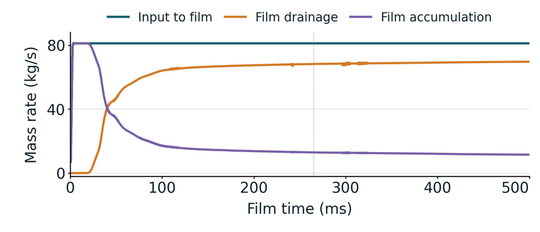
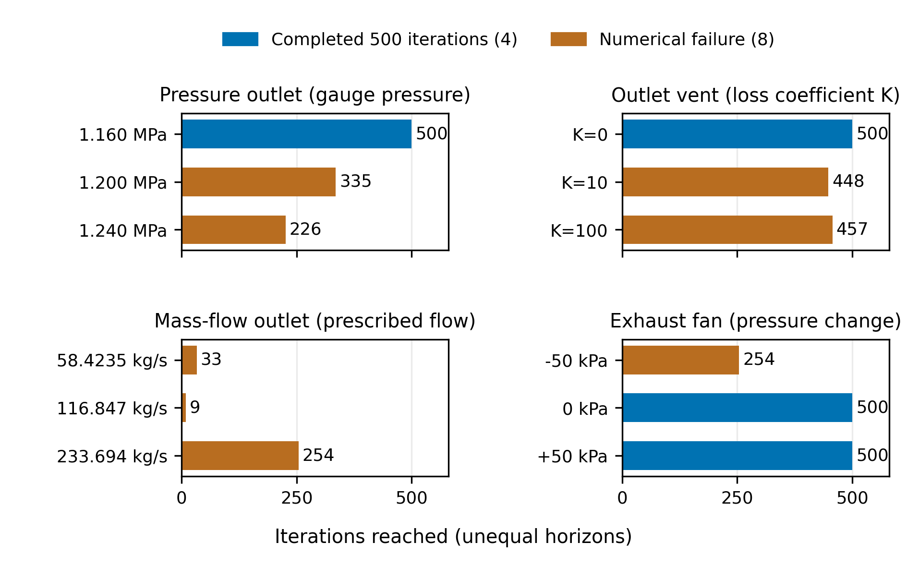
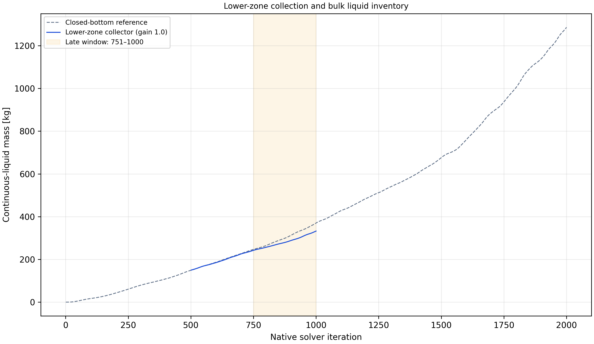
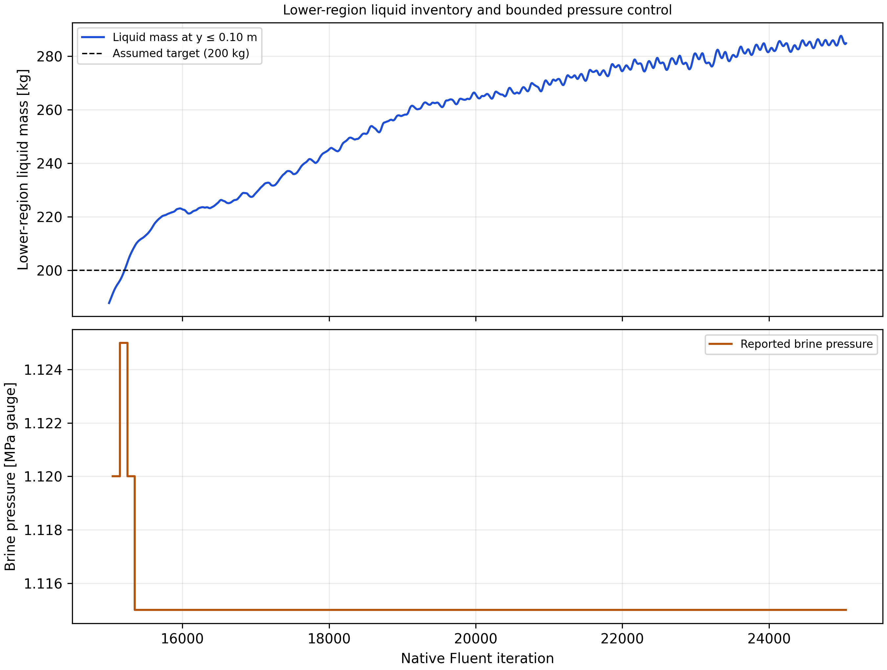

# Development of a geothermal separator CFD model: liquid transport, collection and wall-film behaviour

## Title page information

| Field | Information |
| --- | --- |
| Author | Shuhei Yokkaichi |
| Programme | Bachelor of Engineering (Honours), Engineering Science |
| Institution | The University of Auckland |
| Report type | Part IV Research Project Report |
| Supervisors | Sadiq Zarrouk and Maedeh Amirpour |
| Co-worker | Andy Tran |
| Draft date | 14 October 2026 |
| Student identification | 302558861; UPI: syok443 |
| Submission date | 18 October 2026 |

<!-- Names follow the supplied working poster. The supplied ESB title-page template includes supervisors and co-worker; this takes precedence here over the generic structuring handout's different cover-page advice. -->

## Abstract

Liquid reaching a separator wall is only one stage of separation: it must also leave through a collection route without returning to the steam. This study developed an inherited computational fluid dynamics model of a vertical geothermal steam–water separator by following liquid delivery, storage, release and removal. The simplified domain omitted brine discharge. Mesh and inlet comparisons, a numerical collector and staged startup enabled studies of roughness and Eulerian Wall Film.

Mesh development changed the predicted wall-liquid fields. In a matched comparison with mesh, feed and numerical controls held fixed, wall-side inlet placement increased retained mass by 37.4%. Without a collector, liquid accumulated in the lower vessel or almost entirely left through the steam outlet. A liquid-selective collector represented transfer to the omitted pool, and revised startup reduced loading disturbances. Wall treatment strongly changed outlet liquid flow and inventory, but incomplete liquid accounts prevented an efficiency interpretation.

With bulk fields held fixed, film spread and thickened over the lower and middle wall. At 500 ms, input and drainage averaged 81.12 and 69.60 kg/s over the final 10 ms, while storage remained 11.53 kg/s. Later configurations added droplet release and impact mechanisms. A matched direct-drain test reduced lower-wall film by 70.32%. However, its 0.5088 kg removal partly replaced native film outflow, giving only 0.1897 kg of additional external removal. A longer continuation showed that upper-wall film could still accumulate while lower drainage operated.

At a common film age of 195 ms, finer-mesh states showed less extensive appreciable film thickness and lower film drainage. The coarse-informed observation time did not establish equivalent film development or mesh independence.

The study establishes model sensitivity and checked collection and startup procedures. Its central finding is that outlet liquid flow and wall capture must be assessed with storage, release and external removal. Developing fields, incomplete mass balances and unresolved numerical sensitivity limit the findings to model development. Physical validation is still needed before predicting separation efficiency or pressure loss.

## Declaration

*Unsigned draft using the supplied University template. The author must review and sign the declaration before submission.*

**Student**

I hereby declare that:

1. This report is the result of the final year project work carried out by my project partner (see cover page) and I under the guidance of our supervisor (see cover page) in the 2026 academic year at the Department Engineering Science and Biomedical Engineering, Faculty of Engineering, University of Auckland.
2. This report is not the outcome of work done previously.
3. This report is not the outcome of work done in collaboration, except that with a potential project sponsor (if any) as stated in the text.
4. This report is not the same as any report, thesis, conference article or journal paper, or any other publication or unpublished work in any format.

**Continuing-project statement.** The work builds on an inherited separator model and the published work of Purnanto et al. (2013). The present investigation developed liquid-collection and startup procedures, examined mesh and inlet assumptions, and studied wall roughness, film transport, release and drainage. The starting geometry and bulk modelling approach are identified as inherited work.

**Use of generative AI.** OpenAI Codex assisted with literature retrieval, coding and checking Fluent/PyFluent workflows, execution and recovery support, analysis, figure preparation and report drafting. Fluent performed the numerical calculations. The researcher directed the scientific scope and supplied the physical interpretation. Appendix D describes the division of work and the report's evidence records.

**Report word count:** to be inserted from the final assembled report.

**Signature and date:** to be completed by the author.

<!-- Prescribed wording: ../../ESB_part_IV_latex_report_template_v2/Declaration/ESB_declaration_online.tex. The declaration is not signed or represented as approved by this draft. -->

## Table of contents

| Report section | Draft location |
| --- | --- |
| 1. Introduction | [Part 1](#1-introduction) |
| 2. Literature review | [Part 1](#2-literature-review) |
| 3. Model and methods | [Part 2](#3-model-and-methods) |
| 4. Results | [Part 3](#4-results) |
| 5. Discussion | [Part 4](#5-discussion) |
| 6. Conclusions and future work | [Part 4](#6-conclusions-and-future-work) |
| References | [References](#references) |
| Appendix A. Method detail and reproducibility | [Appendix A](#appendix-a-method-detail-and-reproducibility) |
| Appendix B. Evidence routes and source limits | [Appendix B](#appendix-b-evidence-routes-and-source-limits) |
| Appendix C. Figure register | [Appendix C](#appendix-c-figure-register) |
| Appendix D. Author contribution | [Appendix D](#appendix-d-author-contribution) |

Page references will be generated during document layout.

## List of figures

| Figure | Subject |
| --- | --- |
| 1 | Liquid destinations and the report’s central question |
| 2 | Separator operation and liquid routes |
| 3 | Empirical wetness and inlet velocity |
| 4 | Inlet geometries and tangential-velocity fields |
| 5 | Wall-film droplet entrainment |
| 6 | Actual solved domain and split inlet |
| 7 | Earlier coarse-mesh film rates informing the observation-time choice |
| 8 | Mesh structure and wall-liquid fields |
| 9 | Effect of inlet phase placement on liquid distribution |
| 10 | Liquid inventory and outlet flow on three finer meshes |
| 11 | Early startup and carrier development |
| 12 | Roughness response |
| 13 | Film-disabled/accretion-enabled outlet histories |
| 14 | Film-disabled/accretion-enabled bulk-liquid spatial comparison |
| 15 | Shortened-startup ramp comparison |
| 16 | Selected film development through 500 ms |
| 17 | Film-thickness views |
| 18 | Direct lower-wall drainage and the change in total film removal |
| 19 | Wall-film distribution across mesh resolutions at the selected starts and 195 ms |
| 20 | Mesh dependence of saved liquid inventories and removal rates |
| 21 | Proposed inlet-region wall features and preliminary mixture-flow patterns |
| A1 | Complete contact chronology |
| A2 | Shortened-startup and film chronology to iteration 25815 |
| A3 | Native inlet mesh section |
| A4 | Original twelve-case full-geometry outlet screen |
| A5 | Earlier cell-zone absorber and reference |
| A6 | Long pool-control trial and scope decision |

## List of main tables

| Table | Subject |
| --- | --- |
| 1 | Fixed material properties |
| 2 | Main boundary conditions |

Appendix tables retain comparison designs, detailed settings, criteria, histories, balance results and the supported research answers.

## Acknowledgements

I thank Sadiq Zarrouk and Maedeh Amirpour for their supervision and feedback as the modelling questions developed. Discussions with Sadiq also helped shape the wall-liquid design concepts. I thank Andy Tran for his collaboration as my project partner.

## Glossary of terms and abbreviations

| Term | Meaning in this report |
| --- | --- |
| BOC | Bottom-outlet cyclone |
| CFD | Computational fluid dynamics |
| Carrier | The Eulerian vapour and bulk-liquid flow fields through which discrete droplets are tracked |
| DPM | Discrete Phase Model; the Lagrangian representation of droplets |
| EWF | Eulerian Wall Film; the wall-based representation of liquid-film transport |
| IAPWS | International Association for the Properties of Water and Steam |
| IF97 | IAPWS industrial formulation for equilibrium water and steam properties |
| PyFluent | Python interface used to configure and command Ansys Fluent |
| Agent harness | Recorded workflow linking research questions, agent instructions, solver execution and analysis |
| RNG | Renormalisation group; used here in the RNG k–ε turbulence model |
| SIMPLE | Semi-Implicit Method for Pressure-Linked Equations |
| Bulk liquid | Liquid represented by the Eulerian secondary phase; excludes EWF inventory and discrete droplets |
| Vapour / bulk liquid | The primary vapour and secondary bulk-liquid phases in the selected Fluent carrier models |
| Accretion | Transfer of represented bulk liquid into the wall film |
| Stripping | Release of liquid from a film under gas forcing |
| Splashing | Production of secondary droplets during droplet impact on a film |
| Edge separation | Release of film liquid at a wall edge |
| Direct film drain | Local mass and momentum sink acting on lower-wall film storage |
| Incomplete trajectory | A tracked droplet with no completed terminal fate under the stated tracking controls |
| Absorber / virtual collector | A numerical liquid-removal treatment inside the truncated model; the two terms refer to the same model role |
| Native iteration | Fluent's recorded solver-update coordinate; it is not physical carrier-flow time |
| Film time | Time accumulated from the accepted EWF steps |
| Source term | A rate added to a transport equation; a negative mass source removes mass |
| Implicit source linearisation | Use of source derivatives within an equation solve to represent source dependence on the solved variable |
| Numerical stability | Observed finite and controlled behaviour over the stated calculation window |
| Iterative convergence | Active equations and relevant outputs meeting their declared settling conditions |
| Numerical accuracy | Accuracy of the computed solution of the stated model, assessed through numerical error and resolution evidence |
| Stiff source | A source with strong sensitivity to the solved variable, which can make an equation harder to solve |
| Numerical qualification | Assessment of a calculation against declared numerical, accounting and stationarity checks |
| Physical validation | Assessment against relevant physical observations for a stated use |

## Symbols

| Symbol | Meaning | Unit |
| --- | --- | --- |
| $\dot m$ | Mass-flow rate | kg/s |
| $M_b, M_f$ | Bulk-liquid and film inventories | kg |
| $M_c$ | Liquid mass in the collector | kg |
| $k_s$ | Modelled roughness height | m |
| $C_s$ | Roughness constant | — |
| $\alpha_L$ | Bulk-liquid volume fraction | — |
| $\rho_L$ | Liquid density | kg/m³ |
| $\boldsymbol u_L$ | Liquid velocity vector | m/s |
| $\boldsymbol u_m$ | Mixture velocity vector | m/s |
| $k$ | Shared turbulent kinetic energy | m²/s² |
| $\epsilon$ | Shared turbulence dissipation rate | m²/s³ |
| $S_L$ | Volumetric liquid mass source | kg/(m³·s) |
| $V_c$ | Collector region / its geometric volume | m³ |
| $\tau$ | Prescribed depletion time in the contact law | s |
| $h_f$ | Film thickness | m |
| $\tau_f$ | Direct film-drain capture time | s |
| $K_d$ | Direct film-drain removal coefficient | s⁻¹ |

---

# Part 1 — Introduction and literature review

<!-- Research framing: credible liquid transport and collection, developed through mesh/inlet assessment, absorber and startup procedures, and wall-film studies. Internal evidence links are traceability notes. -->

## 1. Introduction

### 1.1. Engineering problem

Geothermal steam–water separators supply dry steam to turbines. Liquid carryover can cause erosion and transport minerals that form deposits. Separator design must therefore consider separation efficiency, pressure drop and operating pressure ([Zarrouk & Purnanto, 2015](https://doi.org/10.1016/j.geothermics.2014.05.009)).

This study develops an inherited computational fluid dynamics (CFD) model of a vertical bottom-outlet cyclone with a spiral inlet, tracing the liquid path from phase placement at the inlet through wall transport and collection. It examines how the cyclone’s geometry and flow behavior influence liquid separation and discharge.

<!-- Evidence: [Study scope](../../../scope.md); [inlet-development interpretation](../../../experiments/phase-01-purnanto-baseline-and-inlet-exploration/interpretation.md); [author's development context and meeting sources](../Shuhei-Context.md#how-the-project-understanding-developed); [absorber-development context](../../../experiments/phase-07-1a-absorber-convergence/CONTEXT.md). -->

### 1.2. Problem in the inherited model

In a working separator, the spiral inlet sets the incoming steam–water mixture into rotation. Liquid moves towards the vessel wall, where it can form a film and drain towards the brine pool below. The collected brine leaves through a discharge pipe, while steam leaves through a separate internal pipe (Figure 2). Some wall liquid can also return to the steam as droplets. Predicting separation therefore requires an account of what happens to liquid after it reaches the wall, as well as how it leaves the vessel.

The inherited CFD geometry omits the brine pool and discharge pipe, leaving a closed lower wall. Liquid can reach the base, but cannot drain out through it. With liquid continuously entering and no collection treatment, liquid must accumulate within the model or leave through the steam outlet. Simply opening the lower boundary does not ensure separate liquid discharge, because steam can also escape through it. The simplified geometry therefore lacks a route that removes collected liquid while retaining the intended steam path.

A second limitation concerns liquid at the vessel wall. The inherited formulation represents steam and liquid through a bulk Mixture field, without a separate model of an evolving wall film. Purnanto et al. (2013) also tracked injected droplets using the Discrete Phase Model (DPM) to estimate outlet steam quality. These trajectories describe droplet motion through the calculated flow, but do not establish how deposited liquid forms a film, travels along the wall, accumulates or is released back into the steam. Ordinary wall boundary conditions affect the bulk flow, but do not by themselves resolve these film processes.

Together, these limitations leave the liquid path incomplete between wall capture and final discharge. A low liquid flow through the steam outlet may reflect storage on the wall or at the base rather than sustained collection. Droplet trajectories alone also cannot show whether liquid reaching a wall remains there, drains away or later returns to the steam. The model must distinguish liquid transport, storage, release and removal before its outlet predictions can support an assessment of separator performance.

<!-- Evidence: [Model boundary](../../../model.md). -->

<!-- Evidence: [Verified early absorber](../../../experiments/phase-07-1a-absorber-convergence/baseline-v2-virtual-liquid-outlet/results.md); [selected case history](../../../experiments/phase-07-2a-wall-liquid-routing/stage-02-combined-ewf-roughness/case-history-N45606.md); [full-geometry scope decision](../../../experiments/phase-06-full-geometry-with-brine-pool/conclusion.md); historical lower-boundary dilemma in [29 April, 04:04–06:36](../../../meetings/otter/2026-04-29-wk-7-steam-liquid-separator-analysis.md). -->

<!-- Evidence: [R0 control](../../../experiments/phase-07-1a-absorber-convergence/roughness-family/r0-smooth-control/results.md); [source-inclusive R0 accounting assessment](../../../experiments/phase-07b-full-geometry-liquid-removal/convergence-investigation/shuhei-audit.md). -->

### 1.3. Research aim and questions

The aim is to develop the inherited separator CFD model and assess whether it gives a numerically consistent and physically credible account of liquid transport and collection. The investigation addresses three questions:

1. How do mesh representation and inlet phase placement affect the predicted liquid distribution, retention near the wall and drainage?

2. Can the inherited model be developed into a credible CFD model of the separator?

3. How do wall roughness and wall-film modelling affect liquid transport, storage, release and collection?

Model credibility requires both numerical consistency and agreement with physical behaviour. Continuity residuals and liquid mass balances assess numerical consistency, while liquid inventories, discharge paths and predicted liquid-removal efficiency must also be physically reasonable. Efficiency comparisons must use the same definition of liquid removal and comparable operating conditions; outlet steam quality alone is a different measure. Agreement with measured separator performance provides a stronger test of physical credibility than a plausible efficiency value alone. The present work assesses progress against these criteria, while incomplete liquid accounting and the absence of a matched field comparison limit the conclusions.

### 1.4. Scope and contribution

To address these questions, the study follows the liquid path through the simplified separator model. Mesh and inlet comparisons assess how liquid reaches and remains near the wall. Collector development addresses the missing discharge route, supported by startup procedures that allow the model to reach the intended feed conditions. Wall-roughness and wall-film studies then examine how captured liquid is stored, transported, released or drained. Downstream equipment, mineral chemistry and optimum operating pressure are outside the simulated scope.

<!-- Evidence: [Study overview](../../../index.md); [selected case history](../../../experiments/phase-07-2a-wall-liquid-routing/stage-02-combined-ewf-roughness/case-history-N45606.md). -->

Figure 1 brings these investigations together by distinguishing liquid transfer within the vessel from removal out of the model. Liquid entering a wall film can remain in storage, drain away or return to the steam as droplets. The routes shown were examined in separate configurations; they do not represent one fully coupled, validated model.

*Figure 1. Liquid destinations examined in separate model configurations. Wall capture can lead to storage, release or removal. Numerical sinks and native film-edge outflow are distinct; this conceptual map does not show a measured balance.*

<!-- Overview basis: Sections 3.2–3.3, 4.7, 4.10–4.11 and 5.3–5.6; [editable figure and source record](../figures/report-liquid-destinations-overview.provenance.json). No arrow represents a measured rate or proven final droplet fate. -->

The contribution is a set of checked collection and startup procedures, together with comparisons that show how model choices affect liquid delivery, storage and removal. These provide a basis for further model development, while incomplete liquid accounting and combined-model refinement limit performance prediction. The following literature review examines the prior methods and assumptions that inform this approach.

## 2. Literature review

### 2.1. How a geothermal steam–water separator works

A vertical bottom-outlet cyclone (BOC) uses a tangential or spiral inlet to rotate the incoming steam and brine. Liquid moves towards the wall while steam occupies the central region. An internal pipe carries steam out through the bottom; brine leaves separately. *Bottom outlet* refers to the steam-pipe arrangement ([Zarrouk & Purnanto, 2015](https://doi.org/10.1016/j.geothermics.2014.05.009)).

Liquid at the wall can form a film that drains towards the brine discharge or releases droplets back into the steam (Figure 2). The schematic also distinguishes brine discharge from downstream liquid collection and condensation.

*Figure 2. Conceptual schematic of separator liquid paths: wall film, carryover, brine discharge ($\dot m_l$) and downstream brine collection ($\dot m_b$). Source: [Rizaldy et al. (2016)](https://www.researchgate.net/publication/310818568_LIQUID_CARRYOVER_IN_GEOTHERMAL_STEAM-WATER_SEPARATORS), fig. 5.*

<!-- Evidence: [Model boundary](../../../model.md). Figure source: [primary carryover paper](../../../../CFD_wiki/raw/053_Rizaldy_Final.pdf), PDF page 3, original fig. 5; symbol interpretation checked against PDF pages 3–4. [Full-page source preview](../figures/literature-candidates/wall-film/rizaldy-2016-pdf-page-03.png). The inserted panel was rendered directly from the local PDF; its labels and arrows are unchanged. -->

### 2.2. Internal flow physics and performance measures

Rotation produces a low-pressure core, with inward acceleration scaling as $u_\theta^2/r$, where $u_\theta$ is the tangential velocity and $r$ is the radius. The different responses of liquid and steam to pressure and drag, which depend on their densities, allow outward liquid transport. Fine droplets can follow the steam, whereas larger droplets reach collection surfaces more readily. Uncertain inlet droplet sizes and continued droplet generation complicate prediction ([Pointon et al., 2009](https://publications.mygeoenergynow.org/grc/1028587.pdf)).

Higher velocity can strengthen outward transport but also increase entrainment by steam shear. Empirical data show sharp increases in outlet wetness at different inlet steam velocities for different separators (Figure 3). Thus, greater swirl alone does not establish better separation ([Zarrouk & Purnanto, 2015](https://doi.org/10.1016/j.geothermics.2014.05.009)).

*Figure 3. Outlet wetness and steam quality versus inlet steam velocity for three separator datasets. Left axis: outlet wetness; right axis: steam quality. Source: [Zarrouk and Purnanto (2015)](https://doi.org/10.1016/j.geothermics.2014.05.009), fig. 12, using Bangma (1960) and Lazalde-Crabtree (1984) data.*

<!-- Figure source: [primary design review](<../../../../CFD_wiki/raw/Zarrouk and Purnanto 2014.pdf>), PDF page 12 / printed page 247; [full-page source preview](../figures/literature-candidates/design-overview/zarrouk-purnanto-2015-page-12.png). The published axes, curves, points and legend are unchanged. -->

Outlet steam quality is defined as

$$
x_{\mathrm{out}}=
\frac{\dot m_{v,\mathrm{out}}}
{\dot m_{v,\mathrm{out}}+\dot m_{l,\mathrm{out}}},
$$

where the terms are outward vapour and liquid mass-flow rates through the steam outlet. Purnanto et al. (2013) used this measure ([Purnanto et al., 2013](https://www.researchgate.net/publication/269519626_CFD_MODELLING_OF_TWO-PHASE_FLOW_INSIDE_GEOTHERMAL_STEAM-WATER_SEPARATORS)). Outlet steam quality differs from the liquid-capture fraction, which compares collected liquid with inlet liquid; the denominators of these two measures are not interchangeable.

Steam purity concerns chemical contamination in the steam. Estimates of chemical carryover are affected by condensation and drain-pot collection, so field comparisons require matching definitions and sampling locations ([Rizaldy et al., 2016](https://www.researchgate.net/publication/310818568_LIQUID_CARRYOVER_IN_GEOTHERMAL_STEAM-WATER_SEPARATORS)).

Assessing internal pressure drop requires defined inlet and outlet locations and a stated static or total pressure measure. This assessment differs from selecting the optimum operating pressure, which also involves flashing and plant conditions ([Pointon et al., 2009](https://publications.mygeoenergynow.org/grc/1028587.pdf); [Zarrouk & Purnanto, 2015](https://doi.org/10.1016/j.geothermics.2014.05.009)). The present no-flashing model addresses internal flow at prescribed phase conditions.

### 2.3. Established design methods and geothermal CFD

Empirical geothermal design methods provide reference points for CFD. However, CFD's additional flow detail must be assessed against the model's assumptions and the comparison evidence ([Zarrouk & Purnanto, 2015](https://doi.org/10.1016/j.geothermics.2014.05.009)).

Pointon et al. (2009) used Fluent's Discrete Phase Model (DPM) to compare inlet designs with assumptions about droplet feed and wall/baffle collection. Predicted efficiencies were 99.96% for scrolled entry and 99.93% for tangential entry; an empirical design method gave 99.955%. Scrolled entry also gave a higher calculated mean tangential velocity than tangential entry: 34.1 rather than 32.5 m/s (Figure 4). However, agreement with the empirical method did not independently test the feed or collection assumptions ([Pointon et al., 2009](https://publications.mygeoenergynow.org/grc/1028587.pdf)).

*(a) Inlet configurations.*

*(b) Calculated tangential-velocity distributions.*

*Figure 4. Scrolled entry gives a higher calculated mean tangential velocity than tangential entry. (a) Inlet geometries; (b) tangential-velocity fields. Scrolled entry (labelled “lemniscate entrance” in the source) is on the left; tangential entry is on the right. Source: [Pointon et al. (2009)](https://publications.mygeoenergynow.org/grc/1028587.pdf), figs. 5 and 7.*

<!-- Figure source: [primary Pointon paper](../../../../CFD_wiki/raw/1028587.pdf), PDF pages 5–6 / printed pages 946–947; [geometry source page](../figures/literature-candidates/pointon/page-5.png); [velocity source page](../figures/literature-candidates/pointon/page-6.png). Both published panels, the velocity legend and mean annotations are unchanged. The report adds the (a)/(b) labels outside the images. -->

Purnanto et al. (2013) compared three BOC configurations using a steady Mixture model and a DPM outlet-quality calculation. Differences in vessel proportions prevented the effect of inlet shape from being isolated. Counting droplets with incomplete tracks as separated improved empirical agreement, but the authors described this assumption as non-rigorous. The inherited modelling basis therefore requires explicit treatment of unresolved droplet fate ([Purnanto et al., 2013](https://www.researchgate.net/publication/269519626_CFD_MODELLING_OF_TWO-PHASE_FLOW_INSIDE_GEOTHERMAL_STEAM-WATER_SEPARATORS)).

Both studies used renormalisation-group (RNG) k–ε turbulence modelling. Pointon preferred RNG with a swirl modification because it had lower computational requirements than Reynolds stress modelling. This rationale offers a starting point, not a detailed turbulence-model comparison. Turbulence-model accuracy in the present swirling and near-wall flow remains to be assessed ([Pointon et al., 2009](https://publications.mygeoenergynow.org/grc/1028587.pdf); [Purnanto et al., 2013](https://www.researchgate.net/publication/269519626_CFD_MODELLING_OF_TWO-PHASE_FLOW_INSIDE_GEOTHERMAL_STEAM-WATER_SEPARATORS)).

Appendix B.2 compares the methods and assumptions carried into this study.

### 2.4. Wall–liquid transport and carryover

Film motion depends on gravity, pressure and shear. Deposition adds liquid to the film; drainage removes liquid from the film; entrainment returns droplets to the steam. More wall deposition can therefore increase liquid storage or later release without increasing external collection.

Rizaldy et al. (2016) predict that entrainment is sensitive to loading, film thickness and inlet velocity. Figure 5 illustrates the conceptual mechanisms of undercut and roll-wave entrainment, associated with lower and higher film Reynolds numbers, respectively. Film Reynolds number compares inertia with viscosity using liquid velocity and film thickness. However, the brine-flow data needed to compare the predicted liquid carryover with measurements from the first drain pot after the Wairakei separator were unavailable, leaving quantitative agreement with field measurements unresolved ([Rizaldy et al., 2016](https://www.researchgate.net/publication/310818568_LIQUID_CARRYOVER_IN_GEOTHERMAL_STEAM-WATER_SEPARATORS)).

*Figure 5. Conceptual mechanisms by which steam shear releases droplets from a liquid film: (a) undercut and (b) roll-wave entrainment. Source: [Rizaldy et al. (2016)](https://www.researchgate.net/publication/310818568_LIQUID_CARRYOVER_IN_GEOTHERMAL_STEAM-WATER_SEPARATORS), fig. 9, crediting Ishii and Grolmes (1975).*

<!-- Figure source: [primary carryover paper](../../../../CFD_wiki/raw/053_Rizaldy_Final.pdf), PDF page 5; [full-page source preview and original attribution](../figures/literature-candidates/wall-film/rizaldy-2016-pdf-page-05.png). The two published mechanism panels and labels are unchanged. -->

Fluent's roughness settings change near-wall momentum transfer; they do not add film storage or a drain ([Ansys, Inc., 2025k](https://ansyshelp.ansys.com/public/Views/Secured/corp/v252/en/flu_th/x1-5720008.164.html)). EWF, by contrast, adds surface storage and transport. The effects of roughness and EWF on outlet flow must be interpreted alongside retained liquid mass and collection.

### 2.5. Representing liquid and its collection

The Mixture model represents bulk liquid through the secondary-phase volume fraction. Algebraic slip estimates the relative velocity between phases under a local-equilibrium assumption. The liquid volume fraction does not directly resolve film thickness or the droplet-size distribution ([Ansys, Inc., 2025d](https://ansyshelp.ansys.com/public/Views/Secured/corp/v252/en/flu_th/flu_th_sec_drift_oview.html)).

DPM follows size-dependent droplet trajectories. Interpreting its results requires defined injection and boundary treatments and a count of every tracked fate, including incomplete trajectories.

Skoog (2020) combined EWF surface transport, DPM deposition and entrainment in a reactor-channel approximation. Film and droplet flows were compared with one-dimensional calculations using Okawa correlations based on experiments. The inlet liquid allocation between film and droplets and the transverse droplet velocity affected the result. This separate accounting of film and droplet flows provides a precedent, but the applicability of the reactor conditions and correlations to a cyclone still requires justification ([Skoog, 2020](https://www.diva-portal.org/smash/get/diva2:1452100/FULLTEXT02.pdf); [Ansys, Inc., 2025e](https://ansyshelp.ansys.com/public/views/secured/corp/v252/en/flu_ug/flu_ug_models_wallfilm.html)).

Bulk-to-film transfer moves liquid within the domain, whereas the absorber removes it from the domain. Droplet injection must not duplicate liquid already supplied by another feed. Fluent permits cell-zone mass sources and associated transport sources ([Ansys, Inc., 2025a](https://ansyshelp.ansys.com/public/Views/Secured/corp/v252/en/flu_ug/flu_ug_bcs_sec_cell_zones.html)), but the governing source law and its effects require assessment. Section 3 describes the contact-based absorber.

<!-- Evidence: [Audited model basis](../../../model.md); [liquid-accounting guardrails and application of Skoog](../../../technical/skoog-application-guardrails.md); [absorber-development context](../../../experiments/phase-07-1a-absorber-convergence/CONTEXT.md). -->

### 2.6. Numerical startup, convergence and validation

In a steady calculation, iterations and pseudo-time describe numerical development, not physical filling time. The National Aeronautics and Space Administration (NASA) recommends monitoring residuals and relevant outputs, with convergence criteria based on acceptable error in those outputs ([National Aeronautics and Space Administration \[NASA\], 2021a](https://www.grc.nasa.gov/www/wind/valid/tutorial/iterconv.html)).

Fluent permits flow development before film initialisation ([Ansys, Inc., 2025h](https://ansyshelp.ansys.com/public/views/secured/corp/v252/en/flu_ug/flu_ug_ewf_sec_overview.html)). Reduced-feed startup and ramps remain case-specific choices that require assessment.

Implementation checks, iterative convergence, mass accounting and numerical sensitivity answer separate questions. Mesh and time-step studies require a fixed model; changes to roughness or the absorber instead test model sensitivity ([NASA, 2021c](https://www.grc.nasa.gov/www/wind/valid/tutorial/verassess.html)).

Physical validation requires comparison with relevant measurements and assessment of uncertainty ([NASA, 2021b](https://www.grc.nasa.gov/www/wind/valid/tutorial/valassess.html)). For this model, those comparisons must assess the assumed collection route and outlet predictions within the tested operating range.

<!-- Evidence: [Verification and validation limits](../../../vnv.md). -->

### 2.7. Remaining model uncertainties and research direction

The literature shows that the definition of collection is central to the research problem. In Pointon's model, a droplet's trajectory ends at a collecting boundary, whereas the film literature allows captured liquid to return to the steam. Purnanto's incomplete tracks highlight a further distinction between a calculated destination and an assumed one. Agreement in an outlet measure therefore does not, by itself, resolve the internal liquid path when feed, capture or final fate is imposed.

The inherited model adds a specific difficulty: its truncated domain omits brine discharge. Changes to the mesh and inlet can alter predicted liquid delivery to the wall, but cannot provide the missing exit. This study therefore connects comparisons of these changes to collector development and then to film storage, release and drainage. The separate bulk, film and droplet accounts make it possible to ask whether a lower bulk-liquid outlet rate accompanies external collection, internal transfer or continued storage. That distinction determines what each result contributes to performance prediction.

---

# Model basis, development methods and results

## 3. Inherited model and operating basis

The investigation continued the Purnanto-based separator geometry, bulk-flow formulation and reference operating condition. These defined the starting model. Its development required more than predicting liquid movement towards the wall: the model also needed to represent what happened to liquid after it arrived there. Section 4 follows the successive investigations of liquid delivery, retention, wall transport and collection, introducing each method alongside the evidence it supplied.

The account follows the questions that connected the investigations. Later reconstructions are identified where they revisit earlier assumptions; they explain the model's behaviour without implying that those results were available when the original choices were made.

### 3.1. Computational domain and modelling scope

Building on the model limitations identified in the literature review, this study used the inherited separator geometry based on Purnanto et al. (2013).

The simplified domain retained the spiral inlet, cylindrical separation vessel and internal steam outlet pipe needed to study liquid transport through the active separation region (Figure 6). The inlet guided the incoming mixture into the vessel, while the internal pipe provided the steam exit. The lower brine pool and its discharge pipe were omitted, leaving a closed bottom wall.

*Figure 6. Simplified computational domain and inlet arrangement: (a) spiral inlet, vessel and internal steam outlet; (b) wall-side liquid strip and adjacent vapour inlet. The brine pool and discharge pipe are omitted. Panel (b) shows the split inlet introduced in Section 4.1; the collector is introduced in Section 4.3.*

The closed base supplied no physical liquid exit. Section 4 follows the inlet, mesh and collection changes used to investigate liquid transport in this domain.

### 3.2. Bulk-flow model and retained assumptions

The Mixture model provided a computationally cheaper continuation of Purnanto's separator model. Its algebraic-slip formulation was consistent with the small-Stokes-number argument used in that study: sufficiently small dispersed droplets respond rapidly relative to the characteristic flow timescale ([Purnanto et al., 2013](https://www.researchgate.net/publication/269519626_CFD_MODELLING_OF_TWO-PHASE_FLOW_INSIDE_GEOTHERMAL_STEAM-WATER_SEPARATORS)). Solving mixture momentum with algebraic slip requires fewer equations than a full Eulerian formulation, making repeated inlet and wall-treatment investigations more practical ([Ansys, Inc., 2025d](https://ansyshelp.ansys.com/public/Views/Secured/corp/v252/en/flu_th/flu_th_sec_drift_oview.html)). After exploratory VOF and turbulence trials, Mixture with RNG $k$–$\varepsilon$ was retained as the practical basis for the inlet and wall-treatment studies. The alternative formulations remained exploratory (Appendix A.13).

<!-- Basis: [recorded baseline rationale](../../../experiments/phase-01-purnanto-baseline-and-inlet-exploration/purnanto-00-reference-spiral-boc/setup.md); [executed VOF trial](../../../experiments/phase-01-purnanto-baseline-and-inlet-exploration/purnanto-02b-vof-split-inlet-transient/setup.md); [turbulence screening](../../../experiments/phase-07-1a-absorber-convergence/turbulence-family/README.md). The small-Stokes-number rationale concerns dispersed liquid; applicability to concentrated wall liquid remains unverified. -->

A pressure-based solver with the Mixture model in Ansys Fluent 2025 R2 was used for bulk continuity, momentum, liquid fraction and algebraic slip. Steam was the primary phase and water the secondary phase. The RNG $k$–$\varepsilon$ model included swirl treatment and standard wall functions; gravity acted downwards. The energy equation was disabled; flashing, condensation and temperature-dependent properties were excluded. Table 1 gives the material values; Appendix A.1 records the controls ([Ansys, Inc., 2025d](https://ansyshelp.ansys.com/public/Views/Secured/corp/v252/en/flu_th/flu_th_sec_multiphase_mixture.html)).

*Table 1. Fixed material properties verified for the throughput-controlled absorber model.*

| Phase | Density (kg/m³) | Dynamic viscosity (Pa·s) |
| --- | ---: | ---: |
| Vapour | 5.79743 | $1.52062\times10^{-5}$ |
| Liquid water | 881.211 | $1.45544\times10^{-4}$ |

The selected bulk-flow formulation used Manninen slip, Schiller–Naumann drag and a liquid-phase diameter of 10 µm. These settings kept the bulk slip model fixed across the wall comparisons introduced below. Its accuracy for concentrated wall liquid remained unverified. The liquid-phase diameter controls continuum slip, separately from DPM droplets and film (Appendix A.1).

### 3.3. Reference feed and boundary conditions

The reference feed condition was retained from Purnanto to provide a common operating basis for the model-development comparisons: 197.61 kg/s at 1600 kJ/kg and 11.2 bar absolute. At this pressure, saturated liquid and vapour enthalpies, $h_f$ and $h_g$, gave the vapour mass fraction as $x=(h-h_f)/(h_g-h_f)=0.408323$. The steam and liquid feeds followed from $x\dot m_{\mathrm{tot}}$ and $(1-x)\dot m_{\mathrm{tot}}$, linking the phase loading to the reference thermodynamic condition. The inlet commands retained Purnanto's rounded phase mass flows of 116.92 kg/s liquid and 80.69 kg/s vapour; Appendix A.7 gives the calculation ([Purnanto et al., 2013](https://www.researchgate.net/publication/269519626_CFD_MODELLING_OF_TWO-PHASE_FLOW_INSIDE_GEOTHERMAL_STEAM-WATER_SEPARATORS)). Enthalpy defined the supplied composition; flashing was not solved within the domain.

The boundary setup retained the Purnanto-based model’s prescribed-feed and pressure-outlet approach. The steam outlet supplied the pressure boundary condition, allowing inlet pressure to emerge from the solution. The operating pressure was 0 Pa, so outlet gauge and absolute pressures were equal. Stationary, no-slip walls confined the flow. The project’s revised inlet distribution and numerical collection treatments are introduced in Sections 4.2–4.4. Appendices A.6 and A.2 give the turbulence and backflow inputs and the reconstruction differences.

## 4. Model development and results

The first comparison examined how inlet phase placement changed liquid delivery to the wall. Accumulation and contrasting solver behaviour then raised questions about mesh representation and the missing collection route. They also exposed a separate requirement: retained liquid needed an exit through which it could be collected. A lower collector and a developed flow field then provided the basis for wall-treatment comparisons. Those comparisons led to further questions about film storage, release and drainage, followed by tests of numerical sensitivity. The workflow supporting the investigation is described separately in Section 4.14.

Each comparison uses its stated mesh and settings. Outlet liquid flow is reported as positive outwards unless a signed value is given. Steady-solver iterations track numerical development; accepted film time tracks the transient film calculation. Detailed settings and supporting trials remain in the appendices.

### 4.1. Two-phase inlet and wall-side liquid placement

The inlet split represented the expected concentration of liquid towards the outer wall as the upstream flow turned into the separator. Liquid entered through the wall-side strip and steam through the remaining area, allowing the phases to mix within the domain. This placement provided a defined liquid supply for studying wall-film formation and drainage. The pure-phase inlets simplified this expected distribution; complete phase separation at entry was assumed, not measured.

The strip area was sized from the phase volumetric flows under an assumed common inlet velocity, rather than from the mass fractions alone. About 0.933% of the 0.724 m square inlet area was assigned to a 6.754 mm liquid strip. Appendix A.7 distinguishes the design properties from the solved densities and resulting phase velocities.

<!-- Rationale: [22 April spiral-inlet discussion, 03:41–04:39](../../../meetings/otter/2026-04-22-wk-6-spiral-inlet-design-meeting.md); [11 March initial two-phase inlet proposal, 02:08](../../../meetings/otter/2026-03-11-two-phase-fluid-modeling-meeting.md). Meeting records establish design intent, not measured inlet phase distributions. -->

Separate phase mass-flow inlets implemented the revised distribution while retaining the reference loading; liquid and vapour entered normal to their respective faces. The later absorber-free mixed/split reconstructions used the same 60,964-cell mesh, total phase feed, Coupled controls, fresh initialisation and 10,000-update horizon. Mixed feed supplied both phases across both inlet faces; split feed supplied liquid through the wall-side strip. This comparison tested the consequences of the assumed phase placement, rather than measuring the real inlet distribution.

Split feed produced a more continuous liquid-rich wall band and deeper lower-region enrichment than mixed feed (Figure 7). At a nominal speed of 26.81 m/s, the bulk-liquid inventory at iteration 10,000 was 1262.6 kg with mixed feed and 1734.5 kg with split feed, a difference of 471.9 kg, or 37.4%. Split feed had a larger bulk-liquid inventory at all five tested speeds in the range 20.11–32.14 m/s.

Over iterations 9500–10,000, the outward liquid flow through the steam outlet averaged 99.671% of the 116.9387 kg/s liquid feed for mixed feed and 99.404% for split feed. The inventory difference therefore accompanied almost complete liquid discharge through the steam outlet, rather than discharge through a separate collection route.

*Figure 7. Bulk-liquid volume fraction with mixed and wall-side split feed at inlet height (a, b) and through the vessel centre (c, d). Matched sections at iteration 10,000 use a shared 0–1 scale; neither case includes a collector or EWF.*

Wall-side placement increased retained liquid and changed its distribution along the wall. Both cases still discharged almost all incoming liquid through the steam outlet, and neither inlet supplied a separate collection route. The finer absorber-free checkpoints below show the complementary outcome: liquid could remain near the wall and base while little left through the steam outlet.

<!-- Evidence: [matched inlet setup and numerical basis](../../../experiments/phase-08-storyline-reconstruction/stage-01-60k-storyline/baseline-lineage-audit.md), [mixed-feed results](../../../experiments/phase-08-storyline-reconstruction/stage-01-60k-storyline/f1-one-inlet/results.md), [split-feed inventory and spatial findings](../../../experiments/phase-08-storyline-reconstruction/stage-01-60k-storyline/f2-split-inlet/results.md), and [native inlet-plane exports](../../../Poster/poster-sections/mesh-and-volume-fraction-comparison.md). Percentage inventory change is calculated from the rounded published endpoint values. -->

### 4.2. Liquid accumulation and mesh representation

The closed base made liquid retention a different question from liquid collection. Later absorber-free SIMPLE diagnostics revisited this distinction using 342,609-, 679,970- and 997,604-cell fields at iteration 3000. The checkpoints describe developing liquid distributions at a common iteration count (Appendix A.2).

Saved fields from the three finer split-inlet SIMPLE cases showed liquid near the wall and base. Their inventory and outlet histories show accumulation with little discharge through the steam outlet relative to the liquid feed (Figure 8). At iteration 3000, the liquid inventories in the 342,609- and 679,970-cell cases were each about 454–455 kg, whereas the 997,604-cell case held 333.142 kg. The latter case discharged only 0.003623 kg/s through the steam outlet and held 69.16% of its liquid below $y=1$ m. Appendix A.17 retains the exact checkpoint values.

*Figure 8. Liquid inventory (left) and net outlet liquid flow (right) in the finer absorber-free SIMPLE cases. Liquid accumulates while outlet flow remains small relative to the liquid feed. Lines connect saved checkpoints; solver iterations are not physical time.*

On the 679,970-cell mesh, liquid inventory reached 764.744 kg at iteration 4000, with 69.62% below $y=2$ m. Outlet liquid flow was 8.00 kg/s, or 6.84% of the feed. The next continuation failed with algebraic multigrid (AMG) divergence and a floating-point exception after printed iteration 4211. The historical 7,601,261-cell tetrahedral case had reached iteration 10,000. This contrast raised the question of whether the mesh representation of retained liquid contributed to the different numerical behaviour.

The near-wall region was central to this question. Liquid arriving there exchanges momentum with the wall and the surrounding steam; its subsequent motion determines whether it reaches the base or returns towards the steam outlet. The mesh must represent both the liquid-fraction gradient across this region and transport along it. Section 2.4 describes the wall-liquid and steam-liquid processes that later motivated the film treatment.

Poly-hexcore offered a practical way to concentrate resolution across the wall region while retaining an economical core. Its layered poly-prism cells follow the surface, polyhedral cells connect the layers to the interior, and hexahedral cells fill the core. This arrangement allows small wall-normal spacing without imposing the same spacing throughout the vessel ([Ansys, Inc., 2020, pp. 1–2](https://www.ansys.com/content/dam/resource-center/white-paper/ansys-fluent-mosaic-technology-wp.pdf)).

The theoretical advantage concerns gradient resolution and local alignment. Fluent's mesh guidance recommends prism layers for steep wall-normal gradients and explains that numerical diffusion decreases with refinement and improved flow alignment. Numerical diffusion can smear a transported field, providing a plausible mechanism for spreading a concentrated liquid-rich region across neighbouring cells ([Ansys, Inc., 2025c, §7.1.3.3](https://ansyshelp.ansys.com/public/Views/Secured/corp/v252/en/flu_ug/flu_ug_GridTypes.html)). In this separator, wall-following layers support cross-wall resolution, while alignment with the spiralling liquid path depends on the local cell orientation. The Cartesian hexcore alone does not follow that path. Tetrahedral meshes can also use prism wall layers; the relevant comparison is the actual wall spacing and orientation, rather than the mesh name alone.

Swirl also creates strong circumferential-velocity and pressure gradients. Fluent recommends sufficient resolution of these gradients and identifies core-flow turbulence modelling as important in cyclone-type flows ([Ansys, Inc., 2025l, §§10.3.2–10.3.3](https://ansyshelp.ansys.com/public/Views/Secured/corp/v252/en/flu_ug/flu_ug_uns_sec_models_swirl.html)). Wall-region refinement therefore addresses the liquid route within a flow whose core still controls the surrounding forcing.

Figure 9 shows the mesh and liquid fields used to examine this interpretation. At iteration 10,000, the historical tetrahedral case showed a thin region of liquid enrichment near the wall, whereas the 60,964-cell SIMPLE reconstruction showed a broader region with a higher liquid fraction. The latter mesh contained thin wall-following layers, polyhedral transitions and larger interior cells. This coarse comparison supplied spatial evidence of changed liquid representation; the 679,970-cell accumulation and failure sequence above was a separate calculation.

*Figure 9. Mesh sections (a–b) and bulk-liquid volume-fraction fields at iteration 10,000 (c–d). The polyhedral–hexahedral reconstruction shows broader wall enrichment. These fields are separate from the 680k calculation that failed after iteration 4211.*

Taken together, the wall enrichment, growing lower-vessel inventory and later failure support the interpretation that the poly-hexcore representation may have preserved wall liquid more effectively, exposing accumulation at the closed base. That accumulation may in turn have contributed to the numerical breakdown. Greater numerical spreading in the historical tetrahedral calculation is a possible reason why it continued to run. This is a proposed mechanism linking liquid transport to solver behaviour: inlet representation, preparation and numerical controls also differed, and the immediate cause of failure remained unresolved.

The saved 60,964-cell states had mean main-wall $y^+$ values of approximately $2.0\times10^4$ to $3.4\times10^4$, indicating coarse near-wall resolution despite the layered topology. Appendix A.10 records the wall fields and remaining gaps in layer dimensions and mesh-quality measures. These constraints make improved liquid preservation a working interpretation, while quantitative accuracy requires a matched comparison. Section 4.13 later examines mesh sensitivity with film and collection included.

<!-- Development rationale: [17 August discussion of wall layers and coarse-mesh experimentation](../../../meetings/otter/2026-08-17-fluid-dynamics-modeling-meeting.md). That discussion concerns earlier full-geometry work, not a measured speed or accuracy comparison for the final simplified mesh. -->

<!-- Evidence: [native mesh and liquid-field comparison, source pairs and export manifests](../../../Poster/poster-sections/mesh-and-volume-fraction-comparison.md); solved 60k topology and wall-resolution evidence in Appendix A.10. The separate 342k mesh illustration used elsewhere is not substituted for the 60k contour's mesh here. -->

### 4.3. Providing a liquid-collection route

The inlet and mesh studies changed delivery and retention but provided no separate collection route. Earlier trials included the lower geometry to represent the brine pool and discharge directly. Unresolved stability and mass-balance problems in those trials complicated the study of liquid transport (Appendix A.13). The investigation therefore returned to the simplified domain to examine transport and collection separately from pool behaviour and discharge control. Full-geometry modelling remained a possible later extension.

The absorber and closed bottom wall together represented the two functions of the omitted brine pool needed for this study. The absorber captured liquid reaching the lower region, representing its transfer into the pool. For the steam, the bottom wall acted as an idealised stationary pool surface: it prevented downward passage and diverted the flow within the vessel towards the steam outlet. This was the basis for selecting the simplified model for liquid-transport and collection studies: it retained liquid capture and steam diversion without resolving pool motion, level control or discharge. The rigid, no-slip surface remained an approximation to the real steam–brine interface.

<!-- Modelling rationale: [Phase 7A interpretation](../../../experiments/phase-07a-simplified-purnanto-liquid-removal/interpretation.md). -->

The first simplified collector prescribed removal from the inlet liquid throughput and distributed it within the lower region according to the local liquid fraction. It removed liquid mass and associated momentum without a direct vapour mass sink (Appendix A.5). This provided a first numerical collection route, but made the requested total removal depend on feed rather than solely on liquid arriving at the collector. Sections 4.4–4.5 examine its operation at the reference loading; Section 4.8 introduces the contact-dependent law. The absorber-free reconstructions above are later evidence that revisits the original collection problem.

<!-- Evidence: [matched finer-mesh checkpoints](../../../experiments/phase-08-storyline-reconstruction/stage-02-fine-mesh-simple/direct-student-342k/n3000/results.md), [997k spatial result](../../../experiments/phase-08-storyline-reconstruction/stage-02-fine-mesh-simple/direct-student-997k/n3000/results.md), [680k accumulation and failed continuation](../../../experiments/phase-08-storyline-reconstruction/stage-02-fine-mesh-simple/direct-student-680k/n4000/results.md), [mixed-inlet Coupled account](../../../experiments/phase-08-storyline-reconstruction/stage-01-60k-storyline/f1-one-inlet/results.md) and [full-geometry scope decision](../../../experiments/phase-06-full-geometry-with-brine-pool/conclusion.md). -->

### 4.4. Reduced-feed development and inlet ramp

With a numerical collection route in place, the next task was to develop a flow field at the intended operating condition. The simplified model was first run at reduced feed, then brought to the reference loading. Table 2 gives the full and reduced commands used for these startup and wall studies.

*Table 2. Main boundary conditions. Reduced feed was 25% of full feed, with the phase mass ratio retained.*

| Boundary | Condition | Full feed | Reduced feed |
| --- | --- | ---: | ---: |
| Liquid inlet | Liquid mass-flow inlet | 116.9200 kg/s | 29.2300 kg/s |
| Vapour inlet | Vapour mass-flow inlet | 80.6900 kg/s | 20.1725 kg/s |
| Steam outlet | Gauge pressure | 1.120 MPa | Same |
| Vessel and bottom | Stationary, no-slip walls | Selected roughness/film treatment | As defined for startup |

Inlet loading was increased gradually so that each loading stage could start from an already developed field. This was consistent with Fluent guidance that gradual increases in inlet swirl or rotational speed can improve solution stability in swirling flows ([Ansys, Inc., 2025l](https://ansyshelp.ansys.com/public/Views/Secured/corp/v252/en/flu_ug/flu_ug_uns_sec_models_swirl.html)). Staged loading was used as a practical solution strategy; its independent contribution was not isolated from the other numerical changes.

The original startup used Hybrid Initialisation, smooth walls, EWF disabled and throughput-controlled collection. The corrected ramp was followed by Coupled pressure–velocity solution with Global Time Step pseudo-time. The saved full-feed field, termed the **developed parent**, supplied common starting conditions for wall comparisons, with continuing residual oscillations and an unresolved liquid balance. Appendix A.5 retains the iteration history.

The startup and wall studies used the 60,964-cell split-inlet model.

At 25% feed with throughput collection, bulk-liquid inventory fell only 0.30% over iterations 1080–1580, ending at 31.3571 kg (Figure 10). The minimum scaled continuity residual was $3.2056\times10^{-4}$.

A failed ramp command had left the model at reduced feed until iteration 1580. The corrected 2000-update ramp reached full feed at iteration 3580. During the ramp, the scaled continuity residual peaked at $1.1166\times10^{-2}$ and bulk-liquid inventory reached 182.5178 kg.

*Figure 10. Reduced-feed hold, loading ramp and full-feed development. The panels show scaled residuals, bulk-liquid inventory and the liquid-feed command against solver iteration. Dashed markers indicate A: ramp start; B: full feed and Coupled activation; C: EWF activation.*

After the ramp reached the intended loading, the full-feed control assessed inventory, outlet flow and removal to define the starting state for wall comparisons.

<!-- Evidence: [selected case history](../../../experiments/phase-07-2a-wall-liquid-routing/stage-02-combined-ewf-roughness/case-history-N45606.md), [carrier residuals](../../../../PyAnsys/output/phase72a-lineage-N45606/20261005/carrier-residuals.csv) and [liquid histories](../../../../PyAnsys/output/phase72a-lineage-N45606/20261005/selected-lineage-histories.csv). -->

### 4.5. Full-feed control and mass balance

Before using the full-feed field for comparisons, its liquid account was assessed alongside the residual and inventory histories.

A lower outlet liquid flow can accompany external collection, continued storage or depletion of previously stored liquid. Outlet flows were therefore assessed alongside bulk and film inventories, collection rates and mass balances. Residual histories supplied a separate check on numerical behaviour over each comparison window. Each reported value retained its case, active equations and reporting window, with endpoints and means treated separately. Appendix A.9 defines the numerical criteria and integration methods.

Fluent fluxes used a positive sign for flow into the domain. With EWF disabled and no other liquid transfer, the signed remainder (kg/s) was

$$
R_L=\sum_b\dot m_{L,b}+\dot m_{L,\mathrm{source,applied}}.
$$

The liquid source retained its negative sign for removal. The evaluated and applied removal represented the same sink, so the balance included only one removal term. Native mixture and phase-summed reports were assessed separately.

The bulk-liquid outlet ratio used liquid feed as its denominator, whereas outlet dryness used total outlet flow (Section 2.2). Neither pathlines nor diagnostic-droplet fates replaced bulk-liquid fluxes. Residual scaling was checked for startup comparisons; residuals were not percentage mass imbalances ([NASA, 2021a](https://www.grc.nasa.gov/www/wind/valid/tutorial/iterconv.html)).

The smooth-wall, EWF-off Coupled continuation became the iteration-5586 comparison parent. The continuity residual fell and inventory approached 296 kg, but residual oscillations, outlet reverse flow and turbulent-viscosity limiting persisted.

The applied throughput-controlled absorber removal matched its 116.92 kg/s command, but an additional 24.3344 kg/s left through the steam outlet. The signed liquid boundary-plus-source remainder was therefore −24.3344 kg/s, or −20.81% of the feed. Source application was verified; conservation remained unresolved (Appendix A.15.2).

The collector supplied the commanded removal, while substantial liquid still reached the steam outlet. Early contours also showed liquid travelling along the wall towards that outlet, raising a separate question about wall-liquid routing. The following comparisons used the same developing field to examine responses to wall treatments. The unresolved balance restricted their interpretation to treatment responses; correcting conservation remained a separate requirement for performance prediction.

<!-- Evidence: [full-feed control continuation](../../../experiments/phase-07-1a-absorber-convergence/roughness-family/r0-smooth-control/results.md), [baseline handoff](../../../experiments/phase-07-2a-wall-liquid-routing/baseline-control-handoff.md), [aligned native full-feed control histories](../../../../PyAnsys/output/phase71a_r0_control_run4/report-histories-batched.json) and [full-feed control accounting audit](../../../experiments/phase-07b-full-geometry-liquid-removal/convergence-investigation/shuhei-audit.md). -->

### 4.6. Roughness response from the common parent

Two branches from the common parent examined the wall route identified above. Roughness tested whether increased near-wall momentum loss changed the liquid route; EWF added film storage and transport. The roughness branch kept EWF disabled, while the film branch retained smooth walls, separating the treatments before combined cases were examined.

Wall roughness was included in the wall-friction treatment through the equivalent sand-grain height $k_s$ and roughness constant $C_s$ ([Ansys, Inc., 2025k](https://ansyshelp.ansys.com/public/Views/Secured/corp/v252/en/flu_th/x1-5720008.164.html)). The tested values were sensitivity inputs, not measured surface properties. The wall treatment and unresolved settings are documented in Appendix A.10.

The comparisons were designed to distinguish changes in liquid routing from differences caused by model preparation. Wall-treatment screens therefore started from a common saved field and used equal update horizons and reporting windows. Because the parent was still developing, these comparisons assessed responses to the treatments rather than equilibrium performance. Exploratory inlet, droplet and film tests informed the selected comparisons (Appendix A.13).

Roughness ranged from 0 to 8 mm; Appendix A.5 gives the $C_s$ variations and reporting windows. Wall-screen comparisons used arithmetic means over the final 500 bulk updates.

<!-- Motivation: [early outlet-flow record](../../../experiments/phase-07-1a-absorber-convergence/v2-inlet-loading-ramp/results.md); [roughness hypothesis](../../../experiments/phase-07-1a-absorber-convergence/roughness-family/index.md); [film hypothesis](../../../experiments/phase-07-1a-absorber-convergence/ewf-family/index.md); [5 October wall-liquid discussion](../../../meetings/otter/2026-10-05-separator-liquid-film-and-roughness-analysis.md). -->

The mean bulk-liquid outlet flow varied non-monotonically with roughness height (Figure 11). At $C_s=0.5$, a roughness height of 0.05 mm raised the mean outlet flow by 21.21% relative to the smooth-wall reference, whereas a height of 8 mm reduced it by 44.09%, from 24.3715 to 13.6253 kg/s. Increasing $C_s$ lowered the flow at both fixed roughness heights.

*Figure 11. Mean bulk-liquid outlet flow as a function of (a) roughness height and (b) roughness constant at fixed heights. The height response is non-monotonic; the 8 mm case also loses bulk inventory. EWF is off. Means are calculated over iterations 8087–8586; dashed lines mark the smooth-wall reference.*

The 8 mm case lost 187.109 kg of bulk liquid, so its lower outlet flow accompanied depletion of stored liquid. Oscillations and incomplete balances left the division between collection and storage change unresolved. The later 0.045 mm continuation also changed bulk advancement and film stepping, so its response combined several changes (Appendix A.12).

<!-- Evidence for the material-reference continuation: [Commercial-steel results](../../../experiments/phase-07-2a-wall-liquid-routing/stage-04-ewf-wall-parameters/commercial-steel/results.md). The 0.045 mm value is a selected reference, not a measured separator finish or a matched roughness-only comparison. -->

<!-- Evidence: [roughness-screen results and sample standard deviations](../../../experiments/phase-07-2a-wall-liquid-routing/roughness-family/results.md#matched-tail-comparison) and [comparison figure and provenance](../../../observations/07-wall-liquid-interaction.md). The source's later statement identifying the lowest outlet conflicts with its table; the table values are used here. -->

Roughness changed the predicted outlet flow, but the non-monotonic response and inventory loss made the liquid account essential to interpreting that change. The separate smooth-wall branch added an explicit film representation to examine surface storage and drainage from the same parent.

### 4.7. Accretion-enabled wall-film response

The separate smooth-wall comparison introduced the Eulerian Wall Film (EWF) model. It solved surface mass and momentum equations, with accretion transferring bulk liquid into the film ([Ansys, Inc., 2025e](https://ansyshelp.ansys.com/public/Views/Secured/corp/v252/en/flu_ug/flu_ug_ewf_sec_options.html)). This added explicit film storage and transport to the bulk-liquid calculation.

With common smooth-wall starting fields and throughput collection, the EWF package reduced mean outlet liquid flow by 92.88%, from 24.369 kg/s in the film-disabled continuation to 1.735 kg/s in the accretion-enabled case over iterations 8087–8586 (Figure 12). Phase accretion and the coupled film equations were enabled; momentum feedback was disabled. Earlier trials are documented in Appendix A.11.

*Figure 12. The accretion-enabled EWF package reduces bulk-liquid outlet flow while liquid inventories change. The smooth-wall cases share the full-feed parent. Shading marks the final 500 iterations; the film step is 10 µs.*

During the accretion-enabled continuation, bulk mass fell from 295.8536 to 63.0234 kg, while film mass reached only 3.1112 kg. The centre sections show less bulk liquid beside the wall in the accretion-enabled case (Figure 13). Film storage alone therefore accounted for only a small part of the bulk-inventory decrease; the remaining change required a combined account of outlet flow and collection.

*Figure 13. Less bulk liquid remains beside the wall in the accretion-enabled film case (right) than in the film-disabled continuation (left). Both centre sections are shown at iteration 8586 on a shared 0–1 liquid-volume-fraction scale. Film storage and drainage are assessed separately.*

<!-- Evidence: [film-disabled and accretion-enabled comparison](../../../observations/07-wall-liquid-interaction.md), [wall-film-screen results and native sections](../../../experiments/phase-07-2a-wall-liquid-routing/ewf-family/results.md#native-phase-2-volume-fraction-contours--2026-09-23), [paired contour provenance](../figures/bulk-comparison-described-film-treatment.provenance.json) and [selected endpoint histories](../../../../PyAnsys/output/phase72a-lineage-N45606/20261005/selected-lineage-histories.csv). The film-disabled continuation's mean is from its separate comparison run and is not substituted for the roughness screen's smooth-wall mean. -->

The film treatment reduced bulk liquid near the wall and at the steam outlet. Interpreting this redistribution required closer attention to collection: the collector still prescribed removal from inlet throughput, even as liquid moved between bulk and film representations. The next development made bulk collection depend on local liquid presence before combining the treatments and following the film for longer.

### 4.8. Contact collection and combined model development

The initial collector tied requested removal to feed throughput. A contact-dependent law instead made removal respond to liquid actually reaching the lower region, matching the intended one-way transfer into the omitted pool more directly. The source depleted local bulk-liquid inventory without an inlet-throughput cap or a direct vapour mass sink:

$$
S_L=-\frac{\rho_L\alpha_L}{\tau},\qquad \tau=10^{-5}\ \mathrm{s}.
$$

Here, $\rho_L$, $\alpha_L$ and $\tau$ denote liquid density, liquid volume fraction and depletion time, respectively; $S_L$ has units of kg/(m³·s). The associated momentum and turbulence sources represented one-way capture. Appendices A.3–A.5 describe the implementation, source checks, depletion-time sensitivity and earlier throughput-controlled law ([Ansys, Inc., 2025a](https://ansyshelp.ansys.com/public/Views/Secured/corp/v252/en/flu_ug/flu_ug_bcs_sec_cell_zones.html)).

A shorter depletion time reduced collector inventory but increased removal variability (Appendix A.4). The combined continuation used contact collection with a 10 µs depletion time, 0.5 mm roughness and a 1 µs film step simultaneously; the effects of these settings were not isolated.

At iteration 45606, film mass was 6.3600 kg after 120.769 ms. Over the final 1000 updates, drainage remained 9.98% below accretion, so liquid continued to accumulate in the film during this interval. Appendix A.15.3 and the linked case history retain the endpoints and detailed film account.

The combined continuation brought local collection and film transport into one model, but depended on a long inherited development history and still accumulated film. The next comparison asked whether the treatments could be introduced earlier to reach full feed with a smaller loading disturbance, providing a more practical starting point for further film development.

<!-- Evidence: [contact-strength screens](../../../experiments/phase-07-2a-wall-liquid-routing/stage-02-combined-ewf-roughness/results.md#all-liquid-contact-absorber-trial), [complete selected case history](../../../experiments/phase-07-2a-wall-liquid-routing/stage-02-combined-ewf-roughness/case-history-N45606.md) and [corrected film ledger](../../../../PyAnsys/output/phase72a-lineage-N45606/20261005/corrected-film-development-summary.json). The short strength-screen branch is distinct from the original-field continuation retained in Appendix A.9. -->

### 4.9. Shortened startup with early wall-film activation

The startup study asked a different question: whether the combined model could reach full feed with smaller loading disturbances. Matching ramp progress aligned inlet loading, while the activation hold provided a separate window to assess the disturbance from introducing the additional models. Several settings changed together, so this comparison tested the combined procedure rather than isolating each contribution (Appendix A.16).

The shortened procedure reused the reduced-feed field without reinitialisation and activated contact collection, roughness, Coupled flow and a dry-initialised film before increasing the feed (Appendix A.16).

Early activation reduced disturbances during the loading ramp, but introduced a larger continuity-residual peak during the preceding activation hold. Within the ramp window, the peak continuity residual fell by 70.15%, peak bulk + film inventory by 70.43%, and peak outward outlet liquid flow by 75.78% relative to the historical ramp (Figure 14). Appendix A.17 lists the peak values.

*Figure 14. Shortened startup had lower ramp peaks than historical startup. (a) Continuity residual; (b) bulk + film inventory; (c) signed outlet liquid flow, with negative values indicating outward flow. The larger activation disturbance is excluded; the dashed line marks full feed, and shading indicates the subsequent hold.*

The activation hold, excluded from Figure 14, had a continuity residual peak of 0.10593, exceeding the historical ramp peak. At iteration 5080, bulk and film masses were 61.0549 and 0.1645 kg, respectively. Almost all film input was still stored (Appendix A.15.4). All ramp updates met the recorded inner-film tolerance, but 15 of the final 100 hold updates failed to meet it (Appendix A.9.4). The benefit was therefore specific to the loading ramp; the activation disturbance and later inner-film tolerance failures remained.

The contact source also matched independently evaluated removal at all 3500 solved updates, supporting its implementation during startup. Overall liquid balance still required accounting for the other liquid routes. The film was young at full feed, so the following continuation examined whether it would spread and develop drainage under fixed bulk forcing.

<!-- Evidence: [shortened-startup results](../../../experiments/phase-07-2a-wall-liquid-routing/stage-03-shortened-reconstruction/early-ewf-startup/results.md), [audited metrics, native source checks and normalisation](../../../../PyAnsys/output/phase72a-stage3-early-ewf-server1/20261005/analysis-summary.json) and [native final histories for Appendix A.15.4](../../../../PyAnsys/output/phase72a-stage3-early-ewf-server1/20261005/final-histories.json). -->

### 4.10. Film development under frozen bulk fields

The small initial film inventory left open whether deposited liquid would eventually drain or continue to accumulate. A longer calculation followed its development, retaining gravity, gas shear, wall viscosity and momentum advection in the film momentum equation. Native film-edge outflow provided the drainage route; additional film forces and droplet interactions were disabled (Appendix A.9). In the liquid-destination map (Figure 1), accretion transfers liquid from the bulk into film storage, while native edge outflow leaves the film domain. The bulk collector acts on bulk liquid separately; it cannot directly remove stored film.

Bulk freezing initially tested whether changing bulk forcing caused film-solver disturbances. It subsequently allowed film development to be examined under fixed forcing, with bulk flow, turbulence, volume fraction and relative motion held constant. Film development was assessed in physical film time, separately from steady bulk iterations. Fluent's frozen-carrier EWF procedure assumes a converged bulk field; the retained bulk field here was still developing ([Ansys, Inc., 2025g](https://ansyshelp.ansys.com/public/Views/Secured/corp/v252/en/flu_th/flu_th_ewf_sec_sol_alg.html); [2025j](https://ansyshelp.ansys.com/public/Views/Secured/corp/v252/en/flu_ug/flu_ug_sec_multiphase_solution.html)).

Film balances used accepted physical film time; steady bulk iterations counted numerical updates. The early film balance compared integrated accretion with the sum of drainage and inventory change over this interval; Appendix A.9 defines the integration and normalised error. Later release mechanisms required separate transfer terms (Appendix A.12). Accretion is an internal transfer that cancels in compatible combined bulk–film accounts. During bulk freezing, the held bulk field continued to supply the film while bulk inventory stayed fixed. The balance therefore assessed the film subsystem under prescribed forcing.

The implicit beta algorithm supplied no inner residual reports, so saved-field comparisons and film mass accounts provided local numerical checks. Settings were checked by saving and reopening. In a separate matched-time test, a 20 µs film step passed local field and ledger checks over 2.5 ms, whereas a 25 µs step exceeded the 0.1% ledger-error limit. These checks supported step selection over the tested 2.5 ms interval (Appendix A.9).

The 500 ms film run used overlap-weighted rates over the final 10 ms, so only the part of each sampled interval inside that window contributed to the reported rate.

Film mass increased from 0.1645 kg at 3.5 ms to 9.5444 kg at 500 ms (Figure 15). After iteration 5080, the bulk equations were frozen, holding the bulk inventory at 61.0549 kg and the outward bulk-liquid outlet flow at 3.4300 kg/s. These fixed values describe the held forcing; reciprocal bulk depletion was not calculated.

*Figure 15. Drainage develops while film inventory keeps rising under frozen bulk forcing. (a) Film mass; (b) film input and drainage. Shading marks the final 10 ms; markers in (a) locate the Figure 16 snapshots and the endpoint.*

The film spread and thickened over the lower and middle wall (Figure 16). Between 75.66 and 265.18 ms, the proportion of wall area with a film thickness of at least 0.10 mm increased from 40.34% to 61.98%; the maximum thickness rose from 0.253 to 0.291 mm.

*Figure 16. Wall-film thickness at three saved times with bulk fields frozen. Film times and masses are labelled; all three views use the same camera and a 0–0.30 mm colour scale.*

Over the final 10 ms ending at 500 ms, mean accretion was 81.121 kg/s and drainage was 69.600 kg/s, a 14.20% drainage deficit. The film storage rate, calculated from mass change divided by elapsed accepted film time over this window, was 11.528 kg/s. The film mass curve therefore continued to rise late in the run despite increasing drainage. Rates use interval-overlap weighting; Appendix A.17 retains the earlier 265.184 ms result and its different 1000-update window. Only the reference-speed arm reached the 500 ms endpoint (Appendix A.9).

Substantial drainage therefore coexisted with continuing storage. The unresolved question was whether additional routes would change the film account: release could return liquid to droplets, while direct lower-wall capture could remove it from the model. The separate configurations below examined these two destinations.

<!-- Evidence: [selected film-development results, spatial metrics and reporting windows](../../../experiments/phase-07-2a-wall-liquid-routing/stage-03-shortened-reconstruction/early-ewf-startup/film-development/results.md), [500 ms campaign results](../../../experiments/phase-07-2a-wall-liquid-routing/stage-03-shortened-reconstruction/early-ewf-startup/inlet-speed-500ms/results.md), [selected reference-speed CSV](../../../../PyAnsys/output/phase72a-stage3-speed-sensitivity-server1/20261006/selected-film-history-reference.csv) and [Figure 15 provenance](../figures/results-film-development-reference500ms-provenance.json). -->

### 4.11. Added film-release mechanisms and direct drainage

The first question was whether film liquid returned to droplets, creating a destination not represented in the earlier drainage account. A separate configuration added pressure-gradient, spreading and surface-tension forces, droplet collection, splashing, stripping and edge separation. Particle impacts can cause splashing, while stripping and edge separation release film liquid as droplets. Film-to-flow momentum feedback remained disabled, distinct from numerical coupling of the film equations (Appendix A.12) ([Ansys, Inc., 2025b](https://ansyshelp.ansys.com/public/Views/Secured/corp/v252/en/flu_th/flu_th_ewf_sec_film_submodels.html)). Its bulk fields and film forces differed from those of the 500 ms reference; the results describe the combined configuration.

After 4000 bulk updates, 50 ms of frozen-bulk development increased film mass from 0.2638 to 5.9070 kg. Over the final approximately 5 ms, the mean stripping and edge-separation rates were 64.56 and 51.87 kg/s, respectively, while the storage rate was 80.81 kg/s. A separate splash contribution remained unresolved. Active droplet release coexisted with continued film accumulation.

Native film outflow was zero during that final averaging window, whereas the earlier configuration in Section 4.10 had sustained edge outflow. The two configurations used different bulk fields and film forces, so this contrast leaves the cause of the changed outflow unresolved. The next test extended the film domain onto the lower wall and added direct removal there. Extending the domain also changed the film-edge network and opened a native outflow route; the matched comparison below held this expanded domain fixed to isolate activation of the direct sink.

For wall-film liquid, the same collection concept was implemented through a separate mass sink on the lower wall. It removed local film mass and the corresponding momentum at the film velocity, using an assumed capture time of 1.5 ms. Removal depended on the liquid already in the film, independently of inlet throughput and bulk-liquid inventory, and was accounted for separately from native film-edge outflow (Appendix A.12).

A matched direct-sink test compared Drain OFF and Drain ON (Figure 17). Both cases started from identical fields and a total film mass of 9.7526 kg, with the same expanded film domain and all bulk equations frozen. Over 15 ms, the sink reduced the final lower-wall film mass by 70.32% relative to Drain OFF. Native outflow was also lower with the drain on, so the 0.5088 kg of direct removal increased combined external removal by only 0.1897 kg.

*Figure 17. Direct drainage reduces lower-wall film but partly replaces native outflow. Matched 15 ms OFF/ON test with all bulk equations frozen: (a) lower-wall film mass at the endpoint; (b) cumulative native outflow and direct removal.*

In the longer continuation, the lower film mass stayed near 0.056 kg while the upper film mass grew. The complete 405 ms record, including the rejected tail, contains 15.16 kg of direct removal and a 27.58 kg increase in film inventory. Film inventory was already increasing before the Courant-guard crossing. Particle release was internal transfer, while the sink removed liquid from the model (Appendix A.12).

The release and drain tests separated two destinations in Figure 1: release returned film liquid to droplets within the model, while the direct sink removed it. Lower-wall drainage operated alongside continuing upper-film storage, making transport and supply to the removal region the next concern. After summarising the numerical support for the selected procedures, the final comparison asks how film distribution, storage and drainage change with mesh resolution.

<!-- Evidence: [release-mechanism continuation](../../../experiments/phase-07-2a-wall-liquid-routing/stage-04-ewf-wall-parameters/realism-continuation/feedback-off/results.md), [matched direct-drain test](../../../experiments/phase-07-2a-wall-liquid-routing/stage-04-ewf-wall-parameters/ewf-only-drain/results.md) and [long drain-ON development](../../../experiments/phase-07-2a-wall-liquid-routing/stage-04-ewf-wall-parameters/ewf-only-drain/long-development/results.md). -->

### 4.12. Numerical assessment of the selected development path

The numerical checks supported two parts of the development procedure: source readback verified application of the contact law, and matched-time field and ledger comparisons supported local film-step selection. The remaining numerical concerns were inner-film tolerance failures, unavailable inner residuals and continued film storage (Appendix A.9.4). These restrict the results to developing model responses.

The final mesh comparison therefore examines how developing film states respond to resolution under the selected procedures. Performance prediction requires a closed combined liquid account, stationary or otherwise characterised transient behaviour, numerical independence and physical validation.

<!-- Evidence: [combined-history residual checks](../../../experiments/phase-07-2a-wall-liquid-routing/stage-02-combined-ewf-roughness/case-history-N45606.md#ewf-residuals), [shortened-startup source audit](../../../experiments/phase-07-2a-wall-liquid-routing/stage-03-shortened-reconstruction/early-ewf-startup/results.md#film-evidence-and-numerical-limits), [matched-time film-step assessment](../../../experiments/phase-07-2a-wall-liquid-routing/stage-03-shortened-reconstruction/early-ewf-startup/film-development/results.md), [local screen criteria](../../../experiments/phase-07-2a-wall-liquid-routing/stage-03-shortened-reconstruction/early-ewf-startup/film-development/setup.md), [20 µs comparison JSON](../../../../PyAnsys/output/phase72a-stage3-film-development-server1/20261005/mid-film-sensitivity-20us.json) and [25 µs comparison JSON](../../../../PyAnsys/output/phase72a-stage3-film-development-server1/20261005/mid-film-sensitivity-25us.json). -->

### 4.13. Mesh sensitivity of film development and drainage

The coarse-mesh film history showed that drainage developed while storage continued (Section 4.10). Together with the later removal tests, this raised a further question: did the predicted film distribution, storage and drainage persist across mesh resolutions? The final comparison therefore used a common film age, with the observation time informed by the earlier film history.

The mesh study used 0.045 mm roughness with film-to-flow momentum feedback disabled. A common film age close to 200 ms was selected because earlier coarse-mesh drainage had begun to change more slowly, although film inventory was still increasing (Figure 18). This was a practical observation time for developing films, rather than a test of equilibrium. The earlier run used different film settings, so its drainage level and development timescale were not assumed transferable to the mesh study.

*Figure 18. Coarse-mesh film behaviour behind the observation-time choice. Drainage rises rapidly and then changes more slowly around 200 ms, while positive accumulation indicates continued film storage. The earlier Stage 3 reference run used frozen bulk fields and different film settings from Phase 9. The dotted line marks the earlier 265.184 ms checkpoint, not the selected 195 ms comparison time. Reproduced from the working poster; Section 4.10 gives the associated film-development results.*

<!-- Source: working poster ppt/media/image18.png; original generator PyAnsys/scripts/analysis/build_wall_film_poster_card.py; selected Stage 3 nominal-speed history PyAnsys/output/phase72a-stage3-speed-sensitivity-server1/20261006/selected-film-history-reference.csv. Accumulation is the film-mass change divided by each film interval. The author supplied the approximately 200 ms selection rationale; no formal plateau criterion is claimed. -->

The approximate 200 ms rationale and the exact saved endpoint are distinct: the final comparison selected 195 ms, with bulk equations still frozen. All four completed meshes—60,964, 342,609, 679,970 and 997,604 cells—were compared at that film age. Each film developed under the retained bulk field for its own mesh, rather than one identical field shared by all meshes. Starting ages ranged from 0.700 to 0.900 ms. The 342k reference preceded its bulk-active adjustment, whereas the other three references were at the bulk-freeze boundary. The 2,596,657-cell mesh supplied only an initial-bulk reference with provisional film settings. Differences in preparation and retained fields prevent the comparison from isolating spatial discretisation error.

<!-- Evidence: [mesh-study setup](../../../experiments/phase-09-mesh-convergence/setup.md); [wall-film plan](../../../experiments/phase-09-mesh-convergence/ewf-plan-v1.md). The observation-time rationale was supplied by the author during report revision on 17 October 2026; it is not a quantified plateau test. Selected endpoint evidence is recorded in the Phase 9 results dated 17 October 2026. -->

Figure 19 unfolds the cylindrical vessel wall into a flat map: height runs vertically and angle around the vessel runs horizontally. Each column is one mesh, with its starting state above and its 195 ms state below. The white opening locates the inlet. Purple denotes film near the bottom of the thickness scale, not necessarily a dry wall; green and yellow indicate thicker film. This view allows the reader to compare the extent and path of the film at the same age.

*Figure 19. At 195 ms, the 60k case has broad regions of appreciable film thickness; the finer cases retain more distinct paths and less extensive coverage, particularly above the inlet. All panels use the same 0–0.30 mm scale; larger thicknesses are saturated. White arrows show direction, not speed. The lower collector and inlet extension are excluded from these wall maps.*

In the lower row of Figure 19, the 60k film extended over much of the displayed wall at appreciable thickness. The 342k and 680k states had similar spatial patterns, with thinner upper-wall regions and more distinct film paths. The 997k state showed a less extensive region of appreciable thickness above the inlet. These maps show the extent and thickness of the film at the same age. Propagation speed would require tracking the changing distribution over time.

The spatial comparison raises two related questions: how much liquid remains in the film, and how much is being removed at the lower wall? Figure 20(c) shows the stored mass in kilograms; Figure 20(d) shows the instantaneous removal rate in kilograms per second. Panels (a–b) retain the bulk-flow context. Because the bulk was frozen, overlapping starting and final points in those panels are expected and are not evidence of a settled whole-separator flow.

*Figure 20. Film storage and lower-wall drainage differ across the selected mesh states at 195 ms. Points are saved snapshots, not history means. Bulk fields were frozen during film development; the 342k starting reference precedes an additional bulk-active adjustment. The 2.6M reference has provisional settings and no 195 ms endpoint. Bulk outlet flow excludes internal sources; film-drain values are endpoint sink rates, not cumulative collection.*

Total film mass at 195 ms was 7.490 kg on the 60k mesh, compared with 2.821, 2.950 and 2.056 kg on the 342k, 680k and 997k meshes. Lower-wall film-drain rates decreased across this sequence from 22.716 to 7.168, 6.778 and 4.587 kg/s (Figure 20). Although the two intermediate film inventories differed by only 4.6% relative to 342k, the 997k state contained 30.3% less film and had a 32.3% lower drain rate than 680k. The finest completed mesh therefore departed from the apparent agreement between the intermediate meshes.

The lower-wall film inventories were 34.07, 10.75, 10.17 and 6.88 g, respectively. The removal law converts liquid present in the lower-wall region into a drain rate:

$$
\dot m_{\mathrm{drain}}=\frac{M_{\mathrm{film,lower}}}{\tau_f},\qquad \tau_f=1.5\times10^{-3}\ \mathrm{s}.
$$

For example, the 60k lower-wall inventory of 0.03407 kg gives approximately 22.72 kg/s. The small inventory and large rate are consistent with the short prescribed removal timescale; the rate is not the mass already collected. Lower drainage was therefore directly associated with less film in the removal region under the same drain law, rather than independently demonstrating reduced effectiveness of that law.

The common observation time revealed different film distributions across the meshes. The maps are consistent with slower film propagation on the finer meshes, but lower supply or greater release could also reduce the visible coverage and inventory. Section 5.1 discusses these alternatives. Continuous selected-run inventory, flux and film-source histories were unavailable in the shared evidence, and saved bulk residuals were partly decimated. The frozen bulk quantities describe prescribed forcing. The endpoints show sensitivity to mesh and preparation; histories of film supply, release, storage and removal are needed to distinguish the causes of that sensitivity.

<!-- Evidence: [selected-state results and history availability](../../../experiments/phase-09-mesh-convergence/results.md#selected-starting-and-195-ms-states--17-october-2026), [endpoint CSV](../../../../PyAnsys/output/phase9-selected-results/20261017/endpoint-results.csv), [history audit](../../../../PyAnsys/output/phase9-selected-results/20261017/history-audit.json), [film-map provenance](../../../experiments/phase-09-mesh-convergence/figures/selected-film-thickness.provenance.json), and [endpoint-figure provenance](../../../experiments/phase-09-mesh-convergence/figures/selected-mesh-response.provenance.json). Percentages use unrounded endpoint values. The author supplied the observation-time rationale on 17 October 2026. -->

The development sequence connected liquid delivery, surface storage, release and removal. Its central finding is that collection must be assessed through these routes together: lower outlet flow, local drainage and continued storage can coexist. The following section explains how the workflow supported these repeated investigations.

### 4.14. Experiment workflow and use of automation

The model-development sequence required traceable starting states, settings and evidence across runs and sessions. OpenAI Codex, an AI coding assistant, helped carry out setup, execution and evidence handling, while I retained responsibility for scientific direction and interpretation. A connected knowledge base, durable experiment records, task-specific instructions called skills, and Fluent-control tools formed the agent harness that supported this work.

**Scale and reuse.** The retained project records identify 387 executed configurations across both authors, including failed and partial trials, covering outlet conditions, liquid removal, turbulence, wall roughness and wall-film behaviour. This count describes the breadth of work rather than a measured speed-up from automation. Reusing cases, code and analysis procedures gave later tests traceable starting points without rebuilding each procedure.

The workflow diagram connects research decisions to execution. Literature, Fluent guidance and previous results informed the next question; the recorded setup then guided case creation, verification, execution and analysis. Saved parent cases and checked procedures supported later comparisons. Checkpoints, transcripts and background monitoring allowed long runs to continue beyond an active chat, with one agent responsible for commands in each Fluent session. Findings returned to the project record to inform the next test.

*Experiment workflow. Recorded scientific intent guides execution, and the resulting evidence informs the next decision. Reproduced unchanged from the repository README. “Auto Loop” and “Result.md” are older labels for the current `phase-loop` workflow and `results.md` records. The diagram shows the developed workflow; its implementation evolved during the project.*

**Keeping the agent on task.** Durable records preserved the scientific question, permitted scope, starting case, controlled changes, findings and state needed to resume work. Each fact had one authoritative record, linked to reusable methods and executable code. This gave the agent a defined problem to return to after a long conversation or failed calculation, without repeatedly asking me to reconstruct earlier decisions. Unsupported assumptions, repeated debugging and irrelevant work still occurred; the records provided a basis for recognising and correcting them.

**Making progress verifiable.** Custom skills required the agent to inspect the starting case, read back critical settings, save and reopen the case, and check a short run before longer execution. Analysis then connected the fields and histories to the original question. These steps made completion depend on observable evidence.

The custom Model Context Protocol (MCP) integration let the agent inspect and control Fluent through PyFluent while preserving sessions between tool connections. Reviewed scripts handled longer calculations and specialised extraction. Native solver state, transcripts and paired case/data files recorded what had run.

A related software-engineering approach appears in Lauren Tan's workshop on Cursor's agent-skills framework, released as pstack ([Tan, 2026](https://maven.com/p/e23d9c/how-cursor-turned-ai-agents-into-better-engineers)), and her published verification example ([Tan, n.d.](https://github.com/poteto/verification-skill-example)). Both make verification part of the agent's task. For this CFD study, execution checks supported traceability; numerical convergence and physical validity required the separate assessments described above.

**Human judgement and the research opportunity.** The usefulness of each experiment depended on the question chosen. I was also learning Fluent and CFD, and my limited experience made it harder to recognise which uncertainties mattered. I spent time on investigations that later proved peripheral to the central liquid-routing question. Although the agent could propose and implement tests, I still needed to judge their relevance, interpret unexpected behaviour and decide when to change direction.

I expect that an experienced CFD researcher would use the same harness more effectively by asking sharper questions and recognising unproductive directions earlier. This is my reflection on the project, rather than a measured comparison between users. The experience suggests a promising direction for research: agents can take on more of the repeated implementation, execution and evidence-handling work, allowing researchers to explore more alternatives. Clear human direction and informed interpretation remain essential. The value of faster experimentation depends on the quality of the questions it serves.

<!-- Scale-count audit, 17 October 2026: all 166 exact setup.md files in the 15 Project/experiments campaign folders were read, together with linked results, historical/deferred setup records and execution evidence. Count distinct executed experimental conditions/protocols across BOTH authors. Multiple cases inside one setup count separately. Deliberately tested numerical-setting changes and standalone DPM comparisons count; failed/partial trials count if solver execution is evidenced. Exclude unchanged continuations, checkpoints, repeated identical conditions, routine implementation/seeded verification probes, pre-solve blocks, prepared-only cases, and scheduled controls never reached. Do not count every ramp step or individual particle track.
Campaign | setup.md files | distinct executed configurations
phase-01-purnanto-baseline-and-inlet-exploration | 7 | 22
phase-02-parity-reset-and-pre-v2-qualification | 5 | 15
phase-03-dpm-carryover-and-coupling | 5 | 28 (includes 12 Andy historical cases)
phase-04-ewf-wall-film-mechanisms | 7 | 7
phase-05-full-geometry-v2 | 8 | 52
phase-06-full-geometry-with-brine-pool | 8 | 8
phase-07a-simplified-purnanto-liquid-removal | 32 | 24
phase-07b-full-geometry-liquid-removal | 12 | 12
phase-07-1a-absorber-convergence | 1 | 9
phase-07-2a-wall-liquid-routing | 41 | 98
phase-08-storyline-reconstruction | 13 | 49
phase-09-mesh-convergence | 9 | 15
phase-09-steady-vof-pool | 8 | 23
phase-10-proposed-design | 9 | 10
phase-10-single-inlet-mesh-convergence | 1 | 15
TOTAL | 166 | 387 = 358 bulk/film/numerical conditions + 29 standalone particle-tracking comparisons.
Cross-phase deduplication: 7.2A R0/E0 counted once under 7.1A; 7.2A inherited 60k N8000 baseline counted under Phase 9 mesh; historical F1 SIMPLE/F0 alias counted once; Phase 6 S1-R/F11, D04/S3-C and S6/S4-C repeats excluded; Phase 6 D01/D02 pressure cases count once despite references in missing Phase 5 Stage 5; current matched 2025 R2 tet benchmark differs from historical 2024 R2 protocol. Same-control restarts and endpoint fractional timesteps are not extra cases.
Evidence limit: this is an exact sum of identified configurations in retained records, not a proven complete all-time total. Missing Phase 5 Stage 5 Realizable/RSM/SST detail, unidentifiable early Student/anthracite tests, a poorly identified failed stripping test and uncertain corrupt G025 execution were excluded. No simultaneous-computer count or measured speed-up is claimed. Detailed read-only subagent ledgers were produced in the operating-system temporary directory, consolidated as cfd-case-audit-consolidated.md; the campaign files above and their linked results own the evidence. -->

<!-- Workflow sources: [repository overview](../../../../README.md#experiment-workflow); [phase-loop procedure](../../../../.agents/skills/phase-loop/SKILL.md); [MCP session controls](../../../../PyAnsys/src/pyansys_fluent/mcp_server.py); [run-control procedure](../../../../.agents/skills/pyansys-workflow/references/run-control.md). The reflection on learning CFD, peripheral work and expert judgement comes from the author's direction on 17 October 2026. No measured reduction in hallucination or task drift is claimed. -->

---

# Part 4 — Discussion, conclusions and future work

## 5. Discussion

The results identify three linked model sensitivities: liquid delivery to the wall, transfer into the wall film and removal from the vessel. These responses must be considered together to assess collection; the explanations for some changes remain unresolved.

### 5.1. Mesh development changed the wall-liquid representation

The polyhedral–hexahedral workflow made wall refinement and coarse local testing more practical. This matters because the liquid path of interest occupies the wall region, where fine cross-wall spacing is needed to represent steep liquid-fraction gradients. The wall layers provided control over that spacing, while larger interior cells supported less costly exploratory calculations. A reduction in numerical smearing remains a hypothesis because transport error also depends on resolution, alignment and discretisation ([Ansys, Inc., 2025c, §7.1.3.3](https://ansyshelp.ansys.com/public/Views/Secured/corp/v252/en/flu_ug/flu_ug_GridTypes.html)).

The broader liquid-rich region in Figure 9 and the lower-vessel accumulation in Figure 8 suggest that mesh representation affected how wall liquid was retained. The 680k case accumulated 764.744 kg by iteration 4000 and failed after iteration 4211, while the historical tetrahedral case reached iteration 10,000. One interpretation is that better preservation of wall liquid exposed the missing drain and allowed accumulation to contribute to numerical failure; greater numerical spreading may have helped the tetrahedral calculation continue. The different inlet, preparation and numerical controls leave this as a proposed mechanism. Its practical implication is to assess liquid routing and storage alongside solver behaviour.

Historical comparisons cannot isolate mesh effects because inlet representation and preparation also changed and matched inventory histories were unavailable. The combined-model comparison adds a common-film-age assessment of distribution, storage and drainage (Section 4.13). Its main implication is that the observation time chosen from coarse-mesh drainage did not produce equivalent film distributions across resolutions. The finer cases showed less extensive appreciable film thickness and lower drainage at 195 ms (Figures 19–20), consistent with delayed film propagation towards collection. A coarse-mesh drainage response that begins to level out is therefore insufficient to establish that the finer cases have reached the same stage of development.

The lower total film inventory makes a transport-only explanation incomplete. The relevant balance is:

$$
\text{film accumulation rate}=\text{supply to film}-\text{drainage}-\text{release from film}.
$$

With equal starting mass and equal supply and release histories, a sustained reduction in drainage would leave more liquid stored on the wall. The selected endpoints instead show lower film mass together with lower drainage; they do not establish that drainage was lower throughout development. The combination of lower storage and lower drainage therefore requires consideration of differences in film supply, release and their histories as well as transport. The drain law itself remained proportional to local lower-wall inventory: the lower endpoint rate reflected less liquid in that region under the same removal timescale. Missing source histories prevent these contributions from being separated.

The broad coarse-mesh coverage may partly reflect numerical spreading, whereas finer resolution may preserve more distinct liquid paths. This remains a hypothesis: the retained bulk fields and preparation also differed, affecting the conditions that supply and drive the film. The two intermediate meshes showed similar patterns, but the 997k result did not establish a common limiting state. Lower drainage at 195 ms therefore cannot yet be read as lower eventual collection. Equal-age comparisons remain useful for transient predictions; longer histories are needed to determine whether the differences represent a delay, distinct later drainage levels, or both.

### 5.2. Inlet phase placement changes the wall-liquid starting condition

The thin liquid strip provided a reproducible way to prescribe the wall-rich feed. Liquid films in upstream piping provide a physical reason to test that placement but do not establish the actual inlet profile ([Pointon et al., 2009](https://publications.mygeoenergynow.org/grc/1028587.pdf)).

With feed, mesh and controls fixed, wall-side placement increased retained liquid by 37.4%. Figure 7 also shows a more continuous liquid-rich wall band and deeper lower-region enrichment. Within the tested model, these results show that inlet placement changes the liquid distribution presented to the wall before EWF is added. Almost all supplied liquid still left through the steam outlet, so greater retention did not establish better collection. In later wall comparisons, inlet placement must be preserved to separate wall-treatment effects from a changed starting distribution. Assessing collection then requires following the liquid through storage and removal.

<!-- Evidence for the development rationale: [Inlet interpretation](../../../experiments/phase-01-purnanto-baseline-and-inlet-exploration/interpretation.md); [author's inlet context](../Shuhei-Context.md#4-two-phase-inlet-make-the-assumed-liquid-arrangement-explicit). -->

### 5.3. The central development problem was the liquid collection route

The closed-bottom model's only exit was the steam outlet. Liquid in the model either accumulated or left with steam, whereas separator operation requires outward transport followed by brine discharge. The rising liquid inventory was consistent with the missing drain, but changes over steady-solver iterations did not provide a physical filling rate ([Zarrouk & Purnanto, 2015](https://doi.org/10.1016/j.geothermics.2014.05.009)).

The absorber-free Coupled cases discharged 99.4–99.7% of the liquid feed through the steam outlet. Their smaller mass imbalance did not make this liquid exit route suitable for collection. In a stationary closed-bottom calculation without another sink, conservation would require incoming liquid to leave through that outlet. Numerical closure can therefore be desirable while the available boundary routes remain inadequate for the separator question. This distinction explains why Coupled remained useful after a collector was added.

Opening the lower boundary allowed steam to leave through it. Full-geometry trials exposed dependence on a liquid seal and outlet control; neither an initially patched pool nor the tested pressure feedback established a maintained pool. Explicit liquid collection in the truncated vessel allowed wall studies to continue. This collection approach represents transfer to an omitted pool without predicting its pressure, level or discharge response.

<!-- Evidence: [Full-geometry closure](../../../experiments/phase-06-full-geometry-with-brine-pool/conclusion.md); [initial-pool interpretation](../../../experiments/phase-01-purnanto-baseline-and-inlet-exploration/interpretation.md); historical boundary and water-seal discussion in [29 April, 04:04–06:36](../../../meetings/otter/2026-04-29-wk-7-steam-liquid-separator-analysis.md) and [17 August, 02:59–11:29](../../../meetings/otter/2026-08-17-fluid-dynamics-modeling-meeting.md). -->

### 5.4. Contact removal and staged startup made the model easier to develop

The contact absorber tied removal of mass and momentum to liquid present in the collector. This dependence on local liquid presence more closely reflected the intended transfer to the omitted pool than removal prescribed from inlet throughput alone.

Reduced feed allowed flow and collection to develop before full loading. This useful hold arose after a ramp command failed; the checked ramp converted the observation into a repeatable startup procedure. With the later contact and film treatments activated before loading, ramp peaks in the continuity residual, combined bulk + film inventory and outlet flow were about 70%, 70% and 76% lower, respectively.

The shorter procedure supported repeat runs on finer meshes but changed several settings together. The larger activation disturbance occurred before the ramp comparison, so the smaller ramp peaks do not describe the whole startup. The causes of that disturbance and later film-solver failures remain unresolved. Comparable starts require checked fields and film ages.

### 5.5. Wall treatment strongly controls the calculated liquid state

The non-monotonic roughness response in Figure 11 shows that increasing the roughness input did not consistently reduce outlet liquid flow. Small roughness heights raised outlet liquid flow, while the largest tested height reduced it by 44.09%. Roughness changes the modelled near-wall momentum transfer; it does not supply a new liquid store or drain. ([Ansys, Inc., 2025k](https://ansyshelp.ansys.com/public/Views/Secured/corp/v252/en/flu_th/x1-5720008.164.html)) One possible explanation for the outlet response is a change in liquid transport or residence near the wall. A competing explanation is reduced liquid availability after bulk inventory depletion. The 8 mm case lost 187.109 kg during the continuation, so depletion remains a possible explanation even though the final outlet history became comparatively level. The wall-surface velocity report sampled the no-slip boundary and could not resolve the near-wall transport needed to distinguish these explanations.

The accretion-enabled film package changed the model representation by adding surface storage and transport. Mean bulk-liquid outlet flow fell from 24.369 to 1.735 kg/s, and Figure 13 shows less bulk liquid beside the wall. However, bulk-liquid mass fell from 295.854 to 63.023 kg while film mass reached only 3.111 kg. The lower outlet flux and the new film inventory therefore do not, by themselves, account for where the liquid went. Until the bulk, source and film accounting is resolved, these results cannot establish separation efficiency.

These screens identify wall treatment as a major model sensitivity. The 8 mm screen and later 0.045 mm material-reference continuation also used different bulk advancement and film stepping. Neither identified an optimum surface finish. A useful follow-up must distinguish increased delivery to the collector from bulk-liquid depletion, surface storage and transfer back to droplets. Such a comparison requires wall-adjacent fields and separate inventories and removal histories, alongside comparable bulk advancement and film stepping, rather than an outlet ranking alone.

<!-- Evidence: [roughness inventory changes, competing depletion interpretation and wall-velocity report limit](../../../experiments/phase-07-2a-wall-liquid-routing/roughness-family/results.md#matched-tail-comparison); [selected wall-treatment comparison](../../../observations/07-wall-liquid-interaction.md). -->

### 5.6. Film development, release and drainage answer different parts of the same question

Longer film histories addressed the earlier question about patchy initial films by showing continued spreading and thickening. Between 75.66 and 265.18 ms, both appreciable film coverage and maximum thickness increased (Figure 16). Over the final 10 ms of the 500 ms run, the mean drainage rate was 69.60 kg/s, while the mean input rate was 81.12 kg/s and the mean storage rate remained positive at 11.53 kg/s (Figure 15). A wider visible film and substantial drainage can therefore coexist with continuing accumulation.

The bulk fields were frozen during this development, so the film responded to fixed forcing. This choice held the bulk inventory and outlet flux constant; the bulk was not updated to account for depletion. The run reveals how the film develops under those fields, while sustained coupled collection remains a separate question.

In later runs with different fields and film forces, stripping and edge-separation records showed film liquid returning as droplets. Splashing was enabled but not measured separately. Release from the film reduces film mass without necessarily removing liquid from the vessel: the droplets may return to the wall, enter the collector or leave with steam. This modelled release is consistent with the film-entrainment problem described in the literature and explains why wall capture alone cannot establish permanent collection ([Rizaldy et al., 2016](https://www.researchgate.net/publication/310818568_LIQUID_CARRYOVER_IN_GEOTHERMAL_STEAM-WATER_SEPARATORS); [Ansys, Inc., 2025b](https://ansyshelp.ansys.com/public/Views/Secured/corp/v252/en/flu_th/flu_th_ewf_sec_film_submodels.html)).

The matched direct-drain test demonstrated local film removal with the bulk equations frozen (Figure 17). Lower-wall inventory fell by 70.32%, but the 0.5088 kg removed by the direct sink partly replaced native film outflow, which fell from 0.5302 to 0.2111 kg. Combined removal increased by only 0.1897 kg, close to the reduction in total film inventory. The sink therefore changed the distribution of removal between routes while also increasing total removal. The mass removed by the direct sink alone would overstate the gain relative to the drain-OFF arm.

In the longer continuation, film inventory in the lower region stayed near 0.056 kg while almost all film growth occurred above it. Removal was active, yet input still exceeded the combined losses; film continued to accumulate in the upper region before the later Courant-guard failure. These observations raise questions about film transport towards the collector as well as local drainage. They do not establish that downward motion was absent or isolate the cause of upper accumulation. Features that intercept circulating film or guide it towards the collector are specific design hypotheses. Assessing these features requires tracking collection, steam-outlet liquid, storage and pressure loss together, because lower film mass could also result from greater release into the steam flow.

<!-- Evidence: [identical-parent drain comparison and separate native outflow/direct sink account](../../../experiments/phase-07-2a-wall-liquid-routing/stage-04-ewf-wall-parameters/ewf-only-drain/results.md); [lower-region inventory, upper storage and pre-guard assessment](../../../experiments/phase-07-2a-wall-liquid-routing/stage-04-ewf-wall-parameters/ewf-only-drain/long-development/results.md). -->

<!-- Evidence for the early questions: [Initial EWF interpretation](../../../experiments/phase-04-ewf-wall-film-mechanisms/interpretation.md); [3 June, 12:29–13:29](../../../meetings/otter/2026-06-03-droplet-injection-simulation-review.md); [22 July, 06:40–07:58](../../../meetings/otter/2026-07-22-geothermal-simulation-analysis.md). -->

### 5.7. Contribution and the evidence needed for performance prediction

The contribution is a model-development approach that follows liquid from its assumed inlet placement through wall transport to collection. Checked collection and startup procedures enabled the comparisons; longer histories distinguished storage, release and drainage. Appendix B summarises the supported answers in Table B2.

Bulk-liquid flux, outlet quality and DPM escape fractions measure different quantities. Exact absorber tracking did not close the early balance, and a small film-ledger error did not establish whole-separator conservation. Assessing whole-separator conservation requires each liquid transfer to be tracked and counted once.

High wall $y^+$ values in the saved fields, incomplete refinement assessment and omitted pool response limit performance prediction. Physical validation still requires comparison with measurements under matched operating conditions and at corresponding locations, together with an assessment of uncertainty ([NASA, 2021b](https://www.grc.nasa.gov/www/wind/valid/tutorial/valassess.html)).

The common-age mesh comparison also shows why the collection model must be assessed through its developing liquid paths. A drainage level on one mesh cannot be assumed to represent the same film-development stage on another. The present evidence does not select a mesh for quantitative performance prediction.

## 6. Conclusions and future work

### 6.1. Conclusions

Liquid reaching the wall did not by itself establish collection. This study developed a geothermal separator CFD model by tracking where liquid enters, accumulates, transfers and leaves. Mesh and inlet investigations showed that the predicted wall-liquid distribution depended on how wall liquid was represented. In the matched inlet comparison, placing liquid beside the wall increased retained mass by 37.4%. Absorber-free cases showed the consequences of a missing collection route: liquid accumulated or was discharged almost completely through the steam outlet.

A liquid-selective absorber and staged loading supplied common fields for wall studies. The contact treatment represented the transfer of liquid mass and momentum to the omitted brine pool. The later combined startup reduced the peak continuity residual during the ramp by 70.15%, but a separate activation disturbance remained.

Wall treatment changed both bulk-liquid discharge and liquid storage in the model. The selected accretion-enabled film package reduced mean bulk-liquid outlet flow from 24.369 to 1.735 kg/s, alongside a large decrease in bulk-liquid inventory. With the bulk fields held fixed, the film calculations predicted spreading, thickening and drainage, but the film storage rate still averaged 11.53 kg/s over the final 10 ms ending at 500 ms. The direct drain removed 0.5088 kg but increased combined external removal by only 0.1897 kg because it partly replaced native film outflow. The mass removed by the direct drain alone therefore overstated the additional collection. These calculations showed that lower-wall collection could operate while film continued to accumulate above it.

The completed work demonstrates model sensitivity and provides checked procedures for collection and startup. These findings motivate tests of designs that redirect wall liquid towards collection. At 195 ms, finer-mesh states showed less extensive appreciable film thickness and lower film drainage. The coarse-informed observation time did not establish equivalent film development across resolutions. This is consistent with slower propagation, but differences in film supply and release remain unresolved; mesh independence has not been established. Sustained liquid accounting and physical validation are still needed before claiming improved separation efficiency or pressure-drop accuracy.

### 6.2. Future work

The next comparisons should test the proposed explanations and address the remaining evidence gaps:

1. **Resolve the mesh dependence of film development.** Compare film coverage, supply, storage, release and drainage histories using controlled preparation and checked film steps. Retain equal-age comparisons and extend development to distinguish delayed propagation from different later drainage levels. Test whether the broad coarse-mesh coverage reflects numerical spreading or differences in film supply and forcing.
2. **Complete the coupled liquid account.** Advance the bulk equations and track bulk, film and droplet transfers together. Separate external removal from internal transfers and repeat developed-film step checks.
3. **Separate startup and model effects.** Compare loading sequence, collector law and solver controls individually from common fields.
4. **Compare with measurements.** Match feed conditions and the locations of pressure and liquid measurements to assess the model's use for design.

#### 6.2.1. Proposed inlet-region designs

The wall-film studies suggest that a design should control what happens after liquid reaches the wall. Film continued to accumulate above the lower collector, and the release models provided routes for liquid to return to the steam. These findings motivate two related questions: can a feature intercept circulating wall liquid before it meets the incoming steam again, and can it guide that liquid towards collection? The design proposals developed for the project poster address these questions, but their effect on separation performance remains unverified.

The **vertical film blocker** is intended to interrupt circumferential liquid transport near the inlet. Its purpose is to reduce renewed contact between returning wall liquid and incoming steam. The **angled film ramp** instead provides an inclined feature intended to guide liquid downwards towards the lower collection region. Figure 21 shows the two geometries in preliminary mixture-velocity views. The vertical feature interrupts the local vector pattern, while vectors beside the angled feature change direction along its inclined edge. These observations show local flow around the features; they do not demonstrate that wall liquid follows the intended route. In particular, mixture-velocity vectors cannot establish wall-film drainage.

| (a) Vertical film blocker | (b) Angled film ramp |
| --- | --- |
|  |  |

*Figure 21. Proposed wall features and preliminary local mixture-flow patterns. Manual Fluent views retained with the basic-EWF 50 ms case folders: (a) 154,063-cell vertical blocker and (b) 213,232-cell angled ramp. Colours indicate mixture speed, with an upper scale limit of 60 m/s. Cameras, vector sampling and lower scale limits differ; the panels illustrate the features rather than provide a quantitative velocity comparison. The arrows are not wall-film velocities.*

Both basic-wall-film calculations subsequently reached a film age of 150 ms. Over 50–150 ms, they used matching basic film settings and fixed 10 µs steps with the bulk fields held fixed (Appendix A.14). This established retained states for further assessment, but the meshes, initial bulk fields and earlier film histories differed. Moreover, stripping and edge separation were disabled in these basic-film continuations. They therefore cannot test whether either feature suppresses renewed droplet release. The earlier near-50 ms inlet comparison used a separate enhanced-film vertical case; its local film values must not be treated as results from the matching basic-film comparison.

A third concept is an **external collection channel**: a shell opening would intercept wall liquid and lead it into an external drain. This would provide a route out of the main swirling region. It remains a proposal without selected simulation evidence. Its assessment would need to include the pressure and liquid-seal conditions that permit liquid discharge while limiting steam loss, because the earlier full-geometry trials showed that an open lower route could also discharge steam.

A useful design comparison should include the unmodified geometry and both internal features under controlled feed, model settings and preparation. Local mesh refinement and film-step checks are needed around each feature, followed by histories long enough to distinguish transport delay from a sustained change in collection. The comparison should track collected liquid, liquid leaving with steam, film storage and release, and inlet-to-outlet pressure loss. Bulk, film and droplet transfers must be accounted for together. Lower film inventory would support the intended design only if liquid reached collection rather than returning to the steam. This would test whether intercepting or redirecting wall liquid improves the complete collection route identified by this study.

<!-- Evidence: [poster](../../../Poster/A1%20Landscape%20%E2%80%94%20Geothermal%20Separator%20Poster%20%E2%80%94%20Working%20Draft.pptx); [design rationale and attribution](../Shuhei-Context.md#10-design-proposals-act-on-the-wall-liquid-path-revealed-by-the-studies); [comparison settings](../../../experiments/phase-10-proposed-design/setup.md); [earlier inlet comparison and limits](../../../experiments/phase-10-proposed-design/inlet-comparison-50ms.md). Figure 21 retains the manual files unchanged; folder association does not independently verify the exact native state at image export. Appendix A.14 records source paths and hashes. -->

---

# References and appendices

*Working draft. The supplied template specifies APA 7. Author–date links connect the draft text to its sources.*

## References

Ansys, Inc. (2020). *Ansys Fluent Mosaic technology automatically combines disparate meshes with polyhedral elements for fast, accurate flow resolution* [White paper]. <https://www.ansys.com/content/dam/resource-center/white-paper/ansys-fluent-mosaic-technology-wp.pdf>

Ansys, Inc. (2025a). Cell zone conditions (§8.2.7, Defining mass, momentum, energy, and other sources). In *Ansys Fluent user's guide* (Release 2025 R2). <https://ansyshelp.ansys.com/public/Views/Secured/corp/v252/en/flu_ug/flu_ug_bcs_sec_cell_zones.html#flu_ug_sec_bc_source>

Ansys, Inc. (2025b). Film sub-models (§17.2.1). In *Ansys Fluent theory guide* (Release 2025 R2). <https://ansyshelp.ansys.com/public/Views/Secured/corp/v252/en/flu_th/flu_th_ewf_sec_film_submodels.html>

Ansys, Inc. (2025c). Mesh topologies (§7.1, particularly §7.1.3.3, Numerical diffusion). In *Ansys Fluent user's guide* (Release 2025 R2). <https://ansyshelp.ansys.com/public/Views/Secured/corp/v252/en/flu_ug/flu_ug_GridTypes.html>

Ansys, Inc. (2025d). Mixture model theory (§14.4, particularly the overview and relative-velocity formulation). In *Ansys Fluent theory guide* (Release 2025 R2). <https://ansyshelp.ansys.com/public/Views/Secured/corp/v252/en/flu_th/flu_th_sec_multiphase_mixture.html>

Ansys, Inc. (2025e). Modeling Eulerian wall films (Chapter 30, particularly §§30.3–4). In *Ansys Fluent user's guide* (Release 2025 R2). <https://ansyshelp.ansys.com/public/views/secured/corp/v252/en/flu_ug/flu_ug_models_wallfilm.html>

Ansys, Inc. (2025f). Model-specific DEFINE macros (§2.3.45, DEFINE_SOURCE). In *Ansys Fluent customization manual* (Release 2025 R2). <https://ansyshelp.ansys.com/public/Views/Secured/corp/v252/en/flu_udf/flu_udf_ModelSpecificDEFINE.html#flu_udf_sec_define_source>

Ansys, Inc. (2025g). Numerical schemes and solution algorithm (§17.4). In *Ansys Fluent theory guide* (Release 2025 R2). <https://ansyshelp.ansys.com/public/Views/Secured/corp/v252/en/flu_th/flu_th_ewf_sec_num_schemes.html>

Ansys, Inc. (2025h). Overview of using the Eulerian wall film model (§30.2). In *Ansys Fluent user's guide* (Release 2025 R2). <https://ansyshelp.ansys.com/public/views/secured/corp/v252/en/flu_ug/flu_ug_ewf_sec_overview.html>

Ansys, Inc. (2025i). Pressure-based solver settings (§37.3, particularly §37.3.1, Choosing the pressure–velocity coupling method). In *Ansys Fluent user's guide* (Release 2025 R2). <https://ansyshelp.ansys.com/public/Views/Secured/corp/v252/en/flu_ug/flu_ug_sec_uns_solve_pvel_1.html>

Ansys, Inc. (2025j). Solution strategies for multiphase modeling (§27.8, particularly §§27.8.1.2–1.3 and 27.8.1.7). In *Ansys Fluent user's guide* (Release 2025 R2). <https://ansyshelp.ansys.com/public/Views/Secured/corp/v252/en/flu_ug/flu_ug_sec_multiphase_solution.html>

Ansys, Inc. (2025k). Wall roughness effects in turbulent wall-bounded flows (§4.18.5). In *Ansys Fluent theory guide* (Release 2025 R2). <https://ansyshelp.ansys.com/public/Views/Secured/corp/v252/en/flu_th/x1-5720008.164.html>

Ansys, Inc. (2025l). Swirling and rotating flows (§10.3, particularly §§10.3.1.2, 10.3.2–10.3.3 and 10.3.4.2.2). In *Ansys Fluent user's guide* (Release 2025 R2). <https://ansyshelp.ansys.com/public/Views/Secured/corp/v252/en/flu_ug/flu_ug_uns_sec_models_swirl.html>

International Association for the Properties of Water and Steam. (2012). *Revised release on the IAPWS industrial formulation 1997 for the thermodynamic properties of water and steam* (R7-97[2012]). <https://iapws.org/technical-guidance/release/IF97-Rev>

National Aeronautics and Space Administration. (2021a, February 10). *Examining iterative convergence*. NPARC Alliance CFD verification and validation tutorial. <https://www.grc.nasa.gov/www/wind/valid/tutorial/iterconv.html>

National Aeronautics and Space Administration. (2021b, February 10). *Validation assessment*. NPARC Alliance CFD verification and validation tutorial. <https://www.grc.nasa.gov/www/wind/valid/tutorial/valassess.html>

National Aeronautics and Space Administration. (2021c, February 10). *Verification assessment*. NPARC Alliance CFD verification and validation tutorial. <https://www.grc.nasa.gov/www/wind/valid/tutorial/verassess.html>

Pointon, A. R., Mills, T. D., Seil, G. J., & Zhang, Q. (2009). Computational fluid dynamic techniques for validating geothermal separator sizing. *GRC Transactions, 33*, 943–948. <https://publications.mygeoenergynow.org/grc/1028587.pdf>

Purnanto, M. H., Zarrouk, S. J., & Cater, J. E. (2013). CFD modelling of two-phase flow inside geothermal steam–water separators. *IPENZ Transactions, 40*, 1–10. <https://www.researchgate.net/publication/269519626_CFD_MODELLING_OF_TWO-PHASE_FLOW_INSIDE_GEOTHERMAL_STEAM-WATER_SEPARATORS>

Rizaldy, Zarrouk, S. J., & Morris, C. (2016). Liquid carryover in geothermal steam–water separators. In *Proceedings of the 38th New Zealand Geothermal Workshop*, Auckland, New Zealand. <https://www.researchgate.net/publication/310818568_LIQUID_CARRYOVER_IN_GEOTHERMAL_STEAM-WATER_SEPARATORS>

Skoog, E. (2020). *CFD annular flow modelling based on a three-field approach* [Master's thesis, Luleå University of Technology]. DiVA. <https://www.diva-portal.org/smash/get/diva2:1452100/FULLTEXT02.pdf>

Tan, L. [poteto]. (n.d.). *Verification-skill-example: Project-local verification skill and feature map* [Example repository]. GitHub. Retrieved October 17, 2026, from <https://github.com/poteto/verification-skill-example>.

Tan, L. (2026, August 12). *How Cursor turned AI agents into better engineers* [Workshop]. Maven. <https://maven.com/p/e23d9c/how-cursor-turned-ai-agents-into-better-engineers>.

Zarrouk, S. J., & Purnanto, M. H. (2015). Geothermal steam–water separators: Design overview. *Geothermics, 53*, 236–254. <https://doi.org/10.1016/j.geothermics.2014.05.009>

The design overview is cited as 2015, following the volume-publication metadata. Its local filename, PDF header and wiki label use 2014.

## Appendix A. Method detail and reproducibility

### A.1. Verified model inputs and remaining evidence

*Table A1. Model inputs and source records for the selected startup and absorber studies. Unverified settings remain case-specific gaps.*

| Setting group | Verified basis | Evidence and remaining limits |
| --- | --- | --- |
| Bulk formulation | Pressure-based solver, absolute velocity; Mixture; RNG $k$–$\varepsilon$ with differential-viscosity and swirl options and standard wall functions; gravity $(0,-9.81,0)$ m/s²; energy off | [Throughput-collector build and readback](../../../experiments/phase-07-1a-absorber-convergence/baseline-v2-virtual-liquid-outlet/build-manifest.json); selected model described in Section 3.2 |
| Geometry and mesh | 60,964 cells, 226,982 nodes and 328,287 faces; identical geometry and connectivity in the full-feed parent, combined contact endpoint and shortened-startup endpoint; 715 collector cells selected by centroid $y\leq0.10$ m | Figure 6 and Appendix A.10 give boundaries, dimensions and source-region extent. The earlier 342,609-cell collector and later meshes are separate cases |
| Wall resolution and quality | Native shared-flow `SV_WALL_YPLUS`, `SV_WALL_YPLUS_UTAU` and adjacent-cell `SV_WALL_DIST` recovered from three hash-matched data pairs | Appendix A.10 gives per-wall area-weighted statistics. Exact meshing layer count/first-layer height and solver-side orthogonal quality/skewness remain unverified; no completed matched refinement study |
| Feed | Enthalpy and phase-flow calculation in Section 3.3 and Appendix A.7; hold: 29.23/20.1725 kg/s liquid/vapour; full feed: 116.92/80.69 kg/s | Boundary readbacks and the discrete ramp rule are in the [startup provenance](../../../experiments/phase-07-1a-absorber-convergence/roughness-family/r0-smooth-control/provenance.md) |
| Materials and walls | Density and viscosity for the throughput-controlled absorber model in Section 3.2; smooth-wall parent | Full-precision values are in the [material settings](../../../experiments/phase-07-1a-absorber-convergence/baseline-v2-virtual-liquid-outlet/build-manifest.json); wall treatments are recorded for each selected case |
| Phase interaction | Manninen algebraic slip; Schiller–Naumann drag; constant phase-2 diameter $10^{-5}$ m (10 µm). Virtual mass, lift, wall lubrication, turbulent dispersion and turbulence interaction off; bulk surface tension/cavitation off; no bulk interphase mass-transfer model | Recovered from the hash-matched full-feed parent/control at iteration 5586, combined contact endpoint at iteration 45606 and shortened-startup endpoint at iteration 5080. See [saved-case model and geometry metadata](../figures/model-domain-metadata.json). EWF phase accretion is a separate wall transfer |
| Boundary settings | Pure-phase mass-flow inlets and steam pressure outlet in the main lineage; full-feed-control settings in Appendix A.6 | Pressure, turbulence, hydraulic-diameter and backflow values apply to the identified saved control; they are not assumed for other branches |
| Historical startup | Actual 25% hold to iteration 1580; 2000-update ramp to iteration 3580; Coupled/Global Time Step continuation to iteration 5586 | The [selected native history](../../../experiments/phase-07-2a-wall-liquid-routing/stage-02-combined-ewf-roughness/case-history-N45606.md) distinguishes the intended schedule from the executed sequence |
| Full-feed control | Terminal control separated from hold, ramp and warm-up; settings in Appendix A.6 | Full readbacks are in the [control setup](../../../experiments/phase-07-1a-absorber-convergence/roughness-family/r0-smooth-control/setup.md); the [declared window](../../../experiments/phase-07-1a-absorber-convergence/roughness-family/r0-smooth-control/control-window.md) defines the comparison |
| Final contact absorber | $S_L=-\rho_L\alpha_L/\tau$; $\tau=10^{-5}$ s; liquid-velocity momentum removal; `libcontactv2` | Derivative and hook identities are given in Appendix A.3, with the [contact-treatment setup](../../../experiments/phase-07-2a-wall-liquid-routing/stage-02-combined-ewf-roughness/ewf-absorber/setup.md) |
| Roughness screen | Common full-feed-parent fields at iteration 5586; EWF off; 3000 updates; final-500 means | Heights, constants, inventory changes and oscillations are in the [roughness-screen results](../../../experiments/phase-07-2a-wall-liquid-routing/roughness-family/results.md) |
| Film-disabled/accretion-enabled comparison | Smooth walls; EWF off/on package; accretion on in the film case; film equations coupled; wall momentum feedback off; fixed 10 µs film step | Exact mechanisms and numerical readbacks in Appendix A.9; [accretion-enabled film build/reopen receipt](../../../../PyAnsys/output/phase72a_ewf_student_e27_build_20260923T071523Z/probe-receipt.json) |
| Combined lineage | Original accretion-enabled film fields; later roughness, contact absorber and smaller film step; selected replay and adaptive continuation | Branches, accepted film steps and residual-normalisation changes are in the [combined contact history](../../../experiments/phase-07-2a-wall-liquid-routing/stage-02-combined-ewf-roughness/case-history-N45606.md) |
| Shortened startup | Same iteration 1580 fields; 500 updates at 25%; 2000-update ramp; 1000-update full-feed hold; 1 µs film step | [Shortened-startup protocol and parent identity](../../../experiments/phase-07-2a-wall-liquid-routing/stage-03-shortened-reconstruction/early-ewf-startup/setup.md) |
| Film development | Bulk frozen after iteration 5080; alternative implicit beta algorithm; accepted film steps and native clock; original inner residuals unavailable | Algorithms, exact local criteria and selected recoveries in Appendix A.9; [film-development evidence](../../../experiments/phase-07-2a-wall-liquid-routing/stage-03-shortened-reconstruction/early-ewf-startup/film-development/results.md) |
| Remaining bulk numerical controls | Full-feed-control and shortened-startup discretisation and relaxation are recorded; raw residual tuples and pseudo-time entries are preserved; fixed horizons are not residual stopping criteria | Appendix A.10 distinguishes stored entries from applied controls. Effective global-step selection and the positional mapping of bulk residual-stop tuples remain unverified; do not substitute guessed defaults |

### A.2. Provisional reconstruction comparisons

The reconstruction series used the 60,964-cell simplified mesh with the absorber disabled. It covered numerical packages, mixed and split inlets, one-way droplet diagnostics and a provisional film treatment. Sections 4.1–4.3 define the comparisons and present the selected findings. Figure 9 compares the 7,601,261-cell historical tetrahedral case with the mixed-inlet SIMPLE reconstruction. Both fields were saved at iteration 10,000 and displayed at corresponding sections with common liquid-volume-fraction ranges. Mesh and inlet placement differ, so this comparison does not isolate a mesh effect ([Mixed-inlet SIMPLE settings](../../../experiments/phase-08-storyline-reconstruction/stage-01-60k-storyline/f0-simple/results.md); [native comparison views](../../../Poster/poster-sections/mesh-and-volume-fraction-comparison.md)).

The mixed-inlet and split-inlet Coupled cases shared the coarse mesh, materials, total phase feed, outlet, smooth walls and EWF-off bulk model. Both used Coupled, Global Time Step and first-order $k$. The SIMPLE reconstruction instead used pseudo-time off and second-order $k$. The two mixed-inlet cases therefore compare a numerical package, with several controls changed together ([Mixed-inlet SIMPLE definition](../../../experiments/phase-08-storyline-reconstruction/stage-01-60k-storyline/f0-simple/setup.md); [mixed/split-inlet audit](../../../experiments/phase-08-storyline-reconstruction/stage-01-60k-storyline/baseline-lineage-audit.md)).

For phase $i$ on mixed-inlet face $b$, $\dot m_{i,b}=\dot m_i A_b/(A_L+A_V)$. Both faces carried the same phase mixture but retained separate turbulence hydraulic diameters. The split-inlet case placed liquid on the outer `liquidinlet` strip and vapour on `steaminlet`. The speed series scaled both phase commands at a fixed ratio, leaving feed enthalpy unchanged.

Each reconstruction speed used fresh Hybrid Initialisation and a 10,000-update horizon, with iterations 9,500–10,000 as the reporting window. Nominal speeds were 20.11, 23.46, 26.81, 29.48 and 32.14 m/s. At 26.81 m/s, the commands were 116.93872650 kg/s liquid and 80.70292372 kg/s vapour. These are distinct from the historical startup values in Table 2. The nominal speed used combined inlet area, rather than the velocity on each split phase face. No completed resolution study is reported for the mixed-inlet and split-inlet Coupled reconstructions.

Detailed droplet and provisional-film comparisons are outside the selected results. Appendix A.10 shows the inlet mesh in more detail. The finer-mesh checkpoints in Section 4.2 are developing states, rather than a completed convergence study.

The [reconstruction results](../../../experiments/phase-08-storyline-reconstruction/stage-01-60k-storyline/results.md) and [report contract](../../../experiments/phase-08-storyline-reconstruction/stage-01-60k-storyline/report-contract.md) give the methods and values. The [fine-mist distribution](../../../experiments/phase-03-dpm-carryover-and-coupling/purnanto-09cV3-fine-mist-psd/setup.md) remains an assumed input. Tables A29 and A30 retain the inlet comparison and finer-mesh checkpoint values, respectively; Figures 9–10 show their spatial and numerical context.

The coarse mixed-inlet SIMPLE endpoint retained 6576.7 kg. Its late-window liquid discharge was 360.424% of liquid feed, and its mean absolute mixture boundary gap was 153.14% of total feed. The mixed-inlet Coupled final-500 assessment reported a 0.2378% gap. Coupling, pseudo-time and the $k$ scheme changed together. The reported inventory changes are numerical diagnostics, rather than physical accumulation rates ([SIMPLE comparison](../../../experiments/phase-08-storyline-reconstruction/stage-01-60k-storyline/f0-simple/results.md); [Coupled assessment](../../../experiments/phase-08-storyline-reconstruction/stage-01-60k-storyline/f1-one-inlet/results.md)).

The finer diagnostics used 342,609, 679,970 and 997,604 cells, pure split feed of 116.92/80.69 kg/s liquid/vapour, fresh Hybrid Initialisation, SIMPLE with pseudo-time off, Green–Gauss node-based gradients, PRESTO! pressure, second-order momentum/$k$/$\varepsilon$ and QUICK volume fraction. Relaxation factors were pressure 0.2, momentum 0.4, $k$ and $\varepsilon$ 0.5, volume fraction 0.2 and drift velocity 0.1. Absorber, EWF and DPM feedback were off, and the bottom was closed. Geometry volumes differed slightly between meshes. The [matched 3000-update results](../../../experiments/phase-08-storyline-reconstruction/stage-02-fine-mesh-simple/direct-student-342k/n3000/results.md) and [679,970-cell continuation](../../../experiments/phase-08-storyline-reconstruction/stage-02-fine-mesh-simple/direct-student-680k/n4000/results.md) retain paired checkpoint verification and numerical failures.

The separate archived-08b transfer onto 997,604 cells was successfully saved and reopened, then its continuation failed after the last printed iteration 10022. Its inventory fell slightly during those updates, unlike the accumulating 679,970-cell sequence. It is not used as evidence that accumulation caused the crash ([Transfer and continuation record](../../../experiments/phase-08-storyline-reconstruction/stage-02-fine-mesh-simple/08b-native997k/run2000-off/results.md)).

### A.3. Final contact source assignments and independent reporting

*Table A2. Exact source assignments for the final contact absorber at a 10 µs depletion time. The sources act only in the collector zone.*

| Equation and assignment | Final contact source | Source unit |
| --- | --- | --- |
| Phase-2 mass | `contact_mass_10us::libcontactv2` | kg/(m³·s) |
| Mixture x momentum | `contact_x_10us::libcontactv2` | N/m³ |
| Mixture y momentum | `contact_y_10us::libcontactv2` | N/m³ |
| Mixture z momentum | `contact_z_10us::libcontactv2` | N/m³ |
| Shared turbulent kinetic energy | `P71V2SinkK = P71V2Sink*k`, with the contact mass expression | kg/(m·s³) |
| Shared dissipation rate | `P71V2SinkEpsilon = P71V2Sink*epsilon`, with the contact mass expression | kg/(m·s⁴) |
| Direct phase-1 mass | Disabled | — |
| Contact sources outside the collector | No contact hooks added | — |

The collector kept the name `p71a-v2-virtual-outlet`. `P71V2Alpha` read phase-2 fraction; `P72ContactRho` used the selected liquid density; and `P72ContactTau` held the depletion time. The `P71V2Sink` expression evaluated $-\rho_L\alpha_L/\tau$ for removal reporting and the turbulence sources. These inherited names did not identify the earlier throughput-controlled law. The mass and momentum equations used the compiled functions in Table A2 ([Configuration code](../../../../PyAnsys/scripts/setup/run_phase72a_contact_absorber.py); [saved/reopened source state](../../../../PyAnsys/output/phase72a-lineage-N45606/20261005/raw/history-recovery/PyAnsys/output/phase72a-contact-absorber-e27-restart/20261003T032636Z/prepared-reopen.json)).

For positive liquid fraction, the mass derivative was $\partial S_L/\partial\alpha_L=-\rho_L/\tau$. The momentum functions supplied $\partial(S_Lu_{L,j})/\partial u_{m,j}\approx S_L$, holding slip and the other source factors fixed. The [C implementation](../../../../PyAnsys/src/pyansys_fluent/contact_absorber.c) used `DEFINE_SOURCE` and wrote each coefficient at the equation index supplied by Fluent, following the documented source interface ([Ansys, Inc., 2025f](https://ansyshelp.ansys.com/public/Views/Secured/corp/v252/en/flu_udf/flu_udf_ModelSpecificDEFINE.html)). It did not assume a fixed index across equations or versions.

The C function used the non-negative part of liquid fraction. For non-negative fractions, the reporting expression represented the same law. Its integral equalled $M_c/\tau$ by definition. A separate native applied-source report checked whether Fluent applied that source.

The two reports served different checks:

1. **Evaluated removal:** `P72ContactRemoval = -VolumeInt(P71V2Sink, collector)`, recorded by `p72-contact-removal`, integrated the expression as a positive removal rate.
2. **Applied source:** `v2-applied-absorber` used a native Volume Sum of `phase-2-user-mass-source` over the collector and retained the source's sign.

The [contact monitor configuration](../../../../PyAnsys/scripts/setup/run_phase72a_contact_absorber.py) and [native monitor definition](../../../../PyAnsys/scripts/setup/run_p71a_v2_inlet_loading.py) specify the reductions. The two values describe the same source and must be counted only once in a balance. Boundary-only fluxes were reported separately from native flux totals that already included user sources.

### A.4. Final contact source strength and its observed limits

The depletion time $\tau$ set the contact-source strength. At a fixed collector mass, a smaller $\tau$ increased evaluated removal $M_c/\tau$. Continuing liquid delivery could still maintain a finite inventory. The law did not impose zero liquid fraction, and $\tau$ was an assumed removal time rather than a measured residence time or bulk timestep.

*Table A3. Contact-strength screens from the same iteration-13586 parent, each advanced by 100 updates to iteration 13686. The values describe developing endpoints.*

| Removal time $\tau$ (µs) | Collector liquid mass (g) | Collector maximum liquid fraction (%) | Evaluated endpoint bulk removal (kg/s) |
| ---: | ---: | ---: | ---: |
| 100 | 2.780 | 0.05010 | 27.80 |
| 11 | 0.496 | 0.01978 | 49.59 |
| 1 | 0.159 | 0.01302 | 158.81 |

Each screen used liquid-velocity momentum removal, a verified 1 µs film step, a nonbinding numerical thickness bound and volume-fraction relaxation of 0.1. The 1 µs removal-time branch reduced collector inventory further but increased source variability. The 10 µs branch was selected for another 1000 updates as a practical compromise; no optimum was established.

The longer screen reached iteration 14686. Over its final 200 updates, mean continuity was 0.001911 and evaluated removal ranged from 51.729 to 82.691 kg/s. Bulk inventory still drifted, and phase-fraction residuals remained above $10^{-3}$. Stationary collector throughput and whole-separator conservation were unresolved. This branch was separate from the later restart from the original fields that reached iteration 45606 ([Contact-screen results](../../../experiments/phase-07-2a-wall-liquid-routing/stage-02-combined-ewf-roughness/results.md#all-liquid-contact-absorber-trial)).

### A.5. Startup, comparison protocols and reporting windows

The historical startup and initial wall screens used the throughput-controlled absorber, rather than the final contact law. Its local volumetric source was

$$
S_{L,\mathrm{throughput}}
=-\frac{\dot m_{L,\mathrm{in}}\alpha_L}
{\max\left(\int_{V_c}\alpha_L\,\mathrm dV,\,10^{-6}\ \mathrm{m^3}\right)}.
$$

Here, $\dot m_{L,\mathrm{in}}$ was the magnitude of native phase-2 mass flow at the liquid inlet. Removal depended on inlet flow and was distributed through the collector by liquid fraction. The denominator's floor limited division by a small liquid volume. Momentum removal used liquid velocity; the shared $k$ and $\varepsilon$ sources used the same mass source. No direct vapour mass source was assigned. This early law differs from the local depletion law in Section 4.8 ([Source definitions and assignments](../../../experiments/phase-07-1a-absorber-convergence/baseline-v2-virtual-liquid-outlet/build-manifest.json)).

*Table A4. Executed procedures and reporting windows. Iteration coordinates identify the saved lineage; they are not physical elapsed time.*

| Comparison or calculation | Preparation and changes | Horizon and reporting rule |
| --- | --- | --- |
| Historical reduced-feed startup | Hybrid Initialisation, ten passes; smooth walls, EWF off, no patched pool; throughput-controlled absorber; 25% inlet commands | Actual hold to iteration 1580 after a delayed ramp command; retain the hold's full history and identify minima and endpoint inventories separately |
| Historical inlet ramp | Start from iteration 1580; ramp both commands to full feed with boundary readback every ten updates | 2000 updates to iteration 3580; compare ramp progress separately from the preceding hold |
| Full-feed control | SIMPLE changed to Coupled with Global Time Step; all other recorded settings retained | First continuation retained as warm-up; second 1000-update control uses native iterations 4586–5586. The expected ledger coordinates, 4580–5580, differ by six restart-boundary rows |
| Wall-roughness screen | Each child starts from the same full-feed-parent fields at iteration 5586; EWF off; vary $k_s$ and $C_s$ with the other recorded controls fixed | 3000 updates per child; report means over iterations 8087–8586 and retain full histories for stability and inventory assessment |
| Film-disabled/accretion-enabled screen | Same developed parent and smooth walls; EWF off versus accretion on, coupled film equations and bulk-flow momentum feedback off; 10 µs film step in the accretion-enabled case | Report iterations 8087–8586; interpret the enabled film settings as a package |
| Combined wall and contact continuation | Start from original accretion-enabled film fields at iteration 13586; add $k_s=0.5$ mm, $C_s=0.5$, final contact removal, collector film drainage and a 1 µs film step | Retain the corrected restart and selected continuation through iteration 45606; use actual accepted film times and record any subsequent control or residual-normalisation changes |
| Shortened startup | Reuse bulk fields saved at iteration 1580; activate Coupled flow, dry EWF with accretion, 0.5 mm roughness at $C_s=0.5$ and contact collection | 500 updates at 25% feed, 2000-update ramp, then 1000 at full feed to iteration 5080; fixed 1 µs film step; compare against matched loading progress |
| Local film-step checks | Restart from identical saved fields with prescribed bulk flow; change the film step | Compare equal accepted film elapsed time and retain inner-film solve behaviour |
| Longer film development | Freeze bulk equations after the shortened startup and advance the film using the selected continuation | Use the native film clock; the reference arm extends to 500 ms, with final-10-ms averages weighted by interval overlap |

The [startup provenance](../../../experiments/phase-07-1a-absorber-convergence/roughness-family/r0-smooth-control/provenance.md), [terminal control definition](../../../experiments/phase-07-1a-absorber-convergence/roughness-family/r0-smooth-control/control-window.md), [selected combined history](../../../experiments/phase-07-2a-wall-liquid-routing/stage-02-combined-ewf-roughness/case-history-N45606.md), [shortened-startup setup](../../../experiments/phase-07-2a-wall-liquid-routing/stage-03-shortened-reconstruction/early-ewf-startup/setup.md) and [film-development record](../../../experiments/phase-07-2a-wall-liquid-routing/stage-03-shortened-reconstruction/early-ewf-startup/film-development/results.md) retain parent identities and execution details. Reconstruction protocols are specified separately in Appendix A.2.

### A.6. Verified full-feed control settings

*Table A5. Boundary and numerical settings from the saved full-feed-control readback. These values identify that control; other case families require their own settings.*

| Setting | Verified value |
| --- | --- |
| Phase feed | Liquid 116.92 kg/s at the liquid strip; vapour 80.69 kg/s at the steam face; the other phase command on each face was zero |
| Operating and outlet pressure | Operating pressure 0 Pa; steam-outlet gauge pressure 1,120,000 Pa |
| Inlet turbulence | Intensity 2.11%; hydraulic diameter 0.01338 m for liquid and 0.72061 m for vapour |
| Outlet backflow | Normal to boundary; total-pressure backflow specification; liquid fraction zero; intensity 2.11%; hydraulic diameter 0.875936 m |
| Physical walls | Stationary, no-slip; smooth in the control, with $k_s=0$ and $C_s=0.5$ |
| Gradients and pressure | Green–Gauss node-based; PRESTO! |
| Momentum and turbulence | Second-order upwind momentum and $\varepsilon$; first-order upwind $k$ |
| Volume fraction | QUICK |
| Pressure–velocity and pseudo-time | Coupled with separately solved volume fraction; Global Time Step |
| Explicit pressure and momentum relaxation | 0.5 for each |
| Global-step explicit relaxation | $k$ and $\varepsilon$: 0.75; volume fraction: 0.5; relative motion: 0.1; density, body force and turbulent viscosity: 1.0 |
| Active bulk equations | Flow, relative motion, turbulence and volume fraction |

The mass-flow inlets stored a supersonic/initial gauge-pressure entry of 1,140,000 Pa. This entry was not a measured inlet pressure and was not used to calculate separator pressure loss. Pressure-sampling locations for a performance comparison remain to be defined.

The saved control also records pseudo-time scale factors of 1.0 for $k$, $\varepsilon$ and volume fraction, with implicit relaxation factors of 0.8, 0.8 and 0.5, respectively. The turbulent-viscosity ratio limit was $10^5$, and the minimum volume fraction for matrix solution was $10^{-8}$. These settings specify numerical controls; they do not measure convergence or accuracy.

The [terminal checkpoint readback](../../../../PyAnsys/output/phase71a_r0_control_run4/checkpoint-plus1000-batched-readback.json) contains the boundary, method and control values. Its [completion receipt](../../../../PyAnsys/output/phase71a_r0_control_run4/authoritative-completion-receipt.json) identifies the saved pair and the two intended solver changes. Contact and shortened-startup cases reduced explicit volume-fraction relaxation to 0.1; the [shortened-startup saved/reopened state](../../../../PyAnsys/output/phase72a-stage3-early-ewf-server1/20261005/prepared-reopen.json) retained the listed bulk schemes, pressure/momentum relaxation and other global-step relaxation factors. Later film algorithm and step changes are specified in Appendix A.9. Appendix A.10 preserves raw bulk residual and global-step settings whose active/positional interpretation remains unverified.

### A.7. Worked inlet calculation and property bases

IAPWS-IF97 provides the industrial formulation for equilibrium water and steam properties ([International Association for the Properties of Water and Steam \[IAPWS\], 2012](https://iapws.org/technical-guidance/release/IF97-Rev)). The calculation below uses the paper's reported saturation enthalpies; the later density values are saved Fluent inputs.

The thermodynamic example in Section 3.3 uses Purnanto et al. (2013), Table 1: $h=1600$ kJ/kg, $\dot m_{\mathrm{tot}}=197.61$ kg/s and pressure 11.2 bar absolute, with $h_{L,\mathrm{sat}}=784.66$ and $h_{V,\mathrm{sat}}=2781.46$ kJ/kg. Substitution gives

$$
x_V=\frac{1600-784.66}{2781.46-784.66}=0.408323,
\quad \dot m_V=80.6888\ \mathrm{kg/s},
\quad \dot m_L=116.9212\ \mathrm{kg/s}.
$$

The historical inlet commands used the published rounded values: 80.69 kg/s vapour and 116.92 kg/s liquid. Later continuations kept their saved material properties, rather than replacing them with the paper's densities.

*Table A6. Input calculation for the reference inlet design and the later full-feed mass-flow implementation. Velocities and uniform fractions in this table are calculated from the stated inputs.*

| Quantity | Original split-area design | Later mass-flow calculation |
| --- | ---: | ---: |
| Liquid / vapour commands (kg/s) | 116.92 / 80.69 | 116.92 / 80.69 |
| Liquid density (kg/m³) | 881.77 | 881.2108764648438 |
| Vapour density (kg/m³) | 5.73 | 5.797433853149414 |
| Liquid volumetric flow (m³/s) | 0.13259694 | 0.13268107 |
| Vapour volumetric flow (m³/s) | 14.08202443 | 13.91822693 |
| Combined inlet area (m²) | 0.524176 | 0.524176 |
| Liquid area (m²) | 0.0048896224, calculated | 0.0048899165, supplied input audit |
| Vapour area (m²) | 0.5192863776, calculated | 0.5192860835, supplied input audit |
| Liquid strip width at 0.724 m height (m) | 0.0067536221 | 0.0067540283 |
| Vapour strip width at 0.724 m height (m) | 0.7172463779 | 0.7172459717 |
| Combined volumetric-flow speed (m/s) | 27.11803167 | 26.80570648 |
| Liquid mean normal velocity (m/s) | 27.11803167 | 27.13360599 |
| Vapour mean normal velocity (m/s) | 27.11803167 | 26.80261878 |
| Liquid fraction under a uniform common-velocity assumption | 0.00932821 | 0.00944288 |

The calculations use $Q_i=\dot m_i/\rho_i$, $U_{\mathrm{vol}}=(Q_L+Q_V)/A$, and $U_{i,n}=Q_i/A_i$. The original design selected $A_i=Q_i/U_{\mathrm{vol}}$ to make the phase velocities equal. The later calculation kept the supplied face split but used different densities, so the phase velocities differed. The areas agree with the [input audit](../../../../PyAnsys/output/phase9-mesh-convergence/20261007/mesh-input-audit.json), the [reconstruction audit](../../../experiments/phase-08-storyline-reconstruction/stage-01-60k-storyline/baseline-lineage-audit.md) and the saved face polygons in [Appendix A.10](#a10-saved-mesh-and-wall-resolution-evidence). These velocities are calculated inputs, rather than sampled flow fields; geometric agreement does not assess mesh quality.

For the original reference design, forcing both pure-phase faces to 26.81 m/s on the 0.524176 m² area would supply approximately 195.37 kg/s with the paper's densities. The historical mass-flow route instead fixed 197.61 kg/s. The later material values and fixed face split supply a combined volumetric-flow speed close to 26.81 m/s at those mass commands. The [original derivation](../../../experiments/phase-02-parity-reset-and-pre-v2-qualification/purnanto-08c-inlet-loading-sensitivity/inlet-regimes-interpretation.md), [material readback](../../../experiments/phase-07-1a-absorber-convergence/baseline-v2-virtual-liquid-outlet/build-manifest.json) and [terminal feed readback](../../../../PyAnsys/output/phase71a_r0_control_run4/checkpoint-plus1000-batched-readback.json) identify the separate inputs.

For each nominal reconstruction speed $U$, both reference phase rates were scaled by $U/U_{\mathrm{ref}}$, keeping the phase ratio fixed. Appendix A.2 gives those reference commands. They differ from a calculation that imposes a common speed on the pure-phase faces.

### A.8. Mesh-zone assignments and paired starting states

*Table A7. Region and model assignments needed to recreate the selected wall and contact treatments. Names refer to the partitioned 60,964-cell cases.*

| Region or setting | Recorded assignment |
| --- | --- |
| Bulk fluid zones | `separator-purnanto`: 60,249 cells; `p71a-v2-virtual-outlet`: 715 cells |
| Collector selection | Existing lower cell-centroid selection, $y\leq0.10$ m; separating faces follow the cells rather than an exact horizontal plane |
| Phase mass source | Phase-2 only in the collector; assignments and associated mixture transport terms in Appendix A.3 |
| Roughness treatment | `separator-purnanto:1`, `separator-purnanto:1:001`, `wall`, and `wall:004`; the `bottom` wall retained smooth treatment |
| Contact-branch EWF | Active on `wall`; lower `wall:004` remains outside EWF, allowing native outflow at the lower active-film edge |
| Diagnostic particle collector entry | `interior--separator-purnanto:007` and `interior--separator-purnanto:010`, configured as zero-resistance porous jumps with escape |
| Diagnostic particle lower walls | Escape at `bottom`, `wall:004`, and `separator-purnanto:1:001` |
| Shortened-startup film controls | Fixed 1 µs step; ten subiterations; coupled film equations; phase accretion on; bulk-flow momentum feedback off |
| Shortened-startup numerical film bounds | Adaptive stepping off; recorded Courant input 0.05 and thickness bound 1 m. The bound was a numerical safeguard, not a physical film thickness or an acceptance criterion |
| Frozen-bulk film development | Bulk flow, turbulence, volume fraction and relative motion disabled; film transport and its native drainage retained |

The [roughness code](../../../../PyAnsys/scripts/setup/run_phase72a_family_r_native.py), [contact configuration](../../../../PyAnsys/scripts/setup/run_phase72a_contact_absorber.py), [shortened-startup saved/reopened state](../../../../PyAnsys/output/phase72a-stage3-early-ewf-server1/20261005/prepared-reopen.json) and [film-development implementation](../../../../PyAnsys/scripts/setup/continue_phase72a_stage3_film_development.py) specify the assignments and controls. Earlier shared-budget film sinks and later wall treatments used separate configurations.

*Table A8. Paired input states for the principal comparison routes. Parent records retain the full filenames, paths and hashes.*

| Route | Starting state and field treatment | Owning record |
| --- | --- | --- |
| Historical low-feed startup | Prepared throughput-controlled absorber case/data pair after Hybrid Initialisation; write 29.23 kg/s liquid and 20.1725 kg/s vapour after reading the pair. The build's inherited liquid command was 111.22015 kg/s, so loading the artifact alone did not apply the study's reduced feed | [Verified prepared absorber model](../../../experiments/phase-07-1a-absorber-convergence/baseline-v2-virtual-liquid-outlet/results.md) |
| Common-parent roughness and EWF screens | Saved full-feed-parent/control case/data pair at iteration 5586; retain its developed bulk fields for each child rather than starting from the previous screen endpoint | [Declared full-feed parent and window](../../../experiments/phase-07-1a-absorber-convergence/roughness-family/r0-smooth-control/control-window.md) |
| Original-field contact continuation | Original accretion-enabled film solution at iteration 13586; apply the contact settings template while retaining existing bulk and film fields | [Selected combined history](../../../experiments/phase-07-2a-wall-liquid-routing/stage-02-combined-ewf-roughness/case-history-N45606.md) |
| Shortened startup | Historical iteration-1580 bulk data with the selected 0.5 mm rough-wall and contact treatments; initialise the newly activated film dry without resetting the bulk arrays | [Parent identity and preparation](../../../experiments/phase-07-2a-wall-liquid-routing/stage-03-shortened-reconstruction/early-ewf-startup/setup.md) |
| Frozen-bulk film development | Selected startup pair at iteration 5080 and its saved film clock; preserve both bulk and film fields before disabling bulk equations | [Film-development record](../../../experiments/phase-07-2a-wall-liquid-routing/stage-03-shortened-reconstruction/early-ewf-startup/film-development/results.md) |

The historical startup checkpoint at iteration 1580 supplied the shortened-startup parent. Its case hash was `232e72ff86c657b2d90bff56f6e9cb84336e30905e365fa89d7c699ef653bf57` and its data hash was `ff64317d4e6e77661d7faf13d26d4c04ac3d5db2ea78eed461762a3b3531c187`. Prepared bulk arrays were checked against that saved state. A fresh Hybrid Initialisation would not reproduce this comparison's initial field.

A saved-field continuation requires the paired case/data inputs in Table A8; its description and endpoint iteration alone do not specify the starting fields. Appendix A.1 lists the remaining mesh and control gaps. Appendix A.12 gives the separate parents and assignments for the later release and direct-drain cases.

### A.9. Film mechanisms, algorithms and assessment criteria

#### A.9.1. Active film model

*Table A9. Physical model switches recovered from the accretion-enabled film build/reopen receipt and the shortened-startup prepared/reopened state. These settings define the early cases; the later release and direct-drain configurations are specified in Appendix A.12.*

| Setting | Recorded state in the early EWF configurations through the 500 ms reference |
| --- | --- |
| Film material | `water-liquid-at-psep`, the same fixed liquid material as the bulk secondary phase |
| Film equations | Film mass and momentum active; energy and scalar equations disabled |
| Film momentum terms | Gravity, external-flow shear, wall viscosity and momentum advection active; pressure-gradient, spreading and surface-tension forces disabled |
| Bulk-to-film interaction | Phase accretion active (`secondary-phase-mode=1`); stored concentration 0.001 and velocity 10 m/s. Bulk phase-change mass transfer and EWF–VOF transition disabled |
| Momentum feedback | Film wall `enable_flow_momentum_coupling=false`; carrier flow affects film, with no film momentum feedback to the bulk |
| DPM/film interaction | Collection, splashing and DPM pressure contribution disabled. One-way particle escape remained a separate diagnostic route |
| Film entrainment models | Stripping, droplet edge separation and sharp-edge treatment disabled |
| Drainage topology for contact/shortened startup | Active film on `wall`; lower `wall:004` outside EWF; native outflow at the lower active-film edge. This is distinct from the disabled droplet edge-separation model |
| Stored discretisation identifiers | `time-scheme=2`, `mass-scheme=0`, `mom-scheme=0`; identifiers retained from the actual readbacks rather than converted from assumed defaults |
| Original implicit solver | `implicit-scheme-new?=false`; EWF Coupled Solution on; original $h/u/v$ subiteration output retained |
| Later alternative implicit solver | `implicit-scheme-new?=true`; the beta numerical route exposed by Fluent 252 `eulerian_wallfilm.implicit_options.new_implicit_scheme`. Original inner-residual output unavailable in the tested batches |

The [film build receipt](../../../../PyAnsys/output/phase72a_ewf_student_e27_build_20260923T071523Z/probe-receipt.json) and [shortened-startup state](../../../../PyAnsys/output/phase72a-stage3-early-ewf-server1/20261005/prepared-reopen.json) give the switches. Film equation coupling, bulk momentum feedback and phase accretion are separate controls. Fluent's [model-options guidance](https://ansyshelp.ansys.com/public/Views/Secured/corp/v252/en/flu_ug/flu_ug_ewf_sec_options.html) describes the force and interaction terms. The stored discretisation integers are reported as read back; their scheme orders remain unmapped.

#### A.9.2. Numerical variants and selected restarts

*Table A10. Film numerical procedures attached to the reported field histories. The thickness limit is a numerical bound; it is not a predicted thickness or a physical acceptance criterion.*

| Procedure | Controls and field treatment |
| --- | --- |
| Accretion-enabled film screen and continuation | Original implicit algorithm; coupled film equations; fixed 10 µs; ten subiterations; stop $10^{-5}$; adaptive stepping off; stored Courant input 0.05; 0.3 m thickness bound |
| Contact history from original iteration-13586 fields | Original bulk and film fields retained; contact collection and 0.5 mm rough-wall treatment added; fixed 1 µs, ten subiterations and 1 m bound; explicit volume-fraction relaxation 0.1. At iteration 33586, adaptive film target 0.05, growth 1.2 and reduction 2 replaced the fixed step |
| Shortened startup to iteration 5080 | Historical bulk arrays at iteration 1580 retained; new film initialised dry once; original algorithm, coupled film equations, fixed 1 µs, ten subiterations, stop $10^{-5}$ and 1 m bound |
| Original-solver repair probes | Independent restarts from iteration-5080 fields; allow 30 subiterations, test a half step and a sequential-film alternative; retain the reported probe results separately from selected later fields |
| Alternative implicit local checks | Identical bulk/film fields at iteration 5080; bulk frozen; `implicit-scheme-new?=true`; 30-subiteration input retained; compare a 0.5 µs reference against larger fixed steps at +0.5 ms accepted film time |
| First selected adaptive development | Continue the selected 50 µs matched-time endpoint at iteration 5090; bulk frozen; adaptive development. The continuation to iteration 8190 was rejected; restart the preserved passing fields at iteration 7190 with 5 µs for 100 updates, then target 0.2, growth 1.15 and reduction 2 |
| Mid-development matched-time check | Identical saved fields at iteration 13390 and 75.6616 ms; 2.5 µs ×1000 reference, 25 µs ×100 and 20 µs ×125 candidates; each adds 2.5 ms and uses the same frozen carrier fields |
| Mid-development adaptive continuation | Retain the passing 20 µs endpoint; target 0.5, growth 1.15 and reduction 2. Reject the continuation to iteration 23615 when its Courant guard fails; resume preserved fields at iteration 22615 with 5 µs for 100 updates, then target 0.2, growth 1.15 and reduction 2 |
| Reference development to 500 ms | Continue the selected recovery from iteration 22615, preserving the same carrier fields; accepted native steps define elapsed time. The final increment was shortened to reach exactly 500 ms; its input was 5.595263 µs. No bulk restoration or stationary-film qualification is reported |

In these fixed-step tests, the stored Courant input did not select or cap the step. Adaptive steps were checked against the saved native clock; the stored `timestep-max` did not establish an applied ceiling. Rejected branches were excluded from the selected clock and inventory history. The [film-development result](../../../experiments/phase-07-2a-wall-liquid-routing/stage-03-shortened-reconstruction/early-ewf-startup/film-development/results.md), [run manifest](../../../../PyAnsys/output/phase72a-stage3-film-development-server1/20261005/run-manifest.json) and [implementation](../../../../PyAnsys/scripts/setup/continue_phase72a_stage3_film_development.py) record these case-specific observations. The beta algorithm changed the numerical solution method, without adding a film mechanism.

*Figure A1. Selected contact and wall-film history through iteration 45606. Markers identify model and stepping changes. Negative outlet flux is outward; iteration records calculation order, not physical time.*

The A–G markers in Figure A2 identify combined-model activation, inlet ramp, full feed, bulk freeze, lower-target recovery, the 20 µs step test and smaller-step recovery. Diamonds mark preserved restart fields. Rejected branches are excluded; Figure 15 extends the selected film history to 500 ms.

*Figure A2. Shortened startup and film development through iteration 25815. Event labels identify model changes and restarts. Bulk inventory and outlet flow are held fixed after D; negative outlet flux is outward.*

#### A.9.3. Metric definitions and decision scope

Each matched-time comparison used the same wall facets and checked centroid correspondence before evaluating the norms. Let $r$ denote the reference and $c$ the candidate; $m_j$, $\boldsymbol u_j$ and $h_j$ are native film mass, velocity and thickness on facet $j$. With nonzero reference denominators, the recorded differences were

$$
e_M=100\frac{\sum_j|m_j^c-m_j^r|}{\sum_jm_j^r},\qquad
e_u=100\frac{\sum_jm_j^r\|\boldsymbol u_j^c-\boldsymbol u_j^r\|}
{\sum_jm_j^r\|\boldsymbol u_j^r\|},
$$

$$
e_h=100\frac{|h_{\max}^c-h_{\max}^r|}{h_{\max}^r},\qquad
e_D=100\frac{|\overline D^c-\overline D^r|}{|\overline A^r|}.
$$

Here, $e_h$ compares the maximum thickness in each field, rather than local thickness differences. The velocity norm is weighted by reference film mass. $\overline D$ and $\overline A$ are drainage and accretion rates over the same accepted-time interval. The [reference/candidate records](../../../../PyAnsys/output/phase72a-stage3-film-development-server1/20261005/run-manifest.json) and [comparison code](../../../../PyAnsys/scripts/setup/continue_phase72a_stage3_film_development.py) give the values and facet metadata.

With integrated accretion $I_A=\sum_iA_i\Delta t_i$, the early film-ledger remainder was $E_f=\Delta M_f+\Delta D_f-I_A$ and its relative error was $e_f=100|E_f|/|I_A|$. Each recorded rate was multiplied by its accepted film-time increment. Mean accretion, drainage and storage were $I_A/\Delta t$, $\Delta D_f/\Delta t$ and $\Delta M_f/\Delta t$. The signed drainage deficit was $100(I_A-\Delta D_f)/|I_A|$, and the storage ratio was $100\Delta M_f/|I_A|$. During frozen-bulk development, accretion was a prescribed input to this film-only account. It becomes an internal transfer when compatible bulk and film accounts are both solved and combined.

*Table A11. Existing case-specific criteria used for numerical decisions. A local screen is not a statement of universal CFD accuracy.*

| Decision | Recorded criterion | Scope and missing qualification |
| --- | --- | --- |
| Original film inner tolerance | Final recorded $h$, $u$ and $v$ residuals each $\leq10^{-5}$ per update | Count only updates with complete subiteration records; unavailable beta-algorithm residuals are not passes |
| Original-solver step increase | At least 99% of updates meet the inner tolerance; no final inner residual $>1$; $e_f\leq0.1\%$ | Numerical eligibility for a further step trial, not film stationarity |
| Local matched-time field screen | $e_M\leq1\%$, $e_u\leq2\%$, $e_h\leq2\%$; both film ledgers $\leq0.1\%$; finite fields with nonnegative thickness and recovery bounds respected | Same parent, physical model and accepted elapsed film time; valid only for the tested state and interval |
| Additional mid-development screen | $e_D\leq1\%$ of reference accretion | Applied to iteration 13390, +2.5 ms; reference and candidate use the same frozen forcing |
| Recovery bounds | Peak film Courant $\leq1$; maximum thickness $\leq3$ mm; film mass $\leq12.3$ kg; film-ledger error $\leq1\%$; no nonfinite fields | Bounds for preserving and recovering the numerical branch. The stricter local ledger limit remains 0.1% |
| Provisional stationary-film screen | Three consecutive 1000-update windows: absolute drainage deficit and storage/accretion $\leq1\%$, film-ledger error $\leq0.1\%$ and finite nonnegative film fields | Also requires numerical evidence: original solver $\geq99\%$ inner-tolerance pass and no final residual $>1$; alternative solver uses local facet-field agreement because inner residuals are unavailable. No stationary-film qualification was completed |
| Full-model stationary-film assessment | Restore all bulk equations; repeat a developed-film step check; sustain the rate/ledger criteria and spatial persistence over three full-model windows | Adjacent facet-field changes use $e_M\leq1\%$, $e_u\leq2\%$, $e_h\leq2\%$. This assessment remains incomplete |

The [film-development setup](../../../experiments/phase-07-2a-wall-liquid-routing/stage-03-shortened-reconstruction/early-ewf-startup/film-development/setup.md) and [result](../../../experiments/phase-07-2a-wall-liquid-routing/stage-03-shortened-reconstruction/early-ewf-startup/film-development/results.md) define these criteria. Inner tolerance, local field agreement, recovery bounds and stationary-film assessment serve different purposes. Step checks from iterations 5080 and 13390 apply to those film states and intervals.

Iteration-window means were arithmetic means over the stated native updates. Reconstruction mean absolute boundary gaps used $100\,\overline{|R_{\mathrm{boundary}}|}/\dot m_{\mathrm{tot,in}}$, with the phase-summed or native mixture definition stated. The 500 ms film rates used 490–500 ms; partial increments were weighted by their overlap with that window. Bulk-liquid outlet ratios used realised liquid feed. Diagnostic particle weights were excluded from physical throughput. Source checks and a small film-ledger remainder did not establish whole-separator conservation.

#### A.9.4. Detailed film-solver and local-step results

All 2000 shortened-startup ramp updates met the recorded inner-film tolerance. During the full-feed hold, 15 updates between iterations 5025 and 5076 failed, or 15% of the final 100 updates. Each reached the ten-subiteration limit. The largest final subiteration residuals for film thickness, $u$ and $v$ were 1315.134, 9150.082 and 59.84849, respectively, against a tolerance of $10^{-5}$. In the selected 500 ms speed campaign, the 20.11 m/s arm remained incomplete at 135.451 ms and the 32.14 m/s arm was pending.

A small ledger error could coexist with poor inner convergence. The corrected contact history had a film-only ledger error of 0.00637%, while some updates failed the inner tolerance (Table A12). The local replay contained repeated large residual bursts. The final 233 adaptive updates lacked subiteration records and were excluded from the tolerance-pass counts.

*Table A12. Inner-film residual checks over the available combined-history records. A pass requires the final film-thickness and both film-momentum residuals to be at or below $10^{-5}$. Percentages use only the available updates in each segment; they are not steady-state criteria.*

| Segment | Available film updates | Updates meeting all final tolerances | Reported pass fraction (%) |
| --- | ---: | ---: | ---: |
| Original accretion-enabled film case, fixed 10 µs | 8000 | 1957 | 24.46 |
| Corrected contact restart, fixed 1 µs | 4000 | 3807 | 95.17 |
| Selected local replay, fixed 1 µs | 16,000 | 14,717 | 91.98 |
| Adaptive continuation with subiteration records | 11,787 | 10,526 | 89.30 |

A local film-step comparison restarted from identical fields saved at iteration 13390 at 75.662 ms and advanced each arm by 2.5 ms of accepted film time. Bulk fields were held fixed and the alternative implicit film algorithm was used in all arms. The 20 µs candidate met the declared local screen against the 2.5 µs reference, whereas the 25 µs candidate exceeded the 0.1% ledger limit (Table A13). Both candidates closely matched the reference fields. Appendix A.9 defines the algorithms, normalisations, finite-field restrictions and recovery limits used in this screen.

*Table A13. Local film-step assessment from the same fields saved at iteration 13390 to 78.162 ms. Field differences are relative to the 2.5 µs reference. Ledger errors use integrated film input. Thresholds were declared for this local screen; they are not universal CFD acceptance limits.*

| Assessment quantity | Local limit | 20 µs candidate | 25 µs candidate |
| --- | ---: | ---: | ---: |
| Mass-distribution L1 difference (%) | ≤1 | 0.00285 | 0.00757 |
| Film-mass-weighted velocity difference (%) | ≤2 | 0.00207 | 0.00343 |
| Difference in maximum thickness (%) | ≤2 | 0.000115 | 0.000150 |
| Drainage difference / accretion (%) | ≤1 | 0.00283 | 0.00364 |
| Candidate film-ledger error (%) | ≤0.1 | 0.04743 | 0.13391 |
| Reference film-ledger error (%) | ≤0.1 | 0.00958 | 0.00958 |
| Peak film Courant number | ≤1 recovery bound | 0.96675 | 0.63710 |
| Local screen | All field, ledger and recovery checks met | Pass | Fail: ledger |

The mass L1 measure divided summed absolute facet-mass differences by total reference film mass. Reference inventory grew from 3.8635 to 3.9176 kg, so the denominator mostly comprised liquid already present at restart. The small percentage did not measure relative error in newly accumulated liquid. The comparison showed local agreement over 2.5 ms; later film states and the 500 ms endpoint still require their own step checks.

The alternative implicit solver did not report inner residuals in these tests, so its updates have no tolerance-pass assessment. The selected evidence supports implementation checks, local step agreement and continuing storage. It includes neither a completed matched mesh-convergence study nor validation against physical measurements; separation-efficiency and pressure-loss predictions remain unqualified.

### A.10. Saved mesh and wall-resolution evidence

Geometry and model settings were extracted offline from the selected saved cases. Node coordinates, face-node counts and face connectivity were identical at iterations 5586, 45606 and 5080. Vertices from native wall views matched those coordinates at their stored float32 precision. The [metadata](../figures/model-domain-metadata.json) gives case/data paths, SHA-256 hashes, dataset routes, polygon statistics, model entries and extraction limits. The [domain-figure provenance](../figures/model-domain-overview.provenance.json) identifies the rendered faces.

*Table A14. Measured landmarks and composition of the selected solved mesh. Coordinate extrema describe discrete mesh geometry, not nominal CAD dimensions.*

| Quantity | Saved-mesh value |
| --- | --- |
| Cells / nodes / faces | 60,964 / 226,982 / 328,287 |
| Cell types | 4596 hexahedral; 56,368 polyhedral |
| Coordinate bounds (m) | $x=-2.067034$ to 1.064855; $y\simeq0$ to 6.989980; $z=-1.469893$ to 1.064689 |
| Inlet plane and elevation (m) | $x=-2.067034$; $y=1.704$ to 2.428 |
| Inlet areas (m²) | Liquid 0.0048899165; vapour 0.5192860835; total 0.524176 |
| Inlet strip widths at 0.724 m height | Liquid 6.754028 mm; vapour 0.717246 m |
| Steam outlet | Plane $y=6.261$ m; polygon area 0.601149 m² |
| Collector | 715 cells selected by centroid $y\leq0.10$ m; node extent reaches 0.184767 m |
| Bottom boundary | Wall at approximately $y=0$; polygon area 3.117877 m² |

*Figure A3. Enlarged inlet-centre mesh section from Figure 9. Wall-following layers and larger interior cells show topology; this view does not establish near-wall resolution.*

The wall fields came from the paired data files under `results/1/phase-1`. In these cases, `phaseId=1` maps to the shared `mixture` domain, rather than a vapour-only wall field. `SV_WALL_YPLUS` and `SV_WALL_YPLUS_UTAU` are reported separately. The stored `reference-yplus=300` setting was not used in place of measured values.

*Table A15. Stored native wall-resolution fields on the main `wall` zone: 3463 faces and 53.436952 m². Each row describes a saved endpoint, not an iteration-window mean. The mean is $\sum_jA_jq_j/\sum_jA_j$, using native face-polygon areas.*

| State | Native field | Minimum | Area-weighted mean | Maximum |
| --- | --- | ---: | ---: | ---: |
| Full-feed parent/control, iteration 5586 | `SV_WALL_YPLUS` | 167.64 | 34,334.64 | 60,904.93 |
| Full-feed parent/control, iteration 5586 | `SV_WALL_YPLUS_UTAU` | 284.45 | 29,331.95 | 59,434.17 |
| Combined contact endpoint, iteration 45606 | `SV_WALL_YPLUS` | 399.03 | 20,427.87 | 99,786.78 |
| Combined contact endpoint, iteration 45606 | `SV_WALL_YPLUS_UTAU` | 700.97 | 19,023.87 | 95,670.19 |
| Shortened-startup endpoint, iteration 5080 | `SV_WALL_YPLUS` | 399.03 | 20,140.20 | 99,786.82 |
| Shortened-startup endpoint, iteration 5080 | `SV_WALL_YPLUS_UTAU` | 700.97 | 18,757.91 | 95,670.26 |

The metadata also gives area-weighted percentiles for every physical wall zone. Across 4869 wall faces, total area was 69.993160 m². Area-weighted `SV_WALL_YPLUS` means were 27,049.79, 16,521.92 and 16,309.68 for the three states in Table A15. These high values call for assessment of wall-function assumptions and mesh sensitivity; a numerical acceptance band was not established for this model.

Native `SV_WALL_DIST` gave the nearest-wall distance of each wall face's adjacent cell. On the main wall it ranged from 0.282407 to 16.825050 mm, with an area-weighted mean of 13.008928 mm, unchanged across the three cases. This cell field does not specify first-layer height or layer count. Those meshing details, orthogonal quality, skewness and a completed matched refinement assessment remain unverified.

*Table A16. SHA-256 identities for the exact pairs used in the model, geometry and stored-wall-field extraction. Full locations and owning receipts are in the linked metadata.*

| State | Case SHA-256 | Data SHA-256 |
| --- | --- | --- |
| Full-feed parent/control, iteration 5586 | `4fd493972839929f1f0922ad42679456d1f4aea294da86e4b13d6b7c32f754fc` | `b2261fac8626b2e338c3a9c80c334c8a910d1bfb536f782ef9234623f00e1a72` |
| Combined contact endpoint, iteration 45606 | `ac2aca5c033ad58bb2b55348dc67fd28e9603e45b3579c15460f2142c0533721` | `d9e90521a5e276e9a774f1fafc20cd0f4e5a75d47c7610af68d58a6da5f2b429` |
| Shortened-startup endpoint, iteration 5080 | `e6aaed696398faa0968bb1dd287f22006c99d71762030fd3a4ceea04fbed7af4` | `a12b23308d71c44ca6899bb8ed6000f0713f25594938a54e86bf80300af7bf00` |

The saved phase-diameter entry was `(diameter (constant . 1e-05))`, giving $10^{-5}$ m, or 10 µm. The interaction records specified Manninen slip and Schiller–Naumann drag. They also retained `ke-rough-wall-treatment-r14?=#t` and `model/roughness-colebrook?=#t`. The first flag is consistent with the current rough-wall treatment described in [Fluent 2025 R2 §4.18.5](https://ansyshelp.ansys.com/public/Views/Secured/corp/v252/en/flu_th/x1-5720008.164.html). The Colebrook flag's applied role remains unmapped, so the stored flags alone do not verify the effective wall-law variant.

Raw residual and pseudo-time entries were preserved. The full-feed control stored `(pseudo-time-step 1.)` and `(pseudo-time-step-sel "constant")`, alongside other global-step selections and positional residual tuples. The active readback established Coupled/Global Time Step and the relaxation values in Appendix A.6. The applied role of the remaining entries and the meaning of every residual-tuple position remain unverified. Reaching a fixed iteration horizon therefore did not establish that residual stopping criteria had been met.

### A.11. Descriptive case names and archive traceability

*Table A17. Descriptive case names, archive identifiers and saved iterations. N denotes native solver iteration. The terminal control and smooth-wall continuation share an archive label but are separate calculations.*

| Reader-facing description | Archived case or investigation identifier | Saved records and reporting window |
| --- | --- | --- |
| Throughput-controlled absorber | `v2`; `p71a-v2-virtual-outlet` | Historical startup and initial wall screens; source law in Appendix A.5 |
| Original startup and full-feed parent/control | R0 terminal control | Reduced-feed hold to N1580; ramp to N3580; terminal control N4586–N5586. Scheduled ledger coordinates N4580–N5580 differ by six restart-boundary rows |
| Smooth-wall continuation | R0 in the roughness family | Independent N5586→N8586 continuation; final-window means N8087–N8586 |
| 0.5 mm rough-wall treatment | R3 | $k_s=0.5$ mm, $C_s=0.5$; roughness screen and later combined treatments |
| 8 mm rough-wall case | R7 | $k_s=8$ mm, $C_s=0.5$; final-window means N8087–N8586 |
| 2 mm rough-wall case at $C_s=1.0$ | R11 | Roughness-constant sensitivity; final-window means N8087–N8586 |
| Film-disabled continuation | E0 | Independent smooth-wall N5586 child; reported window N8087–N8586 |
| Accretion-enabled film case | E2.7 | Independent smooth-wall N5586 child; reported window N8087–N8586; original fields retained at N13586 |
| Contact-strength screens | Contact-collector trials | Common N13586 parent; 100-update endpoints N13686; longer 10 µs branch to N14686 |
| Combined contact and wall-film continuation | Roughness, contact collection and wall film | Original E2.7 N13586 fields→N45606; adaptive change at N33586; selected history retained separately from contact-strength trials |
| Shortened startup | Early Coupled/contact/film activation | N1580 bulk fields→500-update hold, 2000-update ramp and 1000-update full-feed hold→N5080 |
| Frozen-bulk film development and local step checks | Selected shortened-startup continuation | N5080 parent; early checkpoints N5090/N7190, rejected N8190; matched check at N13390/75.6616 ms; recovery from N22615, rejected N23615; selected chronology through N25815 and reference-speed continuation to 500 ms |
| Historical tetrahedral-mesh reference | 08b | 7,601,261-cell split-feed case; compared fields at N10,000 |
| Mixed-inlet SIMPLE reconstruction | F0 | Absorber off; SIMPLE, pseudo-time off, second-order $k$; fields at N10,000 |
| Mixed-inlet Coupled reconstruction | F1 | Absorber off; Coupled/Global Time Step, first-order $k$; fields at N10,000 |
| Split-inlet Coupled reconstruction | F2 | Absorber off; Coupled/Global Time Step, first-order $k$; fields at N10,000 |
| Deferred droplet and provisional-film reconstructions | F3/F4 | Detailed comparisons and performance conclusions remain deferred |
| Later release-mechanism continuation | Added film-release mechanisms, feedback OFF | N29815→N33815 bulk active; then 50 ms frozen-bulk film to N37149; Section 4.11 and Appendix A.12 |
| Direct lower-film drain | Frozen-bulk local film sink | Matched OFF/ON N40483→N41483 over 15 ms; ON continued to rejected N68483 after +405 ms |
| Finer absorber-free diagnostics | Direct Student-edition continuations | 342k/680k/997k saved N3000; 680k saved N4000 and later failed after printed N4211 |
| Mesh-refinement campaign | Combined wall-film and collection model | Ongoing work; no completed convergence comparison selected for this report |

#### Earlier inlet, droplet and wall-film investigations

Tables A18–A20 group Shuhei's development work by the question tested. Completed calculations reached their recorded horizons; convergence and physical validity required separate evidence. Failed and incomplete comparisons are included where they explain the next decision. Counts apply only to the named study and exclude checkpoints, particle tracks and unrun preparations. The early work involved exploratory learning and setup corrections.

*Table A18. Earlier inlet and liquid-representation studies. These records establish the development path; unmatched horizons, incomplete tracks and open carrier balances limit their use as performance comparisons.*

| Investigation and evidence | Variants and recorded extent | Outcome and limit | Development decision |
| --- | --- | --- | --- |
| [Inlet and initial-liquid exploration](../../../experiments/phase-01-purnanto-baseline-and-inlet-exploration/interpretation.md) | Reference/audit; split-inlet VOF; mixed wet-half inlet; patched lower pool; corrected-area and pure-phase inlet variants | **Exploratory.** No qualified baseline. The patched pool redistributed and did not establish a sustained liquid state | Standardise the split-inlet parent; distinguish an initial pool from a maintained operating state |
| [Parity and inlet loading](../../../experiments/phase-02-parity-reset-and-pre-v2-qualification/observations/01-08b-08c-inlet-loading.md), 08b/08c | Three reported carrier checkpoints: 20.00, approximately 27.1 and 32.14 m/s; low case at 3088 iterations, others at 5000 | **Directional only.** Steam-outlet liquid increased with loading, but phase-derived imbalance remained approximately 58% of inlet mixture flow and horizons differed | Retain loading as a controlled comparison; do not equate outlet dryness with whole-separator efficiency |
| [Droplet tracking and dispersion](../../../experiments/phase-03-dpm-carryover-and-coupling/observations/02-09a-09b-dpm-dispersion.md), 09a/09b | Deterministic tracking; stochastic dispersion with random eddy lifetime on/off; diameter probes including 5.63 and 10 µm | **Sensitive to tracking assumptions.** Fine-droplet escape changed, while many tracks remained incomplete and sampling budgets differed | Record tracking controls and unresolved fates beside any escape result |
| [DPM feedback and allocation](../../../experiments/phase-03-dpm-carryover-and-coupling/observations/03-08b-09c-global-dpm-interaction.md), 09c/09cV2; [fine-mist study](../../../experiments/phase-03-dpm-carryover-and-coupling/purnanto-09cV3-fine-mist-psd/results.md) | Two-way feedback; replacement of an added DPM payload by a partitioned liquid feed; fine-mist comparisons at 5% and 10% allocation | **Inconclusive as a coupling comparison.** Allocation, material identity and carrier maturity changed; the first coupled branch lacked particle-fate evidence | Treat feedback and liquid allocation explicitly; avoid attributing their combined effect to one setting |
| [Early EWF mechanism comparison](../../../experiments/phase-04-ewf-wall-film-mechanisms/observations/04-010v2-ewf-mechanism-comparison.md), 010V2 family | Five main configurations: intended deposition control, splash, edge separation, stripping and combination; separate [global-DPM and preliminary branches](../../../experiments/phase-04-ewf-wall-film-mechanisms/index.md) | **Mechanism evidence.** Reported 5000-iteration film inventories were 0.201–0.207 kg. Software versions differed; transfer histories, stripping-specific evidence and carrier closure were incomplete | Retain wall-film physics for later development; resolve the continuous-liquid exit before ranking separator performance |

#### Full-geometry drainage and pool-control investigations

*Table A19. Shuhei's earlier full-geometry work, from the initial enlarged vessel to the pool-control model. Andy's separate outlet and later full-geometry campaigns are outside this account.*

| Investigation and evidence | Variants and recorded extent | Outcome and limit | Development decision |
| --- | --- | --- | --- |
| [Unprimed outlet-pressure screen](../../../experiments/phase-02-parity-reset-and-pre-v2-qualification/full-geometry-02c-mixture-pressure-sensitivity/results.md), 02c | Eight reported pressure points, 1.115–1.140 MPa gauge; mostly 500-iteration checkpoints, with the lowest-pressure point at 649 | **Inconclusive.** Liquid discharge and wrong-outlet vapour changed strongly; no common converged window or accepted pressure resulted | Investigate outlet formulation and retained liquid, rather than select a pressure from an endpoint |
| [Transient VOF initial-state tests](../../../experiments/phase-02-parity-reset-and-pre-v2-qualification/full-geometry-vof-02d-model-form-sensitivity/setup.md), 02d | Unpatched, outlet-region patch and lower-pool patch; recorded coarse-mesh attempts stopped after 67–69 steps | **Incomplete.** Early stopping prevented the requested transient qualification. Saved fine-mesh preparations are not completed tests | Keep VOF feasibility unresolved; do not treat short or prepared states as evidence against the model |
| [Steady outlet formulations: first screen](../../../experiments/phase-05-full-geometry-v2/full-geometry-02e-mixture-outlet-characterization/stage-01/results.md) and [targeted follow-up](../../../experiments/phase-05-full-geometry-v2/full-geometry-02e-mixture-outlet-characterization/stage-02/results.md), 02e | 12 initial cases across pressure outlet, outlet vent, mass-flow outlet and exhaust fan; four follow-ups. Separate 275k-mesh retries retained | **Six of 16 reached 500 iterations; ten failed numerically.** Surviving cases did not establish a mass-closed operating state. All four mesh retries also failed | Deprioritise prescribed mass flow and exhaust fan; examine why added pressure/resistance still gave excessive liquid discharge |
| [Transient Mixture pressure/initialisation screen](../../../experiments/phase-05-full-geometry-v2/full-geometry-fg-mix-t01-transient-liquid-outlet/stage-03/results-pressure-sensitivity.md), FG-MIX-T01 | 18 attempted cases: nine pressures, 1.120–1.200 MPa in 0.010 MPa increments, from developed-field and Hybrid starts; fixed 0.25 ms step, requested 0.05 s. Separate [unpatched control](../../../experiments/phase-05-full-geometry-v2/full-geometry-fg-mix-t01-transient-liquid-outlet/stage-03/results-no-patch-NP-DT1.md) | **Numerical failure.** All 18 pressure cases failed before a paired endpoint; exact failure times were not recovered reliably. The unpatched control also failed | No acceptable pressure or initialisation was selected under these controls; the result does not reject transient CFD generally |
| [Full-geometry startup paths](../../../experiments/phase-05-full-geometry-v2/full-geometry-03a-mixture-08b-parity-baseline/stage-03/results.md) and [long continuations](../../../experiments/phase-05-full-geometry-v2/full-geometry-03a-mixture-08b-parity-baseline/stage-04/results.md), 03A | 12 selected startup branches, including carrier-first and 10–100% loading paths; three had no confirmed native history. Three later continuations reached cumulative 33,000–45,000 iterations, one without the final named endpoint | **No qualified baseline.** Promising intermediate balances did not establish sustained full-load behaviour; missing and failed histories were not ranked as completed comparisons | Retain F11 as a diagnostic basis and test the lower-pool boundary/control abstraction |
| [Pool-control discovery](../../../experiments/phase-06-full-geometry-with-brine-pool/discovery-campaign-20260831/results.md) and [long-horizon feedback test](../../../experiments/phase-06-full-geometry-with-brine-pool/stage-06-long-horizon-surrogate-hypothesis/results.md) | Six executed discovery cases, including repeats: fixed pressure, outlet resistance, feedback gains and prescribed pressure path; separate 10,000-iteration feedback continuation | **Target state not established.** The long run ended at 284.83 kg against an assumed 200 kg proxy target; pressure saturated for 98/100 control endpoints. Its residual history was unavailable | Return to the truncated model and study liquid removal directly; this was a scope decision, not proof that a real pool cannot be controlled |

*Figure A4. Twelve lower-outlet tests on 231,376 cells. Blue: four completed 500-update runs; orange: eight numerical failures. Unequal endpoints show calculation extent, not convergence.*

#### Simplified collector, startup and wall-development investigations

*Table A20. Studies leading to the selected absorber, startup and reference-speed film continuation. The earlier collector used 342,609 cells; the later wall screen used 60,964 cells. Recovery attempts and continuations keep their separate parent identities.*

| Investigation and evidence | Variants and recorded extent | Outcome and limit | Development decision |
| --- | --- | --- | --- |
| [Bottom-removal screen](../../../experiments/phase-07a-simplified-purnanto-liquid-removal/fixed-mesh-treatment-screen/index.md) | Pressure outlet, outlet vent, fixed/adaptive withdrawal and a phase-selective region source; 19 setup entries including the reference and three follow-ups | **13 completed studies, three startup failures and three source-interface blocks before solving.** Completed studies comprised the reference and 12 treatments; vapour loss, inventory growth or imposed routing remained | Split the lower cells into a source zone; an unavailable source interface does not test the physical mechanism |
| [Cell-zone absorber development](../../../experiments/phase-07a-simplified-purnanto-liquid-removal/interpretation.md) and [capacity comparison](../../../experiments/phase-07a-simplified-purnanto-liquid-removal/cell-zone-absorber-control-family/index.md) | Gains 0.25, 0.50 and 1.00; subsequent lower-inventory feedback at gain 2.00 with caps of 146.15, 292.30 and 584.60 kg/s | **Source established, control target unmet.** Gain screens retained positive global inventory drift. The lowest-cap case completed; both higher-cap cases diverged | Retain phase-selective removal, but revise the inventory-feedback law and startup; greater capacity alone did not solve the problem |
| [Turbulence closure screen](../../../experiments/phase-07-1a-absorber-convergence/turbulence-family/README.md) and [production-limiter trial](../../../experiments/phase-07-1a-absorber-convergence/turbulence-family/t2-rng-production-limiter/results.md) | RNG, standard and realizable $k$–$\epsilon$: three 500-update screens; limiter trial preserved after 250 active updates before failure. Seven further model, wall and numerical variants remained unrun | **No accepted closure selected.** Completed screens remained nonstationary; the limiter trial failed numerically | Assess turbulence separately from absorber and startup changes |
| [Dynamic outer-ring outlet](../../../experiments/phase-07-1a-absorber-convergence/dynamic-thin-outer-ring/results.md), C8 | 5000-update all-wall parent; outer ring opened at 1.120 MPa when triggered; partial child history through 2800 active updates | **Incomplete.** Liquid dominated ring flux, but vapour also escaped; conservation and a terminal comparison were unavailable | Retain as a local routing diagnostic; no outlet pressure was selected |
| [Throughput-controlled absorber and startup](../../../experiments/phase-07-1a-absorber-convergence/interpretation.md), v2/R0 | Earlier ramp attempts; unintended 25% hold; corrected 2000-update ramp; Coupled/Global Time Step and full-feed continuations | **Retained development parent.** The sequence reached N5586 with improved numerical behaviour and exact source-command tracking; substantial balance error and liquid carryover remained | Use the preserved full-feed state for independent wall-treatment comparisons, without calling it a validated steady separator |
| [Roughness screen](../../../experiments/phase-07-2a-wall-liquid-routing/roughness-family/results.md), R0–R11 | 12 independent 3000-update cases from N5586: 0–8 mm at $C_s=0.5$, plus $C_s=0.75/1.0$ at 0.5 and 2 mm | **Sensitive and non-monotonic.** The 0.05 mm case raised outlet liquid by 21.21%; the 8 mm case lowered it by 44.09% while losing 187.109 kg of bulk-liquid inventory | Follow inventory as well as outlet liquid; the lowest outlet value does not define an optimum surface |
| [Film activation and recovery](../../../experiments/phase-07-2a-wall-liquid-routing/ewf-family/results.md), E0–E3 and E2.1–E2.7 | Dry-film controls; accretion activation; thickness cap, sub-iterations, fixed/adaptive step and film-coupling changes | **Seven named accretion configurations failed before a usable continuation.** E2 and E2.1–E2.6 failed numerically; E2.7 completed with accretion and coupled film equations on, wall flow-momentum feedback off. E1/E3 remained dry with accretion off | Retain E2.7 for development. Dry controls and failed solver settings did not establish that film capture was physically absent |
| [Contact-strength and combined continuation](../../../experiments/phase-07-2a-wall-liquid-routing/stage-02-combined-ewf-roughness/results.md) | Short common-parent contact-strength screens, followed by the selected roughness/contact/EWF lineage; exact strengths and windows in Appendices A.3–A.5 | **Enabled further development.** Stronger removal and later film controls changed the model package; short endpoints did not qualify drainage or isolate each mechanism | Preserve the selected chronology and source accounting; distinguish a combined recipe from a single-setting comparison |
| [Shortened startup](../../../experiments/phase-07-2a-wall-liquid-routing/stage-03-shortened-reconstruction/early-ewf-startup/results.md) and [film development](../../../experiments/phase-07-2a-wall-liquid-routing/stage-03-shortened-reconstruction/early-ewf-startup/film-development/results.md) | Early Coupled/EWF activation; matched 20/25 µs step checks against a 2.5 µs reference; preserved recoveries; [reference-speed continuation to 500 ms](../../../experiments/phase-07-2a-wall-liquid-routing/stage-03-shortened-reconstruction/early-ewf-startup/inlet-speed-500ms/results.md) | **Film still developing.** Startup improved, but the activation spike remained. Film advanced under frozen bulk forcing and continued to store liquid | Assess startup, local step agreement and drainage separately |
| [Absorber-free reconstruction](../../../experiments/phase-08-storyline-reconstruction/stage-01-60k-storyline/index.md), F0–F4 | Mixed/split inlets, SIMPLE/Coupled packages, droplet and provisional-film families on the supplied mesh; selected F0–F2 scope in Appendix A.2 | **Provisional reconstruction.** Changed mesh, inlet and numerical packages prevent direct attribution to one change; detailed F3/F4 results remain deferred | Use as supporting model-development context, not a quantitative replay of the earlier cases |

*Figure A5. Liquid still accumulates with the earlier 342,609-cell collector. The child starts at reference iteration 500; shading marks its late assessment window. The longer reference is context, not a matched endpoint.*

The gain-1.0 child ran from reference iteration 500 to 1000 and ended at 332.524 kg. Its late slope was +0.35206 kg/iteration over samples 751–1000; shading covers 750–1000. Only updates 501–1000 form the matched comparison. The 2000-update reference is context, and this 342,609-cell parent differs from the later 60,964-cell studies ([Result and reductions](../../../experiments/phase-07a-simplified-purnanto-liquid-removal/cell-zone-treatment-family/p7-e5-cz-g100/results.md)).

This development register ends with the 500 ms reference film study. Appendix A.12 gives the later release and direct-drain cases, and Appendix A.2 defines the finer absorber-free tests. Section 4.14 reports 387 distinct executed configurations identified across both authors' retained records, including failed and partial trials. That count excludes unchanged continuations, checkpoints and repeated identical conditions; it describes the recorded breadth of work, rather than a complete all-time simulation total or a measured speed-up.

### A.12. Later film-release and direct-drain comparisons

*Table A21. Selected later film configurations. These retain the 60,964-cell bulk mesh but differ from the early frozen-bulk reference in carrier fields and active film terms.*

| Comparison | Parent, controls and purpose |
| --- | --- |
| Material-reference continuation | N25815→N29815; 0.5→0.045 mm roughness, $C_s=0.5$, bottom smooth; bulk advancement restored and adaptive film stepping replaced by fixed 1 µs. Added 4 ms of film time. Endpoint bulk/film inventory rose from 61.0549/6.6883 to 61.7862/6.7832 kg while outward bulk-liquid outlet flow fell from 3.4300 to 2.7536 kg/s. This combined response was not an isolated roughness effect |
| Added mechanisms, feedback OFF | Original selected-settings N29815 at 269.184 ms; commercial-steel roughness; gravity, shear, wall viscosity, pressure gradient, spreading, surface tension, momentum advection, phase accretion, DPM collection, splashing, stripping and edge separation active. Film-to-bulk momentum feedback OFF; global DPM continuous-phase feedback OFF. Alternative implicit film algorithm |
| Bulk-active preparation | N29815→N33815, 4000 updates at 1 µs film step, no reinitialisation. Bulk liquid increased from 61.7862 to 162.2990 kg; outward liquid at the steam outlet increased from 2.7536 to 9.1154 kg/s |
| Frozen-bulk release study | N33815→N37149, +50 ms: 3333 steps at 15 µs and a final 5 µs step. Thirty maximum film subiterations; achieved inner residuals unavailable. Final approximately 5 ms rates in Section 4.11; cumulative stripping and separation fields differenced over accepted film time |
| Direct-drain production comparison | Same N40483 fields at 373.184 ms; add initially dry film storage on lower `wall:004`, 34 faces, and preserve all upper fields. Independent OFF/ON children each add 1000 updates / 15 ms to N41483. Upper physics retained; local lower splash and edge separation OFF; bulk frozen |
| Long drain-ON continuation | N41483→N68483 at fixed 15 µs; 27,000 updates / 405 ms. First Courant ≥1 at N67648 (+392.475 ms); 835 further updates occurred before the block returned. Entire endpoint classified as numerically rejected |

The [material-reference setup](../../../experiments/phase-07-2a-wall-liquid-routing/stage-04-ewf-wall-parameters/commercial-steel/setup.md) and [result](../../../experiments/phase-07-2a-wall-liquid-routing/stage-04-ewf-wall-parameters/commercial-steel/results.md) document the 0.045 mm continuation. The [mechanism setup](../../../experiments/phase-07-2a-wall-liquid-routing/stage-04-ewf-wall-parameters/realism-continuation/setup.md), [feedback-OFF setup](../../../experiments/phase-07-2a-wall-liquid-routing/stage-04-ewf-wall-parameters/realism-continuation/feedback-off/setup.md) and [native readback](../../../../PyAnsys/output/phase72a-stage4-realism/20261007/feedback-off/run-manifest.json) give the later assignments. Feedback-ON probes failed after printed iterations 29827 and 29829. These numerical failures did not establish that feedback had no physical effect.

For the lower film, the local mass and momentum sources were

$$
s_m=-K_d\rho_L\max(h_f,0),\qquad
\boldsymbol s_p=s_m\boldsymbol u_f,
$$

with $s_m$ in kg/(m²·s), $\boldsymbol s_p$ in N/m², film thickness $h_f$ and mean-film velocity $\boldsymbol u_f$. The coefficient was

$$
K_d=\min\left(1/\tau_f,\;0.01/\Delta t_{\mathrm{refresh}}\right)
=666.667\;\mathrm{s}^{-1},
$$

using $\tau_f=1.5$ ms and $\Delta t_{\mathrm{refresh}}=15$ µs. Profile Update Interval was one solver iteration, and native checks established one accepted film step per iteration in this test. This was an assumed local capture law, independent of inlet throughput and bulk inventory.

An isolated source check started with identical seeded lower films of 50.3752 g. Bulk equations and film forcing/collection were disabled. Over 1.5 ms, drain ON removed 31.9363 g; drain OFF changed by only 0.0000783 g. The largest per-step source/mass-loss difference was 0.000135%. Native film outflow excluded the user sink, so direct removal was integrated separately. The original upper fields and clock were restored before the production comparison ([Source check and comparison](../../../experiments/phase-07-2a-wall-liquid-routing/stage-04-ewf-wall-parameters/ewf-only-drain/results.md)).

Over the 15 ms production comparison, sampled ledger remainders were 0.2553% and 0.2414% of integrated input for drain OFF and ON. Direct removal was 0.5088 kg. Endpoint inventories differed by less than this because native outflow and other film transfers also changed. The reported 70.32% reduction applies to lower-wall film mass, rather than total film or separator efficiency.

The long continuation increased film mass from 10.9829 to 38.5606 kg and directly removed 15.1568 kg. These totals include the rejected tail. Storage was already positive before the first guard crossing: 49.47 kg/s over the preceding 75 ms and 37.35 kg/s over the preceding 15 ms. Upper-film accumulation therefore preceded the numerical rejection. The full-interval ledger discrepancy was 1.648%, exceeding the 1% criterion, and inner-film residuals were unavailable ([Long-run evidence](../../../experiments/phase-07-2a-wall-liquid-routing/stage-04-ewf-wall-parameters/ewf-only-drain/long-development/results.md)).

Film reports can contain signed net transfers, so each ledger followed that case's definitions and counted each transfer once. Stripped and edge-separated liquid left the film representation; direct drainage removed liquid from the modelled system. The selected reports did not isolate a complete splash budget or whole-separator droplet balance.

### A.13. Wider development history and the full-geometry detour

Tables A18–A20 give the wider study history. Table A22 summarises the decisions that connected the full-geometry drainage work to the selected collector model.

*Table A22. Evidence behind the change in drainage model. These are model-development decisions; none establishes the capability of a physical separator drain.*

| Tested route | Observation | Resulting decision |
| --- | --- | --- |
| Full-geometry brine outlet: four steady boundary formulations | Six of 16 cases reached 500 iterations; ten failed. Completed cases retained large liquid-balance errors (Figure A4; Table A19) | Study liquid collection in the truncated domain |
| Pressure feedback on the lower liquid region | The 10,000-update trial did not hold the assumed 200 kg target (Figure A6) | Use a separate numerical collector instead of claiming resolved pool control |
| Lower-cell-zone source | Removal reduced accumulation relative to the reference, but inventory still grew (Figure A5; Table A20) | Revise the source law and startup, then use common saved fields for wall studies |

*Figure A6. Liquid inventory exceeds the assumed 200 kg target during the pool-control trial. Brine pressure stays mostly at its lower bound; this tests the numerical feedback model, not physical level control.*

During the 10,000-update trial and preceding 50-update startup check, liquid below $y\leq0.10$ m increased from 187.79 to 284.83 kg. Pressure remained at its lower bound of 1.115 MPa gauge for 98 of 100 control endpoints. The 200 kg target was assumed, and residual histories were unavailable.

<!-- Evidence: [early inlet development](../../../experiments/phase-01-purnanto-baseline-and-inlet-exploration/interpretation.md), [DPM comparisons](../../../experiments/phase-03-dpm-carryover-and-coupling/interpretation.md), [five early EWF configurations](../../../experiments/phase-04-ewf-wall-film-mechanisms/observations/04-010v2-ewf-mechanism-comparison.md), [original outlet screen](../../../experiments/phase-05-full-geometry-v2/full-geometry-02e-mixture-outlet-characterization/stage-01/results.md), [targeted outlet screen](../../../experiments/phase-05-full-geometry-v2/full-geometry-02e-mixture-outlet-characterization/stage-02/results.md), [long pool-control result and figure](../../../experiments/phase-06-full-geometry-with-brine-pool/stage-06-long-horizon-surrogate-hypothesis/results.md), [scope decision](../../../experiments/phase-06-full-geometry-with-brine-pool/conclusion.md) and [simplified collection interpretation](../../../experiments/phase-07a-simplified-purnanto-liquid-removal/interpretation.md). Appendix A.11 supplies the remaining family records and separates executed cases from incomplete or unrun plans. -->

### A.14. Wall-liquid design concepts and selected evidence

The vertical film blocker and angled film ramp use 154,063-cell and 213,232-cell meshes, respectively. Both basic-wall-film calculations have reached 150 ms film age, with their 50 ms states retained. Over 50–150 ms, both used 10,000 fixed 10 µs updates with bulk equations frozen. The basic film settings now match; mesh resolution, initial fields and earlier film histories still differ. These trials therefore address design questions separately from mesh refinement and do not isolate geometry effects.

Figure 21 uses the author's manual mixture-velocity exports stored with the vertical basic-EWF 50 ms and angled 50 ms pairs. The original pixels and legends are retained. These files show the features and local bulk-flow patterns; their export state is associated through their source folders rather than an independent native readback. They are distinct from the enhanced-EWF vertical images used in the earlier three-case inlet comparison.

<!-- Figure 21 source copies, verified byte-for-byte on 17 October 2026:
manual-vertical-blocker-basic-50ms.png: source OneDrive P4P-Fluent-Artifacts/Phase10/proposed-design/vertical-slit-basic-ewf-10us/final-50ms-N34661-1791798382738342500/vertical-shot-velocity-vectors.png; SHA-256 4b4da153f49dcaa8528877eea01793f6f48f10730c9e08ccf1c342b69fd6a520.
manual-angled-ramp-50ms.png: source OneDrive P4P-Fluent-Artifacts/Phase10/proposed-design-213k/final-50ms-N33492-1791790200415874900/vertical-shot-velocity-vectors.png; SHA-256 46ac45751fda6f0b207b1fa78ad5f8ff3e71bf0d0b409cfe487954f30b2054e1.
-->

The later [Plan v1 continuation campaign](../../../experiments/phase-10-proposed-design/server5-planv1-500ms.md) targets 500 ms from the retained 150 ms parents with changed film physics and drainage controls. A target is not a completed result; no verified 500 ms design endpoint is used in this section.

*Table A23. Film-guiding design concepts and verified calculation endpoints. Completion does not establish steady film or a design benefit.*

| Concept and supplied mesh | Intended liquid route | Selected evidence and next comparison |
| --- | --- | --- |
| Vertical film blocker: `Separator-vertical-slit-154k.msh.h5`, 154,063 cells | Intercept circulating wall liquid before it meets inlet steam again | [Basic-film continuation](../../../experiments/phase-10-proposed-design/vertical-slit154k/basic-ewf-10us/results.md): 150 ms / N44661 pair saved and reopened; file hashes verified. The 50 ms / N34661 pair and [earlier enhanced-film endpoint](../../../experiments/phase-10-proposed-design/vertical-slit154k/results.md) at 50.9 ms / N84000 remain separate records |
| Angled film ramp: `Separator-angle-slit-213k.msh.h5`, 213,232 cells | Redirect wall liquid towards lower collection | [Basic-film continuation](../../../experiments/phase-10-proposed-design/angled-slit213k/results.md): 150 ms / N43492 pair saved and reopened; file hashes verified. The 50 ms / N33492 pair is retained. Common spatial views and a controlled liquid-routing comparison are still needed |
| External collection channel | Collect wall liquid through a shell opening and route it down an external pipe | Future-work concept from supervisory discussion; no implemented geometry or simulation result is selected here |

<!-- Design identity: author's confirmation on 12 October 2026, recorded in [Shuhei-Context](../Shuhei-Context.md#10-design-proposals-act-on-the-wall-liquid-path-revealed-by-the-studies). Concept development: [21 September, 17:08–19:55](../../../meetings/otter/2026-09-21-separator-simulation-progress-update.md) and [5 October, 17:11–19:51 and 25:55–27:45](../../../meetings/otter/2026-10-05-separator-liquid-film-and-roughness-analysis.md). These sources establish rationale and attribution, not measured design performance. -->

### A.15. Supplementary startup and balance results

#### A.15.1. Historical startup stages

*Table A24. Historical bulk-flow development. Continuity minima, the ramp maximum and endpoint values are distinguished. Loading and numerical controls change between stages.*

| Development step | Scaled continuity observation | Endpoint bulk liquid (kg) | Endpoint outward steam-outlet liquid (kg/s) |
| --- | --- | ---: | ---: |
| 25% feed hold to iteration 1580 | Minimum $3.2056\times10^{-4}$ at iteration 1556 | 31.3571 | 0.0684 |
| Ramp to full feed at iteration 3580 | Ramp maximum $1.1166\times10^{-2}$ | 182.5178 | 8.9952 |
| Full-feed control to iteration 5586 | Minimum $2.0735\times10^{-3}$ at iteration 4770; endpoint $2.7841\times10^{-3}$ | 295.8536 | 24.3344 |

The [selected startup history](../../../experiments/phase-07-2a-wall-liquid-routing/stage-02-combined-ewf-roughness/case-history-N45606.md) gives the stage definitions and native records. Appendix A.5 specifies the executed procedure.

#### A.15.2. Full-feed-control mass balance

*Table A25. Source-inclusive mass-balance remainders at iteration 5586, with EWF off. Boundary fluxes are positive into the domain and the applied absorber source is negative. Each source is counted once. Percentages use liquid, vapour and total feeds of 116.92, 80.69 and 197.61 kg/s, respectively.*

| Account | Signed boundary-plus-source remainder (kg/s) | Remainder / relevant feed (%) |
| --- | ---: | ---: |
| Bulk liquid | −24.3344 | −20.8129 |
| Vapour | +0.4391 | +0.5441 |
| Native mixture | −23.8923 | −12.0906 |

These are reported equation accounts, rather than physical storage rates derived from steady-solver iterations. The native mixture result is retained separately from the summed phase reports. The [full-feed-control audit](../../../experiments/phase-07b-full-geometry-liquid-removal/convergence-investigation/shuhei-audit.md) and [terminal histories](../../../../PyAnsys/output/phase71a_r0_control_run4/report-histories-batched.json) define the fluxes and source.

#### A.15.3. Selected combined-history endpoints

*Table A26. Selected endpoints on the combined field history. Outlet values are individual saved endpoints, rather than window means. The model changes between rows.*

| Model state | Bulk liquid (kg) | Film (kg) | Bulk + film (kg) | Outward bulk-liquid steam-outlet flow (kg/s) |
| --- | ---: | ---: | ---: | ---: |
| Full-feed parent, iteration 5586 | 295.8536 | 0 | 295.8536 | 24.3344 |
| Accretion-enabled film case, iteration 8586 | 63.0234 | 3.1112 | 66.1346 | 1.7365 |
| Corrected contact continuation, iteration 17586 | 62.9581 | 5.9150 | 68.8732 | 3.6794 |
| Selected adaptive endpoint, iteration 45606 | 62.8970 | 6.3600 | 69.2570 | 3.6724 |

The [combined case history](../../../experiments/phase-07-2a-wall-liquid-routing/stage-02-combined-ewf-roughness/case-history-N45606.md) identifies the parent fields and changes. Figure A1 shows the complete selected sequence; Appendix A.9.4 gives its available inner-film residual checks.

#### A.15.4. Shortened-startup liquid accounts

*Table A27. Liquid-account terms over shortened-startup iterations 4581–5080, the final 500 full-feed updates. Bulk equations remained active. Boundary flux and applied source retain their native signs; film input, edge outflow and storage are positive magnitudes. Film rates use the same 0.5 ms of accepted film time. These terms do not complete a combined separator ledger.*

| Quantity | Reported rate (kg/s) |
| --- | ---: |
| Signed liquid-inlet flow | +116.9200 |
| Signed steam-outlet liquid flow | −3.3012 |
| Native applied contact source | −63.0140 |
| Boundary plus contact source, before EWF transfer | +50.6048 |
| Film input by accretion | 80.7365 |
| Total film edge outflow | 0.000227 |
| Film storage, $\Delta M_f/\Delta t_f$ | 80.7364 |

The [shortened-startup result](../../../experiments/phase-07-2a-wall-liquid-routing/stage-03-shortened-reconstruction/early-ewf-startup/results.md) gives the native definitions and window. Film storage nearly equals film input during this interval, while edge outflow remains small. The bulk and film terms need a compatible transfer account before they can establish whole-separator closure.

### A.16. Comparison designs

*Table A28. Main comparisons on the 60,964-cell domain. Film equation coupling and film-to-bulk momentum feedback are separate controls.*

| Comparison | Bulk procedure | Wall and collection model | Film procedure |
| --- | --- | --- | --- |
| Original startup/control | 25% hold → ramp → Coupled; parent at 5586 | Throughput collection; smooth; EWF off | — |
| Roughness screen | Independent parent restarts; 3000 updates | Throughput collection; vary $k_s,C_s$ | Off |
| Film-disabled/accretion-enabled | Independent smooth-wall restarts | Throughput collection; EWF off/on; feedback off | Coupled film; fixed 10 µs |
| Combined continuation | 13586 → 45606; bulk active | Contact collection; 0.5 mm roughness | 1 µs, then adaptive |
| Shortened startup | 1580 → 500 hold + 2000 ramp + 1000 full feed | Contact collection; 0.5 mm roughness; film initialised dry | Coupled film; fixed 1 µs |
| Film development | 5080 parent; bulk frozen | Shortened-startup model retained | Implicit beta; local checks, then adaptive |

The main model choices are described in Section 3. Each row identifies its parent, changed model and numerical procedure. Appendices A.5 and A.9 give the detailed controls and reporting windows.

### A.17. Numerical values supporting the Results figures

The main Results use figures to show the comparisons. The following tables retain their reported numerical values and reporting windows for reference. They do not add independent evidence.

#### A.17.1. Inlet placement

*Table A29. Matched inlet-placement results. Inventories are iteration-10,000 endpoints; outlet ratios use iterations 9500–10,000. Liquid feed was 116.9387 kg/s.*

| Quantity | Mixed feed | Wall-side split feed |
| --- | ---: | ---: |
| Bulk-liquid inventory (kg) | 1262.6 | 1734.5 |
| Outward steam-outlet liquid / liquid feed (%) | 99.671 | 99.404 |

Source: [matched inlet records](../../../experiments/phase-08-storyline-reconstruction/stage-01-60k-storyline/baseline-lineage-audit.md).

#### A.17.2. Finer absorber-free checkpoints

*Table A30. Absorber-free checkpoints at iteration 3000 under the same reduced-relaxation SIMPLE settings. The fields are still developing.*

| Cells | Bulk-liquid inventory (kg) | Outward steam-outlet liquid (kg/s) |
| ---: | ---: | ---: |
| 342,609 | 453.612 | 2.2080 |
| 679,970 | 455.409 | 1.5321 |
| 997,604 | 333.142 | 0.003623 |

Source: [matched checkpoint results](../../../experiments/phase-08-storyline-reconstruction/stage-02-fine-mesh-simple/direct-student-342k/n3000/results.md).

#### A.17.3. Startup peaks

*Table A31. Ramp peaks. Reductions are relative to the historical startup; the settings test a combined recipe.*

| Measure | Historical startup | Shortened startup | Reduction (%) |
| --- | ---: | ---: | ---: |
| Scaled continuity | 0.011166 | 0.0033336 | 70.15 |
| Bulk + film inventory (kg) | 182.518 | 53.9715 | 70.43 |
| Outward bulk-liquid steam-outlet flow (kg/s) | 8.99517 | 2.17887 | 75.78 |

Source: [shortened-startup analysis](../../../experiments/phase-07-2a-wall-liquid-routing/stage-03-shortened-reconstruction/early-ewf-startup/results.md).

#### A.17.4. Film endpoint windows

*Table A32. Endpoint film mass and mean late-window rates. The 265.184 ms rates use the latest complete 1000-update window; 500 ms rates use the final 10 ms with interval-overlap weighting. Storage is mass change divided by accepted film time.*

| Film time (ms) | Film mass (kg) | Accretion (kg/s) | Drainage (kg/s) | Storage (kg/s) | Drainage deficit (%) |
| ---: | ---: | ---: | ---: | ---: | ---: |
| 265.184 | 6.6883 | 81.121 | 68.177 | 12.954 | 15.96 |
| 500.000 | 9.5444 | 81.121 | 69.600 | 11.528 | 14.20 |

Source: [film-development results](../../../experiments/phase-07-2a-wall-liquid-routing/stage-03-shortened-reconstruction/early-ewf-startup/film-development/results.md) and [500 ms continuation](../../../experiments/phase-07-2a-wall-liquid-routing/stage-03-shortened-reconstruction/early-ewf-startup/inlet-speed-500ms/results.md).

#### A.17.5. Direct-drain inventory and removal

*Table A33. Direct drainage over 15 ms from identical fields and initial film mass of 9.7526 kg. Both arms use the same expanded film domain; only the sink is switched.*

| Quantity | Drain OFF | Drain ON |
| --- | ---: | ---: |
| Final lower-wall film (kg) | 0.18752 | 0.05565 |
| Final total film (kg) | 11.1726 | 10.9829 |
| Direct sink removal (kg) | 0 | 0.5088 |
| Native film outflow (kg) | 0.5302 | 0.2111 |
| Direct sink plus native outflow (kg) | 0.5302 | 0.7199 |

Source: [matched direct-drain results](../../../experiments/phase-07-2a-wall-liquid-routing/stage-04-ewf-wall-parameters/ewf-only-drain/results.md).

For the direct-drain comparison, the unrounded integrated sink removal was 0.508790 kg. Native outflow fell by 0.319124 kg, leaving 0.189666 kg more total external film removal. Final total film mass fell by 0.189694 kg between the arms, in agreement at the displayed precision. These are differences over the same 15 ms window; they are distinct from the 70.32% reduction in lower-wall inventory.

## Appendix B. Evidence routes and source limits

*Table B1. Source records and evidence limits for the main findings.*

| Finding | Source record | Evidence used and limits |
| --- | --- | --- |
| Final contact implementation and strength | [Contact setup](../../../experiments/phase-07-2a-wall-liquid-routing/stage-02-combined-ewf-roughness/ewf-absorber/setup.md), [C source](../../../../PyAnsys/src/pyansys_fluent/contact_absorber.c) and [contact screens](../../../experiments/phase-07-2a-wall-liquid-routing/stage-02-combined-ewf-roughness/results.md#all-liquid-contact-absorber-trial) | Local source derivatives, liquid-velocity momentum, saved assignments, native reporting definitions and bounded strength comparisons; Appendices A.3–A.4 |
| Low-feed numerical development | [Combined contact history](../../../experiments/phase-07-2a-wall-liquid-routing/stage-02-combined-ewf-roughness/case-history-N45606.md) | Residual minimum at iteration 1556 and inventory/outlet values checked against native CSV histories; early closure was not established |
| Corrected ramp and common parent | [Full-feed-control provenance](../../../experiments/phase-07-1a-absorber-convergence/roughness-family/r0-smooth-control/provenance.md), [selection context](../../../experiments/phase-07-1a-absorber-convergence/CONTEXT.md) and [handoff](../../../experiments/phase-07-2a-wall-liquid-routing/baseline-control-handoff.md) | Actual boundary schedule and loading/solver sequence kept distinct from the terminal control |
| Full-feed-control balance | [Control audit](../../../experiments/phase-07b-full-geometry-liquid-removal/convergence-investigation/shuhei-audit.md) and [native terminal histories](../../../../PyAnsys/output/phase71a_r0_control_run4/report-histories-batched.json) | Phase fluxes, native mixture flux and applied source aligned at iteration 5586; terminal histories supplement the earlier audit |
| Roughness response | [Roughness-screen results](../../../experiments/phase-07-2a-wall-liquid-routing/roughness-family/results.md) and [existing replot](../../../observations/07-wall-liquid-interaction.md) | Common-parent tail values and whole-run inventory losses retained |
| Film-disabled/accretion-enabled response | [Wall–liquid comparison](../../../observations/07-wall-liquid-interaction.md) | Existing native-history replot and its declared window |
| Combined development to iteration 45606 | [Selected case history](../../../experiments/phase-07-2a-wall-liquid-routing/stage-02-combined-ewf-roughness/case-history-N45606.md) | Actual field lineage, changed absorber, accepted film clock, film ledger and inner-solve limits |
| Shortened startup | [Early-start result](../../../experiments/phase-07-2a-wall-liquid-routing/stage-03-shortened-reconstruction/early-ewf-startup/results.md) | Ramp peaks, separate activation spike and late inner-film failures |
| Selected film at iteration 25815 | [Film-development result](../../../experiments/phase-07-2a-wall-liquid-routing/stage-03-shortened-reconstruction/early-ewf-startup/film-development/results.md) | Selected history, frozen equations, local step check and continuing inventory growth |
| Longer reference-speed film | [500 ms campaign result](../../../experiments/phase-07-2a-wall-liquid-routing/stage-03-shortened-reconstruction/early-ewf-startup/inlet-speed-500ms/results.md) | Completed reference arm and final-10-ms window; other arms retain their incomplete status |
| Film-release mechanisms and drainage | [Feedback-OFF result](../../../experiments/phase-07-2a-wall-liquid-routing/stage-04-ewf-wall-parameters/realism-continuation/feedback-off/results.md), [direct drain](../../../experiments/phase-07-2a-wall-liquid-routing/stage-04-ewf-wall-parameters/ewf-only-drain/results.md) and [long continuation](../../../experiments/phase-07-2a-wall-liquid-routing/stage-04-ewf-wall-parameters/ewf-only-drain/long-development/results.md) | Mechanism signals, matched drain comparison, continued upper storage and rejected tail; Appendix A.12 |
| Finer absorber-free accumulation | [Matched checkpoints](../../../experiments/phase-08-storyline-reconstruction/stage-02-fine-mesh-simple/direct-student-342k/n3000/results.md) and [680k continuation](../../../experiments/phase-08-storyline-reconstruction/stage-02-fine-mesh-simple/direct-student-680k/n4000/results.md) | Developing spatial/inventory results; no mesh-independence claim |
| Mesh-study status | [Mesh-study record](../../../experiments/phase-09-mesh-convergence/results.md), [EWF plan](../../../experiments/phase-09-mesh-convergence/ewf-plan-v1.md) and [680k lane](../../../experiments/phase-09-mesh-convergence/server1-680k/CONTEXT.md) | Section 4.13 compares four selected 195 ms frozen-bulk endpoints; the 2.6M case is an initial reference only. Mesh independence remains unestablished |
| Development rationale and design attribution | [Author's context](../Shuhei-Context.md) and linked [meeting transcripts](../../../meetings/otter/index.md) | Historical proposals and learning explain study choices; anonymous speakers are not assigned identities. Settings and quantitative claims remain tied to experiment records. Confirmed geometry mapping and selected design evidence are in Appendix A.14 |

The [carrier residual CSV](../../../../PyAnsys/output/phase72a-lineage-N45606/20261005/carrier-residuals.csv) and [liquid-history CSV](../../../../PyAnsys/output/phase72a-lineage-N45606/20261005/selected-lineage-histories.csv) support the early scalar values. The [lineage manifest](../../../../PyAnsys/output/phase72a-lineage-N45606/20261005/lineage-manifest.json) identifies sources, coverage, joins and residual-normalisation limits. The linked experiment analyses supply the full run assessments.

The roughness record's prose names the 2 mm case at $C_s=1.0$ as the lowest outlet result, but its table gives a lower value for the 8 mm case. This report uses the table values and makes no optimum claim. Reconstruction comparisons use identified checkpoints, rather than unreconciled campaign totals.

### B.1. Supported answers and remaining evidence

*Table B2. Answers to the research questions and the next evidence needed.*

| Research question | Supported answer | Next discriminating evidence |
| --- | --- | --- |
| Mesh and inlet representation | At 195 ms, finer-mesh states had less extensive appreciable film thickness and lower drainage; a coarse-informed observation time did not establish equivalent development. Wall-side feed retained 37.4% more liquid in the matched inlet comparison | Film supply, release, coverage and drainage histories to distinguish transport delay from different later states; measured inlet profiles |
| Liquid removal and startup | Local collection and checked loading supplied saved starting fields for wall studies | Separate startup comparisons and sustained full-feed balance |
| Wall transport and retained liquid | Roughness and film treatment strongly changed the liquid state; release and drainage coexisted with storage | Matched mechanism comparisons with the relevant bulk equations active |
| Credibility for performance assessment | Source checks, saved fields and local film-step comparisons support specific implementation and development findings | Matched mesh and step assessment, complete liquid accounts and physical validation |

### B.2. Supporting literature comparison

*Table B3. Literature methods and their implications for this model.*

| Study / context | Liquid representation | Assessment evidence | Implication |
| --- | --- | --- | --- |
| Pointon et al. (2009): geothermal BOC | DPM; assumed feed and wall collection | Empirical design comparison | Declare droplet feed and collection rules |
| Purnanto et al. (2013): geothermal BOC; 11.2 bar absolute; isothermal, incompressible, no flashing | Mixture and DPM | Outlet quality; incomplete tracks | Retain bulk model; account for unresolved fate |
| Rizaldy et al. (2016): separator and steam line | Film-entrainment correlations; chemical sampling | Wairakei context; incomplete brine-flow data | Study re-entrainment; match sampling locations |
| Skoog (2020): reactor-channel approximation | Separate steam, EWF and DPM | 1D empirical comparison; inlet sensitivity | Track transfers; justify cyclone application |

Sections 2.3–2.5 discuss these sources; Section 2.7 connects their unresolved liquid destinations to the research questions.

## Appendix C. Figure register

*Table C1. Figure sources and comparison definitions. Figure 1 is the report-specific conceptual overview; Figures 2–5 reproduce credited literature panels. Figures 19–20 show the selected-state mesh comparison and its limits.*

| Figure | Subject | Source and comparison definition |
| --- | --- | --- |
| 1 | Liquid destinations and the report’s central question | [Conceptual overview](../figures/report-liquid-destinations-overview.png), editable SVG/PDF and [provenance](../figures/report-liquid-destinations-overview.provenance.json); internal transfers, storage and computational removal distinguished; separate model configurations; no measured rates or established droplet fates |
| 2 | Separator operation and liquid routes | Rizaldy et al. (2016), original fig. 5; conceptual physical routes; source symbols defined; downstream drain recovery distinguished from additional carryover |
| 3 | Empirical wetness and inlet velocity | Zarrouk and Purnanto (2015), original fig. 12; data credited to Bangma (1960) and Lazalde-Crabtree (1984); different separator sizes; no threshold assigned to the current geometry |
| 4 | Inlet geometries and tangential-velocity fields | Pointon et al. (2009), original figs. 5 and 7; paired geometry/CFD panels; earlier-study conditions; retained legend and mean annotations |
| 5 | Wall-film droplet entrainment | Rizaldy et al. (2016), original fig. 9; conceptual mechanisms; original caption's Ishii and Grolmes (1975) credit retained |
| 6 | Actual solved domain and split inlet | New [report figure](../figures/model-domain-overview.png) from saved face polygons; [provenance](../figures/model-domain-overview.provenance.json); source-region extent distinguished from centroid selection |
| 7 | Mesh structure and wall-liquid fields | Native [historical and revised mesh/contour exports](../../../Poster/poster-sections/mesh-and-volume-fraction-comparison.md); 7.6M tetrahedral split-feed reference and 60k mixed-feed SIMPLE reconstruction; same mesh/field identity within each column; historical comparison does not isolate mesh |
| 8 | Effect of inlet phase placement on liquid distribution | Native [inlet-height exports](../../../Poster/poster-sections/mesh-and-volume-fraction-comparison.md) and [split-feed vertical field](../../../experiments/phase-08-storyline-reconstruction/stage-01-60k-storyline/f2-split-inlet/results.md); matched 60k Coupled mixed/split feed at N10000, 0–1 scale |
| 9 | Liquid inventory and outlet flow on three finer meshes | Existing [matched-checkpoint figure](../../../experiments/phase-08-storyline-reconstruction/stage-02-fine-mesh-simple/direct-student-342k/n3000/figures/matched-mesh-checkpoints.png) from the [owning result](../../../experiments/phase-08-storyline-reconstruction/stage-02-fine-mesh-simple/direct-student-342k/n3000/results.md); same SIMPLE package, split feed and developing iteration states |
| 10 | Early startup and carrier development | New [report figure](../figures/results-described-early-development.png) with [provenance](../figures/results-described-early-development.provenance.json); actual 25% hold, verified ramp and Coupled continuation; iteration distinct from physical time |
| 11 | Roughness response | New [report figure](../figures/results-described-roughness.png) with [provenance](../figures/results-described-roughness.provenance.json); common developed parent; iterations 8087–8586 means; connected settings are not fitted curves |
| 12 | Film-disabled/accretion-enabled outlet histories | New [report figure](../figures/results-described-film-outlet.png) with [provenance](../figures/results-described-film-outlet.provenance.json); all native points; positive outward flow; package and inventory limits |
| 13 | Film-disabled/accretion-enabled bulk-liquid spatial comparison | New [report figure](../figures/bulk-comparison-described-film-treatment.png) derived from native iteration-8586 fields; [provenance](../figures/bulk-comparison-described-film-treatment.provenance.json); same $z=0$ plane and 0–1 scale; developing-field comparison |
| 14 | Shortened-startup ramp comparison | New [report figure](../figures/results-described-startup.png) with [provenance](../figures/results-described-startup.provenance.json); matched loading progress; activation window excluded; common continuity normalisation |
| 15 | Selected film development through 500 ms | New [report figure](../figures/results-film-development-reference500ms.png) derived from selected native histories; [provenance](../figures/results-film-development-reference500ms-provenance.json); accepted film clock, frozen-bulk forcing, excluded siblings and final-10-ms window |
| 16 | Film-thickness views | New [report figure](../figures/wall-film-described-development.png) with [provenance](../figures/wall-film-described-development.provenance.json); shared camera and 0–0.30 mm scale; stated saved film times |
| 17 | Direct lower-wall drainage and total film removal | [Report figure](../figures/results-direct-film-drain.png) with [provenance](../figures/results-direct-film-drain.provenance.json) from the [matched direct-drain result](../../../experiments/phase-07-2a-wall-liquid-routing/stage-04-ewf-wall-parameters/ewf-only-drain/results.md); identical starting fields and expanded film domain, 15 ms, bulk frozen; local inventory distinguished from native and direct external removal |
| 18 | Earlier coarse-mesh film rates | Unmodified image18.png from the working poster; Stage 3 nominal-speed frozen-bulk history to 500 ms. [Extracted figure](../figures/methods-coarse-film-time-reference.png) and [provenance](../figures/methods-coarse-film-time-reference.provenance.json). Different film configuration from Phase 9; dotted marker is 265.184 ms |
| 19 | Film distribution across resolutions | [Phase 9 film maps](../../../experiments/phase-09-mesh-convergence/figures/selected-film-thickness.png); saved starting and 195 ms fields, common clipped thickness scale, direction-only arrows; collector and inlet extension excluded |
| 20 | Mesh dependence of inventories and removal | [Phase 9 endpoint comparison](../../../experiments/phase-09-mesh-convergence/figures/selected-mesh-response.png); four 195 ms frozen-bulk states, unequal starting fields/preparation, and provisional 2.6M initial reference; no history means or cumulative collection |
| 21 | Proposed blocker and ramp with mixture-velocity vectors | Unchanged manual OneDrive exports; source paths and SHA-256 hashes in Appendix A.14. Different cameras and sampling; geometry illustration only, not measured film transport |
| A1 | Complete contact chronology | New [report figure](../figures/results-described-combined-history.png) with [provenance](../figures/results-described-combined-history.provenance.json); full selected lineage to iteration 45606; native iteration and film time kept distinct |
| A2 | Shortened-startup and film chronology to iteration 25815 | [Report figure](../figures/results-described-film-history.png) with [provenance](../figures/results-described-film-history.provenance.json); all selected native points, held bulk fields, saved restarts and rejected branches excluded; signed outlet flow is negative outward |
| A3 | Native inlet mesh section | Mesh topology only; measured stored wall-resolution fields retained separately |
| A4 | Original twelve-case full-geometry outlet screen | [Endpoint display](../figures/appendix-outlet-screen-endpoints.png) and [provenance](../figures/appendix-outlet-screen-endpoints.provenance.json) from the verified execution table and original plot definitions; 231,376 cells; four completed and eight failed, with unequal horizons. Replaces the old inventory-history display because its raw curves are unavailable; no histories are reconstructed |
| A5 | Earlier cell-zone absorber and reference | [Descriptive report figure](../figures/appendix-collector-inventory-comparison.png) and [provenance](../figures/appendix-collector-inventory-comparison.provenance.json); original 500 collector and 2000 reference points retained. 342,609 cells; gain-1.0 child to native 1000; longer reference is context; matched range and positive late drift stated |
| A6 | Long pool-control trial and scope decision | [Descriptive report figure](../figures/appendix-pool-control-history.png) and [provenance](../figures/appendix-pool-control-history.provenance.json) from the original mass and pressure records; all 10,051 mass and 101 pressure points retained. Assumed 200 kg target, native iteration, bounded gauge-pressure action and unavailable residual histories stated |

Figure 1 introduces the liquid destinations assessed by the study. Figures 2–6 provide the physical context and solved domain. Figures 8–10 show mesh, inlet placement and accumulation; Figures 11–18 show startup, wall-film development and direct drainage. Figures 19–20 connect film distribution to storage and drainage across meshes at a common film age. Appendix figures retain mesh detail, selected histories and the earlier drainage studies. Tables A18–A20 give the wider experiment history, and Appendices A.15 and A.17 supply the supporting startup, balance and figure values.

## Appendix D. Author contribution

Shuhei Yokkaichi led the model-development investigation in this report. He framed the liquid-routing questions, selected and interpreted the inlet, collection, startup and wall-film comparisons, and developed the research argument. The investigation built on Purnanto et al. (2013) and the inherited separator model; the starting geometry and bulk formulation were not new contributions. Andy Tran was the project co-worker. His separate later full-geometry and VOF campaigns are outside Shuhei's results.

Early inlet exploration ran alongside Andy's attempt to reproduce the published result, providing shared development context without completed physical validation. The design concepts also developed through supervision. Sadiq proposed an angled wall feature and an external collection route; Shuhei developed and presented the blocker and ramp concepts. Appendix A.14 gives the confirmed geometry identities and selected test extent.

Codex, an OpenAI generative-AI coding and writing assistant, supported literature retrieval, Fluent/PyFluent implementation, run execution and recovery, data analysis, figure preparation and drafting. Fluent performed the numerical calculations. Shuhei directed the scientific scope and supplied the physical interpretation. Linked setup, result and machine records identify the implementation and evidence. This draft still requires the author's final review and submission declaration.
