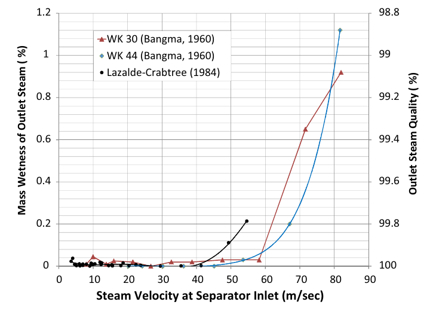
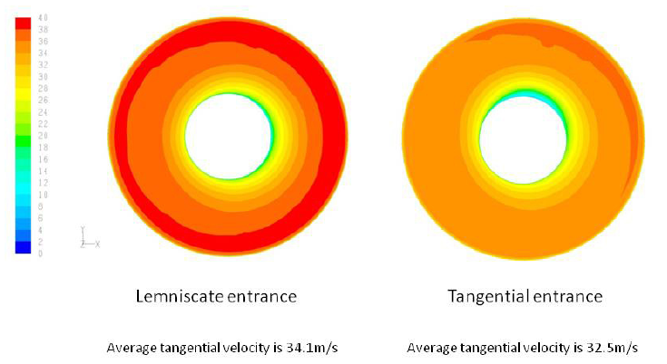

# Part 1 — Introduction and literature review

<!-- Research framing: credible liquid transport and collection, developed through mesh/inlet assessment, absorber and startup procedures, and wall-film studies. Internal evidence links are traceability notes. -->

## 1. Introduction

### 1.1. Engineering problem

Geothermal steam–water separators supply dry steam to turbines. Liquid carryover can cause erosion and transport minerals that form deposits. Design must therefore consider separation efficiency, pressure drop and operating pressure. ([Zarrouk & Purnanto, 2015](https://doi.org/10.1016/j.geothermics.2014.05.009))

This study develops an inherited computational fluid dynamics (CFD) model of a vertical bottom-outlet cyclone with a spiral inlet. It follows liquid from inlet placement through wall transport and collection.

<!-- Evidence: [Study scope](../../scope.md); [inlet-development interpretation](../../experiments/phase-01-purnanto-baseline-and-inlet-exploration/interpretation.md); [author's development context and meeting sources](../Shuhei-Context.md#how-the-project-understanding-developed); [absorber-development context](../../experiments/phase-07-1a-absorber-convergence/CONTEXT.md). -->

### 1.2. Problem in the inherited model

The simplified geometry omits the lower brine-discharge path. A closed bottom gives liquid no intended exit; opening the whole lower boundary can also let steam escape there. The model needs a collection treatment that preserves the steam route.

<!-- Evidence: [Model boundary](../../model.md). -->

A virtual collector, termed an absorber, and reduced-feed startup enabled roughness and Eulerian Wall Film (EWF) studies after unsuccessful full-geometry drainage trials.

<!-- Evidence: [Verified early absorber](../../experiments/phase-07-1a-absorber-convergence/baseline-v2-virtual-liquid-outlet/results.md); [selected case history](../../experiments/phase-07-2a-wall-liquid-routing/stage-02-combined-ewf-roughness/case-history-N45606.md); [full-geometry scope decision](../../experiments/phase-06-full-geometry-with-brine-pool/conclusion.md); historical lower-boundary dilemma in [29 April, 04:04–06:36](../../meetings/otter/2026-04-29-wk-7-steam-liquid-separator-analysis.md). -->

A *developed flow field* is a saved full-feed state used as a common starting point, or parent. The selected parent retained a substantial liquid-balance error; it supported comparisons but was not validated.

<!-- Evidence: [R0 control](../../experiments/phase-07-1a-absorber-convergence/roughness-family/r0-smooth-control/results.md); [source-inclusive R0 accounting assessment](../../experiments/phase-07b-full-geometry-liquid-removal/convergence-investigation/shuhei-audit.md). -->

### 1.3. Research aim and questions

The aim is to develop and assess the separator model's liquid-transport and collection paths. Predicting separation efficiency and pressure drop is the longer-term purpose. The present work addresses four questions:

1. How do mesh representation and inlet phase placement affect liquid distribution and retention near the wall?
2. How can numerical collection and staged startup provide starting fields for wall studies?
3. How do wall roughness and wall-film modelling affect liquid transport, storage, release and collection?
4. What numerical and liquid-accounting evidence supports these predictions, and what remains necessary for field validation?

### 1.4. Scope and contribution

The study mainly uses the simplified primary separator. Mesh and inlet comparisons lead into collector development, startup and wall-treatment studies. Later cases examine film development to 500 ms, release mechanisms and direct drainage. Downstream equipment, mineral chemistry and optimum operating pressure are outside the simulated scope.

<!-- Evidence: [Study overview](../../index.md); [selected case history](../../experiments/phase-07-2a-wall-liquid-routing/stage-02-combined-ewf-roughness/case-history-N45606.md). -->

The contribution is an account of predicted liquid destinations and methods that enable their study. A final comparison across five mesh resolutions is reserved for Phase 9; mesh convergence remains unqualified. Controlled reconstruction cases are defined in Appendix A.2.

Section 3 describes the model and comparisons. Section 4 presents the results; Sections 5–6 discuss their meaning, limits and further work.

## 2. Literature review

### 2.1. How a geothermal steam–water separator works

A vertical bottom-outlet cyclone (BOC) uses a tangential or spiral inlet to rotate the incoming steam and brine. Liquid moves towards the wall while steam occupies the central region. An internal pipe carries steam out through the bottom; brine leaves separately. *Bottom outlet* refers to the steam-pipe arrangement. ([Zarrouk & Purnanto, 2015](https://doi.org/10.1016/j.geothermics.2014.05.009))

Wall capture is only part of separation. A film may drain, remain in the vessel or release droplets into the steam (Figure 1). The model must therefore distinguish wall retention from external collection.

*Figure 1. Conceptual liquid paths: wall film, droplets carried with steam, brine discharge ($\dot m_l$) and downstream brine collection ($\dot m_b$). The source schematic distinguishes these routes from condensation; it is not a measured mass balance. Source: [Rizaldy et al. (2016)](https://www.researchgate.net/publication/310818568_LIQUID_CARRYOVER_IN_GEOTHERMAL_STEAM-WATER_SEPARATORS), fig. 5.*

<!-- Evidence: [Model boundary](../../model.md). Figure source: [primary carryover paper](../../../CFD_wiki/raw/053_Rizaldy_Final.pdf), PDF page 3, original fig. 5; symbol interpretation checked against PDF pages 3–4. [Full-page source preview](../figures/literature-candidates/wall-film/rizaldy-2016-pdf-page-03.png). The inserted panel was rendered directly from the local PDF; its labels and arrows are unchanged. -->

### 2.2. Internal flow physics and performance measures

Rotation produces a low-pressure core, with inward acceleration scaling as $u_\theta^2/r$ for tangential velocity $u_\theta$ and radius $r$. Density-dependent responses to pressure and drag allow outward liquid transport. Fine droplets can follow steam; larger droplets reach collection surfaces more readily. Uncertain inlet sizes and continued droplet generation complicate prediction. ([Pointon et al., 2009](https://publications.mygeoenergynow.org/grc/1028587.pdf))

Higher velocity can strengthen outward transport but also increase entrainment by steam shear. Empirical data show rapid wetness increases at different velocities for different separators (Figure 2). Thus, greater swirl alone does not establish better separation. ([Zarrouk & Purnanto, 2015](https://doi.org/10.1016/j.geothermics.2014.05.009))

*Figure 2. Outlet mass wetness and steam quality versus inlet steam velocity. The reversed right axis gives steam quality. Different datasets show different breakdown regions, not a threshold for this geometry. Source: [Zarrouk and Purnanto (2015)](https://doi.org/10.1016/j.geothermics.2014.05.009), fig. 12, using Bangma (1960) and Lazalde-Crabtree (1984) data.*

<!-- Figure source: [primary design review](<../../../CFD_wiki/raw/Zarrouk and Purnanto 2014.pdf>), PDF page 12 / printed page 247; [full-page source preview](../figures/literature-candidates/design-overview/zarrouk-purnanto-2015-page-12.png). The published axes, curves, points and legend are unchanged. -->

Outlet steam quality is

$$
x_{\mathrm{out}}=
\frac{\dot m_{v,\mathrm{out}}}
{\dot m_{v,\mathrm{out}}+\dot m_{l,\mathrm{out}}},
$$

where the terms are outward vapour and liquid mass-flow rates through the steam outlet. Purnanto et al. (2013) used this measure. It differs from liquid-capture fraction, which compares collected liquid with inlet liquid; their denominators are not interchangeable. ([Purnanto et al., 2013](https://www.researchgate.net/publication/269519626_CFD_MODELLING_OF_TWO-PHASE_FLOW_INSIDE_GEOTHERMAL_STEAM-WATER_SEPARATORS))

Steam purity concerns contamination. Chemical carryover estimates are affected by condensation and drain-pot collection, so field comparisons need matching definitions and sampling locations. ([Rizaldy et al., 2016](https://www.researchgate.net/publication/310818568_LIQUID_CARRYOVER_IN_GEOTHERMAL_STEAM-WATER_SEPARATORS))

Internal pressure drop requires defined inlet/outlet locations and a stated static or total pressure measure. It differs from selecting optimum operating pressure, which also involves flashing and plant conditions. The present no-flashing model addresses internal flow at prescribed phase conditions. ([Pointon et al., 2009](https://publications.mygeoenergynow.org/grc/1028587.pdf); [Zarrouk & Purnanto, 2015](https://doi.org/10.1016/j.geothermics.2014.05.009))

### 2.3. Established design methods and geothermal CFD

Empirical geothermal design methods provide reference points for CFD. However, CFD's additional flow detail must be assessed against its assumptions and comparison evidence. ([Zarrouk & Purnanto, 2015](https://doi.org/10.1016/j.geothermics.2014.05.009))

Pointon et al. (2009) used Fluent's Discrete Phase Model (DPM) with assumed droplet feed and wall/baffle collection. Predicted efficiencies were 99.96% for scrolled and 99.93% for tangential entry; an empirical design method gave 99.955%. Scrolled entry also gave higher tangential velocities (Figure 3). Empirical agreement did not independently test the feed or collection assumptions. ([Pointon et al., 2009](https://publications.mygeoenergynow.org/grc/1028587.pdf))

*(a) Inlet configurations.*

*(b) Calculated tangential-velocity distributions.*

*Figure 3. (a) Entry geometries; (b) tangential velocity (m/s). Scrolled (lemniscate) entry is left; tangential entry is right. Reported mean velocities are 34.1 and 32.5 m/s, respectively. Source: [Pointon et al. (2009)](https://publications.mygeoenergynow.org/grc/1028587.pdf), figs. 5 and 7.*

<!-- Figure source: [primary Pointon paper](../../../CFD_wiki/raw/1028587.pdf), PDF pages 5–6 / printed pages 946–947; [geometry source page](../figures/literature-candidates/pointon/page-5.png); [velocity source page](../figures/literature-candidates/pointon/page-6.png). Both published panels, the velocity legend and mean annotations are unchanged. The report adds the (a)/(b) labels outside the images. -->

Purnanto et al. (2013) compared three BOC configurations using a steady Mixture model and DPM outlet-quality calculation. Changed vessel proportions prevented isolation of inlet shape. Counting incomplete droplet tracks as separated improved empirical agreement, but the authors called that assumption non-rigorous. The inherited modelling basis therefore requires explicit treatment of unresolved droplet fate. ([Purnanto et al., 2013](https://www.researchgate.net/publication/269519626_CFD_MODELLING_OF_TWO-PHASE_FLOW_INSIDE_GEOTHERMAL_STEAM-WATER_SEPARATORS))

Both studies used renormalisation-group (RNG) k–ε turbulence modelling. Pointon's swirl modification and lower-cost rationale offer a starting point, not a detailed turbulence-model comparison. Accuracy in the present swirling and near-wall flow remains to be assessed. ([Pointon et al., 2009](https://publications.mygeoenergynow.org/grc/1028587.pdf); [Purnanto et al., 2013](https://www.researchgate.net/publication/269519626_CFD_MODELLING_OF_TWO-PHASE_FLOW_INSIDE_GEOTHERMAL_STEAM-WATER_SEPARATORS))

Table 1 identifies transferable methods and the limits on their use.

*Table 1. Literature methods and their implications for this model.*

| Study / context | Liquid representation | Assessment evidence | Implication |
| --- | --- | --- | --- |
| Pointon et al. (2009): geothermal BOC | DPM; assumed feed and wall collection | Empirical design comparison | Declare droplet feed and collection rules |
| Purnanto et al. (2013): geothermal BOC; 11.2 bar absolute; isothermal, incompressible, no flashing | Mixture and DPM | Outlet quality; incomplete tracks | Retain bulk model; account for unresolved fate |
| Rizaldy et al. (2016): separator and steam line | Film-entrainment correlations; chemical sampling | Wairakei context; incomplete brine-flow data | Study re-entrainment; match sampling locations |
| Skoog (2020): reactor-channel approximation | Separate steam, EWF and DPM | 1D empirical comparison; inlet sensitivity | Track transfers; justify cyclone application |

### 2.4. Wall–liquid transport and carryover

Film motion depends on gravity, pressure and shear. Deposition adds liquid; drainage removes it; entrainment returns droplets to the steam. More wall deposition can therefore increase storage or later release without increasing external collection.

Rizaldy et al. (2016) predict entrainment sensitivity to loading, film thickness and velocity. Figure 4 shows conceptual release mechanisms. Missing brine-flow data prevented the required comparison with Wairakei drain-pot measurements, leaving quantitative field agreement unresolved. ([Rizaldy et al., 2016](https://www.researchgate.net/publication/310818568_LIQUID_CARRYOVER_IN_GEOTHERMAL_STEAM-WATER_SEPARATORS))

*Figure 4. Conceptual (a) undercut and (b) roll-wave entrainment, associated with lower and higher film Reynolds numbers, respectively. Steam releases droplets from the film. Film Reynolds number compares inertia with viscosity using liquid velocity and film thickness. Source: [Rizaldy et al. (2016)](https://www.researchgate.net/publication/310818568_LIQUID_CARRYOVER_IN_GEOTHERMAL_STEAM-WATER_SEPARATORS), fig. 9, crediting Ishii and Grolmes (1975).*

<!-- Figure source: [primary carryover paper](../../../CFD_wiki/raw/053_Rizaldy_Final.pdf), PDF page 5; [full-page source preview and original attribution](../figures/literature-candidates/wall-film/rizaldy-2016-pdf-page-05.png). The two published mechanism panels and labels are unchanged. -->

Fluent roughness changes near-wall momentum transfer; it does not add a film store or drain. EWF instead adds surface storage and transport. Their outlet-flow responses must be read alongside retained mass and collection. ([Ansys, Inc., 2025k](https://ansyshelp.ansys.com/public/Views/Secured/corp/v252/en/flu_th/x1-5720008.164.html))

### 2.5. Representing liquid and its collection

The Mixture model represents bulk liquid through secondary-phase volume fraction. Algebraic slip estimates relative phase velocity using local equilibrium. Liquid volume fraction does not directly resolve film thickness or droplet-size distribution. ([Ansys, Inc., 2025d](https://ansyshelp.ansys.com/public/Views/Secured/corp/v252/en/flu_th/flu_th_sec_drift_oview.html))

DPM follows size-dependent droplet trajectories. Its interpretation requires defined injection and boundary treatments, with every tracked fate counted, including incomplete trajectories.

Skoog (2020) combined EWF surface transport, DPM deposition and entrainment in a reactor-channel approximation. Film/droplet flows were compared with one-dimensional calculations using experimentally based Okawa correlations. Inlet allocation and transverse droplet velocity affected the result. The separate liquid accounts provide a precedent; reactor conditions and correlations still need justification for a cyclone. ([Skoog, 2020](https://www.diva-portal.org/smash/get/diva2:1452100/FULLTEXT02.pdf); [Ansys, Inc., 2025e](https://ansyshelp.ansys.com/public/views/secured/corp/v252/en/flu_ug/flu_ug_models_wallfilm.html))

Bulk-to-film transfer moves liquid within the domain; the absorber removes it. Droplet injection must not duplicate another liquid feed. Fluent permits cell-zone mass and associated transport sources, but their law and effect require assessment. Section 3 describes the contact-based absorber. ([Ansys, Inc., 2025a](https://ansyshelp.ansys.com/public/Views/Secured/corp/v252/en/flu_ug/flu_ug_bcs_sec_cell_zones.html))

<!-- Evidence: [Audited model basis](../../model.md); [liquid-accounting guardrails and application of Skoog](../../technical/skoog-application-guardrails.md); [absorber-development context](../../experiments/phase-07-1a-absorber-convergence/CONTEXT.md). -->

### 2.6. Numerical startup, convergence and validation

A steady calculation's iterations and pseudo-time describe numerical development, not physical filling time. The National Aeronautics and Space Administration (NASA) recommends monitoring residuals and relevant outputs, with convergence criteria tied to acceptable output error. ([NASA, 2021a](https://www.grc.nasa.gov/www/wind/valid/tutorial/iterconv.html))

Fluent permits flow development before film initialisation. Reduced-feed startup and ramp choices remain case-specific procedures requiring assessment. ([Ansys, Inc., 2025h](https://ansyshelp.ansys.com/public/views/secured/corp/v252/en/flu_ug/flu_ug_ewf_sec_overview.html))

Implementation checks, iterative convergence, mass accounting and numerical sensitivity answer separate questions. Mesh and time-step studies require a fixed model; roughness or absorber changes instead test model sensitivity. ([NASA, 2021c](https://www.grc.nasa.gov/www/wind/valid/tutorial/verassess.html))

Physical validation requires relevant measurements and uncertainty assessment. Here, field comparison must examine the assumed collection route and outlet predictions within the tested operating range. ([NASA, 2021b](https://www.grc.nasa.gov/www/wind/valid/tutorial/valassess.html))

<!-- Evidence: [Verification and validation limits](../../vnv.md). -->

### 2.7. Remaining model uncertainties and research direction

The inherited model's incomplete liquid path links the research questions: mesh and inlet placement determine liquid delivery; collection supplies an exit; wall modelling determines storage and release. Liquid accounting and numerical checks define the limits of each finding.
