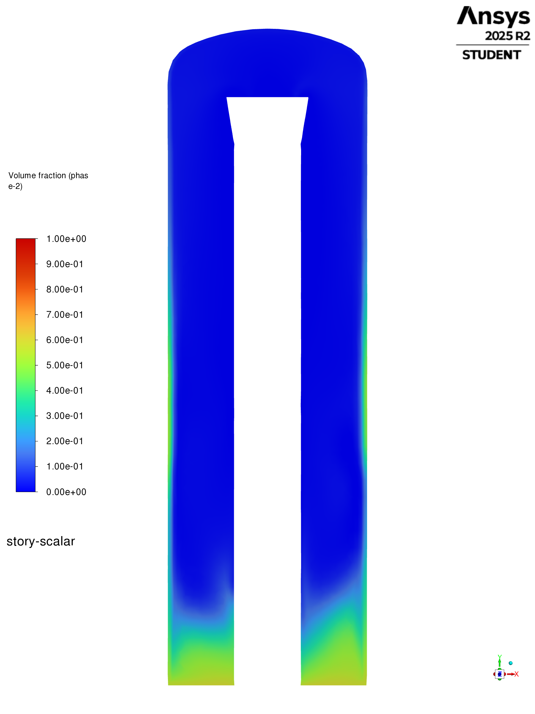
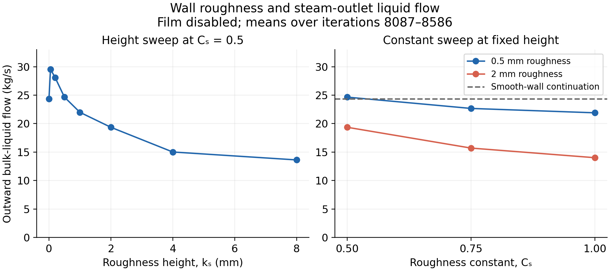
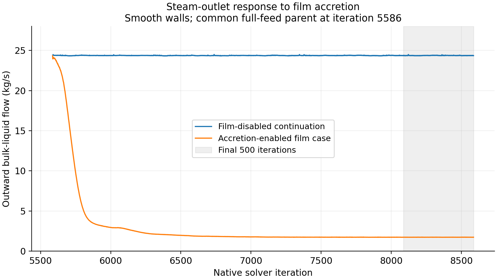
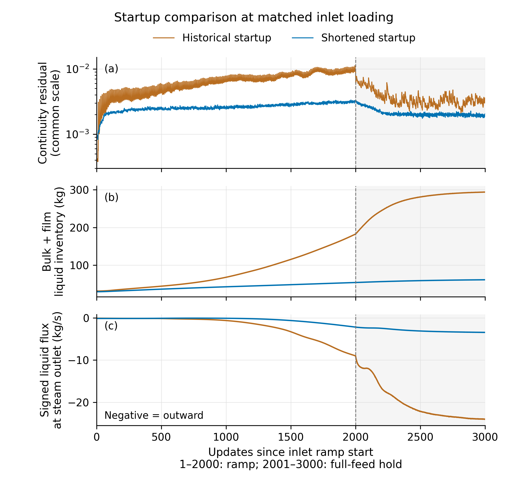
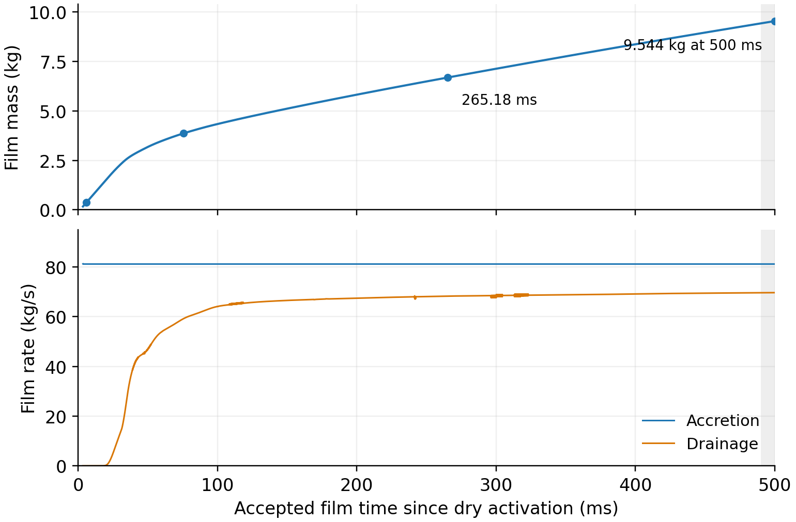

# Part 3 — Results

<!-- Findings are ordered by the physical model-development questions highlighted in the poster, rather than by experiment date. -->

## 4. Results

The principal findings concern mesh representation, inlet phase placement, liquid collection, wall interaction and film behaviour. The mesh and inlet comparisons establish how liquid reaches and occupies the wall region. Accumulation then explains the need for an absorber, while the later experiments examine what happens to liquid on the wall. The wider exploratory history is retained in Appendix A.13.

The comparisons use their stated meshes, starting fields and numerical settings. Steam-outlet liquid flow is reported as a positive outward magnitude unless a signed balance is given. Steady solver iteration and accepted film time remain separate coordinates.

### 4.1. Mesh development and the wall-liquid field

The polyhedral–hexahedral mesh provided a different representation of the wall region from the inherited tetrahedral mesh. The native sections show larger interior cells, polyhedral transitions and layers that follow the vessel surface (Figure 6). This made the mesh structure relevant to the expected liquid path: circumferential motion beside the wall followed by transport towards the lower collection region. The Fluent Meshing workflow supplied the meshes used for repeated model development, with the detailed topology and near-wall evidence given in Section 3.4.

The saved liquid fields also changed. At iteration 10,000, the historical tetrahedral reference had a thin wall-enriched region, while the 60,964-cell SIMPLE reconstruction showed a broader region of higher liquid volume fraction. The contrast made wall-liquid retention an explicit question for the later mesh and collection investigations. A liquid-rich wall region could no longer be treated as a minor part of the flow field.

| Historical tetrahedral reference | Polyhedral–hexahedral reconstruction |
| --- | --- |
| **(a) Mesh at inlet height**  | **(b) Mesh at inlet height**  |
| **(c) Bulk-liquid volume fraction**  | **(d) Bulk-liquid volume fraction**  |

*Figure 6. Native mesh and bulk-liquid sections at each geometry's inlet midpoint. Left: the 7,601,261-cell historical tetrahedral case with split feed. Right: the 60,964-cell mixed-inlet SIMPLE reconstruction. Both liquid fields are saved at iteration 10,000 and use a 0–1 scale; mesh and contour images within each column refer to the same case mesh. The panels document topology and the resulting saved liquid states.*

The development benefit was control over the mesh structure near the liquid path. Reduced numerical diffusion is a plausible explanation for the changed wall field, but the historical comparison also changed inlet representation and preparation, and the coarse SIMPLE state had a large balance error. The more focused finer-mesh results in Section 4.3 establish the accumulation that motivated explicit collection; neither comparison alone measures an accuracy gain.

<!-- Evidence: [native mesh and liquid-field comparison, source pairs and export manifests](../../meetings/Poster/poster-sections/mesh-and-volume-fraction-comparison.md); solved 60k topology and wall-resolution evidence in Appendix A.10. The separate 342k mesh illustration used elsewhere is not substituted for the 60k contour's mesh here. -->

### 4.2. Two-phase inlet and wall-side liquid placement

The split inlet established a reproducible liquid-rich feed beside the outer wall. At the reference enthalpy, steam supplied 40.83% of the mass but about 99.07% of the original design's volumetric flow. The area calculation therefore assigned approximately 0.004890 m² to liquid and 0.519286 m² to steam, giving a 6.754 mm liquid strip across the 0.724 m inlet height. Section 3.3 derives this allocation from the energy balance and identifies the separate density bases used in the design and later simulations.

The matched comparison tested the effect of phase placement on the same 60,964-cell mesh. The mixed inlet distributed both phases over the inlet faces; the split inlet placed liquid on the wall-side strip and steam on the remaining area. Total phase feed, Coupled settings, initialisation procedure and the 10,000-update horizon were retained.

With split feed, the inlet-height section showed a more continuous liquid-rich band around the outer wall, and the vertical section showed a deeper enriched lower region (Figure 7). The whole-domain inventory increased from 1262.6 to 1734.5 kg, a difference of 471.9 kg or 37.4% (Table 7). Split feed retained more liquid at all five tested speeds from 20.11 to 32.14 m/s. Thus, inlet phase placement changed the internal liquid state even when the overall phase loading was held fixed.

| Mixed-phase feed | Wall-side liquid strip with separate steam feed |
| --- | --- |
| **(a) Inlet-height section**  | **(b) Inlet-height section**  |
| **(c) Vertical centre section**  | **(d) Vertical centre section**  |

*Figure 7. Bulk-liquid volume fraction with mixed and split phase placement at nominal 26.81 m/s and iteration 10,000. Both cases use the same mesh, Coupled/Global Time Step package, 0–1 colour range and closed lower boundary, with absorber and EWF disabled. Top: inlet-height sections. Bottom: vertical centre sections. The contour footprints show distribution; the volume-integral reports quantify retained mass.*

*Table 7. Matched inlet-placement results at nominal 26.81 m/s. Inventories are iteration-10,000 endpoints; outlet ratios use the declared iterations 9500–10,000 window. The reconstruction liquid feed was 116.9387 kg/s.*

| Quantity | Mixed feed | Wall-side split feed |
| --- | ---: | ---: |
| Bulk-liquid inventory (kg) | 1262.6 | 1734.5 |
| Outward steam-outlet liquid / liquid feed (%) | 99.671 | 99.404 |

The wall-side feed provides a clear basis for studying wall transport and film formation. Its complete phase segregation remains an assumed inlet profile, and the near-100% liquid outlet ratios show that phase placement alone did not supply a collection route. This leads directly to the accumulation and absorber question below.

<!-- Evidence: [matched inlet setup and numerical basis](../../experiments/phase-08-storyline-reconstruction/stage-01-60k-storyline/baseline-lineage-audit.md), [mixed-feed results](../../experiments/phase-08-storyline-reconstruction/stage-01-60k-storyline/f1-one-inlet/results.md), [split-feed inventory and spatial findings](../../experiments/phase-08-storyline-reconstruction/stage-01-60k-storyline/f2-split-inlet/results.md), and [native inlet-plane exports](../../meetings/Poster/poster-sections/mesh-and-volume-fraction-comparison.md). Percentage inventory change is calculated from the rounded published endpoint values. -->

### 4.3. Liquid accumulation and the need for collection

The mesh and inlet studies both made the destination of wall liquid important. In the truncated model, its lower boundary remained closed. The finer split-inlet SIMPLE cases concentrated liquid near the wall and base while discharging relatively little through the steam outlet.

Across three finer meshes, inventory increased while only a small fraction of the 116.92 kg/s liquid feed reached the steam outlet (Table 8; Figure 8). At iteration 3000, the 997,604-cell case held 69.16% of its liquid below $y=1$ m.

*Table 8. Developing absorber-free fields under the same reduced-relaxation SIMPLE package at iteration 3000. Equal iteration count does not imply equal physical time or converged fields.*

| Cells | Bulk-liquid inventory (kg) | Outward steam-outlet liquid (kg/s) |
| ---: | ---: | ---: |
| 342,609 | 453.612 | 2.2080 |
| 679,970 | 455.409 | 1.5321 |
| 997,604 | 333.142 | 0.003623 |

*Figure 8. Saved-checkpoint liquid inventory and steam-outlet liquid flow for three finer meshes with pure split feed, SIMPLE and no absorber. Lines connect saved states. The horizontal coordinate is steady solver iteration; all three inventories were still developing.*

The 679,970-cell continuation made the lower accumulation clearer. Inventory rose from 455.409 kg at iteration 3000 to 764.744 kg at iteration 4000; 69.62% was then below $y=2$ m. Outward liquid flow was 8.00 kg/s, only 6.84% of the feed. The next continuation encountered AMG divergence and a floating-point exception after the last printed iteration 4211.

These fields exposed the collection problem: liquid was retained away from the steam outlet without a separate brine-discharge route. The coarse Coupled cases gave the other possible response, discharging almost all incoming liquid through the steam outlet (Section 4.2). Their smaller boundary gap described closer numerical closure, but did not represent effective liquid collection.

Earlier attempts to resolve a full brine outlet produced excessive discharge, numerical failure or uncontrolled lower-liquid inventory. The study therefore retained the simplified upper vessel and represented collection with a liquid-selective source. Appendix A.13 preserves the broader experiment overview and pool-control figure that explain this scope decision. The following startup and wall studies used that explicit collection route.

The accumulation histories are steady numerical development, not physical filling rates, and the later failure does not isolate its cause. The result is evidence that the selected liquid transport requires a collection model; mesh accuracy and a stationary separator state remain separate questions.

<!-- Evidence: [matched finer-mesh checkpoints](../../experiments/phase-08-storyline-reconstruction/stage-02-fine-mesh-simple/direct-student-342k/n3000/results.md), [997k spatial result](../../experiments/phase-08-storyline-reconstruction/stage-02-fine-mesh-simple/direct-student-997k/n3000/results.md), [680k accumulation and failed continuation](../../experiments/phase-08-storyline-reconstruction/stage-02-fine-mesh-simple/direct-student-680k/n4000/results.md), [mixed-inlet Coupled account](../../experiments/phase-08-storyline-reconstruction/stage-01-60k-storyline/f1-one-inlet/results.md) and [full-geometry scope decision](../../experiments/phase-06-full-geometry-with-brine-pool/conclusion.md). -->

### 4.4. Reduced-feed development and inlet ramp

The startup and wall-treatment sequence used the 60,964-cell split-inlet model, with full-feed commands of 116.92 kg/s liquid and 80.69 kg/s steam. These are the reference rates for the following comparisons.

At 25% feed with the throughput-controlled absorber active, the bulk-liquid inventory approached a nearly constant value before inlet loading increased (Figure 9). Scaled continuity reached a minimum of $3.2056\times10^{-4}$ at iteration 1556. Over the final 500 updates of the hold, iterations 1080–1580, inventory decreased from 31.4518 to 31.3571 kg, a change of 0.30%. Outward bulk-liquid flow through the steam outlet was 0.0684 kg/s at iteration 1580.

The reduced-feed hold continued because the intended inlet changes had not been applied to Fluent. The corrected procedure then wrote and checked both inlet commands during the 2000-update ramp. Full feed was reached at iteration 3580. Continuity and liquid inventory increased during loading: the ramp's maximum continuity was $1.1166\times10^{-2}$, and its endpoint bulk inventory was 182.5178 kg (Table 9).

*Figure 9. Early numerical development with the throughput-controlled absorber. The panels show scaled carrier residuals, bulk-liquid inventory and reported liquid-inlet loading. A marks the end of the 25% feed hold and start of the corrected ramp at iteration 1580. B marks full feed and the change to Coupled with Global Time Step at iteration 3580. C marks later EWF activation from the full-feed parent at iteration 5586. The horizontal axis is native iteration. The inherited iteration 1 inlet-report cache value is omitted from the inlet panel.*

*Table 9. Successive stages of carrier development. Residual minima, the ramp maximum and endpoint values are identified separately. These stages differ in inlet loading and numerical controls.*

| Development step | Scaled continuity observation | Endpoint bulk liquid (kg) | Endpoint outward steam-outlet liquid (kg/s) |
| --- | --- | ---: | ---: |
| 25% feed hold to iteration 1580 | Minimum $3.2056\times10^{-4}$ at iteration 1556 | 31.3571 | 0.0684 |
| Ramp to full feed at iteration 3580 | Ramp maximum $1.1166\times10^{-2}$ | 182.5178 | 8.9952 |
| Full-feed control to iteration 5586 | Minimum $2.0735\times10^{-3}$ at iteration 4770; endpoint $2.7841\times10^{-3}$ | 295.8536 | 24.3344 |

The low-feed hold supplied the developed fields for the checked ramp. Its nearly constant inventory was useful for startup, while source-inclusive balance was assessed separately at full feed.

<!-- Evidence: [selected case history](../../experiments/phase-07-2a-wall-liquid-routing/stage-02-combined-ewf-roughness/case-history-N45606.md), [carrier residuals](../../../PyAnsys/output/phase72a-lineage-N45606/20261005/carrier-residuals.csv) and [liquid histories](../../../PyAnsys/output/phase72a-lineage-N45606/20261005/selected-lineage-histories.csv). -->

### 4.5. Full-feed control and mass balance

After the change to Coupled with Global Time Step, continuity fell from its ramp peak and bulk inventory approached 296 kg. The preserved smooth-wall, film-disabled full-feed control at iteration 5586 supplied the initial fields for the roughness and wall-film comparisons. The continuation completed without a fatal solver event, although residual oscillations, outlet reverse flow and turbulence-limiting messages remained.

At iteration 5586, the commanded liquid removal and native applied removal magnitude were both 116.92 kg/s. Agreement to numerical precision confirmed source application at the endpoint. The liquid budget nevertheless remained open: the absorber removed the liquid inlet rate while a further 24.3344 kg/s left through the steam outlet.

*Table 10. Source-inclusive mass-balance remainders at iteration 5586. Boundary fluxes are positive into the domain and the applied absorber source is negative. Each source is counted once. Percentages use the liquid, vapour and total feeds of 116.92, 80.69 and 197.61 kg/s, respectively.*

| Budget | Signed boundary-plus-source remainder (kg/s) | Remainder / relevant feed (%) |
| --- | ---: | ---: |
| Bulk liquid | −24.3344 | −20.8129 |
| Vapour | +0.4391 | +0.5441 |
| Native mixture | −23.8923 | −12.0906 |

The native mixture and phase-summed accounts differed by 0.0031 kg/s and were retained separately. The parent supplied common fields for later screens, but correct source application and improved continuity did not resolve its liquid-balance error.

<!-- Evidence: [full-feed control continuation](../../experiments/phase-07-1a-absorber-convergence/roughness-family/r0-smooth-control/results.md), [baseline handoff](../../experiments/phase-07-2a-wall-liquid-routing/baseline-control-handoff.md), [aligned native full-feed control histories](../../../PyAnsys/output/phase71a_r0_control_run4/report-histories-batched.json) and [full-feed control accounting audit](../../experiments/phase-07b-full-geometry-liquid-removal/convergence-investigation/shuhei-audit.md). -->

### 4.6. Roughness response from the common parent

Twelve roughness cases each completed 3000 updates from the same full-feed parent. They covered heights of 0–8 mm at $C_s=0.5$, with $C_s=0.75$ and 1.0 also tested at 0.5 and 2 mm. The steam-outlet liquid response was non-monotonic (Figure 10). At $C_s=0.5$, increasing $k_s$ from zero to 0.05 mm raised mean outward liquid flow from 24.3715 to 29.5412 kg/s, an increase of 21.21%. Larger tested heights lowered the flow. The 8 mm rough-wall case gave 13.6253 kg/s, 44.09% below the smooth-wall continuation. These means use the same final-500 window, iterations 8087–8586.

*Figure 10. Outward bulk-liquid steam-outlet flow in the EWF-off roughness screen. Left: height sweep at $C_s=0.5$. Right: constant changes at $k_s=0.5$ and 2 mm. All cases start from the same full-feed fields at iteration 5586; plotted values are means over iterations 8087–8586. The dashed line is the smooth-wall continuation. Lines connect tested settings and do not represent fitted response models.*

The 8 mm case ended with 108.744 kg of bulk liquid, 187.109 kg below the common starting inventory. Its lower outlet flow therefore accompanied substantial liquid depletion. Late-window outlet standard deviations were only 0.0219 and 0.0331 kg/s for the smooth and 8 mm cases, respectively; these measure iteration-to-iteration variation, not physical uncertainty.

Increasing $C_s$ lowered mean outlet flow at both tested fixed heights. However, the 1 mm rough-wall case at $C_s=0.5$ and the 0.5 mm rough-wall case at $C_s=1.0$ had oscillatory outlet histories, and source-inclusive balances remained open across the screen. The results establish sensitivity to the prescribed wall treatment; they do not establish that the lower outlet rates correspond to improved separation or drainage.

<!-- Evidence: [roughness-screen results and sample standard deviations](../../experiments/phase-07-2a-wall-liquid-routing/roughness-family/results.md#matched-tail-comparison) and [comparison figure and provenance](../../observations/07-wall-liquid-interaction.md). The source's later statement identifying the lowest outlet conflicts with its table; the table values are used here. -->

### 4.7. Accretion-enabled wall-film response

After early accreting-film trials failed, a configuration with phase accretion and coupled film equations, but film-to-flow momentum feedback disabled, completed 3000 updates. This supplied the accretion-enabled comparison; the preceding trials are retained in Appendix A.11.

The accretion-enabled EWF package reduced mean bulk-liquid steam-outlet flow from 24.369 kg/s in the film-disabled continuation to 1.735 kg/s in the accretion-enabled film case, a reduction of 92.88% over iterations 8087–8586 (Figure 11). Both cases began from the developed full-feed fields saved at iteration 5586 and retained smooth walls and the throughput-controlled absorber. The accretion-enabled case included phase accretion and coupled film equations, with film-to-flow momentum feedback disabled.

*Figure 11. Outward bulk-liquid steam-outlet flow for the film-disabled continuation and accretion-enabled film case over iterations 5586–8586. All 3001 saved points are shown without smoothing; shading identifies the final 500 updates. The film-disabled continuation has EWF off. The accretion-enabled case uses phase accretion, coupled film equations and a fixed 10 µs film step, with bulk-flow momentum feedback off.*

Bulk-liquid inventory fell from 295.8536 to 63.0234 kg, while the film held 3.1112 kg (Table 11). The bulk loss therefore greatly exceeded the new film store. The matched sections show the accompanying reduction in wall-adjacent bulk liquid (Figure 12), making wall treatment a strong influence on the calculated liquid distribution.

*Figure 12. Bulk-liquid volume fraction at iteration 8586 for the film-disabled continuation and accretion-enabled film case, each after 3000 updates from the same fields at iteration 5586. The native X–Y centre sections use Z = 0 m, the same orthographic camera and a fixed 0–1 scale. The film-disabled continuation has EWF off; the accretion-enabled case has phase accretion and coupled film equations on, with bulk-flow momentum feedback off. The panels show bulk liquid, not wall-film thickness or drainage. Their different inventories and open mass accounts remain limits on interpretation.*

The comparison establishes the response to the enabled film package. Its open combined liquid account and changing inventories prevent the outlet reduction from being interpreted as a measured gain in separation efficiency.

<!-- Evidence: [film-disabled and accretion-enabled comparison](../../observations/07-wall-liquid-interaction.md), [wall-film-screen results and native sections](../../experiments/phase-07-2a-wall-liquid-routing/ewf-family/results.md#native-phase-2-volume-fraction-contours--2026-09-23), [paired contour provenance](../figures/bulk-comparison-described-film-treatment.provenance.json) and [selected endpoint histories](../../../PyAnsys/output/phase72a-lineage-N45606/20261005/selected-lineage-histories.csv). The film-disabled continuation's mean is from its separate comparison run and is not substituted for the roughness screen's smooth-wall mean. -->

### 4.8. Contact collection and combined model development

The final contact absorber was assessed through short removal-time screens and a separate combined continuation. After 100 updates from the same iteration 13586 parent, reducing the prescribed depletion time from 10 to 1 µs lowered collector inventory from 0.496 to 0.159 g. Evaluated endpoint removal increased from 49.59 to 158.81 kg/s, with greater source variability at 1 µs. These were developing endpoint values. The full three-value comparison and subsequent bounded 10 µs screen are retained in Appendix A.4.

The combined continuation returned to the original accretion-enabled film fields saved at iteration 13586 and introduced 0.5 mm roughness, the contact absorber at a 10 µs depletion time, and a 1 µs film step. The selected history continued through replay and adaptive film stepping to iteration 45606. Appendix A.9 retains the full history and its restart branches. Because these controls changed together, differences from the original accretion-enabled film state cannot be assigned to roughness, absorber replacement or film stepping individually.

*Table 11. Selected endpoints on the combined field history. Outlet values are individual endpoints, rather than final-window means.*

| Model state | Bulk liquid (kg) | Film (kg) | Bulk + film (kg) | Outward bulk-liquid steam-outlet flow (kg/s) |
| --- | ---: | ---: | ---: | ---: |
| Full-feed parent, iteration 5586 | 295.8536 | 0 | 295.8536 | 24.3344 |
| Accretion-enabled film case, iteration 8586 | 63.0234 | 3.1112 | 66.1346 | 1.7365 |
| Corrected contact continuation, iteration 17586 | 62.9581 | 5.9150 | 68.8732 | 3.6794 |
| Selected adaptive endpoint, iteration 45606 | 62.8970 | 6.3600 | 69.2570 | 3.6724 |

Bulk inventory remained close to 63 kg between iterations 17586 and 45606, while film mass increased. At iteration 45606, the native film clock was 120.769 ms. Over the corrected-restart interval iterations 13586–45606, integrated accretion was 3.3498 kg, drainage was 2.8324 kg, and film inventory increased by 0.5176 kg. The film-only ledger error was 0.00637% of integrated accretion.

During the final 1000 adaptive updates, mean accretion, drainage and storage were 82.1518, 73.9558 and 8.2017 kg/s, respectively. Drainage remained 9.98% below accretion. This record therefore contains drainage alongside continued film filling. Repeated inner-film residual failures and the missing final 233 subiteration records limit the interpretation of the smooth inventory histories; their extent is reported in Section 4.12.

<!-- Evidence: [contact-strength screens](../../experiments/phase-07-2a-wall-liquid-routing/stage-02-combined-ewf-roughness/results.md#all-liquid-contact-absorber-trial), [complete selected case history](../../experiments/phase-07-2a-wall-liquid-routing/stage-02-combined-ewf-roughness/case-history-N45606.md) and [corrected film ledger](../../../PyAnsys/output/phase72a-lineage-N45606/20261005/corrected-film-development-summary.json). The short strength-screen branch is distinct from the original-field continuation retained in Appendix A.9. -->

### 4.9. Shortened startup with early wall-film activation

The shortened startup reused the same saved reduced-feed bulk fields as the historical path. Coupled flow, dry EWF with accretion, 0.5 mm roughness and contact collection were introduced before loading. The 500-update activation hold was followed by a verified 2000-update ramp and a 1000-update full-feed hold.

At matched ramp progress, the shortened recipe had lower peaks in continuity, combined liquid inventory and bulk-liquid outlet flow (Figure 13; Table 12). Peak continuity fell by 70.15%, while the inventory and outlet peaks fell by 70.43% and 75.78%, respectively. Continuity had the same residual normalisation in the two calculations. The other residual normalisations differed, so their scaled magnitudes were not treated as direct measures of relative improvement.

*Figure 13. Historical and shortened startup over the 2000-update inlet ramp and following 1000-update full-feed hold. The horizontal axis aligns loading progress: historical iterations 1581–4580 and shortened iterations 2081–5080. Shading marks the full-feed hold. The earlier activation hold is outside this comparison. The historical case remains EWF off throughout this interval; the shortened-startup case has the combined wall and contact treatment active.*

*Table 12. Peak values during the matched inlet ramp. Reductions are relative to the historical ramp. The combined settings assess a startup recipe rather than an isolated activation-timing change.*

| Measure | Historical startup | Shortened startup | Reduction (%) |
| --- | ---: | ---: | ---: |
| Scaled continuity | 0.011166 | 0.0033336 | 70.15 |
| Bulk + film inventory (kg) | 182.518 | 53.9715 | 70.43 |
| Outward bulk-liquid steam-outlet flow (kg/s) | 8.99517 | 2.17887 | 75.78 |

The preceding low-feed activation hold contained a continuity peak of 0.10593, larger than the historical ramp peak. Lower ramp excursions therefore did not mean that all startup disturbance was avoided. At the shortened-startup endpoint iteration 5080, bulk liquid was 61.0549 kg and film was 0.1645 kg. Bulk inventory still increased by 2.2644 kg over the final 500 updates.

The final hold identifies where liquid was moving (Table 13). Mean contact removal was 63.0140 kg/s and film accretion was 80.7365 kg/s, with almost all film input still being stored. The +50.6048 kg/s boundary/contact remainder excludes EWF transfer and is therefore a partial diagnostic, distinct from the film-disabled balance in Table 10.

*Table 13. Shortened-startup liquid-account terms over the final 500 full-feed updates, iterations 4581–5080. Bulk equations remained active. Boundary flux and the applied source retain their native signs; film input, edge outflow and storage are positive magnitudes. Film rates use the same 0.5 ms interval of accepted film time. These terms do not form a completed combined separator ledger.*

| Quantity | Reported rate (kg/s) |
| --- | ---: |
| Signed liquid-inlet flow | +116.9200 |
| Signed steam-outlet liquid flow | −3.3012 |
| Native applied contact source | −63.0140 |
| Boundary plus contact source, before EWF transfer | +50.6048 |
| Film input by accretion | 80.7365 |
| Total film edge outflow | 0.000227 |
| Film storage, $\Delta M_f/\Delta t_f$ | 80.7364 |

All 2000 ramp updates met the recorded inner-film tolerance, but 15 of the final 100 full-feed updates failed it by large margins. The recipe reduced loading excursions and supplied fields for film development; the separate activation peak and late film-solver failures mean it did not establish convergence over the complete startup. Appendix A.9.4 retains the residual evidence.

<!-- Evidence: [shortened-startup results](../../experiments/phase-07-2a-wall-liquid-routing/stage-03-shortened-reconstruction/early-ewf-startup/results.md), [audited metrics, native source checks and normalisation](../../../PyAnsys/output/phase72a-stage3-early-ewf-server1/20261005/analysis-summary.json) and [native final histories for Table 13](../../../PyAnsys/output/phase72a-stage3-early-ewf-server1/20261005/final-histories.json). -->

### 4.10. Film development under frozen bulk fields

After iteration 5080, the selected film continuation advanced the native film clock from 3.5 to 265.184 ms. Film mass increased from 0.1645 to 6.6883 kg. The reference-speed continuation then reached 500 ms with 9.5444 kg of film (Figure 14). Bulk inventory remained at 61.0549 kg and outward bulk-liquid outlet flow at 3.4300 kg/s because the bulk equations were frozen. The resulting increase in combined inventory came from additional film storage.

*Figure 14. Selected reference-speed film development under frozen bulk fields, from 3.5 to 500 ms since dry-film activation. The panels show native film inventory and accretion and drainage rates against accepted film time. All selected records are shown without smoothing. Markers identify the three snapshots in Figure 15 and the 500 ms endpoint; shading marks the final 10 ms reporting window. Accretion is prescribed input from the held bulk field. The selected restart path is used; rejected sibling histories are excluded. Detailed recovery chronology is retained in Appendix A.9.*

The saved wall-film fields showed increasing coverage and thickness over the lower and middle vessel wall, while the upper region remained thinner (Figure 15). Between the 75.66 and 265.18 ms snapshots, film mass rose from 3.864 to 6.688 kg and the wall area with film thickness of at least 0.10 mm increased from 40.34% to 61.98%. Maximum facet thickness increased from 0.253 to 0.291 mm. The growth therefore involved a wider region of appreciable film, as well as an increase in the local maximum.

*Figure 15. Wall-film thickness at accepted film times of 5.90, 75.66 and 265.18 ms since dry-film activation, saved at iterations 5190, 13390 and 25815, respectively. All panels use the same orthographic camera and linear 0–0.30 mm colour scale. The views are rendered from native Fluent wall geometry and facet fields without spatial interpolation. Bulk fields were held fixed; these snapshots show film development at different times.*

At the nominal reference speed of 26.81 m/s, accretion continued to exceed drainage at both selected reporting times (Table 14). In the final 10 ms of the 500 ms arm, film storage was 11.528 kg/s and the drainage deficit was 14.20%. Extending film time thus retained a positive filling rate. The selected history had not met the film-development stationarity screen of drainage deficit and absolute storage/accretion at or below 1% over three consecutive 1000-update windows.

*Table 14. Film inventory and late-window rates under frozen bulk fields. Inventory is the endpoint value. Rates at 265.184 ms use the latest complete 1000-update window; rates at 500 ms use the final 10 ms with interval-overlap weighting. Storage is calculated from film-inventory change over accepted film time; small ledger remainders are retained.*

| Film time (ms) | Film mass (kg) | Mean accretion (kg/s) | Mean drainage (kg/s) | Mean storage (kg/s) | Drainage deficit (%) |
| ---: | ---: | ---: | ---: | ---: | ---: |
| 265.184 | 6.6883 | 81.121 | 68.177 | 12.954 | 15.96 |
| 500.000 | 9.5444 | 81.121 | 69.600 | 11.528 | 14.20 |

The film was responding to prescribed bulk forcing: frozen equations did not advance reciprocal bulk depletion. This establishes surface-film development under those inputs, rather than a stationary coupled separator. Only the reference-speed arm reached the selected 500 ms endpoint; Appendix A.9 records the incomplete speed comparison.

<!-- Evidence: [selected film-development results, spatial metrics and reporting windows](../../experiments/phase-07-2a-wall-liquid-routing/stage-03-shortened-reconstruction/early-ewf-startup/film-development/results.md), [500 ms campaign results](../../experiments/phase-07-2a-wall-liquid-routing/stage-03-shortened-reconstruction/early-ewf-startup/inlet-speed-500ms/results.md), [selected reference-speed CSV](../../../PyAnsys/output/phase72a-stage3-speed-sensitivity-server1/20261006/selected-film-history-reference.csv) and [Figure 14 provenance](../figures/results-film-development-reference500ms-provenance.json). -->

### 4.11. Added film-release mechanisms and direct drainage

The later film tests extended the early development study by adding routes for liquid to leave the film and return to the flow. With stripping, splashing, droplet collection and edge separation enabled, the selected feedback-OFF case completed 4000 bulk updates followed by 50 ms of frozen-bulk film development. Film mass rose from 0.2638 to 5.9070 kg during that film-only interval. The final approximately 5 ms recorded mean stripping and edge-separation rates of 64.56 and 51.87 kg/s, respectively, alongside film storage of 80.81 kg/s. Splashing was enabled, but its separate mass contribution was not resolved in the selected reports.

These transfers made film release explicit, while native film outflow remained zero in that interval. A subsequent experiment therefore extended film storage onto the lower wall and tested a direct film sink. The matched 15 ms comparison removed 0.5088 kg through that sink and reduced lower-wall film mass by 70.32% relative to drain OFF (Table 15). Removal operated while every bulk equation remained frozen.

*Table 15. Direct lower-wall film drainage over 15 ms from identical fields. Both arms used the same expanded film domain; only the sink was switched. The common initial total film mass was 9.7526 kg.*

| Quantity | Drain OFF | Drain ON |
| --- | ---: | ---: |
| Final lower-wall film (kg) | 0.18752 | 0.05565 |
| Final total film (kg) | 11.1726 | 10.9829 |
| Direct sink removal (kg) | 0 | 0.5088 |
| Native film outflow (kg) | 0.5302 | 0.2111 |
| Direct sink plus native outflow (kg) | 0.5302 | 0.7199 |

The longer drain-ON continuation kept lower-wall inventory close to 0.056 kg while the upper film continued to grow. Over the recorded 405 ms, direct removal was 15.16 kg and total film increased by 27.58 kg, almost entirely on the upper wall. Positive storage was already present before the later numerical guard crossing. Local collection therefore worked without stopping accumulation elsewhere on the wall.

These later runs used changed film forces, roughness and bulk fields, so their rates are not a matched comparison with the early 500 ms study. Stripping and edge separation are transfers out of the film, not external collection; the long run was also rejected after its Courant limit was crossed. Appendix A.12 retains the numerical and accounting detail, including the rejected tail. The supported learning is that film release, local drainage and continued upper-wall storage can coexist.

<!-- Evidence: [release-mechanism continuation](../../experiments/phase-07-2a-wall-liquid-routing/stage-04-ewf-wall-parameters/realism-continuation/feedback-off/results.md), [matched direct-drain test](../../experiments/phase-07-2a-wall-liquid-routing/stage-04-ewf-wall-parameters/ewf-only-drain/results.md) and [long drain-ON development](../../experiments/phase-07-2a-wall-liquid-routing/stage-04-ewf-wall-parameters/ewf-only-drain/long-development/results.md). -->
### 4.12. Numerical assessment of the selected development path

Implementation checks confirmed the intended bulk source application. In the shortened startup, independently evaluated contact removal agreed with the negative native applied source at all 3500 solved updates. The source check excluded the inherited, unsolved parent cache row. These results establish application of the specified numerical removal law; the full-feed control balance error in Table 10 remains a separate conservation result.

The corrected contact history closed its film-only ledger to 0.00637% of integrated input. A matched-time check also showed close agreement between the 20 µs film step and a 2.5 µs reference over 2.5 ms from identical fields. The 20 µs candidate met the local field and ledger criteria; the 25 µs candidate exceeded the 0.1% ledger threshold.

These checks supported source implementation and local film-step selection. Repeated inner-film residual failures, unavailable residual output from the alternative algorithm, and continuing storage prevented a full convergence claim. Appendix A.9.4 retains the detailed residual and step comparisons; matched mesh assessment and physical validation remain outstanding.

<!-- Evidence: [combined-history residual checks](../../experiments/phase-07-2a-wall-liquid-routing/stage-02-combined-ewf-roughness/case-history-N45606.md#ewf-residuals), [shortened-startup source audit](../../experiments/phase-07-2a-wall-liquid-routing/stage-03-shortened-reconstruction/early-ewf-startup/results.md#film-evidence-and-numerical-limits), [matched-time film-step assessment](../../experiments/phase-07-2a-wall-liquid-routing/stage-03-shortened-reconstruction/early-ewf-startup/film-development/results.md), [local screen criteria](../../experiments/phase-07-2a-wall-liquid-routing/stage-03-shortened-reconstruction/early-ewf-startup/film-development/setup.md), [20 µs comparison JSON](../../../PyAnsys/output/phase72a-stage3-film-development-server1/20261005/mid-film-sensitivity-20us.json) and [25 µs comparison JSON](../../../PyAnsys/output/phase72a-stage3-film-development-server1/20261005/mid-film-sensitivity-25us.json). -->
