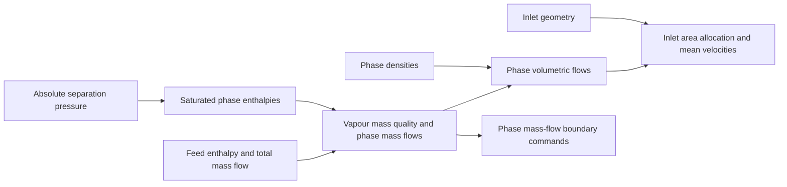

# Development of a geothermal separator CFD model: liquid transport, collection and wall-film behaviour

## Title page information

| Field | Information |
| --- | --- |
| Author | Shuhei Yokkaichi |
| Programme | Bachelor of Engineering (Honours), Engineering Science |
| Institution | The University of Auckland |
| Report type | Part IV Research Project Report |
| Supervisors | Sadiq Zarrouk and Maedeh Amirpour |
| Co-worker | Andy Tran |
| Draft date | 11 October 2026 |
| Student identification | To be entered by the author |
| Submission date | To be entered by the author |

<!-- Names follow the supplied working poster. The supplied ESB title-page template includes supervisors and co-worker; this takes precedence here over the generic structuring handout's different cover-page advice. -->

## Abstract

Geothermal separators must move liquid away from steam and provide a route for its collection and discharge. This study developed an existing computational fluid dynamics model of a vertical steam–water separator, focusing on how liquid moves between the bulk flow, vessel wall and collector. The simplified geometry omitted the lower brine-discharge path. A polyhedral–hexahedral mesh, explicit inlet phase placement, numerical liquid collection and staged startup supported successive investigations of wall roughness and Eulerian Wall Film.

The revised mesh provided wall-following refinement and showed changed wall-liquid fields. With the same mesh and numerical package, wall-side inlet placement increased retained liquid by 37.4% relative to mixed feed. Absorber-free calculations exposed the collection problem through increasing lower-vessel liquid inventory or discharge of almost the entire liquid feed through the steam outlet. A liquid-selective collector and reduced-feed startup then supplied common fields for wall-treatment comparisons. A later combined startup reduced the ramp continuity peak by 70.15%. Wall treatment strongly changed the calculated liquid state: the selected accretion-enabled film package reduced mean bulk-liquid steam-outlet flow from 24.369 to 1.735 kg/s, alongside substantial inventory changes.

Under prescribed bulk forcing, film spread and thickened over the lower and middle wall. At 500 ms, film input and drainage were 81.12 and 69.60 kg/s, with continued storage of 11.53 kg/s. Later configurations added stripping, splashing and edge separation. A matched direct-film-drain test reduced lower-wall film inventory by 70.32%, while a longer continuation showed continuing upper-wall accumulation despite active removal below.

The study establishes a collection and startup method and shows why wall capture, film release and drainage must be considered together. These findings guide further model development and proposed features that direct wall liquid towards collection. Open combined balances, developing fields and incomplete resolution and physical assessment limit the results to model-development evidence; validated efficiency and pressure-loss predictions remain future work.

## Declaration

*Unsigned draft using the supplied University template. The author must review and sign the declaration before submission.*

**Student**

I hereby declare that:

1. This report is the result of the final year project work carried out by my project partner (see cover page) and I under the guidance of our supervisor (see cover page) in the 2026 academic year at the Department Engineering Science and Biomedical Engineering, Faculty of Engineering, University of Auckland.
2. This report is not the outcome of work done previously.
3. This report is not the outcome of work done in collaboration, except that with a potential project sponsor (if any) as stated in the text.
4. This report is not the same as any report, thesis, conference article or journal paper, or any other publication or unpublished work in any format.

**Continuing-project statement.** The work builds on an inherited separator model and the published work of Purnanto et al. (2013). The present investigation developed liquid-collection and startup procedures, examined mesh and inlet assumptions, and studied wall roughness, film transport, release and drainage. The starting geometry and bulk modelling approach are identified as inherited work.

**Use of generative AI.** OpenAI Codex assisted with literature retrieval, coding and checking Fluent/PyFluent workflows, execution and recovery support, analysis, figure preparation and report drafting. Fluent performed the numerical calculations. The researcher directed the scientific scope and supplied the physical interpretation. Appendix D describes the division of work and the report's evidence records.

**Report word count:** to be inserted from the final assembled report.

**Signature and date:** to be completed by the author.

<!-- Prescribed wording: ESB_part_IV_latex_report_template_v2/Declaration/ESB_declaration_online.tex. The declaration is not signed or represented as approved by this draft. -->

## Table of contents

| Report section | Draft location |
| --- | --- |
| 1. Introduction | [Part 1](#1-introduction) |
| 2. Literature review | [Part 1](#2-literature-review) |
| 3. Model and methods | [Part 2](#3-model-and-methods) |
| 4. Results | [Part 3](#4-results) |
| 5. Discussion | [Part 4](#5-discussion) |
| 6. Conclusions and future work | [Part 4](#6-conclusions-and-future-work) |
| References | [References](#references) |
| Appendix A. Method detail and reproducibility | [Appendix A](#appendix-a-method-detail-and-reproducibility) |
| Appendix B. Evidence routes and source limits | [Appendix B](#appendix-b-evidence-routes-and-source-limits) |
| Appendix C. Figure register | [Appendix C](#appendix-c-figure-register) |
| Appendix D. Author contribution | [Appendix D](#appendix-d-author-contribution) |

Page references will be generated during document layout.

## List of figures

| Figure | Subject |
| --- | --- |
| 1 | Separator operation and liquid routes |
| 2 | Empirical wetness and inlet velocity |
| 3 | Inlet geometries and tangential-velocity fields |
| 4 | Wall-film droplet entrainment |
| 5 | Actual solved domain and split inlet |
| 6 | Mesh structure and wall-liquid fields |
| 7 | Effect of inlet phase placement on liquid distribution |
| 8 | Liquid inventory and outlet flow on three finer meshes |
| 9 | Early startup and carrier development |
| 10 | Roughness response |
| 11 | Film-disabled/accretion-enabled outlet histories |
| 12 | Film-disabled/accretion-enabled bulk-liquid spatial comparison |
| 13 | Shortened-startup ramp comparison |
| 14 | Selected film development through 500 ms |
| 15 | Film-thickness views |
| A1 | Complete contact chronology |
| A2 | Shortened-startup and film chronology to iteration 25815 |
| A3 | Native inlet mesh section |
| A4 | Original twelve-case full-geometry outlet screen |
| A5 | Earlier cell-zone absorber and reference |
| A6 | Long pool-control trial and scope decision |

## List of main tables

| Table | Subject |
| --- | --- |
| 1 | Context and evidence for transferring liquid-transport and collection methods to the present separator model |
| 2 | Fixed material properties verified for the throughput-controlled absorber model |
| 3 | Boundary conditions for the main startup and wall-treatment lineage |
| 4 | Model and control changes for the principal reported comparisons |
| 5 | Procedures used to assess implementation and numerical credibility |
| 6 | Quantities used in the model assessment |
| 7 | Matched inlet-placement results at nominal 26.81 m/s |
| 8 | Developing absorber-free fields under the same reduced-relaxation SIMPLE package at iteration 3000 |
| 9 | Successive stages of carrier development |
| 10 | Source-inclusive mass-balance remainders at iteration 5586 |
| 11 | Selected endpoints on the combined field history |
| 12 | Peak values during the matched inlet ramp |
| 13 | Shortened-startup liquid-account terms over the final 500 full-feed updates, iterations 4581–5080 |
| 14 | Film inventory and late-window rates under frozen bulk fields |
| 15 | Direct lower-wall film drainage over 15 ms from identical fields |
| 16 | Answers to the research questions and the next evidence needed |

Appendix tables retain the detailed settings, checks and evidence registers.

## Acknowledgements

I thank Sadiq Zarrouk and Maedeh Amirpour for their supervision of this project, and Andy Tran for his collaboration as my project partner.

## Glossary of terms and abbreviations

| Term | Meaning in this report |
| --- | --- |
| BOC | Bottom-outlet cyclone |
| CFD | Computational fluid dynamics |
| Carrier | The Eulerian vapour and bulk-liquid flow fields through which discrete droplets are tracked |
| DPM | Discrete Phase Model; the Lagrangian representation of droplets |
| EWF | Eulerian Wall Film; the wall-based representation of liquid-film transport |
| PyFluent | Python interface used to configure and command Ansys Fluent |
| Agent harness | Recorded workflow linking research questions, agent instructions, solver execution and analysis |
| RNG | Renormalisation group; used here in the RNG k–ε turbulence model |
| SIMPLE | Semi-Implicit Method for Pressure-Linked Equations |
| Bulk liquid | Liquid represented by the Eulerian secondary phase; excludes EWF inventory and discrete droplets |
| Vapour / bulk liquid | The primary vapour and secondary bulk-liquid phases in the selected Fluent carrier models |
| Accretion | Transfer of represented bulk liquid into the wall film |
| Stripping | Release of liquid from a film under gas forcing |
| Splashing | Production of secondary droplets during droplet impact on a film |
| Edge separation | Release of film liquid at a wall edge |
| Direct film drain | Local mass and momentum sink acting on lower-wall film storage |
| Incomplete trajectory | A tracked droplet with no completed terminal fate under the stated tracking controls |
| Absorber / virtual collector | A numerical liquid-removal treatment inside the truncated model; the two terms refer to the same model role |
| Native iteration | Fluent's recorded solver-update coordinate; it is not physical carrier-flow time |
| Film time | Time accumulated from the accepted EWF steps |
| Source term | A rate added to a transport equation; a negative mass source removes mass |
| Implicit source linearisation | Use of source derivatives within an equation solve to represent source dependence on the solved variable |
| Numerical stability | Observed finite and controlled behaviour over the stated calculation window |
| Iterative convergence | Active equations and relevant outputs meeting their declared settling conditions |
| Numerical accuracy | Accuracy of the computed solution of the stated model, assessed through numerical error and resolution evidence |
| Stiff source | A source with strong sensitivity to the solved variable, which can make an equation harder to solve |
| Numerical qualification | Assessment of a calculation against declared numerical, accounting and stationarity checks |
| Physical validation | Assessment against relevant physical observations for a stated use |

## Symbols

| Symbol | Meaning | Unit |
| --- | --- | --- |
| $\dot m$ | Mass-flow rate | kg/s |
| $M_b, M_f$ | Bulk-liquid and film inventories | kg |
| $M_c$ | Liquid mass in the collector | kg |
| $k_s$ | Modelled roughness height | m |
| $C_s$ | Roughness constant | — |
| $\alpha_L$ | Bulk-liquid volume fraction | — |
| $\rho_L$ | Liquid density | kg/m³ |
| $\boldsymbol u_L$ | Liquid velocity vector | m/s |
| $\boldsymbol u_m$ | Mixture velocity vector | m/s |
| $k$ | Shared turbulent kinetic energy | m²/s² |
| $\epsilon$ | Shared turbulence dissipation rate | m²/s³ |
| $S_L$ | Volumetric liquid mass source | kg/(m³·s) |
| $V_c$ | Collector region / its geometric volume | m³ |
| $\tau$ | Prescribed depletion time in the contact law | s |
| $h_f$ | Film thickness | m |
| $\tau_f$ | Direct film-drain capture time | s |
| $K_d$ | Direct film-drain removal coefficient | s⁻¹ |

---

# Part 1 — Introduction and literature review

<!-- Research framing: credible liquid transport and collection, developed through mesh/inlet assessment, absorber and startup procedures, and wall-film studies. Internal evidence links are traceability notes. -->

## 1. Introduction

### 1.1. Engineering problem

Geothermal steam–water separators remove liquid from the two-phase fluid produced by geothermal wells so that dry, clean steam can enter the turbine. Liquid carried with the steam can cause erosion and transport dissolved minerals that form deposits. Separator design therefore requires assessment of separation efficiency and internal pressure drop, together with selection of the operating pressure. [Zarrouk and Purnanto (2015)](https://doi.org/10.1016/j.geothermics.2014.05.009) review these design and operating requirements.

Computational fluid dynamics (CFD) can examine internal flow and the effects of changes to separator design or operating conditions. Its use in design requires a justified representation of liquid transport and collection, assessed numerical behaviour, and comparison with measurements of the intended performance quantities.

This study develops an existing Fluent model of a vertical bottom-outlet cyclone separator with a spiral inlet. Its central problem is the representation of the liquid path: liquid must move away from steam, travel along the wall and reach a collection route. The work examined mesh and inlet assumptions, introduced numerical liquid removal, and developed staged startup procedures that enabled more detailed wall–liquid studies.

<!-- Evidence: [Study scope](../scope.md); [absorber-development context](../experiments/phase-07-1a-absorber-convergence/CONTEXT.md). -->

### 1.2. Problem in the inherited model

The simplified geometry represents the upper separation region and omits the lower brine-discharge path. Liquid can accumulate within the computational domain or leave through the steam outlet. A numerical liquid-removal treatment is therefore needed to represent collection in this geometry. The assessment must distinguish accumulation, numerical removal and outlet carryover.

<!-- Evidence: [Model boundary](../model.md). -->

A virtual collector, termed an absorber, was introduced to remove liquid numerically from a defined region. Staged startup allowed the liquid field to develop under reduced inlet loading before full feed was applied. Together, these treatments provided a starting state for studies of wall roughness and Eulerian Wall Film (EWF).

<!-- Evidence: [Verified early absorber](../experiments/phase-07-1a-absorber-convergence/baseline-v2-virtual-liquid-outlet/results.md); [selected case history](../experiments/phase-07-2a-wall-liquid-routing/stage-02-combined-ewf-roughness/case-history-N45606.md). -->

In this report, a *developed flow field* means a saved full-feed starting state, or parent, used for repeatable wall-treatment comparisons. Residuals, liquid inventory and removal rates establish what that state can support. The parent retained a material liquid-balance error, so it supplied a common development basis rather than a validated separator solution.

<!-- Evidence: [R0 control](../experiments/phase-07-1a-absorber-convergence/roughness-family/r0-smooth-control/results.md); [source-inclusive R0 accounting assessment](../experiments/phase-07b-full-geometry-liquid-removal/convergence-investigation/shuhei-audit.md). -->

### 1.3. Research aim and questions

The aim of this research is to develop and assess an existing Fluent CFD model of a geothermal steam–water separator. The purpose is to improve understanding of internal steam and liquid transport and establish a basis for predicting separation efficiency and pressure drop.

The completed study focuses on mesh representation, inlet phase placement, liquid collection, startup and wall interaction. Predicting separation efficiency and pressure drop is the longer-term purpose of this development. The present calculations assess the prerequisites for that use and the further evidence needed for comparison with field measurements.

The aim is pursued through four research questions:

1. How do mesh representation and inlet phase placement affect predicted wall-liquid distribution and retention?
2. How can liquid collection and staged startup address the missing brine-discharge path and establish fields for further separator-model studies?
3. How do wall roughness and wall-film modelling affect liquid transport, storage, release and collection?
4. What numerical and liquid-accounting evidence supports these predictions, and what further evidence is required for field comparison and separator-performance assessment?

### 1.4. Scope and contribution

The study primarily uses the simplified separator geometry. Mesh and inlet comparisons examine how liquid is distributed near the wall and retained in the vessel. Absorber-free and full-geometry calculations establish the need for a collection treatment. The study then examines reduced-feed startup and wall roughness and film modelling, with the initial roughness and EWF screens starting from the same saved full-feed parent. Later calculations examine earlier film activation, film development to 500 ms, added release mechanisms and direct film drainage.

<!-- Evidence: [Study overview](../index.md); [selected case history](../experiments/phase-07-2a-wall-liquid-routing/stage-02-combined-ewf-roughness/case-history-N45606.md). -->

The main contribution is a connected account of how mesh, inlet and wall treatments affect liquid transport, supported by practical collection and startup methods. The connected experiments distinguish liquid retained in the vessel, transferred to film, released from the wall and removed at a collector. Earlier absorbers form part of the startup history; the final contact absorber and later direct film drain receive the implementation account.

The results support assessment of model development and predicted liquid behaviour. Mesh convergence, complete liquid accounting and comparison with field measurements remain necessary before separation efficiency and pressure-drop predictions can be validated. Selection of an optimum separation pressure or separator location is outside the scope of the calculations presented here.

The reconstruction comparisons are used to interpret model behaviour, with their case definitions in Appendix A.2. They do not provide a completed mesh-convergence study.

Section 3 defines the model, numerical procedures and comparison design. Section 4 presents the development and wall-treatment results. Sections 5 and 6 interpret their contribution and limits, then identify the conclusions and further work.

## 2. Literature review

### 2.1. How a geothermal steam–water separator works

A geothermal separator receives a two-phase flow of steam and mineral-bearing liquid, or brine. Its task is to direct steam into the steam line while collecting and discharging the liquid through a separate path. The selected operating pressure affects the steam available from the geothermal fluid, while the vessel and inlet determine how the two phases move within the separator. Horizontal separators mainly use gravity to collect liquid. Vertical cyclone separators use rotation to move liquid towards the vessel wall before it drains. ([Zarrouk & Purnanto, 2015](https://doi.org/10.1016/j.geothermics.2014.05.009))

In a vertical bottom-outlet cyclone (BOC), a tangential or spiral inlet turns the incoming flow around the vessel. Liquid moves towards the outer wall and lower collection region, while the central region becomes dominated by steam. An internal pipe collects steam and carries it out through the bottom of the vessel; the collected brine leaves through its own outlet. The term *bottom outlet* refers to this steam-pipe arrangement. The spiral inlet guides the transition from incoming flow to rotation. ([Zarrouk & Purnanto, 2015](https://doi.org/10.1016/j.geothermics.2014.05.009))

This operation has three linked requirements: move liquid away from the steam, retain it in a collection route, and discharge it. Reaching the wall is only one part of the process. A liquid film may drain, remain within the vessel, or supply droplets that return to the steam. Figure 1 places these routes within the vessel and shows downstream liquid collection. The simplified geometry used in this study omits the physical lower brine-discharge route, making its numerical replacement a material modelling choice.

*Figure 1. Conceptual steam and liquid routes in a vertical BOC separator. Mass-flow symbols follow the source schematic: $\dot m_{\mathrm{total}}$ is inlet steam–water flow, $\dot m_s$ is separated steam, and $\dot m_l$ is discharged brine. In this schematic, $\dot m_b$ denotes brine that accompanies the steam and settles into the downstream drain; $\dot m_{\mathrm{carryover}}$ denotes additional entrained carryover that may pass the drain. The symbol $\dot m_{\mathrm{condensate}}$ denotes downstream steam condensation. The diagram illustrates routes rather than a complete measured mass balance. Source: [Rizaldy et al. (2016)](https://www.researchgate.net/publication/310818568_LIQUID_CARRYOVER_IN_GEOTHERMAL_STEAM-WATER_SEPARATORS), original fig. 5.*

<!-- Evidence: [Model boundary](../model.md). Figure source: [primary carryover paper](../../CFD_wiki/raw/053_Rizaldy_Final.pdf), PDF page 3, original fig. 5; symbol interpretation checked against PDF pages 3–4. [Full-page source preview](figures/literature-candidates/wall-film/rizaldy-2016-pdf-page-03.png). The inserted panel was rendered directly from the local PDF; its labels and arrows are unchanged. -->

### 2.2. Internal flow physics and performance measures

The rotating flow produces a radial pressure distribution, with lower pressure near the centre and higher pressure towards the wall. For approximately circular motion, the inward acceleration needed to follow the flow scales with $u_\theta^2/r$, where $u_\theta$ is tangential velocity and $r$ is distance from the axis. Steam and liquid respond differently to the pressure field and interphase drag because of their different densities. This provides the basis for outward liquid transport and a steam-rich core. Pointon et al. (2009) connect the higher tangential velocities in their scrolled-entry calculation to improved droplet separation. ([Pointon et al., 2009](https://publications.mygeoenergynow.org/grc/1028587.pdf))

Droplet size changes the balance between inertia and drag. Fine droplets can remain closely coupled to the steam and reach its outlet, while larger droplets are more readily directed towards collection surfaces. The incoming flow may already contain a film and dispersed droplets, and steam shear can produce further droplets inside the vessel. Pointon et al. (2009) identify the uncertain inlet size distribution and this continuing droplet generation as modelling difficulties. Thus, an inlet mass-flow rate alone does not specify the liquid population on which a separation prediction depends. ([Pointon et al., 2009](https://publications.mygeoenergynow.org/grc/1028587.pdf))

Increasing velocity also has competing effects. Stronger rotation can assist outward transport, while greater steam shear can promote liquid entrainment. The field trials reviewed by Zarrouk and Purnanto (2015) show a breakdown region in which outlet steam wetness rises sharply with inlet velocity (Figure 2). The reported threshold differs between separator sizes and datasets. These observations give a reason to examine loading, geometry and wall-liquid behaviour together, rather than assume that greater swirl always improves performance. ([Zarrouk & Purnanto, 2015](https://doi.org/10.1016/j.geothermics.2014.05.009))

*Figure 2. Empirical outlet wetness and steam quality versus inlet steam velocity. The left axis gives wetness; the right gives the corresponding steam quality and runs in the opposite direction. The datasets concern different separator sizes and show different regions of rapid wetness increase. They do not establish a breakdown threshold for the present geometry. Source: [Zarrouk and Purnanto (2015)](https://doi.org/10.1016/j.geothermics.2014.05.009), original fig. 12, using data from Bangma (1960) and Lazalde-Crabtree (1984).*

<!-- Figure source: [primary design review](<../../CFD_wiki/raw/Zarrouk and Purnanto 2014.pdf>), PDF page 12 / printed page 247; [full-page source preview](figures/literature-candidates/design-overview/zarrouk-purnanto-2015-page-12.png). The published axes, curves, points and legend are unchanged. -->

The resulting flow must be connected to a defined performance measure. For a stream containing steam and liquid water, outlet steam quality can be written as

$$
x_{\mathrm{out}}=
\frac{\dot m_{v,\mathrm{out}}}
{\dot m_{v,\mathrm{out}}+\dot m_{l,\mathrm{out}}},
$$

where the two terms are the outward vapour and liquid mass-flow rates through the steam outlet. A liquid-capture fraction instead relates collected liquid to inlet liquid. These quantities use different denominators: at the same capture fraction, a feed with more brine relative to steam can produce a wetter steam outlet. Published separator-efficiency definitions must therefore be read alongside their equations and sampling boundaries. Purnanto et al. (2013) calculated outlet quality from the steam and water leaving the outlet, while Zarrouk and Purnanto (2015) also discuss liquid-removal and tracer-based measures. ([Purnanto et al., 2013](https://www.researchgate.net/publication/269519626_CFD_MODELLING_OF_TWO-PHASE_FLOW_INSIDE_GEOTHERMAL_STEAM-WATER_SEPARATORS); [Zarrouk & Purnanto, 2015](https://doi.org/10.1016/j.geothermics.2014.05.009))

Steam purity concerns contaminants carried with the steam. Field estimates of brine carryover may use its chemical signature, such as sodium, but downstream condensation, washing and incomplete capture by drain pots affect the sampled quantity. Rizaldy et al. (2016) discuss these measurement limits. A field comparison therefore requires compatible locations and definitions, as well as matching operating conditions. ([Rizaldy et al., 2016](https://www.researchgate.net/publication/310818568_LIQUID_CARRYOVER_IN_GEOTHERMAL_STEAM-WATER_SEPARATORS))

Pressure selection and pressure drop address different design decisions. Separation pressure sets the thermodynamic state of the supplied steam and brine. For a given fluid enthalpy, changing that pressure changes the flashed steam fraction and the steam conditions available to the turbine. Zarrouk and Purnanto (2015) therefore treat optimum pressure as a plant-level decision that also considers scaling and losses in the collection system. The fixed-property, no-flashing flow calculation used by Purnanto et al. (2013) instead examines motion at prescribed phase conditions. That distinction is relevant to the present study: developing an internal-flow model does not itself determine optimum operating pressure. ([Zarrouk & Purnanto, 2015](https://doi.org/10.1016/j.geothermics.2014.05.009); [Purnanto et al., 2013](https://www.researchgate.net/publication/269519626_CFD_MODELLING_OF_TWO-PHASE_FLOW_INSIDE_GEOTHERMAL_STEAM-WATER_SEPARATORS))

Internal pressure drop describes the difference between defined inlet and outlet pressures. Pointon et al. (2009) identify the enlargement at vessel entry and contraction into the steam pipe as important hydraulic-loss locations. The low-pressure core is a spatial flow feature; it does not by itself specify the inlet-to-outlet drop. An assessment must state the sampling locations, averaging method and pressure measure. Likewise, a reduction in liquid outlet flow needs a liquid account: collection, storage and transfer to a film can all change that output. ([Pointon et al., 2009](https://publications.mygeoenergynow.org/grc/1028587.pdf))

### 2.3. Established design methods and geothermal CFD

Geothermal cyclone design developed through field experience and empirical methods, including those of Bangma and Lazalde-Crabtree. Zarrouk and Purnanto (2015) review this development and the links between pressure selection, vessel sizing and performance. These methods supply engineering reference points. CFD adds information about local velocity, pressure and liquid trajectories that an overall sizing relation cannot resolve. Its value depends on how the model assumptions and comparison evidence are assessed. ([Zarrouk & Purnanto, 2015](https://doi.org/10.1016/j.geothermics.2014.05.009))

Pointon et al. (2009) used Fluent to compare scrolled and tangential entries in a large geothermal separator. The Discrete Phase Model (DPM) tracked droplets, with prescribed collection at selected walls and the baffle plate. An illustrated 3 µm comparison used one-way coupling. The efficiency calculation used a correlation-based droplet-size distribution and predicted 99.96% for the scrolled entry and 99.93% for the tangential entry, compared with 99.955% from a proprietary empirical design method. This supports the entry-design trend under the assumed droplet feed and collection rules. Figure 3 shows the corresponding tangential-velocity fields. ([Pointon et al., 2009](https://publications.mygeoenergynow.org/grc/1028587.pdf))

*(a) Inlet configurations.*

*(b) Calculated tangential-velocity distributions.*

*Figure 3. (a) Scrolled (lemniscate) and tangential entry geometries; (b) their calculated tangential-velocity distributions. The scrolled configuration is on the left in both panels. Reported mean tangential velocities are 34.1 and 32.5 m/s, respectively. Source: [Pointon et al. (2009)](https://publications.mygeoenergynow.org/grc/1028587.pdf), original figs. 5 and 7.*

<!-- Figure source: [primary Pointon paper](../../CFD_wiki/raw/1028587.pdf), PDF pages 5–6 / printed pages 946–947; [geometry source page](figures/literature-candidates/pointon/page-5.png); [velocity source page](figures/literature-candidates/pointon/page-6.png). Both published panels, the velocity legend and mean annotations are unchanged. The report adds the (a)/(b) labels outside the images. -->

Purnanto et al. (2013) compared circular tangential, rectangular tangential and rectangular spiral BOC configurations using a steady Mixture carrier and DPM outlet-quality calculation. Vessel proportions also differed, preventing isolation of inlet shape. Some trajectories remained incomplete despite an increased tracking limit. Counting them as separated improved agreement with the empirical comparison, but the authors identified that assumption as non-rigorous. Their work supplies the inherited flow-modelling basis and a direct example of how unresolved droplet fate affects performance interpretation. ([Purnanto et al., 2013](https://www.researchgate.net/publication/269519626_CFD_MODELLING_OF_TWO-PHASE_FLOW_INSIDE_GEOTHERMAL_STEAM-WATER_SEPARATORS))

Both studies used the renormalisation-group (RNG) k–ε turbulence model. Pointon et al. (2009) applied a swirl modification and favoured its lower computational cost over a Reynolds-stress model, without a detailed turbulence-model comparison. This provides a practical starting rationale for the inherited model. The present separator still requires assessment of the accuracy of its swirling flow and near-wall treatment. ([Pointon et al., 2009](https://publications.mygeoenergynow.org/grc/1028587.pdf); [Purnanto et al., 2013](https://www.researchgate.net/publication/269519626_CFD_MODELLING_OF_TWO-PHASE_FLOW_INSIDE_GEOTHERMAL_STEAM-WATER_SEPARATORS))

Table 1 compares the flow context, liquid representation and assessment evidence of the selected studies. These differences determine which methods can be retained and which require further justification in the present model.

*Table 1. Context and evidence for transferring liquid-transport and collection methods to the present separator model.*

| Study and flow context | Liquid representation | Assessment evidence | Implication for this study |
| --- | --- | --- | --- |
| Pointon et al. (2009): large geothermal BOC; steady separation study | Correlation-based droplet feed; DPM; prescribed wall collection | Scrolled/tangential efficiency comparison against an empirical design method | Retain trajectory-based assessment; examine the feed distribution and collection assumptions |
| Purnanto et al. (2013): geothermal BOC; 11.2 bar absolute; isothermal, incompressible, no flashing | Mixture carrier; DPM performance estimate | Outlet-quality comparison with empirical calculations and data; unfinished trajectories | Retain the carrier basis; account for unresolved tracks and changed vessel proportions |
| Rizaldy et al. (2016): geothermal separator and steam line | Correlation-based film entrainment; chemical carryover sampling | Wairakei field context and loading/velocity sensitivity; required brine-flow comparison remained unavailable | Investigate film transport and re-entrainment; match the field sampling boundary |
| Skoog (2020): annular flow in a cylindrical approximation of a reactor channel | Separate steam, EWF and DPM fields; correlation-based entrainment | Film/droplet mass flows compared with 1D empirical calculations; inlet split and transverse-velocity sensitivity | Retain explicit interfield transfers; justify geometry, operating conditions and correlations for the cyclone |

The shared lesson is that liquid distribution and collection rules form part of the prediction. The present study retains the inherited carrier model, introduces a declared numerical collector, and examines wall transport with separate bulk, film and droplet accounts. The reduced-feed startup is a case-specific development procedure assessed from its recorded execution.

### 2.4. Wall–liquid transport and carryover

Liquid reaching a wall can form a film whose motion depends on gravity, pressure forces and shear at the wall and steam–film interface. Deposition adds liquid to the film; drainage removes it from a collection boundary; entrainment returns liquid to the steam as droplets. These processes can compete, so improved wall deposition need not produce an equal improvement in discharged liquid or outlet steam quality.

Rizaldy et al. (2016) discuss film instability and droplet formation under steam shear in geothermal separators. Figure 4 shows the undercut and roll-wave mechanisms. Their correlation-based analysis predicts sensitivity to liquid loading, film thickness and inlet velocity. Wairakei chemical measurements provide field context, but the brine-flow data needed to test the predicted carryover against the first drain pot were unavailable. Their work motivates film-transport investigation while leaving that quantitative field comparison open. ([Rizaldy et al., 2016](https://www.researchgate.net/publication/310818568_LIQUID_CARRYOVER_IN_GEOTHERMAL_STEAM-WATER_SEPARATORS))

*Figure 4. Conceptual droplet entrainment from a wall film: (a) undercut entrainment and (b) roll-wave entrainment. The source associates the panels with lower and higher film Reynolds numbers, respectively. Film Reynolds number compares inertial and viscous effects using liquid velocity and film thickness. Source: [Rizaldy et al. (2016)](https://www.researchgate.net/publication/310818568_LIQUID_CARRYOVER_IN_GEOTHERMAL_STEAM-WATER_SEPARATORS), original fig. 9, whose caption credits Ishii and Grolmes (1975).*

<!-- Figure source: [primary carryover paper](../../CFD_wiki/raw/053_Rizaldy_Final.pdf), PDF page 5; [full-page source preview and original attribution](figures/literature-candidates/wall-film/rizaldy-2016-pdf-page-05.png). The two published mechanism panels and labels are unchanged. -->

Fluent represents wall roughness by modifying the near-wall velocity relation used to calculate wall shear and related turbulent quantities. The response depends on the roughness parameters and near-wall treatment. A roughness test therefore assesses changed wall momentum transfer; it does not supply a separate film mass account or discharge route. ([Ansys, Inc., 2025f](https://ansyshelp.ansys.com/public/Views/Secured/corp/v252/en/flu_th/x1-5720008.164.html))

The roughness and film studies therefore address distinct questions. Roughness tests sensitivity to wall momentum treatment. Film modelling tests an additional liquid store and its transport. Outlet flow, retained mass and collected liquid must be examined together to interpret either response.

### 2.5. Representing liquid and its collection

The Mixture model represents phases within the volume mesh through mixture equations and secondary-phase volume fractions. With algebraic slip enabled, relative phase velocity is modelled using a local-equilibrium approximation over short spatial scales. The resulting secondary-phase volume fraction describes bulk liquid distribution; it does not resolve a film thickness or droplet-size distribution. ([Ansys, Inc., 2025b](https://ansyshelp.ansys.com/public/Views/Secured/corp/v252/en/flu_th/flu_th_sec_drift_oview.html))

DPM tracking follows size-dependent droplet trajectories through a continuous flow field to prescribed wall or outlet outcomes. Its interpretation requires a declared droplet population and an account of every tracked fate, including incomplete trajectories.

EWF solves thin-film transport on the wall surface without cells through the film thickness. Skoog (2020) combined EWF, DPM deposition and correlation-based entrainment in a cylindrical approximation of a boiling-water-reactor channel. Film and droplet mass flows were compared with one-dimensional calculations based on Okawa correlations, which used experimental evidence. The model was sensitive to the inlet film/droplet split and imposed droplet transverse velocity. This provides a three-field accounting precedent; the reactor geometry, operating conditions and exchange correlations require separate justification for a geothermal cyclone. ([Skoog, 2020](https://www.diva-portal.org/smash/get/diva2:1452100/FULLTEXT02.pdf); [Ansys, Inc., 2025c](https://ansyshelp.ansys.com/public/views/secured/corp/v252/en/flu_ug/flu_ug_models_wallfilm.html))

Adding representations also adds accounting requirements. Bulk-to-film transfer removes liquid from one store and adds it to another; it is internal transfer within a combined liquid account. Prescribed droplet feed must not duplicate liquid already supplied through another representation. In the truncated geometry, the absorber instead removes liquid from the modelled domain. Fluent permits mass and associated transport sources in cell zones, but the selected source law and its effect on the solution remain model choices to be assessed. Section 3 describes the final contact treatment. ([Ansys, Inc., 2025a](https://ansyshelp.ansys.com/public/Views/Secured/corp/v252/en/flu_ug/flu_ug_bcs_sec_cell_zones.html))

<!-- Evidence: [Audited model basis](../model.md); [liquid-accounting guardrails and application of Skoog](../technical/skoog-application-guardrails.md); [absorber-development context](../experiments/phase-07-1a-absorber-convergence/CONTEXT.md). -->

### 2.6. Numerical startup, convergence and validation

A steady calculation starts from estimated fields and iterates towards a solution. Its numerical startup is distinct from a physical startup transient: iterations and pseudo-time cannot be treated as elapsed physical time when interpreting bulk-liquid storage. The National Aeronautics and Space Administration (NASA) recommends monitoring residuals and relevant outputs, with convergence criteria tied to the acceptable error in those outputs. ([NASA, 2021a](https://www.grc.nasa.gov/www/wind/valid/tutorial/iterconv.html))

Fluent's EWF guidance allows the flow field to be solved before film initialisation where needed. This motivates staged activation, while the reduced-feed fraction and inlet ramp remain case-specific choices. Their assessment in this study uses the preserved fields and recorded sequence. ([Ansys, Inc., 2025e](https://ansyshelp.ansys.com/public/views/secured/corp/v252/en/flu_ug/flu_ug_ewf_sec_overview.html))

Implementation checks establish whether the intended source was assigned and applied. Residual and output histories assess iterative behaviour. A complete mass account checks consistency between inflow, outflow, removal and storage. Mesh and applicable time-step studies assess numerical sensitivity for a fixed model; changing roughness or absorber strength instead tests model sensitivity. These checks address separate requirements. ([NASA, 2021c](https://www.grc.nasa.gov/www/wind/valid/tutorial/verassess.html))

Physical validation requires measurements of the intended outputs under suitable operating conditions, with their uncertainty. Its scope is limited to the assessed application range. In this model, a field comparison must assess both the collection assumption and predicted outlet quantities. ([NASA, 2021b](https://www.grc.nasa.gov/www/wind/valid/tutorial/valassess.html))

<!-- Evidence: [Verification and validation limits](../vnv.md). -->

### 2.7. Remaining model uncertainties and research direction

The literature links separator predictions to droplet feed, collection rules and wall-film exchange. The project-specific problem is to develop the inherited simplified model so that these effects can be studied with explicit numerical and liquid accounts.

The development sequence asks how to represent collection in a domain without a brine-discharge path; how to develop repeatable full-feed fields; and how wall treatments change liquid destinations. Mesh and inlet choices affect the transport leading into this sequence. Film formation, release and drainage determine what happens after liquid reaches the wall.

These questions lead to the research direction in Section 1.3. Collection and startup development enable the wall studies, which in turn identify transport processes and possible design changes to investigate. Numerical assessment and liquid accounting establish how far those findings can support separator-performance prediction.

---

# Part 2 — Model and methods

<!-- Revision scope: model development, film development to 500 ms, selected later film-release and direct-drain tests, and absorber-free mesh diagnostics. Unverified settings are identified where they affect reproducibility. -->

## 3. Model and methods

### 3.1. Computational domain and modelling scope

The computational domain represented the upper separation region of a vertical bottom-outlet cyclone separator with a spiral inlet. It included the inlet passage, vessel walls and steam outlet. The lower brine pool and its discharge path were omitted. The bottom of the domain remained a wall, so liquid could be stored in the model or leave through the steam outlet unless an additional collection treatment was active.

A numerical collector was defined in the lower fluid region to represent liquid collection at a brine-pool surface. This treatment allowed liquid to leave the simplified model without introducing a steam outlet at its base. It did not resolve the pool surface, pool depth or downstream discharge. Calculations with the collector disabled examined transport within the same truncated domain.

This boundary choice was central to the investigation. Without collection, a stationary, mass-conserving solution would have to discharge the incoming liquid through the steam outlet. The absorber-free cases therefore tested the consequences of the truncated domain and its liquid transport; they did not represent a separator with a functioning brine outlet.

The study assessed the model's numerical development and its predicted liquid routes. It used a steady bulk-flow formulation, with a separate evolving wall-film model where enabled. Numerical startup therefore described the development of the solution through iterations; it did not represent the physical startup time of the separator.

*Figure 5. Computational domain and pure-phase inlet partition reconstructed from the selected 60,964-cell saved mesh. The collector contains 715 cells and extends to approximately $y=0.185$ m, although its selection used cell centroids $y\leq0.10$ m. The bottom remains a wall; the omitted pool and discharge are not represented. Face colours identify boundaries and the source region, not solution fields. The full-feed parent, combined contact endpoint and shortened-startup endpoint share identical node coordinates and face connectivity.*

Coordinates use the saved mesh system, with vertical $y$ and the bottom at approximately $y=0$. The inlet plane was $x=-2.067$ m, with lower and upper edges at $y=1.704$ and 2.428 m. The steam-outlet plane was $y=6.261$ m, while the top of the discrete mesh was $y=6.990$ m. The complete mesh extended over $x=-2.067$–1.065 m and $z=-1.470$–1.065 m, including the inlet passage. These are measured saved-mesh landmarks, not nominal CAD dimensions. Appendix A.1 retains exact coordinate bounds and the paired-case identity checks.

<!-- Evidence: [Model scope](../model.md); [collector and wall-zone specification](../experiments/phase-07-2a-wall-liquid-routing/stage-02-combined-ewf-roughness/ewf-absorber/setup.md). -->

### 3.2. Physical model and assumptions

#### 3.2.1. Bulk steam–liquid flow

The calculations used Ansys Fluent 2025 R2 with a pressure-based solver and absolute velocity formulation. Steam was the primary phase and liquid water was the secondary phase. Fluent's Mixture model solved mixture continuity and momentum, secondary-phase volume fraction and algebraic relative velocity. For vapour and liquid fractions $\alpha_V$ and $\alpha_L$,

$$
\alpha_V+\alpha_L=1,\qquad
\rho_m=\alpha_V\rho_V+\alpha_L\rho_L,\qquad
\boldsymbol u_m=\frac{\alpha_V\rho_V\boldsymbol u_V+\alpha_L\rho_L\boldsymbol u_L}{\rho_m}.
$$

Here, $\boldsymbol u_m$ is the mass-averaged mixture velocity. The phase drift velocity is $\boldsymbol u_{\mathrm{dr},i}=\boldsymbol u_i-\boldsymbol u_m$, and slip is $\boldsymbol u_L-\boldsymbol u_V$. Mixture continuity and momentum describe the shared bulk flow; the secondary-phase transport equation and algebraic slip relation describe liquid distribution and relative motion. RNG $k$–$\varepsilon$ supplies the turbulent stresses. The energy equation was not solved. ([Ansys, Inc., 2025b, §§14.4.3–4 and 14.4.6–7](https://ansyshelp.ansys.com/public/Views/Secured/corp/v252/en/flu_th/flu_th_sec_multiphase_mixture.html))

The three saved states identified in Appendix A.1 used the Manninen algebraic-slip formulation, Schiller–Naumann drag and a constant secondary-phase diameter of **10 µm**. Virtual mass, lift and wall lubrication were disabled, with no additional interphase turbulent-dispersion or turbulence-interaction model. Bulk surface tension and cavitation were disabled, and no bulk interphase mass-transfer model was assigned. EWF phase accretion, where active, was a separate transfer at the wall. These settings were recovered from the hash-matched saved cases, rather than inferred from the diagnostic particle distribution.

The algebraic relation assumes that relative motion approaches local equilibrium over a short spatial length scale. Retaining the inherited formulation allowed collection and wall treatments to be compared within one bulk model. It did not establish the accuracy of that approximation for the segregated liquid near the vessel wall. The 10 µm parameter controls continuum-phase slip; it is not a resolved droplet population or a wall-film thickness. Individual diagnostic droplets and the surface film were represented separately where enabled. ([Ansys, Inc., 2025b, §14.4.6](https://ansyshelp.ansys.com/public/Views/Secured/corp/v252/en/flu_th/flu_th_sec_drift_theory_relvel.html))

RNG $k$–$\varepsilon$ supplied the turbulence closure, with its differential-viscosity and swirl-dominated-flow options enabled in the verified throughput-controlled absorber model. Standard wall functions supplied the near-wall treatment. This closure was retained in the wall-treatment comparisons. Gravity acted in the negative $y$ direction at 9.81 m/s². Density and viscosity were fixed at the values in Table 2. The energy equation was disabled, so flashing, condensation and temperature-dependent properties were outside the model.

*Table 2. Fixed material properties verified for the throughput-controlled absorber model.*

| Phase | Density (kg/m³) | Dynamic viscosity (Pa·s) |
| --- | ---: | ---: |
| Vapour | 5.79743 | $1.52062\times10^{-5}$ |
| Liquid water | 881.211 | $1.45544\times10^{-4}$ |

<!-- Evidence: [Saved/reopened model and material settings](../experiments/phase-07-1a-absorber-convergence/baseline-v2-virtual-liquid-outlet/build-manifest.json). -->

#### 3.2.2. Wall roughness and wall-film representation

Wall roughness and Eulerian Wall Film (EWF) represented different parts of the wall interaction. Roughness changed the wall-function treatment through equivalent sand-grain height $k_s$ and roughness constant $C_s$. The tested values were sensitivity inputs; they were not measurements of the separator surface. ([Ansys, Inc., 2025f](https://ansyshelp.ansys.com/public/Views/Secured/corp/v252/en/flu_th/x1-5720008.164.html))

In Fluent 2025 R2, the default rough-wall formulation for RNG $k$–$\varepsilon$ with standard wall functions uses a virtual wall shift. The saved rough-wall flag was consistent with this treatment, but the effective role of an additional Colebrook flag remains unverified (Appendix A.10). The virtual-wall formulation removes the older restriction between roughness height and wall-adjacent cell distance. It does not establish adequate wall resolution or the suitability of an equilibrium wall function for the rotating flow. Actual wall-resolution evidence must therefore be assessed separately. ([Ansys, Inc., 2025f, §4.18.5](https://ansyshelp.ansys.com/public/Views/Secured/corp/v252/en/flu_th/x1-5720008.164.html))

EWF added surface equations for film mass and momentum on selected walls. Phase accretion transferred liquid from the bulk phase into the film. Film transport and edge outflow were then recorded separately from bulk-liquid transport. Coupling between the film equations and momentum feedback to the bulk flow were distinct settings. ([Ansys, Inc., 2025c](https://ansyshelp.ansys.com/public/views/secured/corp/v252/en/flu_ug/flu_ug_models_wallfilm.html); [2025e](https://ansyshelp.ansys.com/public/views/secured/corp/v252/en/flu_ug/flu_ug_ewf_sec_overview.html))

The early EWF cases, including the reference development to 500 ms, solved film mass and momentum with gravity, external-flow shear and wall-viscous resistance. Film pressure-gradient, spreading and surface-tension terms were disabled. Phase accretion was enabled, while film energy, phase change, DPM collection/splash, stripping, edge-separation and EWF–VOF transition models were disabled. Bulk-flow momentum feedback was off. Native outflow at the lower edge of the active film wall remained a drainage route; this was distinct from the disabled droplet edge-separation model. ([Ansys, Inc., 2025c, §§30.3–4](https://ansyshelp.ansys.com/public/Views/Secured/corp/v252/en/flu_ug/flu_ug_ewf_sec_options.html))

Selected later tests added pressure-gradient, spreading and surface-tension forces, droplet collection, splashing, stripping and edge separation. Stripping transfers film liquid to droplets under gas forcing; splashing produces secondary droplets when droplets strike the film; edge separation releases liquid at wall edges. These processes extend the represented liquid routes but do not themselves establish greater predictive accuracy. The later cases retained film-to-bulk momentum feedback off and used different developed bulk fields, so they were not a single-switch comparison with the early film run. Appendix A.12 defines their settings and parents. ([Ansys, Inc., 2025k, §17.2.1](https://ansyshelp.ansys.com/public/Views/Secured/corp/v252/en/flu_th/flu_th_ewf_sec_film_submodels.html))

The initial accretion-enabled film screen used coupled film equations. Later film-development tests included an alternative implicit numerical algorithm, identified separately from the physical model in Appendix A.9. The model/control matrix in Table 4 identifies the selected case changes; Appendix A.9 records the switches, algorithm variants and numerical bounds.

One-way particle tracking, where used, was a separate diagnostic on a prescribed carrier field. It retained the full Eulerian liquid feed. Particle weights therefore did not represent additional physical liquid entering the separator and were excluded from the feed balance.

### 3.3. Boundary conditions and liquid collection

#### 3.3.1. Enthalpy and the inlet phase mass flows

The reference feed was based on the 1600 kJ/kg condition reported by Purnanto et al. (2013). The total mass flow was 197.61 kg/s at a separation pressure of 11.2 bar absolute, or 1.120 MPa. Their saturated-liquid and saturated-vapour enthalpies at that pressure were 784.66 and 2781.46 kJ/kg, respectively. ([Purnanto et al., 2013, Table 1](https://www.researchgate.net/publication/269519626_CFD_MODELLING_OF_TWO-PHASE_FLOW_INSIDE_GEOTHERMAL_STEAM-WATER_SEPARATORS))

For a saturated steam–water feed in equilibrium, the specific enthalpy is the mass-weighted phase enthalpy:

$$
h=(1-x_V)h_{L,\mathrm{sat}}+x_Vh_{V,\mathrm{sat}},\qquad
x_V=\frac{h-h_{L,\mathrm{sat}}}{h_{V,\mathrm{sat}}-h_{L,\mathrm{sat}}},
$$

where $x_V$ is vapour mass quality and saturation properties refer to absolute pressure. The relation applies within the two-phase enthalpy interval. This example uses the paper's enthalpies; other operating conditions require a consistent property basis such as IAPWS-IF97. ([IAPWS, 2012](https://iapws.org/technical-guidance/release/IF97-Rev)) The phase flows are

$$
\dot m_V=x_V\dot m_{\mathrm{tot}},\qquad
\dot m_L=(1-x_V)\dot m_{\mathrm{tot}}.
$$

The calculation gives $x_V=0.408323$. The historical boundary commands retained the published rounded values, **80.69 kg/s vapour and 116.92 kg/s liquid**; these define the reproduced case. Appendix A.7 gives the worked calculation.

Enthalpy determined the phase allocation before the CFD calculation. The energy equation was disabled, so Fluent did not use this enthalpy to calculate flashing or update the phase split inside the separator. Reduced-feed startup multiplied both phase commands by the same factor and retained their mass ratio.

#### 3.3.2. Volumetric flow, inlet split and velocity

Mass quality and volume fraction describe different quantities. The original split-area design used densities of 881.77 kg/m³ for liquid and 5.73 kg/m³ for vapour. For the 0.724 m by 0.724 m inlet, $A=0.524176$ m², a common normal velocity gave

$$
Q_i=\frac{\dot m_i}{\rho_i},\qquad
U=\frac{Q_L+Q_V}{A},\qquad A_i=\frac{Q_i}{U}.
$$

Vapour supplied about 40.83% of the mass and 99.07% of the reference volumetric flow. The design therefore assigned approximately 0.933% of inlet area to a 6.754 mm liquid strip beside the vessel wall (Figure 5), with calculated $U=27.1180$ m/s. This pure-phase placement was an idealised input. Under the same common-velocity assumption, a uniform mixed inlet would instead have

$$
\alpha_{L,\mathrm{uniform}}
=\frac{\dot m_L/\rho_L}
{\dot m_L/\rho_L+\dot m_V/\rho_V}
=0.009328.
$$

The liquid mass fraction was therefore not a liquid-volume-fraction boundary value. Later calculations retained the split geometry and prescribed mass flows using Table 2's material values. Mean normal phase velocities followed

$$
U_{i,n}=\frac{\dot m_i}{\rho_i A_i}.
$$

At full feed these were approximately 27.134 m/s for liquid and 26.803 m/s for vapour, with combined volumetric-flow speed 26.806 m/s. Appendix A.7 retains both property bases, areas and arithmetic. Reconstruction commands are specified separately in Appendix A.2.

The wall-side strip tests an inlet already rich in liquid near the outer wall. Pointon et al. (2009) describe liquid films in upstream piping as one possible source of separator liquid, which gives a physical basis for investigating this arrangement. Complete phase segregation and the strip width were imposed modelling assumptions, rather than measured inlet profiles. This arrangement connects the inlet study to wall transport and film formation. ([Pointon et al., 2009](https://publications.mygeoenergynow.org/grc/1028587.pdf))

<!-- Evidence: [Original area derivation and phase-property basis](../experiments/phase-02-parity-reset-and-pre-v2-qualification/purnanto-08c-inlet-loading-sensitivity/inlet-regimes-interpretation.md); [supplied inlet areas](../../PyAnsys/output/phase9-mesh-convergence/20261007/mesh-input-audit.json); [saved full-feed commands](../../PyAnsys/output/phase71a_r0_control_run4/checkpoint-plus1000-batched-readback.json). -->

#### 3.3.3. Fluent boundary implementation

The main absorber and wall-treatment calculations used two mass-flow inlet zones. At `liquidinlet`, phase-2 liquid received the required mass-flow command and phase-1 vapour received zero. At `steaminlet`, phase-1 vapour received its command and phase-2 liquid received zero. Flow direction was normal to the boundary. The startup commands were 25% of the full-feed values (Table 3).

*Table 3. Boundary conditions for the main startup and wall-treatment lineage.*

| Boundary | Condition | Full feed | Reduced feed |
| --- | --- | ---: | ---: |
| Liquid inlet | Liquid mass-flow inlet | 116.9200 kg/s | 29.2300 kg/s |
| Vapour inlet | Vapour mass-flow inlet | 80.6900 kg/s | 20.1725 kg/s |
| Steam outlet | Prescribed gauge pressure | 1.120 MPa | Same pressure specification |
| Vessel and bottom walls | Stationary, no-slip | Smooth or specified roughness | As defined for the startup case |

Operating pressure was 0 Pa, so the specified outlet gauge pressure also represented 1.120 MPa absolute in this model. The inlet condition prescribed phase mass flow; inlet pressure was obtained as part of the solution. Appendix A.6 distinguishes the stored inlet pressure entry from a pressure sampled for pressure-loss assessment.

Turbulence was specified using **Intensity and Hydraulic Diameter**. The recorded intensity was 2.11%. For a rectangular passage of width $W$ and height $H$,

$$
D_h=\frac{4A}{P_w}=\frac{2WH}{W+H},
$$

where $P_w$ is the perimeter used for this geometric calculation. Applying the expression to each inlet strip gives approximately 0.01338 m for liquid and 0.72061 m for vapour, matching the full-feed control inputs. This choice treated the strips as separate rectangular passages for the turbulence length scale. Other inlet comparisons used different diameter choices, which must remain identified with their cases.

The steam outlet was a pressure boundary. Its full-feed control specified normal, vapour-only backflow, with 2.11% turbulence intensity and 0.875936 m hydraulic diameter. Physical walls were stationary and no-slip. Their roughness and film assignments are specified separately from the bulk boundary type in Appendix A.8.

The mixed-inlet and split-inlet Coupled reconstructions changed phase placement on the same physical inlet faces. Appendix A.2 gives the area-distributed commands and retained turbulence diameters. Their speed series scaled throughput at fixed phase ratio; an enthalpy sweep would change that ratio.

<!-- Evidence: [Executed inlet schedule](../experiments/phase-07-1a-absorber-convergence/roughness-family/r0-smooth-control/provenance.md); [full-feed control readback](../../PyAnsys/output/phase71a_r0_control_run4/checkpoint-plus1000-batched-readback.json); [reconstruction boundary audit](../experiments/phase-08-storyline-reconstruction/stage-01-60k-storyline/baseline-lineage-audit.md). -->

#### 3.3.4. Contact-based absorber

The final contact absorber removed bulk liquid from 715 lower fluid cells selected by centroid position, $y\leq0.10$ m. The collector boundary followed the selected cell faces, whose node extent reached $y\simeq0.185$ m; it was not an exact plane at 0.10 m. It represented collection at the omitted pool by removing liquid without a direct vapour mass sink. The early startup used an earlier throughput-controlled absorber; Appendix A distinguishes that law from the contact treatment used later.

For non-negative liquid fraction, the contact source was

$$
S_L=-\frac{\rho_L\alpha_L}{\tau},\qquad
\tau=10^{-5}\ \mathrm{s}.
$$

Here, $S_L$ is the volumetric liquid mass source in kg/(m³·s), and $\tau$ is the prescribed depletion time. Removal depended on liquid present in each collector cell, without an inlet-throughput cap. The compiled function used the non-negative part of $\alpha_L$ for source evaluation without overwriting the solved fraction. For constant density, the evaluated removal magnitude was

$$
\dot m_{\mathrm{removed,eval}}
=-\int_{V_c}S_L\,\mathrm dV
=\frac{M_c}{\tau},\qquad
M_c=\int_{V_c}\rho_L\alpha_L\,\mathrm dV.
$$

Associated transport terms removed momentum with the signed liquid velocity and removed the corresponding transported turbulence quantities:

$$
\boldsymbol S_{\mathrm{mom}}=S_L\boldsymbol u_L,\qquad
S_k=S_Lk,\qquad S_\varepsilon=S_L\varepsilon.
$$

The physical idealisation was one-way capture: liquid entering the collector transferred its mass and momentum to the omitted brine pool. Associated transport sources prevented extracted mass from leaving its transported momentum and turbulence quantities behind in the model. Pool motion, pressure response and liquid return were omitted. A mass source does not automatically supply the required momentum and other transport sources in Fluent. ([Ansys, Inc., 2025a](https://ansyshelp.ansys.com/public/Views/Secured/corp/v252/en/flu_ug/flu_ug_bcs_sec_cell_zones.html))

The mass and momentum functions supplied local source derivatives for implicit treatment. Appendix A.3 gives the exact assignments, derivative approximations and independent applied-source reports. The depletion time controls source strength; it is separate from the film timestep and was assessed through the removal-time screen in Appendix A.4.

The volumetric source acted only on bulk liquid. Film left through native edge outflow at the lower edge of the active EWF wall; the lower wall segment was outside EWF. Diagnostic droplets used native escape at collector-entry faces and lower walls. Bulk removal, collector film drainage and particle escape therefore remained separate collection routes.

A later direct-film-drain test extended EWF onto the lower wall segment and removed local film mass with its mean-film momentum. Its assumed capture time was 1.5 ms, distinct from the 10 µs bulk-contact depletion time. A source-only check and matched 15 ms drain-OFF/ON runs tested removal with all bulk equations frozen. The sink acted on film storage and was reported separately from native film edge outflow; the bulk absorber could not provide this direct surface removal. Appendix A.12 gives the source law and comparison procedure.

### 3.4. Mesh and spatial discretisation

Fluent Meshing was used to construct a polyhedral–hexahedral mesh with controlled refinement near the vessel wall. The practical aim was a repeatable meshing process for model development. The physical aim was to resolve concentrated wall liquid and its circumferential and downward transport. Wall-following layers provide normal refinement and follow the vessel surface; the hexahedral core does not align with every direction of the swirling flow. Reduced numerical diffusion was a hypothesis to assess, since mesh alignment, local resolution and discretisation all affect transport error. ([Ansys, Inc., 2025g, §7.1.3.3](https://ansyshelp.ansys.com/public/Views/Secured/corp/v252/en/flu_ug/flu_ug_GridTypes.html))

The solved mesh contained 60,964 cells (4596 hexahedral; 56,368 polyhedral), 226,982 nodes and 328,287 faces. The three saved states in Appendix A.10 had identical coordinates and connectivity, including the 715-cell collector. Figure A3 documents the wall-following structure. Resolution, alignment and discretisation affect numerical diffusion; visible topology alone does not establish accuracy. ([Ansys, Inc., 2025g, §7.1.3](https://ansyshelp.ansys.com/public/Views/Secured/corp/v252/en/flu_ug/flu_ug_GridTypes.html))

The full-feed control used Green–Gauss node-based gradients, PRESTO! pressure, second-order upwind momentum and $\varepsilon$, first-order upwind $k$, and QUICK volume fraction. Spatial schemes were recorded per case because the numerical packages differed between the main development and reconstruction calculations. Appendix A.6 retains the verified control settings. The historical tetrahedral comparison is defined separately in Section 3.6 and Appendix A.2.

Native wall fields provided a direct resolution check. Area-weighted mean $y^+$ on the main wall was approximately $2.0\times10^4$–$3.4\times10^4$ across the three saved states, showing that wall-following topology did not by itself provide fine near-wall resolution. Appendix A.10 gives the distinct stored $y^+$ fields, wall-distance statistics and case identities. Exact layer count, first-layer height, orthogonal quality and skewness remain unverified; the matched refinement assessment is incomplete.

<!-- Evidence: [Raw mesh input audit](../../PyAnsys/output/phase9-mesh-convergence/20261007/mesh-input-audit.json); [native section views](../meetings/Poster/poster-sections/mesh-and-volume-fraction-comparison.md); [partitioned control setup](../experiments/phase-07-1a-absorber-convergence/roughness-family/r0-smooth-control/setup.md). -->

### 3.5. Numerical solution procedure

The historical startup used Hybrid Initialisation with ten passes and no patched pool. The smooth-wall, EWF-off model used the throughput-controlled absorber. After loading the prepared pair, both inlets were explicitly set to Table 3's 25% feed values before solving.

An intended ramp was delayed by a command-writing failure, leaving an actual reduced-feed hold to iteration 1580. The corrected procedure then increased both inlet commands over 2000 updates. If $r$ denotes completed ramp updates, the loading factor was

$$
f(r)=0.25+0.75\frac{r}{2000},\qquad
\dot m_L(r)=116.92f(r),\qquad
\dot m_V(r)=80.69f(r).
$$

Each ten-update block held one feed command: $r=0$ for the first block, then $r=10,20,\ldots,1990$, followed by full feed at $r=2000$. Commands were written and read back before solving. Here, 25% feed means one quarter of full flow, rather than the paper's 25% flow reduction.

At full feed, SIMPLE changed to Coupled with Global Time Step. After warm-up, a separate 1000-update control supplied the saved parent at iteration 5586. Appendix A.5 gives native coordinates and reporting windows.

Here, a **developed parent** is a saved full-feed solution selected for further experiments after examining residual, inventory, outlet and source histories. The full-feed parent/control supplied reproducible common fields; its unresolved convergence and balances remained limits on the later screens.

Coupled solves pressure and momentum corrections together, while the selected Mixture volume fraction remained separately solved. Coupled with Volume Fractions is unavailable with Mixture slip. ([Ansys, Inc., 2025h, §37.3.1](https://ansyshelp.ansys.com/public/Views/Secured/corp/v252/en/flu_ug/flu_ug_sec_uns_solve_pvel_1.html); [2025i, §27.8.1](https://ansyshelp.ansys.com/public/Views/Secured/corp/v252/en/flu_ug/flu_ug_sec_multiphase_solution.html))

Coupling and pseudo-time changed together, so their response belongs to a numerical package. Neither pseudo-time nor steady iteration count represented physical elapsed time.

The shortened startup reused iteration-1580 bulk fields without reinitialisation, introducing contact collection, the 0.5 mm rough-wall treatment, Coupled flow and a film initialised dry once. It held 25% feed for 500 updates, used the same 2000-update ramp, then held full feed for 1000. Table 4 and Appendix A.9 give film controls.

Later frozen-bulk arms disabled flow, turbulence, volume-fraction and relative-motion advancement while retaining film transport and edge drainage. An alternative implicit beta algorithm did not expose the original $h/u/v$ inner residuals; these updates were not tolerance passes. Matched-time facet fields and film accounting supplied a separate local screen (Appendix A.9).

Fluent's steady EWF procedure assumes a converged carrier field that remains unchanged and receives negligible film feedback. Here, bulk freezing was a numerical development procedure; bulk convergence had not been established. The film therefore evolved under prescribed forcing. Restoring the bulk equations and checking the intended combined model remained necessary for a stationary separator claim. ([Ansys, Inc., 2025j, §17.4.3](https://ansyshelp.ansys.com/public/Views/Secured/corp/v252/en/flu_th/flu_th_ewf_sec_sol_alg.html))

Assignments were checked after data loading and save/reopen. Appendices A.5–A.10 give paired parents and controls, including raw residual/global-step entries whose active mapping remains unverified.

### 3.6. Comparison design

The investigation combined exploratory model development with later comparisons from shared saved fields. Early inlet, droplet, wall-film and liquid-removal studies examined which assumptions and treatments required further work. Some were unmatched diagnostics or incomplete runs, and some early inlet variants arose during setup correction. They are therefore not treated as one fully controlled parameter sweep. Results leads with the mesh, inlet, collection and wall findings. Appendix A.13 groups the wider investigations by their question and contribution; Appendix A.11 retains case identities.

Later comparisons addressed startup, wall transport and the numerical basis for interpreting liquid routes. Common-parent screens changed specified wall inputs while retaining the same saved bulk fields and the other recorded controls. Startup and combined continuations assessed procedures in which several settings changed together. Table 4 defines these principal comparisons. A numerical failure or an incomplete calculation was retained as evidence about the tested conditions, without implying that the physical mechanism could not operate.

<!-- Evidence: [Early exploratory inlet work](../experiments/phase-01-purnanto-baseline-and-inlet-exploration/interpretation.md), [droplet-study limits](../experiments/phase-03-dpm-carryover-and-coupling/interpretation.md), [initial film investigation](../experiments/phase-04-ewf-wall-film-mechanisms/interpretation.md) and [simplified-geometry collection studies](../experiments/phase-07a-simplified-purnanto-liquid-removal/interpretation.md). -->

*Table 4. Model and control changes for the principal reported comparisons. All used the 60,964-cell domain; a retained setting refers to the recorded parent, not a software default.*

| Calculation | Parent and bulk procedure | Collection and wall model | Film numerical procedure | Comparison scope |
| --- | --- | --- | --- | --- |
| Original startup and full-feed control | Hybrid →25% hold →ramp →Coupled control at iteration 5586 | Throughput-controlled absorber; smooth walls; EWF off | — | Executed startup package |
| Wall-roughness screen | Independent full-feed-parent children; 3000 updates | Throughput-controlled absorber; EWF off; vary $k_s$ and $C_s$ | — | Wall-input sensitivity; final 500 updates |
| Film-disabled continuation and accretion-enabled film case | Independent smooth-wall children of the full-feed parent | EWF off versus accretion on; throughput-controlled absorber; feedback off | Original coupled film algorithm; fixed 10 µs | Film package; matched iterations 8087–8586 |
| Combined contact continuation | Original accretion-enabled fields, iterations 13586 →45606; bulk active | Contact $\tau=10$ µs; 0.5 mm rough-wall treatment; lower film-edge drainage | Original algorithm; 1 µs, then adaptive | Combined change and development |
| Shortened startup | Iteration-1580 fields →500 hold +2000 ramp +1000 full feed | Contact collection and 0.5 mm roughness; dry film activated once; feedback off | Original coupled algorithm; fixed 1 µs | Recipe at matched loading progress |
| Frozen-bulk film development | Shortened-startup endpoint at iteration 5080; bulk held; selected restarts | Shortened-startup physics retained | Alternative implicit beta; local step checks, then adaptive | Film under prescribed forcing |

Roughness heights ranged from 0 to 8 mm at $C_s=0.5$, with $C_s=0.75$ and 1.0 also tested at 0.5 and 2 mm. The 0.5 mm rough-wall treatment used $C_s=0.5$. Appendix A.5 gives protocols/windows; Appendix A.9 gives exact film algorithms, subiterations, bounds and adaptive controls.

Film-step checks restarted identical saved fields and compared equal accepted film time. Longer frozen-bulk calculations held carrier quantities as inputs.

The absorber-off mixed-inlet and split-inlet Coupled reconstructions changed phase placement at the same mesh, feed and numerical package. Each speed case used fresh Hybrid Initialisation and 10,000 updates; Appendix A.2 gives windows. Mesh-resolution assessment remains incomplete.

The historical tetrahedral-mesh reference and mixed-inlet SIMPLE reconstruction used corresponding mesh/contour sections at iteration 10,000 but differed in mesh, inlet representation and preparation. The mixed-inlet SIMPLE and Coupled reconstructions changed coupling, pseudo-time and the $k$ scheme together. Neither comparison isolated a single cause. Appendix A.2 defines these provisional comparisons; Sections 4.1–4.3 and 5.1–5.3 give the observations and their interpretation.

Subsequent absorber-free diagnostics used 342,609-, 679,970- and 997,604-cell meshes with pure split feed, fresh Hybrid Initialisation and the same reduced-relaxation SIMPLE package. Saved fields at iteration 3000 supplied a common iteration comparison; the 679,970-cell case continued to a verified iteration-4000 checkpoint before a later numerical failure. These were developing steady calculations, not a converged mesh study. The selected later film-release and drain tests answered separate questions about added liquid routes and local collection, with their changed settings and numerical limits retained in Appendix A.12.

### 3.7. Data reduction and numerical assessment

Each reported value retained its case, active equations and observation window. Endpoint values, window means and residual minima were identified separately. The fixed run horizons bounded the observations; reaching a horizon was not a convergence criterion. Table 5 defines the assessment procedures, and Table 6 defines the principal quantities.

*Table 5. Procedures used to assess implementation and numerical credibility.*

| Assessment | Procedure |
| --- | --- |
| Implementation | Check model and source assignments, units and saved/reopened settings; compare evaluated removal with native applied-source reports |
| Stability and iterative convergence | Examine solver events, residuals and late inventory/outlet/source trends; apply recorded inner-film criteria only where available |
| Conservation | Reconcile signed boundary fluxes, applied sources and relevant transfer/storage terms, counting each once |
| Local film-step screen | Compare identical-parent fields at equal accepted film time against Appendix A.9's field/ledger/Courant criteria |
| Stationary-film screen | Check three consecutive 1000-update windows and spatial persistence; restore bulk for full-model assessment (Appendix A.9) |
| Spatial resolution | A completed matched mesh-refinement assessment remains outstanding |
| Physical validation | Matched field measurements and uncertainty assessment remain outstanding |

Native residual scaling and restart normalisation were checked before comparison. Residuals were examined with quantities of interest; they were not percentage mass imbalances. ([NASA, 2021a](https://www.grc.nasa.gov/www/wind/valid/tutorial/iterconv.html))

*Table 6. Quantities used in the model assessment.*

| Quantity | Definition and use |
| --- | --- |
| Bulk and collector liquid mass | $\int\rho_L\alpha_L\,\mathrm dV$ over the stated volume, kg; identifies storage and collector occupancy |
| Steam-outlet phase flows | Outward vapour and bulk-liquid rates, kg/s; identifies the represented outlet routes |
| Applied absorber removal | Native integrated phase-2 source, kg/s; checked separately from evaluated $M_c/\tau$ |
| Boundary-plus-source remainder | Signed boundary fluxes plus applied sources, kg/s; partial if relevant film transfers/storage are omitted |
| Film mass and accretion | Native film inventory, kg, and bulk-to-film transfer rate, kg/s |
| Film drainage and storage | Edge outflow and inventory change over accepted film time; distinguishes discharge from continued filling |
| Pressure difference | Future performance measure: sampling surfaces and averaging remain undefined; no qualified pressure-loss result is reported |

Fluent boundary fluxes were positive into the domain. Outward bulk-liquid flow through the steam outlet was therefore reported as $-\dot m_{2,\mathrm{steamoutlet}}$. For an EWF-off case with no other liquid transfers, the signed liquid remainder was

$$
R_L=\sum_b\dot m_{L,b}+\dot m_{L,\mathrm{source,applied}},
$$

The sum included all liquid boundaries; the applied source retained its negative removal sign. Native mixture and phase-summed accounts were assessed separately. Evaluated and applied removal described the same source and were counted once.

With updating bulk equations, accretion leaves bulk and enters film, cancelling only in compatible combined accounts. Boundary-plus-absorber remainders that omit it remain partial diagnostics.

For the accretion-fed film, $A_i$ was the accretion rate during accepted increment $\Delta t_i$, $\Delta D_f$ cumulative film outflow and $\Delta M_f$ inventory change. The film-only remainder was

$$
E_f=\Delta M_f+\Delta D_f-\sum_i A_i\Delta t_i,\qquad
e_f=100\frac{|E_f|}{\left|\sum_i A_i\Delta t_i\right|}.
$$

Lower-edge drainage was distinguished from other edge outflow. Appendix A.9 gives integration and rate definitions; extra active film inputs/losses would require extra terms.

With bulk frozen, accretion was prescribed film input without advancing reciprocal bulk loss/replenishment. Constant bulk inventory/outlet rates were imposed, and film-ledger agreement could not establish coupled conservation or bulk stationarity. Steady-iteration inventory change did not supply a physical bulk-storage rate.

Wall screens used final-500 arithmetic means; the 500 ms film arm used its final 10 ms with interval-overlap weighting (Appendices A.5 and A.9). The bulk-liquid outlet ratio was $100(-\dot m_{L,\mathrm{steamoutlet}})/\dot m_{L,\mathrm{in,realised}}$, describing routing rather than qualified efficiency. Retained liquid was storage; diagnostic particle weights were excluded from throughput.

Local step selection required mass-distribution difference $\leq1\%$, velocity/thickness differences $\leq2\%$, ledger error $\leq0.1\%$ and recovery bounds; the mid-development check added drainage difference $\leq1\%$ of reference accretion. Appendix A.9 defines norms and parents. A local pass did not establish global timestep independence or validation.

Appendices A and B provide the settings, parent identities, source assignments and extraction records needed to trace these procedures. Appendix A.11 maps the descriptive case names to archived identifiers. Remaining numerical-resolution and physical-validation limits accompany the reported findings and their interpretation.

### 3.8. Experiment workflow and use of automation

The investigation followed an iterative workflow: identify a physical or numerical question, define a bounded comparison, implement and check it, run Fluent, then use the result to select the next question. Literature, the CFD knowledge wiki and earlier experiment records supplied the rationale. The researcher set the scientific scope and interpreted the findings. Agent-assisted work used task-specific instructions, termed skills, to support setup, execution, analysis and documentation.

Python scripts and PyFluent issued configuration and run commands to Fluent, which performed the numerical solution. Recorded settings, native reports, transcripts and saved case/data pairs provided checks on what had actually run. Setup and result records retained the question, parent fields, changed settings and outcome. This workflow supported repeatable comparisons and recovery from failed calculations; it was not an independent validation method. Earlier calculations used different automation routes, so the current harness is not assumed to describe every historical run.

---

# Part 3 — Results

<!-- Findings are ordered by the physical model-development questions highlighted in the poster, rather than by experiment date. -->

## 4. Results

The principal findings concern mesh representation, inlet phase placement, liquid collection, wall interaction and film behaviour. The mesh and inlet comparisons establish how liquid reaches and occupies the wall region. Accumulation then explains the need for an absorber, while the later experiments examine what happens to liquid on the wall. The wider exploratory history is retained in Appendix A.13.

The comparisons use their stated meshes, starting fields and numerical settings. Steam-outlet liquid flow is reported as a positive outward magnitude unless a signed balance is given. Steady solver iteration and accepted film time remain separate coordinates.

### 4.1. Mesh development and the wall-liquid field

The polyhedral–hexahedral mesh provided a different representation of the wall region from the inherited tetrahedral mesh. The native sections show larger interior cells, polyhedral transitions and layers that follow the vessel surface (Figure 6). This made the mesh structure relevant to the expected liquid path: circumferential motion beside the wall followed by transport towards the lower collection region. The Fluent Meshing workflow supplied the meshes used for repeated model development, with the detailed topology and near-wall evidence given in Section 3.4.

The saved liquid fields also changed. At iteration 10,000, the historical tetrahedral reference had a thin wall-enriched region, while the 60,964-cell SIMPLE reconstruction showed a broader region of higher liquid volume fraction. The contrast made wall-liquid retention an explicit question for the later mesh and collection investigations. A liquid-rich wall region could no longer be treated as a minor part of the flow field.

| Historical tetrahedral reference | Polyhedral–hexahedral reconstruction |
| --- | --- |
| **(a) Mesh at inlet height**  | **(b) Mesh at inlet height**  |
| **(c) Bulk-liquid volume fraction**  | **(d) Bulk-liquid volume fraction**  |

*Figure 6. Native mesh and bulk-liquid sections at each geometry's inlet midpoint. Left: the 7,601,261-cell historical tetrahedral case with split feed. Right: the 60,964-cell mixed-inlet SIMPLE reconstruction. Both liquid fields are saved at iteration 10,000 and use a 0–1 scale; mesh and contour images within each column refer to the same case mesh. The panels document topology and the resulting saved liquid states.*

The development benefit was control over the mesh structure near the liquid path. Reduced numerical diffusion is a plausible explanation for the changed wall field, but the historical comparison also changed inlet representation and preparation, and the coarse SIMPLE state had a large balance error. The more focused finer-mesh results in Section 4.3 establish the accumulation that motivated explicit collection; neither comparison alone measures an accuracy gain.

<!-- Evidence: [native mesh and liquid-field comparison, source pairs and export manifests](../meetings/Poster/poster-sections/mesh-and-volume-fraction-comparison.md); solved 60k topology and wall-resolution evidence in Appendix A.10. The separate 342k mesh illustration used elsewhere is not substituted for the 60k contour's mesh here. -->

### 4.2. Two-phase inlet and wall-side liquid placement

The split inlet established a reproducible liquid-rich feed beside the outer wall. At the reference enthalpy, steam supplied 40.83% of the mass but about 99.07% of the original design's volumetric flow. The area calculation therefore assigned approximately 0.004890 m² to liquid and 0.519286 m² to steam, giving a 6.754 mm liquid strip across the 0.724 m inlet height. Section 3.3 derives this allocation from the energy balance and identifies the separate density bases used in the design and later simulations.

The matched comparison tested the effect of phase placement on the same 60,964-cell mesh. The mixed inlet distributed both phases over the inlet faces; the split inlet placed liquid on the wall-side strip and steam on the remaining area. Total phase feed, Coupled settings, initialisation procedure and the 10,000-update horizon were retained.

With split feed, the inlet-height section showed a more continuous liquid-rich band around the outer wall, and the vertical section showed a deeper enriched lower region (Figure 7). The whole-domain inventory increased from 1262.6 to 1734.5 kg, a difference of 471.9 kg or 37.4% (Table 7). Split feed retained more liquid at all five tested speeds from 20.11 to 32.14 m/s. Thus, inlet phase placement changed the internal liquid state even when the overall phase loading was held fixed.

| Mixed-phase feed | Wall-side liquid strip with separate steam feed |
| --- | --- |
| **(a) Inlet-height section**  | **(b) Inlet-height section**  |
| **(c) Vertical centre section**  | **(d) Vertical centre section**  |

*Figure 7. Bulk-liquid volume fraction with mixed and split phase placement at nominal 26.81 m/s and iteration 10,000. Both cases use the same mesh, Coupled/Global Time Step package, 0–1 colour range and closed lower boundary, with absorber and EWF disabled. Top: inlet-height sections. Bottom: vertical centre sections. The contour footprints show distribution; the volume-integral reports quantify retained mass.*

*Table 7. Matched inlet-placement results at nominal 26.81 m/s. Inventories are iteration-10,000 endpoints; outlet ratios use the declared iterations 9500–10,000 window. The reconstruction liquid feed was 116.9387 kg/s.*

| Quantity | Mixed feed | Wall-side split feed |
| --- | ---: | ---: |
| Bulk-liquid inventory (kg) | 1262.6 | 1734.5 |
| Outward steam-outlet liquid / liquid feed (%) | 99.671 | 99.404 |

The wall-side feed provides a clear basis for studying wall transport and film formation. Its complete phase segregation remains an assumed inlet profile, and the near-100% liquid outlet ratios show that phase placement alone did not supply a collection route. This leads directly to the accumulation and absorber question below.

<!-- Evidence: [matched inlet setup and numerical basis](../experiments/phase-08-storyline-reconstruction/stage-01-60k-storyline/baseline-lineage-audit.md), [mixed-feed results](../experiments/phase-08-storyline-reconstruction/stage-01-60k-storyline/f1-one-inlet/results.md), [split-feed inventory and spatial findings](../experiments/phase-08-storyline-reconstruction/stage-01-60k-storyline/f2-split-inlet/results.md), and [native inlet-plane exports](../meetings/Poster/poster-sections/mesh-and-volume-fraction-comparison.md). Percentage inventory change is calculated from the rounded published endpoint values. -->

### 4.3. Liquid accumulation and the need for collection

The mesh and inlet studies both made the destination of wall liquid important. In the truncated model, its lower boundary remained closed. The finer split-inlet SIMPLE cases concentrated liquid near the wall and base while discharging relatively little through the steam outlet.

Across three finer meshes, inventory increased while only a small fraction of the 116.92 kg/s liquid feed reached the steam outlet (Table 8; Figure 8). At iteration 3000, the 997,604-cell case held 69.16% of its liquid below $y=1$ m.

*Table 8. Developing absorber-free fields under the same reduced-relaxation SIMPLE package at iteration 3000. Equal iteration count does not imply equal physical time or converged fields.*

| Cells | Bulk-liquid inventory (kg) | Outward steam-outlet liquid (kg/s) |
| ---: | ---: | ---: |
| 342,609 | 453.612 | 2.2080 |
| 679,970 | 455.409 | 1.5321 |
| 997,604 | 333.142 | 0.003623 |

*Figure 8. Saved-checkpoint liquid inventory and steam-outlet liquid flow for three finer meshes with pure split feed, SIMPLE and no absorber. Lines connect saved states. The horizontal coordinate is steady solver iteration; all three inventories were still developing.*

The 679,970-cell continuation made the lower accumulation clearer. Inventory rose from 455.409 kg at iteration 3000 to 764.744 kg at iteration 4000; 69.62% was then below $y=2$ m. Outward liquid flow was 8.00 kg/s, only 6.84% of the feed. The next continuation encountered AMG divergence and a floating-point exception after the last printed iteration 4211.

These fields exposed the collection problem: liquid was retained away from the steam outlet without a separate brine-discharge route. The coarse Coupled cases gave the other possible response, discharging almost all incoming liquid through the steam outlet (Section 4.2). Their smaller boundary gap described closer numerical closure, but did not represent effective liquid collection.

Earlier attempts to resolve a full brine outlet produced excessive discharge, numerical failure or uncontrolled lower-liquid inventory. The study therefore retained the simplified upper vessel and represented collection with a liquid-selective source. Appendix A.13 preserves the broader experiment overview and pool-control figure that explain this scope decision. The following startup and wall studies used that explicit collection route.

The accumulation histories are steady numerical development, not physical filling rates, and the later failure does not isolate its cause. The result is evidence that the selected liquid transport requires a collection model; mesh accuracy and a stationary separator state remain separate questions.

<!-- Evidence: [matched finer-mesh checkpoints](../experiments/phase-08-storyline-reconstruction/stage-02-fine-mesh-simple/direct-student-342k/n3000/results.md), [997k spatial result](../experiments/phase-08-storyline-reconstruction/stage-02-fine-mesh-simple/direct-student-997k/n3000/results.md), [680k accumulation and failed continuation](../experiments/phase-08-storyline-reconstruction/stage-02-fine-mesh-simple/direct-student-680k/n4000/results.md), [mixed-inlet Coupled account](../experiments/phase-08-storyline-reconstruction/stage-01-60k-storyline/f1-one-inlet/results.md) and [full-geometry scope decision](../experiments/phase-06-full-geometry-with-brine-pool/conclusion.md). -->

### 4.4. Reduced-feed development and inlet ramp

The startup and wall-treatment sequence used the 60,964-cell split-inlet model, with full-feed commands of 116.92 kg/s liquid and 80.69 kg/s steam. These are the reference rates for the following comparisons.

At 25% feed with the throughput-controlled absorber active, the bulk-liquid inventory approached a nearly constant value before inlet loading increased (Figure 9). Scaled continuity reached a minimum of $3.2056\times10^{-4}$ at iteration 1556. Over the final 500 updates of the hold, iterations 1080–1580, inventory decreased from 31.4518 to 31.3571 kg, a change of 0.30%. Outward bulk-liquid flow through the steam outlet was 0.0684 kg/s at iteration 1580.

The reduced-feed hold continued because the intended inlet changes had not been applied to Fluent. The corrected procedure then wrote and checked both inlet commands during the 2000-update ramp. Full feed was reached at iteration 3580. Continuity and liquid inventory increased during loading: the ramp's maximum continuity was $1.1166\times10^{-2}$, and its endpoint bulk inventory was 182.5178 kg (Table 9).

*Figure 9. Early numerical development with the throughput-controlled absorber. The panels show scaled carrier residuals, bulk-liquid inventory and reported liquid-inlet loading. A marks the end of the 25% feed hold and start of the corrected ramp at iteration 1580. B marks full feed and the change to Coupled with Global Time Step at iteration 3580. C marks later EWF activation from the full-feed parent at iteration 5586. The horizontal axis is native iteration. The inherited iteration 1 inlet-report cache value is omitted from the inlet panel.*

*Table 9. Successive stages of carrier development. Residual minima, the ramp maximum and endpoint values are identified separately. These stages differ in inlet loading and numerical controls.*

| Development step | Scaled continuity observation | Endpoint bulk liquid (kg) | Endpoint outward steam-outlet liquid (kg/s) |
| --- | --- | ---: | ---: |
| 25% feed hold to iteration 1580 | Minimum $3.2056\times10^{-4}$ at iteration 1556 | 31.3571 | 0.0684 |
| Ramp to full feed at iteration 3580 | Ramp maximum $1.1166\times10^{-2}$ | 182.5178 | 8.9952 |
| Full-feed control to iteration 5586 | Minimum $2.0735\times10^{-3}$ at iteration 4770; endpoint $2.7841\times10^{-3}$ | 295.8536 | 24.3344 |

The low-feed hold supplied the developed fields for the checked ramp. Its nearly constant inventory was useful for startup, while source-inclusive balance was assessed separately at full feed.

<!-- Evidence: [selected case history](../experiments/phase-07-2a-wall-liquid-routing/stage-02-combined-ewf-roughness/case-history-N45606.md), [carrier residuals](../../PyAnsys/output/phase72a-lineage-N45606/20261005/carrier-residuals.csv) and [liquid histories](../../PyAnsys/output/phase72a-lineage-N45606/20261005/selected-lineage-histories.csv). -->

### 4.5. Full-feed control and mass balance

After the change to Coupled with Global Time Step, continuity fell from its ramp peak and bulk inventory approached 296 kg. The preserved smooth-wall, film-disabled full-feed control at iteration 5586 supplied the initial fields for the roughness and wall-film comparisons. The continuation completed without a fatal solver event, although residual oscillations, outlet reverse flow and turbulence-limiting messages remained.

At iteration 5586, the commanded liquid removal and native applied removal magnitude were both 116.92 kg/s. Agreement to numerical precision confirmed source application at the endpoint. The liquid budget nevertheless remained open: the absorber removed the liquid inlet rate while a further 24.3344 kg/s left through the steam outlet.

*Table 10. Source-inclusive mass-balance remainders at iteration 5586. Boundary fluxes are positive into the domain and the applied absorber source is negative. Each source is counted once. Percentages use the liquid, vapour and total feeds of 116.92, 80.69 and 197.61 kg/s, respectively.*

| Budget | Signed boundary-plus-source remainder (kg/s) | Remainder / relevant feed (%) |
| --- | ---: | ---: |
| Bulk liquid | −24.3344 | −20.8129 |
| Vapour | +0.4391 | +0.5441 |
| Native mixture | −23.8923 | −12.0906 |

The native mixture and phase-summed accounts differed by 0.0031 kg/s and were retained separately. The parent supplied common fields for later screens, but correct source application and improved continuity did not resolve its liquid-balance error.

<!-- Evidence: [full-feed control continuation](../experiments/phase-07-1a-absorber-convergence/roughness-family/r0-smooth-control/results.md), [baseline handoff](../experiments/phase-07-2a-wall-liquid-routing/baseline-control-handoff.md), [aligned native full-feed control histories](../../PyAnsys/output/phase71a_r0_control_run4/report-histories-batched.json) and [full-feed control accounting audit](../experiments/phase-07b-full-geometry-liquid-removal/convergence-investigation/shuhei-audit.md). -->

### 4.6. Roughness response from the common parent

Twelve roughness cases each completed 3000 updates from the same full-feed parent. They covered heights of 0–8 mm at $C_s=0.5$, with $C_s=0.75$ and 1.0 also tested at 0.5 and 2 mm. The steam-outlet liquid response was non-monotonic (Figure 10). At $C_s=0.5$, increasing $k_s$ from zero to 0.05 mm raised mean outward liquid flow from 24.3715 to 29.5412 kg/s, an increase of 21.21%. Larger tested heights lowered the flow. The 8 mm rough-wall case gave 13.6253 kg/s, 44.09% below the smooth-wall continuation. These means use the same final-500 window, iterations 8087–8586.

*Figure 10. Outward bulk-liquid steam-outlet flow in the EWF-off roughness screen. Left: height sweep at $C_s=0.5$. Right: constant changes at $k_s=0.5$ and 2 mm. All cases start from the same full-feed fields at iteration 5586; plotted values are means over iterations 8087–8586. The dashed line is the smooth-wall continuation. Lines connect tested settings and do not represent fitted response models.*

The 8 mm case ended with 108.744 kg of bulk liquid, 187.109 kg below the common starting inventory. Its lower outlet flow therefore accompanied substantial liquid depletion. Late-window outlet standard deviations were only 0.0219 and 0.0331 kg/s for the smooth and 8 mm cases, respectively; these measure iteration-to-iteration variation, not physical uncertainty.

Increasing $C_s$ lowered mean outlet flow at both tested fixed heights. However, the 1 mm rough-wall case at $C_s=0.5$ and the 0.5 mm rough-wall case at $C_s=1.0$ had oscillatory outlet histories, and source-inclusive balances remained open across the screen. The results establish sensitivity to the prescribed wall treatment; they do not establish that the lower outlet rates correspond to improved separation or drainage.

<!-- Evidence: [roughness-screen results and sample standard deviations](../experiments/phase-07-2a-wall-liquid-routing/roughness-family/results.md#matched-tail-comparison) and [comparison figure and provenance](../observations/07-wall-liquid-interaction.md). The source's later statement identifying the lowest outlet conflicts with its table; the table values are used here. -->

### 4.7. Accretion-enabled wall-film response

After early accreting-film trials failed, a configuration with phase accretion and coupled film equations, but film-to-flow momentum feedback disabled, completed 3000 updates. This supplied the accretion-enabled comparison; the preceding trials are retained in Appendix A.11.

The accretion-enabled EWF package reduced mean bulk-liquid steam-outlet flow from 24.369 kg/s in the film-disabled continuation to 1.735 kg/s in the accretion-enabled film case, a reduction of 92.88% over iterations 8087–8586 (Figure 11). Both cases began from the developed full-feed fields saved at iteration 5586 and retained smooth walls and the throughput-controlled absorber. The accretion-enabled case included phase accretion and coupled film equations, with film-to-flow momentum feedback disabled.

*Figure 11. Outward bulk-liquid steam-outlet flow for the film-disabled continuation and accretion-enabled film case over iterations 5586–8586. All 3001 saved points are shown without smoothing; shading identifies the final 500 updates. The film-disabled continuation has EWF off. The accretion-enabled case uses phase accretion, coupled film equations and a fixed 10 µs film step, with bulk-flow momentum feedback off.*

Bulk-liquid inventory fell from 295.8536 to 63.0234 kg, while the film held 3.1112 kg (Table 11). The bulk loss therefore greatly exceeded the new film store. The matched sections show the accompanying reduction in wall-adjacent bulk liquid (Figure 12), making wall treatment a strong influence on the calculated liquid distribution.

*Figure 12. Bulk-liquid volume fraction at iteration 8586 for the film-disabled continuation and accretion-enabled film case, each after 3000 updates from the same fields at iteration 5586. The native X–Y centre sections use Z = 0 m, the same orthographic camera and a fixed 0–1 scale. The film-disabled continuation has EWF off; the accretion-enabled case has phase accretion and coupled film equations on, with bulk-flow momentum feedback off. The panels show bulk liquid, not wall-film thickness or drainage. Their different inventories and open mass accounts remain limits on interpretation.*

The comparison establishes the response to the enabled film package. Its open combined liquid account and changing inventories prevent the outlet reduction from being interpreted as a measured gain in separation efficiency.

<!-- Evidence: [film-disabled and accretion-enabled comparison](../observations/07-wall-liquid-interaction.md), [wall-film-screen results and native sections](../experiments/phase-07-2a-wall-liquid-routing/ewf-family/results.md#native-phase-2-volume-fraction-contours--2026-09-23), [paired contour provenance](figures/bulk-comparison-described-film-treatment.provenance.json) and [selected endpoint histories](../../PyAnsys/output/phase72a-lineage-N45606/20261005/selected-lineage-histories.csv). The film-disabled continuation's mean is from its separate comparison run and is not substituted for the roughness screen's smooth-wall mean. -->

### 4.8. Contact collection and combined model development

The final contact absorber was assessed through short removal-time screens and a separate combined continuation. After 100 updates from the same iteration 13586 parent, reducing the prescribed depletion time from 10 to 1 µs lowered collector inventory from 0.496 to 0.159 g. Evaluated endpoint removal increased from 49.59 to 158.81 kg/s, with greater source variability at 1 µs. These were developing endpoint values. The full three-value comparison and subsequent bounded 10 µs screen are retained in Appendix A.4.

The combined continuation returned to the original accretion-enabled film fields saved at iteration 13586 and introduced 0.5 mm roughness, the contact absorber at a 10 µs depletion time, and a 1 µs film step. The selected history continued through replay and adaptive film stepping to iteration 45606. Appendix A.9 retains the full history and its restart branches. Because these controls changed together, differences from the original accretion-enabled film state cannot be assigned to roughness, absorber replacement or film stepping individually.

*Table 11. Selected endpoints on the combined field history. Outlet values are individual endpoints, rather than final-window means.*

| Model state | Bulk liquid (kg) | Film (kg) | Bulk + film (kg) | Outward bulk-liquid steam-outlet flow (kg/s) |
| --- | ---: | ---: | ---: | ---: |
| Full-feed parent, iteration 5586 | 295.8536 | 0 | 295.8536 | 24.3344 |
| Accretion-enabled film case, iteration 8586 | 63.0234 | 3.1112 | 66.1346 | 1.7365 |
| Corrected contact continuation, iteration 17586 | 62.9581 | 5.9150 | 68.8732 | 3.6794 |
| Selected adaptive endpoint, iteration 45606 | 62.8970 | 6.3600 | 69.2570 | 3.6724 |

Bulk inventory remained close to 63 kg between iterations 17586 and 45606, while film mass increased. At iteration 45606, the native film clock was 120.769 ms. Over the corrected-restart interval iterations 13586–45606, integrated accretion was 3.3498 kg, drainage was 2.8324 kg, and film inventory increased by 0.5176 kg. The film-only ledger error was 0.00637% of integrated accretion.

During the final 1000 adaptive updates, mean accretion, drainage and storage were 82.1518, 73.9558 and 8.2017 kg/s, respectively. Drainage remained 9.98% below accretion. This record therefore contains drainage alongside continued film filling. Repeated inner-film residual failures and the missing final 233 subiteration records limit the interpretation of the smooth inventory histories; their extent is reported in Section 4.12.

<!-- Evidence: [contact-strength screens](../experiments/phase-07-2a-wall-liquid-routing/stage-02-combined-ewf-roughness/results.md#all-liquid-contact-absorber-trial), [complete selected case history](../experiments/phase-07-2a-wall-liquid-routing/stage-02-combined-ewf-roughness/case-history-N45606.md) and [corrected film ledger](../../PyAnsys/output/phase72a-lineage-N45606/20261005/corrected-film-development-summary.json). The short strength-screen branch is distinct from the original-field continuation retained in Appendix A.9. -->

### 4.9. Shortened startup with early wall-film activation

The shortened startup reused the same saved reduced-feed bulk fields as the historical path. Coupled flow, dry EWF with accretion, 0.5 mm roughness and contact collection were introduced before loading. The 500-update activation hold was followed by a verified 2000-update ramp and a 1000-update full-feed hold.

At matched ramp progress, the shortened recipe had lower peaks in continuity, combined liquid inventory and bulk-liquid outlet flow (Figure 13; Table 12). Peak continuity fell by 70.15%, while the inventory and outlet peaks fell by 70.43% and 75.78%, respectively. Continuity had the same residual normalisation in the two calculations. The other residual normalisations differed, so their scaled magnitudes were not treated as direct measures of relative improvement.

*Figure 13. Historical and shortened startup over the 2000-update inlet ramp and following 1000-update full-feed hold. The horizontal axis aligns loading progress: historical iterations 1581–4580 and shortened iterations 2081–5080. Shading marks the full-feed hold. The earlier activation hold is outside this comparison. The historical case remains EWF off throughout this interval; the shortened-startup case has the combined wall and contact treatment active.*

*Table 12. Peak values during the matched inlet ramp. Reductions are relative to the historical ramp. The combined settings assess a startup recipe rather than an isolated activation-timing change.*

| Measure | Historical startup | Shortened startup | Reduction (%) |
| --- | ---: | ---: | ---: |
| Scaled continuity | 0.011166 | 0.0033336 | 70.15 |
| Bulk + film inventory (kg) | 182.518 | 53.9715 | 70.43 |
| Outward bulk-liquid steam-outlet flow (kg/s) | 8.99517 | 2.17887 | 75.78 |

The preceding low-feed activation hold contained a continuity peak of 0.10593, larger than the historical ramp peak. Lower ramp excursions therefore did not mean that all startup disturbance was avoided. At the shortened-startup endpoint iteration 5080, bulk liquid was 61.0549 kg and film was 0.1645 kg. Bulk inventory still increased by 2.2644 kg over the final 500 updates.

The final hold identifies where liquid was moving (Table 13). Mean contact removal was 63.0140 kg/s and film accretion was 80.7365 kg/s, with almost all film input still being stored. The +50.6048 kg/s boundary/contact remainder excludes EWF transfer and is therefore a partial diagnostic, distinct from the film-disabled balance in Table 10.

*Table 13. Shortened-startup liquid-account terms over the final 500 full-feed updates, iterations 4581–5080. Bulk equations remained active. Boundary flux and the applied source retain their native signs; film input, edge outflow and storage are positive magnitudes. Film rates use the same 0.5 ms interval of accepted film time. These terms do not form a completed combined separator ledger.*

| Quantity | Reported rate (kg/s) |
| --- | ---: |
| Signed liquid-inlet flow | +116.9200 |
| Signed steam-outlet liquid flow | −3.3012 |
| Native applied contact source | −63.0140 |
| Boundary plus contact source, before EWF transfer | +50.6048 |
| Film input by accretion | 80.7365 |
| Total film edge outflow | 0.000227 |
| Film storage, $\Delta M_f/\Delta t_f$ | 80.7364 |

All 2000 ramp updates met the recorded inner-film tolerance, but 15 of the final 100 full-feed updates failed it by large margins. The recipe reduced loading excursions and supplied fields for film development; the separate activation peak and late film-solver failures mean it did not establish convergence over the complete startup. Appendix A.9.4 retains the residual evidence.

<!-- Evidence: [shortened-startup results](../experiments/phase-07-2a-wall-liquid-routing/stage-03-shortened-reconstruction/early-ewf-startup/results.md), [audited metrics, native source checks and normalisation](../../PyAnsys/output/phase72a-stage3-early-ewf-server1/20261005/analysis-summary.json) and [native final histories for Table 13](../../PyAnsys/output/phase72a-stage3-early-ewf-server1/20261005/final-histories.json). -->

### 4.10. Film development under frozen bulk fields

After iteration 5080, the selected film continuation advanced the native film clock from 3.5 to 265.184 ms. Film mass increased from 0.1645 to 6.6883 kg. The reference-speed continuation then reached 500 ms with 9.5444 kg of film (Figure 14). Bulk inventory remained at 61.0549 kg and outward bulk-liquid outlet flow at 3.4300 kg/s because the bulk equations were frozen. The resulting increase in combined inventory came from additional film storage.

*Figure 14. Selected reference-speed film development under frozen bulk fields, from 3.5 to 500 ms since dry-film activation. The panels show native film inventory and accretion and drainage rates against accepted film time. All selected records are shown without smoothing. Markers identify the three snapshots in Figure 15 and the 500 ms endpoint; shading marks the final 10 ms reporting window. Accretion is prescribed input from the held bulk field. The selected restart path is used; rejected sibling histories are excluded. Detailed recovery chronology is retained in Appendix A.9.*

The saved wall-film fields showed increasing coverage and thickness over the lower and middle vessel wall, while the upper region remained thinner (Figure 15). Between the 75.66 and 265.18 ms snapshots, film mass rose from 3.864 to 6.688 kg and the wall area with film thickness of at least 0.10 mm increased from 40.34% to 61.98%. Maximum facet thickness increased from 0.253 to 0.291 mm. The growth therefore involved a wider region of appreciable film, as well as an increase in the local maximum.

*Figure 15. Wall-film thickness at accepted film times of 5.90, 75.66 and 265.18 ms since dry-film activation, saved at iterations 5190, 13390 and 25815, respectively. All panels use the same orthographic camera and linear 0–0.30 mm colour scale. The views are rendered from native Fluent wall geometry and facet fields without spatial interpolation. Bulk fields were held fixed; these snapshots show film development at different times.*

At the nominal reference speed of 26.81 m/s, accretion continued to exceed drainage at both selected reporting times (Table 14). In the final 10 ms of the 500 ms arm, film storage was 11.528 kg/s and the drainage deficit was 14.20%. Extending film time thus retained a positive filling rate. The selected history had not met the film-development stationarity screen of drainage deficit and absolute storage/accretion at or below 1% over three consecutive 1000-update windows.

*Table 14. Film inventory and late-window rates under frozen bulk fields. Inventory is the endpoint value. Rates at 265.184 ms use the latest complete 1000-update window; rates at 500 ms use the final 10 ms with interval-overlap weighting. Storage is calculated from film-inventory change over accepted film time; small ledger remainders are retained.*

| Film time (ms) | Film mass (kg) | Mean accretion (kg/s) | Mean drainage (kg/s) | Mean storage (kg/s) | Drainage deficit (%) |
| ---: | ---: | ---: | ---: | ---: | ---: |
| 265.184 | 6.6883 | 81.121 | 68.177 | 12.954 | 15.96 |
| 500.000 | 9.5444 | 81.121 | 69.600 | 11.528 | 14.20 |

The film was responding to prescribed bulk forcing: frozen equations did not advance reciprocal bulk depletion. This establishes surface-film development under those inputs, rather than a stationary coupled separator. Only the reference-speed arm reached the selected 500 ms endpoint; Appendix A.9 records the incomplete speed comparison.

<!-- Evidence: [selected film-development results, spatial metrics and reporting windows](../experiments/phase-07-2a-wall-liquid-routing/stage-03-shortened-reconstruction/early-ewf-startup/film-development/results.md), [500 ms campaign results](../experiments/phase-07-2a-wall-liquid-routing/stage-03-shortened-reconstruction/early-ewf-startup/inlet-speed-500ms/results.md), [selected reference-speed CSV](../../PyAnsys/output/phase72a-stage3-speed-sensitivity-server1/20261006/selected-film-history-reference.csv) and [Figure 14 provenance](figures/results-film-development-reference500ms-provenance.json). -->

### 4.11. Added film-release mechanisms and direct drainage

The later film tests extended the early development study by adding routes for liquid to leave the film and return to the flow. With stripping, splashing, droplet collection and edge separation enabled, the selected feedback-OFF case completed 4000 bulk updates followed by 50 ms of frozen-bulk film development. Film mass rose from 0.2638 to 5.9070 kg during that film-only interval. The final approximately 5 ms recorded mean stripping and edge-separation rates of 64.56 and 51.87 kg/s, respectively, alongside film storage of 80.81 kg/s. Splashing was enabled, but its separate mass contribution was not resolved in the selected reports.

These transfers made film release explicit, while native film outflow remained zero in that interval. A subsequent experiment therefore extended film storage onto the lower wall and tested a direct film sink. The matched 15 ms comparison removed 0.5088 kg through that sink and reduced lower-wall film mass by 70.32% relative to drain OFF (Table 15). Removal operated while every bulk equation remained frozen.

*Table 15. Direct lower-wall film drainage over 15 ms from identical fields. Both arms used the same expanded film domain; only the sink was switched. The common initial total film mass was 9.7526 kg.*

| Quantity | Drain OFF | Drain ON |
| --- | ---: | ---: |
| Final lower-wall film (kg) | 0.18752 | 0.05565 |
| Final total film (kg) | 11.1726 | 10.9829 |
| Direct sink removal (kg) | 0 | 0.5088 |
| Native film outflow (kg) | 0.5302 | 0.2111 |
| Direct sink plus native outflow (kg) | 0.5302 | 0.7199 |

The longer drain-ON continuation kept lower-wall inventory close to 0.056 kg while the upper film continued to grow. Over the recorded 405 ms, direct removal was 15.16 kg and total film increased by 27.58 kg, almost entirely on the upper wall. Positive storage was already present before the later numerical guard crossing. Local collection therefore worked without stopping accumulation elsewhere on the wall.

These later runs used changed film forces, roughness and bulk fields, so their rates are not a matched comparison with the early 500 ms study. Stripping and edge separation are transfers out of the film, not external collection; the long run was also rejected after its Courant limit was crossed. Appendix A.12 retains the numerical and accounting detail, including the rejected tail. The supported learning is that film release, local drainage and continued upper-wall storage can coexist.

<!-- Evidence: [release-mechanism continuation](../experiments/phase-07-2a-wall-liquid-routing/stage-04-ewf-wall-parameters/realism-continuation/feedback-off/results.md), [matched direct-drain test](../experiments/phase-07-2a-wall-liquid-routing/stage-04-ewf-wall-parameters/ewf-only-drain/results.md) and [long drain-ON development](../experiments/phase-07-2a-wall-liquid-routing/stage-04-ewf-wall-parameters/ewf-only-drain/long-development/results.md). -->
### 4.12. Numerical assessment of the selected development path

Implementation checks confirmed the intended bulk source application. In the shortened startup, independently evaluated contact removal agreed with the negative native applied source at all 3500 solved updates. The source check excluded the inherited, unsolved parent cache row. These results establish application of the specified numerical removal law; the full-feed control balance error in Table 10 remains a separate conservation result.

The corrected contact history closed its film-only ledger to 0.00637% of integrated input. A matched-time check also showed close agreement between the 20 µs film step and a 2.5 µs reference over 2.5 ms from identical fields. The 20 µs candidate met the local field and ledger criteria; the 25 µs candidate exceeded the 0.1% ledger threshold.

These checks supported source implementation and local film-step selection. Repeated inner-film residual failures, unavailable residual output from the alternative algorithm, and continuing storage prevented a full convergence claim. Appendix A.9.4 retains the detailed residual and step comparisons; matched mesh assessment and physical validation remain outstanding.

<!-- Evidence: [combined-history residual checks](../experiments/phase-07-2a-wall-liquid-routing/stage-02-combined-ewf-roughness/case-history-N45606.md#ewf-residuals), [shortened-startup source audit](../experiments/phase-07-2a-wall-liquid-routing/stage-03-shortened-reconstruction/early-ewf-startup/results.md#film-evidence-and-numerical-limits), [matched-time film-step assessment](../experiments/phase-07-2a-wall-liquid-routing/stage-03-shortened-reconstruction/early-ewf-startup/film-development/results.md), [local screen criteria](../experiments/phase-07-2a-wall-liquid-routing/stage-03-shortened-reconstruction/early-ewf-startup/film-development/setup.md), [20 µs comparison JSON](../../PyAnsys/output/phase72a-stage3-film-development-server1/20261005/mid-film-sensitivity-20us.json) and [25 µs comparison JSON](../../PyAnsys/output/phase72a-stage3-film-development-server1/20261005/mid-film-sensitivity-25us.json). -->

---

# Part 4 — Discussion, conclusions and future work

## 5. Discussion

### 5.1. Mesh development made wall-liquid transport a priority

The polyhedral–hexahedral workflow improved practical control over mesh construction and wall refinement. Its wall-following structure was selected to represent concentrated liquid and steep cross-wall gradients more deliberately. Reduced numerical smearing is a credible explanation to investigate because transport error depends on resolution, alignment and discretisation. ([Ansys, Inc., 2025g, §7.1.3.3](https://ansyshelp.ansys.com/public/Views/Secured/corp/v252/en/flu_ug/flu_ug_GridTypes.html))

The finer absorber-free results strengthened the missing-drain interpretation. On the 679,970-cell mesh, inventory rose from 455.41 to 764.74 kg between the saved iteration-3000 and iteration-4000 fields, mostly in the lower vessel, before a later numerical failure. The very small liquid outlet rate on the 997,604-cell mesh showed the same separation between wall/lower retention and steam discharge. These fields made the absent collection route more apparent.

Historical comparisons also changed inlet representation and preparation; neither the saved tetrahedral reference nor Purnanto et al. (2013) provides a matched inventory history. The finer fields were still developing, and failure alone does not establish mesh accuracy. A controlled comparison is therefore needed to quantify numerical diffusion and test whether the new wall-liquid distribution is more accurate.

### 5.2. Inlet phase placement changes the wall-liquid starting condition

Feed enthalpy and total flow determine how much steam and liquid enter, but do not determine where the liquid lies across the inlet. The wall-side strip makes that spatial assumption explicit. It represents liquid already concentrated beside the upstream wall and entering the separator's outer circulation path, consistent with the possible upstream pipe films described by Pointon et al. (2009). ([Pointon et al., 2009](https://publications.mygeoenergynow.org/grc/1028587.pdf))

The matched inlet comparison demonstrates why this distinction matters. Moving the same phase feed to the wall-side strip increased retained liquid by 37.4% and produced a deeper liquid-rich lower region. Inlet placement therefore changes the liquid state presented to the wall before EWF is added. This connects the inlet study directly to the later roughness and film experiments: their response depends on the liquid distribution supplied to the surface, as well as on the wall model itself.

The split inlet supplied a reproducible basis for investigating that path. Its pure-phase profile was assumed rather than measured, and greater retention was not proof of improved collection. The continuing near-total discharge through the steam outlet showed that an inlet change and a collection treatment solve different parts of the problem.

### 5.3. The central development problem was the liquid collection route

The study shows why a separator model must explain the destination of liquid as well as its motion away from steam. In the truncated vessel, the lower boundary was closed and the steam outlet was the only open exit. The absorber-free cases either retained substantial liquid near the wall and base or discharged almost all of the liquid feed through the steam outlet. These responses made the missing collection route a central modelling problem.

This interpretation connects the calculations to the physical operation described by Zarrouk and Purnanto (2015): outward transport must be followed by retention and brine discharge. The finer SIMPLE cases were consistent with the first part of that process. They kept most liquid away from the steam outlet, but provided no separate route for it to leave. Increasing inventory under those conditions was therefore physically understandable, even though the steady numerical histories did not represent an actual filling time. ([Zarrouk & Purnanto, 2015](https://doi.org/10.1016/j.geothermics.2014.05.009))

The Coupled reconstructions illustrate the other possible response to the same boundary topology. They discharged about 99.4–99.7% of the supplied liquid through the steam outlet. Their closer mass balance was numerically useful, but described a liquid destination inconsistent with effective brine collection. This is a limitation of accepting that model state for separator assessment, not a general rejection of Coupled. Once a collector was present, Coupled formed part of the useful development sequence.

The earlier full-geometry trials showed that adding a brine boundary was itself a substantial modelling task. Outlet changes produced excessive discharge or numerical failure, and the tested pressure-feedback model did not maintain its assumed lower-liquid target. Returning to the truncated geometry with an explicit collector allowed the upper separator flow and liquid collection to be developed together. The resulting contribution was a usable collection and startup method, followed by evidence about the wall processes that this method enabled.

The numerical collector remains an idealisation of the omitted pool. These findings support the need to represent collection explicitly; they do not establish the pool hydraulics or validate the predicted discharge.

### 5.4. Contact removal and staged startup made the model easier to develop

The contact absorber gave the represented bulk liquid a declared destination. Its local source removed available liquid with the associated momentum, consistent with the assumption that both pass into the omitted brine pool. This was a useful change from prescribing removal solely from inlet throughput: extraction responded to liquid present in the collector. Source readback and independent applied-source reports confirmed that the intended law was implemented.

Reduced feed addressed a different problem: developing the initial flow and liquid distribution before imposing full loading. At 25% feed, inventory approached 31.36 kg and continuity reached approximately $3.21\times10^{-4}$. The checked ramp and subsequent Coupled continuation supplied common full-feed fields for the roughness and initial film screens. Later, introducing contact collection and wall-film treatment before the ramp reduced its continuity, inventory and outlet-flow peaks by about 70%, 70% and 76%, respectively.

A plausible explanation is that gradual loading lets liquid transport and collection develop before the full inlet forcing is imposed. The early reduced-feed hold and the later combined startup both support the practical value of this approach. Readback of each inlet command was also essential: the original failed ramp command showed why the executed loading history must be checked rather than inferred from the intended schedule.

The low-feed result used the earlier throughput-controlled absorber, while the revised startup changed several settings together. Their improvements therefore support the tested procedures, rather than isolate the final contact law or reduced feed as the sole cause. The remaining activation spike and late film-solver failures define the next startup refinements.

### 5.5. Wall treatment strongly controls the calculated liquid state

Wall interaction is central because rotation directs liquid towards the vessel surface, where it can circulate, drain or return to the steam. The imposed wall-side inlet strip also places liquid directly on this path. Its physical motivation is consistent with the upstream pipe films discussed by Pointon et al. (2009), while its complete phase segregation remains an explicit modelling assumption. ([Pointon et al., 2009](https://publications.mygeoenergynow.org/grc/1028587.pdf))

The common-parent comparisons show that changing wall treatment materially changed the predicted liquid distribution. Roughness produced a non-monotonic outlet response: a small increase raised liquid outflow, whereas the largest tested height reduced it by 44.09%. Activating the selected accretion-enabled film package reduced mean bulk-liquid steam-outlet flow from 24.369 to 1.735 kg/s. The corresponding inventory and section changes show that the response extended beyond the outlet alone.

These findings make wall transport a priority for separator modelling. They also explain why film formation must be followed by a mass account: liquid removed from the bulk may enter film storage, reach the collector or later return as droplets. The large inventory changes and open combined balances prevent interpreting the outlet reductions as equivalent improvements in separation efficiency. Roughness was a sensitivity input, so the lowest tested outlet rate does not identify an optimum surface finish.

### 5.6. Film development, release and drainage answer different parts of the same question

The early film run establishes the first part of the wall-liquid story. Film spread over a wider area of the lower and middle wall while thickening locally. Between 75.66 and 265.18 ms, the area with at least 0.10 mm thickness increased from 40.34% to 61.98%. By 500 ms the film held 9.54 kg, and drainage had reached 69.60 kg/s against 81.12 kg/s of input. A substantial drainage rate therefore coexisted with continued filling.

The later runs extended this description beyond film growth. Stripping and edge separation returned liquid from the film to droplets, while droplet impact and splashing added further exchange routes. This is consistent with the importance of film entrainment in the geothermal literature: reaching the wall does not guarantee permanent collection. The recorded stripping and separation signals show that those routes were active in the numerical model; splashing was enabled but not quantified independently. ([Rizaldy et al., 2016](https://www.researchgate.net/publication/310818568_LIQUID_CARRYOVER_IN_GEOTHERMAL_STEAM-WATER_SEPARATORS); [Ansys, Inc., 2025k](https://ansyshelp.ansys.com/public/Views/Secured/corp/v252/en/flu_th/flu_th_ewf_sec_film_submodels.html))

The direct-film-drain test then addressed collection itself. It removed liquid with frozen bulk equations and reduced the lower film inventory by 70.32% in the matched short comparison. In the longer continuation, the lower inventory stayed near 0.056 kg while the upper film accumulated. This distinction is useful: a functioning local collector does not ensure that liquid reaches it quickly enough to prevent storage elsewhere. Film input, transport, release and external removal must be examined together.

These runs provide complementary learning, with different bulk fields and film settings. The early film developed under prescribed forcing, and the later long drain run crossed its numerical guard; neither establishes a stationary coupled separator. Added mechanisms increase the physical detail of the model, while their accuracy still requires assessment.

### 5.7. Contribution and the evidence needed for performance prediction

The study contributes a connected model-development method and identifies how mesh, inlet and wall choices affect the liquid path. Mesh development made wall-region transport explicit, and inlet placement changed retained mass and lower-vessel enrichment. A collection treatment and staged loading then enabled common-parent wall comparisons. Those comparisons established strong sensitivity to roughness and accretion, while longer film runs distinguished spreading, release, drainage and storage. Table 16 relates these findings to the research questions.

*Table 16. Answers to the research questions and the next evidence needed.*

| Research question | Supported answer | Next discriminating evidence |
| --- | --- | --- |
| Mesh and inlet representation | Wall-following meshes exposed changed wall-liquid fields; split feed retained 37.4% more liquid in the matched reference comparison | Matched mesh assessment and inlet profiles supported by physical evidence |
| Liquid removal and startup | Local collection and checked loading produced repeatable starting fields for further studies | Controlled startup comparisons and sustained full-feed balance |
| Wall transport and retained liquid | Roughness and accretion strongly changed the liquid state; film release and drainage coexisted with storage | Matched film-mechanism comparisons with the relevant bulk equations active |
| Credibility for performance assessment | Native source checks, saved fields and local film-step comparisons support specific implementation and development findings | Matched mesh/step assessment, complete liquid accounts and field validation |

Numerical checks support this physical account. Residuals describe equation behaviour, mass balances test the accounted transfers, and inventory trends show continuing development. The early full-feed control demonstrates why they must be read together: its source removed exactly the liquid feed while additional liquid left through the steam outlet. A smaller continuity residual could not resolve that deficit. Similarly, a small film-only ledger error did not establish conservation of the whole separator.

The main remaining consequence is that outlet liquid rates cannot yet support validated efficiency or pressure-loss predictions. The very high saved wall $y^+$ values, incomplete matched refinement assessment and omitted pool response affect that intended use. Field comparison must use compatible operating conditions and measured quantities, with their uncertainty. ([NASA, 2021b](https://www.grc.nasa.gov/www/wind/valid/tutorial/valassess.html))

## 6. Conclusions and future work

### 6.1. Conclusions

This study developed the separator model through mesh, inlet, collection and wall-film investigations. The central finding is that outward liquid transport, wall capture and final collection form a connected process. The polyhedral–hexahedral workflow provided deliberate wall-following refinement, and the saved fields made wall-liquid retention an important modelling question. In the matched inlet comparison, placing liquid beside the wall increased retained mass by 37.4% and deepened the enriched lower region. Absorber-free cases then exposed the missing collection route through accumulation or near-complete liquid discharge through the steam outlet.

A liquid-selective absorber and staged loading supplied common fields for further wall studies. The final contact treatment represented one-way transfer of liquid mass and momentum to the omitted brine pool. A later combined startup reduced the ramp continuity peak by 70.15%, demonstrating a useful procedural improvement while retaining a separate activation disturbance.

Wall treatment strongly changed the predicted liquid state. The selected accretion-enabled film package reduced mean bulk-liquid outlet flow from 24.369 to 1.735 kg/s, accompanied by a large inventory change. Film-development calculations then showed spreading, thickening and drainage, with 11.53 kg/s still being stored in the final window at 500 ms. Later release and direct-drain tests showed that local collection can operate while film continues to accumulate higher on the wall.

These results provide a basis for studying how separator design redirects wall liquid. They establish model sensitivity and useful collection and startup procedures. Matched resolution assessment, complete sustained liquid accounting and physical validation remain necessary before claiming improved separation efficiency or pressure-drop accuracy.

### 6.2. Future work

The next comparisons should test the explanations established here:

1. **Assess wall-liquid transport on matched meshes.** Hold geometry, inlet phase placement, collector law and numerical controls fixed. Compare wall/lower inventories, spatial liquid distribution and collection/outlet rates at suitably developed states. This would test whether the apparent improvement in liquid retention persists with refinement.
2. **Complete the coupled liquid account.** Restore the relevant bulk equations and track bulk, film and physical droplet transfers together. Distinguish external removal from stripping, splashing and edge separation, which move liquid between representations. Repeat local film-step checks after the film has developed.
3. **Separate startup and model effects.** Use common starting fields to test loading sequence, collector law and solver package individually. This would identify which changes reduce disturbances and which change the final liquid routes.
4. **Test features that guide wall liquid to collection.** A vertical film blocker could intercept circulating liquid before the inlet, an angled ramp could guide it downwards, and an external collection channel could remove it from the main swirling region. Compare collected liquid, steam-side carryover, film storage and pressure loss; these remain design hypotheses.
5. **Compare against physical separator measurements.** Use matched feed conditions and defined pressure and liquid-sampling locations. This would establish whether the developed model can support design decisions beyond its demonstrated numerical behaviour.

---

# References and appendices

*Working draft. The supplied report template specifies APA 7. Author–date links in the Markdown body are working citations for that style.*

## References

Ansys, Inc. (2025a). *Cell zone conditions* (§8.2.7, Defining mass, momentum, energy, and other sources). In *Ansys Fluent user's guide* (Release 2025 R2). [Version-matched source](https://ansyshelp.ansys.com/public/Views/Secured/corp/v252/en/flu_ug/flu_ug_bcs_sec_cell_zones.html).

Ansys, Inc. (2025b). *Mixture model theory* (§14.4, particularly the overview and relative-velocity formulation). In *Ansys Fluent theory guide* (Release 2025 R2). [Model overview](https://ansyshelp.ansys.com/public/Views/Secured/corp/v252/en/flu_th/flu_th_sec_drift_oview.html). [Algebraic slip formulation](https://ansyshelp.ansys.com/public/Views/Secured/corp/v252/en/flu_th/flu_th_sec_drift_theory_relvel.html).

Ansys, Inc. (2025c). *Modeling Eulerian wall films* (Chapter 30, particularly §§30.3–4). In *Ansys Fluent user's guide* (Release 2025 R2). [Chapter](https://ansyshelp.ansys.com/public/views/secured/corp/v252/en/flu_ug/flu_ug_models_wallfilm.html). [Model options](https://ansyshelp.ansys.com/public/Views/Secured/corp/v252/en/flu_ug/flu_ug_ewf_sec_options.html). [Solution controls](https://ansyshelp.ansys.com/public/Views/Secured/corp/v252/en/flu_ug/flu_ug_ewf_sec_eqns.html).

Ansys, Inc. (2025d). *Model-specific DEFINE macros* (§2.3.45, DEFINE_SOURCE). In *Ansys Fluent customization manual* (Release 2025 R2). [Version-matched source](https://ansyshelp.ansys.com/public/Views/Secured/corp/v252/en/flu_udf/flu_udf_ModelSpecificDEFINE.html).

Ansys, Inc. (2025e). *Overview of using the Eulerian wall film model* (§30.2). In *Ansys Fluent user's guide* (Release 2025 R2). [Version-matched source](https://ansyshelp.ansys.com/public/views/secured/corp/v252/en/flu_ug/flu_ug_ewf_sec_overview.html).

Ansys, Inc. (2025f). *Wall roughness effects in turbulent wall-bounded flows* (§4.18.5). In *Ansys Fluent theory guide* (Release 2025 R2). [Version-matched source](https://ansyshelp.ansys.com/public/Views/Secured/corp/v252/en/flu_th/x1-5720008.164.html).

Ansys, Inc. (2025g). *Mesh topologies* (§7.1, particularly §7.1.3.3, Numerical diffusion). In *Ansys Fluent user's guide* (Release 2025 R2). [Version-matched source](https://ansyshelp.ansys.com/public/Views/Secured/corp/v252/en/flu_ug/flu_ug_GridTypes.html).

Ansys, Inc. (2025h). *Pressure-based solver settings* (§37.3, particularly §37.3.1, Choosing the pressure–velocity coupling method). In *Ansys Fluent user's guide* (Release 2025 R2). [Version-matched source](https://ansyshelp.ansys.com/public/Views/Secured/corp/v252/en/flu_ug/flu_ug_sec_uns_solve_pvel_1.html).

Ansys, Inc. (2025i). *Solution strategies for multiphase modeling* (§27.8, particularly §§27.8.1.2–1.3 and 27.8.1.7). In *Ansys Fluent user's guide* (Release 2025 R2). [Version-matched source](https://ansyshelp.ansys.com/public/Views/Secured/corp/v252/en/flu_ug/flu_ug_sec_multiphase_solution.html).

Ansys, Inc. (2025j). *Numerical schemes and solution algorithm for Eulerian wall films* (§17.4). In *Ansys Fluent theory guide* (Release 2025 R2). [Temporal schemes](https://ansyshelp.ansys.com/public/Views/Secured/corp/v252/en/flu_th/flu_th_ewf_sec_time_diff.html). [Spatial schemes](https://ansyshelp.ansys.com/public/Views/Secured/corp/v252/en/flu_th/flu_th_ewf_sec_space_diff.html). [Steady and transient solution algorithm](https://ansyshelp.ansys.com/public/Views/Secured/corp/v252/en/flu_th/flu_th_ewf_sec_sol_alg.html). [Coupled film solution](https://ansyshelp.ansys.com/public/Views/Secured/corp/v252/en/flu_th/flu_th_ewf_sec_time_coupl.html).

Ansys, Inc. (2025k). *Film sub-models* (§17.2.1). In *Ansys Fluent theory guide* (Release 2025 R2). [Version-matched source](https://ansyshelp.ansys.com/public/Views/Secured/corp/v252/en/flu_th/flu_th_ewf_sec_film_submodels.html).

International Association for the Properties of Water and Steam. (2012). *Revised release on the IAPWS industrial formulation 1997 for the thermodynamic properties of water and steam* (R7-97[2012]). [Official release](https://iapws.org/technical-guidance/release/IF97-Rev).

National Aeronautics and Space Administration. (2021a, February 10). *Examining iterative convergence*. NPARC Alliance CFD verification and validation tutorial. [Source page](https://www.grc.nasa.gov/www/wind/valid/tutorial/iterconv.html).

National Aeronautics and Space Administration. (2021b, February 10). *Validation assessment*. NPARC Alliance CFD verification and validation tutorial. [Source page](https://www.grc.nasa.gov/www/wind/valid/tutorial/valassess.html).

National Aeronautics and Space Administration. (2021c, February 10). *Verification assessment*. NPARC Alliance CFD verification and validation tutorial. [Source page](https://www.grc.nasa.gov/www/wind/valid/tutorial/verassess.html).

Pointon, A. R., Mills, T. D., Seil, G. J., & Zhang, Q. (2009). Computational fluid dynamic techniques for validating geothermal separator sizing. *GRC Transactions, 33*, 943–948. [Publisher-hosted paper](https://publications.mygeoenergynow.org/grc/1028587.pdf). [Local primary copy consulted](1028587.pdf).

Purnanto, M. H., Zarrouk, S. J., & Cater, J. E. (2013). CFD modelling of two-phase flow inside geothermal steam–water separators. *IPENZ Transactions, 40*, 1–10. [Publisher identifier](https://search.informit.org/doi/10.3316/informit.366967552564856). [Primary paper copy consulted](https://www.researchgate.net/publication/269519626_CFD_MODELLING_OF_TWO-PHASE_FLOW_INSIDE_GEOTHERMAL_STEAM-WATER_SEPARATORS).

Rizaldy, Zarrouk, S. J., & Morris, C. (2016, November 23–25). Liquid carryover in geothermal steam–water separators. In *Proceedings of the 38th New Zealand Geothermal Workshop*, Auckland, New Zealand. [Author-hosted paper](https://www.researchgate.net/publication/310818568_LIQUID_CARRYOVER_IN_GEOTHERMAL_STEAM-WATER_SEPARATORS). [Local primary copy consulted](053_Rizaldy_Final.pdf).

Skoog, E. (2020). *CFD annular flow modelling based on a three-field approach* [Master's thesis, Luleå University of Technology]. [University-hosted thesis](https://www.diva-portal.org/smash/get/diva2:1452100/FULLTEXT02.pdf). [Local primary copy consulted](FULLTEXT02.pdf).

Zarrouk, S. J., & Purnanto, M. H. (2015). Geothermal steam–water separators: Design overview. *Geothermics, 53*, 236–254. [DOI](https://doi.org/10.1016/j.geothermics.2014.05.009). [Local primary copy consulted](<Zarrouk and Purnanto 2014.pdf>).

The design-overview year follows the DOI's volume-publication metadata, January 2015. Its retained local filename, PDF header and wiki label use 2014. That difference is bibliographic and does not change the study's technical content.

## Appendix A. Method detail and reproducibility

### A.1. Verified model inputs and remaining evidence

*Table A1. Model facts and evidence routes for the central startup and absorber contribution. A missing entry must not be inferred from another branch or from a software default.*

| Setting group | Draft basis | Remaining detail / owning record |
| --- | --- | --- |
| Geometry and mesh | Exact selected saved mesh: 60,964 cells, 226,982 nodes and 328,287 faces; identical geometry/connectivity in the full-feed parent, combined contact endpoint and shortened-startup endpoint; 715 collector cells selected by centroid $y\leq0.10$ m | Figure 5 and Appendix A.10 give native boundaries, dimensions and source-region extent. The separate 342,609-cell inspection and later input meshes retain their own identities |
| Wall resolution and quality | Native shared-flow `SV_WALL_YPLUS`, `SV_WALL_YPLUS_UTAU` and adjacent-cell `SV_WALL_DIST` recovered from three hash-matched data pairs | Appendix A.10 gives per-wall area-weighted statistics. Exact meshing layer count/first-layer height and solver-side orthogonal quality/skewness remain unverified; no completed matched refinement study |
| Feed | Enthalpy and phase-flow derivation in Section 3.3.1 and Appendix A.7; hold: 29.23/20.1725 kg/s liquid/vapour; full feed: 116.92/80.69 kg/s | Retain actual boundary readbacks beside the discrete ramp rule; [startup provenance](provenance.md) |
| Materials and walls | Verified density and viscosity values for the throughput-controlled absorber model in Section 3.2; smooth-wall parent | Retain full-precision [material settings](Project/experiments/phase-07-1a-absorber-convergence/baseline-v2-virtual-liquid-outlet/build-manifest.json) and the selected cases' wall-treatment readbacks |
| Phase interaction | Manninen algebraic slip; Schiller–Naumann drag; constant phase-2 diameter $10^{-5}$ m (10 µm). Virtual mass, lift, wall lubrication, turbulent dispersion and turbulence interaction off; bulk surface tension/cavitation off; no bulk interphase mass-transfer model | Recovered from the hash-matched full-feed parent/control at iteration 5586, combined contact endpoint at iteration 45606 and shortened-startup endpoint at iteration 5080. See [saved-case model and geometry metadata](figures/model-domain-metadata.json). EWF phase accretion is a separate wall transfer |
| Boundary settings | Pure-phase mass-flow inlets and steam pressure outlet for the main lineage; verified full-feed control in Appendix A.6 | Check the other selected cases for any changes to pressure, turbulence inputs, hydraulic diameters or backflow settings |
| Historical startup | Actual 25% hold to iteration 1580; verified 2000-update ramp to iteration 3580; Coupled/Global Time Step continuation to iteration 5586 | Keep intended and executed schedules distinct; [selected native history](case-history-N45606.md) |
| Full-feed control | Terminal control separated from hold, ramp and warm-up; selected settings in Appendix A.6 | Retain complete readbacks from the [full-feed control setup](Project/experiments/phase-07-1a-absorber-convergence/roughness-family/r0-smooth-control/setup.md); use the [declared control window](control-window.md) |
| Final contact absorber | $S_L=-\rho_L\alpha_L/\tau$; $\tau=10^{-5}$ s; liquid-velocity momentum removal; `libcontactv2` | Derivative and hook identities are given in Appendix A.3, with the [contact-treatment setup](Project/experiments/phase-07-2a-wall-liquid-routing/stage-02-combined-ewf-roughness/ewf-absorber/setup.md) |
| Roughness screen | Common full-feed-parent fields at iteration 5586; EWF off; 3000 updates; final-500 means | Retain height, constant, inventory and oscillation evidence from the [roughness-screen results](Project/experiments/phase-07-2a-wall-liquid-routing/roughness-family/results.md) |
| Film-disabled/accretion-enabled comparison | Smooth walls; EWF off/on package; accretion on in the film case; film equations coupled; wall momentum feedback off; fixed 10 µs film step | Exact mechanisms and numerical readbacks in Appendix A.9; [accretion-enabled film build/reopen receipt](PyAnsys/output/phase72a_ewf_student_e27_build_20260923T071523Z/probe-receipt.json) |
| Combined lineage | Original accretion-enabled film fields; later roughness, contact absorber and smaller film step; selected replay and adaptive continuation | Keep branches, accepted film steps and normalisation changes from the [combined contact history](case-history-N45606.md) |
| Shortened startup | Same iteration 1580 fields; 500 updates at 25%; 2000-update ramp; 1000-update full-feed hold; 1 µs film step | [Shortened-startup protocol and parent identity](Project/experiments/phase-07-2a-wall-liquid-routing/stage-03-shortened-reconstruction/early-ewf-startup/setup.md) |
| Film development | Bulk frozen after iteration 5080; alternative implicit beta algorithm; accepted film steps and native clock; original inner residuals unavailable | Algorithms, exact local criteria and selected recoveries in Appendix A.9; [film-development evidence](Project/experiments/phase-07-2a-wall-liquid-routing/stage-03-shortened-reconstruction/early-ewf-startup/film-development/results.md) |
| Remaining bulk numerical controls | Full-feed-control and shortened-startup discretisation and relaxation are recorded; raw residual tuples and pseudo-time entries are preserved; fixed horizons are not residual stopping criteria | Appendix A.10 distinguishes stored entries from applied controls. Effective global-step selection and the positional mapping of bulk residual-stop tuples remain unverified; do not substitute guessed defaults |

### A.2. Provisional reconstruction comparisons

The separate reconstruction series covered numerical packages, mixed and split inlets, one-way droplet diagnostics and a provisional film treatment. It used the common 60,964-cell simplified mesh with the absorber disabled. Section 3.6 defines the comparison design; Sections 4.1–4.3 present mesh, inlet and collection findings; Section 5.1 considers possible explanations. The historical tetrahedral-mesh reference used 7,601,261 cells and split feed, while the mixed-inlet SIMPLE reconstruction used the supplied mesh and mixed feed. The contrast does not isolate mesh effects. Saved fields at iteration 10,000 were compared at corresponding section locations with common liquid-volume-fraction ranges. ([Mixed-inlet SIMPLE settings and limits](Project/experiments/phase-08-storyline-reconstruction/stage-01-60k-storyline/f0-simple/results.md); [native comparison views](mesh-and-volume-fraction-comparison.md))

Figure 6 presents the historical and revised mesh structures alongside their saved liquid fields.

The mixed-inlet and split-inlet Coupled reconstructions shared the coarse mesh, materials, total phase feed, outlet, smooth walls and EWF-off carrier. The mixed-feed case distributed both phases over the two physical inlet faces by area; the split-feed case assigned liquid to the outer strip and vapour to the steam face. Both used Coupled, Global Time Step and first-order $k$. The mixed-inlet SIMPLE reconstruction used pseudo-time off and second-order $k$. Comparing the two mixed-inlet cases therefore changed a numerical package. ([Mixed-inlet SIMPLE definition](Project/experiments/phase-08-storyline-reconstruction/stage-01-60k-storyline/f0-simple/setup.md); [mixed/split-inlet audit](baseline-lineage-audit.md))

For phase $i$ on mixed-inlet face $b$, $\dot m_{i,b}=\dot m_i A_b/(A_L+A_V)$. Both faces therefore carried the same phase mixture, while retaining their separate turbulence hydraulic diameters. The split-inlet reconstruction placed liquid only on `liquidinlet` and vapour only on `steaminlet`. The speed series scaled both phase commands at fixed ratio, rather than changing feed enthalpy.

Each reconstruction speed used fresh Hybrid Initialisation and a 10,000-update horizon, with iterations 9,500–10,000 as the reporting window. Nominal speeds were 20.11, 23.46, 26.81, 29.48 and 32.14 m/s. At 26.81 m/s, the commands were 116.93872650 kg/s liquid and 80.70292372 kg/s vapour. These are distinct from the historical startup values in Table 3. The nominal speed used combined inlet area, rather than the velocity on each split phase face. No completed resolution study is reported for the mixed-inlet and split-inlet Coupled reconstructions.

Detailed droplet and provisional-film reconstruction comparisons remain outside the selected results. The native inlet mesh close-up is retained in Appendix A.10. Section 4.3 presents the completed finer-mesh diagnostic checkpoints, without treating them as a converged refinement study.

The [reconstruction results](Project/experiments/phase-08-storyline-reconstruction/stage-01-60k-storyline/results.md) and [report contract](report-contract.md) retain the methods, values and source routes. The [fine-mist distribution specification](Project/experiments/phase-03-dpm-carryover-and-coupling/purnanto-09cV3-fine-mist-psd/setup.md) remains an assumed design input. Table 7 presents the matched mixed/split-inlet comparison; Table 8 presents the finer split-inlet diagnostics. The coarse numerical-package difference is recorded below.

The coarse mixed-inlet SIMPLE endpoint retained 6576.7 kg and discharged 360.424% of its liquid feed over the reported late window, with mean absolute mixture boundary gap 153.14% of total feed. The mixed-inlet Coupled last-500 assessment instead reported a 0.2378% gap. Coupling, pseudo-time and the $k$ scheme changed together; this remains a numerical-package comparison. These diagnostics support the routing interpretation without turning the coarse SIMPLE field into a physical accumulation rate. ([SIMPLE comparison](Project/experiments/phase-08-storyline-reconstruction/stage-01-60k-storyline/f0-simple/results.md); [Coupled assessment](Project/experiments/phase-08-storyline-reconstruction/stage-01-60k-storyline/f1-one-inlet/results.md))

The finer diagnostics used 342,609, 679,970 and 997,604 cells, pure split feed of 116.92/80.69 kg/s liquid/vapour, fresh Hybrid Initialisation, SIMPLE with pseudo-time off, Green–Gauss node-based gradients, PRESTO! pressure, second-order momentum/$k$/$\varepsilon$ and QUICK volume fraction. Relaxation factors were pressure 0.2, momentum 0.4, $k$ and $\varepsilon$ 0.5, volume fraction 0.2 and drift velocity 0.1. Absorber, EWF and DPM feedback were off, and the bottom was closed. Geometry volumes differed slightly between meshes. The [matched 3000-update results](Project/experiments/phase-08-storyline-reconstruction/stage-02-fine-mesh-simple/direct-student-342k/n3000/results.md) and [679,970-cell continuation](Project/experiments/phase-08-storyline-reconstruction/stage-02-fine-mesh-simple/direct-student-680k/n4000/results.md) retain paired checkpoint verification and numerical failures.

The separate archived-08b transfer onto 997,604 cells was successfully saved and reopened, then its continuation failed after the last printed iteration 10022. Its inventory fell slightly during those updates, unlike the accumulating 679,970-cell sequence. It is not used as evidence that accumulation caused the crash. ([Transfer and continuation record](Project/experiments/phase-08-storyline-reconstruction/stage-02-fine-mesh-simple/08b-native997k/run2000-off/results.md))

### A.3. Final contact source assignments and independent reporting

*Table A2. Exact source assignments for the final contact absorber at a 10 µs depletion time. The sources act only in the collector zone.*

| Equation and assignment | Final contact source | Source unit |
| --- | --- | --- |
| Phase-2 mass | `contact_mass_10us::libcontactv2` | kg/(m³·s) |
| Mixture x momentum | `contact_x_10us::libcontactv2` | N/m³ |
| Mixture y momentum | `contact_y_10us::libcontactv2` | N/m³ |
| Mixture z momentum | `contact_z_10us::libcontactv2` | N/m³ |
| Shared turbulent kinetic energy | `P71V2SinkK = P71V2Sink*k`, with the contact mass expression | kg/(m·s³) |
| Shared dissipation rate | `P71V2SinkEpsilon = P71V2Sink*epsilon`, with the contact mass expression | kg/(m·s⁴) |
| Direct phase-1 mass | Disabled | — |
| Contact sources outside the collector | No contact hooks added | — |

The collector retained the case name `p71a-v2-virtual-outlet`. `P71V2Alpha` read phase-2 fraction. `P72ContactRho` was obtained from the selected liquid material, and `P72ContactTau` held the selected depletion time. The named `P71V2Sink` expression evaluated the contact law, $-\rho_L\alpha_L/\tau$, for removal reporting and the retained turbulence hooks. The `P71V2` prefixes were retained identifiers; the active law was the final contact law. The mass and momentum attachments used the compiled functions in Table A2. ([Configuration code](run_phase72a_contact_absorber.py); [saved/reopened source state](PyAnsys/output/phase72a-lineage-N45606/20261005/raw/history-recovery/PyAnsys/output/phase72a-contact-absorber-e27-restart/20261003T032636Z/prepared-reopen.json))

For positive liquid fraction, the supplied mass derivative corresponded to $\partial S_L/\partial\alpha_L=-\rho_L/\tau$. Momentum functions supplied $\partial(S_Lu_{L,j})/\partial u_{m,j}\approx S_L$, holding slip and the other source factors fixed. The [C implementation](contact_absorber.c) wrote these coefficients at the equation index passed to the callback. It did not treat that number as a portable symbolic equation identifier.

The C mass evaluation used the non-negative part of liquid fraction. The named reporting expression represented the same law for non-negative fraction. Agreement of that expression with $M_c/\tau$ was an identity of the law, not independent evidence that Fluent applied the source correctly. The native applied-source report was therefore needed as a separate application check.

Two report reductions described different quantities:

1. **Evaluated removal:** `P72ContactRemoval = -VolumeInt(P71V2Sink, collector)`, recorded by `p72-contact-removal`. This integrated the volumetric expression and reported a positive removal magnitude.
2. **Native applied source:** the retained `v2-applied-absorber` report used a Volume Sum of `phase-2-user-mass-source` over the collector. This reported the signed native source in the source account.

The [contact monitor configuration](run_phase72a_contact_absorber.py) and [native monitor definition](run_p71a_v2_inlet_loading.py) preserve these reductions. Adding evaluated removal and native applied removal to one balance would count the same source twice. Boundary-only fluxes were also kept separate from flux-report nets that already included user sources.

### A.4. Final contact source strength and its observed limits

The contact law exposed its strength through $\tau$. For a fixed collector liquid mass, a smaller $\tau$ increased evaluated removal $M_c/\tau$. Under continuing delivery, a finite inventory could remain. Literal zero liquid fraction was not the condition imposed by this law, and its depletion time was not a measured carrier residence time or physical carrier timestep.

*Table A3. Contact-strength screens from the same original parent at iteration 13586, each after 100 updates at iteration 13686. These are short developing endpoints; they are not stationary throughputs or mesh-convergence results.*

| Removal time $\tau$ (µs) | Collector liquid mass (g) | Collector maximum liquid fraction (%) | Evaluated endpoint bulk removal (kg/s) |
| ---: | ---: | ---: | ---: |
| 100 | 2.780 | 0.05010 | 27.80 |
| 10 | 0.496 | 0.01978 | 49.59 |
| 1 | 0.159 | 0.01302 | 158.81 |

These screens retained the final liquid-velocity momentum treatment, a verified 1 µs film step, a nonbinding diagnostic thickness bound and volume-fraction relaxation of 0.1. The 1 µs removal-time branch reduced collector inventory further but increased source variability. The 10 µs branch was selected for a further 1000 updates as a working compromise; this was not an optimum or a demonstrated limit independent of $\tau$.

The longer screen reached iteration 14686 with final-200 continuity mean 0.001911 and evaluated removal ranging from 51.729 to 82.691 kg/s. Bulk inventory still drifted and phase-fraction residuals remained above $10^{-3}$. This short-screen branch was distinct from the later original-field restart leading to iteration 45606. The local law and its bounded short response were useful development evidence; steady collector throughput and full separator qualification remained open. ([Contact-screen values and limits](Project/experiments/phase-07-2a-wall-liquid-routing/stage-02-combined-ewf-roughness/results.md#all-liquid-contact-absorber-trial))

### A.5. Startup, comparison protocols and reporting windows

The historical startup and initial wall screens used the throughput-controlled absorber, rather than the final contact law. Its local volumetric source was

$$
S_{L,\mathrm{throughput}}
=-\frac{\dot m_{L,\mathrm{in}}\alpha_L}
{\max\left(\int_{V_c}\alpha_L\,\mathrm dV,\,10^{-6}\ \mathrm{m^3}\right)}.
$$

Here, $\dot m_{L,\mathrm{in}}$ was the absolute native phase-2 mass flow at the liquid inlet. This law distributed inlet-dependent removal through the collector according to local liquid fraction, with a floor on the normalisation volume. The associated momentum terms used liquid velocity; the shared $k$ and $\varepsilon$ sources used the same mass source. No direct vapour mass source was assigned. These definitions distinguish the early startup model from the local depletion law in Section 3.3.4. ([Verified throughput-controlled source definitions and assignments](Project/experiments/phase-07-1a-absorber-convergence/baseline-v2-virtual-liquid-outlet/build-manifest.json))

*Table A4. Executed procedures and reporting windows. Iteration coordinates identify the saved lineage; they are not physical elapsed time.*

| Comparison or calculation | Preparation and changes | Horizon and reporting rule |
| --- | --- | --- |
| Historical reduced-feed startup | Hybrid Initialisation, ten passes; smooth walls, EWF off, no patched pool; throughput-controlled absorber; 25% inlet commands | Actual hold to iteration 1580 after a delayed ramp command; retain the hold's full history and identify minima and endpoint inventories separately |
| Historical inlet ramp | Start from iteration 1580; ramp both commands to full feed with boundary readback every ten updates | 2000 updates to iteration 3580; compare ramp progress separately from the preceding hold |
| Full-feed control | SIMPLE changed to Coupled with Global Time Step; all other recorded settings retained | First continuation retained as warm-up; second 1000-update control uses native iterations 4586–5586. The expected ledger coordinates, 4580–5580, differ by six restart-boundary rows |
| Wall-roughness screen | Each child starts from the same full-feed-parent fields at iteration 5586; EWF off; vary $k_s$ and $C_s$ with the other recorded controls fixed | 3000 updates per child; report means over iterations 8087–8586 and retain full histories for stability and inventory assessment |
| Film-disabled/accretion-enabled screen | Same developed parent and smooth walls; EWF off versus accretion on, coupled film equations and bulk-flow momentum feedback off; 10 µs film step in the accretion-enabled case | Report iterations 8087–8586; interpret the enabled film settings as a package |
| Combined wall and contact continuation | Start from original accretion-enabled film fields at iteration 13586; add $k_s=0.5$ mm, $C_s=0.5$, final contact removal, collector film drainage and a 1 µs film step | Retain the corrected restart and selected continuation through iteration 45606; use actual accepted film times and record any subsequent control or residual-normalisation changes |
| Shortened startup | Reuse bulk fields saved at iteration 1580; activate Coupled flow, dry EWF with accretion, 0.5 mm roughness at $C_s=0.5$ and contact collection | 500 updates at 25% feed, 2000-update ramp, then 1000 at full feed to iteration 5080; fixed 1 µs film step; compare against matched loading progress |
| Local film-step checks | Restart from identical saved fields with prescribed bulk flow; change the film step | Compare equal accepted film elapsed time and retain inner-film solve behaviour |
| Longer film development | Freeze bulk equations after the shortened startup and advance the film using the selected continuation | Use the native film clock; the reference arm extends to 500 ms, with final-10-ms averages weighted by interval overlap |

The [startup provenance](provenance.md), [terminal control definition](control-window.md), [selected combined history](case-history-N45606.md), [shortened-startup setup](Project/experiments/phase-07-2a-wall-liquid-routing/stage-03-shortened-reconstruction/early-ewf-startup/setup.md) and [film-development record](Project/experiments/phase-07-2a-wall-liquid-routing/stage-03-shortened-reconstruction/early-ewf-startup/film-development/results.md) retain parent identities and execution details. Reconstruction protocols are specified separately in Appendix A.2.

### A.6. Verified full-feed control settings

*Table A5. Boundary and numerical settings from the saved full-feed-control readback. These values identify that control; other case families require their own settings.*

| Setting | Verified value |
| --- | --- |
| Phase feed | Liquid 116.92 kg/s at the liquid strip; vapour 80.69 kg/s at the steam face; the other phase command on each face was zero |
| Operating and outlet pressure | Operating pressure 0 Pa; steam-outlet gauge pressure 1,120,000 Pa |
| Inlet turbulence | Intensity 2.11%; hydraulic diameter 0.01338 m for liquid and 0.72061 m for vapour |
| Outlet backflow | Normal to boundary; total-pressure backflow specification; liquid fraction zero; intensity 2.11%; hydraulic diameter 0.875936 m |
| Physical walls | Stationary, no-slip; smooth in the control, with $k_s=0$ and $C_s=0.5$ |
| Gradients and pressure | Green–Gauss node-based; PRESTO! |
| Momentum and turbulence | Second-order upwind momentum and $\varepsilon$; first-order upwind $k$ |
| Volume fraction | QUICK |
| Pressure–velocity and pseudo-time | Coupled with separately solved volume fraction; Global Time Step |
| Explicit pressure and momentum relaxation | 0.5 for each |
| Global-step explicit relaxation | $k$ and $\varepsilon$: 0.75; volume fraction: 0.5; relative motion: 0.1; density, body force and turbulent viscosity: 1.0 |
| Active bulk equations | Flow, relative motion, turbulence and volume fraction |

The mass-flow inlets also retained a stored supersonic/initial gauge-pressure entry of 1,140,000 Pa. The inlet condition was specified by mass flow; this stored entry was not used as a measured inlet pressure or to calculate separator pressure loss. Pressure sampling for a performance comparison remains to be defined.

The terminal readback also records per-equation pseudo-time scale factors of 1.0 for $k$, $\varepsilon$ and volume fraction, with implicit relaxation factors 0.8, 0.8 and 0.5, respectively. Turbulent viscosity was limited to a viscosity ratio of $10^5$; the minimum volume fraction for matrix solution was $10^{-8}$. These are numerical controls, not achieved accuracy or convergence criteria.

The [terminal checkpoint readback](PyAnsys/output/phase71a_r0_control_run4/checkpoint-plus1000-batched-readback.json) contains the boundary, method and control values. Its [completion receipt](PyAnsys/output/phase71a_r0_control_run4/authoritative-completion-receipt.json) identifies the saved pair and the two intended solver changes. Contact and shortened-startup cases reduced explicit volume-fraction relaxation to 0.1; the [shortened-startup saved/reopened state](PyAnsys/output/phase72a-stage3-early-ewf-server1/20261005/prepared-reopen.json) retained the listed bulk schemes, pressure/momentum relaxation and other global-step relaxation factors. Later film algorithm and step changes are specified in Appendix A.9. Appendix A.10 preserves raw bulk residual and global-step settings whose active/positional interpretation remains unverified.

### A.7. Worked inlet calculation and property bases

The thermodynamic example in Section 3.3.1 uses Purnanto et al. (2013), Table 1: $h=1600$ kJ/kg, $\dot m_{\mathrm{tot}}=197.61$ kg/s and pressure 11.2 bar absolute, with $h_{L,\mathrm{sat}}=784.66$ and $h_{V,\mathrm{sat}}=2781.46$ kJ/kg. Substitution gives

$$
x_V=\frac{1600-784.66}{2781.46-784.66}=0.408323,
\quad \dot m_V=80.6888\ \mathrm{kg/s},
\quad \dot m_L=116.9212\ \mathrm{kg/s}.
$$

The published rounded values 80.69/116.92 kg/s were retained as historical boundary commands. The later saved material properties were separate inputs; they were not replaced by the paper's densities when recreating a continuation.

*Table A6. Input calculation for the reference inlet design and the later full-feed mass-flow implementation. Velocities and uniform fractions in this table are calculated from the stated inputs.*

| Quantity | Original split-area design | Later mass-flow calculation |
| --- | ---: | ---: |
| Liquid / vapour commands (kg/s) | 116.92 / 80.69 | 116.92 / 80.69 |
| Liquid density (kg/m³) | 881.77 | 881.2108764648438 |
| Vapour density (kg/m³) | 5.73 | 5.797433853149414 |
| Liquid volumetric flow (m³/s) | 0.13259694 | 0.13268107 |
| Vapour volumetric flow (m³/s) | 14.08202443 | 13.91822693 |
| Combined inlet area (m²) | 0.524176 | 0.524176 |
| Liquid area (m²) | 0.0048896224, calculated | 0.0048899165, supplied input audit |
| Vapour area (m²) | 0.5192863776, calculated | 0.5192860835, supplied input audit |
| Liquid strip width at 0.724 m height (m) | 0.0067536221 | 0.0067540283 |
| Vapour strip width at 0.724 m height (m) | 0.7172463779 | 0.7172459717 |
| Combined volumetric-flow speed (m/s) | 27.11803167 | 26.80570648 |
| Liquid mean normal velocity (m/s) | 27.11803167 | 27.13360599 |
| Vapour mean normal velocity (m/s) | 27.11803167 | 26.80261878 |
| Liquid fraction under a uniform common-velocity assumption | 0.00932821 | 0.00944288 |

The calculations use $Q_i=\dot m_i/\rho_i$, $U_{\mathrm{vol}}=(Q_L+Q_V)/A$, and $U_{i,n}=Q_i/A_i$. The original design selected $A_i=Q_i/U_{\mathrm{vol}}$, which made the phase velocities equal. The later column retained the supplied face split and changed the density basis; its phase velocities consequently differed. The areas agree with the [raw input audit](PyAnsys/output/phase9-mesh-convergence/20261007/mesh-input-audit.json), the [native reconstruction audit](baseline-lineage-audit.md) and the exact solved-case polygons in [Appendix A.10](#a10-saved-mesh-and-wall-resolution-evidence). The pending quality assessment remains distinct from verified geometric scale. These derived velocities are not native field measurements.

For the original reference design, forcing both pure-phase faces to 26.81 m/s on the 0.524176 m² area would supply approximately 195.37 kg/s with the paper's densities. The historical mass-flow route instead fixed 197.61 kg/s. The later material values and fixed face split supply a combined volumetric-flow speed close to 26.81 m/s at those mass commands. The [original derivation](inlet-regimes-interpretation.md), [material readback](Project/experiments/phase-07-1a-absorber-convergence/baseline-v2-virtual-liquid-outlet/build-manifest.json) and [terminal feed readback](PyAnsys/output/phase71a_r0_control_run4/checkpoint-plus1000-batched-readback.json) identify the separate inputs.

For a reconstruction speed $U$, the reconstruction series used its own reference commands and scaled both phase rates by $U/U_{\mathrm{ref}}$, retaining the phase ratio. The actual reference commands are given in Appendix A.2. They must be carried into a reconstruction rather than recalculated from an assumed common speed on the pure-phase faces.

### A.8. Mesh-zone assignments and paired starting states

*Table A7. Region and model assignments needed to recreate the selected wall and contact treatments. Names refer to the partitioned 60,964-cell cases.*

| Region or setting | Recorded assignment |
| --- | --- |
| Bulk fluid zones | `separator-purnanto`: 60,249 cells; `p71a-v2-virtual-outlet`: 715 cells |
| Collector selection | Existing lower cell-centroid selection, $y\leq0.10$ m; separating faces follow the cells rather than an exact horizontal plane |
| Phase mass source | Phase-2 only in the collector; assignments and associated mixture transport terms in Appendix A.3 |
| Roughness treatment | `separator-purnanto:1`, `separator-purnanto:1:001`, `wall`, and `wall:004`; the `bottom` wall retained smooth treatment |
| Contact-branch EWF | Active on `wall`; lower `wall:004` remains outside EWF, allowing native outflow at the lower active-film edge |
| Diagnostic particle collector entry | `interior--separator-purnanto:007` and `interior--separator-purnanto:010`, configured as zero-resistance porous jumps with escape |
| Diagnostic particle lower walls | Escape at `bottom`, `wall:004`, and `separator-purnanto:1:001` |
| Shortened-startup film controls | Fixed 1 µs step; ten subiterations; coupled film equations; phase accretion on; bulk-flow momentum feedback off |
| Shortened-startup numerical film bounds | Adaptive stepping off; recorded Courant input 0.05 and thickness bound 1 m. The bound was a numerical safeguard, not a physical film thickness or an acceptance criterion |
| Frozen-bulk film development | Bulk flow, turbulence, volume fraction and relative motion disabled; film transport and its native drainage retained |

The [roughness assignment code](run_phase72a_family_r_native.py), [contact configuration](run_phase72a_contact_absorber.py), [shortened-startup saved/reopened state](PyAnsys/output/phase72a-stage3-early-ewf-server1/20261005/prepared-reopen.json) and [film-development implementation](continue_phase72a_stage3_film_development.py) retain the assignments and controls. Earlier shared-budget film sinks and later wall-film parameter treatments are separate configurations; their settings must remain attached to their reported cases.

*Table A8. Paired input states for the principal comparison routes. Parent records retain the full filenames, paths and hashes.*

| Route | Starting state and field treatment | Owning record |
| --- | --- | --- |
| Historical low-feed startup | Prepared throughput-controlled absorber case/data pair after Hybrid Initialisation; write 29.23 kg/s liquid and 20.1725 kg/s vapour after reading the pair. The build's inherited liquid command was 111.22015 kg/s, so loading the artifact alone did not apply the study's reduced feed | [Verified prepared absorber model](Project/experiments/phase-07-1a-absorber-convergence/baseline-v2-virtual-liquid-outlet/results.md) |
| Common-parent roughness and EWF screens | Saved full-feed-parent/control case/data pair at iteration 5586; retain its developed bulk fields for each child rather than starting from the previous screen endpoint | [Declared full-feed parent and window](control-window.md) |
| Original-field contact continuation | Original accretion-enabled film solution at iteration 13586; apply the contact settings template while retaining existing bulk and film fields | [Selected combined history](case-history-N45606.md) |
| Shortened startup | Historical iteration-1580 bulk data with the selected 0.5 mm rough-wall and contact treatments; initialise the newly activated film dry without resetting the bulk arrays | [Parent identity and preparation](Project/experiments/phase-07-2a-wall-liquid-routing/stage-03-shortened-reconstruction/early-ewf-startup/setup.md) |
| Frozen-bulk film development | Selected startup pair at iteration 5080 and its saved film clock; preserve both bulk and film fields before disabling bulk equations | [Film-development record](Project/experiments/phase-07-2a-wall-liquid-routing/stage-03-shortened-reconstruction/early-ewf-startup/film-development/results.md) |

The historical startup checkpoint at iteration 1580 supplied the shortened-startup parent. Its case hash was `232e72ff86c657b2d90bff56f6e9cb84336e30905e365fa89d7c699ef653bf57` and its data hash was `ff64317d4e6e77661d7faf13d26d4c04ac3d5db2ea78eed461762a3b3531c187`. Prepared bulk arrays were checked against that saved state. A fresh Hybrid Initialisation would not reproduce this comparison's initial field.

Reproducing a saved-field continuation requires the paired case/data inputs identified above; a run description and endpoint iteration number alone do not specify its starting fields. Remaining geometry, solved-mesh/wall-resolution and bulk numerical-control facts are identified in Appendix A.1. Appendix A.12 defines the selected later release and direct-drain cases, with their distinct parents and assignments.

### A.9. Film mechanisms, algorithms and assessment criteria

#### A.9.1. Active film model

*Table A9. Physical model switches recovered from the accretion-enabled film build/reopen receipt and the shortened-startup prepared/reopened state. These settings define the early cases; the later release and direct-drain configurations are specified in Appendix A.12.*

| Setting | Recorded state in the early EWF configurations through the 500 ms reference |
| --- | --- |
| Film material | `water-liquid-at-psep`, the same fixed liquid material as the bulk secondary phase |
| Film equations | Film mass and momentum active; energy and scalar equations disabled |
| Film momentum terms | Gravity, external-flow shear, wall viscosity and momentum advection active; pressure-gradient, spreading and surface-tension forces disabled |
| Bulk-to-film interaction | Phase accretion active (`secondary-phase-mode=1`); stored concentration 0.001 and velocity 10 m/s. Bulk phase-change mass transfer and EWF–VOF transition disabled |
| Momentum feedback | Film wall `enable_flow_momentum_coupling=false`; carrier flow affects film, with no film momentum feedback to the bulk |
| DPM/film interaction | Collection, splashing and DPM pressure contribution disabled. One-way particle escape remained a separate diagnostic route |
| Film entrainment models | Stripping, droplet edge separation and sharp-edge treatment disabled |
| Drainage topology for contact/shortened startup | Active film on `wall`; lower `wall:004` outside EWF; native outflow at the lower active-film edge. This is distinct from the disabled droplet edge-separation model |
| Stored discretisation identifiers | `time-scheme=2`, `mass-scheme=0`, `mom-scheme=0`; identifiers retained from the actual readbacks rather than converted from assumed defaults |
| Original implicit solver | `implicit-scheme-new?=false`; EWF Coupled Solution on; original $h/u/v$ subiteration output retained |
| Later alternative implicit solver | `implicit-scheme-new?=true`; the beta numerical route exposed by Fluent 252 `eulerian_wallfilm.implicit_options.new_implicit_scheme`. Original inner-residual output unavailable in the tested batches |

The exact switches are supplied by the [accretion-enabled film build receipt](PyAnsys/output/phase72a_ewf_student_e27_build_20260923T071523Z/probe-receipt.json) and [shortened-startup state](PyAnsys/output/phase72a-stage3-early-ewf-server1/20261005/prepared-reopen.json). Fluent distinguishes film equation coupling, bulk momentum feedback and phase accretion; each has a separate numerical or physical role. Its [model-options guidance](https://ansyshelp.ansys.com/public/Views/Secured/corp/v252/en/flu_ug/flu_ug_ewf_sec_options.html) describes the selectable force and interaction terms. The native discretisation identifiers preserve the selected controls; their scheme-order labels have not been inferred from the integer values.

#### A.9.2. Numerical variants and selected restarts

*Table A10. Film numerical procedures attached to the reported field histories. The thickness limit is a numerical bound; it is not a predicted thickness or a physical acceptance criterion.*

| Procedure | Controls and field treatment |
| --- | --- |
| Accretion-enabled film screen and continuation | Original implicit algorithm; coupled film equations; fixed 10 µs; ten subiterations; stop $10^{-5}$; adaptive stepping off; stored Courant input 0.05; 0.3 m thickness bound |
| Contact history from original iteration-13586 fields | Original bulk and film fields retained; contact collection and 0.5 mm rough-wall treatment added; fixed 1 µs, ten subiterations and 1 m bound; explicit volume-fraction relaxation 0.1. At iteration 33586, adaptive film target 0.05, growth 1.2 and reduction 2 replaced the fixed step |
| Shortened startup to iteration 5080 | Historical bulk arrays at iteration 1580 retained; new film initialised dry once; original algorithm, coupled film equations, fixed 1 µs, ten subiterations, stop $10^{-5}$ and 1 m bound |
| Original-solver repair probes | Independent restarts from iteration-5080 fields; allow 30 subiterations, test a half step and a sequential-film alternative; retain the reported probe results separately from selected later fields |
| Alternative implicit local checks | Identical bulk/film fields at iteration 5080; bulk frozen; `implicit-scheme-new?=true`; 30-subiteration input retained; compare a 0.5 µs reference against larger fixed steps at +0.5 ms accepted film time |
| First selected adaptive development | Continue the selected 50 µs matched-time endpoint at iteration 5090; bulk frozen; adaptive development. The continuation to iteration 8190 was rejected; restart the preserved passing fields at iteration 7190 with 5 µs for 100 updates, then target 0.2, growth 1.15 and reduction 2 |
| Mid-development matched-time check | Identical saved fields at iteration 13390 and 75.6616 ms; 2.5 µs ×1000 reference, 25 µs ×100 and 20 µs ×125 candidates; each adds 2.5 ms and uses the same frozen carrier fields |
| Mid-development adaptive continuation | Retain the passing 20 µs endpoint; target 0.5, growth 1.15 and reduction 2. Reject the continuation to iteration 23615 when its Courant guard fails; resume preserved fields at iteration 22615 with 5 µs for 100 updates, then target 0.2, growth 1.15 and reduction 2 |
| Reference development to 500 ms | Continue the selected recovery from iteration 22615, preserving the same carrier fields; accepted native steps define elapsed time. The final increment was shortened to reach exactly 500 ms; its input was 5.595263 µs. No bulk restoration or stationary-film qualification is reported |

In fixed-step mode, the stored Courant input did not select or cap the step. In adaptive mode, accepted steps and the saved native clock were checked independently; the stored `timestep-max` did not demonstrate a ceiling. Rejected sibling continuations did not contribute to the selected film clock or inventory history. These case-specific observations are recorded in the [film-development result](Project/experiments/phase-07-2a-wall-liquid-routing/stage-03-shortened-reconstruction/early-ewf-startup/film-development/results.md), [executed manifest](PyAnsys/output/phase72a-stage3-film-development-server1/20261005/run-manifest.json) and [continuation implementation](continue_phase72a_stage3_film_development.py). The beta algorithm was a numerical variant, not an additional film mechanism.

*Figure A1. Full selected contact lineage retained for reproducibility. Native iterations locate loading changes, EWF activation, contact/roughness changes, transfers and adaptive stepping. They do not supply a physical carrier-time axis. The accepted film clock and the inner-solve limits are assessed separately.*

*Figure A2. Selected shortened-startup and film-development lineage through iteration 25815, retained to show field preservation and recoveries. The flat bulk inventory and outlet traces after the bulk freeze are imposed by the held carrier fields. Rejected siblings are excluded. Main Figure 14 presents film inventory and rates against accepted film time through 500 ms.*

#### A.9.3. Metric definitions and decision scope

Each matched-time comparison used the same wall facets and checked centroid correspondence before evaluating the norms. Let $r$ denote the reference and $c$ the candidate; $m_j$, $\boldsymbol u_j$ and $h_j$ are native film mass, velocity and thickness on facet $j$. With nonzero reference denominators, the recorded differences were

$$
e_M=100\frac{\sum_j|m_j^c-m_j^r|}{\sum_jm_j^r},\qquad
e_u=100\frac{\sum_jm_j^r\|\boldsymbol u_j^c-\boldsymbol u_j^r\|}
{\sum_jm_j^r\|\boldsymbol u_j^r\|},
$$

$$
e_h=100\frac{|h_{\max}^c-h_{\max}^r|}{h_{\max}^r},\qquad
e_D=100\frac{|\overline D^c-\overline D^r|}{|\overline A^r|}.
$$

Thus $e_h$ compares the two maxima, not the maximum local difference or a thickness-field norm. The velocity norm uses reference film mass as the weight. $\overline D$ and $\overline A$ are drainage and accretion rates over the same accepted-time interval. Their values and the per-facet field metadata are retained in the [mid-development reference/candidate records](PyAnsys/output/phase72a-stage3-film-development-server1/20261005/run-manifest.json) and [comparison implementation](continue_phase72a_stage3_film_development.py).

For $I_A=\sum_iA_i\Delta t_i$, the film ledger was $E_f=\Delta M_f+\Delta D_f-I_A$ and $e_f=100|E_f|/|I_A|$. The accretion integral used each recorded rate with its accepted native film-time increment. Window-average accretion, drainage and storage were $I_A/\Delta t$, $\Delta D_f/\Delta t$ and $\Delta M_f/\Delta t$. The signed drainage deficit was $100(I_A-\Delta D_f)/|I_A|$; the storage ratio was $100\Delta M_f/|I_A|$. Accretion was an external prescribed input to this film-only ledger during frozen-bulk development, although it is an internal liquid transfer when both compatible bulk and film accounts are solved and combined.

*Table A11. Existing case-specific criteria used for numerical decisions. A local screen is not a statement of universal CFD accuracy.*

| Decision | Recorded criterion | Scope and missing qualification |
| --- | --- | --- |
| Original film inner tolerance | Final recorded $h$, $u$ and $v$ residuals each $\leq10^{-5}$ per update | Count only updates with complete subiteration records; unavailable beta-algorithm residuals are not passes |
| Original-solver step increase | At least 99% of updates meet the inner tolerance; no final inner residual $>1$; $e_f\leq0.1\%$ | Numerical eligibility for a further step trial, not film stationarity |
| Local matched-time field screen | $e_M\leq1\%$, $e_u\leq2\%$, $e_h\leq2\%$; both film ledgers $\leq0.1\%$; finite fields with nonnegative thickness and recovery bounds respected | Same parent, physical model and accepted elapsed film time; valid only for the tested state and interval |
| Additional mid-development screen | $e_D\leq1\%$ of reference accretion | Applied to iteration 13390, +2.5 ms; reference and candidate use the same frozen forcing |
| Recovery bounds | Peak film Courant $\leq1$; maximum thickness $\leq3$ mm; film mass $\leq12.3$ kg; film-ledger error $\leq1\%$; no nonfinite fields | Bounds for preserving and recovering the numerical branch. The stricter local ledger limit remains 0.1% |
| Provisional stationary-film screen | Three consecutive 1000-update windows: absolute drainage deficit and storage/accretion $\leq1\%$, film-ledger error $\leq0.1\%$ and finite nonnegative film fields | During frozen bulk, a passing rate screen would remain provisional; no such final qualification is reported |
| Full-model stationary-film assessment | Restore all bulk equations; repeat a developed-film step check; sustain the rate/ledger criteria and spatial persistence over three full-model windows | Adjacent facet-field changes use $e_M\leq1\%$, $e_u\leq2\%$, $e_h\leq2\%$. This assessment remains incomplete |

These criteria were documented in the [executed film-development setup](Project/experiments/phase-07-2a-wall-liquid-routing/stage-03-shortened-reconstruction/early-ewf-startup/film-development/setup.md). They separate tolerance evidence, local agreement, recovery limits and intended final qualification. Checks from the iteration-5080 parent and iteration-13390 fields do not establish timestep independence for all later film states.

Uniform iteration-window means were arithmetic means over the stated native updates. Reported reconstruction mean absolute boundary gaps used $100\,\overline{|R_{\mathrm{boundary}}|}/\dot m_{\mathrm{tot,in}}$, with the phase-summed or native mixture definition identified. The 500 ms film rates used the common 490–500 ms interval: partial accepted increments were weighted by their overlap with that interval. Bulk-liquid outlet ratios used realised liquid feed, and diagnostic particle weights remained outside physical throughput. A small film-ledger error, verified source attachment or exact evaluated/applied-source agreement did not establish whole-separator closure.

#### A.9.4. Detailed film-solver and local-step results

In the shortened startup, all 2000 ramp updates met the recorded inner-film tolerance. During the full-feed hold, 15 updates at iterations 5025–5076 failed, representing 15% of the final 100 updates. Each reached the ten-subiteration limit. Maximum final thickness and two momentum residuals were 1315.134, 9150.082 and 59.84849, respectively, against $10^{-5}$. The 20.11 m/s film arm remained incomplete at 135.451 ms and the 32.14 m/s arm was pending in the selected 500 ms campaign record.

Film accounting and inner-solve behaviour also gave different assessments. The corrected contact history had a film-only ledger error of 0.00637%, but its final inner residuals did not meet the recorded tolerance at every update (Table A12). The local replay contained repeated large residual bursts. Records were unavailable for the final 233 adaptive updates, so those updates were not counted as tolerance passes.

*Table A12. Inner-film residual checks over the available combined-history records. A pass requires the final film-thickness and both film-momentum residuals to be at or below $10^{-5}$. Percentages use only the available updates in each segment; they are not steady-state criteria.*

| Segment | Available film updates | Updates meeting all final tolerances | Reported pass fraction (%) |
| --- | ---: | ---: | ---: |
| Original accretion-enabled film case, fixed 10 µs | 8000 | 1957 | 24.46 |
| Corrected contact restart, fixed 1 µs | 4000 | 3807 | 95.17 |
| Selected local replay, fixed 1 µs | 16,000 | 14,717 | 91.98 |
| Adaptive continuation with subiteration records | 11,787 | 10,526 | 89.30 |

A local film-step comparison restarted from identical fields saved at iteration 13390 at 75.662 ms and advanced each arm by 2.5 ms of accepted film time. Bulk fields were held fixed and the alternative implicit film algorithm was used in all arms. The 20 µs candidate met the declared local screen against the 2.5 µs reference, whereas the 25 µs candidate exceeded the 0.1% ledger limit (Table A13). Both candidates closely matched the reference fields. Appendix A.9 defines the algorithms, normalisations, finite-field restrictions and recovery limits used in this screen.

*Table A13. Local film-step assessment from the same fields saved at iteration 13390 to 78.162 ms. Field differences are relative to the 2.5 µs reference. Ledger errors use integrated film input. Thresholds were declared for this local screen; they are not universal CFD acceptance limits.*

| Assessment quantity | Local limit | 20 µs candidate | 25 µs candidate |
| --- | ---: | ---: | ---: |
| Mass-distribution L1 difference (%) | ≤1 | 0.00285 | 0.00757 |
| Film-mass-weighted velocity difference (%) | ≤2 | 0.00207 | 0.00343 |
| Difference in maximum thickness (%) | ≤2 | 0.000115 | 0.000150 |
| Drainage difference / accretion (%) | ≤1 | 0.00283 | 0.00364 |
| Candidate film-ledger error (%) | ≤0.1 | 0.04743 | 0.13391 |
| Reference film-ledger error (%) | ≤0.1 | 0.00958 | 0.00958 |
| Peak film Courant number | ≤1 recovery bound | 0.96675 | 0.63710 |
| Local screen | All field, ledger and recovery checks met | Pass | Fail: ledger |

The mass L1 measure summed absolute per-face mass differences and divided by total reference film mass. The reference inventory grew from 3.8635 to 3.9176 kg, so most of that mass was present at restart. The small percentage therefore did not quantify relative error in the newly accumulated mass. The comparison demonstrated local agreement with a conservative reference over 2.5 ms; it did not establish timestep independence for later developed film or the 500 ms endpoint.

The alternative implicit film solver did not expose inner residuals in these later tests. Its updates therefore have no recorded tolerance-pass assessment. The selected evidence contains implementation checks, a local film-step comparison and continuing film storage, but no completed matched mesh-convergence assessment or comparison against field measurements. Qualified separation-efficiency and pressure-loss predictions are not reported.

### A.10. Saved mesh and wall-resolution evidence

The geometry and model metadata were extracted from the selected saved case files without modifying their inputs or contacting a Fluent session. Node coordinates, face-node counts and face connectivity were identical in the full-feed parent/control at iteration 5586, combined contact endpoint at iteration 45606 and shortened-startup endpoint at iteration 5080. Native wall-view vertices independently matched those coordinates at their stored float32 precision. The [metadata](figures/model-domain-metadata.json) retains full case/data paths, SHA-256 identities, HDF5 dataset routes, polygon statistics, raw model entries and extraction limits. The [domain-figure provenance](figures/model-domain-overview.provenance.json) identifies the rendered face geometry.

*Table A14. Measured landmarks and composition of the selected solved mesh. Coordinate extrema describe discrete mesh geometry, not nominal CAD dimensions.*

| Quantity | Saved-mesh value |
| --- | --- |
| Cells / nodes / faces | 60,964 / 226,982 / 328,287 |
| Cell types | 4596 hexahedral; 56,368 polyhedral |
| Coordinate bounds (m) | $x=-2.067034$ to 1.064855; $y\simeq0$ to 6.989980; $z=-1.469893$ to 1.064689 |
| Inlet plane and elevation (m) | $x=-2.067034$; $y=1.704$ to 2.428 |
| Inlet areas (m²) | Liquid 0.0048899165; vapour 0.5192860835; total 0.524176 |
| Inlet strip widths at 0.724 m height | Liquid 6.754028 mm; vapour 0.717246 m |
| Steam outlet | Plane $y=6.261$ m; polygon area 0.601149 m² |
| Collector | 715 cells selected by centroid $y\leq0.10$ m; node extent reaches 0.184767 m |
| Bottom boundary | Wall at approximately $y=0$; polygon area 3.117877 m² |

*Figure A3. Native inlet-centre section of the selected mesh. Wall-following cells and larger interior cells document the topology. They do not supply a measured layer count, first-layer height or numerical-accuracy result. Figure 5 defines the whole solved domain.*

The wall fields were recovered from the paired data files under `results/1/phase-1`. The stored `phaseId=1` maps to the saved case's shared `mixture` domain; this namespace does not make the values a vapour-only wall result. `SV_WALL_YPLUS` and `SV_WALL_YPLUS_UTAU` were retained as distinct native fields. They were not interchanged or replaced by the stored `reference-yplus=300` setting.

*Table A15. Stored native wall-resolution fields on the main `wall` zone: 3463 faces and 53.436952 m². Each row describes a saved endpoint, not an iteration-window mean. The mean is $\sum_jA_jq_j/\sum_jA_j$, using native face-polygon areas.*

| State | Native field | Minimum | Area-weighted mean | Maximum |
| --- | --- | ---: | ---: | ---: |
| Full-feed parent/control, iteration 5586 | `SV_WALL_YPLUS` | 167.64 | 34,334.64 | 60,904.93 |
| Full-feed parent/control, iteration 5586 | `SV_WALL_YPLUS_UTAU` | 284.45 | 29,331.95 | 59,434.17 |
| Combined contact endpoint, iteration 45606 | `SV_WALL_YPLUS` | 399.03 | 20,427.87 | 99,786.78 |
| Combined contact endpoint, iteration 45606 | `SV_WALL_YPLUS_UTAU` | 700.97 | 19,023.87 | 95,670.19 |
| Shortened-startup endpoint, iteration 5080 | `SV_WALL_YPLUS` | 399.03 | 20,140.20 | 99,786.82 |
| Shortened-startup endpoint, iteration 5080 | `SV_WALL_YPLUS_UTAU` | 700.97 | 18,757.91 | 95,670.26 |

The metadata also retains area-weighted percentiles and statistics for every physical wall zone. Across all 4869 physical wall faces, total area was 69.993160 m²; area-weighted `SV_WALL_YPLUS` means were 27,049.79, 16,521.92 and 16,309.68 for the three states in Table A15. High stored wall-resolution values identify a limitation to assess against wall-function assumptions and mesh sensitivity. No universal acceptance band or automatic invalidity conclusion was applied.

Native cell `SV_WALL_DIST`, indexed through each wall face's adjacent cell, provided a nearest-wall distance. For the main wall it ranged from 0.282407 to 16.825055 mm, with area-weighted mean 13.008929 mm, and was unchanged across the three cases. This is not a meshing first-layer height or layer count. Those construction details, solver-side orthogonal quality and skewness, and a completed matched refinement assessment remain open.

*Table A16. SHA-256 identities for the exact pairs used in the model, geometry and stored-wall-field extraction. Full locations and owning receipts are in the linked metadata.*

| State | Case SHA-256 | Data SHA-256 |
| --- | --- | --- |
| Full-feed parent/control, iteration 5586 | `4fd493972839929f1f0922ad42679456d1f4aea294da86e4b13d6b7c32f754fc` | `b2261fac8626b2e338c3a9c80c334c8a910d1bfb536f782ef9234623f00e1a72` |
| Combined contact endpoint, iteration 45606 | `ac2aca5c033ad58bb2b55348dc67fd28e9603e45b3579c15460f2142c0533721` | `d9e90521a5e276e9a774f1fafc20cd0f4e5a75d47c7610af68d58a6da5f2b429` |
| Shortened-startup endpoint, iteration 5080 | `e6aaed696398faa0968bb1dd287f22006c99d71762030fd3a4ceea04fbed7af4` | `a12b23308d71c44ca6899bb8ed6000f0713f25594938a54e86bf80300af7bf00` |

The raw phase-diameter entry was `(diameter (constant . 1e-05))`: the dot is Scheme pair punctuation and the numeric atom is $10^{-5}$ m, or 10 µm. The saved interaction records specified Manninen slip and Schiller–Naumann drag. The selected cases retained `ke-rough-wall-treatment-r14?=#t` and `model/roughness-colebrook?=#t`. The former is consistent with the current rough-wall treatment; it was not the documented legacy override to false. [Fluent 2025 R2 §4.18.5](https://ansyshelp.ansys.com/public/Views/Secured/corp/v252/en/flu_th/x1-5720008.164.html) explains the virtual-wall shift for this turbulence/wall-model combination. The additional Colebrook flag's active role remains unmapped; the raw flags do not independently verify the effective wall-law variant.

Raw steady residual entries and global pseudo-time fields were also preserved. For example, the full-feed control stored `(pseudo-time-step 1.)` and `(pseudo-time-step-sel "constant")`, together with global-step selection entries, while each active residual had a positional tuple. Their presence alone did not establish that an entry controlled the applied global step or map every tuple member to a stopping criterion. The active Settings readback established Coupled/Global Time Step and the relaxation values in Appendix A.6; further positional/activation interpretation remains unverified. Fixed exploratory horizons were therefore not described as achieved residual stopping criteria.

### A.11. Descriptive case names and archive traceability

*Table A17. Reader-facing descriptions mapped to retained archive identifiers and iteration records. Here, N denotes native solver iteration, not elapsed physical time. The terminal control and smooth-wall continuation share an archive label but are separate calculations.*

| Reader-facing description | Archived case or investigation identifier | Saved records and reporting window |
| --- | --- | --- |
| Throughput-controlled absorber | `v2`; `p71a-v2-virtual-outlet` | Historical startup and initial wall screens; source law in Appendix A.5 |
| Original startup and full-feed parent/control | Phase 7.1A; R0 terminal control | Reduced-feed hold to N1580; ramp to N3580; terminal control N4586–N5586. Scheduled ledger coordinates N4580–N5580 differ by six restart-boundary rows |
| Smooth-wall continuation | R0 in the roughness family; Phase 7.2A | Independent N5586→N8586 continuation; final-window means N8087–N8586 |
| 0.5 mm rough-wall treatment | R3 | $k_s=0.5$ mm, $C_s=0.5$; roughness screen and later combined treatments |
| 8 mm rough-wall case | R7 | $k_s=8$ mm, $C_s=0.5$; final-window means N8087–N8586 |
| 2 mm rough-wall case at $C_s=1.0$ | R11 | Roughness-constant sensitivity; final-window means N8087–N8586 |
| Film-disabled continuation | E0 | Independent smooth-wall N5586 child; reported window N8087–N8586 |
| Accretion-enabled film case | E2.7 | Independent smooth-wall N5586 child; reported window N8087–N8586; original fields retained at N13586 |
| Contact-strength screens | Phase 7.2A, Stage 2 contact trials | Common N13586 parent; 100-update endpoints N13686; longer 10 µs branch to N14686 |
| Combined contact and wall-film continuation | Phase 7.2A, Stage 2 | Original E2.7 N13586 fields→N45606; adaptive change at N33586; selected history retained separately from contact-strength trials |
| Shortened startup | Phase 7.2A, Stage 3 | N1580 bulk fields→500-update hold, 2000-update ramp and 1000-update full-feed hold→N5080 |
| Frozen-bulk film development and local step checks | Phase 7.2A, Stage 3 film development | N5080 parent; early checkpoints N5090/N7190, rejected N8190; matched check at N13390/75.6616 ms; recovery from N22615, rejected N23615; selected chronology through N25815 and reference-speed continuation to 500 ms |
| Historical tetrahedral-mesh reference | 08b | 7,601,261-cell split-feed case; compared fields at N10,000 |
| Mixed-inlet SIMPLE reconstruction | F0 | Absorber off; SIMPLE, pseudo-time off, second-order $k$; fields at N10,000 |
| Mixed-inlet Coupled reconstruction | F1 | Absorber off; Coupled/Global Time Step, first-order $k$; fields at N10,000 |
| Split-inlet Coupled reconstruction | F2 | Absorber off; Coupled/Global Time Step, first-order $k$; fields at N10,000 |
| Deferred droplet and provisional-film reconstructions | F3/F4; Phase 8, Stage 1 | Detailed comparisons and performance conclusions remain deferred |
| Later release-mechanism continuation | Phase 7.2A, Stage 4, feedback OFF | N29815→N33815 bulk active; then 50 ms frozen-bulk film to N37149; Section 4.11 and Appendix A.12 |
| Direct lower-film drain | Phase 7.2A, Stage 4, EWF-only drain | Matched OFF/ON N40483→N41483 over 15 ms; ON continued to rejected N68483 after +405 ms |
| Finer absorber-free diagnostics | Phase 8, Stage 2, direct Student runs | 342k/680k/997k saved N3000; 680k saved N4000 and later failed after printed N4211 |
| Mesh-refinement campaign | Phase 9 | Ongoing work; no completed convergence comparison selected for this report |

#### Earlier inlet, droplet and wall-film investigations

Tables A18–A20 group Shuhei's development work by the question tested. They supplement the selected-case mapping in Table A17. A completed calculation reached its recorded horizon; this does not establish convergence or physical validity. Numerical failures, incomplete comparisons and capability blocks are retained because they explain the subsequent decisions. Counts refer to the stated comparison only: checkpoints, solver iterations, particle tracks and prepared but unrun cases are not added as separate simulations. The early work included exploratory learning and setup corrections, rather than one preplanned campaign.

*Table A18. Earlier inlet and liquid-representation studies. These records establish the development path; unmatched horizons, incomplete tracks and open carrier balances limit their use as performance comparisons.*

| Investigation and evidence | Variants and recorded extent | Outcome and limit | Development decision |
| --- | --- | --- | --- |
| [Inlet and initial-liquid exploration](Project/experiments/phase-01-purnanto-baseline-and-inlet-exploration/interpretation.md), Phase 1 | Reference/audit; split-inlet VOF; mixed wet-half inlet; patched lower pool; corrected-area and pure-phase inlet variants | **Exploratory.** No qualified baseline. The patched pool redistributed and did not establish a sustained liquid state | Standardise the split-inlet parent; distinguish an initial pool from a maintained operating state |
| [Parity and inlet loading](01-08b-08c-inlet-loading.md), 08b/08c | Three reported carrier checkpoints: 20.00, approximately 27.1 and 32.14 m/s; low case at 3088 iterations, others at 5000 | **Directional only.** Steam-outlet liquid increased with loading, but phase-derived imbalance remained approximately 58% of inlet mixture flow and horizons differed | Retain loading as a controlled comparison; do not equate outlet dryness with whole-separator efficiency |
| [Droplet tracking and dispersion](02-09a-09b-dpm-dispersion.md), 09a/09b | Deterministic tracking; stochastic dispersion with random eddy lifetime on/off; diameter probes including 5.63 and 10 µm | **Sensitive to tracking assumptions.** Fine-droplet escape changed, while many tracks remained incomplete and sampling budgets differed | Record tracking controls and unresolved fates beside any escape result |
| [DPM feedback and allocation](03-08b-09c-global-dpm-interaction.md), 09c/09cV2; [fine-mist study](Project/experiments/phase-03-dpm-carryover-and-coupling/purnanto-09cV3-fine-mist-psd/results.md) | Two-way feedback; replacement of an added DPM payload by a partitioned liquid feed; fine-mist comparisons at 5% and 10% allocation | **Inconclusive as a coupling comparison.** Allocation, material identity and carrier maturity changed; the first coupled branch lacked particle-fate evidence | Treat feedback and liquid allocation explicitly; avoid attributing their combined effect to one setting |
| [Early EWF mechanism comparison](04-010v2-ewf-mechanism-comparison.md), 010V2 family | Five main configurations: intended deposition control, splash, edge separation, stripping and combination; separate [global-DPM and preliminary branches](Project/experiments/phase-04-ewf-wall-film-mechanisms/index.md) | **Mechanism evidence.** Reported 5000-iteration film inventories were 0.201–0.207 kg. Software versions differed; transfer histories, stripping-specific evidence and carrier closure were incomplete | Retain wall-film physics for later development; resolve the continuous-liquid exit before ranking separator performance |

#### Full-geometry drainage and pool-control investigations

*Table A19. Earlier full-geometry work in the 02c → Full Geometry V2 → F11/Phase-6 development line. The studies below are distinct from the co-worker's parallel resolved-outlet and later full-geometry campaigns.*

| Investigation and evidence | Variants and recorded extent | Outcome and limit | Development decision |
| --- | --- | --- | --- |
| [Unprimed outlet-pressure screen](Project/experiments/phase-02-parity-reset-and-pre-v2-qualification/full-geometry-02c-mixture-pressure-sensitivity/results.md), 02c | Eight reported pressure points, 1.115–1.140 MPa gauge; mostly 500-iteration checkpoints, with the lowest-pressure point at 649 | **Inconclusive.** Liquid discharge and wrong-outlet vapour changed strongly; no common converged window or accepted pressure resulted | Investigate outlet formulation and retained liquid, rather than select a pressure from an endpoint |
| [Transient VOF initial-state tests](Project/experiments/phase-02-parity-reset-and-pre-v2-qualification/full-geometry-vof-02d-model-form-sensitivity/setup.md), 02d | Unpatched, outlet-region patch and lower-pool patch; recorded coarse-mesh attempts stopped after 67–69 steps | **Incomplete.** Early stopping prevented the requested transient qualification. Saved fine-mesh preparations are not completed tests | Keep VOF feasibility unresolved; do not treat short or prepared states as evidence against the model |
| [Steady outlet formulations: first screen](Project/experiments/phase-05-full-geometry-v2/full-geometry-02e-mixture-outlet-characterization/stage-01/results.md) and [targeted follow-up](Project/experiments/phase-05-full-geometry-v2/full-geometry-02e-mixture-outlet-characterization/stage-02/results.md), 02e | 12 initial cases across pressure outlet, outlet vent, mass-flow outlet and exhaust fan; four follow-ups. Separate 275k-mesh retries retained | **Six of 16 reached 500 iterations; ten failed numerically.** Surviving cases did not establish a mass-closed operating state. All four mesh retries also failed | Deprioritise prescribed mass flow and exhaust fan; examine why added pressure/resistance still gave excessive liquid discharge |
| [Transient Mixture pressure/initialisation screen](results-pressure-sensitivity.md), FG-MIX-T01 | 18 attempted cases: nine pressures, 1.120–1.200 MPa in 0.010 MPa increments, from developed-field and Hybrid starts; fixed 0.25 ms step, requested 0.05 s. Separate [unpatched control](results-no-patch-NP-DT1.md) | **Numerical failure.** All 18 pressure cases failed before a paired endpoint; exact failure times were not recovered reliably. The unpatched control also failed | No acceptable pressure or initialisation was selected under these controls; the result does not reject transient CFD generally |
| [Full-geometry startup paths](Project/experiments/phase-05-full-geometry-v2/full-geometry-03a-mixture-08b-parity-baseline/stage-03/results.md) and [long continuations](Project/experiments/phase-05-full-geometry-v2/full-geometry-03a-mixture-08b-parity-baseline/stage-04/results.md), 03A | 12 selected startup branches, including carrier-first and 10–100% loading paths; three had no confirmed native history. Three later continuations reached cumulative 33,000–45,000 iterations, one without the final named endpoint | **No qualified baseline.** Promising intermediate balances did not establish sustained full-load behaviour; missing and failed histories were not ranked as completed comparisons | Retain F11 as a diagnostic basis and test the lower-pool boundary/control abstraction |
| [Pool-control discovery](Project/experiments/phase-06-full-geometry-with-brine-pool/discovery-campaign-20260831/results.md) and [long-horizon feedback test](Project/experiments/phase-06-full-geometry-with-brine-pool/stage-06-long-horizon-surrogate-hypothesis/results.md), Phase 6 | Six executed discovery cases, including repeats: fixed pressure, outlet resistance, feedback gains and prescribed pressure path; separate 10,000-iteration feedback continuation | **Target state not established.** The long run ended at 284.83 kg against an assumed 200 kg proxy target; pressure saturated for 98/100 control endpoints. Its residual history was unavailable | Return to the truncated model and study liquid removal directly; this was a scope decision, not proof that a real pool cannot be controlled |

*Figure A4. Lower-region liquid-volume histories for the original twelve-case outlet screen on 231,376 cells. The four panels group pressure outlet (PO), outlet vent (OV), mass-flow outlet (MF) and exhaust fan (EF) cases. Y010 and Y030 denote $y\leq0.10$ m and $y\leq0.30$ m; plotted volume is reported liquid mass divided by 881.77 kg/m³. Solid histories reached 500 iterations; dashed histories end before floating-point failure. Four cases completed and eight failed; the EF-P1 inventory history is unavailable. Unequal failure horizons are not matched endpoints. These regional inventories do not replace the total-domain liquid history, which was not recorded.*

#### Simplified collector, startup and wall-development investigations

*Table A20. Development studies leading to the selected absorber, startup and reference-speed film continuation. The early collector used a 342,609-cell model; the later common-parent wall screen used 60,964 cells. Numerical recovery attempts and continuations retain their own parents and are not pooled as independent physical comparisons.*

| Investigation and evidence | Variants and recorded extent | Outcome and limit | Development decision |
| --- | --- | --- | --- |
| [Bottom-removal screen](Project/experiments/phase-07a-simplified-purnanto-liquid-removal/fixed-mesh-treatment-screen/index.md), Phase 07A | Pressure outlet, outlet vent, fixed/adaptive withdrawal and a phase-selective region source; 19 tabulated setup entries including the reference and three follow-up settings | **13 completed packets, three smoke failures and three pre-solve capability blocks.** Completed packets included the reference and 12 treatments; vapour loss, inventory growth or imposed-routing limits remained | Recover a lower liquid-only source through a genuine cell-zone split; do not interpret an API capability block as a failed physical mechanism |
| [Cell-zone absorber development](Project/experiments/phase-07a-simplified-purnanto-liquid-removal/interpretation.md) and [capacity comparison](Project/experiments/phase-07a-simplified-purnanto-liquid-removal/cell-zone-absorber-control-family/index.md) | Gains 0.25, 0.50 and 1.00; subsequent lower-inventory feedback at gain 2.00 with caps of 146.15, 292.30 and 584.60 kg/s | **Source established, control target unmet.** Gain screens retained positive global inventory drift. The lowest-cap case completed; both higher-cap cases diverged | Retain phase-selective removal, but revise the inventory-feedback law and startup; greater capacity alone did not solve the problem |
| [Turbulence closure screen](Project/experiments/phase-07-1a-absorber-convergence/turbulence-family/README.md) and [production-limiter trial](Project/experiments/phase-07-1a-absorber-convergence/turbulence-family/t2-rng-production-limiter/results.md), Phase 7.1A | RNG, standard and realizable $k$–$\epsilon$: three 500-update screens; production-limiter trial preserved at active 250 before failure. Seven further option/wall/numerical packets remained unrun | **No qualified closure selected.** Completed closure screens remained nonstationary; the limiter trial failed numerically | Keep turbulence changes separate from absorber and startup changes; count only executed evidence |
| [Dynamic outer-ring outlet](Project/experiments/phase-07-1a-absorber-convergence/dynamic-thin-outer-ring/results.md), C8 | 5000-update all-wall parent; triggered opening of the outer ring at 1.120 MPa; partial child history to active 2800 | **Incomplete.** The ring flux was liquid-dominated in magnitude, but also contained vapour; conservation and a terminal comparison were unavailable | No outlet pressure was selected. Retain this as a local routing diagnostic, separate from the later corrected absorber |
| [Throughput-controlled absorber and startup](Project/experiments/phase-07-1a-absorber-convergence/interpretation.md), v2/R0 | Earlier ramp attempts; unintended 25% hold; corrected 2000-update ramp; Coupled/Global Time Step and full-feed continuations | **Retained development parent.** The sequence reached N5586 with improved numerical behaviour and exact source-command tracking; substantial balance error and liquid carryover remained | Use the preserved full-feed state for independent wall-treatment comparisons, without calling it a validated steady separator |
| [Roughness screen](Project/experiments/phase-07-2a-wall-liquid-routing/roughness-family/results.md), R0–R11 | 12 independent 3000-update cases from N5586: 0–8 mm at $C_s=0.5$, plus $C_s=0.75/1.0$ at 0.5 and 2 mm | **Conditional response.** The 0.05 mm case increased outlet-liquid magnitude by 21.21%; the 8 mm case reduced it by 44.09% but lost 187.109 kg of bulk-liquid inventory over the run | Retain roughness sensitivity; do not label the lowest outlet value an optimum or a material-accurate improvement |
| [Film activation and recovery](Project/experiments/phase-07-2a-wall-liquid-routing/ewf-family/results.md), E0–E3 and E2.1–E2.7 | Dry-film controls; accretion activation; thickness cap, sub-iterations, fixed/adaptive step and film-coupling changes | **Seven named accretion configurations failed before a usable continuation.** E2 and E2.1–E2.6 failed numerically; E2.7 completed with accretion and coupled film equations on, wall flow-momentum feedback off. E1/E3 remained dry with accretion off | Retain E2.7 for development. Dry controls and failed solver settings did not establish that film capture was physically absent |
| [Contact-strength and combined continuation](Project/experiments/phase-07-2a-wall-liquid-routing/stage-02-combined-ewf-roughness/results.md), Stage 2 | Short common-parent contact-strength screens, followed by the selected roughness/contact/EWF lineage; exact strengths and windows in Appendices A.3–A.5 | **Enabled further development.** Stronger removal and later film controls changed the model package; short endpoints did not qualify drainage or isolate each mechanism | Preserve the selected chronology and source accounting; distinguish a combined recipe from a single-setting comparison |
| [Shortened startup](Project/experiments/phase-07-2a-wall-liquid-routing/stage-03-shortened-reconstruction/early-ewf-startup/results.md) and [film development](Project/experiments/phase-07-2a-wall-liquid-routing/stage-03-shortened-reconstruction/early-ewf-startup/film-development/results.md), Stage 3 | Early Coupled/EWF activation; matched 20/25 µs step checks against a 2.5 µs reference; rejected steps and preserved recoveries; selected [reference-speed continuation to 500 ms](Project/experiments/phase-07-2a-wall-liquid-routing/stage-03-shortened-reconstruction/early-ewf-startup/inlet-speed-500ms/results.md) | **Early film-development reference, still developing.** Startup improved, but the activation spike remained. Later film development used frozen bulk fields and continued to store liquid | Separate startup improvement, local film-step evidence and film drainage; retain the incomplete drainage result at the selected cutoff |
| [Absorber-free reconstruction](Project/experiments/phase-08-storyline-reconstruction/stage-01-60k-storyline/index.md), F0–F4 | Mixed/split inlets, SIMPLE/Coupled packages, droplet and provisional-film families on the supplied mesh; selected F0–F2 scope in Appendix A.2 | **Provisional reconstruction.** Changed mesh, inlet and numerical packages prevent direct attribution to one change; detailed F3/F4 results remain deferred | Use as supporting model-development context, not a quantitative replay of the earlier cases |

*Figure A5. Global liquid inventory in the earlier 342,609-cell collector screen. The gain-1.0 child starts from the reference at native iteration 500 and advances through 1000. Shading marks 750–1000; the reported late slope uses samples 751–1000. At iteration 1000 its liquid inventory is 332.524 kg and its late slope is +0.35206 kg/iteration ([result and reductions](Project/experiments/phase-07a-simplified-purnanto-liquid-removal/cell-zone-treatment-family/p7-e5-cz-g100/results.md)). Liquid therefore continued to accumulate despite the local phase-selective source. The reference continues to iteration 2000; comparisons with the child use their common 501–1000 window. The later 60,964-cell startup and wall studies have a different parent.*

The early-family register ends with the 500 ms reference film study. The later release and direct-drain cases are mapped in Table A17 and detailed in Appendix A.12; the finer absorber-free cases are defined in Appendix A.2. Campaign counts are not summed into a project-wide total because they mix independent settings, repeat screens and recovery attempts.

### A.12. Later film-release and direct-drain comparisons

*Table A21. Selected later film configurations. These retain the 60,964-cell bulk mesh but differ from the early frozen-bulk reference in carrier fields and active film terms.*

| Comparison | Parent, controls and purpose |
| --- | --- |
| Added mechanisms, feedback OFF | Original selected-settings N29815 at 269.184 ms; commercial-steel roughness; gravity, shear, wall viscosity, pressure gradient, spreading, surface tension, momentum advection, phase accretion, DPM collection, splashing, stripping and edge separation active. Film-to-bulk momentum feedback OFF; global DPM continuous-phase feedback OFF. Alternative implicit film algorithm |
| Bulk-active preparation | N29815→N33815, 4000 updates at 1 µs film step, no reinitialisation. Bulk liquid increased from 61.7862 to 162.2990 kg; outward liquid at the steam outlet increased from 2.7536 to 9.1154 kg/s |
| Frozen-bulk release study | N33815→N37149, +50 ms: 3333 steps at 15 µs and a final 5 µs step. Thirty maximum film subiterations; achieved inner residuals unavailable. Final approximately 5 ms rates in Section 4.11; cumulative stripping and separation fields differenced over accepted film time |
| Direct-drain production comparison | Same N40483 fields at 373.184 ms; add initially dry film storage on lower `wall:004`, 34 faces, and preserve all upper fields. Independent OFF/ON children each add 1000 updates / 15 ms to N41483. Upper physics retained; local lower splash and edge separation OFF; bulk frozen |
| Long drain-ON continuation | N41483→N68483 at fixed 15 µs; 27,000 updates / 405 ms. First Courant ≥1 at N67648 (+392.475 ms); 835 further updates occurred before the block returned. Entire endpoint classified as numerically rejected |

The exact force, interaction, roughness and coefficient assignments are retained in the [selected-mechanism setup](Project/experiments/phase-07-2a-wall-liquid-routing/stage-04-ewf-wall-parameters/realism-continuation/setup.md), [feedback-OFF setup](Project/experiments/phase-07-2a-wall-liquid-routing/stage-04-ewf-wall-parameters/realism-continuation/feedback-off/setup.md) and [saved native readback](PyAnsys/output/phase72a-stage4-realism/20261007/feedback-off/run-manifest.json). Feedback-ON probes failed after printed N29827 and N29829; their failure did not establish that physical film feedback could be omitted without changing the prediction.

For the lower film, the local mass and momentum sources were

$$
s_m=-K_d\rho_L\max(h_f,0),\qquad
\boldsymbol s_p=s_m\boldsymbol u_f,
$$

with $s_m$ in kg/(m²·s), $\boldsymbol s_p$ in N/m², film thickness $h_f$ and mean-film velocity $\boldsymbol u_f$. The coefficient was

$$
K_d=\min\left(1/\tau_f,\;0.01/\Delta t_{\mathrm{refresh}}\right)
=666.667\;\mathrm{s}^{-1},
$$

using $\tau_f=1.5$ ms and $\Delta t_{\mathrm{refresh}}=15$ µs. Profile Update Interval was one solver iteration, and native checks established one accepted film step per iteration in this test. This was an assumed local capture law, independent of inlet throughput and bulk inventory.

An isolated check used identical 50.3752 g seeded lower films, with bulk equations and film forcing/collection disabled. Over 1.5 ms, drain ON removed 31.9363 g, while drain OFF changed by only 0.0000783 g. The per-step source/mass-loss difference was at most 0.000135%. Native film outflow excluded this user sink, so the direct removal was integrated and reported separately. Original upper fields and clock were restored before the production comparison. ([Direct-drain proof and comparison](Project/experiments/phase-07-2a-wall-liquid-routing/stage-04-ewf-wall-parameters/ewf-only-drain/results.md))

In the 15 ms production comparison, sampled film-ledger remainders were 0.2553% and 0.2414% of integrated input for drain OFF and ON. The removed 0.5088 kg did not equal the difference in endpoint inventories because native outflow and other film transfers also changed. The 70.32% result refers specifically to lower-wall film mass, rather than total film or separator efficiency.

The long continuation recorded total film growth from 10.9829 to 38.5606 kg and direct removal of 15.1568 kg. Those complete-interval totals include the rejected tail. Before the first guard crossing, storage remained positive: 49.47 kg/s over the preceding 75 ms and 37.35 kg/s over the preceding 15 ms. Thus continued upper-film accumulation did not depend on the rejected tail. The full-interval sampled ledger discrepancy was 1.648%, above its 1% criterion; achieved inner-film residuals were unavailable. ([Recovered long-run evidence](Project/experiments/phase-07-2a-wall-liquid-routing/stage-04-ewf-wall-parameters/ewf-only-drain/long-development/results.md))

Film source reports can contain signed net transfers. Accounting therefore followed the recorded definitions and checked ledger for each case, counting each transfer once. Stripped and edge-separated liquid left the film representation, whereas the direct sink removed liquid from the modelled system. The selected reports do not isolate a complete splash budget or a whole-separator droplet balance.

### A.13. Wider development history and the full-geometry detour

*Table A22. Experiment families and their contribution to model development. Counts refer to the named comparisons, not the whole project. The early full-geometry work precedes the simplified collector studies; the separate co-worker investigations are outside this account.*

| Investigation family | Range investigated | Finding and consequence |
| --- | --- | --- |
| Inlet and carrier basis | Mixed and split phase placement, inlet area, loading and initial liquid distribution | A repeatable split-inlet basis emerged; the overall liquid balance remained open. |
| Droplet transport | Size and loading, deterministic/stochastic tracking, eddy lifetime and two-way feedback | Reported fates depended on assumptions; incomplete tracks limited performance interpretation. |
| Early film mechanisms | Five main deposition, splash, edge-separation, stripping and combined configurations | Finite films and mechanism signals were observed; missing transfers and open carrier balances prevented a performance ranking. |
| Full-geometry drainage and control | Four outlet formulations, transient pressure/startup tests and lower-liquid feedback | Drainage and control remained unqualified; the immediate scope returned to simplified liquid removal. |
| Simplified liquid removal | Pressure, resistance, prescribed/adaptive withdrawal and phase-selective sources | Conventional treatments retained routing or inventory problems; the lower-region liquid source was retained for redesign. |
| Absorber and startup | Source laws, reduced feed, checked loading and numerical continuation | A common developed parent became available, with material balance limits. |
| Wall roughness | Twelve cases: 0–8 mm height and selected roughness-constant changes | Outlet response was non-monotonic; inventory loss limited the interpretation of lower carryover. |
| Film solution and development | Accretion and startup; film advanced to 500 ms; later release mechanisms and direct drainage | Film spread and drained while still growing. A direct lower-wall sink worked, while upper-wall storage remained. |
| Separate reconstruction | Mixed/split inlets, numerical packages and three finer meshes without an absorber | Liquid accumulated near the wall and base; other cases discharged nearly all liquid through the steam outlet. Both responses exposed the importance of a collection route. |

The earlier drainage studies explain the change in modelling scope. Sixteen steady outlet-condition cases were attempted across four formulations; six reached 500 iterations and ten ended with floating-point exceptions. The completed cases still had large liquid-balance errors (Appendix Figure A4). A subsequent 10,000-update pressure-feedback trial did not establish a controlled lower-liquid mass near the assumed target (Figure A6). These findings supported the return to a truncated geometry with a separate numerical collector. The earlier lower-cell-zone sink reduced accumulation relative to its reference but did not establish a stationary inventory (Appendix Figure A5), leading to further source-law and startup development.

*Figure A6. Lower-region liquid mass and bounded brine-pressure action during the 10,000-update pressure-control trial and its 50-update smoke check. Liquid mass in the region y ≤ 0.10 m rose from 187.79 to 284.83 kg, while pressure remained at its lower bound of 1.115 MPa gauge for 98 of 100 control endpoints. The dashed 200 kg target is a numerical assumption, not a measured plant level. The horizontal axis is native iteration. Residual histories were unavailable; this result limits the tested feedback model and does not establish that physical level control is impossible.*

<!-- Evidence: [early inlet development](../experiments/phase-01-purnanto-baseline-and-inlet-exploration/interpretation.md), [DPM comparisons](../experiments/phase-03-dpm-carryover-and-coupling/interpretation.md), [five early EWF configurations](../observations/04-010v2-ewf-mechanism-comparison.md), [original outlet screen](../experiments/phase-05-full-geometry-v2/full-geometry-02e-mixture-outlet-characterization/stage-01/results.md), [targeted outlet screen](../experiments/phase-05-full-geometry-v2/full-geometry-02e-mixture-outlet-characterization/stage-02/results.md), [long pool-control result and figure](../experiments/phase-06-full-geometry-with-brine-pool/stage-06-long-horizon-surrogate-hypothesis/results.md), [scope decision](../experiments/phase-06-full-geometry-with-brine-pool/conclusion.md) and [simplified collection interpretation](../experiments/phase-07a-simplified-purnanto-liquid-removal/interpretation.md). Appendix A.11 supplies the remaining family records and separates executed cases from incomplete or unrun plans. -->

## Appendix B. Evidence routes and source limits

*Table B1. Sources for the main findings. Project records own the scientific results; linked machine evidence preserves their run identity.*

| Finding | Owning evidence | Scope of this draft's check |
| --- | --- | --- |
| Final contact implementation and strength | [Contact setup](Project/experiments/phase-07-2a-wall-liquid-routing/stage-02-combined-ewf-roughness/ewf-absorber/setup.md), [C source](contact_absorber.c) and [contact screens](Project/experiments/phase-07-2a-wall-liquid-routing/stage-02-combined-ewf-roughness/results.md#all-liquid-contact-absorber-trial) | Local source derivatives, liquid-velocity momentum, saved assignments, native reporting definitions and bounded strength comparisons; Appendices A.3–A.4 |
| Low-feed numerical development | [Combined contact history](case-history-N45606.md) | Carrier CSV minimum at iteration 1556 and inventory/outlet CSV values checked; quantitative early closure is not inferred |
| Corrected ramp and common parent | [Full-feed-control provenance](provenance.md), [selection context](Project/experiments/phase-07-1a-absorber-convergence/CONTEXT.md) and [handoff](baseline-control-handoff.md) | Actual boundary schedule and loading/solver sequence kept distinct from the terminal control |
| Full-feed-control balance | [Full-feed-control audit](shuhei-audit.md), supplemented by [native terminal-control histories](PyAnsys/output/phase71a_r0_control_run4/report-histories-batched.json) | Iteration-5586 phase fluxes, native mixture flux and applied source aligned and checked; the historical audit's raw-availability limit is not repeated as the present state |
| Roughness response | [Roughness-screen results](Project/experiments/phase-07-2a-wall-liquid-routing/roughness-family/results.md) and [existing replot](07-wall-liquid-interaction.md) | Common-parent tail values and whole-run inventory losses retained |
| Film-disabled/accretion-enabled response | [Wall–liquid comparison](07-wall-liquid-interaction.md) | Existing native-history replot and its declared window |
| Combined development to iteration 45606 | [Selected case history](case-history-N45606.md) | Actual field lineage, changed absorber, accepted film clock, film ledger and inner-solve limits |
| Shortened startup | [Early-start result](Project/experiments/phase-07-2a-wall-liquid-routing/stage-03-shortened-reconstruction/early-ewf-startup/results.md) | Ramp peaks, separate activation spike and late inner-film failures |
| Selected film at iteration 25815 | [Film-development result](Project/experiments/phase-07-2a-wall-liquid-routing/stage-03-shortened-reconstruction/early-ewf-startup/film-development/results.md) | Selected lineage, frozen equations, local step check and developing inventory |
| Longer reference-speed film | [500 ms campaign result](Project/experiments/phase-07-2a-wall-liquid-routing/stage-03-shortened-reconstruction/early-ewf-startup/inlet-speed-500ms/results.md) | Completed reference arm and final-10-ms window; other arms retain their incomplete status |
| Film-release mechanisms and drainage | [Feedback-OFF result](Project/experiments/phase-07-2a-wall-liquid-routing/stage-04-ewf-wall-parameters/realism-continuation/feedback-off/results.md), [direct drain](Project/experiments/phase-07-2a-wall-liquid-routing/stage-04-ewf-wall-parameters/ewf-only-drain/results.md) and [long continuation](Project/experiments/phase-07-2a-wall-liquid-routing/stage-04-ewf-wall-parameters/ewf-only-drain/long-development/results.md) | Mechanism signals, matched drain comparison, continued upper storage and rejected tail; Appendix A.12 |
| Finer absorber-free accumulation | [Matched checkpoints](Project/experiments/phase-08-storyline-reconstruction/stage-02-fine-mesh-simple/direct-student-342k/n3000/results.md) and [680k continuation](Project/experiments/phase-08-storyline-reconstruction/stage-02-fine-mesh-simple/direct-student-680k/n4000/results.md) | Developing spatial/inventory results; no mesh-independence claim |
| Mesh-study status | [Mesh-refinement preparation results](Project/experiments/phase-09-mesh-convergence/results.md) | Current campaign record; no completed convergence comparison selected |

The early numerical values are checked against the [carrier residual CSV](carrier-residuals.csv) and [selected liquid-history CSV](selected-lineage-histories.csv). The [lineage manifest](lineage-manifest.json) records sources, coverage, joins and normalisation limits. This revision checks the central scalar values and their provenance; it does not replace the owning analyses with a new full-run audit.

The roughness record's statement that the 2 mm case at $C_s=1.0$ gives the lowest outlet conflicts with its table, where the 8 mm rough-wall case is lower. The draft uses the table values and makes no optimum claim. The selected reconstruction endpoints support the routing comparison in Section 4.3; unreconciled campaign coverage totals are not used.

## Appendix C. Figure register

*Table C1. Figures used in the draft. Figures 1–4 reproduce literature panels with source credits. Native mesh and flow images retain their source records and case identities.*

| Figure | Subject | Evidence and caption requirement |
| --- | --- | --- |
| 1 | Separator operation and liquid routes | Rizaldy et al. (2016), original fig. 5; conceptual physical routes; source symbols defined; downstream drain recovery distinguished from additional carryover |
| 2 | Empirical wetness and inlet velocity | Zarrouk and Purnanto (2015), original fig. 12; data credited to Bangma (1960) and Lazalde-Crabtree (1984); different separator sizes; no threshold assigned to the current geometry |
| 3 | Inlet geometries and tangential-velocity fields | Pointon et al. (2009), original figs. 5 and 7; paired geometry/CFD panels; earlier-study conditions; retained legend and mean annotations |
| 4 | Wall-film droplet entrainment | Rizaldy et al. (2016), original fig. 9; conceptual mechanisms; original caption's Ishii and Grolmes (1975) credit retained |
| 5 | Actual solved domain and split inlet | New [report figure](figures/model-domain-overview.png) from saved face polygons; [provenance](figures/model-domain-overview.provenance.json); source-region extent distinguished from centroid selection |
| 6 | Mesh structure and wall-liquid fields | Native [historical and revised mesh/contour exports](mesh-and-volume-fraction-comparison.md); 7.6M tetrahedral split-feed reference and 60k mixed-feed SIMPLE reconstruction; same mesh/field identity within each column; historical comparison does not isolate mesh |
| 7 | Effect of inlet phase placement on liquid distribution | Native [inlet-height exports](mesh-and-volume-fraction-comparison.md) and [split-feed vertical field](Project/experiments/phase-08-storyline-reconstruction/stage-01-60k-storyline/f2-split-inlet/results.md); matched 60k Coupled mixed/split feed at N10000, 0–1 scale |
| 8 | Liquid inventory and outlet flow on three finer meshes | Existing [matched-checkpoint figure](Project/experiments/phase-08-storyline-reconstruction/stage-02-fine-mesh-simple/direct-student-342k/n3000/figures/matched-mesh-checkpoints.png) from the [owning result](Project/experiments/phase-08-storyline-reconstruction/stage-02-fine-mesh-simple/direct-student-342k/n3000/results.md); same SIMPLE package, split feed and developing iteration states |
| 9 | Early startup and carrier development | New [report figure](figures/results-described-early-development.png) with [provenance](figures/results-described-early-development.provenance.json); actual 25% hold, verified ramp and Coupled continuation; iteration distinct from physical time |
| 10 | Roughness response | New [report figure](figures/results-described-roughness.png) with [provenance](figures/results-described-roughness.provenance.json); common developed parent; iterations 8087–8586 means; connected settings are not fitted curves |
| 11 | Film-disabled/accretion-enabled outlet histories | New [report figure](figures/results-described-film-outlet.png) with [provenance](figures/results-described-film-outlet.provenance.json); all native points; positive outward flow; package and inventory limits |
| 12 | Film-disabled/accretion-enabled bulk-liquid spatial comparison | New [report figure](figures/bulk-comparison-described-film-treatment.png) derived from native iteration-8586 fields; [provenance](figures/bulk-comparison-described-film-treatment.provenance.json); same $z=0$ plane and 0–1 scale; developing-field comparison |
| 13 | Shortened-startup ramp comparison | New [report figure](figures/results-described-startup.png) with [provenance](figures/results-described-startup.provenance.json); matched loading progress; activation window excluded; common continuity normalisation |
| 14 | Selected film development through 500 ms | New [report figure](figures/results-film-development-reference500ms.png) derived from selected native histories; [provenance](figures/results-film-development-reference500ms-provenance.json); accepted film clock, frozen-bulk forcing, excluded siblings and final-10-ms window |
| 15 | Film-thickness views | New [report figure](figures/wall-film-described-development.png) with [provenance](figures/wall-film-described-development.provenance.json); shared camera and 0–0.30 mm scale; stated saved film times |
| A1 | Complete contact chronology | New [report figure](figures/results-described-combined-history.png) with [provenance](figures/results-described-combined-history.provenance.json); full selected lineage to iteration 45606; native iteration and film time kept distinct |
| A2 | Shortened-startup and film chronology to iteration 25815 | New [report figure](figures/results-described-film-history.png) with [provenance](figures/results-described-film-history.provenance.json); held bulk fields, preserved restarts and excluded rejected siblings |
| A3 | Native inlet mesh section | Mesh topology only; measured stored wall-resolution fields retained separately |
| A4 | Original twelve-case full-geometry outlet screen | Existing regional-inventory figure; 231,376 cells; four formulation panels; volume derived from liquid mass; unequal failed-run horizons and missing EF-P1 history stated |
| A5 | Earlier cell-zone absorber and reference | Existing global-inventory figure; 342,609 cells; gain-1.0 child to native 1000; longer reference is context; matched range and positive late drift stated |
| A6 | Long pool-control trial and scope decision | Existing [regional-mass and pressure figure](f1_proxy_and_pressure.png) from the [owning result](Project/experiments/phase-06-full-geometry-with-brine-pool/stage-06-long-horizon-surrogate-hypothesis/results.md); assumed 200 kg target, native iteration, bounded gauge-pressure action and unavailable residual histories stated |

Figures 1–4 establish the physical and literature context, and Figure 5 defines the solved domain. Figures 6–8 lead the Results with mesh, inlet placement and accumulation; Figures 9–15 support the startup and wall-film findings. Appendix figures retain mesh detail, longer histories and the full-geometry detour. Appendix A.13 preserves the wider experiment overview; the main Results follows the poster's physical themes.

## Appendix D. Author contribution

Shuhei Yokkaichi led the model-development investigation presented in this report: framing the liquid-routing questions, selecting and interpreting the inlet, collection, startup and wall-film comparisons, and developing the connected research argument. The work builds on the published separator model of Purnanto et al. (2013) and the inherited project model, rather than claiming the starting geometry or bulk formulation as new. Andy Tran was the project co-worker; his separate later full-geometry and VOF campaigns are not presented as Shuhei's experimental results.

Codex, an OpenAI generative-AI coding and writing assistant, supported literature retrieval, Fluent/PyFluent implementation, execution and recovery workflows, data analysis, figures and report drafting. Fluent performed the numerical calculations. Shuhei directed the scientific scope and supplied the physical interpretation; linked setup, result and machine records identify the implementation and evidence used. The author must review the final report and declaration before submission.
