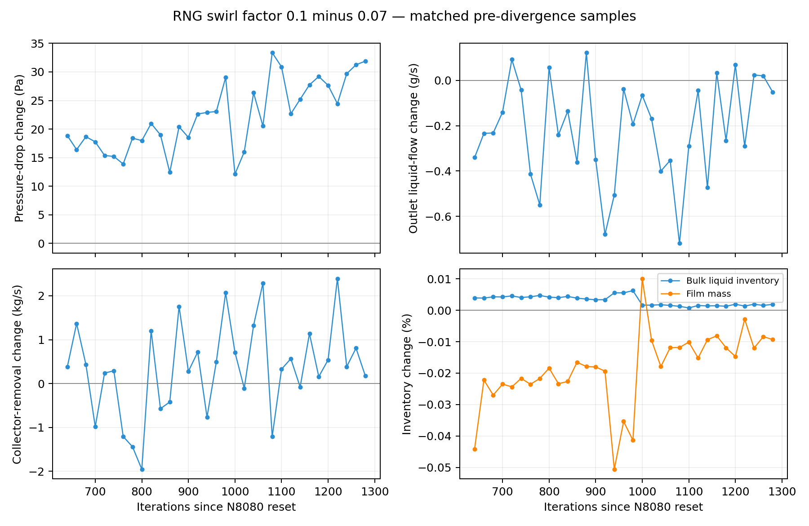
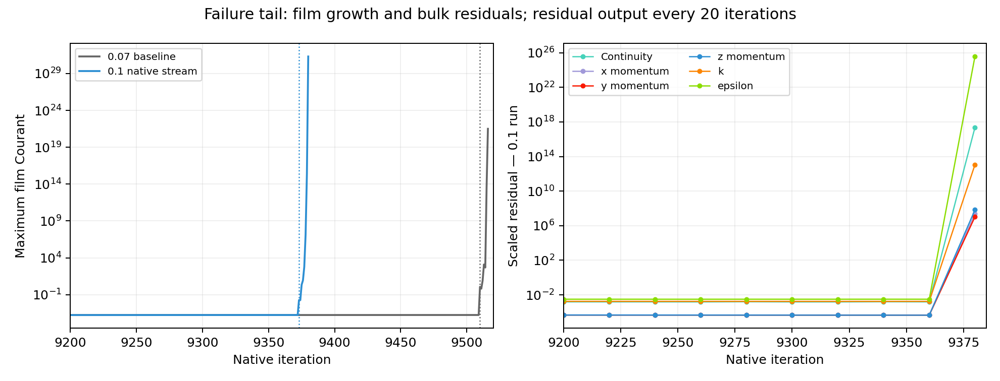

# RNG swirl factor: 0.07 versus 0.1

| Question | Evidence-backed answer |
| --- | --- |
| Did 0.1 materially change recorded liquid routing? | Small pre-divergence changes: outlet liquid flow about 0.04–0.05% lower; bulk inventory less than 0.005% higher |
| Largest consistent bulk difference | Pressure drop 20–28 Pa higher, about 0.18–0.25% |
| Collector response | Mean internal removal 0.50–0.55 kg/s higher, 0.77–0.97%; instantaneous differences change sign |
| Numerical outcome | Both runs develop very large film Courant; 0.1 manually stopped at N9380 after severe divergence |
| Swirl strength / turbulence mechanism | No matched spatial velocity, radial pressure or turbulent-viscosity fields extracted |
| Current Server 3 state | N9380; earlier request to cap film subiterations at 10 applied; no additional solve for this analysis |

| Comparison identity | Value |
| --- | --- |
| Mesh / reset | Same 60,964-cell mesh and original RNG N8080 parent |
| Baseline constant | 0.07; read from parent HDF5 settings/Rampant Variables; case hash matches selected N8080 record |
| Trial constant | 0.1; live value recorded at N8703 before continuation |
| Manual change timing | Exact iteration not logged; quantitative windows start after N8703 |
| Window 1 | N8900–N9080; 10 matched native samples, every 20 iterations |
| Window 2 | N9160–N9340; same sampling and number of samples |
| Pressure drop | Inlet static-pressure report minus outlet static-pressure report |
| Outlet liquid flow | Negative native boundary-only v2-flux-phase2-steamoutlet; exclude source-inclusive API totals |
| Collector removal | Negative v2-applied-absorber; internal numerical mass sink, not direct film drainage |

| Window 1 metric | Swirl 0.07 mean | Swirl 0.1 mean | Relative change |
| --- | ---: | ---: | ---: |
| Pressure drop (Pa) | 11156.51 | 11176.62 | +0.180% |
| Bulk liquid inventory (kg) | 49.99072 | 49.99279 | +0.00414% |
| Outlet liquid flow (kg/s) | 0.507858 | 0.507614 | −0.0482% |
| Collector removal (kg/s) | 56.2572 | 56.8040 | +0.972% |
| Film mass (kg) | 0.0172061 | 0.0172021 | −0.0235% |
| Maximum film thickness (µm) | 55.1586 | 55.1450 | −0.0247% |
| Maximum film Courant | 1.66475e-4 | 1.66478e-4 | +0.00186% |

Matched raw samples N8720–N9360; x-axis counts iterations from reset. Positive pressure change is consistent, while outlet and collector differences fluctuate; traces are not independent statistical replicates.

| Window sensitivity | N8900–N9080 | N9160–N9340 |
| --- | ---: | ---: |
| Pressure-drop change | +0.180% | +0.254% |
| Outlet liquid-flow change | −0.0482% | −0.0372% |
| Collector-removal change | +0.972% | +0.774% |
| Bulk liquid-inventory change | +0.00414% | +0.00143% |
| Film-mass change | −0.0235% | −0.0104% |

Baseline native film reports versus trial native transcript; trial residual output every 20 iterations. Trial film growth starts near N9373; bulk residuals remain small at N9360 and are extremely large at N9380, so their order within that interval is unresolved.

| Numerical observation | 0.07 baseline | 0.1 trial |
| --- | --- | --- |
| First observed film Courant above 0.01 | N9510 | N9373 |
| Terminal event | Floating-point exception at N9519 | Human stop at N9380 after severe divergence |
| Terminal continuity / epsilon | — | 2.26e17 / 3.70e25 |
| Terminal film Courant | — | 2.09e31 |
| Terminal film mass / thickness | — | 24506 kg / inherited 1 m thickness limit |
| Terminal pair physical interpretation | Not qualified | Invalid for judging separation performance |

| Interpretation / limit | Consequence |
| --- | --- |
| Earlier film escalation with 0.1 | Observed 137 iterations earlier; single repeat with manual/reporting differences does not establish causation |
| Baseline also develops film instability | Failure is not unique to increased swirl constant |
| Artificial collector | Higher internal removal alone does not prove better physical separation |
| Partial, drifting histories | No steady-state, mesh-independence or external-validation claim |
| Missing matched spatial fields | Tangential velocity and turbulent-viscosity response remain unresolved; failed endpoint cannot repair this gap |
| Sparse residual output | Cannot determine whether turbulence or momentum rose first between N9360 and N9380 |

| Artifact owner | Record |
| --- | --- |
| Parent constant / hash | [Baseline identity](../../../../PyAnsys/output/server3-report-reduction/20261009/analysis/baseline-identity.json) |
| Trial setup / endpoint | [Continuation receipt](../../../../PyAnsys/output/server3-report-reduction/20261009/continuation.json) |
| Baseline failure | [N9519 recovery record](../../../../PyAnsys/output/phase9-mesh-convergence/20261007/60k-N9519-failure-recovery.json) |
| Matched statistics / hashes | [Comparison](../../../../PyAnsys/output/server3-report-reduction/20261009/analysis/comparison.json) |
| Native sources | [Trial paths](../../../../PyAnsys/output/server3-report-reduction/20261009/analysis/sources.json), [baseline paths](../../../../PyAnsys/output/server3-report-reduction/20261009/analysis/baseline-sources.json); immutable extracts in adjacent raw folders |
| Implementation | [Analysis script](../../../../PyAnsys/scripts/analysis/analyze_rng_swirl_60k.py) |
| Reduced reporting | 34→12 active files; sampling and residual interval 1→20; film message flag false but console subiterations persist |
| Film cap request | [Maximum 10 applied](../../../../PyAnsys/output/server3-report-reduction/20261009/film-subiterations-10.json); no solve submitted |
| Plan reference | [EWF Plan v1](../../phase-09-mesh-convergence/ewf-plan-v1.md) retains reporting; reduced cadence follows the current human request |
