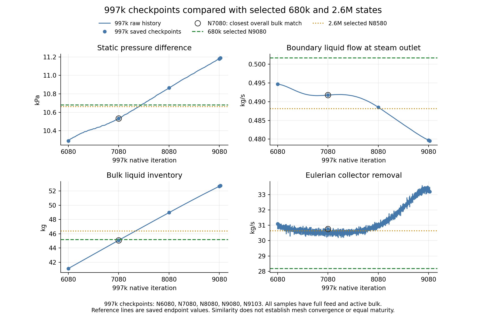

# 997k — Recent checkpoint comparison

| Finding | Evidence / limit |
| --- | --- |
| Closest overall bulk state | N7080 among N6080, N7080, N8080, N9080 and N9103 |
| Reference states | 680k N9080 and 2.6M N8580; selected initial bulk endpoints |
| Ranking | Equal-weight mean absolute relative difference in static pressure difference, boundary liquid outflow, bulk inventory and collector removal |
| Endpoint mean differences | N7080: 3.17% to 680k; 1.29% to 2.6M |
| Last-1000 mean check | N7080 also ranks first: 3.50% to 680k; 1.66% to 2.6M |
| Outlet-flow-only match | N8080 differs from 2.6M by 0.083% |
| Film-mass-only match | N9080 differs from 2.6M by +3.50%; film ages differ |
| Continued development | N7080 bulk inventory rises 9.18% of its mean across its last 1000 iterations |
| Current final selection | Human selected N8080 after this comparison; OneDrive pair replaced and verified; N9103 retained in the archive |
| Selection limit | Similarity ranking does not qualify a steady state; N7080 remains a comparison state |
| Live inspection | Server 3 idle at N8580 before and after; no case loads, setters or solves |

*Blue: native 997k histories and checkpoint values. Green: 680k N9080. Orange: 2.6M N8580. Ring: N7080, the closest overall bulk match among the five inspected checkpoints. Boundary outflow and collector removal are shown positive.*

| State | Static pressure difference (kPa) | Boundary liquid outflow (kg/s) | Bulk liquid (kg) | Collector removal (kg/s) | Reported film mass (g) |
| --- | ---: | ---: | ---: | ---: | ---: |
| 997k N6080 | 10.28965 | 0.494676 | 41.12514 | 31.08831 | 2.26444 |
| **997k N7080** | **10.53348** | **0.491763** | **45.08466** | **30.75922** | **2.67323** |
| 997k N8080 | 10.86498 | 0.488507 | 48.96711 | 31.00188 | 3.10081 |
| 997k N9080 | 11.18037 | 0.479682 | 52.67172 | 33.26571 | 3.66965 |
| 997k N9103 | 11.18860 | 0.479527 | 52.75358 | 33.19609 | 3.68622 |
| 680k reference N9080 | 10.68015 | 0.501653 | 45.17550 | 28.18537 | 7.17115 |
| 2.6M reference N8580 | 10.66199 | 0.488102 | 46.37891 | 30.63474 | 3.54544 |

| N7080 signed difference | To 680k N9080 (%) | To 2.6M N8580 (%) |
| --- | ---: | ---: |
| Static pressure difference | -1.373 | -1.205 |
| Boundary liquid outflow | -1.971 | +0.750 |
| Bulk inventory | -0.201 | -2.791 |
| Collector removal | +9.132 | +0.406 |

| 997k checkpoint | Mean absolute endpoint difference to 680k (%) | Mean absolute endpoint difference to 2.6M (%) |
| --- | ---: | ---: |
| N6080 | 6.08 | 4.41 |
| **N7080** | **3.17** | **1.29** |
| N8080 | 5.68 | 2.19 |
| N9080 | 10.92 | 7.19 |
| N9103 | 10.93 | 7.20 |

| State | Full-feed updates | Film age (ms) | Comparison limit |
| --- | ---: | ---: | --- |
| 997k N7080 | 2000 | 0.5500 | Earlier developing bulk state |
| 680k N9080 | 4000 | 0.7500 | Selected preparation endpoint |
| 2.6M N8580 | 3000 | 0.7000 | User-selected initial bulk endpoint |

| Source / verification | Record |
| --- | --- |
| Live connection and pair presence | [Read-only Server 3 inspection](../../../PyAnsys/output/phase9-997k-checkpoints/20261009/inspection.json); all five case/data pairs present |
| Saved-pair readback | N6080/N7080/N8080 reopened in original campaign; superseded N9103 shared pair reopened; N9080 native journal pair present but not reopened by this inspection |
| Native report evidence | Immutable copies under `PyAnsys/output/phase9-997k-checkpoints/20261009/raw/`; report histories cover N1581–N9103 |
| Definitions | Area-weighted inlet static pressure minus outlet static pressure; native boundary-only liquid flux; Eulerian collector removal separate from film outflow |
| Reference provenance | Fixed copy of the [five-mesh initial-state comparison](initial-bulk-comparison.md) machine record; paired identities and source hashes retained |
| Comparison values and method | [JSON](../../../PyAnsys/output/phase9-997k-checkpoints/20261009/comparison.json); [CSV](../../../PyAnsys/output/phase9-997k-checkpoints/20261009/comparison.csv) |
| Plot generator | [Analysis script](../../../PyAnsys/scripts/analysis/compare_phase9_997k_checkpoints.py); no Fluent calls |
| Scientific limit | Correlated metrics, different startup maturity and unequal film ages; no steady-state or mesh-convergence claim |
