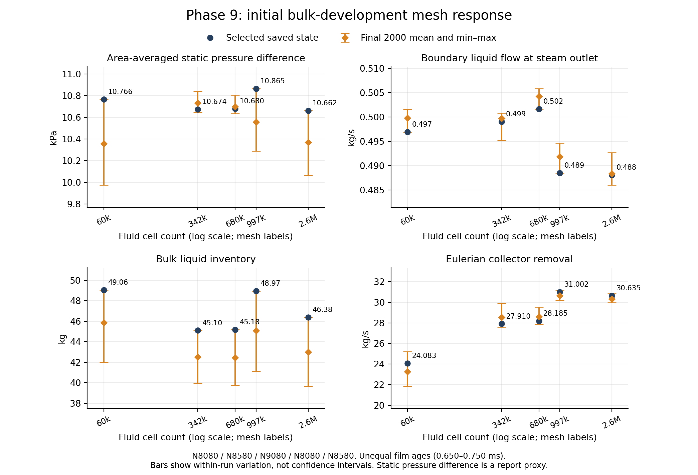
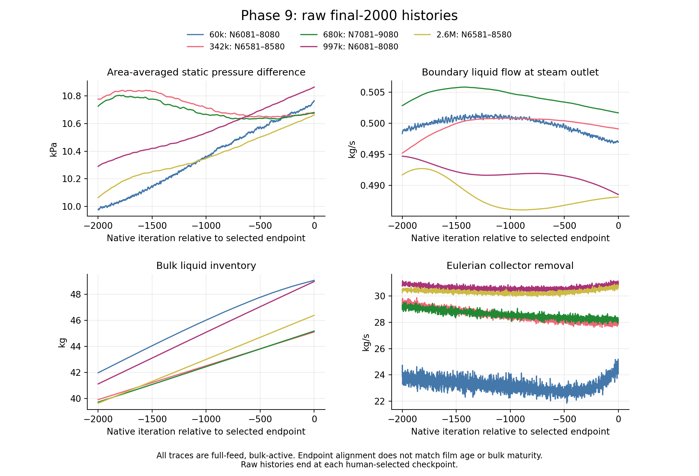
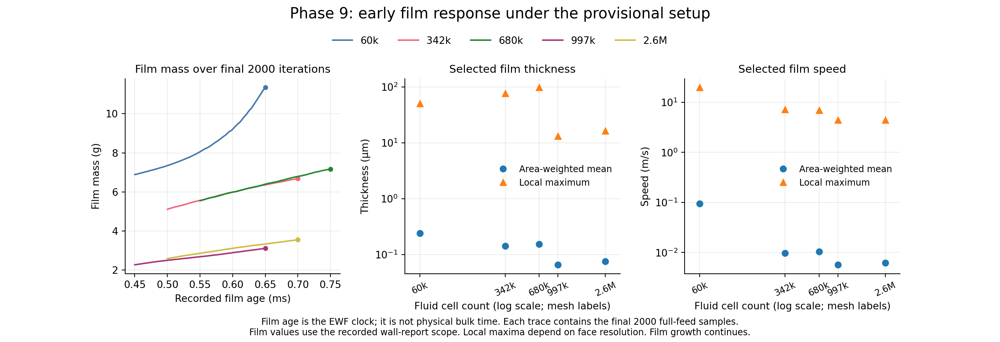

# Phase 9 — Initial bulk-development mesh comparison

| Decision | Evidence / limit |
| --- | --- |
| Purpose | Compare the five selected initial states; identify early mesh response and remaining drift |
| Main figures | Bulk response, raw final-2000 histories, early film response |
| Main observation | 342k and 680k bulk outputs are close; selected 997k N8080 has higher pressure and collector removal than that pair; film outputs vary more than outlet liquid flow |
| Current selection | Human reselected 997k N8080; OneDrive pair replaced and verified; former N9103 remains archived |
| Numerical limit | Bulk liquid inventory rises in every final-2000 window; film growth continues |
| Scientific limit | Provisional mesh sensitivity; no steady separator efficiency, mesh independence, or physical validation |
| EWF Plan v1 | Inspiration for later evidence; no plan execution, settings change, bulk freeze, or new solve |
| Session use | Read archived report files on Servers 3 and 4; zero case loads or solves; Server 1 fields not needed for these figures |

| Mesh | Fluid cells | Selected state | Full-feed updates | Film age (ms) | Static pressure difference (kPa) | Boundary liquid outflow (kg/s) | Bulk liquid (kg) | Collector removal (kg/s) | Reported film mass (g) |
| --- | ---: | ---: | ---: | ---: | ---: | ---: | ---: | ---: | ---: |
| 60k | 60,964 | N8080 | 4000 | 0.6500 | 10.7665 | 0.49693 | 49.0561 | 24.0832 | 11.3462 |
| 342k | 342,609 | N8580 | 4000 | 0.7000 | 10.6741 | 0.49906 | 45.1017 | 27.9099 | 6.6876 |
| 680k | 679,970 | N9080 | 4000 | 0.7500 | 10.6801 | 0.50165 | 45.1755 | 28.1854 | 7.1711 |
| 997k | 997,604 | N8080 | 3000 | 0.6500 | 10.8650 | 0.48851 | 48.9671 | 31.0019 | 3.1008 |
| 2.6M | 2,596,657 | N8580 | 3000 | 0.7000 | 10.6620 | 0.48810 | 46.3789 | 30.6347 | 3.5454 |

*Dots: selected saved state. Diamonds and bars: final-2000 mean and raw min–max. Bars describe within-run variation, not confidence intervals. Source: native file-backed reports, checked against selected checkpoint fields.*

| Observation | Interpretation |
| --- | --- |
| 342k and 680k selected pressure differences differ by about 0.06%; bulk liquid mass by about 0.16% | These two states have similar global bulk outputs; agreement between two meshes does not establish convergence |
| Boundary liquid outflow spans 0.4881–0.5017 kg/s | Eulerian outlet carryover is less mesh-sensitive than collector removal and film storage in this endpoint set |
| Carryover/full liquid feed spans 0.4175–0.4291% | Normalized Eulerian carryover only; exclude total separation-efficiency claims |
| 997k pressure and collector removal exceed 342k/680k; its inventory is close to 60k | A different developing state; the current evidence cannot isolate mesh error from startup and iteration drift |
| 2.6M pressure returns near the 342k/680k values | The sequence is not monotonic; the finest state does not resolve the 997k difference by itself |

*Source/window: 60k N6081–8080; 342k N6581–8580; 680k N7081–9080; 997k N6081–8080; 2.6M N6581–8580. Horizontal coordinate is native iteration minus the selected endpoint. All windows have full feed and active bulk equations.*

| Mesh | Final-2000 bulk mass rise / mean (%) | Final-2000 pressure span / absolute mean (%) | Implication |
| --- | ---: | ---: | --- |
| 60k | 15.4318 | 7.6462 | Inventory and pressure still develop |
| 342k | 12.1708 | 1.8070 | Small pressure variation does not establish stationary inventory |
| 680k | 12.8119 | 1.6056 | Small pressure variation does not establish stationary inventory |
| 997k | 17.3900 | 5.4460 | Human-selected N8080; later N9103 remains archived |
| 2.6M | 15.6461 | 5.7711 | User-selected endpoint; original 4000-update full-feed minimum not reached |

*Source: native film reports under the provisional setup. Film mass traces contain each mesh's final 2000 full-feed samples. Film age is the EWF clock, not physical bulk time. Thickness and speed use the recorded wall-report scope; maxima are local values.*

| Observation | Interpretation / limit |
| --- | --- |
| 60k film mass grows fastest late in its run | Coarse-mesh film behaviour needs separate scrutiny; no causal mesh diagnosis from these unequal-age states |
| 342k/680k film-mass traces are close; 997k/2.6M form a lower pair | Possible resolution sensitivity in wall collection/storage; startup horizons and changing bulk fields remain confounders |
| Film mass rises in all final windows | Developing-film comparison; storage is an output, not evidence of steady drainage |
| Local maximum thickness is much larger than the area-weighted mean | Local concentrations need spatial inspection; one maximum cannot represent the whole film |
| Native cumulative film outflow is zero at every selected endpoint | No native film outflow recorded; Eulerian collector removal is a separate mechanism, not proof of film drainage |

| Priority | Plot to retain or add | Separator question | Comparison rule |
| --- | --- | --- | --- |
| 1 — made | Static pressure difference, boundary liquid carryover, bulk liquid mass and collector removal versus cells | Do global flow and liquid routing change with resolution? | Saved value plus final-window mean and raw range; preserve pressure definition |
| 2 — made | Raw final-2000 histories for the same four values | Are apparent mesh differences larger than continuing within-run drift? | Native coordinates; full-feed, bulk-active windows; record native endpoints |
| 3 — made | Film mass versus film age; mean/max thickness and speed versus cells | Does the early wall response change more than the bulk outputs? | Current unequal-age limitation visible; later compare at the same film age under the selected setup |
| 4 — next spatial comparison | Tangential/axial velocity and liquid volume fraction versus radius at common heights; common-scale centre-plane contours | Does the mesh change swirl, the core, recirculation, or the wall liquid band? | Same physical planes, radial bins, phase definitions and colour limits; use area-weighted bins, not cell-index profiles |
| 5 — later EWF evidence | Film mass, collector-wall arrival, direct film-drain rate, and storage/source ledger versus film age | Does captured liquid reach the intended drain, and where does it remain? | Separate Eulerian sink, film drainage, accretion, DPM exchange and internal release; match clocks and source timing |
| 6 — before performance claims | Signed phase/native-mixture balances, inventory drift, and total outlet liquid routing | Is lower carryover consistent with conservation and useful liquid removal? | Count each external stream/source once; include escaped DPM liquid only with verified particle-flux evidence |

| Metric / evidence | Definition / provenance |
| --- | --- |
| Static pressure difference | Area-weighted static pressure on `liquidinlet` + `steaminlet`, minus area-weighted static pressure on `steamoutlet`; not total-pressure loss |
| Boundary carryover | Negative of native `v2-flux-phase2-steamoutlet`; checked against the API `(without-sources)` component |
| API source-inclusive flux | Includes the internal collector source; do not use it as boundary carryover |
| Collector removal | Negative of native `v2-applied-absorber`; internal Eulerian liquid removal, shown positive |
| Feed | Liquid 116.92 kg/s; vapour 80.69 kg/s; verified across each full-feed history |
| Film clock | Fixed 0.1 µs increments from dry N1580; selected pair clocks verified; 997k uses reopened N8080 / 0.650 ms |
| Final windows | Last 2000 full-feed iterations through each selected endpoint; same update count does not imply equal maturity |
| Settings and surface scope | Recorded provisional settings; fine-mesh vessel/inlet wall zones were merged to the common `wall` role before transfer |
| Formal mesh-error assessment | Defer Richardson/GCI until iteration error, common scientific state and refinement-family assumptions are established |
| Selected four pairs | [Selection manifest](../../../PyAnsys/output/phase9-mesh-convergence/20261007/initial-bulk-final-selection.json) |
| Selected 2.6M pair | [Final receipt](../../../PyAnsys/output/phase9-mesh-convergence-server4/20261007/final-initial-bulk.json) |
| 60k/342k/680k histories | `PyAnsys/output/phase9-mesh-convergence/20261007/{mesh}-histories.json`; selected endpoints checked against run receipts |
| Recovered 997k history | [Read-only extraction](../../../PyAnsys/output/phase9-mesh-comparison/20261009/997k/extraction.json); immutable native copies in adjacent `raw/` |
| Recovered 2.6M history | [Read-only extraction](../../../PyAnsys/output/phase9-mesh-comparison/20261009/2_6M/extraction.json); immutable native copies in adjacent `raw/` |
| Machine comparison | [Current values, windows, hashes and paired identities](../../../PyAnsys/output/phase9-mesh-comparison/20261009/selected-N8080-last2000/comparison.json); [CSV](../../../PyAnsys/output/phase9-mesh-comparison/20261009/selected-N8080-last2000/comparison.csv) |
| Fixed source records | Current input copies in `PyAnsys/output/phase9-mesh-comparison/20261009/selected-N8080-last2000/source-records/`; 2.6M startup uses preserved `original-run.json`. Earlier final-1000 and N9103 comparison data remains in its original output directories. |
| OneDrive replacement proof | [N8080 selection and copied-file hashes](../../../PyAnsys/output/phase9-mesh-convergence/20261007/997k-final-selection-N8080.json); previous N9103 pair and manifests retained under shared `archive/` |
| Plot generator | [Recorded-evidence analysis](../../../PyAnsys/scripts/analysis/plot_phase9_initial_bulk_comparison.py); no Fluent calls |
| Historical 60k limit | Later N9519 continuation diverged; selected N8080 state remains the comparison endpoint |
