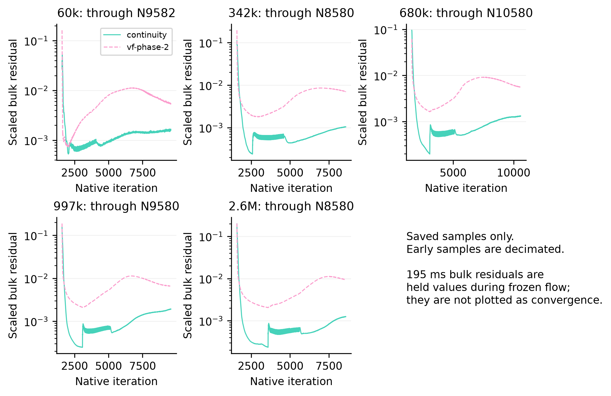
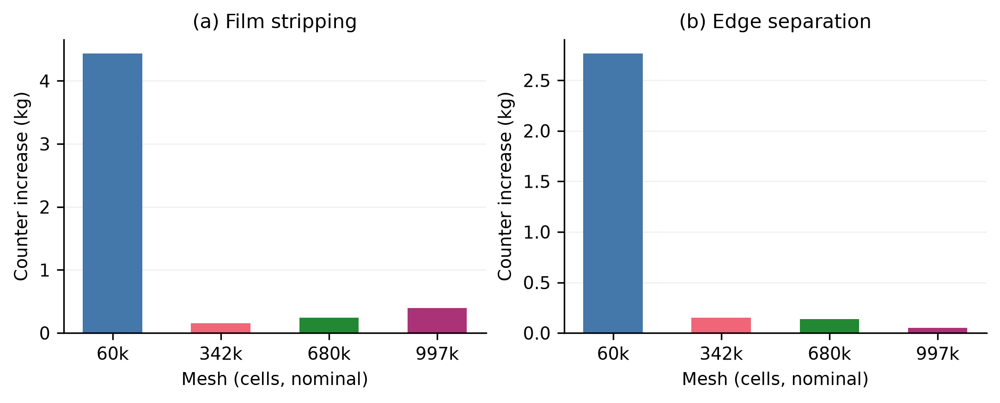
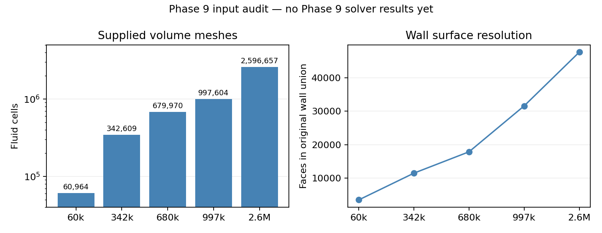

# Phase 9 — Current evidence

## Selected starting and 195 ms states — 17 October 2026

| Check | Observation / limit |
| --- | --- |
| Sources | Nine selected OneDrive case/data pairs read offline; 18 files SHA256 hashed |
| Reference hashes | Fourteen source files match shared manifest hashes; four 997k files have fresh hashes but no independent shared hash manifest |
| Paired comparisons | 60k, 342k, 680k and 997k have starting and 195 ms states |
| 2.6M | Initial-bulk state only; provisional EWF settings; no 195 ms pair available |
| Starting states | 60k 0.815 ms; 342k 0.700 ms; 680k 0.900 ms; 997k 0.800 ms; 2.6M 0.700 ms |
| Bulk state | All 195 ms states frozen; 342k starting pair precedes its bulk-active adjustment |
| Solver interaction | No Fluent case loads, setters, iterations, restarts or exits |
| Interpretation | Film storage and lower-wall drainage differ between meshes; mesh independence and total efficiency remain unestablished |

| History / quantity | Evidence recovered | Missing / effect |
| --- | --- | --- |
| Bulk residuals | Embedded continuity and phase-fraction arrays in all nine data files | Older samples decimated; frozen-stage repetitions do not demonstrate convergence |
| Flux and inventory | Current endpoint report values; boundary flux checked from saved face fields | No continuous selected-run histories in shared files; no late-window means or slopes |
| Film inventory | Upper and lower film reconstructed from saved thickness and face areas | No continuous film-mass history |
| Film drain | Saved named-expression endpoint rate; checked against cached native drain reports where present | No source/drain histories for cumulative removal or film-ledger closure |
| Film stripping / edge separation | Saved cumulative-counter differences | Internal transfers; receiving phase and outlet fate not verified |
| Film subiteration residuals | Not recovered | Native selected-run transcripts needed |
| DPM outlet mass / fates | No saved DPM summary in selected files | Total carryover and efficiency cannot be assembled |
| Remote recovery | Servers 1/3/4 TCP unreachable; 5/6 not configured locally | Server-local report files and transcripts not yet inspected |
| Other local histories | Earlier 60k pilot exists; excluded as a different run | Used only to check HDF5 residual normalization against native printed residuals |

| Mesh | Starting N / age (ms) | Starting bulk / film (kg) | 195 ms N | 195 ms bulk / film (kg) | 195 ms bulk carryover (kg/s) | 195 ms film sink (kg/s) |
| --- | --- | --- | --- | --- | ---: | ---: |
| 60k | 9582 / 0.815 | 50.835 / 0.018686 | 49899 | 50.835 / 7.489776 | 0.548691 | 22.716049 |
| 342k | 8580 / 0.700 | 45.102 / 0.006688 | 111460 | 48.831 / 2.820786 | 0.495744 | 7.167794 |
| 680k | 10580 / 0.900 | 49.178 / 0.008494 | 103080 | 49.178 / 2.950425 | 0.496423 | 6.777898 |
| 997k | 9580 / 0.800 | 54.456 / 0.003822 | 49900 | 54.456 / 2.056433 | 0.477213 | 4.586771 |
| 2.6M | 8580 / 0.700 | 46.379 / 0.003545 | Unavailable | Unavailable | Unavailable | Unavailable |

*Saved endpoint values; no history interpolation or averaging. Film drain is the stored source expression evaluated on saved lower-wall fields. The 2.6M point is a provisional initial-bulk reference.*

*Offline face-constant polygons on the cylindrical wall; common 0–0.30 mm scale, thicker regions saturated. White arrows show binned film-velocity direction normalized to a 0.3 m path length, not speed. The lower collector and inlet extension are excluded. Starting ages differ.*

*Saved samples from the starting pairs, after N1580. Native iteration and stored normalization retained; earlier points decimated. Frozen 195 ms repetitions excluded. Residual magnitudes alone do not qualify the comparison.*

*Cumulative stripping and edge-separation counter changes from each selected start to 195 ms. These are internal transfers, not external collection or outlet carryover; the 342k interval includes bulk-active adjustment.*

| Additional output / action | Location / requirement |
| --- | --- |
| Separate liquid-routing plot | [Figure](figures/selected-liquid-routing.png); [PDF](figures/selected-liquid-routing.pdf) |
| Separate inventory plot | [Figure](figures/selected-liquid-inventory.png); [PDF](figures/selected-liquid-inventory.pdf) |
| Report-facing summary | [PDF](figures/selected-mesh-response.pdf); [provenance](figures/selected-mesh-response.provenance.json) |
| Exact endpoint values | [CSV](../../../PyAnsys/output/phase9-selected-results/20261017/endpoint-results.csv) |
| History audit / source paths | [Audit](../../../PyAnsys/output/phase9-selected-results/20261017/history-audit.json); each adjacent mesh/state record retains report-file paths and residual CSVs |
| Extraction / plot generators | [Extractor](../../../PyAnsys/scripts/analysis/gather_phase9_selected_results.py); [Matplotlib plots](../../../PyAnsys/scripts/analysis/plot_phase9_selected_results.py) |
| Narrow recovery | Retrieve the selected-run native report files and film transcripts from their owning hosts; preserve gaps and restarts |
| Deferred figures | Inventory histories, interval film ledger, film inner-residual history and total efficiency; insufficient evidence |

## Earlier execution and preparation evidence

| Server 5 timestep recovery | Evidence / action |
| --- | --- |
| Historical activation-repair parent | Frozen transition N11080, 0.950 ms film age |
| Implementation error | RP max step set to 2.5 us; active film solver retained 0.1 us for the next 1000 updates |
| Preserved attempt | N12080 case/data and native transcript retained; actual film age 1.050 ms; not promoted |
| Repair | Save/reopen at numerical changes; restored N11080 / 0.950 ms; resumed native output proves actual 2.5 us |
| Evidence | [Live inspection](../../../PyAnsys/output/phase9-ewf-server5/20261009/N12080-clock-recovery-inspection.json); [recovery record](../../../PyAnsys/output/phase9-ewf-server5/20261009/clock-activation-recovery.json) |

| Current Server 5 work | State |
| --- | --- |
| Selected-pair OneDrive export | Complete: all four selected case/data files copied into `Phase9/Server5/342k/selected-ewf-pre-and-195ms-20261015` under university `P4P-Fluent-Artifacts`. SHA256 verified on Server 5 and independently on this Mac after OneDrive sync. [Cross-computer verification](../../../PyAnsys/output/phase9-ewf-server5/20261009/onedrive-cross-computer-verification.json). |
| Authority | Human revoked this chat's Server 3 authority; Server 5 only |
| Parent | 342k N8580 shared initial bulk pair copied/hash-verified; UDF archive hash-verified |
| EWF settings | Agreed settings reapplied; local child saved/reopened; original main-wall film and bulk fields preserved |
| Run | Human selected EWF development complete at N111460 / 195 ms with bulk frozen. Pre-run prepared N8580 / 0.700 ms and final frozen N111460 / 195 ms case/data pairs are saved, hash-verified and explicitly selected. Current bulk-active command is left running only as supplementary work; no continuation or error recovery selected. |
| Schedule | Selected endpoint 195 ms, bulk frozen; completion does not establish steady state or physical validation. Shared plan now requires both pre-EWF and final 195 ms pairs for every mesh. [Exact selected pairs](../../../PyAnsys/output/phase9-ewf-server5/20261009/selected-ewf-final-pairs.json). |
| Evidence | [Setup receipt](../../../PyAnsys/output/phase9-ewf-server5/20261009/342k-ewf-settings-current.json); [run manifest](../../../PyAnsys/output/phase9-ewf-server5/20261009/run-manifest.json) |

| Selected-endpoint analysis | Current finding |
| --- | --- |
| [Five-mesh comparison and plots](initial-bulk-comparison.md) | Uses selected 60k N8080, 342k N8580, 680k N9080, 997k N8080 and 2.6M N8580 |
| Numerical limit | Bulk inventory rises in every final-2000 comparison window; early film growth continues |
| Routing definition | Boundary-only outlet liquid flux; collector removal shown separately |

| Current 342k setup | Result |
| --- | --- |
| EWF settings | Applied, saved and reopened; [machine receipt](../../../PyAnsys/output/phase9-mesh-convergence/20261007/342k-ewf-settings-current.json) |
| Starting state | N8580, 0.700 ms film age; original main-wall film fields preserved |
| Changes | Sequential film solution; smoothing ON; film surface tension 0.04041 N/m; lower EWF wall and 1.5 ms direct mass/momentum drain; source refresh each film update; particle cadence 20 us |
| Bulk | Full feed and all four equation groups active; bulk Coupled unchanged |
| Execution | No solve submitted; next planned stage 1500 iterations at 0.1 us; nominal new schedule 42810 iterations to 200 ms |

| Selected initial bulk-development endpoint | Native iteration | Export | Claim limit |
| --- | ---: | --- | --- |
| 60k | 8080 | OneDrive pair; hashes match local source | Selected preparation endpoint |
| 342k | 8580 | OneDrive pair; hashes match local source | Selected preparation endpoint |
| 680k | 9080 | OneDrive pair; hashes match local source | Selected preparation endpoint |
| 997k | 8080 | Reopened source and replacement OneDrive pair; hashes match | Human-selected final checkpoint; N9103 archived; not steady |
| 2.6M | 8580 | Server 4 owner saved/reopened pair and verified OneDrive hashes | Human-selected initial bulk endpoint; original 4000-update minimum not reached |

Human selection, 9 October 2026: these are final **initial bulk-development** states. 997k was reselected to N8080 and its OneDrive pair replaced; N9103 remains archived. This selection does not establish steady state, film equilibrium or mesh convergence. [Export manifest](../../../PyAnsys/output/phase9-mesh-convergence/20261007/initial-bulk-final-selection.json) records exact shared paths and SHA256 hashes; [replacement proof](../../../PyAnsys/output/phase9-mesh-convergence/20261007/997k-final-selection-N8080.json) verifies the copied pair.

| Question | Current result |
| --- | --- |
| Phase started | Human envelope recorded; input audit complete |
| Meshes solved under Phase 9 | Server 3 preparation complete: selected 60k N8080, 342k N8580, 680k N9080 and 997k N8080; all have two consecutive passing hold windows. 2.6M completion belongs to the separate Server 4 chat. |
| Common template | Provisional Stage 4 settings; low-feed A bulk fields unchanged; dry film; save/reopen passed |
| 342k collector mapping | Native cell split and entry/wall topology verified; legacy replacement input saved |
| Transfer failure | Native Replace Mesh crashed Fluent with SIGSEGV; scientific experiment untested |
| Server 3 connection | User restarted Fluent; new configured endpoint connected to Fluent 2025 R2 |
| Retry status | Original E2.7 parent replacement passed; six DPM injections restored; provisional Stage 4 settings applied; save/reopen and native 342,609-cell verification passed |
| Previous Server 3 state | N5180 case/data preserved locally with hashes |
| Mesh files | All five readable; exact counts and hashes recorded |
| Coordinate scale | 342k file uses metre-sized coordinates; other four use millimetre-sized coordinates |
| Wall identity | Fine meshes split original wall into vessel/inlet components; physical mapping required |
| Native mesh scale/quality | 342k: metre extents and native mesh check passed; other meshes pending |
| Current action | 342k EWF run started on Server 5; Server 3 authority revoked. Initial bulk exports remain preserved. |
| Approved retained controls | Two smoothing passes, current reference values and current DPM tracking controls; no separate tracking pass |
| Bulk correction proof | Corrected common source and 342k saved/reopened with surface tension ON at exact 08b coefficient, compressibility flag ON and drag-modification flag ON |
| Legacy interaction | Human approved stored `none` as an inactive Mixture legacy exception |
| Session interruption | Temporary no-solve model-switch probe stopped Fluent; paired endpoints preserved; no exit command sent |
| Claim limit | Input audit is not solver verification or mesh convergence |

| Controller order review | Verification / result |
| --- | --- |
| Before a case load | Reject busy solver; check both case/data files before replacing the case |
| Pair load sequence | Case → UDF library → data → native iteration check |
| Run recovery | Reject pending `RUNNING` manifest before entering mesh preparation |
| Native batch transcript | One start/stop pair around solve; preserve original solver error if cleanup fails |
| Batch acceptance | Validate complete film rows, finite values, consecutive clock, fixed step, Courant and native error text before advancing verified endpoint |
| Paired checkpoint | Save locally → reopen → compare fields, setup, methods, bulk contract and film clock → promote endpoint |
| Temporary setup captures | Add/remove only their own stream callback; keep campaign live stream active across mesh changes |
| Final feed | Read and verify inlet values; no setter after final checkpoint save |
| File / controller collision | Unique batch and checkpoint paths; exclusive desktop controller lock before attach |
| Local verification | Python compilation and 12 tests passed; tests issue no Fluent calls |
| Resumed native batch | N3800→N3810 passed; accepted film clock 0.000222→0.000223 s; peak Courant 5.177948e-6. First transcript closed and second batch N3810→N3820 opened without the stop-transcript error. |
| Server 3 resume proof | Empty/idle server; N3800 case/data hashes match; restored fields/setup/methods/bulk contract/0.000222 s film clock match pause proof |
| Authority and limits | Reviewed Python campaign resumed by human instruction; Server 3 only; all bulk equations active; provisional EWF; native journal handover cancelled |
| Evidence | [Call-order review](../../../PyAnsys/output/phase9-mesh-convergence/20261007/call-order-review.json); [controller](../../../PyAnsys/scripts/setup/run_phase9_mesh_startup.py); [local tests](../../../PyAnsys/tests/test_phase9_call_order.py) |

| Mesh label | Actual fluid cells | File nodes | Low-feed hold updates | Ramp updates | Minimum full-feed hold updates |
| --- | ---: | ---: | ---: | ---: | ---: |
| 60k | 60,964 | 233,698 | 500 | 2000 | 1000 |
| 342k | 342,609 | 1,077,053 | 1000 | 2000 | 2000 |
| 680k | 679,970 | 1,764,797 | 1500 | 2000 | 3000 |
| 997k | 997,604 | 3,177,646 | 1500 | 2000 | 3000 |
| 2_6M | 2,596,657 | 6,195,886 | 2000 | 2000 | 4000 |

| Evidence | Location |
| --- | --- |
| Mesh identities | [input audit](../../../PyAnsys/output/phase9-mesh-convergence/20261007/mesh-input-audit.json) |
| Parent topology | [parent audit](../../../PyAnsys/output/phase9-mesh-convergence/20261007/parent-mesh-audit.json) |
| Preservation | [Server 3 pair](../../../PyAnsys/output/phase9-mesh-convergence/20261007/server3-preservation.json) |

*Source: supplied CFF mesh files. Wall counts use the union of the original wall and newly named vessel/inlet wall zones. Input audit only.*

| Execution evidence | Location |
| --- | --- |
| Source template | [Verified low-feed template](../../../PyAnsys/output/phase9-mesh-convergence/20261007/source-template.json) |
| Failure and recovery state | [Campaign manifest](../../../PyAnsys/output/phase9-mesh-convergence/20261007/campaign-manifest.json) |
| Immutable native crash | [Transfer transcript](../../../PyAnsys/output/phase9-mesh-convergence/20261007/raw/native-replace-crash-342k/342k-transfer.txt) |

| Verification | Outcome |
| --- | --- |
| Python source compilation | Passed |
| Full-feed stability logic | Human revised limits: pressure-drop range <= 5%, bulk liquid-mass range <= 10%, steamoutlet liquid-flow range <= 5% of full inlet. Two consecutive 1000-update windows required; inclusive limits and rejection above each limit verified. This is a preparation screen. |
| Revised screen proof | [Current human limits and validation](../../../PyAnsys/output/phase9-mesh-convergence/20261007/hold-limits-current-human-change.json) |
| Later 60k numerical failure | N9080 to N10080 continuation stopped at N9519. Native transcript shows infinite film Courant, large film residuals, turbulence AMG divergence and floating-point exception. Failure case/data preserved. |
| 60k recovery basis | Restore verified N9080 pair; preserved completed windows pass the current human 5% / 10% / 5% preparation screen. Later divergence prevents any claim of sustained film stability. [Recovery evidence](../../../PyAnsys/output/phase9-mesh-convergence/20261007/60k-N9519-failure-recovery.json) |
| Accepted 60k preparation endpoint | Human selected the existing verified N8080 pair; 4000 full-feed updates. All 34 final report histories cover N1581–N8080; all four bulk equations active. Two completed windows pass the current 5% / 10% / 5% screen. N9080 and the failed continuation remain preserved. [Endpoint selection](../../../PyAnsys/output/phase9-mesh-convergence/20261007/60k-final-selection-N8080.json) |
| 342k smoke recovery | N1580–N1600 completed; the previous native transcript prevented creation of the requested transcript. Client stream proves 20 accepted film updates, paired N1600 reopen and all 34 report histories passed. Resume at N1600; no repeated solve. [Proof](../../../PyAnsys/output/phase9-mesh-convergence/20261007/342k-smoke-transcript-recovery.json) |
| Transcript sequence correction | Human requested immediate controller reload. New paired N2860 checkpoint passed save/reopen and field/settings/film-clock checks. Corrected controller completed N2860–N2870 and started the next batch with no transcript errors. Fluent stayed open; no rollback or repeated solve. [Live proof](../../../PyAnsys/output/phase9-mesh-convergence/20261007/transcript-sequence-live-verification.json) |
| Native common source | Save/reopen and low-feed bulk-field invariants passed |
| Native 342k geometry/topology | Metre scale, mesh check, collector adjacency and equivalent entry conditions passed |
| Native 342k transfer | Revised ordering passed replacement and injection recovery; child pair and full invariant receipt passed |
| Verification receipt | [Validation](../../../PyAnsys/output/phase9-mesh-convergence/20261007/validation.json) |

| Low-feed smoke check | Verified evidence |
| --- | --- |
| Native horizon | N1580 to N1600; 20 updates completed |
| Accepted film time | 2.0 microseconds; all steps 0.1 microsecond; saved/reopened time agrees |
| Peak film Courant | 9.406721e-8 during the short check |
| Reports | All 34 report histories cover N1581 through N1600 |
| Readback correction | Live Cortex archive held pre-solve clock; controller now uses accepted native transcript time between checkpoints and verifies the clock after paired reopen |
| Proof | [Smoke verification](../../../PyAnsys/output/phase9-mesh-convergence/20261007/60k-smoke-verification.json) |
| Limit | Short implementation check; no steady-film or mesh-convergence claim |

| Local controller | Current proof |
| --- | --- |
| Deployment | 367 files; verified extracted job; [deployment receipt](../../../PyAnsys/output/phase9-mesh-convergence/20261007/host-deployment.json) |
| Disk | 662 GiB free before launch |
| Launch | Prior host worker ended while connecting to old endpoint, before full-run solves; no active host worker remains |
| Desktop recovery route | Desktop controller launched through the working connection; checkpoints and native transcripts stay on Server 3 local disk; desktop must remain running |
| Recovery proof | [N1600 paired reopen](../../../PyAnsys/output/phase9-mesh-convergence/20261007/restart-N1600-reopen.json), [desktop controller](../../../PyAnsys/output/phase9-mesh-convergence/20261007/desktop-controller.json) |
| Session control | No Fluent exit or restart commands; one desktop campaign controller |

| Active campaign | Verified state |
| --- | --- |
| Controller | One desktop process; live native solve progress observed beyond N1600 |
| Active stage | 60k ramp; recovered N2580 pair verified; full feed begins at N4080 |
| Subsequent stages | 2000-update ramp, full-feed hold; then remaining four meshes |
| Controller dependency | Keep the desktop running; idle-sleep guard is active for the controller lifetime |
| Claim limit | Campaign started; five full-feed endpoints are not yet complete |

| N2580 recovery | Evidence / result |
| --- | --- |
| Stop cause | Exact setup comparison rejected native inlet-flow decimal rounding; vapor flow 34.999287499999994 → 34.99928749999999 kg/s |
| No-solve reproduction | Same change after paired save/reopen; every other setup value exact; methods, fields, bulk contract and film clock passed |
| Narrow repair | Tolerance 1e-12 relative/absolute for the two scheduled inlet-flow values only; other setup values remain exact |
| Guard validation | Rounding accepted; 1e-6 kg/s inlet change and energy-model change rejected |
| Preserved progress | N2580; all 34 histories cover N1581–N2580; no repeated updates |
| Recovery proof | [Paired readback](../../../PyAnsys/output/phase9-mesh-convergence/20261007/60k-N2580-rounding-recovery.json), [promotion](../../../PyAnsys/output/phase9-mesh-convergence/20261007/60k-rounding-recovery-promotion.json) |
| Future checkpoint evidence | Before/after setup snapshots and paired identities retained at each checkpoint; controller receipt records terminal status |

| Controller connection recovery | Result |
| --- | --- |
| Stalled client | Initial `(cx-version)` RPC waited without a deadline; bounded native/SDK queries returned immediately |
| Scoped repair | Five-second deadline only during initial version query; verified Fluent 2025 R2; no model changes |
| Native progress | Ramp resumed beyond N2580; live transcript and run manifest confirm completed new updates |
| Session control | Only stalled owned desktop Python clients replaced; no Fluent process exited or restarted |

| Laptop-pause recovery | Verified outcome |
| --- | --- |
| Submitted horizon | 680k N6080→N7080 completed; no repeated iterations |
| Old controller | Keepalive timeout after laptop pause; preserved paired N7080 endpoint before ending |
| Recovery checks | 1000 complete finite film rows, fixed step and clock, Courant/error checks, pair hashes, fields/setup/methods/bulk contract and saved/reopened film clock passed |
| Recovered screen | N6081–N7080: pressure range 10.77045% (fail), bulk mass range 6.90075% (pass), liquid-flux range/full feed 0.012364% (pass) |
| Fleet allocation | Fresh Server 3 controller reads authoritative allocation: 60k, 342k, 680k, 997k. Separate chat owns 2.6M on Server 4. |
| Evidence | [N7080 recovery](../../../PyAnsys/output/phase9-mesh-convergence/20261007/resume-recovery-20261008.json); [Server 3 scope](../../../PyAnsys/output/phase9-mesh-convergence/20261007/server3-scope-applied.json) |

| Server 3 final endpoint | Native iteration | Last-window pressure range (%) | Last-window bulk mass range (%) | Last-window outlet-liquid range/full feed (%) | Final film clock (ms) |
| --- | ---: | ---: | ---: | ---: | ---: |
| [60k](../../../PyAnsys/output/phase9-mesh-convergence/20261007/60k-run.json) | 8080 | 3.8839 | 6.3765 | 0.003703 | 0.650 |
| [342k](../../../PyAnsys/output/phase9-mesh-convergence/20261007/342k-run.json) | 8580 | 0.6131 | 5.8863 | 0.001498 | 0.700 |
| [680k](../../../PyAnsys/output/phase9-mesh-convergence/20261007/680k-run.json) | 9080 | 0.4424 | 6.2283 | 0.002694 | 0.750 |
| [997k](../../../PyAnsys/output/phase9-mesh-convergence/20261007/997k-run.json) | 8080 | 3.0967 | 8.2461 | 0.002912 | 0.650 |

All four preparation pairs are present on the Windows local disk and match their recorded SHA-256 hashes. Each export contains all 34 report histories through its accepted endpoint. The original completion verification inspected 997k N8080 with full feed, all four bulk equations active and the approved bulk settings; it is historical session evidence. Each case has two consecutive passing 1000-update windows. Film ages differ; these preparation endpoints do not establish final EWF stationarity or mesh independence. See [completion verification](../../../PyAnsys/output/phase9-mesh-convergence/20261007/server3-completion-verification.json).
