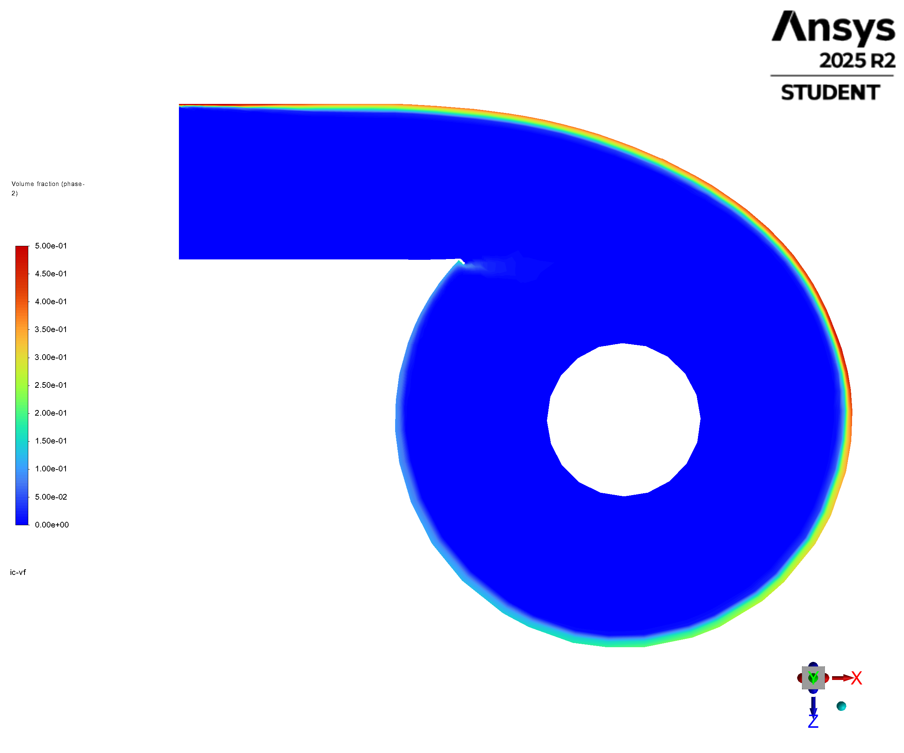
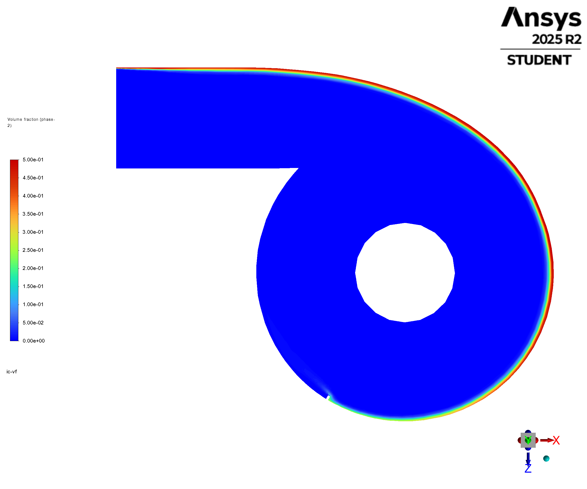
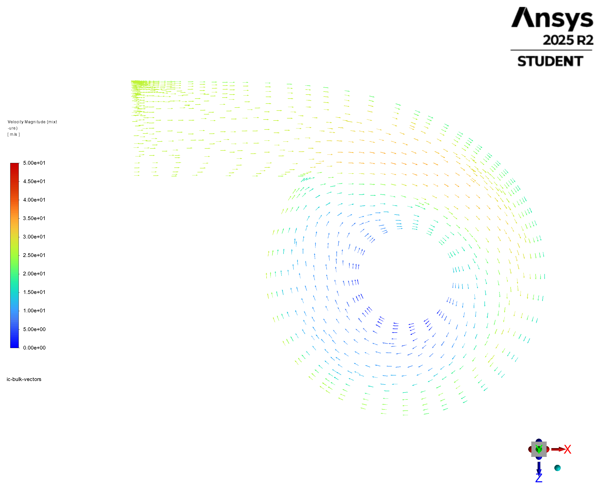
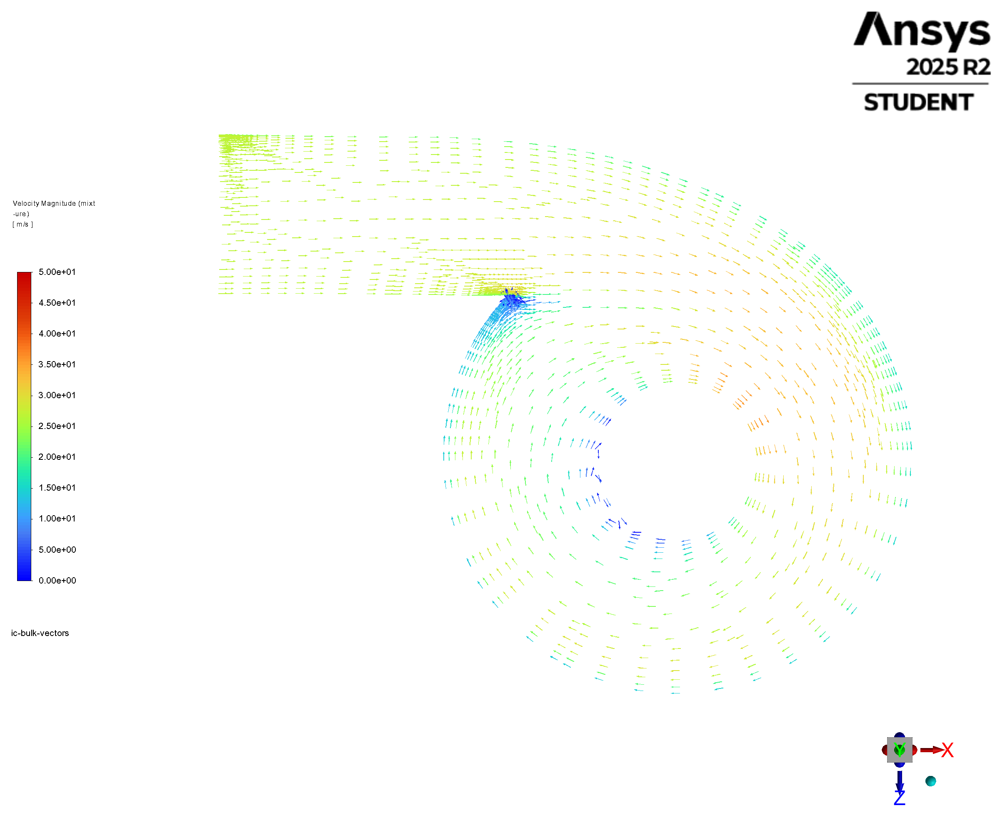
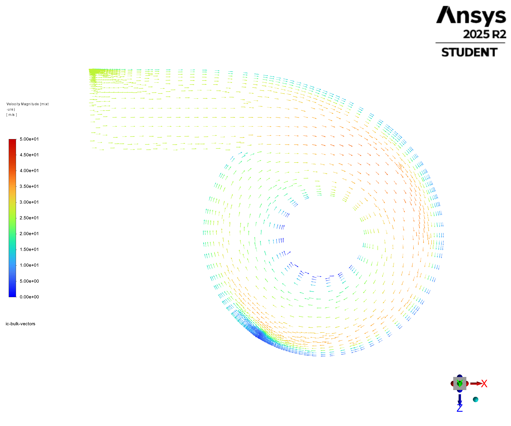
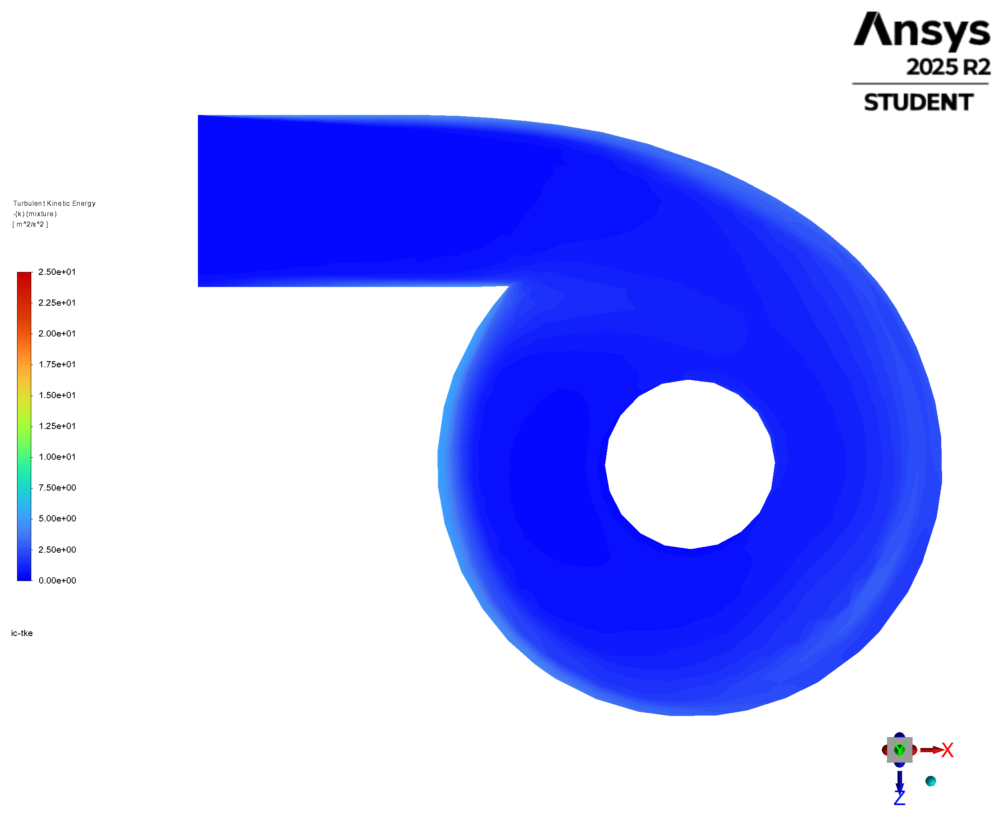
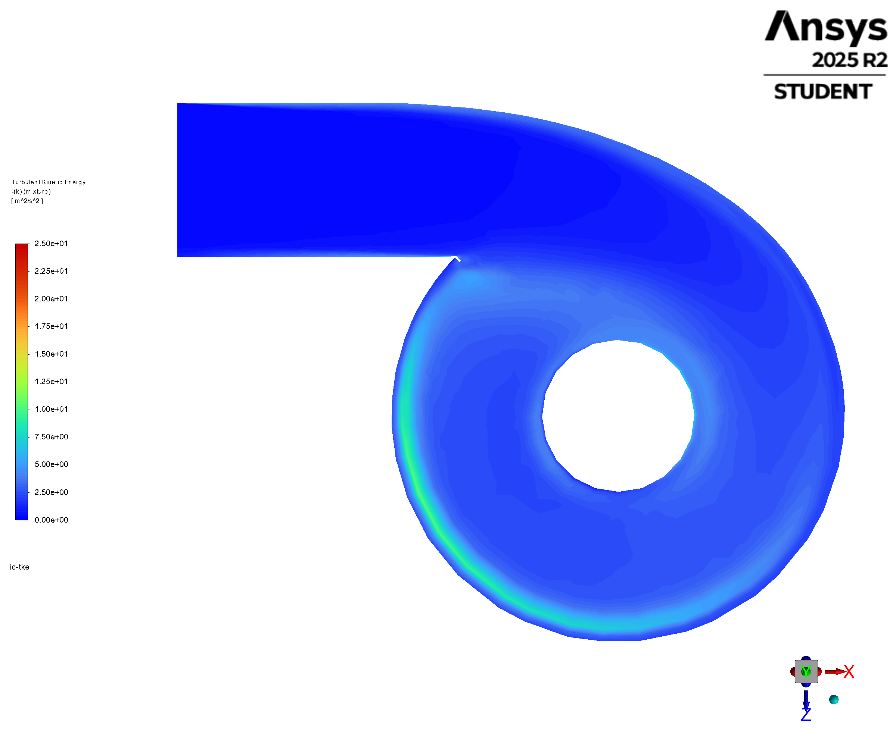
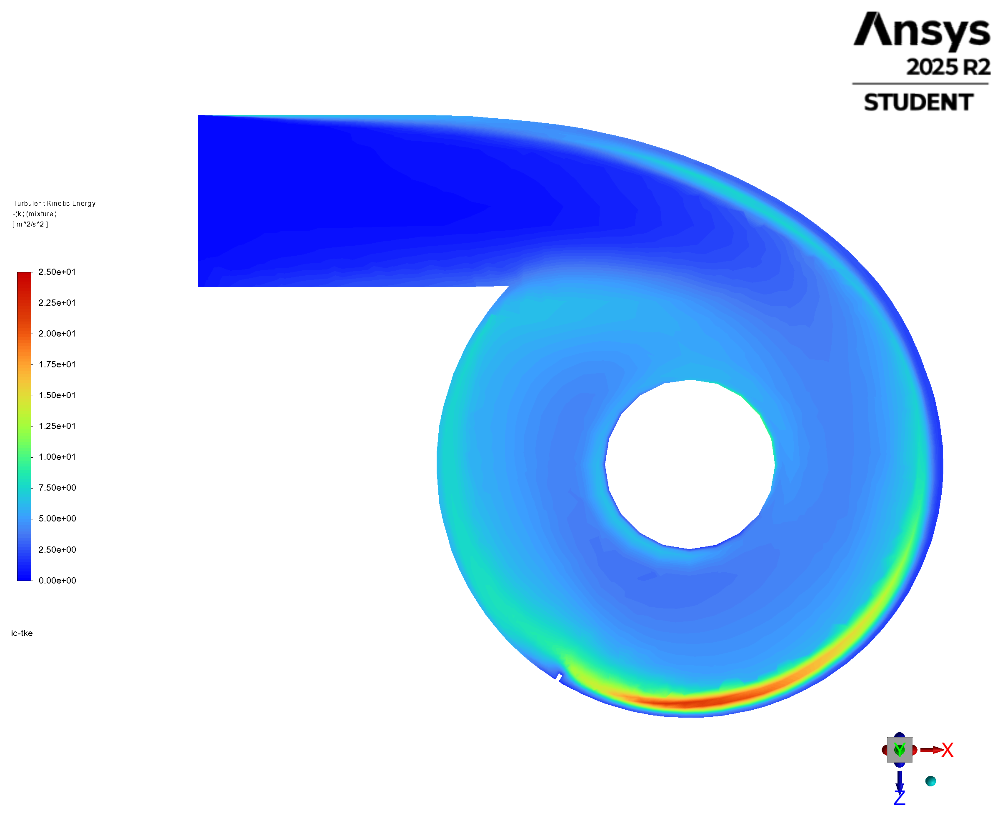

# Inlet-region comparison: 58.050 ms baseline and near-50 ms designs

The three saved cases retain tangential inlet flow, but differ in the local entry disturbance and liquid distribution. The vertical slit has a distinct disturbance at the inlet junction. The angled case shows a smoother entry pattern on this cut, a higher cut-plane speed maximum and stronger turbulent kinetic energy. These are observations of the saved cases; mesh, model and preparation differences prevent a geometry-only conclusion.

| Case | Cells | Native iteration | EWF age | Source pair |
| --- | ---: | ---: | ---: | --- |
| Baseline | 60,964 | 31,000 | 58.050 ms | Local `phase9-60k-ewf-20261009-170630/014-sequential-0p1us-qualification-N30000/final-N31000` |
| Vertical slit | 154,063 | 84,000 | 50.900 ms | OneDrive `Phase10/proposed-design/vertical-slit-reference-50p9ms/vertical-slit-N84000-50p9ms` |
| Angled slit | 213,232 | 33,492 | 50.000 ms | OneDrive `Phase10/proposed-design-213k/final-50ms-N33492-1791790200415874900/final-50ms-N33492` |

| View contract | Basis |
| --- | --- |
| Cut | X–Z plane at Y = 2.066 m, close to the inlet centre; orthographic view along −Y |
| Fields | Phase-2 liquid volume fraction; projected mixture velocity vectors coloured by 3D speed; mixture turbulent kinetic energy |
| Shared ranges | Liquid fraction 0–0.5; values above 0.5 use the upper colour without removing the surface. Speed 0–50 m/s; turbulent kinetic energy 0–25 m²/s² |
| Vectors | All vectors (`skip=0`); fixed-length arrows with native scale factor 0.042; mesh-dependent point density |
| Vector framing | Shared camera field 4.5 × 3.75 m, about 7% wider than the scalar views; angled-slit vector camera shifted +0.2 m in X at the human's request |
| Graphics | Native Fluent PNG exports, 2400 × 2000 pixels; shared scale and scalar ranges within each figure row, with the stated angled-vector pan |
| Timing | The labels are EWF film ages. Bulk flow, phase fraction and turbulence equations are frozen in all three pairs; these cuts show held bulk states at the listed film ages |
| Execution | No solve or scientific setting changes; original paused N30862 / 23.705 ms session restored after postprocessing |

## Matched top-down views

The baseline is the latest accepted accessible endpoint selected by the human. No accepted 100 ms baseline pair was found. All nine figures were exported again from the listed pairs. The baseline bulk arrays match the earlier 50.450 ms checkpoint exactly, so its volume-fraction, vector and turbulence patterns are unchanged. Its wall-film values below use the later 58.050 ms state.

| Field | Baseline | Vertical slit | Angled slit |
| --- | --- | --- | --- |
| Liquid volume fraction |  |  |  |
| Mixture velocity vectors |  |  |  |
| Turbulent kinetic energy |  |  |  |

| Feature | Observation | Interpretation / limit |
| --- | --- | --- |
| Tangential entry | All three turn the inlet stream into circumferential motion around the central tube | The main routing pattern persists |
| Vertical-slit junction | Vectors change direction sharply around the local slit tip; a small downstream liquid-fraction disturbance is visible | Consistent with a local splitter/wake. This does not establish removal or improved efficiency |
| Angled entry | The inlet turn is smoother than the vertical-slit junction on this cut; a separate wall feature is visible farther around the circumference | The intersection of the geometry with this elevation differs; the angled slit cannot be treated as the same 2D obstruction simply rotated |
| Wall-adjacent liquid | All cases retain a liquid-enriched outer-wall band. It is more pronounced in parts of the design-case contours than in the baseline | Bulk liquid fraction is distinct from EWF film thickness; a stronger band does not prove better liquid collection |
| Speed and turbulence | Cut-plane maxima rise from baseline to vertical to angled | Quantifies the displayed held fields; does not establish a beneficial effect |
| Turbulence location | The angled-case turbulence maximum is concentrated farther around the outer wall, in the lower part of the shown top-down image | The largest cut-plane value is not the turbulence level directly at the inlet opening |

| Displayed cut-plane quantity | Baseline | Vertical slit | Angled slit |
| --- | ---: | ---: | ---: |
| Maximum mixture speed | 34.84 m/s | 36.00 m/s | 38.79 m/s |
| Maximum turbulent kinetic energy | 7.394 m²/s² | 10.470 m²/s² | 21.881 m²/s² |

Maxima are Fluent's surface-range values for the displayed objects. Scalar contours use node interpolation; these are not whole-domain extrema. Vector density differs with local mesh refinement.

## Supporting wall-film values

These values come from original wall faces, not from interpreting the top-down bulk contours. The selected outer-vessel inlet quadrant has 1.5 ≤ Y ≤ 2.8 m, X ≤ 0, Z ≤ 0 and 1.02 ≤ √(X² + Z²) ≤ 1.12 m. Face-centroid selection excludes the feed duct and central tube. A face is counted as wetted at thickness ≥1 µm.

| Inlet-quadrant wall quantity | Baseline | Vertical slit | Angled slit |
| --- | ---: | ---: | ---: |
| Selected wall area | 1.815 m² | 1.547 m² | 1.574 m² |
| Selected faces | 87 | 1,180 | 141 |
| Wetted area fraction | 93.36% | 98.93% | 94.40% |
| Film mass on selected faces | 0.2332 kg | 0.5299 kg | 0.03457 kg |
| Area-weighted mean thickness | 145.81 µm | 388.69 µm | 24.92 µm |
| Maximum face thickness | 0.3651 mm | 15.8971 mm | 0.08463 mm |
| Wet-area mean vertical film velocity | +1.296 m/s | −2.549 m/s | −4.123 m/s |

Positive Y is upward. The vertical-slit snapshot has more local film storage and a sharp thickness hotspot. The angled snapshot has a thinner local film and a more downward mean film velocity. These differences are consistent with different local retention/transport, but do not measure net drainage across a control boundary. The vertical peak is localized and should not be described as the thickness of the whole inlet film.

In the vertical case, faces at least 1 mm thick occupy 9.80% of the selected area and contain 49.59% of its film mass. This supports describing concentrated local storage; it does not qualify the peak as a physically converged prediction.

| Claim limit | Effect on the comparison |
| --- | --- |
| Short film development | Local inlet observations only; no separator-wide efficiency or steady-film ranking |
| Film ages differ | Baseline 58.050 ms, vertical 50.900 ms, angled 50.000 ms. The baseline is 8.050 ms older than the angled case; no interpolation or matched-time reconstruction was performed |
| EWF physics differ | Baseline/vertical enable film pressure, spreading, surface tension, stripping and separation. Angled disables them; its film solver configuration also differs |
| Different meshes and wall areas | Face counts and selected surface area differ substantially; fine features, maxima and raw mass are not mesh-independent comparisons |
| Different held bulk states | Bulk preparation and numerical histories are not proven equivalent |
| Projection | Top-down in-plane vectors do not show vertical drainage; the separate film-component values provide limited supporting evidence |

| Evidence | Owner |
| --- | --- |
| [Case inspections, hashes and field ranges](../../../PyAnsys/output/phase10-inlet-comparison/20261012) | PyAnsys machine evidence |
| `baseline/vertical/angled-top-figures.json` | Native object, plane, camera and export settings |
| `baseline/vertical/angled-inlet-sector-metrics.json` | Original-face region definitions and film quantities |
| `baseline/vertical/angled-wall-facets.npz` | Extracted native facet fields and geometry |
| `baseline-50p45-vs-58p05-bulk-check.json` | Exact equality check of the baseline bulk arrays between the earlier and selected endpoints |
| `restored-session.json` | Paused-session restoration and unchanged clock |
