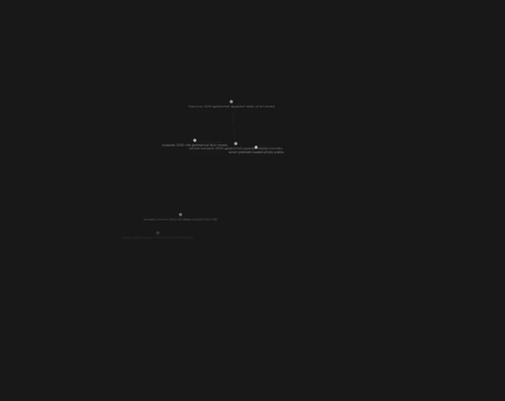
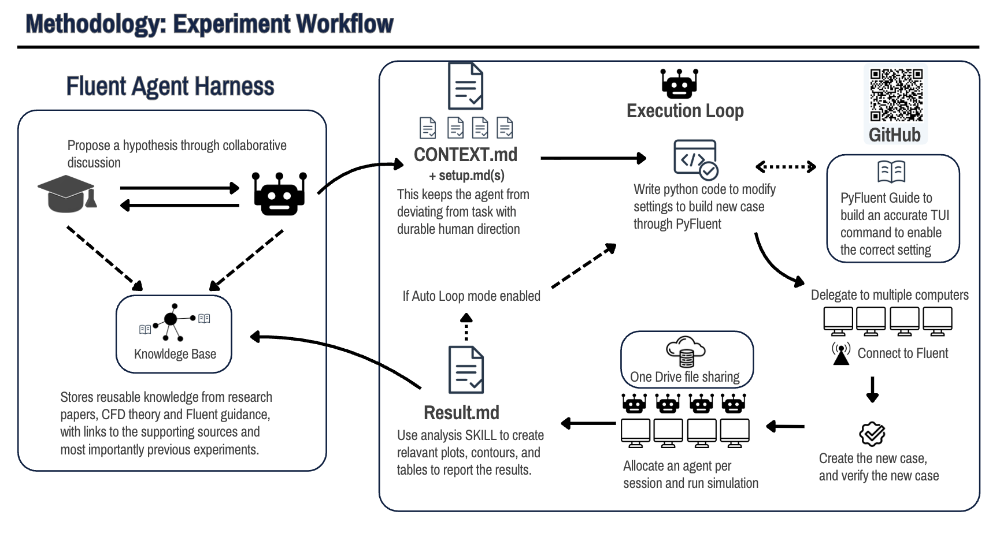

# P4P Knowledge Wiki

**A connected research workspace for rapid CFD experimentation.**

This repository brings together the knowledge, experiment records, Fluent
automation, and agent workflows used in the P4P geothermal separator project.
It supports the full experiment cycle: discuss a hypothesis, define a controlled
test, build and verify the case, run Fluent, analyse the evidence, and use the
findings to choose the next experiment.

## A growing, connected knowledge base

**[Watch the knowledge base expansion video — 17 seconds](assets/readme/knowledge-base-expansion.mp4)**

The video shows the linked knowledge graph expanding. These connections help
navigate between related knowledge and supporting records. The graph provides
an overview; the linked sources and experiment evidence support the decisions.

The value is in how these parts connect. Each experiment can reuse the literature,
verified implementation, and lessons from earlier work. The human sets the
scientific direction; the agent carries out the experiment cycle within that
recorded scope. This helps the project move quickly while keeping each result
traceable to its setup and source evidence.

[Experiment workflow](#experiment-workflow) · [Skills](#the-skills-behind-the-workflow) · [Knowledge base video](#a-growing-connected-knowledge-base) · [Start here](#start-here)

## Experiment workflow

*The project workflow overview. The current skill names and record names are
listed below; the image's “Auto Loop” is now part of `phase-loop`, and results
are stored in `results.md`.*

| Step | What happens | Workflow and record |
| --- | --- | --- |
| **1. Frame the question** | Human and agent review current evidence, discuss a hypothesis, and agree the question, allowed changes, compute boundary, and required evidence. | `phase-planner` → phase `CONTEXT.md` |
| **2. Design the test** | Select the next useful experiment. Define its parent, controlled change, fixed settings, comparison, and evidence before compute. | `phase-loop` → experiment `setup.md` |
| **3. Build and verify** | Inspect the Fluent session, apply settings in dependency order, read back critical values, save and reopen the case, and perform a bounded smoke check. | `pyansys-workflow` → code and build evidence in `PyAnsys/` |
| **4. Run and preserve** | Place work on an available owned Fluent session. Run to the declared horizon, keep local checkpoints and transcripts, and verify completion artifacts. | `pyansys-workflow` → run receipts, histories, and paired case/data files |
| **5. Analyse and decide** | Produce the figures and tables that answer the question. Check numerical adequacy, phase routing, balances, or film behaviour as required. Separate observation from interpretation. | `cfd-numerical-analysis` + `phase-loop` → `results.md` and `phase-state.yaml` |
| **6. Reuse and continue** | Choose the next in-scope test, repair a recoverable failure, or close the phase with a supported conclusion. Add transferable lessons to the knowledge base with links to their evidence. | `phase-loop` + `cfd-wiki` → next experiment or phase closure |

The knowledge base supports the whole cycle. Literature and Fluent guidance help
frame a test and implement it. Previous experiment records help select useful
contrasts and avoid repeating work. New findings stay in their experiment record;
reusable methods and lessons can feed back into the wiki.

## Why this supports rapid experimentation

- **Knowledge is ready to reuse.** Linked literature, model assumptions, Fluent
  guidance, and previous results reduce repeated source searches and setup work.
- **Scientific intent survives between sessions.** `CONTEXT.md` holds the phase
  scope and `setup.md` holds the runnable intent. A continuation can recover the
  question, parent, and required evidence from durable records.
- **Case creation is repeatable.** Python/PyFluent scripts apply controlled
  changes and verify the resulting state. Proven code and version-matched
  guidance provide a starting point for the next case.
- **Compute can run across multiple computers.** The fleet workflow checks
  session availability, parent identity, and ownership before placing work.
  Each Fluent session has one command owner. Checkpoints and transcripts stay
  on the Fluent host; OneDrive carries shared starting files and selected final
  case/data pairs.
- **Long runs have a defined completion path.** Detached execution, run receipts,
  checkpoint recovery, and optional scheduled monitoring support work beyond
  the active chat. Analysis starts from verified terminal evidence.
- **Results guide the next test.** The same loop owns experiment selection,
  execution, analysis, and ordinary recovery inside the agreed scope. The human
  returns when the scientific direction or a human-owned decision must change.

These mechanisms reduce repeated work between experiments. The repository does
not provide a measured speed-up factor. A completed solve also needs sufficient
numerical and physical evidence before it can support a scientific claim.

## The skills behind the workflow

The skills are focused workflows with references for specific operations. Two
skills provide the main scientific entry points: **`phase-planner` sets the
scope with the human, and `phase-loop` advances the experiments within it.**
The loop uses the specialist skills when their evidence or implementation is
needed.

| Skill | Role in the research workflow |
| --- | --- |
| [`phase-planner`](.agents/skills/phase-planner/SKILL.md) | Human-invoked phase framing. Reviews the frontier and records the question, scope, assumptions, evidence needs, and compute boundary in `CONTEXT.md`. |
| [`phase-loop`](.agents/skills/phase-loop/SKILL.md) | Owns experiment design, selection, execution, analysis, recovery, continuation, and evidence-backed closure inside the recorded phase scope. |
| [`pyansys-workflow`](.agents/skills/pyansys-workflow/SKILL.md) | Implements the recorded test in Fluent. Covers inspection/build, native Replace Mesh, code and command review, readback, save/reopen checks, run control, fleet placement, and recovery. |
| [`cfd-numerical-analysis`](.agents/skills/cfd-numerical-analysis/SKILL.md) | Produces the smallest useful set of histories, native Fluent views, plots, and tables. Checks model-specific evidence and returns observations with clear limits. |
| [`cfd-wiki`](.agents/skills/cfd-wiki/SKILL.md) | Retrieves reusable CFD knowledge, paper evidence, and Fluent guidance. Maintains source links, uncertainty labels, and transferable lessons. |
| [`configure-run-monitor`](.agents/skills/configure-run-monitor/SKILL.md) | Configures a selected monitoring chat and schedule for an agreed run. Records the run boundaries and authorised handoff; solver execution remains with the run workflow. |
| [`report-writing`](.agents/skills/report-writing/SKILL.md) | Assembles Project evidence and figures into a concise technical report with traceable claims. |
| [`stem-research-writing`](.agents/skills/stem-research-writing/SKILL.md) | Develops the academic argument, finding emphasis, report flow, scientific language, and evidence-calibrated conclusions. |
| [`handoff`](.agents/skills/handoff/SKILL.md) | Prepares a brief for another chat: why the work was done, what was completed, what the results mean, and what remains uncertain. |
| [`workflow-surgeon`](.agents/skills/workflow-surgeon/SKILL.md) | Repairs concrete workflow friction through the smallest justified change to instructions, ownership, or handoff. |
| [`writing-for-agents`](.agents/skills/writing-for-agents/SKILL.md) | Supports clear agent instructions and skills with distinct responsibilities and references loaded when needed. |
| [`wait-what`](.agents/skills/wait-what/SKILL.md) | Human-invoked request to explain the current position again in simpler project language. |
| [`direct-fluent-use`](.agents/skills/direct-fluent-use/SKILL.md) | Human-invoked start/close control for the pinned local Fluent 2025 R2 Student session on its designated Windows host. |

See the [skill invocation policy](.agents/invocation.md) for the active invocation
map. Branch procedures live under their owning skill, so the agent can load the
specific guidance needed for the current task.

## Where everything lives

Each part has one owner. The other parts link to it, so a finding or procedure
can be updated at its source.

| Location | What it owns | Entry point |
| --- | --- | --- |
| `Project/` | Project questions, phase scope, selected experiments, results, interpretation, and claim limits | [Project index](Project/index.md) |
| `CFD_wiki/` | Reusable literature, CFD methods, source lookup, and generic Fluent guidance | [Knowledge index](CFD_wiki/wiki/index.md) |
| `PyAnsys/` | Executable Fluent/PyFluent implementation, inspection, run control, and machine evidence | [Implementation guide](PyAnsys/README.md) |
| `.agents/skills/` | Workflows that connect planning, knowledge, implementation, evidence, and communication | [Invocation map](.agents/invocation.md) |

The experiment records connect these owners:

| Record | Purpose |
| --- | --- |
| `CONTEXT.md` | Current phase question, scope, evidence requirements, and authority |
| `setup.md` | Runnable scientific intent, parent, controlled changes, and planned evidence |
| `results.md` | Observations, figures/tables, interpretation, and claim limits |
| `phase-state.yaml` | Compact machine state for continuation and recovery |

## Start here

- **Understand the project:** open [Project/index.md](Project/index.md), then the
  relevant phase context and results.
- **Plan the next phase:** invoke `$phase-planner` to discuss the question and
  record its scope. Invoke `$phase-loop` when ready to advance that scope.
- **Find a method or source:** use the [CFD knowledge index](CFD_wiki/wiki/index.md)
  and [paper lookup](CFD_wiki/paper_lookup/index.md).
- **Work on implementation:** read the [PyAnsys guide](PyAnsys/README.md) and the
  current [PyAnsys workflow](.agents/skills/pyansys-workflow/SKILL.md), including
  its [run-control reference](.agents/skills/pyansys-workflow/references/run-control.md).
- **Contribute:** read [AGENTS.md](AGENTS.md) for repository ownership and safety
  rules. Use task branches and pull requests, with `main` as the shared source
  of truth.

## Source files and reproducibility

The repository stores maintained knowledge, scientific records, and executable
workflows. Fluent, its licence, compute hosts, connection configuration, and
large local source/artifact files are separate runtime requirements.

Raw paper PDFs, the large Fluent manual, local environments, credentials, and
generated run output stay outside normal Git storage. Maintained pages point to
their sources. Preserve `raw/` evidence unchanged, and keep exact case parents,
controlled changes, readback, checkpoints, and terminal evidence linked to the
owning experiment.

Retired workflows and removed source material remain recoverable through Git
history. Use the current phase records and active skill map for new work.
